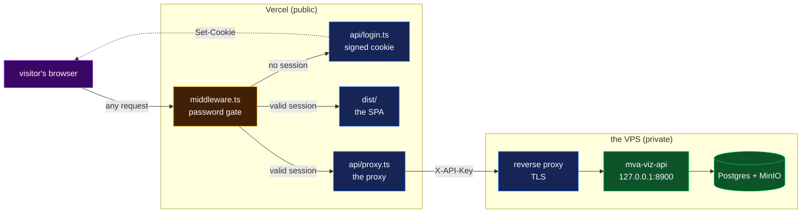

# `app/` — MVA Case Explorer

A data-understanding and visualization web app for one whole-genome case (Mosaic Variegated
Aneuploidy, single sample `PROBAND01`). It is a **reading tool**, not a dashboard: every page
opens with an explainer that names its domain concepts in the repo's `technical term (plain-English
meaning)` pattern, and every chart carries a `Legend` line decoding its own colours.

There is **no trio** in this dataset — one sample only. The app never renders a parent column.

**Verified:** 2026-09-19 — `pnpm run check` green (typecheck, lint, format, theme, dictionary, generated step nav, 687 tests) and the Python gate green, after `Decide` became a three-level tree: **Track ▸ Iteration ▸ Step**, generated from the step maps by `uv run python tools/gen_steps_nav.py` and pinned by `pnpm steps-nav:check`. Every step of every declared iteration now has a page carrying its claims in full (statement, prediction, refutation condition, verdict), its methodology entries readable verbatim, and every figure it drew; iteration 2's seven analysis pages render below that record. `/steps` and `/steps/step-<n>` redirect. Every step that has run now also carries its written half — what it concluded, why the question belonged there, what it inherits and hands on, and **what each of its 93 figures shows and means** — validated by `tools/check_step_narrative.py` in the Python gate. Rendered against the live API in a browser; see methodology [131](../docs/step-0/methodology/131-the-decide-tree-track-iteration-step.md) and [132](../docs/step-0/methodology/132-what-a-step-says-and-what-a-figure-means.md). Bundle budget re-blessed 2026-09-19 to 306.75 kB raw / 96.80 kB gzip (see `tools/bundle-budget.mjs` for the arithmetic: +9.20 kB raw / +1.53 kB gzip, all of it the 26 generated manifest entries, whose descriptions are the page headers).

## Quickstart

Fixture mode (no backend, no credentials — just the UI on committed sample data):

```bash
cd app
pnpm install
pnpm run dev      # http://127.0.0.1:5173
```

The app runs with **no backend**: when the viz API is unreachable it serves committed fixture
data and says so in the header (a `fixture data` badge). Every page works this way; some numbers
are marked PLACEHOLDER/SYNTHETIC in that mode.

### Prerequisites

| Dependency       | Needed for          | Check                                             |
| ---------------- | ------------------- | ------------------------------------------------- |
| Node 22+         | the app itself      | `node -v` — pinned by `engines` in `package.json` |
| pnpm 11+         | installing app deps | `pnpm -v` — pinned by `packageManager`            |
| `uv`             | both Python APIs    | `uv --version` — see repo root README for install |
| Python 3.11–3.14 | both Python APIs    | pinned by `uv`, no manual install needed          |

### Full stack — live data

Three processes, each in its own terminal, from the **repo root** unless noted:

```bash
# 0. one-time: repo-root .env with PGPASSWORD + S3 keys (see .env.example)
cp .env.example .env   # fill in — ask whoever ran tools/setup-warehouse-server.sh

# 1. raw-reads API — k-mer probes, read-store treemap/heatmap/quality curves
uv run mva-reads-api          # http://127.0.0.1:8765

# 2. viz API — everything else (warehouse queries, panel, science, provenance…);
#    proxies /api/probe/* and /api/jobs/* to (1)
uv run mva-viz-api            # http://127.0.0.1:8900

# 3. the app
cd app
pnpm install
pnpm run dev                   # http://127.0.0.1:5173
```

Both APIs read their settings (`MVA_READS_API_URL`, `MVA_API_TOKEN`, `S3_*`, `PG*`, CORS origins)
from the repo-root `.env` — see `.env.example` for every variable and
[`docs/step-0/infrastructure.md`](../docs/step-0/infrastructure.md) for ports/credentials/sharp
edges. Skip step 1 if you only need everything except the Probes/Reads pages — the viz API answers
`503` for those routes and the app shows a start-command card instead of erroring.

`mva-viz-api` is **open when `MVA_VIZ_TOKEN` is empty**, which is the right setting on loopback
and nowhere else: `/api/panel/locus` serves real patient positions. Set the token and every
`/api/*` route requires it as `X-API-Key` (`/health` stays open for uptime probes). The service
_refuses_ a non-loopback bind while the token is empty — see [Hosting](#hosting) below.

| Script                             | Does                                                                            |
| ---------------------------------- | ------------------------------------------------------------------------------- |
| `pnpm run dev`                     | Vite dev server, port 5173, strict (a busy port is an error, not a silent 5174) |
| `pnpm run build`                   | `tsc -b && vite build` — must pass clean                                        |
| `pnpm run typecheck`               | `tsc -b` alone                                                                  |
| `pnpm run lint` / `lint:fix`       | ESLint 9 flat config                                                            |
| `pnpm run format` / `format:check` | Prettier                                                                        |
| `pnpm run test` / `test:watch`     | Vitest (jsdom + testing-library)                                                |
| `pnpm run dictionary`              | regenerate `src/lib/dictionary/` from `docs/dictionary.md` (JSON + copied SVGs) |
| `pnpm run dictionary:check`        | fail on drift from the markdown, or on a dead cross-link inside it              |
| `pnpm run check`                   | every gate, in order — run this before committing                               |

### Environment

Build-time, read by Vite and inlined into the bundle. Only `VITE_`-prefixed names are exposed —
that is the mechanism that keeps the hosting secrets below out of the browser.

| Variable            | Default                 | Meaning                                                                                                                             |
| ------------------- | ----------------------- | ----------------------------------------------------------------------------------------------------------------------------------- |
| `VITE_API_URL`      | `http://127.0.0.1:8900` | where API requests go. Set it to `/` for the hosted build, which makes every request same-origin and lets Vercel's proxy forward it |
| `VITE_USE_FIXTURES` | unset (= on)            | `false` disables the fixture fallback, so an unreachable API surfaces as an error card                                              |

The Probes page additionally needs the reads API behind the viz API; when that upstream is down
the viz API answers `503` and the page shows the start command instead of an error.

## Hosting

The dashboard includes a **Vercel deployment configuration**; a live deployment has not
been verified. The recorded infrastructure status is in
[`docs/current-state.md`](../docs/current-state.md). The intended topology keeps
`mva-viz-api` on the project's own VPS, next to the warehouse and object store.
Nothing about the backend is in the bundle.



> **Legend** — purple = the untrusted visitor; yellow = the decision point (is there a valid
> session?); blue = neutral machinery on the public edge; green = the private services holding
> patient data. A solid arrow is a request, a dashed arrow a response header.

Two properties this buys, and they are the point:

- **The backend's address is not in the bundle.** The browser only ever names its own origin.
  `MVA_VIZ_API_URL` and `MVA_VIZ_API_TOKEN` are plain (not `VITE_`-prefixed) Vercel variables, so
  Vite cannot inline them — `import.meta.env` exposes `VITE_*` and nothing else.
- **Nothing loads before the password.** The gate runs before the CDN cache on every path, so an
  unauthenticated visitor gets the password page instead of `index.html`, the JavaScript chunks
  or a figure PNG. A login route _inside_ the SPA would have shipped the app before it could
  refuse.

### The files

| Path                            | Runs                            | Does                                                                                                         |
| ------------------------------- | ------------------------------- | ------------------------------------------------------------------------------------------------------------ |
| `middleware.ts`                 | Vercel Routing Middleware, edge | the gate: valid session → through; document → the password page; anything else → 401                         |
| `server/session.ts`             | edge                            | the signed cookie — HMAC-SHA256 over the expiry, keyed by secret **+** password                              |
| `server/loginPage.ts`           | edge                            | the self-contained password page (no bundle, no font file)                                                   |
| `server/upstream.ts`            | edge                            | the one forwarder to `mva-viz-api`: token, timeout, header allowlist, `no-store`                             |
| `api/proxy.ts`                  | Edge Function                   | every `/api/*` request, forwarded (`vercel.json` rewrites the path into `?upstream=`). Re-checks the session |
| `api/liveness.ts`               | Edge Function                   | `/health` (rewritten in `vercel.json`), because that path is outside `/api` upstream                         |
| `api/login.ts`, `api/logout.ts` | Edge Function                   | issue and expire the cookie; the only routes the gate lets through                                           |
| `vercel.json`                   | build                           | the `/health` and `/api/:path*` rewrites, the SPA fallback, and the security headers                         |
| `tsconfig.vercel.json`          | `tsc -b`                        | typechecks all of the above — it is outside the Vite build, so it needs its own project                      |

### Vercel project settings

Root Directory **`app`**. Framework preset Vite (`vercel.json` states it). Then four
environment variables, none of them `VITE_`-prefixed except the last:

| Variable                   | Example                   | Meaning                                                                                                             |
| -------------------------- | ------------------------- | ------------------------------------------------------------------------------------------------------------------- |
| `MVA_VIZ_API_URL`          | `https://viz.example.org` | where `mva-viz-api` is reachable from Vercel. Server-side only. **Must be a hostname, never a bare IP** — see below |
| `MVA_VIZ_API_TOKEN`        | (32 random characters)    | must equal `MVA_VIZ_TOKEN` in the server's `.env`. Server-side only                                                 |
| `DASHBOARD_PASSWORD`       | (generated, not chosen)   | the one shared password. Rotating it invalidates every session                                                      |
| `DASHBOARD_SESSION_SECRET` | (32 random characters)    | signs the cookie. Rotating it also invalidates every session                                                        |
| `VITE_API_URL`             | `/`                       | build-time: makes every request same-origin so the proxy sees it                                                    |

Generate the three secrets the same way:

```bash
uv run python -c "import secrets; print(secrets.token_urlsafe(32))"
```

Two constraints that are not obvious until a deployment fails on them, both measured
against a live one rather than assumed:

- **`MVA_VIZ_API_URL` must be a hostname.** The Edge runtime answers a fetch to a bare IP
  itself, with `403 Direct IP access is not allowed in Vercel's Edge environment` — past
  any try/catch, so it reaches the dashboard as an unexplained 403 on every panel. A server
  reachable only by address still works: give it any name that resolves to it, such as the
  hosting provider's default reverse-DNS name. `server/upstream.ts` now checks for this and
  answers 503 with that sentence rather than letting the platform's 403 through.
- **The `/api/:path*` rewrite is load-bearing.** Vercel's catch-all route
  (`api/[...path].ts`) expands like a single `[path]` on a deployed Vite project, so
  `/api/overview` reached the function and `/api/health/dependencies` came back
  `x-vercel-error: NOT_FOUND`. The rewrite in `vercel.json` routes every depth explicitly;
  the filesystem check that runs before rewrites is what keeps `/api/proxy`, `/api/login`,
  `/api/logout` and `/api/liveness` on their own functions.

### Deploy

```bash
# 1. on the VPS, once: put MVA_VIZ_TOKEN in .env, then
./tools/setup-viz-api-service.sh --domain viz.example.org
#    it installs the systemd unit, binds loopback, and prints the reverse-proxy block

# 2. from this machine
cd app
vercel link            # once, choose Root Directory = app
vercel env pull        # optional: .env.local for `vercel dev`
vercel --prod
```

`vercel dev` runs the middleware and the functions locally, so the gate and the proxy can be
exercised before deploying. Without `vercel env pull` it answers `503` and names the variable it
is missing — that is the fail-closed path working, not a bug.

### Running the hosted setup locally

`vercel dev` runs the middleware, the proxy and the Vite dev server together, which is the
only way to exercise the gate and the proxy before deploying — and the way to develop
against a remote API that requires a token, since a browser cannot hold one.

```bash
cd app
DASHBOARD_PASSWORD=... DASHBOARD_SESSION_SECRET=... \
MVA_VIZ_API_URL=http://your-host:8900 MVA_VIZ_API_TOKEN=... \
  vercel dev --listen 3000
```

Two things cost an hour the first time, both verified here rather than assumed:

- **`vercel env pull` cannot decrypt Secret-type variables.** `DASHBOARD_PASSWORD` and
  `DASHBOARD_SESSION_SECRET` come back empty, and the deployment then answers `503` naming
  them — the fail-closed path working, not a bug. Export them as above.
- **Export the variables into the shell**, rather than relying on `.env.local`. With the
  values only in that file the middleware still reported them missing.

Plain `pnpm run dev` remains the fastest loop when the API is on the same machine: leave
`VITE_API_URL` unset, run `uv run mva-viz-api` with `MVA_VIZ_TOKEN` empty, and the browser
talks to it directly. Pointing a plain `pnpm run dev` at a _token-protected_ API cannot
work — the header will show a yellow `API unauthorized` dot saying exactly that.

### What this is not

- **One shared password, so a session identifies "someone who knew it", never a person.** There is
  no user, no role, and no record of who read what. Right for a hackathon dashboard shown to
  judges; wrong for anything clinical.
- **No rate limiting.** Vercel Functions are stateless, so a per-instance counter is defeated by
  concurrency. A wrong password costs a fixed ~400 ms, and the password's own entropy does the
  rest — generate it, do not choose it. `vercel firewall` rate-limiting rules are the upgrade.
- **Patient positions transit Vercel.** `/api/panel/locus` returns real coordinates, and this
  deployment carries them through Vercel's edge to the browser. Every proxied reply is
  `Cache-Control: no-store, private` so nothing is retained by a shared cache, but the data does
  leave the VPS. That was a deliberate call — see
  [methodology 080](../docs/step-0/methodology/080-hosted-dashboard.md).

### What the browser keeps

The query cache is persisted to `localStorage`, so a reload re-renders from what the browser
already has instead of re-asking the API — on Vercel every avoided request is two Edge
invocations (the password gate, then the proxy) plus a WAN round trip, and the free plan's
budget is invocations. Three rules bound it, all in
[`src/lib/queryPersistence.ts`](src/lib/queryPersistence.ts):

- **An allowlist, never a denylist.** Only coordinate-free aggregates are written. `/api/panel/locus`,
  `/api/callset/region`, `/api/search`, `/api/panel/het-pairs` and `/api/panel/clinvar-presence` carry
  real patient positions and are never persisted; liveness (`/health`, `/api/health/dependencies`,
  `/api/jobs`) is never persisted either, because a stale "up" is a wrong answer.
- **A deployment never reads another deployment's cache.** The buster is the build's commit.
- **A day, at most.** Older than `PERSIST_MAX_AGE` and the store is dropped rather than shown.

Nothing here changes what the _server_ sends: every proxied reply is still `no-store, private`,
so no shared cache holds any of it. See
[methodology 081](../docs/step-0/methodology/081-cached-dashboard-requests.md).

## Stack

| Concern            | Choice                                                                             |
| ------------------ | ---------------------------------------------------------------------------------- |
| build / dev server | Vite 8                                                                             |
| UI                 | React 18 + TypeScript 7 (strict)                                                   |
| data fetching      | `@tanstack/react-query` v5 — 30 min `staleTime`, cache persisted to `localStorage` |
| routing            | `react-router-dom` v7                                                              |
| charts, 2D         | `plotly.js-dist-min`, lazily `import()`ed into its own chunk                       |
| charts, 3D         | raw `three` + the `OrbitControls` addon, lazily `import()`ed — see `src/viz3d/`    |
| styling            | Tailwind CSS v4 via `@tailwindcss/vite`, CSS-first `@theme`                        |
| tests              | Vitest + `@testing-library/react` + jsdom                                          |
| lint / format      | ESLint 9 (flat) + Prettier                                                         |

Charts are Plotly because the repo's existing figures are Plotly — same visual language. Plotly is
wrapped by a small in-repo component (`src/components/Plot.tsx`) rather than `react-plotly.js`, so
the ~4 MB bundle is loaded on demand and the dark template lives in one place.

**WebGL 3D is a separate module, on the same pattern.** [`src/viz3d/`](src/viz3d/README.md) wraps
raw `three` — not `@react-three/fiber`, whose current line requires React 19 while this app is
pinned to React 18 — behind one dynamic `import()`, so a visitor who never opens a 3D exhibit
downloads none of it. It is deliberately case-agnostic: a page maps its API rows into a `Scene3D`
and hands that in, and `viz3d` may import `lib` only (an eslint `boundaries` element enforces it).
The `describeScene()` of a scene is simultaneously its AI-export payload, the canvas's
`aria-label`, and a keyboard-reachable list of every object in the figure.
The first real exhibit built on it is the **protein explorer** on `/panel`
([`src/pages/panel/protein/`](src/pages/panel/protein/ProteinExplorer.tsx)): BUB1B's AlphaFold
fold, this proband's protein-altering alleles painted on their residues, and the Cα distance
between any two of them — the one question the 1D domain lollipop cannot answer.

**`typescript-eslint` is deliberately absent.** Every published 8.x release fails at import time
against `typescript@7` (it reads `ts.Extension.Cjs`, which the Go-ported compiler does not expose),
so TS/TSX are parsed with `@babel/eslint-parser`. The trade-off — no type-aware rules — is covered
by `tsc`, which owns unused-code detection via `noUnusedLocals` / `noUnusedParameters`. Full
rationale sits at the top of [`eslint.config.js`](eslint.config.js).

## Architecture

Three layers, each with its own README:

```
src/
  app/        the shell — module manifest, per-module boundaries, providers   → app/README.md
  components/ shared primitives — Exhibit, Plot, DataTable, Card, Badge, …    → components/README.md
  fixtures/   the offline data layer — JSON rows + lazy loaders               → fixtures/README.md
  api/        types.ts (transcribed from the contract) · client.ts (one fetch wrapper) · hooks.ts
  lib/        palette/ (generated colour ramps, tones, scales) · ui.ts (class recipes)
              · format.ts · hooks/ · aiExport/
  viz3d/      the 3D module — spec/ adapters/ core/ hooks/ components/  → viz3d/README.md
  pages/      one folder per page, one file per exhibit
  test/       fixture request matrix, blessed payload hashes, setup
```

**Pages are feature modules.** [`src/app/modules`](src/app/README.md) declares each page once —
route, nav label, title, group, description, lazy `import()` — and the shell derives the router,
the two-tier nav, every page's h1 and the prev/next journey links from that one array, so none of
them can drift. Each module mounts inside its own error boundary and Suspense boundary: a module
that fails to load renders a contained card with a Retry that re-issues the import, instead of
blanking the app. Hovering a nav link preloads that module's chunk.

**Every page serves one of five questions**, and the nav is those five questions: **Learn** (what do
the words mean? — the dictionary as a course, first because the rest is written in its words), **Data** (is the
measurement trustworthy? — Reads, Callset, Genome), **Case** (which gene and pair is causal? —
Panel, Compare, Phenotype, Search), **Decide** (what do we believe, and what has it cost? —
Science, Probes), **Platform** (what exists, where from, is it up? — Catalog, Provenance, Status,
Style). Overview is the map. On every page the order is the same: the finding (`Callout`), then
the background (`Explainer`, terms as click-to-define chips, each linking to its dictionary entry),
then the exhibits, then the hand-off
to the next page.

**`Exhibit` is the only way a chart enters the app.** It makes `legend` a **required** prop — the
repo's "every figure carries a legend" rule enforced by the type checker rather than by review —
and it is the single hook the AI export uses: each exhibit registers its narrative, provenance and
payload while mounted, so page-level and case-level exports need nothing from the call sites.

**Two typographic voices.** Literata, a serif drawn for reading on screens, carries everything
that teaches — page titles, explainer prose, callout bodies, an exhibit's reading line. Atkinson
Hyperlegible Next, a sans built for legibility at small sizes, carries everything that operates —
navigation, labels, tables, numbers. Both are self-hosted (`@fontsource-variable/*`), so the app
works offline. Labels are sentence case; nothing is set in tracked-out capitals.

**Colour lives in one place, and it is generated.** A colour is needed in two places that cannot
share a mechanism — the DOM (a Tailwind class) and a canvas (a hex handed to Plotly or an SVG
attribute) — so they share a _source_: `pnpm theme` runs
[`tools/gen-theme.mjs`](tools/gen-theme.mjs), which reads the installed Tailwind theme, converts
its oklch values to sRGB hex once, and writes both halves:

| Artifact                             | Read by                                         |
| ------------------------------------ | ----------------------------------------------- |
| `src/lib/palette/ramps.generated.ts` | `RAMP.good[500]` — Plotly, SVG, inline style    |
| `src/theme.generated.css`            | `--color-good-500` — `bg-good-500`, `lib/ui.ts` |

Seven semantic families carry the repo's colour legend: `good` (green), `broken` (red),
`decision` (yellow), `machinery` (blue), `raw` (purple), `chrome` (grey furniture) and
`severity` (the one orange step between broken and decision, charts only). `lib/palette` names
the six **tones** components speak in (`neutral · good · broken · decision · machinery · raw`)
plus the chart scales; `lib/ui.ts` owns the Tailwind recipes (`CARD`, `BOX`, `BADGE`,
`EMPTY_DASHED`, `TEXT`, plus a `cx()` joiner), each a `Record<Tone, string>` so a new tone is a
compile error at every site rather than a silent gap.

Four gates hold it together: `pnpm theme:check` (drift between the two halves),
`src/test/theme-tokens.test.ts` (tone coverage, family per recipe, every scale stop on a ramp),
`local/no-raw-hex-color` and `local/no-builtin-tailwind-color` (both in
[`eslint-rules/`](eslint-rules/), with their own `RuleTester` tests). The whole system renders
itself at **`/style-guide`** — every ramp, tone, recipe, scale and primitive, live.

## Pages

| Page           | Question it answers                                              | Exhibits                                                                                                                                                                                                                                                                                                                                                                                                                                                                         |
| -------------- | ---------------------------------------------------------------- | -------------------------------------------------------------------------------------------------------------------------------------------------------------------------------------------------------------------------------------------------------------------------------------------------------------------------------------------------------------------------------------------------------------------------------------------------------------------------------- |
| **Overview**   | What is this case, in numbers — and where do I start?            | stat tiles (variants, PASS %, reads, coverage, Ts/Tv, samples, probe budget); the four-question journey map, one card per section listing its pages in reading order; genotype donut with the `1/2` slice called out                                                                                                                                                                                                                                                             |
| **Learn**      | What do the words mean?                                          | `docs/dictionary.md` generated into the app (`pnpm dictionary`, checked by `pnpm dictionary:check`): chapter rail with progress, term search, entry cards with anchors, SVG figures and mermaid diagrams (lazy, drawn on scroll), "See it in the app" links to the exhibit and methodology entry behind a word, three short paths, a star on any definition (kept per browser)                                                                                                   |
| **Genome**     | Is any chromosome present in the wrong number of copies?         | allele-balance dot plot on the 0.5 line (**the headline**); depth-vs-VAF scatter with crosshair; karyotype ideogram to real chromosome length; 1 Mb density heat strips **+ 3D surface toggle**; BAF karyogram                                                                                                                                                                                                                                                                   |
| **Callset**    | Is the delivered callset healthy, and what did it suppress?      | filtering funnel (log axis, suppressed broken out by reason); depth histogram (log-y, mode annotated); substitution spectrum with Ts/Tv; indel length spectrum; zygosity split; VCF header fields                                                                                                                                                                                                                                                                                |
| **Panel**      | Which MVA candidate genes have evidence, and how much is hidden? | gene scorecard (PASS/suppressed stacked + PASS % axis); constraint scorecard; domain lollipop; locus explorer — pick a gene, get a QUAL track and a VAF track; **protein explorer — the fold in 3D, alleles painted on residues, Cα distances between them**; **two folds side by side under one camera, plus a cross-gene structure metrics table over the whole curated gene set (fold-only outside the annotated panel)**; het-pair matrix; suppressed calls; gene background |
| **Compare**    | Which candidate pair survives comparison?                        | candidate funnel and table; pair comparator and fields; rarity scatter; observed-vs-expected QC norms; ClinVar presence                                                                                                                                                                                                                                                                                                                                                          |
| **Reads**      | What does the raw measurement look like?                         | yield per lane (R1/R2); read-store treemap; flowcell heatmap **+ 3D by tile**; per-cycle quality curves **+ 3D surface**; the 4-level phred binning                                                                                                                                                                                                                                                                                                                              |
| **Probes**     | Ask the raw reads a new question                                 | k-mer probe console (submit → server-side long-poll → result bars vs the expectation line); payload table; jobs monitor with cancel; oracle probe ledger (0/18)                                                                                                                                                                                                                                                                                                                  |
| **Science**    | What is claimed, and what is it worth?                           | hypothesis board; evidence ledger; the loop diagram; probe budget                                                                                                                                                                                                                                                                                                                                                                                                                |
| **Provenance** | Where did every number come from?                                | lineage graph (hand-drawn SVG, hover an edge for its transform); **the public inputs** — one card per provenance manifest, a lockfile for data (URL + version + sha256), expandable to its inputs and outputs, anchored at `/provenance#reference`; derivations with their questions; flat lineage table                                                                                                                                                                         |
| **Catalog**    | What data exists, and what does each column mean?                | delivery inventory; warehouse table catalog; column-meaning explainer; read-store card                                                                                                                                                                                                                                                                                                                                                                                           |
| **Search**     | Where is this gene / region / rsID?                              | query box over the three canonical forms; resolved results; density strip                                                                                                                                                                                                                                                                                                                                                                                                        |
| **Status**     | Is anything broken, and what do I run to fix it?                 | dependency board — one card per backing service with its status, latency against its own timeout budget, when it was last probed, the pages it powers and the remedy inline; per-card **re-probe** (one service, not seven); addresses masked by default with per-card and board-wide reveal; overall verdict tiles and the cost sentence derived from `powers`                                                                                                                  |

Exactly **three** views are 3D, and each has a genuine third axis: density bins
(chromosome × position × count), flowcell (x × y × tile), cycle quality (cycle × partition × mean Q).

## Fixture fallback

Rows live in [`src/fixtures/data/*.json`](src/fixtures/README.md) — data, not code — and are
`import()`ed only when a request actually falls back, so a healthy API costs the visitor nothing.
The fetch wrapper serves them **only** when the API is genuinely unreachable (a network-level
failure) or answers `501`, and `VITE_USE_FIXTURES !== 'false'`; a `404`, `422` or `503` is the live
API answering and reaches the user as an error. When a fixture is served, a `fixture data` badge
appears in the header and a `fixture` chip appears on the affected exhibit.

Each registry entry states which of its numbers are **measured**, which are **PLACEHOLDER**, and
which are **SYNTHETIC** — the word travels into the UI inside the `fixture: …` source string.

Payload equivalence is tested, not assumed: `src/test/fixtures.test.ts` hashes all 55 requests in
the matrix against blessed values.

> **Patient-data rule (binding).** No genomic coordinate is committed anywhere in this repo. The
> locus endpoint returns real positions at runtime; its fixture uses a synthetic counter
> (1000, 2000, 3000 …) and says so. Reference-genome constants (GRCh38 chromosome lengths) are the
> coordinate _system_, not patient data, and are fine.

## Where to look first

| You want to                                  | Start at                                                                                       |
| -------------------------------------------- | ---------------------------------------------------------------------------------------------- |
| add a page                                   | [`src/app/README.md`](src/app/README.md) — one manifest entry                                  |
| add a chart                                  | `src/components/Exhibit.tsx`, then the page's folder                                           |
| reuse a UI piece                             | `/style-guide` in the running app, then [`src/components/README.md`](src/components/README.md) |
| change or add a colour                       | [`tools/gen-theme.mjs`](tools/gen-theme.mjs) — never a hex at a call site                      |
| make the app work offline for a new endpoint | [`src/fixtures/README.md`](src/fixtures/README.md)                                             |
| understand a domain word                     | `/learn` in the running app, generated from [`docs/dictionary.md`](../docs/dictionary.md)      |
| link a page's term to the dictionary         | `dict: '<slug>'` on the `Explainer` chip — `src/test/explainer-dict.test.ts` requires it       |
| know how a number was produced               | [`docs/step-0/methodology/`](../docs/step-0/methodology/)                                      |
