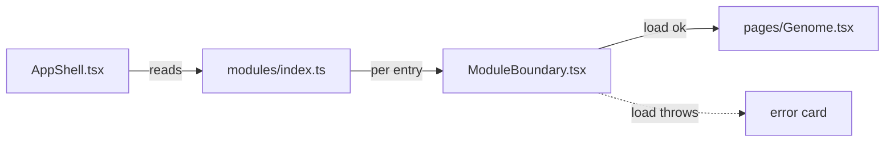

# App shell

**Standing:** current as of 2026-09-03.

Micro-frontend-style shell for one deployable SPA — no Module Federation, no separate
deploys. "Modules" are lazily-loaded chunks, each isolated by its own error/Suspense boundary.

## The contract

A page registers itself once, in `modules/index.ts`, as a `FeatureModule` (`modules/types.ts`):

```ts
{
  id: 'genome', path: '/genome', navLabel: 'Genome', title: 'Genome-wide view',
  group: 'data', description: 'Allele balance, depth against VAF and the karyogram …',
  load: () => import('../../pages/Genome'),
}
```

`AppShell.tsx` reads that array once and derives everything a reader sees about the app's
shape from it — one source, so none of these can disagree:

| Reader                        | What it draws from the manifest                                                           |
| ----------------------------- | ----------------------------------------------------------------------------------------- |
| `<Routes>`                    | one `<Route>` per entry                                                                   |
| `Header` row 1 (Sections)     | one tab per `NAV_GROUPS` entry, landing on the group's first page                         |
| `Header` row 2 (Pages)        | the active group's pages, with the group's `question`                                     |
| `PageFrame` → `PageHeader`    | eyebrow (group · question), "n of m", `title` as the h1, `description`, prev/next         |
| `PageFrame` → `JourneyFooter` | the previous and next page with their descriptions                                        |
| `JourneyProvider`             | the same groups, as context, so `JourneyMap` (Overview) and `Footer` can draw the sitemap |

## Information architecture

Every page serves exactly one of four questions, declared as its `group`; manifest order
inside a group is reading order. Overview has no group — it is the map.

| Group      | Question                                              | Pages                                 |
| ---------- | ----------------------------------------------------- | ------------------------------------- |
| `data`     | Is the measurement trustworthy?                       | Reads → Callset → Genome              |
| `case`     | Which gene, and which pair inside it, is causal?      | Panel → Compare → Phenotype → Search  |
| `decide`   | What do we believe, and what has it cost to find out? | Science → Probes                      |
| `platform` | What exists, where did it come from, and is it up?    | Catalog → Provenance → Status → Style |

Page order on a screen follows the same rule everywhere: h1 and description (from the
manifest), the headline `Callout` (the finding), the `Explainer` (background, terms as
chips), then the sections, then the journey hand-off. Answer first, background second.

Within a page, `PageFrame` lays out two columns at `xl` and up: the content column, and a
sticky rail beside it holding `OnThisPage`. Below `xl` the rail is replaced by the compact
`JumpToSection` select under the page header. Neither is wired by a page — both read the
section registry (`lib/sections.ts`), which every mounted `Section` announces itself to, as
does the ⌘K palette in the header. So a page gets in-page navigation by rendering `Section`s,
and the shell needs to know nothing about what any page contains.

`modules/journey.ts` holds the pure lookups (`moduleAt`, `groupOf`, `pagesIn`, `neighbours`,
`positionInGroup`); nothing else scans `modules` by hand. Pages may not import `app/`
(`eslint-plugin-boundaries`), which is why the groups reach `JourneyMap` through
`components/journeyContext.ts` rather than a direct import.

## Isolation

Each route renders through `ModuleBoundary.tsx`: an error-boundary class component
wrapping `Suspense`. A chunk that fails to import or throws while rendering shows a
red error card in its own slot only — the rest of the app stays up. Retry calls
`load()` again via a fresh `lazy()`, so a failed fetch is actually retried.

## Preloading

Hovering/focusing a nav link calls that module's `load()` early (`onPointerEnter`/
`onFocus` in `Header`). `import()` is cached, so this is a pure win — the same lazy
import navigation would trigger anyway, just started sooner.

## Diagram



> **Legend:** purple = raw input, blue = neutral machinery, yellow = decision point,
> green = goal (rendered page), red = contained failure.

## Files

| File                 | Role                                                     |
| -------------------- | -------------------------------------------------------- |
| `modules/types.ts`   | `FeatureModule` shape, `NAV_GROUPS`                      |
| `modules/index.ts`   | manifest, one entry per page, in journey order           |
| `modules/journey.ts` | pure lookups over the manifest                           |
| `AppShell.tsx`       | Header + routes + journey context from the manifest      |
| `PageFrame.tsx`      | h1/description above and prev/next below the routed page |
| `ModuleBoundary.tsx` | error boundary + Suspense + retry, per module            |
| `providers.tsx`      | StrictMode + QueryClientProvider + BrowserRouter         |
