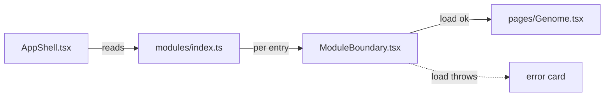

# App shell

**Standing:** current as of 2026-09-01.

Micro-frontend-style shell for one deployable SPA — no Module Federation, no separate
deploys. "Modules" are lazily-loaded chunks, each isolated by its own error/Suspense boundary.

## The contract

A page registers itself once, in `modules/index.ts`, as a `FeatureModule` (`modules/types.ts`):

```ts
{ id: 'genome', path: '/genome', navLabel: 'Genome', load: () => import('../../pages/Genome') }
```

`AppShell.tsx` reads that array twice, into `<Route>`s and (via `Header`) into nav
links — one source, so nav and routing can't disagree.

## Isolation

Each route renders through `ModuleBoundary.tsx`: an error-boundary class component
wrapping `Suspense`. A chunk that fails to import or throws while rendering shows a
red error card in its own slot only — the rest of the app stays up. Retry calls
`load()` again via a fresh `lazy()`, so a failed fetch is actually retried.

## Preloading

Hovering/focusing a nav link calls that module's `load()` early (`onPointerEnter`/
`onFocus` in `Header`). `import()` is cached, so this is a pure win — the same lazy
import navigation would trigger anyway, just started sooner.

## Diagram



> **Legend:** purple = raw input, blue = neutral machinery, yellow = decision point,
> green = goal (rendered page), red = contained failure.

## Files

| File                 | Role                                             |
| -------------------- | ------------------------------------------------ |
| `modules/types.ts`   | `FeatureModule` shape                            |
| `modules/index.ts`   | manifest, one entry per page                     |
| `AppShell.tsx`       | Header + routes from the manifest                |
| `ModuleBoundary.tsx` | error boundary + Suspense + retry, per module    |
| `providers.tsx`      | StrictMode + QueryClientProvider + BrowserRouter |
