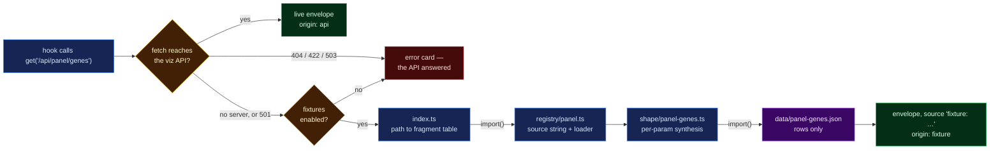

# `src/fixtures/` — the offline data layer

**Verified:** 2026-09-01, against the build in this commit.

What the app serves when the viz API is not there. Rows are **data files**, not code: every
payload lives in `data/*.json` and is fetched lazily, so an app talking to a healthy API
downloads none of it.

## When a fixture is served

Only on a **network-level** failure (`fetch` threw — no server on the port) or a `501 Not
Implemented`, and only while `VITE_USE_FIXTURES !== 'false'`. A `404`, `422` or `503` is the
live API answering correctly and reaches the user as an error card. See
[`src/api/client.ts`](../api/client.ts).



> **Legend** — purple: the raw data file · blue: neutral machinery · yellow: a decision the
> client makes · green: a payload that reached the page · red: the user sees an error, which
> is the correct outcome when the API answered.

## Layout

| Path            | Holds                                                    | Rule                                                                           |
| --------------- | -------------------------------------------------------- | ------------------------------------------------------------------------------ |
| `data/*.json`   | rows, 39 files                                           | data only — no comments, no `_note` keys, nothing to execute                   |
| `shape/*.ts`    | param-driven synthesis (18 files)                        | logic only: per-gene loci, per-Mb bins, flowcell shards, the search classifier |
| `registry/*.ts` | 4 fragments: `callset`, `genome`, `panel`, `platform`    | path → provenance `source` + loader                                            |
| `index.ts`      | static path → fragment table                             | resolves an owner without loading anything                                     |
| `loader.ts`     | `rows<T>(name)` over `import.meta.glob('./data/*.json')` | the one unchecked seam: JSON has no types, so each file is cast once           |
| `prng.ts`       | seeded xorshift32                                        | shared; fills the _shape_ of generated tables deterministically                |

One file under `data/` is **not** a payload: `data/protein/_provenance.json` and
`data/gene-structure/_provenance.json` are provenance manifests, not rows. Those two
directories hold **real** upstream data committed into the repository — one AlphaFold
alpha-carbon trace and one Ensembl exon/domain track per gene — and the manifest is the only
place "where did this come from" can be answered, because an AlphaFold coordinate and an
invented amino-acid position are both just numbers. Per gene it records the model URL, its
version and creation date, the Ensembl release, the file's own sha256, and a
**REAL-vs-SYNTHETIC map for every top-level field**. Written by
`tools/build_protein_fixture.py` on every run; listed, normalised, by
`GET /api/provenance/reference`, whose own offline payload is `data/provenance-reference.json`
— transcribed from a real run of that route, because a fabricated provenance row is the one
kind of fixture that would be actively misleading.

Nothing is eager. `index.ts` carries only the path table; the fragment, its shape modules
and its JSON arrive by `import()` on the first request that actually falls back.

| First paint carries                            | raw       | gzip     |
| ---------------------------------------------- | --------- | -------- |
| before, fixtures compiled into the entry chunk | 296.89 kB | 96.87 kB |
| after, only the path table                     | 236.44 kB | 77.19 kB |

## Adding an endpoint

1. Put the rows in `data/<name>.json`.
2. If the payload varies with a param, add `shape/<name>.ts` that `await rows(...)` and
   synthesises; otherwise skip this step.
3. Add the entry to the owning `registry/*.ts` fragment:
   ```ts
   '/api/panel/genes': {
     source: 'results.panel_gene_density + panel BED',
     load: () => rows<PanelGeneRow[]>('panel-genes'),
   },
   ```
4. Add the path to that fragment's list in `index.ts` and a row to
   [`src/test/fixtureMatrix.ts`](../test/fixtureMatrix.ts) — the test suite fails if a
   registered path is never exercised.
5. Bless the payload: run the suite, and add its hash to
   [`src/test/fixtureHashes.json`](../test/fixtureHashes.json).

Types live in `src/api/types/**` and are never duplicated here.

## What the numbers mean

Each entry states in its registry comment whether its rows are **measured** (copied from an
executed run), **PLACEHOLDER** (a published band standing in for one not yet fetched), or
**SYNTHETIC** (invented so an exhibit has a shape to draw offline). The `source` string
carries that word into the UI, prefixed `fixture:`, next to every exhibit.

> **Patient-data rule (binding).** No genomic coordinate is committed anywhere in this repo.
> The locus, het-pair, ClinVar-presence, suppressed-call and search fixtures all use a
> synthetic 1,000,000-based ladder. Reference-genome constants (GRCh38 chromosome lengths)
> are the coordinate _system_, not patient data, and are fine.

## Equivalence test

[`src/test/fixtures.test.ts`](../test/fixtures.test.ts) hashes every request in the matrix
and compares against `fixtureHashes.json`, which was taken from the TypeScript fixtures
before they became JSON. A changed hash means an offline payload changed — either a bug in
the loading layer, or a data edit that has to be re-blessed on purpose.
