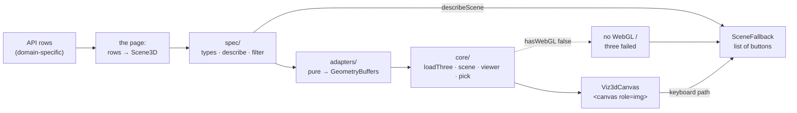

# `viz3d` — 3D exhibits behind one wrapper

**Verified:** 2026-10-05 — `typecheck`, `lint`, `build` and `bundle-budget --skip-build` all
green with this module and its live specimen on `/style-guide` mounted.

A domain-agnostic WebGL module. A page hands in **data** — a `Scene3D` it built from its own
API rows — and gets back a canvas, a text twin of the same figure, and generic controls. It is
a reusable toolkit, not a one-off: another project copies this folder wholesale and adds a
scene kind.

Read this before writing a 3D exhibit; the library choice (raw `three`, not
`@react-three/fiber`) is deliberate and is what the layer edge below depends on.

## The layer edge — the one rule that makes it reusable

**`viz3d` imports `lib` only.** Never `api`, never `components`, never `pages`. Enforced by
`eslint-plugin-boundaries` (element `viz3d` in [`eslint.config.js`](../../eslint.config.js)),
so it is a failed build, not a review note.

The consequence is the contract: `viz3d` never learns any domain's row type. The page does the
mapping. That is also why the small `<select>`/`<button>`
controls in `components/SceneControls.tsx` are re-implemented instead of imported from
`src/components/Controls.tsx` — importing `components` would give this module the transitive
right to reach `api`.



> **Legend:** purple = the raw input (a page's API rows), yellow = the decision point (the
> page choosing how its rows become a scene — the only domain-specific code), blue = neutral
> machinery inside this module, green = the two things a reader ends up with, red = the
> degraded path (no WebGL, or the three chunk failed to load).

## Files

| Path                           | Role                                                                                                                                       |
| ------------------------------ | ------------------------------------------------------------------------------------------------------------------------------------------ |
| `index.ts`                     | the barrel — the only path a page imports                                                                                                  |
| `spec/types.ts`                | the whole data contract: `Scene3D`, `Datum3D`, `Axes3D`, `ColorEncoding`, `Selection3D`, `CameraPreset`, `CameraPose3D`, `GeometryBuffers` |
| `spec/datums.ts`               | a scene read as a flat list of pickable datums, and field classification                                                                   |
| `spec/describe.ts`             | `describeScene` — the AI export, the `aria-label` and the fallback body, in one object                                                     |
| `spec/filter.ts`               | pure filter/recolour, so "colour by any field" needs no canvas                                                                             |
| `adapters/*.ts`                | `Scene3D → GeometryBuffers`, one file per kind. Pure, no three                                                                             |
| `core/loadThree.ts`            | the **only** `import('three')`, plus the `OrbitControls` addon. Both cached                                                                |
| `core/capability.ts`           | `hasWebGL()` — the one seam the no-WebGL path turns on                                                                                     |
| `core/colorRamp.ts`            | samples the app's generated `Colorscale`s per vertex; parses hex, never writes one                                                         |
| `core/scene.ts`                | `GeometryBuffers` + palette → meshes, materials, lights, highlight rings                                                                   |
| `core/camera.ts`               | the four presets and fit-to-bounds. Pure                                                                                                   |
| `core/pick.ts`                 | raycast index → `pickTable` → `Datum3D`. Pure                                                                                              |
| `core/viewer.ts`               | renderer, controls, render loop, pointer handling, dispose                                                                                 |
| `hooks/useSceneSelection.ts`   | `Selection3D` + camera preset ↔ the URL                                                                                                    |
| `hooks/useSceneExplorer.ts`    | active encoding, per-field filters, layers → a derived scene                                                                               |
| `components/Viz3dCanvas.tsx`   | the canvas, the hover tooltip, the resize/dispose lifecycle                                                                                |
| `components/SceneFallback.tsx` | the `<ul>` of `<button>`s: keyboard path, no-WebGL path, text twin                                                                         |
| `components/SceneControls.tsx` | the generic explorer row: view, colour-by, layers, filters, reset                                                                          |

Live example: [`src/pages/styleguide/Specimens.tsx`](../pages/styleguide/Specimens.tsx),
rendered at `/style-guide`.

## How a page maps rows → `Scene3D`

```tsx
const scene: Scene3D = {
  kind: 'points',
  title: 'Events per bin',
  axes: {
    x: { label: 'bin index', unit: 'index' },
    y: { label: 'series', categories: series },
    z: { label: 'events', unit: 'count' },
  },
  color: BY_DENSITY, // a ColorEncoding naming a generated Colorscale
  encodings: [BY_DENSITY, BY_CLASS],
  points: rows.map((row) => ({
    id: `${row.series}-${row.bin}`,
    label: `${row.series} bin ${row.bin}`,
    at: [row.bin, series.indexOf(row.series), row.events],
    value: row.events,
    meta: { pass: row.pass, flagged: row.flagged }, // fields, for colour + filters
  })),
};

const explorer = useSceneExplorer(scene, 'bins');
const selection = useSceneSelection('bins', ids);

<Exhibit
  title="…"
  legend={<>…</>}
  data={describeScene(explorer.scene, selection.highlighted)}
  controls={
    <SceneControls explorer={explorer} view={selection.view} onViewChange={selection.setView} />
  }
>
  <Viz3dCanvas
    scene={explorer.scene}
    highlighted={selection.highlighted}
    onSelect={selection.onSelect}
    view={selection.view}
  />
</Exhibit>;
```

Three properties fall out of that shape:

- **Axes are declared in the reader's units** — bins, Ångström, residue index — and every
  number in a description is grouped or compacted, so a large value reads as a quantity rather
  than as an opaque digit run.
- **Dynamic exploration is free.** Every fact a page puts in `Datum3D.meta` becomes a
  colour-by option (when the scene declares an encoding for it) and a filter — numeric fields
  get a range, categorical ones a set of chips.
- **One URL cites one figure.** `?bins.pick=…&bins.view=top&bins.by=class` — pick, camera and
  encoding are URL-held; filters stay component state because they are exploratory.

## Accessibility and AI export are one artefact

`describeScene(scene, highlighted)` returns a structured summary (kind, axes with units,
colour encoding with what low and high _mean_, object count, top/bottom-k, highlighted ids,
links) plus a deterministic prose paragraph. That one object is:

1. `Exhibit`'s `data` prop — a canvas has no serialisable content, so the export is the
   description, not the picture;
2. the canvas's `aria-label` (what axe's `role-img-alt` audits);
3. the body of `SceneFallback`.

`SceneFallback` is a real `<ul>` of `<button>`s firing the same `onSelect` a click on a sphere
does, so nothing in a 3D exhibit is mouse-only. It renders three times over: when there is no
WebGL, when the three chunk fails to load, and inside a `<details>` beside a working canvas.

Two properties make that claim true for a scene with thousands of datums:

- **Order is by relevance, not by index** — highlighted datums first, then the ones carrying an
  explicit `Datum3D.tone` (a verdict the page has already decided), then the rest in scene
  order. The datums a reader came for are on the first page whatever their index.
- **Every datum is reachable.** The list renders 60 at a time behind _show next 60_ / _show all_
  buttons. It used to stop dead at 60 and tell the reader to "filter the scene to reach them" —
  a control a protein exhibit deliberately does not render (`filters={false}`), which left most
  of a long chain's residues off the keyboard path entirely.

## Cost

three is loaded by exactly one dynamic `import()`, so a visitor who never opens a 3D exhibit
downloads **zero** bytes of it. Measured 2026-09-03 on a clean `pnpm run build`:

| chunk                                      | raw       | gzip      |
| ------------------------------------------ | --------- | --------- |
| `three.module-*.js` (lazy)                 | 529.85 kB | 131.78 kB |
| `OrbitControls-*.js` (lazy)                | 19.66 kB  | 4.38 kB   |
| `viz3d-*.js` (lazy, this module)           | 31.93 kB  | 11.24 kB  |
| initial payload (unchanged by this module) | 249.50 kB | 80.42 kB  |

Every number in that table is the **emitted chunk** as measured by
`node tools/bundle-budget.mjs --skip-build`. three's own release notes quote a different
figure — 365.55 kB raw / 87.12 kB gzip — which is the prebuilt `three/build/three.module.min.js`
this app never fetches; rolldown bundles and minifies three's ESM sources itself.

`core/loadThree.ts` narrows the module namespace to the declared `ThreeApi` field by field,
which is what lets rolldown drop the rest: passing the namespace through measured 724.23 kB
raw / 184.67 kB gzip for the same chunk. Two gates hold the placement:
`no-restricted-imports` (only `core/loadThree.ts` may name `three`) and
[`tools/bundle-budget.mjs`](../../tools/bundle-budget.mjs), which fails if `/three/i` appears
in the initial set, or if a page imports `src/viz3d` and no `three` chunk exists at all.

## Recipe: add a new scene kind

1. **`spec/types.ts`** — add the member to the `Scene3D` union with the data it needs.
2. **`spec/datums.ts`** — add a `sceneDatums` case. Picking, the keyboard fallback, the
   filters and the description all come from that one function, so this is the step that makes
   the new kind a first-class citizen.
3. **`spec/filter.ts`** — add a `filterScene` case (what "hide this datum" means for the kind).
4. **`adapters/<kind>.ts`** — the pure `Scene3D → GeometryBuffers` function. Use
   `adapters/normalise.ts` for the unit box, `datumColors` for colour and `tilePickTable` for
   the pick ranges. Its contract: `colors.length === positions.length`, and the `pickTable`
   ranges tile the primary index space with **no gap and no overlap**.
5. **`adapters/index.ts`** — one line in `toGeometry`.

Nothing in `core/` or `components/` changes: they only ever see `GeometryBuffers`.

### The three kinds, and why they are all neutral

`points`, `surface` and `protein` (a tube through an ordered chain of 3D positions) are
geometry, not domain vocabulary: no member of the union is named after a figure from one
problem. Keep it that way — a kind whose name only one project can read is a kind the next
project has to ignore.

## Two rules the camera obeys

1. **The camera fits the drawn points, not the data box.** `core/camera.ts` exports two fits.
   `fitToBounds` fits the bounding sphere of the box, whose radius is half the box _diagonal_ —
   for a globular protein in a 2 × 1.6 × 1.2 unit box that is a sphere of radius 1.42, and the
   fold drew at ~30–45 % of the shorter canvas side. `fitPoints` solves, in one pass over the
   point buffers, the smallest distance at which every point (plus its sphere radius) is inside
   both the vertical and the horizontal frustum, so the extreme point lands at `1 / 1.08` of the
   binding half-side. `core/viewer.ts` uses `fitPoints`; `fitToBounds` is the fallback for an
   empty point set.
2. **A refit throws away the reader's orbit, so it happens only when the scene's box changed.**
   `viewer.setGeometry(buffers)` compares the new `extent`/`bounds` against the fitted ones: a
   different residue window or a different subject refits, a recolour or a de-emphasis pass does
   not. `setGeometry(buffers, { refit: true })` forces one; `viewer.resize()` never refits (it
   only resizes the renderer and updates the projection matrix), because the `ResizeObserver`
   fires on every layout reflow.
3. **The camera can be _controlled_, and a controlled pose never echoes.** `Viz3dCanvas` takes
   an optional `pose: CameraPose3D` plus `onPose`, over `Viewer.getPose()` / `setPose()`. The
   pose is three vectors in the **normalised unit box** — not the scene's own units — which is
   exactly what makes one pose meaningful on two different scenes, and therefore what makes
   "sync cameras" in the side-by-side protein comparison possible without a page ever touching
   three. Two guards keep it from oscillating: the viewer reports at most every 90 ms and only
   past a 1e-4 threshold (OrbitControls damps, so the camera creeps for ~a second after the
   reader lets go), and both the viewer and the component remember the last pose they emitted
   or adopted, so a value arriving back is a no-op. `pose` is applied by an effect declared
   _after_ the `view` effect, so a shared orbit wins over a preset fit.
