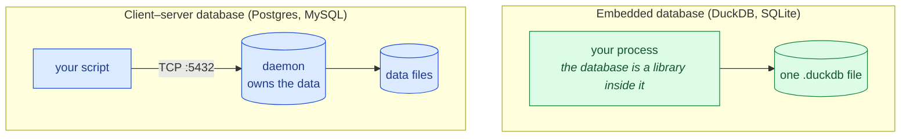
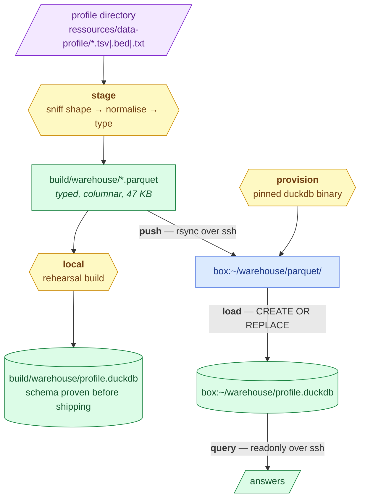

> **Archived 2026-08-29.** Superseded by the Postgres + MinIO path before it ever ran
> against a real host (`methodology/008` vs `010`). The SSH verbs and `remote.py` were
> **removed 2026-08-29** — plain local DuckDB scripting replaces them; only `stage`
> survives, feeding `pg-ingest`. See `docs/decisions.md`. The live infrastructure runbook
> is `docs/infrastructure.md`. Never edited.

# The warehouse: derived tables in DuckDB, on a box you already have

The [exploration toolkit](exploration.md) reads the profile tables straight off disk, which
is right while the numbers are still being argued about on one laptop. This is the other
half: one **typed**, columnar copy of those derived tables on a machine the team shares,
queryable in SQL.

## First, the thing that surprises everyone

**DuckDB is not a server.** It is a library that runs inside your process, with the whole
database in one file — the same arrangement as SQLite, but column-oriented. There is no
daemon, no listening port, no `CREATE USER`, and nothing to "expose".

This is worth stating plainly because it inverts the usual instinct. With Postgres you
install a service, open a port, create accounts, and *then* send data. With DuckDB there is
no step 1–3. "The database on the server" means precisely one thing: a `.duckdb` file on
that server's disk.



> **Legend** — **blue = neutral machinery** you would have to install, secure and keep
> patched; **green = the goal**, a single file with no service behind it. The absent arrow
> in the green box is the point: there is no network hop, so there is no port to expose and
> no second thing to authenticate.

The consequence is a *security* one, and it is why this design was chosen: the access
control on the warehouse is the box's own SSH access. There is no second surface.

The trade-off is sharper than "one writer at a time", and it is worth stating precisely
because it is measured rather than assumed. The lock is a **file** lock, and it excludes
*readers too*:

```
# while one process holds the .duckdb file open:
$ duckdb profile.duckdb -c "INSERT INTO ledger VALUES ('B','y');"
IO Error: Could not set lock on file "…/profile.duckdb":
Conflicting lock is held in …/python3.13 (PID 166463).

$ duckdb -readonly profile.duckdb -c "SELECT count(*) FROM ledger;"
IO Error: Could not set lock on file "…/profile.duckdb": Conflicting lock is held …
```

So one teammate running a long write makes the warehouse **unreadable** for everyone else,
not merely unwritable. For a single-owner, rebuild-from-Parquet store like this one that is
fine — the file is derived, and `load` rewrites it wholesale. For anything several people
or agents append to concurrently it is disqualifying, and the answer is a hosted database
rather than a workaround. See [When you outgrow this](#when-you-outgrow-this).

## The pipeline



> **Legend** — **purple = the raw input** (files as delivered by the shell pipelines);
> **yellow = a step that makes a decision** (what shape is this file, what type is this
> column, does this box already have the binary); **blue = neutral transport**;
> **green = the queryable result**. Every arrow is a separate CLI verb, so a failure is
> debugged one step at a time rather than as one opaque pipeline.

## What to run

```bash
export MVA_WAREHOUSE_HOST=user@your-box     # or an alias from ~/.ssh/config

uv run mva-warehouse preflight              # what does the box have? changes nothing
uv run mva-warehouse stage                  # profile dir → typed Parquet, no network
uv run mva-warehouse local                  # rehearsal: build the .duckdb here first
uv run mva-warehouse ship                   # stage + provision + push + load
uv run mva-warehouse query 'SELECT * FROM warehouse_catalog'
```

`--dry-run` on any networked verb prints the exact commands instead of running them. Read
them before the first real run; they are short.

## Why each step is its own verb

`ship` is the everyday command, but it is a composition, not a monolith. When a deployment
fails you want to know *which* of four independent things broke — the box lacked `unzip`,
the transfer was interrupted, a Parquet was malformed — and each of those is one verb you
can rerun in isolation. `preflight` in particular uploads nothing and changes nothing, so a
failure there costs nothing to retry.

`local` earns its place for a different reason: it builds exactly the schema the remote
load will build, on your machine, before a byte leaves it. If the types are wrong you find
out in one second rather than after a transfer.

## What staging actually fixes

The delivered TSVs are not rectangular, and handing them to a CSV reader unmodified gives
either a parse error or a silently truncated table. Three specific hazards:

| Hazard | Example | What staging does |
|---|---|---|
| No header row | `vcf_contig_counts.tsv` starts with a record | Column names declared in `catalog.OVERRIDES`; the first line stays a record |
| Rollup lines glued under the table | `est_raw_coverage_x  51.9` beneath 8 full-width rows | Collected into one `profile_scalars` table instead of being dropped or read as a short row |
| `##` sections, not one table | `vcf_filter_gt_counts.tsv` holds two blocks | Flattened to long form: `(section, label, count)` |

And one that is not a parse error but a usability tax: a header cell like
`pct_in_0.40_0.60` is legal in a TSV and legal in Parquet, but in SQL the dots read as
qualifiers, so every query touching it would need double quotes forever. It is folded once,
at staging, to `pct_in_0_40_0_60`.

**Types come from DuckDB's own CSV sniffer**, not from a hand-rolled guesser. That is
deliberate: it means the staging step and an analyst typing `read_csv` themselves can never
disagree about what a column is.

## Adding a new case

Nothing in the module knows about this proband. `catalog.discover` sniffs whatever
directory it is given and infers each file's shape from its suffix and first line, so a
different N-of-1 case is a different `--profile` argument. Only files whose shape *cannot*
be read off the file itself — a headerless table has no way to announce its own column
names — need an entry in `OVERRIDES`. Adding a case means adding overrides; it never means
editing the sniffer.

## Data handling

The warehouse holds **derived tables only** — counts, coverage summaries, panel intervals,
checksums. No reads, no genotypes, no patient variant records. It is a derived dataset in
the sense the challenge rules use, and is deleted with everything else within 30 days of
close. `build/` and `*.duckdb` are gitignored so the file is never committed by reflex; the
repository carries the recipe, and `mva-warehouse stage` rebuilds the output in under a
second.

If patient-level tables are ever staged, the same rules that govern the VCF apply to the
box: it must be access-controlled, never public, and wiped on the same schedule.

## When you outgrow this

The file-on-a-box design holds for as long as the warehouse has one owner and is rebuilt
rather than edited. Two things break it: **concurrent writers** (the lock above), and
**mutable shared state** — an oracle probe ledger, a submissions table, a run registry —
which by definition is edited rather than rebuilt.

At that point install **PostgreSQL** on the same box and split the work by what the data
*is*, not by which engine you prefer:

| | Where | Why |
|---|---|---|
| Mutable shared state — ledger, submissions, run registry, results | **Postgres tables** | Concurrent readers and writers, which DuckDB cannot give at all |
| Big immutable derived tables — annotated variants | **Parquet on disk** | Measured at 5,012,204 rows: 17 MB vs 653 MB, and 18 ms vs 287 ms |
| Running the analytics, and writing results back | **DuckDB over both** | One engine; results land in Postgres directly |

DuckDB attaches to Postgres and writes to it natively, so nothing about the pipeline
changes shape:

```sql
INSTALL postgres; LOAD postgres;
ATTACH 'host=box dbname=mva user=… password=…' AS pg (TYPE postgres);

CREATE TABLE pg.panel_summary AS
  SELECT p.gene, p.n_all, b."end" - b.start AS span_bp
  FROM read_parquet('parquet/panel_variant_counts.parquet') p
  JOIN read_parquet('parquet/mva_panel_grch38.parquet') b ON p.gene = b.name;
```

If the *variant* tables also need to be versioned and auditable — a real want for a
scientific submission — point **DuckLake** at that same Postgres as its catalog instead of
installing a second server. It keeps the data as Parquet, adds multi-writer transactions,
and records a snapshot per change:

```sql
ATTACH 'ducklake:postgres:host=box dbname=lakecat …' AS lake (DATA_PATH 'lake/');
SELECT count(*) FROM lake.panel AT (VERSION => 1);   -- the table as it was, before
```

Every claim in this section was executed against a real PostgreSQL and DuckDB rather than
read off documentation. The numbers, the options rejected (MotherDuck, ClickHouse,
`pg_duckdb`, MySQL, SQLite) and the caveats on the synthetic sizing are in
[`methodology/009`](../methodology/009-hosted-database-choice.md), which records the exact
versions the run used. Nothing here depends on a particular Postgres release — use whatever
the server has.
