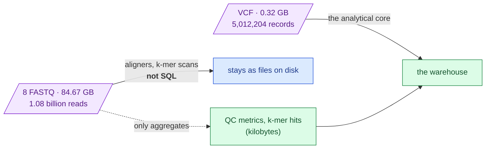
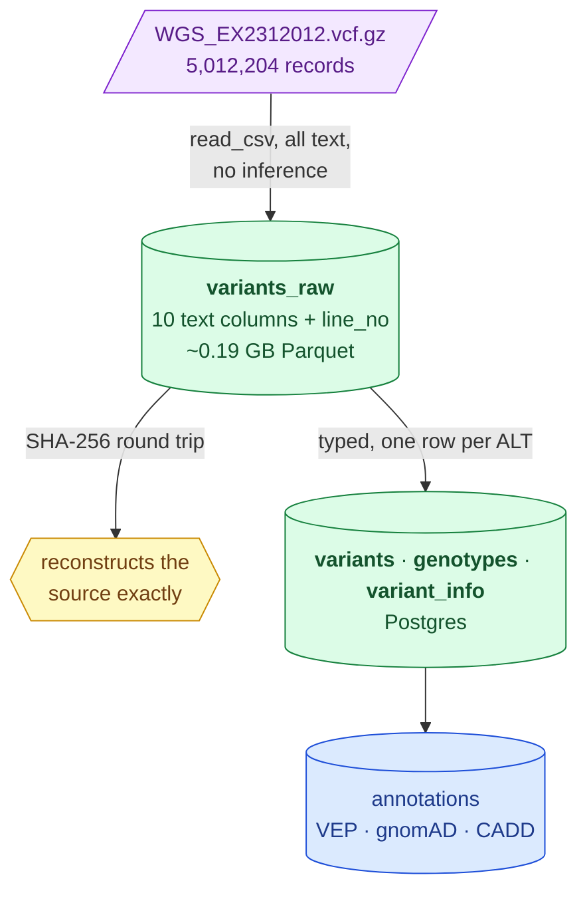

> **Archived 2026-08-29.** Superseded by `docs/data-layers.md`. Its "awaiting review — nothing has been ingested" status is no longer true: layers 0 and 1 are live, see `docs/current-state.md`. Never edited.

# Ingestion plan — for review before anything is loaded

**Status: awaiting review. Nothing has been ingested.** Everything below is either a
measurement already taken or a proposal.

## 1. The first decision: most of the 85 GB must not go into a database

Measured from the delivered manifest:

| | Files | Size | Share |
|---|---|---|---|
| FASTQ (raw sequencing reads) | 8 | 84.67 GB | **99.6%** |
| VCF + index | 2 | 0.32 GB | 0.4% |
| Documents | 2 | 0.00 GB | 0.0% |

"Ingest the 85 GB" is, in practice, "ingest the FASTQ", and that would be a mistake:

* The 8 FASTQ hold **1,079,858,785 reads**. As rows — read name, 149 bp sequence, 149-byte
  quality string — that is roughly **0.4 TB** in a row store, from 85 GB of input.
* Nothing you do with reads is a SQL operation. Reads get *aligned* (producing a BAM) or
  *scanned for k-mers*. Neither is `SELECT`, and no genomics pipeline puts reads in a
  database.
* The VCF already **is** the analytical summary of those reads. That is what a variant
  caller produced them for.



> **Legend** — **purple = raw input as delivered**; **blue = stays where it is**;
> **green = enters the warehouse**. The dotted arrow is the only path from FASTQ into the
> database: derived aggregates, never reads.

**Nothing is discarded.** The FASTQ stay exactly where they are, byte-for-byte, and remain
the source of truth for any realignment. They are simply not *tabular*.

## 2. Is DuckDB lossless? Measured, not assumed

### The full callset round-trips byte-identically

Every one of the 5,012,204 records was read through DuckDB, reconstructed, and compared
with the source by SHA-256 — the source digest computed in plain Python so the check never
depends on the thing being tested:

```
source rows    : 5,012,204
rebuilt rows   : 5,012,204
source sha256  : 33c78c35c2c407782b3429fcf4e7844533fede73c3cdbc4e3208dea5ffb19e59
rebuilt sha256 : 33c78c35c2c407782b3429fcf4e7844533fede73c3cdbc4e3208dea5ffb19e59
IDENTICAL      : True                                    (47 s)
```

This is stronger than any row count or summary: it proves the original bytes are
reproducible, so every field of every record survived in the right order.

### Where DuckDB *does* lose data, and how each is handled

23 of 24 adversarial values round-tripped byte-identically. The failures matter more than
the successes:

| Hazard | What DuckDB does | Our handling |
|---|---|---|
| **Empty string `""`** | becomes `NULL` — indistinguishable from genuinely missing | The **one real loss**. The fingerprint counts empties and NULLs separately, so a conflation is detected rather than assumed away. A VCF uses `.` for missing, never `""`, so it does not arise here — but it is checked, not trusted. |
| `.`, `NA`, `NULL`, `None` as text | preserved exactly | — |
| A `.` in an otherwise numeric column | whole column stays `VARCHAR` | Correct behaviour; no value nulled |
| Bad value *after* the sniffer's sample window | **errors loudly** (`Conversion Error … Line: 30002`) | Raw layer sets types explicitly, so no sniffing at all |
| Value that will not cast to a declared type | **errors loudly** | — |
| Big integers, float precision, unicode, quotes, 5 kB strings, `1/2`, `0\|1` | preserved exactly | — |

The pattern worth internalising: **DuckDB fails loudly rather than corrupting silently.**
Every hazard except the empty-string case either preserved the value or raised an error.

## 3. Proposed structure

Two layers, because that is what makes retention checkable rather than hoped-for.



> **Legend** — **purple = the delivered file**; **green = stored layers**;
> **yellow = the verification gate**; **blue = still to come**. Every arrow out of
> `variants_raw` is re-derivable, so a mistake downstream is never a data loss.

### Layer 1 — `variants_raw`: the lossless anchor

One row per VCF data line. **Every field from the file stored as text**, nothing parsed,
nothing normalised, nothing filtered — non-PASS records included, because a suppressed
allele is precisely what this case may turn on.

| Column | Type | Note |
|---|---|---|
| `line_no` | BIGINT | position in the file — our bookkeeping, not VCF data |
| `chrom, pos, id, ref, alt, qual, filter, info, format, sample_call` | VARCHAR | exactly as delivered |

Typing is the largest source of silent loss, so this layer does none. Its whole job is to
be provably identical to the source. **Measured: ~0.19 GB Parquet, ~72 s to build.**

### Layer 2 — typed and queryable, derived from layer 1

| Table | Grain | Why separate |
|---|---|---|
| `variants` | one row per **ALT allele** | A `1/2` record carries two alternate alleles and biologically *is* a compound heterozygote; it must reach the pair finder as two rows |
| `genotypes` | one row per variant × sample | GT, AD, DP, GQ, PL parsed out of `FORMAT`/`sample_call` |
| `variant_info` | INFO exploded | The header already declares all 31 fields — they are in `warehouse.vcf_fields` |

Each carries `line_no`, so any row can be traced back to its raw record and to the original
file line.

### Where each layer lives

| Layer | Location | Size | Reasoning |
|---|---|---|---|
| FASTQ | files on the box, untouched | 84.67 GB | not tabular |
| `variants_raw` | Parquet on the server disk | ~0.19 GB | archival anchor; rarely queried directly |
| `variants`, `genotypes`, `variant_info` | **PostgreSQL** | ~1–2 GB estimated | what the team and pgAdmin actually query |
| results | PostgreSQL `results` schema | MB | already live |

The 653 MB / 287 ms figures measured in [`methodology/009`](../methodology/009-hosted-database-choice.md)
say Postgres handles this scale comfortably. Parquet stays alongside for the scans where
16× matters.

## 4. Verification gates

Each runs before the next step, and each fails loudly:

1. `mva-warehouse vcf-shape` — header declares 10 columns, single sample. **Passed.**
2. `mva-warehouse vcf-verify` — SHA-256 round trip over all records. **Passed.**
3. `vcf-stage` writes the raw layer, then re-verifies against the Parquet before reporting
   success. Not yet run at full scale.
4. `fingerprint` + `compare` at every hop — row counts, per-column checksums, NULL and
   empty-string accounting. Demonstrated over 1,000,000 records: **all ten columns
   byte-identical.**
5. Layer 2 reconciliation: `variants` row count must equal the number of ALT alleles in
   layer 1, and every `line_no` must appear. Not yet built.

## 5. Open questions for you

1. **Multi-allelic splitting** — one row per ALT allele is proposed. It matches the scorer
   and the biology, but it means `variants` has more rows than the VCF has lines. The
   `line_no` column preserves the mapping. Agreed?
2. **INFO as columns or a MAP** — 31 declared fields. Wide columns are faster and clearer;
   a `MAP` survives a header change without a migration. Recommendation: wide columns for
   the ~11 fields actually populated, plus the raw `info` string retained in layer 1.
3. **Should `variants_raw` also go into Postgres?** It is only ~0.19 GB, so it would fit.
   Recommendation: no — it is an archival artefact, not something to query, and Parquet is
   the better home. Easy to change.
4. **Data handling.** These are patient records. The raw layer must live outside the
   repository and be deleted with everything else within 30 days of close. Where on the
   server should it go?

## 6. What has *not* happened

* No FASTQ has been read beyond the already-committed profile.
* No variant data has been written to PostgreSQL.
* No raw layer has been staged at full scale — only a 1,000,000-record sample, written to
  a scratch directory outside the repository and since deleted.

On your word: `vcf-stage` at full scale (~72 s), then layer 2, then the Postgres load.
