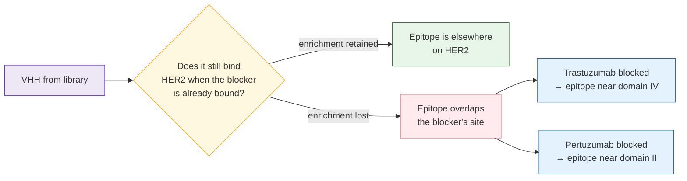

# The SEPIQ 2026 Challenge — context

**Standing:** 2026-10-05 — written from the challenge brief and the dataset file listing supplied
by the organisers. The dataset itself is **not yet downloaded**; every column description below is
read off the published schema, not off data we have measured. Numbers measured from the data get
their own owner page once the files land ([`data-profile.md`](data-profile.md), not yet written).

---

## 1. What is being asked

Two tracks, same inputs, different output granularity.

| | **Track A · SEPIQ** | **Track B · CAPRI** |
|---|---|---|
| Question | Which *residues* form the interface? | What does the *complex* look like in 3D? |
| Input | VHH sequence + antigen sequence | VHH sequence + antigen sequence |
| Output | Per-residue probabilities, or a binary interface/contact map | Predicted atomic coordinates of the HER2–VHH complex |
| Primary metric | **PR AUC** | CAPRI-style assessment: **DockQ**, **L-RMSD**, **i-RMSDbb**, **fnat** |
| Shape of the task | Per-residue binary classification, heavily imbalanced | Structure prediction + pose ranking |

Both tracks are **sequence-in**. No structure is given as input.

### The vocabulary, in software terms

- **VHH** (also *nanobody*, *single-domain antibody*): a ~120-residue protein that binds a target.
  Unlike a normal antibody it is one chain, not two — so the whole binder is a single string of
  amino acids. Think: a short sequence that is the entire query.
- **Antigen**: the protein being bound. Here it is fixed — **HER2** (human epidermal growth factor
  receptor 2), a cell-surface receptor and a well-studied cancer drug target.
- **Epitope**: the residues *on the antigen* (HER2) touched by the binder.
- **Paratope**: the residues *on the VHH* that do the touching.
- **Interface / contact map**: the pairing of the two. A contact map is a boolean matrix
  `len(VHH) × len(antigen)`; "interface residues" is that matrix collapsed onto either axis.
- **CDR** (complementarity-determining region): the three hypervariable loops of a VHH (CDR1,
  CDR2, CDR3). The paratope is mostly, but not only, inside them. CDR3 is the long, diverse one.
- **PR AUC** (area under the precision–recall curve): the Track A metric. Chosen over ROC AUC
  because interface residues are a small minority of all residues — ROC AUC flatters a model that
  mostly predicts "not interface". Treat the positive class as rare and optimise accordingly.
- **DockQ**: a single 0–1 score combining the three CAPRI measures below. **fnat** = fraction of
  true contacts recovered. **L-RMSD** = ligand root-mean-square deviation, how far the binder sits
  from where it should after superposing the antigen. **i-RMSDbb** = interface backbone RMSD, the
  same idea restricted to interface residues and backbone atoms only.

> Every term here also belongs in [`dictionary.md`](dictionary.md), with an example and a source
> line. This page is the challenge statement; the dictionary is the teaching reference.

---

## 2. The dataset — AVIDa-hHER2

Published as a file set (sizes as listed by the organisers):

| File | Size | What it is |
|---|---|---|
| `AVIDa-hHER2.csv` | 499 MB | The main table: one row per VHH sequence, with per-condition scores, derived labels and cluster assignment. Renamed by the organisers from `ONU_table_mod_IE_score_arranged_with_cluster_all.csv`. |
| `NGS_read_count_table.csv` | 126 MB | Read counts from the sequencing runs. |
| `README.md` | 17.3 kB | **The organisers' own data documentation — read this first; it is the authority on every ambiguity flagged below.** |
| `prediction_template_ONU11.csv` | 8.76 kB | Submission template, one per named VHH. |
| `prediction_template_ONU13.csv` | 8.76 kB | " |
| `prediction_template_ONU23.csv` | 8.85 kB | " |
| `LICENSE` | 0 B | Empty as published. |
| `.gitattributes` | 2.71 kB | Git LFS / xet pointers for the two large CSVs. |

**Status: not yet downloaded.** Nothing in this repo has been measured against it.

### 2.1 What the three templates tell us

There are **three** prediction templates — `ONU11`, `ONU13`, `ONU23` — each ~8.8 kB. That is the
shape of the actual deliverable: predictions are requested for **three specific VHHs against HER2**,
not for the whole library. At ~8.8 kB a template is on the order of a few hundred rows — consistent
with one row per residue, or per residue-pair subset. The 499 MB table is **training/derivation
material**, not the thing being scored.

This reframes the problem: the library is a *weak-supervision source*, and the evaluation set is
three complexes. Track B's "the HER2–VHH complex" is presumably these same three.

> **To confirm from the organisers' README:** the exact row semantics of a template, whether
> ONU11/13/23 appear in the big table, and whether Track B's targets are the same three.

### 2.2 `AVIDa-hHER2.csv` schema

Identity and totals:

| Column | Type | Meaning |
|---|---|---|
| `#ONU ID` | string | Row key, e.g. `ONU1`. "ONU" is the organisers' identifier for a distinct sequence. |
| `total` | int64 | Total reads for this sequence across the experiment (example row: `23,939`). |
| `sequence` | string | The VHH amino-acid sequence. Example row ONU1 starts `MAQVQLQESGGGLVQAGGSLRLSCAASGGTVSTFDMGWFRQAPGKEREFVSRISWDHGTTRYADSVKGRFTISRDDAKNTVYLQLNSLKAEDTAV` — the `QVQLQESGGG…` opening is the canonical VHH framework-1. |

Derived scores and labels:

| Column | Type | Meaning |
|---|---|---|
| `background_IE_score` | float64 | Enrichment score against the background/control conditions. |
| `target_IE_score` | float64 | Enrichment score against the HER2 target conditions. |
| `label` | string | Class label; `noise` is one observed value. |
| `binary_label` | float64 | The binder / non-binder target. Null in the example row. |
| `Cluster` | string | Sequence-family assignment, e.g. `Cluster1`. |
| `#Cluster` | float64 | Numeric form of the same. |
| `Cluster_size` | float64 | Members in that cluster (example: `5,378`). |

The 26 per-condition columns, all float64, all prefixed `Marin-`:

| Group | Columns | Reading of the name |
|---|---|---|
| Negative control | `NC1_37C-1st-B`, `NC2_37C-1st-B`, `NC2_4C-1st-B`, `NC3_C1_37C-2nd-B`, `NC3_C1_37C-2nd-C`, `NC3_C2_37C-2nd-B`, `NC3_C2_37C-2nd-C` | No antigen — what the library does on its own. |
| Comparator | `Comparator_C1_37C-2nd-B`, `Comparator_C1_37C-2nd-C`, `Comparator_C2_37C-2nd-B`, `Comparator_C2_37C-2nd-C` | A non-HER2 protein, as a specificity control. |
| HER2, plain | `Her2_37C-1st-B`, `Her2_C1_37C-2nd-B`, `Her2_C1_37C-2nd-C`, `Her2_C2_37C-2nd-B`, `Her2_C2_37C-2nd-C` | The target, uncompeted. |
| HER2 + RabMAb | `Her2_RabMAb_C3_37C-1st-B`, `Her2_RabMAb_C3_4C-1st-B` | HER2 pre-blocked with a rabbit monoclonal antibody. |
| HER2 + Pertuzumab | `Her2_Pertuzumab_C3_37C-1st-B`, `Her2_Pertuzumab_C3_4C-1st-B` | HER2 pre-blocked with pertuzumab. |
| HER2 + Trastuzumab | `Her2_Trastuzumab_C1_37C-1st-B`, `Her2_Trastuzumab_C1_4C-1st-B`, `Her2_Trastuzumab_C2_37C-1st-B`, `Her2_Trastuzumab_C2_4C-1st-B`, `Her2_Trastuzumab_C3_37C-1st-B`, `Her2_Trastuzumab_C3_4C-1st-B` | HER2 pre-blocked with trastuzumab. |

Name grammar, as far as it can be read off the headers: `Marin-<condition>[_C<n>]_<temp>-<round>-<rep>`
where `C1/C2/C3` is a campaign or chamber index, `37C`/`4C` is temperature, `1st`/`2nd` is the
selection round, and the trailing `B`/`C` is a replicate.

Sentinel value: `-500` appears in the example row in several condition columns and in
`target_IE_score`. It reads as a floor/"absent" marker rather than a real score. **Must be
confirmed and handled explicitly before any modelling** — treating `-500` as a number would wreck
every downstream statistic.

> **To confirm from the organisers' README:** what `IE` and `ONU` abbreviate; the exact `-500`
> semantics; the full set of `label` values and how `binary_label` is derived from the IE scores;
> what `Comparator` and `RabMAb` are; whether `C1/C2/C3` is campaign, chamber or clone.

---

## 3. Why the competition columns are the interesting part

This is the one piece of structure worth stating up front, because it is what turns a
sequence-level screen into **residue-level labels**.

Trastuzumab and pertuzumab are both clinical anti-HER2 antibodies, and they bind **different,
published, non-overlapping regions of HER2** — trastuzumab the membrane-proximal domain IV,
pertuzumab the dimerisation arm in domain II. A competition experiment exploits that:

> **Legend** — purple = the raw input (a library sequence); yellow = the decision the competition
> columns resolve; green = epitope away from the blocker; red = epitope overlapping the blocker;
> blue = the coarse epitope region that follows.

So the ratio `Her2_Trastuzumab_* / Her2_*` is a **coarse epitope label derivable from the count
table alone**, for every sequence with enough reads — no structure, no external data. Same for
pertuzumab, and RabMAb adds a third blocking site.

That is a region-level label, not a residue-level one. It does not by itself answer Track A. What
it gives is:

- a **restraint** for Track B — reject docked poses that put the VHH in the wrong HER2 domain;
- a **stratification** for Track A — train and evaluate per epitope bin instead of pooling;
- a **check** on any model's predicted epitope, independent of the structure predictor.

**This is a hypothesis about the data, not a measured result.** It rests on (a) the column names
meaning what they appear to mean, and (b) trastuzumab/pertuzumab epitopes being where the
literature places them. Both must be verified — the first against the organisers' README, the
second against the published HER2–trastuzumab and HER2–pertuzumab structures — before anything is
built on it.

---

## 4. Where the difficulty actually sits

| Difficulty | Why | What it forces |
|---|---|---|
| Labels are sequence-level, the task is residue-level | The screen says *that* a VHH binds, never *where* on either protein | Weak supervision, transfer from structural databases, or both. The gap must be named in the report, not papered over. |
| Three evaluation targets | ONU11/13/23 only | Tiny test set — a leaderboard gap of one or two residues is noise. Internal validation has to be broader than the official metric. |
| Cluster structure | `Cluster` / `Cluster_size`; one example cluster has 5,378 members | **Split by cluster, never by row.** A random row split leaks near-identical sequences across train/test and inflates PR AUC. This is the single easiest way to get a wrong answer. |
| Class imbalance | Interface residues are a minority | PR AUC is the metric precisely because of this. Calibrate; do not tune on accuracy. |
| `-500` sentinels and nulls | Present in the example row | Explicit missing-data policy, decided and documented before modelling. |
| No structures given | Both tracks are sequence-in | Track B needs a folding/docking stack; Track A can either go sequence-only or route through predicted structure — a real fork in the design. |

---

## 5. Open questions, in priority order

1. Read the organisers' `README.md` (17.3 kB) — it likely answers most of §2's flagged items.
2. What exactly does a `prediction_template_ONU*.csv` row represent? That defines the output contract.
3. Are ONU11/13/23 rows in the big table, and what do their competition columns say?
4. Is there ground truth anywhere — solved HER2–VHH structures for these three, or is Track B
   scored against structures held back by the organisers?
5. What does `NGS_read_count_table.csv` hold that `AVIDa-hHER2.csv` does not — raw per-run counts
   behind the IE scores?

---

## 6. Sources

- Challenge brief: track definitions, expected outputs and metrics, as supplied 2026-10-05.
- Dataset file listing and `AVIDa-hHER2.csv` column schema with the ONU1 example row, as supplied
  2026-10-05.
- Everything in §3 marked as a reading of the column names is **inference from the headers**, not
  organiser-stated fact, and is flagged as such.
