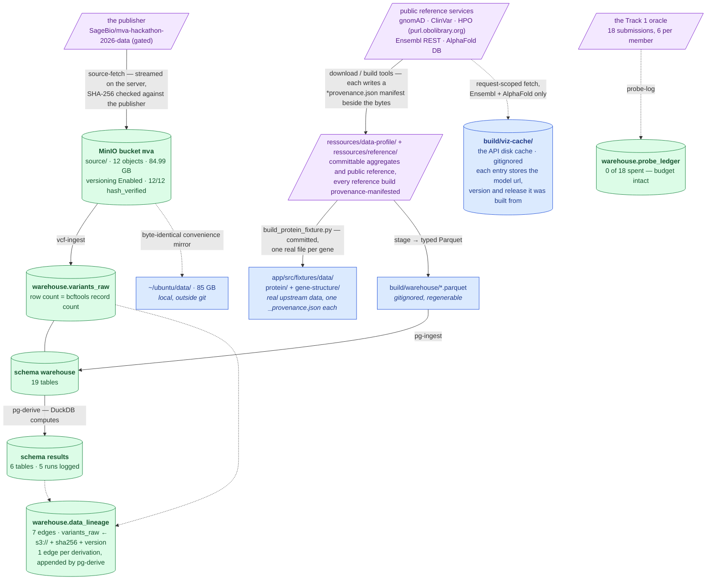

# Current state — what exists, right now

**Verified:** 2026-08-29, by executed runs (`pg-check`, `s3-check`, `pytest`, live SQL
counts). Recorded in
[`methodology/015`](step-0/methodology/015-step-1-consolidation.md) and
[`methodology/016`](step-0/methodology/016-lineage-backfill-and-probe-ledger.md).
**§1's reference-data half re-verified 2026-09-03** by executed runs, and the sequence
matters because an earlier version of this banner got it wrong:

- live `GET https://rest.ensembl.org/info/data` — release **116**;
- `tools/build_gene_set.py` rerun. The gene-set TSV came back byte-identical *at that
  point* ([`061`](step-0/methodology/061-reference-data-provenance.md)); a later rerun the
  same day corrected its `note` column and moved it 2,569 → **2,726 B**
  ([`062`](step-0/methodology/062-reference-manifests-and-bed-notes.md)). A third rerun,
  `--reuse` (no network), added the `group_label` and `group_order` columns and moved it
  2,726 → **3,518 B**, every Ensembl-derived column asserted byte-identical
  ([`064`](step-0/methodology/064-reusable-structure-toolkit.md)). It is 3,518 B now.
- `tools/build_protein_fixture.py --force` rerun **after** that TSV rebuild, manifests
  written `2026-09-03T13:46:57Z`. Every protein fixture and every non-panel gene-structure
  fixture came back byte-identical; the eight panel gene-structure files changed only
  because the synthetic allele labels did, and both `_provenance.json` name the committed
  TSV's current digest again. The staleness that sat between 062's TSV rebuild and this
  rerun, and the blind test that hid it, are recorded in
  [`063`](step-0/methodology/063-manifest-staleness-fix.md).
- `tools/check-python.sh` — **1,580 tests** (re-run 2026-09-03 after
  [`064`](step-0/methodology/064-reusable-structure-toolkit.md), which added 14).

The Postgres, MinIO and row-count numbers in §2 were **not** re-checked on that date and
still carry the 2026-08-29 / 2026-09-03 dates stated in their own rows.

This page owns **repository and infrastructure numbers** — test counts, table counts,
object counts, what is provisioned. **Dataset measurements** (variant counts, coverage,
read counts, panel tallies) are owned by
[`ideation/data-findings.md`](../ideation/data-findings.md) and are linked, never restated.

---

## 1. The data flow



> **Legend** — **purple = raw input** as delivered or as fetched from a public service;
> **green = verified and live** (a live probe or a row count was run today); **blue =
> neutral, regenerable machinery** that holds no unique state. Solid arrows are executed
> pipelines; dotted arrows are side relationships, not steps.

**Where the reference sources' provenance lives.** The purple public services on the right
are *fetched*, not derived, so they get no `data_lineage` edge — an edge naming a transform
that never ran would be fabricated. Each build writes a manifest beside the bytes instead:
five under `ressources/reference/` (`gnomad_constraint`, `clinvar_panel`, `qc_norms`,
`hpo`, `structure_genes`) and one `app/src/fixtures/data/*/_provenance.json` per fixture
directory. They record the upstream URL, the release, the digests and the commit that
built them, they are written by the tool on every run and never by hand, and
`GET /api/provenance/reference` lists all **7** normalised onto one row shape. Method and
observed output: [`step-0/methodology/061`](step-0/methodology/061-reference-data-provenance.md)
and [`062`](step-0/methodology/062-reference-manifests-and-bed-notes.md), which added the
three population-reference manifests and measured both upstreams to confirm the committed
tables are still the current release.

### The source-of-truth chain

```
MinIO source/  →  warehouse.variants_raw  →  results.*
   bytes,           lossless all-text        derived tables,
   hash-verified,   anchor                   re-derivable
   versioned
```

Each link is re-derivable from the one before it, and nothing is edited in place. Losing
`results` costs a `pg-derive`; losing `variants_raw` costs a `vcf-ingest`; losing the
bucket costs a re-fetch from the publisher. The rule that keeps this true:
[delivery is immutable](step-0/notes/delivery-is-immutable.md).

---

## 2. What is provisioned

Postgres and MinIO both run on a **remote VPS**, not locally.

| | Value |
|---|---|
| PostgreSQL | 18.4, database `mva`, 1330 MB |
| schema `warehouse` | **27 tables**, counted live 2026-09-03 (was 19 on 2026-08-29). Two of the additions are `hpo_term_ic` and `hpo_gene_scores`, ingested 2026-09-03; the rest — including `hypotheses` and `evidence`, which the row below expected to be absent — arrived from work not recorded on this page |
| `warehouse.variants_raw` | 5,012,204 rows — **exactly** the bcftools record count in `ressources/data-profile/vcf_stats_summary.txt` ([owned by data-findings](../ideation/data-findings.md)) |
| schema `results` | 6 derived tables, 5 runs logged in `derivation_runs` |
| MinIO bucket `mva` | versioning **Enabled** |
| bucket `source/` | 12 objects, 84,985,953,378 bytes (84.99 GB) |
| hash verification | 12/12 `hash_verified=true` — 10 against the publisher's SHA-256, 2 own-upload — **0 mismatches** |
| `warehouse.source_files` | append-only ledger, 14 rows (VCF + `.tbi` uploaded twice, same hash — correct, not drift) |
| `warehouse.data_lineage` | append-only edge list, **37 rows over 29 distinct target tables** as of 2026-09-03 (a re-derived table gets a new edge, never an edit, so rows exceed targets): 2 for `variants_raw` (the original local-path edge and the superseding `s3://mva/source/…` edge carrying the verified sha256 and version), 1 per derivation, 1 per staged reference table, and 1 for the VEP annotation call. The two newest are the HPO tables, each carrying its upstream URL, release and input digest ([step-3/methodology/056](step-3/methodology/056-phenotype-ranking-without-java.md) §7b) |
| `warehouse.probe_ledger` | oracle submissions spent: **0 of 18** — the table exists and is empty because no probe has been spent. Widened in entry 017 with a `hypothesis_ids` column; the widening has **not** been applied to the live table, which is empty |
| `warehouse.hypotheses`, `warehouse.evidence` | **created 2026-09-03** on the first write: 2 hypotheses and 6 evidence rows under step-3 ([step-3/methodology/056](step-3/methodology/056-phenotype-ranking-without-java.md)). No verdict has been committed |

Both probes connect: `uv run mva-warehouse pg-check`, `uv run mva-warehouse s3-check`.

The `variants_raw` count matching bcftools independently is the cross-check that transport
and typing altered nothing — the two numbers were produced by different tools reading the
same bytes.

### Two copies that are *not* state

| | What | Why it is safe to lose |
|---|---|---|
| `~/ubuntu/data/` | byte-identical 85 GB local mirror of the delivery | convenience only; the bucket is the source of truth |
| `build/warehouse/` | staged Parquet | gitignored, regenerable in under a second, fully redundant with Postgres |

---

## 3. What runs today

```bash
uv run pytest -q                            # 448 passed, no services needed
uv run mva-explore report ressources/data-profile
uv run mva-science steps                    # the research goals, needs no database
uv run mva-science report --from docs/science-register.json
uv run mva-warehouse stage                  # profile dir -> build/warehouse/*.parquet
uv run mva-warehouse pg-check
```

| | Verbs | Notes |
|---|---|---|
| `mva-explore` | 4 — `report`, `checks`, `locus`, `export` | reads the committed profile; `locus` reads a real VCF |
| `mva-warehouse` | 26 — `stage`, `pg-*` (5), `vcf-*` (4), `s3-*` (5), `source-*` (5), `lineage-*` (3), `probe-*` (3) | measured from `mva-warehouse --help` |
| `mva-science` | 12 — `steps`, `board`, `show`, `hypothesis-*` (2), `evidence-*` (2), `verdict`, `probe-link`, `check`, `export`, `report` | measured from `mva-science --help`; `steps` and `report --from` need no database |

The **448 tests are hermetic**: synthetic fixtures only, no dataset, no Postgres, no MinIO.
A green suite says nothing about whether the infrastructure is up — that is what `pg-check`
and `s3-check` are for. 21 test files.

---

## 4. Repository layout

`src/mva/` is six subpackages:

| Package | Concern | Modules |
|---|---|---|
| `pipeline/` | the causal-variant pipeline | `variant`, `vcf`, `compound_het`, `annotation`, `ranking`, `scorer`, `submission` |
| `render/` | the shared report shell and palette | `theme`, `figure`, `report` + `report.css` |
| `explore/` | the data-profile report | `profile`, `checks`, `report`, `cli`, `views/` (callset, karyotype, locus, overview, panel, quality, reads); `theme` and `figure` are re-export shims over `render/` |
| `science/` | the research record | `steps`, `hypothesis`, `evidence`, `dossier`, `record`, `export`, `report`, `cli`, `views/` (loop, board, ledger, submission, methods) |
| `io/` | file parsing shared by all | `readers` |
| `warehouse/` | storage and infrastructure | `settings`, `catalog`, `stage`, `postgres`, `analysis`, `objects`, `source`, `integrity`, `lineage`, `probes`, `vcfstage`, `cli`, `cli_ledger`, `cli_objects`, `cli_source`, `cli_vcf` |

Dependencies run one way, and **nothing may use `science/`**:

```
render/     <-  explore/ , science/
io/         <-  explore/ , science/ , warehouse/
pipeline/   <-  explore/ , science/ , warehouse/
warehouse/  <-  science/
```

`pipeline/` uses none of them. A change to a chart can never affect a submission, and a
change to the research record can never affect the pipeline that feeds it. The map with
seam guarantees is [`step-0/architecture.md`](step-0/architecture.md).

---

## 5. Known gaps

Stated here so they are not discovered later. Sequencing is in [`roadmap.md`](roadmap.md).

| Gap | What is actually wrong | Consequence |
|---|---|---|
| **Staged Parquet is single-homed** | `build/warehouse/` exists only on one laptop | regenerable, so not data loss — but it is an undeclared dependency of `pg-ingest` |
| **Layer 2 not built** | `variants` / `genotypes` / `variant_info` are designed only | see [`data-layers.md`](step-0/data-layers.md) |
| **No real annotator** | `annotation.py` is a port with a lookup fake behind it | the critical path for ranking — see [the note](notes/annotation-as-a-port.md) |
| **The research register is empty** | no hypothesis proposed, no evidence recorded, no probe spent | not a defect — step 1 has not run. The machinery is built and tested; nothing has been claimed. See [`method.md`](method.md) |
| **`clinvar_panel` has no source digest** | its lineage edge names a ClinVar release but does not identify the bytes; the scratch VCF cannot be shown to be the download that produced the committed extract | the extract is reproducible from the release but not *provably* the same bytes. Left empty rather than guessed — see [step-3/methodology/056](step-3/methodology/056-phenotype-ranking-without-java.md) §7b |
| **The register tables are not in the database** | `warehouse.hypotheses` and `warehouse.evidence` are defined in code and covered by tests, but no connection has been made since | they appear on first write, like every other ledger. Until then `mva-science board` against a live database will create them |
