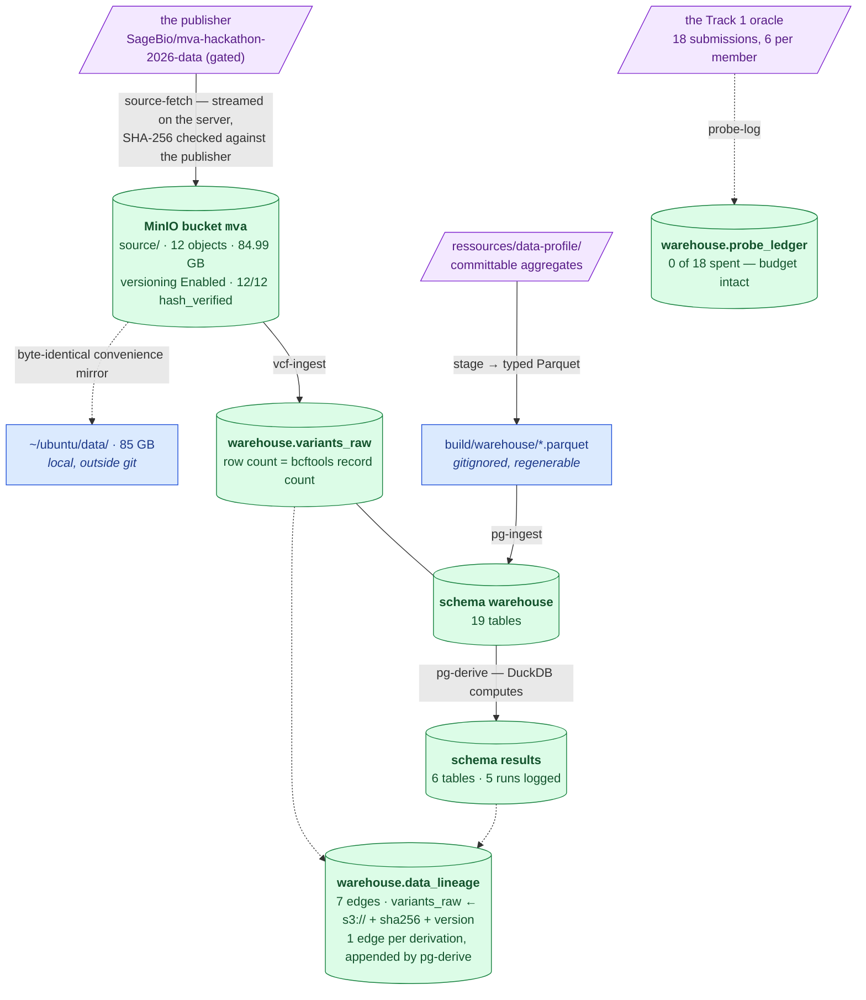

# Current state — what exists, right now

**Verified:** 2026-08-29, by executed runs (`pg-check`, `s3-check`, `pytest`, live SQL
counts). Recorded in
[`methodology/015`](../methodology/015-step-1-consolidation.md) and
[`methodology/016`](../methodology/016-lineage-backfill-and-probe-ledger.md).

This page owns **repository and infrastructure numbers** — test counts, table counts,
object counts, what is provisioned. **Dataset measurements** (variant counts, coverage,
read counts, panel tallies) are owned by
[`ideation/data-findings.md`](../ideation/data-findings.md) and are linked, never restated.

---

## 1. The data flow



> **Legend** — **purple = raw input** as delivered; **green = verified and live** (a live
> probe or a row count was run today); **blue = neutral, regenerable machinery** that
> holds no unique state. Solid arrows are executed pipelines;
> dotted arrows are side relationships, not steps.

### The source-of-truth chain

```
MinIO source/  →  warehouse.variants_raw  →  results.*
   bytes,           lossless all-text        derived tables,
   hash-verified,   anchor                   re-derivable
   versioned
```

Each link is re-derivable from the one before it, and nothing is edited in place. Losing
`results` costs a `pg-derive`; losing `variants_raw` costs a `vcf-ingest`; losing the
bucket costs a re-fetch from the publisher. The rule that keeps this true:
[delivery is immutable](notes/delivery-is-immutable.md).

---

## 2. What is provisioned

Postgres and MinIO both run on a **remote VPS**, not locally.

| | Value |
|---|---|
| PostgreSQL | 18.4, database `mva`, 1330 MB |
| schema `warehouse` | 19 tables |
| `warehouse.variants_raw` | 5,012,204 rows — **exactly** the bcftools record count in `ressources/data-profile/vcf_stats_summary.txt` ([owned by data-findings](../ideation/data-findings.md)) |
| schema `results` | 6 derived tables, 5 runs logged in `derivation_runs` |
| MinIO bucket `mva` | versioning **Enabled** |
| bucket `source/` | 12 objects, 84,985,953,378 bytes (84.99 GB) |
| hash verification | 12/12 `hash_verified=true` — 10 against the publisher's SHA-256, 2 own-upload — **0 mismatches** |
| `warehouse.source_files` | append-only ledger, 14 rows (VCF + `.tbi` uploaded twice, same hash — correct, not drift) |
| `warehouse.data_lineage` | append-only edge list, **7 rows**: 2 for `variants_raw` (the original local-path edge and the superseding `s3://mva/source/…` edge carrying the verified sha256 and version) + 1 per derivation |
| `warehouse.probe_ledger` | oracle submissions spent: **0 of 18** — the table exists and is empty because no probe has been spent |

Both probes connect: `uv run mva-warehouse pg-check`, `uv run mva-warehouse s3-check`.

The `variants_raw` count matching bcftools independently is the cross-check that transport
and typing altered nothing — the two numbers were produced by different tools reading the
same bytes.

### Two copies that are *not* state

| | What | Why it is safe to lose |
|---|---|---|
| `~/ubuntu/data/` | byte-identical 85 GB local mirror of the delivery | convenience only; the bucket is the source of truth |
| `build/warehouse/` | staged Parquet | gitignored, regenerable in under a second, fully redundant with Postgres |

---

## 3. What runs today

```bash
uv run pytest -q                            # 305 passed, no services needed
uv run mva-explore report ressources/data-profile
uv run mva-warehouse stage                  # profile dir -> build/warehouse/*.parquet
uv run mva-warehouse pg-check
```

| | Verbs | Notes |
|---|---|---|
| `mva-explore` | 4 — `report`, `checks`, `locus`, `export` | reads the committed profile; `locus` reads a real VCF |
| `mva-warehouse` | 26 — `stage`, `pg-*` (5), `vcf-*` (4), `s3-*` (5), `source-*` (5), `lineage-*` (3), `probe-*` (3) | measured from `mva-warehouse --help` |

The **305 tests are hermetic**: synthetic fixtures only, no dataset, no Postgres, no MinIO.
A green suite says nothing about whether the infrastructure is up — that is what `pg-check`
and `s3-check` are for.

---

## 4. Repository layout

`src/mva/` is four subpackages:

| Package | Concern | Modules |
|---|---|---|
| `pipeline/` | the causal-variant pipeline | `variant`, `vcf`, `compound_het`, `annotation`, `ranking`, `scorer`, `submission` |
| `explore/` | the report toolkit | `profile`, `checks`, `theme`, `figure`, `report`, `cli`, `views/` (callset, karyotype, locus, overview, panel, quality, reads) |
| `io/` | file parsing shared by both | `readers` |
| `warehouse/` | storage and infrastructure | `settings`, `catalog`, `stage`, `postgres`, `analysis`, `objects`, `source`, `integrity`, `lineage`, `probes`, `vcfstage`, `cli`, `cli_ledger`, `cli_objects`, `cli_source`, `cli_vcf` |

Dependencies run one way: `explore/` and `warehouse/` may use `io/` and `pipeline/`;
`pipeline/` uses neither. A change to a chart can never affect a submission. The map with
seam guarantees is [`architecture.md`](architecture.md).

---

## 5. Known gaps

Stated here so they are not discovered later. Sequencing is in [`roadmap.md`](roadmap.md).

| Gap | What is actually wrong | Consequence |
|---|---|---|
| **Staged Parquet is single-homed** | `build/warehouse/` exists only on one laptop | regenerable, so not data loss — but it is an undeclared dependency of `pg-ingest` |
| **Layer 2 not built** | `variants` / `genotypes` / `variant_info` are designed only | see [`data-layers.md`](data-layers.md) |
| **No real annotator** | `annotation.py` is a port with a lookup fake behind it | the critical path for ranking — see [the note](notes/annotation-as-a-port.md) |
