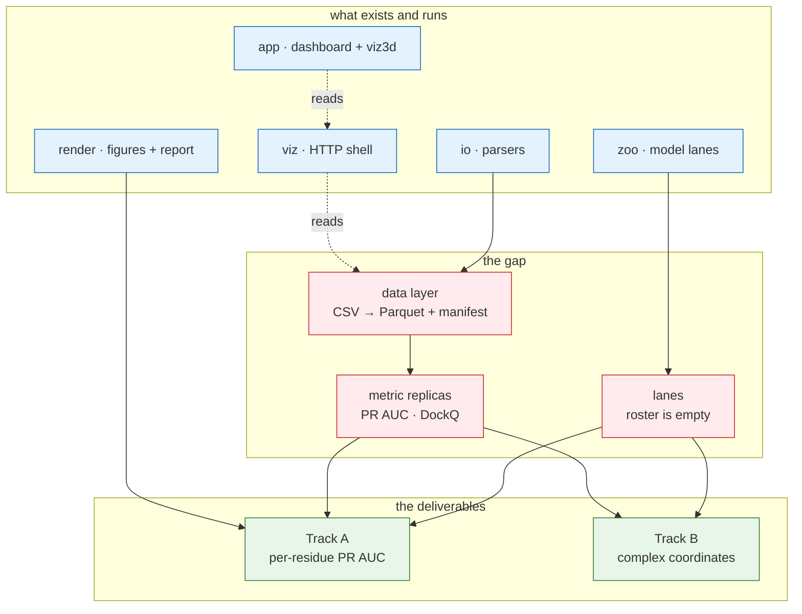

# Current state — what exists, what works, what to build next

**Verified:** 2026-10-05 — every claim on this page was checked against the tree on that
date by running the gate, reading the module, or both. Where something is *declared but
unproven*, the row says so.

This page is the honest inventory after the repository was stripped of its previous case
(MVA genomics) and repointed at the **SEPIQ 2026 challenge**. Read
[`challenge.md`](challenge.md) for what we are trying to do; this page is what we have to
do it with.

---

## The one-paragraph summary

**No science has been done. The dataset is not downloaded. There are no results, no
models and no tests.** What exists is a working platform: file parsers, a figure and
report system, an HTTP service shell, a frozen-model lane contract, and a React dashboard
with a 3D structure viewer. All of it is domain-neutral — none of it knows what a VHH is.
The five static gates are green.

> **Legend** — blue = built and running · red = the gap, nothing written yet · green = the
> two deliverables. A dashed arrow is an HTTP call, a solid one a Python dependency.

---

## 1. Python — `src/sepiq/`, 2,661 lines across 19 modules

### `io/` — format parsers · **works, unused**

| Symbol | What it does |
|---|---|
| `read_table(path) -> Table` | Header-first TSV. Separates the two-field rollup lines tools glue to the bottom into `.scalars`, keeps `#` provenance lines in `.comments`. |
| `read_sections(path) -> Sections` | A file cut into `## name` blocks. `.counts(block)` returns a label→int mapping, dropping non-integers. |
| `as_int` / `as_float` | Tolerant coercion — junk returns `None`, never raises. |
| `write_tsv` / `write_json` / `cell` | Staging a step's rows and numbers to disk. |

Two conventions hold throughout: **a missing value is `None`, never an exception**, and
**nothing is coerced on read**. The second one matters immediately — the challenge
dataset's `-500` sentinel must stay a string until something decides what it means.

**Build on it for:** reading anything the organisers or a tool emit that is not a plain
CSV. Polars handles the two big CSVs directly; this is for everything else.

### `render/` — the visual language · **works, unused**

| Symbol | What it does |
|---|---|
| `Exhibit` | A figure plus its caption and legend, as one object. HTML-escapes every label. |
| `Section` | A group of exhibits. |
| `render(sections) -> str` | One self-contained HTML page with a keyword filter. |
| `theme` | The palette as named `Hue`s — `GOOD`/`BAD`/`DECISION`/`MACHINE`/`RAW`/`MUTED` — registered once as a Plotly template named `sepiq`. |

This package survived the domain change **untouched**, which is the standard the rest of
the repo is held to: it knows about exhibits, captions and colours, not about what is
being plotted.

**Build on it for:** every figure in the report. Do not set colours in a figure; take them
from the template.

### `zoo/` — the frozen-model lane contract · **contract works, roster empty**

Nothing here is trained. The package makes unrelated third-party predictors look identical
to the code that calls them.

| Symbol | State |
|---|---|
| `SequenceRecord.of(chains, **meta)` | **Works.** Named chains (`binder`, `target`) plus open metadata. |
| `item_id(*parts)` | **Works.** Content-addressed key, 16 hex of SHA-256. Two runs agree without coordinating. |
| `ScoreRow`, `Coverage`, `RemoteJob` | **Works.** The output shapes. `aux` carries anything vector-valued — per-residue probabilities, a contact map. |
| `Adapter` protocol | **Declared, no implementation.** Tier 1/2 score locally, tier 3 submits a remote job. |
| `registry.load()` | **Works** — parses `models.toml` + `models.d/*.toml`, validates, merges, refuses collisions. Smoke-tested by hand. |
| `models.toml` | **Empty** — one disabled template entry, no real model. |
| `modal_contract` | **Works as data.** The tier-3 wire shape, the GPU price table, the budget caps. No `modal` import, so it is readable from a laptop. |
| `modal_budget.Ledger` | **Works.** Append-only JSONL, per-lane cap check. |
| `modal_apps/{_common,api}` | **Declared, never deployed.** The container-side scaffolding. |

**The honest gap:** there is no adapter. The protocol says what one must look like; nothing
implements it. The first lane is a new module plus a TOML fragment.

**Build on it for:** running ESM-2 / AbLang / Boltz / Chai as comparable lanes with one
cached score store and a spend ledger, instead of five ad-hoc scripts.

### `viz/` — the HTTP shell · **works, wires no routes**

| Symbol | State |
|---|---|
| `create_app(cache, origins, routers, token)` | **Works.** Takes its routers as an argument. Currently passed none. |
| `auth` | **Works.** `X-API-Key`, `secrets.compare_digest`, `/health` outside the guard. |
| `Cache` | **Works.** A hit returns the payload *and* the instant it was built; writes are temp-file-then-rename. |
| `Envelope` | **Works.** `{data, cached_at, source}` on every `/api/*` response. |
| `Upstream` (proxy) | **Works.** Forwards a job-shaped verb, attaches the token server-side, turns a dead upstream into a 503 rather than a hang. |
| `serve` / `sepiq-api` | **Works.** Refuses a non-loopback bind without a token. |
| `mmcif_tokens` | **Works.** Tokenizer for the mmCIF `loop_` table syntax — the text format structures are published in. Pure syntax. |

**Build on it for:** the first data route. `mmcif_tokens` is the piece to notice: Track B
produces structures, and this already reads their file format.

### Loose modules

| Module | State |
|---|---|
| `settings.py` | **Works.** `.env` loader; real env beats file beats `DEFAULTS`. `DEFAULTS` is the one place to look for what is configurable. |
| `paths.py` | **Works.** Repo-root resolution so a relative default means the same thing from any working directory. |

---

## 2. The dashboard — `app/`

React + Vite + Tailwind. **Builds, runs, and all five gates pass.** 253.68 kB raw /
81.82 kB gzip at first paint.

| Area | Files | State |
|---|---|---|
| `src/app/` | 9 | Router, shell, layout, error boundary. **Works.** |
| `src/components/` | 26 | `DataTable`, `Plot`, `Exhibit`, `StatTile`, `QueryState`, `CommandPalette`, theme toggle, health dot. **Works, domain-neutral.** |
| `src/lib/` | 24 | Formatting, the palette and ramps, URL state, graph layout, the dictionary loader, the AI-export markdown builder. **Works.** |
| `src/viz3d/` | 23 | **The piece worth knowing about** — see below. |
| `src/api/` | 5 | Typed client over the envelope, `useEndpoint`, the health hooks. **Works; nothing to call yet.** |
| `src/pages/` | 6 | Three placeholders: Overview, Learn, Style guide. |

### `viz3d` — a declarative 3D scene viewer

Three scene kinds, of which one matters here:

- `protein` — **a tube through a 3D backbone, with per-residue colour and picking.**
- `points` — a 3D scatter.
- `surface` — a height grid.

Plus a camera, a colour ramp, selection and an explorer hook. **This is directly what
Track B needs**: a predicted complex is atomic coordinates, and per-residue colour is how
you show a predicted epitope on one. It is mounted today in a live synthetic-helix
specimen on the style guide, so it cannot rot unnoticed.

### `/learn` — the dictionary as a course

`docs/dictionary.md` → `app/tools/gen-dictionary.mjs` → the Learn page. **10 chapters, 218
entries, 6 Mermaid diagrams.** The generator fails the build on a cross-link to a missing
heading or a `source:` naming a file that does not exist, so the dictionary cannot quietly
rot. The page knows *block kinds*, never terms — adding a chapter needs no code change.

---

## 3. Tooling — `tools/`, 12 files

| Tool | State |
|---|---|
| `check-python.sh` | **Works.** The five gates, in CI's order. `--fix` formats first. |
| `check_module_size.py` | **Works.** 400 lines, `src` and `tools`. |
| `check-commit-msg.sh` | **Works.** Self-test: 11 cases, green. |
| `modal_trace.py` | **Declared, never run on this branch.** Wraps every Modal command so the deploy/run/stop and its cost land in `build/modal/trace.jsonl`. |
| `md_to_html.py` + `md_to_pdf.mjs` | **Works.** Markdown → styled HTML → PDF, for a report deliverable. |
| `xlsx_to_md.py` | **Works.** An organiser's form as readable Markdown. |
| `setup-env.sh`, `setup-git.sh`, `setup-viz-api-service.sh`, `activate.sh`, `extract-rules.sh` | **Declared.** Setup helpers; only `setup-git.sh` is exercised routinely. |

### The gates

Five, **all static analysis**: ruff format, ruff lint, module size, import layering, mypy.
One definition, three callers — `tools/check-python.sh`, the `.husky/pre-commit` hook, the
CI job.

**Green means it parses, type-checks and respects the layering. It does not mean it does
the right thing.** There is no test suite, by decision. Say this wherever the gates are
quoted as evidence.

The app half: `pnpm run check` = typecheck, lint, format:check, theme:check,
dictionary:check — plus `build` and `bundle-budget`.

**Enforced layering** (`lint-imports`, three contracts): `io` and `render` are leaves and
import no sibling; nothing outside `viz` may import `viz`.

---

## 4. What is deliberately absent

| Not here | Why | Cost to add |
|---|---|---|
| A database | 625 MB of CSV does not need one | — |
| An object store | same | — |
| A test suite | removed with the previous case; nothing new is built yet | low, when there is behaviour worth pinning |
| A hypothesis register | this challenge is scored against a held-out answer key | — |
| Any model | the roster is empty; choosing lanes needs evidence, not a default | one TOML fragment + one adapter each |
| A data-ingest package | **the first real thing to write** | the next step |

---

## 5. What to build next, in order

Each row is a decision that unblocks the one below it.

| # | Build | Why it is first |
|---|---|---|
| 1 | **Download the data and read the organisers' README** | Nine blocking questions in [`challenge.md`](challenge.md) §5 are answered there, four of which decide what we submit. Nothing designed before this is safe. |
| 2 | **`data/` ingest: CSV → Parquet + provenance manifest** | Everything reads from it. Becomes a new leaf package beside `io`. |
| 3 | **A profile report of the dataset** | Row counts, cluster-size distribution, label balance, how often `-500` appears, read depth per condition. Becomes the owner of every measured number — `docs/data-profile.md`. Uses `render/`. |
| 4 | **Metric replicas: PR AUC and DockQ** | The previous case's hardest-won lesson: replicate the official scorer *before* modelling, so a candidate submission can be replayed offline. Blocked on §5 Q1–Q4. |
| 5 | **The cluster-aware split** | Split by `Cluster`, never by row. Writing this early makes leakage impossible by construction rather than by discipline. |
| 6 | **The competition-column epitope labels** | The scientific crux ([`challenge.md`](challenge.md) §3). Derivable from the count table alone — but verify all three assumptions first. |
| 7 | **The first zoo lane** | A protein language model as tier 2 or 3. Proves the adapter protocol against a real model. |
| 8 | **Track B: a folding stack + pose ranking** | Rank predicted complexes by agreement with Track A's epitope. Most teams will submit unranked fold output; this is the differentiator. |

---

## 6. Known debt

| Item | Detail |
|---|---|
| `REPO_BLOB` | `app/src/lib/dictionary/index.ts` and `app/tools/gen-dictionary.mjs` still point `REPO_BLOB` at the previous repository, so a dictionary `source:` link resolves there rather than here. Repoint both when this repo is public. |
| Hosted deploy | `API_UPSTREAM_URL` / `API_UPSTREAM_TOKEN` replaced the old `MVA_VIZ_API_*` names, and the session cookie is now `dash_session`. A deployment must rename those env vars. |
| `zoo` RRF fusion | `merge`/`rank`/`workflow` were cut rather than ported — their dependency chain ran into the most domain-coupled file in the previous repo. The arithmetic is ~15 lines; it is recoverable from [`agharsallah/mva-hackathon`](https://github.com/agharsallah/mva-hackathon), branch `SEPIQ-2026-Challenge`, not from this repo's history. |
| `registry.py` | 383 lines against a 400 limit. The next feature splits it. |
