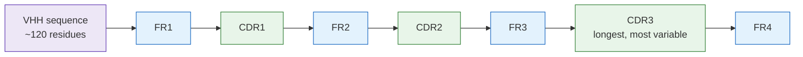
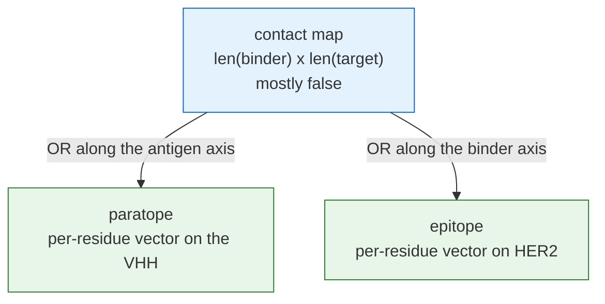
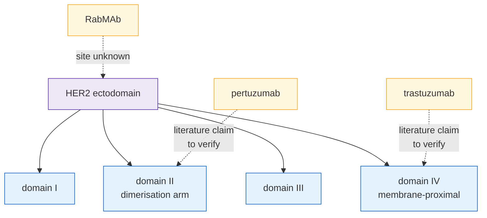
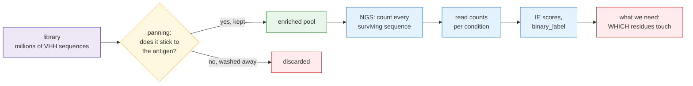
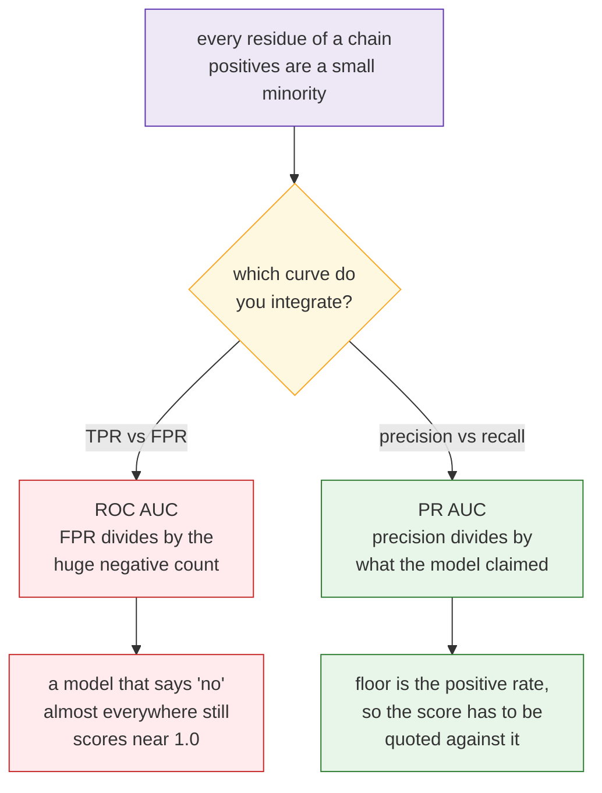
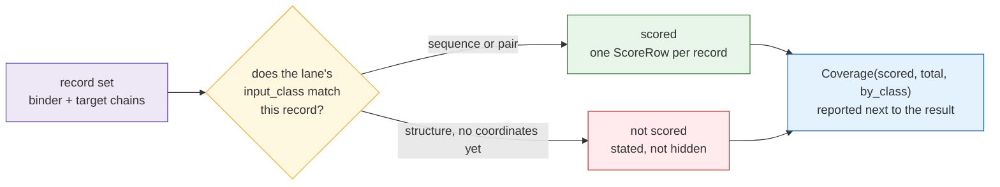

# Dictionary — every unclear word in this repository

**Standing:** 2026-10-05 — rewritten end to end for the SEPIQ 2026 challenge
(antibody–antigen interface prediction, VHH nanobodies against HER2). The previous edition
taught a clinical-genomics case that is no longer in this repository; it is gone, not hidden.
This is the one glossary. Never duplicated elsewhere; enriched whenever a new domain term,
protein, file format or tool appears in the work. Rendered as a course at `/learn` in the app —
generated from this file by `app/tools/gen-dictionary.mjs`, never copied; a cross-link here that
names a missing heading fails that build, and so does a `*Context:*` line naming a file that does
not exist.

Written for a software engineer with no biology background. Ordered so each word only uses words
defined above it. Read top to bottom the first time.

**How an entry is written.** One definition line and two optional italic lines under it:

- `**term** — what it means.` The definition, written for someone who has read only the
  entries above this one.
- `*Example: one concrete value.*` A real value from the work or the published dataset schema,
  never an invented measurement.
- `*Context: where it is used · source: path/to/owner.md · related: term, other · see: [label](file.md) · first seen 2026-10-05*`
  The metadata. Segments are separated by ` · ` (or `; ` before a key); every segment is
  optional. `source:` names the one repo-relative file that owns the term, `related:` the
  entries this one leans on, `see:` a figure, file or page worth opening. `first seen` is normally
  left out — `app/tools/gen-dictionary.mjs` derives it from git, taking the author date of the
  earliest commit that added the term's bold marker to this file, and you only write it by hand
  for a term that existed in the work before it reached this page.

The Learn page renders those as the definition, the example beneath it, and a quiet metadata
footer carrying the date, the source, the related entries as links, and the exhibits.

**Nothing in this repository has been measured against the challenge dataset.** The files are not
downloaded. Every concrete value quoted below is either (a) a published schema value the
organisers supplied, owned by [`challenge.md`](challenge.md), (b) a fact about this repository's
own code, or (c) arithmetic that is explicitly labelled as arithmetic. A claim taken from the
literature is written as a literature claim with a *to verify* flag, never as a settled fact.

Diagrams: `mermaid` blocks render automatically on GitHub, in VS Code with the Markdown preview,
and in the app. Colour code used everywhere: **green = good / safe / the goal**, **red = broken /
dangerous / lost points**, **yellow = a decision point**, **blue = neutral machinery**,
**purple = the raw input**. Every diagram is followed by a `> **Legend**` line decoding its own
colours and symbols, so you never have to guess what a shape means. Every diagram here is a
Mermaid block, so the source *is* the picture and there is no binary asset to keep in step.

---

## 1. Proteins — the alphabet everything is written in

Start here. A protein is, for our purposes, **a string over a 20-letter alphabet that folds into a
shape**. Both halves matter: the string is the input we are given, the shape is what decides what
the protein touches.

**Amino acid** — one letter of the protein alphabet. There are 20 standard ones, each a small
molecule with a common part (the same in all 20) and a distinguishing part.
*Example: glutamine, written `Q`; valine, written `V`; leucine, written `L`.*
*Context: the alphabet every sequence in this challenge is written over · source: standard protein biochemistry, no repo owner yet · related: Protein, One-letter code*

**One-letter code** — the single uppercase character naming an amino acid. The 20 letters are
`ACDEFGHIKLMNPQRSTVWY`. `B`, `J`, `O`, `U`, `X` and `Z` are not standard residues; `X` conventionally
means "unknown" and must be handled, not assumed absent.
*Example: the opening of the published `ONU1` sequence reads `MAQVQLQESGGGLVQAGG…` — M, A, Q, V, Q, L, Q, E, S, G, G, G, …*
*Context: the encoding of the `sequence` column · source: docs/challenge.md · related: Amino acid, Protein sequence*

**Residue** — one amino acid *once it is joined into a chain*. The word you will see everywhere in
this challenge: "interface residue", "per-residue prediction". A free amino acid is an amino acid;
the same thing at position 57 of a chain is residue 57.
*Example: residue 1 of the published `ONU1` sequence is `M` (methionine).*
*Context: the unit Track A predicts over — one probability per residue · source: docs/challenge.md · related: Amino acid, Protein sequence*

**Peptide bond** — the chemical link that joins one residue to the next, always in the same
direction. It is why a protein is a *sequence* and not a set: the chain has a start (the
N-terminus) and an end (the C-terminus), and by convention a sequence is always written
N-terminus first, left to right.
*Example: `MAQ…` means methionine is at the N-terminus, not the C-terminus.*
*Context: why position indices are meaningful and stable · source: standard protein biochemistry, no repo owner yet · related: Residue*

**Protein** — a chain of residues joined by peptide bonds, which folds into a specific
three-dimensional shape and does a job. In software terms: a string that compiles itself into a
machine.
*Example: HER2 and a VHH nanobody are both proteins; this challenge is about how one touches the other.*
*Context: the only kind of object in this challenge · source: docs/challenge.md · related: Residue, Peptide bond, Tertiary structure*

**Chain** — one continuous protein molecule. A complex can contain several chains; each gets an
identifier in a structure file. A VHH is one chain; a normal antibody is four.
*Example: in this repository's record type the two chains are named `binder` and `target`.*
*Context: the named halves of a `SequenceRecord` · source: src/sepiq/zoo/types.py · related: Protein, Chains*

**Protein sequence** — the chain written out as a string of one-letter codes. Also called the
**primary structure**. This is the entire input both tracks of the challenge are given.
*Example: the `sequence` column of `AVIDa-hHER2.csv` holds one of these per row.*
*Context: the model input for both tracks — no structure is supplied · source: docs/challenge.md · related: One-letter code, Residue, FASTA*

**Position / index** — where a residue sits in the sequence. Biology counts from **1**, not 0. Any
code that indexes a sequence has an off-by-one waiting in it.
*Example: "residue 1" is the first character of the string, i.e. `sequence[0]` in Python.*
*Context: the row key of every per-residue prediction file · source: docs/challenge.md · related: Residue, Author numbering*

**FASTA** — the universal plain-text format for sequences: a `>` header line, then the sequence on
the following lines. Think of it as the `.txt` of molecular biology — no types, no schema, widely
abused.
*Example: `>ONU1` on one line, then the amino-acid string on the next.*
*Context: what almost every external model takes as input · source: standard sequence file format, no repo owner yet · related: Protein sequence*

**DNA** — the four-letter code (`A`, `C`, `G`, `T`) that cells store instructions in. It matters here
for exactly one reason: the dataset was produced by **sequencing DNA**, so the amino-acid strings
we analyse were read out as DNA first and translated.
*Example: the `NGS_read_count_table.csv` file counts DNA reads, not protein molecules.*
*Context: why the dataset is a count table and not a list of measured affinities · source: docs/challenge.md · related: Codon, Translation, NGS*

**Codon** — three consecutive DNA letters, which name one amino acid. 64 codons map onto 20 amino
acids plus a STOP signal, so the mapping is many-to-one and lossy in that direction.
*Example: `ATG` codes for methionine and also serves as the start signal.*
*Context: the step between the sequencer's output and the protein string we model · source: standard genetic code, no repo owner yet · related: DNA, Translation, Amino acid*

**Translation** — turning a DNA string into a protein string, three letters at a time. Pure
function, no state: same DNA in, same protein out.
*Example: `ATG GCT TCA TAA` translates to Met-Ala-Ser then STOP.*
*Context: how the sequenced library becomes the `sequence` column · source: standard genetic code, no repo owner yet · related: Codon, DNA, Protein sequence*

**Side chain** — the part of a residue that differs between the 20 amino acids. It is the part that
sticks out of the chain and does the touching, so almost everything about binding is side-chain
chemistry.
*Example: valine's side chain is small and greasy; glutamine's is polar and can form hydrogen bonds.*
*Context: why interface prediction is not just geometry · source: standard protein biochemistry, no repo owner yet · related: Amino acid, Hydrophobic residue, Polar residue*

**Backbone** — the repeating part of the chain that is identical in every residue: the atoms the
peptide bonds run through. The backbone carries the fold; the side chains decorate it.
*Example: the CAPRI metric `i-RMSDbb` measures only backbone atoms — "bb" is backbone.*
*Context: the atom subset several structure metrics restrict themselves to · source: docs/challenge.md · related: Residue, Heavy atom, i-RMSDbb*

**Hydrophobic residue** — a residue whose side chain avoids water. These tend to end up buried in
the protein's core, or at a binding interface, which is itself shielded from water.
*Example: valine `V`, leucine `L`, isoleucine `I`, phenylalanine `F`, tryptophan `W`.*
*Context: one of the cheapest per-residue features available from sequence alone · related: Side chain, Buried residue, Feature*

**Polar residue** — a residue whose side chain is comfortable in water and can form hydrogen bonds.
*Example: serine `S`, threonine `T`, asparagine `N`, glutamine `Q`, tyrosine `Y`.*
*Context: the other half of the simplest sequence-only feature set · related: Side chain, Hydrophobic residue*

**Charged residue** — a polar residue carrying a positive or negative electrical charge. Opposite
charges across an interface attract; like charges repel, so charge complementarity is a classic
interface signal.
*Example: positive — lysine `K`, arginine `R`; negative — aspartate `D`, glutamate `E`.*
*Context: an interface feature that works across the two chains, not within one · related: Polar residue, Interface*

**Secondary structure** — the small repeating shapes the backbone falls into locally, before the
whole chain folds. Three classes cover almost everything: helix, strand, and everything else.
*Example: a VHH is mostly beta strands joined by loops.*
*Context: a standard intermediate feature — predictable from sequence alone with good accuracy · related: Alpha helix, Beta strand, Loop, Backbone*

**Alpha helix** — a corkscrew of backbone, roughly 3.6 residues per turn. Written `H` in most
annotations.
*Example: in a helix, residues `i` and `i+4` sit on the same face.*
*Context: one of the three secondary-structure classes · related: Secondary structure*

**Beta strand** — a stretched-out run of backbone. Several strands lie side by side to form a
**beta sheet**. Written `E` in most annotations (for "extended").
*Example: the immunoglobulin fold that a VHH adopts is a sandwich of two beta sheets.*
*Context: the dominant secondary structure in antibody domains · related: Secondary structure, Immunoglobulin fold*

**Loop** — the irregular connector between helices and strands. Loops are where a protein's
individuality lives: they vary in length and sequence far more than the structured parts.
*Example: the three CDR loops of a VHH are loops in exactly this sense.*
*Context: why "the binding site is in the loops" is a usable prior · related: Secondary structure, CDR*

**Tertiary structure** — the full three-dimensional shape of one folded chain: where every atom
is. This is what Track B has to predict and Track A has to reason about without being given.
*Example: a VHH's tertiary structure is a compact barrel about 4 nanometres across.*
*Context: the thing neither track is given as input · source: docs/challenge.md · related: Protein, Secondary structure, Structure prediction*

**Fold** — the recognisable *family* of tertiary structure a protein belongs to. Different
sequences can share a fold; think interface, not implementation.
*Example: every antibody variable domain, including every VHH, has the immunoglobulin fold.*
*Context: why a model trained on antibodies generalises to nanobodies at all · related: Tertiary structure, Immunoglobulin fold*

**Domain** — a part of a chain that folds independently and could, in principle, be cut out and
still work. A large protein is a string of domains.
*Example: the part of HER2 outside the cell is made of four domains, numbered I to IV.*
*Context: the unit the competition experiment resolves an epitope down to · source: docs/challenge.md · related: Fold, HER2, HER2 subdomains*

**Solvent-accessible surface area (SASA)** — how much of a residue is exposed to water, in square
ångströms. Computed from a structure, not from sequence.
*Example: a residue with near-zero SASA is buried in the core and cannot be part of an interface.*
*Context: the standard way to turn a structure into a per-residue exposure number · related: Buried residue, Tertiary structure*

**Buried residue** — a residue with little or no solvent-accessible surface. It cannot touch
another protein, so it can be excluded from interface prediction *if* a structure is available.
*Example: the hydrophobic core of a VHH is buried; the CDR loop tips are not.*
*Context: the cheapest true-negative filter, available only once a structure exists · related: Solvent-accessible surface area, Hydrophobic residue, Interface residue*

**Disulfide bond** — a covalent staple between two cysteine residues (`C`) that pins distant parts
of a chain together. Antibody domains have a conserved one; many VHHs have an extra one tying CDR3
down.
*Example: cysteines appear as `C` in the sequence string and are therefore visible without a structure.*
*Context: a sequence-visible constraint on CDR3 geometry · related: Residue, CDR3*

**Substitution** — one residue replaced by a different one, at one position. The elementary
difference between two related sequences.
*Example: position 57 is `S` in one library member and `T` in another.*
*Context: what distinguishes members of a sequence cluster · related: Residue, Sequence identity*

---

## 2. Antibodies, and why a VHH is the simple case

**Antibody (immunoglobulin, Ig)** — a protein an immune system makes to recognise one specific
target. The classic form is four chains — two heavy, two light — arranged in a Y.
*Example: trastuzumab and pertuzumab, both named in the dataset's column headers, are antibodies.*
*Context: the class the challenge's binders belong to · source: docs/challenge.md · related: Protein, Heavy chain, Light chain*

**Heavy chain** — the longer of the two chain types in a classic antibody. Two per antibody.
*Example: the "H" in VHH refers to the heavy chain.*
*Context: needed only to explain what a VHH is missing · related: Antibody*

**Light chain** — the shorter chain type in a classic antibody. Two per antibody. A VHH has none —
that is the whole point of it.
*Context: the half of a normal antibody a VHH does without · related: Antibody, VHH*

**Variable domain** — the domain at the tip of an antibody arm whose sequence differs from antibody
to antibody. It is what does the recognising. Written `VH` on the heavy chain and `VL` on the light
chain.
*Example: a VHH *is* a variable domain, standing alone.*
*Context: the only part of an antibody this challenge models · related: Domain, Antibody, VHH*

**Constant domain** — a domain whose sequence is the same across all antibodies of a class. It does
the downstream immune signalling and carries no target specificity, so it is absent from this
problem entirely.
*Context: named so you recognise it as irrelevant here, not because we use it · related: Domain, Variable domain*

**Immunoglobulin fold** — the beta-sandwich fold every antibody variable domain adopts: two sheets
of beta strands face to face, with loops at one end.
*Example: a VHH's framework is this fold; its CDR loops are the loops at one end of it.*
*Context: why framework and loop positions are predictable from sequence alignment alone · related: Fold, Beta strand, Framework region*

**Monoclonal antibody (mAb)** — an antibody produced as a single, identical molecule rather than as
a mixture. Clinical antibody drugs are monoclonals.
*Example: the dataset's blocking conditions use three of them — trastuzumab, pertuzumab and a rabbit monoclonal.*
*Context: what the competition columns pre-block HER2 with · source: docs/challenge.md · related: Antibody, Blocking*

**VHH (nanobody, single-domain antibody, sdAb)** — a complete binder that is one variable domain on
one chain, about 120 residues. Camelids (llamas, alpacas, camels) make antibodies that have no
light chain at all, and the lone heavy-chain variable domain is a VHH. For this challenge it is the
best possible case: **the entire binder is one string**.
*Example: the `sequence` column of `AVIDa-hHER2.csv` holds one VHH per row; the published `ONU1` row starts `MAQVQLQESGGGLVQAGGSLRLSCAAS…`.*
*Context: the binder half of every record in both tracks · source: docs/challenge.md · related: Variable domain, Chain, Framework region, CDR*

**Camelid** — the animal family (llama, alpaca, camel) whose immune systems produce heavy-chain-only
antibodies, and therefore VHHs.
*Context: where the library's sequences ultimately come from · related: VHH*

**Framework region (FR)** — the conserved scaffold parts of a variable domain, numbered FR1 to FR4.
They hold the loops in place and barely vary between library members, which makes them easy to
recognise and poor at explaining why one binder works and another does not.
*Example: `QVQLQESGGG…` is the canonical opening of VHH framework 1, and it is visible at the start of the published `ONU1` sequence.*
*Context: the anchor used to locate the CDR loops inside a raw sequence string · source: docs/challenge.md · related: VHH, CDR, Immunoglobulin fold*

**CDR (complementarity-determining region)** — one of the three hypervariable loops of a variable
domain: CDR1, CDR2, CDR3. They sit side by side at one end of the fold and form most of the binding
surface. "Complementarity-determining" means "the part shaped to fit the target".
*Example: a VHH's layout along its sequence is FR1 · CDR1 · FR2 · CDR2 · FR3 · CDR3 · FR4.*
*Context: the strongest sequence-only prior available for Track A's binder side · source: docs/challenge.md · related: Loop, Framework region, Paratope*

**CDR3** — the third and most variable loop, encoded in a way that lets it vary enormously in both
length and sequence. In VHHs it is usually the longest loop and often does most of the binding,
sometimes reaching into pockets a classic antibody cannot.
*Example: CDR3 length varies between library members while FR1 does not — which is exactly why clusters differ mostly in CDR3.*
*Context: the loop a competition-stratified analysis should look at first · related: CDR, Disulfide bond, Cluster*

**Hypervariable** — describing a region whose sequence differs far more between family members than
the surrounding regions. Literally: high entropy per column once the sequences are aligned.
*Example: in an aligned set of VHHs, CDR3 columns carry many different letters, FR2 columns carry nearly one.*
*Context: how CDRs are found computationally when no numbering scheme is applied · related: CDR, Multiple sequence alignment*

**Germline** — the unmutated starting sequence an immune system builds a binder from, before it
tunes it. Library members that share a germline look alike in their framework.
*Context: one explanation of why cluster structure exists in the dataset · related: Framework region, Cluster*

**Numbering scheme** — an agreed way of assigning position numbers to antibody residues so that
"position 52" means the same structural place in every antibody, regardless of loop length. Three
are in common use: **Kabat**, **Chothia** and **IMGT**. They disagree, including about where each
CDR starts and ends.
*Example: IMGT inserts gaps so CDR3 always occupies the same numbered window however long it is.*
*Context: a choice this repository has not yet made; whichever the organisers' templates imply is the one that must be used · source: docs/challenge.md · related: Position / index, CDR*

**Library (repertoire)** — the whole collection of distinct binder sequences available in one
experiment. Millions of distinct VHHs, most of which bind nothing.
*Example: `AVIDa-hHER2.csv` is 499 MB — one row per distinct library member.*
*Context: the population the screen samples from · source: docs/challenge.md · related: VHH, Display, Cluster*

**Clone** — one distinct sequence in a library, and all the copies of it. Used interchangeably with
"library member" in screening papers.
*Context: the word a screening paper will use where this dataset says ONU · related: Library, ONU*

> **Legend** — purple = the raw input (one row's `sequence` string); blue = framework regions,
> neutral scaffold that varies little between library members; green = the CDR loops, where the
> paratope mostly lives and therefore where Track A's positive residues are concentrated. Left to
> right is N-terminus to C-terminus, the order the string is written in.

---

## 3. Binding — what an "interface" actually is

**Antigen** — the protein being recognised. In this challenge it is fixed: HER2.
*Example: every record pairs a different VHH with the same antigen.*
*Context: the `target` chain of every record · source: docs/challenge.md · related: Protein, HER2, Chains*

**Binder** — the molecule doing the recognising; here, a VHH. This repository uses `binder` and
`target` as the two chain names precisely because "antibody/antigen" is one special case of a
general two-chain problem.
*Example: `SequenceRecord.of({"binder": vhh_seq, "target": her2_seq})`.*
*Context: the chain name in the record type · source: src/sepiq/zoo/types.py · related: Chains, Antigen, VHH*

**Complex** — two or more chains stuck together as one assembly. Track B's output is a predicted
complex.
*Example: "the HER2–VHH complex" means the two chains positioned correctly relative to each other.*
*Context: Track B's deliverable · source: docs/challenge.md · related: Chain, Docking*

**Binding** — two proteins holding onto each other through many weak contacts at once. No covalent
bond is formed; it is reversible, and it is a matter of degree, not a boolean — which is why the
dataset has scores rather than flags.
*Context: why `binary_label` is a derived threshold rather than a direct observation · source: docs/challenge.md · related: Affinity, Contact*

**Contact** — a pair of residues, one from each chain, close enough to be touching. "Close enough"
is a convention that has to be stated: a common one is *any heavy atom of residue A within about
4.5–5 Å of any heavy atom of residue B*. CAPRI's `fnat` uses a heavy-atom criterion of this kind.
**The exact cutoff the organisers score with must be read off their README before anything is
built on it.**
*Example: 1 Å (ångström) is 0.1 nanometres; a 5 Å cutoff is roughly "two residues' worth of space".*
*Context: the definition that decides what counts as a positive residue · source: docs/challenge.md · related: Residue, Interface, fnat*

**Interface** — the set of contacts between two chains in a complex, taken together. The patch
where the two proteins meet.
*Example: a typical antibody–antigen interface involves on the order of a dozen or two residues per side — a literature regularity, to verify against the structures this challenge is scored on.*
*Context: the object both tracks are ultimately about · source: docs/challenge.md · related: Contact, Epitope, Paratope*

**Interface residue** — a residue that participates in at least one contact. This is the **positive
class** of Track A: for a given pair of sequences, label every residue 1 if it is an interface
residue and 0 otherwise.
*Example: of ~120 VHH residues, only the handful in the CDR loops will be positives — so positives are a small minority.*
*Context: the prediction target of Track A · source: docs/challenge.md · related: Contact, Class imbalance, Per-residue evaluation*

**Epitope** — the interface residues **on the antigen** (here, on HER2). The patch of HER2 that is
being gripped.
*Example: the competition columns distinguish VHHs whose epitope overlaps trastuzumab's site from those whose epitope does not.*
*Context: what the blocking experiment gives coarse evidence about · source: docs/challenge.md · related: Interface residue, Antigen, Blocking*

**Paratope** — the interface residues **on the binder** (here, on the VHH). The grip itself.
Mostly, but not only, inside the CDR loops.
*Example: a paratope that lies entirely in CDR3 is common for VHHs — a literature regularity, to verify.*
*Context: the VHH half of Track A's answer · source: docs/challenge.md · related: Interface residue, CDR, VHH*

**Contact map** — the interface as a boolean matrix of shape `len(binder) × len(target)`: cell
`(i, j)` is true when residue `i` of the binder contacts residue `j` of the antigen. Collapse it
along either axis with a logical OR and you get that chain's interface residues.
*Example: for a 120-residue VHH against a 600-residue antigen construct the matrix is 120 × 600 and almost entirely false.*
*Context: the richest form of a Track A answer; the per-residue vectors are its two marginals · source: docs/challenge.md · related: Interface residue, Epitope, Paratope*

> **Legend** — blue = the full boolean matrix, neutral machinery; green = the two per-residue
> vectors that are the goal of Track A. The arrows are logical ORs along one axis: the map is the
> richer object and both vectors are derivable from it, never the other way round.

**Affinity** — how tightly a binder holds its target, usually reported as a dissociation constant
`KD`. **Smaller is tighter.** It is a physical measurement; this dataset does not contain one.
*Example: nanomolar (nM) affinity is strong, micromolar (µM) is weak — three orders of magnitude apart.*
*Context: named to make clear what the dataset's scores are not · source: docs/challenge.md · related: Binding, Enrichment score*

**Avidity** — apparent tightness gained by binding at several points at once, rather than by any
single grip being stronger. It inflates measured binding in multivalent formats.
*Context: a standard confounder in display screens · related: Affinity, Display*

**Specificity** — the degree to which a binder grips its intended target and not other proteins.
Measured by comparing binding against the target with binding against something else.
*Example: the dataset's `Comparator` conditions use a non-HER2 protein exactly for this.*
*Context: what the comparator columns test · source: docs/challenge.md · related: Comparator, Negative control*

**Cross-reactivity** — the failure mode specificity is tested for: a binder that also grips
something it was not meant to.
*Context: why a comparator condition exists at all · related: Specificity*

**Linear epitope** — an epitope made of residues that are consecutive in the sequence.
*Context: the easy case, and the rarer one · related: Epitope*

**Conformational epitope** — an epitope made of residues that are far apart in the sequence but
brought together by the fold. Most real epitopes are of this kind, which is precisely why a
sequence-only model has to learn something about structure to find them.
*Example: residues 20, 95 and 180 of a chain can be neighbours in space and distant in the string.*
*Context: the core difficulty of sequence-in interface prediction · related: Epitope, Tertiary structure*

**Blocking (competition)** — pre-occupying a known site on the antigen with a known antibody, then
asking whether the binder under test can still attach. If it cannot, its epitope overlaps the
blocker's site.
*Example: the `Her2_Trastuzumab_*` conditions are HER2 pre-blocked with trastuzumab.*
*Context: the experiment that turns a sequence-level screen into coarse region-level epitope evidence · source: docs/challenge.md · related: Epitope, Monoclonal antibody, Competition experiment*

**Epitope bin** — a group of binders that compete with each other, and therefore probably share a
region of the antigen. A coarse, experimentally derived partition of the antigen surface.
*Example: "blocked by trastuzumab" and "blocked by pertuzumab" are two bins the dataset's columns can define.*
*Context: the stratification variable this challenge's competition columns make available · source: docs/challenge.md · related: Blocking, Epitope, Stratification*

---

## 4. HER2 — the antigen in this challenge

Everything in this chapter about *where* an antibody binds is a **literature claim**: it comes from
published structures, not from anything measured in this repository. It is flagged as such on
every entry and must be checked against the published complexes before any pipeline depends on it.

**Literature claim** — a statement taken from published work rather than from a run in this
repository. House rule: it is written as a claim, named as such, and carries what would have to be
read to confirm it. It is never promoted to a repo fact by repetition.
*Example: "trastuzumab binds HER2 domain IV" is a literature claim until checked against the deposited structure.*
*Context: the discipline the challenge page applies to every biology prior it uses · source: docs/challenge.md · related: Results integrity*

**Receptor** — a protein that sits in a cell's outer membrane, with one part outside the cell and
one part inside, and passes a signal across when something attaches outside.
*Example: HER2 is one.*
*Context: what kind of protein the antigen is · related: Protein, Ectodomain*

**Ectodomain** — the part of a receptor that is outside the cell. It is the only part an antibody
in the bloodstream can reach, and therefore the only part this challenge cares about.
*Example: HER2's ectodomain is the four-domain region antibodies bind.*
*Context: the antigen construct a screen actually uses · source: docs/challenge.md · related: Receptor, Domain*

**Receptor tyrosine kinase** — a receptor whose inside-the-cell part is an enzyme that switches on
growth signalling when the outside part is engaged. The family HER2 belongs to.
*Context: why HER2 is a cancer drug target · related: Receptor*

**HER2 (ERBB2, human epidermal growth factor receptor 2)** — the antigen for this whole challenge.
A receptor tyrosine kinase, over-produced in a subset of breast and gastric cancers, and the target
of several approved antibody drugs. Fixed across every record: the challenge varies the binder, not
the target.
*Example: every condition column prefixed `Her2_` is a selection round against this protein.*
*Context: the `target` chain of every record in both tracks · source: docs/challenge.md · related: Receptor tyrosine kinase, Antigen, Ectodomain*

**HER2 subdomains (domains I to IV)** — the four domains of the HER2 ectodomain, numbered I to IV from the end
furthest from the membrane to the end nearest it. Different antibodies bind different subdomains,
which is what makes competition informative.
*Example: domain IV is the membrane-proximal one; domain II carries the dimerisation arm.*
*Context: the resolution at which a competition experiment can place an epitope · source: docs/challenge.md · related: Domain, Epitope bin, Literature claim*

**Dimerisation arm** — a protruding loop on HER2 domain II through which HER2 pairs up with another
receptor. Blocking it blocks the pairing.
*Context: the site pertuzumab is reported to occupy · source: docs/challenge.md · related: HER2 subdomains, Pertuzumab, Literature claim*

**Trastuzumab** — a clinical anti-HER2 monoclonal antibody. **Literature claim:** it binds the
membrane-proximal subdomain IV. Appears in the dataset as six blocking conditions.
*Example: `Marin-Her2_Trastuzumab_C1_37C-1st-B` is one of them.*
*Context: one of the three blockers whose competition columns can bin an epitope · source: docs/challenge.md · related: Monoclonal antibody, Blocking, HER2 subdomains, Literature claim*

**Pertuzumab** — a second clinical anti-HER2 monoclonal antibody. **Literature claim:** it binds the
dimerisation arm on subdomain II — a different, non-overlapping site from trastuzumab's. Appears in
the dataset as two blocking conditions.
*Example: `Marin-Her2_Pertuzumab_C3_37C-1st-B` and `Marin-Her2_Pertuzumab_C3_4C-1st-B`.*
*Context: the second blocker; the non-overlap with trastuzumab is what makes two bins rather than one · source: docs/challenge.md · related: Monoclonal antibody, Dimerisation arm, Literature claim*

**RabMAb (rabbit monoclonal antibody)** — a third blocking antibody in the dataset, raised in rabbit.
Its epitope is not stated in anything we have, so it defines a third bin whose location is unknown.
*Example: `Marin-Her2_RabMAb_C3_37C-1st-B`.*
*Context: a third blocking site, useful as a partition even while unlocated · source: docs/challenge.md · related: Blocking, Epitope bin*

**Comparator** — a non-HER2 protein included in the screen so that binding to HER2 can be
distinguished from binding to anything protein-shaped. Its identity is not stated in anything we
have.
*Example: the four `Marin-Comparator_*` columns.*
*Context: the specificity control of the screen · source: docs/challenge.md · related: Specificity, Negative control*

> **Legend** — purple = the antigen as supplied; blue = its four subdomains, neutral machinery;
> yellow = the three blocking antibodies, drawn in the decision colour because where each one binds
> is the open question that decides how a competition column may be read. Dashed arrows are
> **literature claims, not measurements** — the two named sites must be confirmed against the
> published HER2 complexes, and RabMAb's site is not stated anywhere we have.

---

## 5. How the data was made — selection screens

The dataset is not a list of measured affinities. It is a record of **who survived a selection**,
counted by sequencing. Understanding that shape is what tells you which columns can be trusted and
for what.

**Display** — the laboratory technique that physically links a protein to the DNA that encodes it,
so that selecting the protein also selects its sequence. Phage display, yeast display and ribosome
display are the common variants. **Which one produced this dataset is not stated in anything we
have — to confirm from the organisers' README.**
*Context: the mechanism that makes a sequencing read count a binding signal · source: docs/challenge.md · related: DNA, Library, Panning*

**Panning (selection)** — one cycle of the screen: expose the whole library to the immobilised
antigen, wash away what does not stick, keep what does, amplify it, repeat.
*Example: the dataset's condition names carry `1st` and `2nd`, which read as first and second round.*
*Context: what a "round" in a column name refers to · source: docs/challenge.md · related: Display, Round of selection*

**Round of selection** — one iteration of panning. Later rounds are more enriched for real binders
and less diverse; early rounds are noisier but broader.
*Example: `Marin-Her2_C1_37C-2nd-B` is a second-round condition.*
*Context: one axis of the condition-column grammar · source: docs/challenge.md · related: Panning, Condition*

**Enrichment** — the increase in a sequence's share of the library from one round to the next. A
binder's share rises; a non-binder's falls. This is the actual signal in the data.
*Example: a sequence going from 1 read in 10 million to 10,000 reads in 10 million is enriched.*
*Context: what every score column in the dataset is derived from · source: docs/challenge.md · related: Round of selection, Read count, Enrichment score*

**Enrichment score** — a number summarising enrichment for one sequence under one condition,
usually on a log scale and usually normalised against a reference condition. The dataset's `IE`
columns are of this kind.
*Context: the derived quantity the dataset's labels are built from · source: docs/challenge.md · related: Enrichment, IE score, Affinity*

**Negative control** — a condition run with no antigen present, so that whatever enriches anyway is
enriching for a reason that has nothing to do with the target: sticking to plastic, growing faster,
surviving the wash.
*Example: the seven `Marin-NC*` columns.*
*Context: the baseline every target score has to be read against · source: docs/challenge.md · related: Comparator, Background IE score*

**Replicate** — the same condition run more than once, so that the difference between runs
estimates the noise. The trailing `B` and `C` in the dataset's condition names read as replicate
labels.
*Example: `Marin-Her2_C1_37C-2nd-B` and `Marin-Her2_C1_37C-2nd-C` differ only in that letter.*
*Context: the only handle on measurement noise the dataset offers · source: docs/challenge.md · related: Condition, Batch effect*

**Condition** — one combination of antigen, blocker, temperature, round and replicate: one column of
the dataset's score block. 26 of them.
*Example: the name grammar reads as `Marin-<condition>[_C<n>]_<temp>-<round>-<rep>`.*
*Context: the columns a feature-engineering pass has to interpret before it can use them · source: docs/challenge.md · related: Round of selection, Replicate, Campaign*

**Campaign** — the `C1` / `C2` / `C3` index in the condition names. **Whether it denotes a campaign,
a chamber or a clone is not stated in anything we have — to confirm.**
*Context: an unresolved axis of the column grammar; it matters because it decides what may be averaged together · source: docs/challenge.md · related: Condition*

**Competition experiment** — a screen run against antigen that has been pre-blocked, so that only
binders with a non-overlapping epitope can enrich. Comparing the blocked and unblocked conditions
for the same sequence is the epitope signal.
*Example: the ratio `Her2_Trastuzumab_* / Her2_*` is, if the column names mean what they appear to mean, a coarse epitope label computable from the table alone.*
*Context: the one structural signal recoverable without any external data; stated as a hypothesis, not a measured result · source: docs/challenge.md · related: Blocking, Epitope bin, Weak supervision*

**NGS (next-generation sequencing)** — reading millions of DNA fragments in parallel. The readout of
the whole screen: after selection, sequence everything and count.
*Example: `NGS_read_count_table.csv`, 126 MB.*
*Context: how the surviving library becomes a table · source: docs/challenge.md · related: DNA, Read, Read count*

**Read** — one sequence fragment the sequencer reported. The raw unit of NGS output.
*Context: the unit summed into every count in the dataset · source: docs/challenge.md · related: NGS, Read count*

**Read count** — how many reads matched a given sequence in a given condition. The raw observation
behind every derived score; a count, so it is noisy in a way proportional to its size and zero is
not the same as "absent".
*Example: the published `ONU1` row carries `total` = 23,939 reads across the experiment.*
*Context: the quantity the IE scores are computed from · source: docs/challenge.md · related: Read, Enrichment, Sequencing depth*

**Sequencing depth** — how many reads a condition produced in total. Two conditions with different
depths are not directly comparable until counts are normalised into shares.
*Context: the normalisation that has to happen before any two columns are compared · related: Read count, Batch effect*

**Batch effect** — a systematic difference between runs that has nothing to do with biology:
different depth, different day, different operator. It will be confounded with anything that varies
along the same axis.
*Example: the `37C` / `4C` and `B` / `C` axes in the column names are where to look for one.*
*Context: the first thing a profiling pass should test for, once the data is downloaded · related: Replicate, Condition*

**Weak label** — a label that is correct about something *adjacent* to what you want to predict. The
dataset's labels say **that** a VHH binds HER2; the task asks **where**. That gap is the central
difficulty of this challenge and must be named in the report, not papered over.
*Context: the exact relationship between this dataset and this task · source: docs/challenge.md · related: Weak supervision, Interface residue*

> **Legend** — purple = the raw input library; yellow = the selection step, the decision the
> experiment makes; green = sequences that survive it; blue = the counting and scoring machinery
> that produces the published columns; red on the left = sequences lost in the wash, red on the
> right = **the gap**: the pipeline ends at a sequence-level score and the task needs a
> residue-level answer. Nothing in the chain carries residue information, which is why weak
> supervision or transfer from structural data is unavoidable.

---

## 6. The dataset's own vocabulary

Everything in this chapter is read off the **published schema** quoted in
[`challenge.md`](challenge.md). The files are not downloaded and nothing here has been measured.
Items marked *to confirm* are unresolved against the organisers' own README.

**AVIDa-hHER2** — the challenge dataset: a 499 MB table of VHH sequences screened against HER2, plus
a 126 MB NGS count table, three prediction templates and a README. Renamed by the organisers from
`ONU_table_mod_IE_score_arranged_with_cluster_all.csv`.
*Example: the file set is `AVIDa-hHER2.csv` (499 MB), `NGS_read_count_table.csv` (126 MB), `prediction_template_ONU11.csv`, `prediction_template_ONU13.csv`, `prediction_template_ONU23.csv`, `README.md` (17.3 kB), an empty `LICENSE` and `.gitattributes`.*
*Context: the only dataset in this challenge · source: docs/challenge.md · related: Library, Read count · see: [the challenge statement](challenge.md)*

**ONU** — the organisers' identifier for one distinct sequence in the library. **What the
abbreviation expands to is not stated in anything we have — to confirm from the organisers'
README.** Functionally it is the primary key.
*Example: `ONU1`, `ONU11`, `ONU13`, `ONU23`.*
*Context: the row key of the main table and the name of each prediction template · source: docs/challenge.md · related: Clone, ONU ID*

**ONU ID** — the `#ONU ID` column: the row key of `AVIDa-hHER2.csv`. Note the leading `#`, which many
CSV readers will treat as a comment character unless told not to.
*Example: `ONU1`.*
*Context: the join key between the main table, the count table and the templates · source: docs/challenge.md · related: ONU*

**`total`** — the total read count for one sequence across the whole experiment.
*Example: the published `ONU1` row has `total` = 23,939.*
*Context: the obvious confidence weight — a score derived from few reads is a noisy score · source: docs/challenge.md · related: Read count*

**`sequence`** — the column holding the VHH amino-acid string.
*Example: the published `ONU1` value begins `MAQVQLQESGGGLVQAGGSLRLSCAASGGTVSTFDMGWFRQAPGKEREFVSRISWDHGTTRYADSVKGRFTISRDDAKNTVYLQLNSLKAEDTAV`.*
*Context: the model input for the binder half of every record · source: docs/challenge.md · related: Protein sequence, VHH, Framework region*

**IE score** — the dataset's enrichment statistic, carried in two columns. **What `IE` abbreviates is
not stated in anything we have — to confirm from the organisers' README.** It reads as an
enrichment index; it is not an affinity.
*Context: the derived quantity the labels are built from · source: docs/challenge.md · related: Enrichment score, Background IE score, Target IE score*

**Background IE score** — the `background_IE_score` column: enrichment against the background and
control conditions. High here means "enriches for reasons unrelated to HER2".
*Context: the denominator any honest target signal has to beat · source: docs/challenge.md · related: IE score, Negative control*

**Target IE score** — the `target_IE_score` column: enrichment against the HER2 conditions.
*Example: the published `ONU1` row carries the sentinel `-500` here.*
*Context: the primary binding signal in the table · source: docs/challenge.md · related: IE score, Sentinel value*

**`label`** — a string class label. `noise` is one observed value; **the full set of values is not
stated in anything we have — to confirm.**
*Context: a categorical annotation whose vocabulary must be read before it is used · source: docs/challenge.md · related: Binary label*

**Binary label** — the `binary_label` column: the binder / non-binder target, as a float. **How it
is derived from the IE scores is not stated in anything we have — to confirm.** It is null in the
published example row, so nullability is real and must be handled.
*Example: null in the published `ONU1` row.*
*Context: the sequence-level supervision signal; weak with respect to the residue-level task · source: docs/challenge.md · related: Weak label, Ground truth*

**Cluster** — the `Cluster` column: a sequence-family assignment grouping near-identical library
members together. Also present as a numeric `#Cluster`.
*Example: `Cluster1`.*
*Context: the grouping key every train/test split must respect · source: docs/challenge.md · related: Sequence clustering, Cluster-based split, Germline*

**Cluster size** — the `Cluster_size` column: how many library members are in that cluster. Large
clusters are the leakage hazard.
*Example: the published example cluster has `Cluster_size` = 5,378.*
*Context: the number that makes a random row split obviously wrong · source: docs/challenge.md · related: Cluster, Data leakage*

**Sentinel value** — a reserved number standing in for "no value", inside a column typed as a
number. This dataset uses **`-500`**. Treating it as a real score would wreck every downstream
statistic silently — an explicit missing-data policy is required before any modelling.
*Example: `-500` appears in the published `ONU1` row in several condition columns and in `target_IE_score`.*
*Context: the single highest-risk data-quality item in the dataset · source: docs/challenge.md · related: Target IE score, Condition*

**Condition column** — one of the 26 float columns prefixed `Marin-`, each holding a score for one
sequence under one experimental condition, grouped as negative control, comparator, plain HER2, and
HER2 pre-blocked with RabMAb, pertuzumab or trastuzumab.
*Example: `Marin-Her2_Trastuzumab_C2_4C-1st-B`.*
*Context: the raw per-condition evidence behind the two IE scores, and the source of the competition signal · source: docs/challenge.md · related: Condition, Competition experiment, Blocking*

**Prediction template** — the submission file the organisers supply, one per evaluation target,
which defines the output contract. **What one row of it represents is not stated in anything we
have — to confirm; it defines the deliverable.**
*Example: three of them — `prediction_template_ONU11.csv`, `prediction_template_ONU13.csv` (8.76 kB each) and `prediction_template_ONU23.csv` (8.85 kB).*
*Context: the shape of what is actually scored · source: docs/challenge.md · related: Evaluation target, ONU*

**Evaluation target** — one of the three VHHs predictions are requested for: `ONU11`, `ONU13`,
`ONU23`. The 499 MB table is derivation material; **these three are the thing being scored**.
*Example: three templates of about 8.8 kB each, which is on the order of a few hundred rows.*
*Context: the reason internal validation must be far broader than the official metric — three targets is a tiny test set · source: docs/challenge.md · related: Prediction template, Test set, Leaderboard*

**NGS read count table** — `NGS_read_count_table.csv`, 126 MB: the per-run counts. **What it holds
that the main table does not is an open question — presumably the raw counts behind the IE scores.**
*Context: the lower-level view, useful for recomputing a score rather than trusting one · source: docs/challenge.md · related: Read count, NGS*

---

## 7. Machine-learning words

**Feature** — an input number a model is allowed to look at. Turning a sequence into features is
most of the engineering.
*Example: "is this residue hydrophobic", "is this position inside CDR3", "what did a language model embed this position as".*
*Context: the interface between the biology and the model · related: Hydrophobic residue, Embedding*

**Ground truth** — the answer a prediction is scored against. For Track A it is the true interface
residues of the three evaluation targets; the dataset's own columns are **not** ground truth for
that.
*Context: what the challenge grades against, as distinct from what the dataset supervises on · source: docs/challenge.md · related: Weak label, Evaluation target*

**Supervised learning** — fitting a model on examples where the answer is known, so it can answer
on examples where it is not.
*Context: the default framing; weakened here because the known answers are at the wrong granularity · related: Ground truth, Weak supervision*

**Training set** — the examples the model is allowed to fit on.
*Context: one of three disjoint partitions · related: Validation set, Test set*

**Validation set** — examples held back from fitting, used to choose between models and settings.
Looking at it too often turns it into a training set by proxy.
*Context: where model selection happens · related: Training set, Test set, Hyperparameter*

**Test set** — examples touched once, at the end, to estimate real performance. Here the official
one is three VHHs, which is far too small to distinguish close models — so an internal test set has
to carry the real weight.
*Context: the official three targets, plus whatever internal held-out set we construct · source: docs/challenge.md · related: Evaluation target, Validation set*

**Generalisation** — performing on data the model has not seen. The only thing that counts.
*Context: the property every split decision is protecting · related: Test set, Overfitting*

**Overfitting** — learning the training examples rather than the pattern. Visible as good training
scores and poor held-out scores.
*Context: the ordinary failure; leakage is the sneaky one, because it hides overfitting · related: Generalisation, Data leakage*

**Data leakage** — information from the test set reaching the model during training, so the
reported score measures memory instead of prediction. It does not announce itself: the scores
simply look good.
*Example: putting two near-identical sequences from the same cluster on opposite sides of a split.*
*Context: the single easiest way to get a confidently wrong answer in this challenge · source: docs/challenge.md · related: Cluster-based split, Sequence identity, Overfitting*

**Sequence identity** — the percentage of positions at which two aligned sequences carry the same
residue. The standard measure of "how related are these two".
*Example: two VHHs differing only in three CDR3 positions are well above 90 % identical.*
*Context: the quantity a clustering threshold is set on · related: Substitution, Sequence clustering*

**Sequence clustering** — grouping sequences so that everything within a group is above a chosen
identity threshold. The usual tools are CD-HIT and MMseqs2. **This dataset ships its own clustering
in the `Cluster` column, so the grouping does not have to be recomputed — but the threshold the
organisers used is not stated anywhere we have, and it governs how strong the leakage protection
is.**
*Context: how the grouping key for a safe split is produced · source: docs/challenge.md · related: Cluster, Sequence identity, Cluster-based split*

**Random row split** — assigning rows to train and test independently at random. **Wrong here.** With
clusters in the thousands, near-identical sequences land on both sides and the reported score
measures recall of the training set.
*Example: one published cluster has 5,378 members — a random split puts most of them in training and some in test.*
*Context: the baseline mistake this challenge punishes · source: docs/challenge.md · related: Data leakage, Cluster-based split, Cluster size*

**Cluster-based split (grouped split)** — assigning whole clusters, never rows, to train, validation
and test. Every member of a cluster goes to the same side. This is the correct split for this
dataset and is non-negotiable.
*Example: `GroupKFold` with `Cluster` as the group, rather than `KFold` over rows.*
*Context: the standing rule for every experiment on this dataset · source: docs/challenge.md · related: Cluster, Random row split, Data leakage*

**Class imbalance** — one class being far rarer than the other. Here the positive class — interface
residues — is a small minority of all residues, which breaks accuracy as a metric and flatters ROC
AUC.
*Context: the reason the challenge scores Track A with PR AUC · source: docs/challenge.md · related: Interface residue, PR AUC, Positive rate*

**Positive rate (base rate)** — the fraction of examples that are positive. It is also the PR AUC a
random model achieves, which makes it the only honest floor to compare against.
*Example: arithmetic, not a measurement — if 12 of 120 residues are interface, the base rate is 0.10, so a PR AUC of 0.10 is worth nothing and 0.35 is worth something.*
*Context: the number every reported PR AUC must be quoted beside · related: Class imbalance, PR AUC*

**Class weighting** — telling the loss function to care more about the rare class, so the model does
not minimise error by predicting "negative" everywhere.
*Context: the standard first response to imbalance · related: Class imbalance*

**Calibration** — whether a predicted probability means what it says: of the residues scored 0.7,
about 70 % should be interface. A model can rank well and be badly calibrated.
*Context: required if per-residue probabilities are submitted rather than a binary map · source: docs/challenge.md · related: Threshold, PR AUC*

**Weak supervision** — training on labels that are cheap, plentiful and only indirectly related to
the target, instead of scarce exact ones. The frame this entire challenge sits in: millions of
sequence-level binding labels, zero residue-level ones.
*Example: deriving a coarse epitope bin from the competition columns and training on that, rather than on true contacts.*
*Context: the central methodological choice of Track A · source: docs/challenge.md · related: Weak label, Competition experiment, Transfer learning*

**Transfer learning** — reusing what a model learned on one problem for a different one. Here: learn
from the large public set of solved protein complexes, apply to these three.
*Context: the alternative, or complement, to weak supervision · source: docs/challenge.md · related: Weak supervision, Pre-training, Protein Data Bank*

**Pre-training** — the first, large, self-supervised stage of training, on data with no task labels
at all. For proteins: predict masked residues across hundreds of millions of sequences.
*Context: where a protein language model's knowledge comes from · related: Protein language model, Transfer learning*

**Fine-tuning** — continuing to train a pre-trained model on the specific task, usually with far
less data.
*Context: the step that would consume this dataset's weak labels · related: Pre-training, Weak supervision*

**Zero-shot** — using a pre-trained model on a task it was never trained for, with no fitting at
all. Cheap, honest, and the right first baseline.
*Example: reading contact-like signal straight out of a language model without fitting anything on AVIDa-hHER2.*
*Context: the baseline a trained model has to beat to justify itself · related: Pre-training, Baseline*

**Protein language model (PLM)** — a transformer trained on raw protein sequences, which ends up
encoding structural and functional properties it was never shown. The ESM family is the best-known
example. It turns a sequence into a vector per residue.
*Example: a lane with `input_class = "sequence"` in this repository's roster is a model of this kind.*
*Context: the likely backbone of a sequence-only Track A model · source: src/sepiq/zoo/registry.py · related: Embedding, Pre-training, input_class*

**Embedding** — the vector a model produces for one residue (or one whole sequence), carrying what
the model knows about it. The usual bridge between a pre-trained model and a small task-specific
head.
*Example: one vector per residue, concatenated with hand-made features before a classifier.*
*Context: the feature representation a per-residue classifier would consume · related: Protein language model, Feature*

**Attention map** — the matrix of how much each position of a transformer's input attended to each
other position. **Literature claim, to verify:** some attention heads in protein language models
correlate with residue contacts, making them a zero-shot contact signal.
*Context: a cheap candidate source of contact structure; must be validated before being believed · related: Protein language model, Contact map, Literature claim*

**Multiple sequence alignment (MSA)** — many related sequences stacked so that equivalent positions
line up in columns. Gaps are inserted to make lengths match.
*Example: aligning the members of one `Cluster` reveals which columns vary and which do not.*
*Context: the classical input to co-evolution analysis, and still an input to several structure predictors · related: Sequence identity, Hypervariable, Co-evolution*

**Co-evolution** — the observation that positions in contact tend to mutate together across
evolution, because a change in one must be compensated by a change in the other. Reading contacts
out of an alignment this way is the idea modern structure prediction grew out of.
*Example: columns `i` and `j` of an MSA whose letters covary are candidate contacts.*
*Context: why an MSA carries structural information at all · related: Multiple sequence alignment, Contact map, Literature claim*

**Baseline** — the simplest method you compare everything against. A result without one is not a
result.
*Example: "predict every CDR residue as interface and nothing else" is the obvious baseline for Track A's binder side.*
*Context: required beside every reported metric in this repository · related: Positive rate, Zero-shot*

**Hyperparameter** — a setting chosen rather than fitted: learning rate, threshold, number of
layers. Chosen on validation data, never on test data.
*Context: what the validation set exists for · related: Validation set*

**Cross-validation** — repeating train/validate over several different partitions and averaging, to
get a less luck-dependent estimate. Here it must be **grouped** by cluster, like every other split.
*Example: 5-fold `GroupKFold` with `Cluster` as the group.*
*Context: the internal evaluation protocol, given a three-target official test set · related: Cluster-based split, Validation set*

**Stratification** — keeping the proportions of a variable the same across splits, or analysing each
of its levels separately. Here the natural variable is the epitope bin.
*Example: reporting Track A metrics per epitope bin rather than pooled.*
*Context: how the competition signal is used for evaluation rather than for training · source: docs/challenge.md · related: Epitope bin, Cluster-based split*

**Inference** — running a trained model to get predictions. Distinct from training; in this
repository every model is used at inference only, never trained.
*Context: all the zoo does · source: src/sepiq/zoo/types.py · related: Tier, Lane*

**Ensemble** — combining several models' predictions. Usually beats any single member, and gives a
cheap disagreement signal.
*Context: the natural use of a zoo of independent lanes · source: src/sepiq/zoo/registry.py · related: Model zoo, Lane*

---

## 8. Metrics — how a per-residue prediction is scored

**Confusion matrix** — the 2 × 2 table of predicted class against true class: true positives, false
positives, false negatives, true negatives. Every metric below is a ratio out of this table.
*Context: the common ancestor of precision, recall and the rest · related: True positive, Precision, Recall*

**True positive (TP)** — predicted interface, and really interface.
*Context: the numerator of both precision and recall · related: Confusion matrix, Interface residue*

**False positive (FP)** — predicted interface, actually not. Under heavy imbalance these are
abundant and they are what destroys precision.
*Context: the dominant error type in an imbalanced problem · related: Confusion matrix, Class imbalance*

**False negative (FN)** — a real interface residue the model missed.
*Context: the error recall counts · related: Confusion matrix*

**Threshold** — the cutoff that turns a probability into a decision. Every point on a
precision–recall curve is one threshold.
*Context: the free parameter PR AUC integrates away · related: Precision, Recall, Calibration*

**Precision** — of the residues the model called interface, what fraction really are: `TP / (TP + FP)`.
"When it speaks, is it right?"
*Context: one axis of the Track A metric · source: docs/challenge.md · related: True positive, False positive, PR AUC*

**Recall (sensitivity)** — of the residues that really are interface, what fraction the model found:
`TP / (TP + FN)`. "Does it find everything?"
*Context: the other axis of the Track A metric · source: docs/challenge.md · related: True positive, False negative, PR AUC*

**True negative rate** — of the residues that are not interface, what fraction the model correctly
left alone. Also called *specificity* — a different sense of the word from binding specificity in
chapter 3, and a frequent source of confusion.
*Context: named to disambiguate it from the binding sense of specificity · related: Confusion matrix, Specificity*

**F1 score** — the harmonic mean of precision and recall, at one chosen threshold. A single number,
but it hides the threshold choice.
*Context: a reasonable secondary report; never a substitute for the curve · related: Precision, Recall*

**Precision–recall curve** — precision plotted against recall as the threshold sweeps from strict to
permissive. It shows the whole trade-off instead of one point on it.
*Context: the curve the Track A metric integrates · source: docs/challenge.md · related: Precision, Recall, Threshold*

**PR AUC (area under the precision–recall curve)** — the Track A primary metric. One number
summarising the whole precision–recall curve; also reported as *average precision*. Its floor is not
0.5 — it is the positive rate, so it must always be quoted next to that rate.
*Example: arithmetic, not a measurement — at a 10 % positive rate, a random model scores about 0.10, so "PR AUC 0.30" means three times random, not "30 % right".*
*Context: the number Track A is ranked on · source: docs/challenge.md · related: Precision–recall curve, Positive rate, ROC AUC*

**ROC curve** — true positive rate against false positive rate as the threshold sweeps. Its false
positive rate is divided by the large number of true negatives, which is exactly why it is
insensitive to imbalance.
*Context: the metric this challenge deliberately does not use · related: Precision–recall curve, ROC AUC*

**ROC AUC** — area under the ROC curve. Floor 0.5, ceiling 1.0. **Misleading under heavy imbalance**:
a model that is wrong about almost every positive can still score 0.9, because the abundant true
negatives dominate the denominator.
*Context: why PR AUC was chosen instead · source: docs/challenge.md · related: ROC curve, PR AUC, Class imbalance*

> **Legend** — purple = the raw per-residue examples; yellow = the metric choice, the decision this
> diagram is about; red = the misleading route, where the abundant true negatives swamp the
> denominator and flatter a useless model; green = the metric this challenge actually scores Track A
> with. `TPR` is the true positive rate (recall) and `FPR` the false positive rate.

**MCC (Matthews correlation coefficient)** — a single correlation-like score between prediction and
truth, between -1 and +1, that uses all four cells of the confusion matrix and stays meaningful
under imbalance.
*Context: the best single-number secondary metric to report beside PR AUC · related: Confusion matrix, Class imbalance*

**Top-k precision** — of the `k` residues the model is most confident about, what fraction are
really interface. Matches how a predicted epitope is actually used: you follow up a short list, not
a probability field.
*Example: with `k` set to the known interface size, this is the natural "did it find the patch" score.*
*Context: a practically meaningful companion metric to PR AUC · related: Precision, Interface residue*

**Per-residue evaluation** — scoring each residue of each chain as its own example. Track A's shape.
*Context: the granularity Track A is scored at · source: docs/challenge.md · related: Interface residue, PR AUC*

**Per-complex evaluation** — scoring each predicted complex as one example, with a structural
quality measure. Track B's shape.
*Context: the granularity Track B is scored at · source: docs/challenge.md · related: DockQ, Complex*

**Macro average** — compute the metric separately per target, then average the results. Every target
counts equally, however many residues it has.
*Example: with three evaluation targets, a macro average is the mean of three PR AUCs.*
*Context: the right default when targets differ in length and in interface size · related: PR AUC, Evaluation target*

**Micro average** — pool every residue from every target into one set and compute the metric once. A
long target then dominates.
*Context: stated so the choice between the two is made deliberately and reported · related: Macro average*

**Leaderboard** — the organisers' ranking of submissions. With three evaluation targets, a gap of
one or two residues is noise, so a leaderboard position is weak evidence about a method.
*Context: why internal validation must be broader than the official metric · source: docs/challenge.md · related: Evaluation target, Cross-validation*

---

## 9. Structure prediction and docking

**Protein Data Bank (PDB)** — the public archive of experimentally determined protein structures,
including thousands of antibody–antigen complexes. The source of real interface labels, and
therefore the transfer-learning well everything draws from.
*Example: a deposited HER2–trastuzumab complex is what the chapter-4 literature claims would be checked against.*
*Context: where structural ground truth comes from, since this dataset carries none · source: docs/challenge.md · related: Transfer learning, Interface, Literature claim*

**PDB entry** — one deposited structure, named by a four-character identifier. It contains
coordinates, chain identifiers and the experiment's metadata.
*Example: identifiers look like `1N8Z` — four characters, letters and digits.*
*Context: the unit a structural training set is assembled from · related: Protein Data Bank, Chain identifier*

**PDB format / mmCIF** — the two text formats a structure is distributed in. The legacy **PDB**
format is column-positional and capped in size; **mmCIF** is the modern replacement — a bundle of
named tables in one text file, a `loop_` header listing column names followed by whitespace-separated
data rows. In software terms, mmCIF is a CSV whose delimiter is `\s+` and whose header rows are
named.
*Example: this repository has a tokeniser for it in `src/sepiq/viz/mmcif_tokens.py`, which handles bare values, quoted values and multi-line `;` text fields.*
*Context: the format any predicted structure will be written in and any reference structure read from · source: the mmCIF specification, no repo owner yet · related: Atom record, Chain identifier*

**Atom record** — one row of a structure file: which atom, in which residue, of which chain, at
which x/y/z coordinate.
*Example: the mmCIF table `_atom_site` holds these, one row per atom.*
*Context: the elementary content of a structure file · source: the mmCIF specification, no repo owner yet · related: PDB format / mmCIF, Heavy atom*

**Heavy atom** — any atom except hydrogen. Most structure files omit hydrogens entirely, so contact
definitions are stated over heavy atoms.
*Context: the atom set a contact cutoff is measured over · related: Contact, Atom record*

**Alpha carbon (CA)** — the one backbone atom present in every residue, often used as that residue's
single representative position. Coarse but convenient.
*Example: a "CA-only RMSD" compares one point per residue instead of all atoms.*
*Context: the usual simplification when a per-residue distance is needed · related: Backbone, RMSD*

**Chain identifier** — the letter naming one chain inside a structure file. Which letter is the
binder and which the antigen is a per-file convention and a classic source of silently swapped
inputs.
*Example: this repository avoids the problem by naming chains `binder` and `target` rather than positionally.*
*Context: why the record type uses named chains · source: src/sepiq/zoo/types.py · related: Chain, Chains*

**Author numbering** — the residue numbers the depositor chose, which need not start at 1, need not
be contiguous, and need not match the sequence index. Mapping between author numbering and sequence
position is a required, error-prone step.
*Example: a structure may number its first modelled residue 23 because residues 1–22 were not resolved.*
*Context: the join every structure-derived label has to survive · related: Position / index, Atom record*

**Superposition** — rotating and translating one structure onto another so the compared parts
overlap as well as possible. Every structural comparison starts with a choice of what to superpose
on, and that choice is what distinguishes the metrics below.
*Context: the step before any RMSD is computed · related: RMSD, L-RMSD, i-RMSDbb*

**RMSD (root-mean-square deviation)** — after superposition, the square root of the mean squared
distance between corresponding atoms. In ångströms; lower is better; 0 is identical.
*Example: it is a plain L2 distance averaged over atom pairs, nothing more exotic than that.*
*Context: the base measure all three CAPRI distances specialise · source: docs/challenge.md · related: Superposition, Alpha carbon*

**L-RMSD (ligand RMSD)** — superpose on the **antigen**, then measure how far the binder is from
where it should be. Answers "is the binder in the right place on the target".
*Example: a large L-RMSD with a small internal error means the binder is correctly folded and docked to the wrong patch.*
*Context: one of the three CAPRI measures DockQ combines · source: docs/challenge.md · related: RMSD, DockQ, Superposition*

**i-RMSDbb (interface backbone RMSD)** — the same idea restricted to **interface residues** and
**backbone atoms** only. Answers "is the contact patch itself geometrically right", ignoring
everything away from it.
*Example: "bb" is backbone; "i" is interface.*
*Context: one of the three CAPRI measures DockQ combines · source: docs/challenge.md · related: RMSD, Backbone, Interface residue, DockQ*

**fnat (fraction of native contacts)** — of the contacts in the true structure, the fraction the
prediction reproduces. Between 0 and 1; a set-overlap measure, not a distance.
*Example: it is recall computed over contact pairs rather than residues.*
*Context: the contact-level member of the CAPRI trio, and the one that connects Track B back to Track A · source: docs/challenge.md · related: Contact, Recall, DockQ*

**DockQ** — a single score from 0 to 1 combining `fnat`, `L-RMSD` and `i-RMSD` into one number. The
headline Track B metric.
*Context: what Track B is ranked on · source: docs/challenge.md · related: fnat, L-RMSD, i-RMSDbb, CAPRI*

**CAPRI (Critical Assessment of PRedicted Interactions)** — the long-running community experiment in
predicting protein complexes. Its assessment conventions are what Track B borrows.
*Context: where the Track B metric vocabulary comes from · source: docs/challenge.md · related: DockQ, CAPRI quality band*

**CAPRI quality band** — the discrete verdict a prediction is placed in: *incorrect*, *acceptable*,
*medium* or *high*. **Literature claim, to verify against the organisers' scorer:** the published
DockQ bands are incorrect below 0.23, acceptable from 0.23, medium from 0.49 and high from 0.80.
*Context: how a continuous DockQ is reported as a verdict; the thresholds must be confirmed before being quoted as ours · source: docs/challenge.md · related: DockQ, CAPRI, Literature claim*

**Docking** — predicting how two known structures fit together. Distinct from folding, which
predicts one structure from one sequence. Both tracks here start from sequence, so a full stack has
to fold then dock, or do both at once.
*Context: the second half of a Track B pipeline · source: docs/challenge.md · related: Complex, Structure prediction, Pose*

**Pose** — one candidate arrangement of the two chains. A docking run produces many; choosing
between them is a separate problem from generating them.
*Context: what a scoring function ranks · related: Docking, Scoring function*

**Scoring function** — the model that ranks poses. Generating a near-correct pose and failing to
rank it first is a common and separately diagnosable failure.
*Context: the half of docking that the competition columns could supply an independent check on · source: docs/challenge.md · related: Pose, Restraint*

**Restraint** — an externally supplied constraint that poses must satisfy, used to cut the search
space. The competition columns can supply one: reject poses that put the binder in the wrong HER2
subdomain.
*Example: "the epitope must lie in domain II" for a pertuzumab-blocked binder — conditional on the literature claim about pertuzumab's site holding.*
*Context: the practical use of the competition signal in Track B · source: docs/challenge.md · related: Competition experiment, HER2 subdomains, Epitope bin*

**Structure prediction (folding)** — predicting a chain's tertiary structure from its sequence
alone. AlphaFold-class and Boltz-class models do this, some of them for complexes directly.
**No model has been chosen for this challenge: the roster in this repository is deliberately empty.**
*Context: the first stage of any structure-routed approach; the choice is still open · source: src/sepiq/zoo/models.toml · related: Tertiary structure, Docking, Model zoo*

**pLDDT** — a structure predictor's own per-residue confidence, 0–100, higher meaning more certain.
Low pLDDT regions are often genuinely flexible loops rather than prediction failures — which, for a
CDR3, is information rather than noise.
*Context: a per-residue confidence signal usable as a feature even when the structure is not trusted · related: Structure prediction, Loop, CDR3*

**PAE (predicted aligned error)** — a predictor's confidence in the *relative position* of two parts
of a structure. Low PAE between two chains is the usual proxy for "this complex is probably real".
*Context: the standard filter on a predicted complex · related: Structure prediction, Complex*

**ipTM** — a predictor's single-number confidence in an interface it predicted. Commonly used to
rank candidate complexes.
*Context: a ranking signal for Track B poses · related: PAE, Pose, Docking*

**Apo / holo** — a protein's structure when alone (*apo*) versus when bound to a partner (*holo*).
They differ, sometimes at exactly the residues that matter, which is why predicting each chain alone
and then docking rigidly can fail even when both folds are correct.
*Context: the standing caveat on any fold-then-dock pipeline · related: Docking, Tertiary structure, Conformational epitope*

---

## 10. The tooling in this repository

The vocabulary below is this repository's own, and every term matches the code named in its source
line. The research domain changed; this layer did not, because it was written to be case-agnostic.

**Model zoo** — this repository's registry and runner for **frozen third-party models**, used as
interchangeable lanes. Nothing here is trained: one record shape goes in, one score row comes out,
and which model produced it is a registry entry rather than a branch in the code.
*Example: the package is `src/sepiq/zoo/`.*
*Context: the component that will run whatever interface and structure predictors this challenge ends up using · source: src/sepiq/zoo/types.py · related: Lane, Adapter, Model card*

**Lane** — one model, wired in. A new lane is a new adapter module plus a new roster entry, never an
edit to a shared file.
*Example: the roster is keyed by a short lane key, as in `[models.example]`.*
*Context: the unit of extension in the zoo · source: src/sepiq/zoo/registry.py · related: Model zoo, Adapter, Model card*

**Adapter** — the protocol a lane implements, so a caller never branches on which model it is
talking to. It declares `name`, `version`, `tier` and `catalogue_adjacent`, and offers `coverage()`,
`score()` for local tiers and `submit()` for remote ones.
*Example: `class Adapter(Protocol)` in `src/sepiq/zoo/types.py`.*
*Context: the seam between the workflow and any model · source: src/sepiq/zoo/types.py · related: Lane, Tier, Coverage*

**Tier** — where a lane's numbers come from, as a number: **1** = a lookup in a precomputed table,
**2** = a local CPU process, **3** = a remote GPU. Tier decides cost, latency and whether the call
is synchronous.
*Example: `Tier = Literal[1, 2, 3]`.*
*Context: the cost class of every lane · source: src/sepiq/zoo/types.py · related: Adapter, Serverless GPU lane, Spend ledger*

**input_class** — what a lane reads, declared in its roster entry: `sequence` (a single chain),
`pair` (two chains whose relationship is the question) or `structure` (a lane that emits or consumes
coordinates). A record set is matched against it, so a lane is never handed input it cannot read.
*Example: `INPUT_CLASSES = ("sequence", "pair", "structure")`.*
*Context: the declaration that maps this challenge's two tracks onto lanes — Track A is `pair`, Track B is `structure` · source: src/sepiq/zoo/registry.py · related: Lane, Coverage, Chains*

**SequenceRecord** — the unit of work: one `item_id`, a set of named chains, and open `meta`. A lane
reads only the keys it declares, so adding a field never breaks a lane that does not use it.
*Example: `SequenceRecord.of({"binder": vhh, "target": her2}, onu="ONU11")`.*
*Context: what one row of the dataset becomes before any model sees it · source: src/sepiq/zoo/types.py · related: Chains, item_id, Lane*

**Chains** — the named sequence strings inside a record: `binder` and `target`. Named rather than
positional on purpose — an interface model that silently swapped its two inputs would still run and
would still produce numbers.
*Example: `class Chains(TypedDict, total=False): binder: str; target: str`.*
*Context: the two halves of every record in this challenge · source: src/sepiq/zoo/types.py · related: SequenceRecord, Binder, Antigen*

**item_id** — the stable content key of a record: 16 hex characters of SHA-256 over its chain
contents in a fixed order. Content-addressed on purpose — two runs that build the same record agree
on its id without coordinating, a cached score is a hit for the next run, and a changed input is a
different id rather than a silent overwrite.
*Example: `item_id("binder=MAQVQ…", "target=…")` → 16 hex characters.*
*Context: the cache key and the only identifier that crosses to a remote lane · source: src/sepiq/zoo/types.py · related: SequenceRecord, digest, Serverless GPU lane*

**ScoreRow** — one model's verdict on one record: the single summary `score`, plus `aux` for
anything vector-valued, plus the `digest`, `venue`, `licence` and `run_id` that make the row
auditable.
*Example: a Track A lane puts its per-residue probability vector or contact map in `aux` and a summary number in `score`.*
*Context: the one output shape every lane produces · source: src/sepiq/zoo/types.py · related: aux, digest, venue*

**aux** — the free-form dictionary on a score row holding everything that is not one number:
per-residue probabilities, a contact map, a confidence.
*Example: this is where a Track A submission's actual content lives.*
*Context: where the interesting half of an interface prediction ends up · source: src/sepiq/zoo/types.py · related: ScoreRow, Contact map*

**digest** — the hash of the weights or table a lane actually read, recorded on every score row. It
is what makes a cached row trustworthy: a lane whose weights changed produces a different digest, so
a stale score is visible rather than silently reused.
*Context: the integrity check on every cached result · source: src/sepiq/zoo/types.py · related: ScoreRow, item_id, Provenance manifest*

**venue** — where a score was computed, recorded on the row: `laptop`, or `modal:<gpu>`.
*Example: `venue = "laptop"` is the default on `ScoreRow`.*
*Context: part of the reproducibility record of every number · source: src/sepiq/zoo/types.py · related: ScoreRow, Serverless GPU lane*

**Coverage** — how much of a record set one model can score, reported by class. A lane that scores
40 % of the records is not broken; it is a lane with a stated domain. Coverage is reported next to
every result rather than hidden behind a filter.
*Example: `Coverage(model=…, scored=…, total=…, by_class=…)` with a `fraction` property.*
*Context: the honesty requirement on every lane's output · source: src/sepiq/zoo/types.py · related: Adapter, input_class, Lane*

> **Legend** — purple = the records going in; yellow = the match between a lane's declared
> `input_class` and what a record carries; green = records the lane can speak about; red = records
> it cannot, which is a stated domain limit rather than a bug; blue = the `Coverage` object that
> carries both counts out with the result, so a partial lane is never silently mistaken for a
> complete one. The concrete table of lanes against input classes cannot be drawn yet, because no
> model has been chosen and the roster is empty.

**Model card** — the README of one model: its name, the exact version scored against, where its
numbers come from, what its licence allows, and how much of our data it can speak about. A card is a
**declaration**; the adapter it names is what acts.
*Example: the roster's fields are `name`, `version`, `tier`, `input_class`, `source`, `adapter`, `licence`, `non_commercial`, `catalogue_adjacent`, `scope`, `enabled`, `pmid`.*
*Context: what has to be filled in, from the model's own README and licence file, before a lane may be enabled · source: src/sepiq/zoo/registry.py · related: Lane, catalogue_adjacent, Roster · see: [the roster](../src/sepiq/zoo/models.toml)*

**Roster** — the shared model table, `models.toml`, plus one optional fragment per lane in
`models.d/<key>.toml`. A fragment adds a model or overrides fields of one already there, so two
people adding two lanes never edit one file; two fragments claiming one key is an error.
**The roster is currently empty on purpose: no model has been chosen for this challenge, and a card
is a claim about a published artefact that must be checked before it is written.**
*Example: `models.toml` contains one disabled template block named `Template lane — not a real model`.*
*Context: the current state of model selection — nothing chosen, deliberately · source: src/sepiq/zoo/models.toml · related: Model card, Lane*

**catalogue_adjacent** — a flag on a model card marking a model trained on the same public
structures or complexes the evaluation is drawn from. Such a lane is **not excluded**, but its
agreement with the answer is reported separately, because it may be recall rather than prediction.
*Example: a structure predictor trained on PDB complexes, evaluated against a PDB complex, is catalogue-adjacent.*
*Context: the distinction between a model that knew the answer and a model that worked it out — central to this challenge, since antibody–antigen complexes are well represented in public structure databases · source: src/sepiq/zoo/types.py · related: Protein Data Bank, Model card, Transfer learning*

**non_commercial** — a card field recording that a model's terms forbid commercial use. It changes
what may ship, so it is declared rather than discovered.
*Example: the registry also generates a licence manifest across every enabled lane.*
*Context: the licence check that happens before a lane is enabled · source: src/sepiq/zoo/registry.py · related: Model card*

**scope** — a card's rollout bucket: `mvp`, `opt-a` or `opt-b`. `mvp` is the set of lanes that must
work; the others are optional widenings.
*Example: `SCOPES = ("mvp", "opt-a", "opt-b")`.*
*Context: how lane work is prioritised · source: src/sepiq/zoo/registry.py · related: Model card, Lane*

**Modal** — the serverless compute platform this repository uses for tier-3 work: run a container on
a GPU, pay per second, no cluster to keep alive.
*Example: one app per lane, named `sepiq-zoo-<key>`.*
*Context: the venue for every GPU lane · source: src/sepiq/zoo/modal_contract.py · related: Tier, Serverless GPU lane, Spend ledger*

**Serverless GPU lane** — a tier-3 lane: the laptop submits a batch of items, a GPU container scores
them, and the reply comes back with the scores, the weights digest the container measured and the
GPU seconds it spent. Each lane gets its own app so deploying one never replaces another, and
`modal app stop` can end one lane alone.
*Example: every lane app exposes one class `Scorer` with one method `score_batch`.*
*Context: how a model too large for the laptop gets run · source: src/sepiq/zoo/modal_contract.py · related: Modal, Tier, Spend ledger*

**Wire shape** — the deliberately minimal contract between the laptop and a GPU container: one call
carries a batch of items, each item a content-addressed id plus its named chains. **Nothing else
crosses the wire** — no labels, no grouping keys, nothing the container has no use for.
*Example: `Item` and `Reply` TypedDicts in `src/sepiq/zoo/modal_contract.py`.*
*Context: the data-minimisation rule for remote compute · source: src/sepiq/zoo/modal_contract.py · related: item_id, Chains, Serverless GPU lane*

**Weights volume** — the per-lane persistent disk a GPU lane keeps its model weights on, so a cold
start does not re-download gigabytes. One per lane, named `sepiq-zoo-{key}-weights`, and listed in the
deletion checklist.
*Context: the only state a GPU lane keeps between calls · source: src/sepiq/zoo/modal_contract.py · related: Serverless GPU lane, Modal*

**Spend ledger** — the append-only JSONL file under `build/modal/` with one line per remote call,
priced from the platform's published per-second GPU rate. It lets a run quote its own cost without
trusting a dashboard; the platform's billing report is the reconciliation, and a run quotes both.
*Example: `build/modal/ledger.jsonl`, one line per call, never edited.*
*Context: the cost audit trail for every GPU lane · source: src/sepiq/zoo/modal_budget.py · related: Serverless GPU lane, Budget guard*

**Budget guard** — the check asked *before* every wave of remote calls: would this wave, padded by an
overhead factor, push the lane past its share or the step past the cap? A lane that would overrun
stops and says so rather than running out of money halfway.
*Example: `BudgetExceededError`, raised by `Ledger.guard`.*
*Context: the stop condition on remote spend · source: src/sepiq/zoo/modal_budget.py · related: Spend ledger, Serverless GPU lane*

**Envelope** — the one reply shape every API route in this repository returns:
`{data, cached_at, source}`. `source` is not a static description — it is appended with the concrete
upstreams and cache key that produced *this* reply, so a number on a page can be traced back to what
built it.
*Example: `class Envelope(BaseModel)` with `data`, `cached_at` and `source`.*
*Context: how provenance reaches the dashboard rather than stopping at the pipeline · source: CLAUDE.md · related: Provenance manifest, Data lineage*

**Provenance manifest** — the record a tool writes beside whatever it produced: inputs, parameters,
tool, version, and the digest of what it read. The file-level counterpart of the envelope.
*Example: the `#` comment lines a table carries so a figure can cite how its own numbers were sampled.*
*Context: the standing requirement that nothing is produced without its source and generation process documented · source: CLAUDE.md · related: Envelope, Data lineage, digest*

**Data lineage** — the full chain from raw input to a published number: every dataset, table,
feature, metric, figure and deliverable naming its sources and its transformation. Append-only, so a
correction is a new record rather than an edit.
*Context: the repository-wide rule every artifact is held to · source: CLAUDE.md · related: Provenance manifest, Envelope*

**Standing line** — the dated line near the top of every document outside `methodology/` and
`archive/`, saying when it was last checked against reality. A document describing system state that
has not been re-verified must say so.
*Example: this file's own Standing line reads 2026-10-05.*
*Context: the freshness contract on every page in `docs/` · source: CLAUDE.md · related: Methodology entry*

**Methodology entry** — one numbered, append-only record of one run: the question, the inputs with
versions and parameters, the exact commands, the observed output and the conclusion — enough for
someone else to reproduce it. From the first research step on, an entry is a test bound to a
hypothesis and carries its prediction and its refutation condition written *before* the run, and its
verdict after.
*Context: the audit log of how every result was reached; entries are never edited, only superseded · source: CLAUDE.md · related: Standing line, Results integrity*

**Results integrity** — the repository's hardest rule: never invent or assume a result. Every number,
finding or conclusion comes from an actual executed run whose output is visible, and anything not
run is said to be not run. It is why this dictionary quotes published schema values and arithmetic,
and nothing else.
*Context: the rule that governs what may appear in any artifact here · source: CLAUDE.md · related: Methodology entry, Literature claim*

**Quality gate** — one of the checks that must pass before Python is pushed: formatting, linting,
module size, import layering, type checking, the iteration-folder check and the tests. A gate that is
wrong for a change gets fixed and the reason recorded — never bypassed.
*Example: `tools/check-python.sh`, with `--fix` to format and autofix first.*
*Context: the pre-push contract for code in this repository · source: docs/notes/python-quality-gates.md · related: Results integrity*

**Synthetic fixture** — a fabricated test input that mirrors the awkward properties of the real file
without containing any real data. A fixture can prove the machinery works and can never prove the
answer is right, and tests that score against one say so in their names.
*Context: the testing rule for any pipeline over the challenge data · related: Quality gate, Results integrity*

**Learn page** — the app's rendering of this file, at `/learn`. The dictionary is generated from the
markdown at build time, never copied, and the generator doubles as its link checker: a cross-link
naming a missing heading, a `source:` naming a missing file or a `related:` naming an undefined term
all fail the build.
*Example: `pnpm dictionary` writes the generated form; `pnpm dictionary:check` fails on drift.*
*Context: why the format rules at the top of this file are enforced rather than advisory · source: app/tools/gen-dictionary.mjs · related: Standing line*
