# Dictionary — every unclear word in this repository

**Standing:** the one glossary. Never duplicated elsewhere; enriched whenever a new domain
term, gene, file format or tool appears in the work. Last checked 2026-08-29.

Explained like you're 12. Ordered so each word only uses words defined above it.
Format: **term** — what it means. *Example.*

Concrete values in `*Example:*` lines are illustrations, not the source of truth for a
measurement. Dataset numbers are owned by
[`../ideation/data-findings.md`](../ideation/data-findings.md); repository and
infrastructure numbers by [`current-state.md`](current-state.md).

Diagrams: `mermaid` blocks render automatically on GitHub, in VS Code with the Markdown preview,
and on Obsidian/Notion. If you are reading this in a plain text editor they will look like code — open it on
GitHub instead. Colour code used everywhere: **green = good / safe / the goal**, **red = broken / dangerous /
lost points**, **yellow = a decision point**, **blue = neutral machinery**, **purple = the raw input**.
Every diagram is followed by a `> **Legend**` line decoding its own colours and symbols, so you never
have to guess what a shape means.


---

## 1. DNA basics (read this first, everything else needs it)

**DNA** — the instruction book inside every cell. Written with only 4 letters: A, C, G, T.
*Example: ...ACGGTTACG... A human book is 3 billion letters long.*

**Base / nucleotide** — one letter of DNA (A, C, G, or T).

**Base pair (bp)** — DNA is two strands zipped together; A always pairs with T, C with G. One rung of the ladder = 1 bp.
*1 kb = 1,000 letters. 1 Mb = 1 million letters. 1 Gbp = 1 billion letters.*

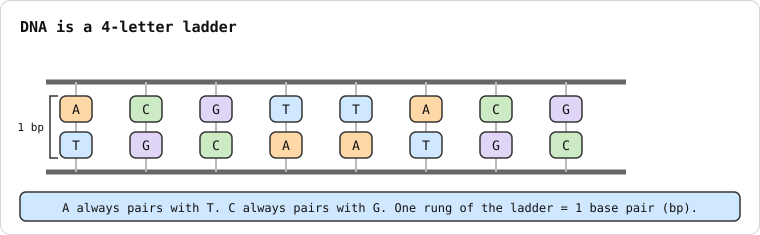

> **Legend** — each coloured box is one DNA letter · A always faces T, C always faces G · the bracket on the left marks one base pair.

**Genome** — the whole instruction book of one person (all 3 billion letters).

**Chromosome** — the book is split into 23 volumes. Written `chr1`, `chr2`, ... `chr15`, `chrX`, `chrY`.
*Example: `chr15q15.1` = chromosome 15, long arm (`q`), region 15.1. Like "volume 15, page 15, paragraph 1".*

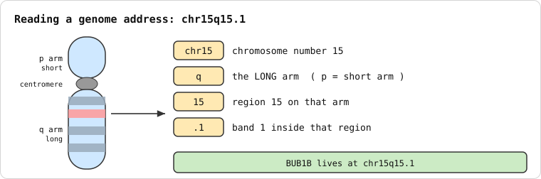

> **Legend** — blue: the chromosome body · gray oval: the centromere, the pinch in the middle · red stripe: the band being addressed · yellow boxes: the four parts of the address, in order.

**Gene** — one recipe inside the book. About 20,000 recipes. Each makes one protein.
*Example: the gene `BUB1B` is the recipe for a protein that checks cell division.*

**Protein** — the machine the recipe builds. Proteins do all the actual work in a cell.

**Amino acid / residue** — one bead in the protein chain. A gene's letters, read 3 at a time, spell out which bead comes next.

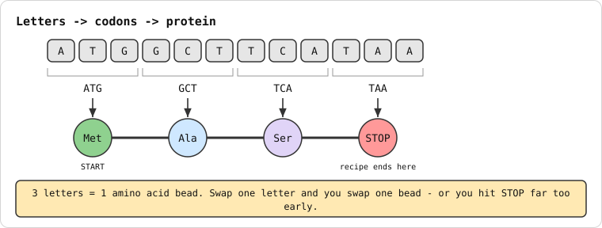

> **Legend** — gray boxes: DNA letters · the brackets show how they group in threes · each circle is the amino acid that triple codes for · red circle: STOP, the end of the recipe.

**Exon** — the parts of a gene that end up in the final recipe (the useful text).

**Intron** — the parts cut out and thrown away before the recipe is used (like commercials cut from a recorded show).

**Splicing** — the cutting-out step. Cell removes introns, glues exons together.
*If splicing goes wrong, the recipe is garbled and the protein is broken.*

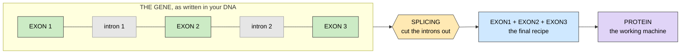

> **Legend** — green boxes: exons, kept · gray boxes: introns, cut out and thrown away · yellow hexagon: the splicing step · blue: the finished recipe · purple: the protein it builds.

**Deep intronic** — a change buried far inside an intron, far from any exon. Easy to miss, but can still wreck splicing.

**Transcript** — one specific version of a recipe (a gene can be spliced several ways). **MANE Select** = the one official version everyone agrees to quote.

**Canonical transcript** — the one version Ensembl nominates as the gene's representative, and the one every tool reports against by default. It matters that everybody uses the *same* one: an exon number, a domain boundary and a variant's amino-acid position are only comparable if they are all measured on the same transcript. *Example:* `ENST00000287598` for BUB1B; Ensembl writes the pointer with a version suffix (`.11`) that the transcript's own id lacks.

**Strand** — which of the DNA's two mirrored strands a gene is read from. **Forward / plus (`+1`)** reads left-to-right along the coordinate axis, **reverse / minus (`-1`)** reads right-to-left. Consequence: on a minus-strand gene, exon 1 is the *rightmost* box on a chart. *Example:* TP53 is `-1`, BUB1B is `+1`.

**TSS (transcription start site)** — the first base actually copied into the transcript, i.e. where reading begins. On the minus strand it is the gene's *high* coordinate.

**Allele** — one copy of a gene. You have 2 copies of every gene: one from each parent.

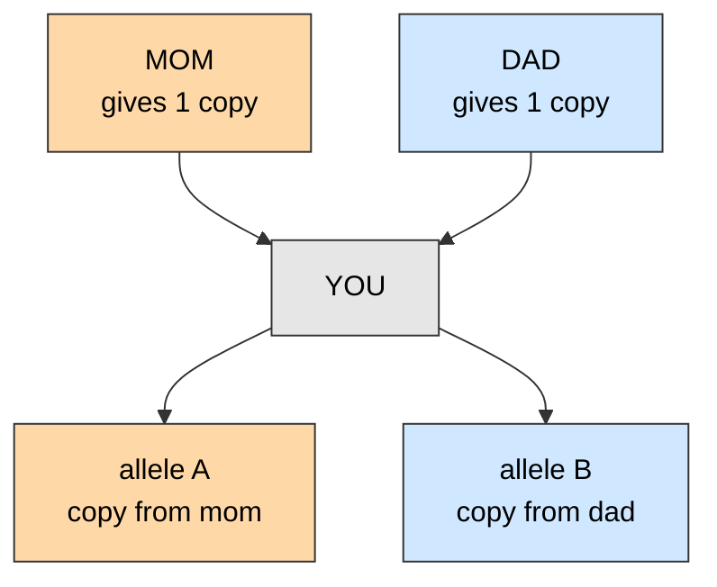

> **Legend** — orange: the copy that comes from mum · blue: the copy that comes from dad · gray: you, holding both at once.

**Diploid** — having 2 copies of each chromosome. Normal for humans.

**Genotype** — which 2 alleles you actually carry at one spot.

**Locus** — an address in the genome. *`15q15.1` is a locus.*

---

## 2. Reading DNA (sequencing) and the files it makes

**Sequencing** — machine reads the DNA letters. It cannot read the whole book at once, so it shreds it and reads tiny scraps.

**Read** — one scrap the machine read. Typically 150 letters long.
*Example: this case is 2 × 149 letters.*

**Base quality / Phred score / Q30** — a per-letter confidence number. Q30 means "1 chance in 1,000 this letter is wrong". People quote the **Q30 rate**: the share of letters at Q30 or better.
*Example: 92% Q30 in this dataset — good. Below ~80% and you start distrusting calls.*

**Paired-end** — machine reads both ends of each scrap. Two files, `R1` and `R2`, that pair up.

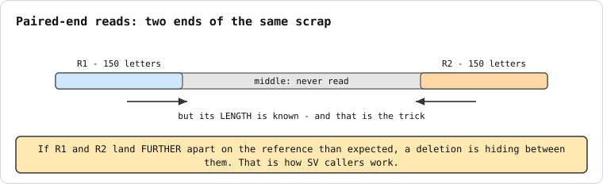

> **Legend** — blue: the R1 read · orange: the R2 read · gray: the middle, never read · the arrows show which direction each end is read from.

**Insert size (fragment length)** — the full length of the original scrap, R1 + the unread middle + R2. It is the physical reach of one piece of evidence.
*Example: 266 letters here. Two variants further apart than that can never sit on the same fragment, which is exactly why [phasing](#4-inheritance--how-the-answer-is-shaped) fails at gene scale in this case.*

**Lane / flowcell / instrument** — the machine's own subdivisions. One library of DNA is spread across several lanes and read in parallel; the lane number is in every read's name.
*Example: `@A01973:164:HGWCNDSX7:1:…` = instrument `A01973` (a NovaSeq 6000), flowcell `HGWCNDSX7`, lane `1`. This case is 4 lanes × 2 ends = 8 FASTQ files, all one library — so the lanes are technical repeats and you just merge them.*

**Coverage / depth (e.g. 30×)** — how many scraps cover each letter, on average. 30× = each letter was read ~30 times.
*More coverage = more confident. At 5× coverage, "nothing found here" means nothing.*

```text
reference    A   C   G   T   T   A   C   G   T   A   C
read 1       A   C   G   T   T   A
read 2           C   G   T   T   A   C   G
read 3                   T   T   A   C   G   T   A
read 4                           A   C   G   T   A   C
             --- --- --- --- --- --- --- --- --- --- ---
depth        1   2   2   3   3   4   3   3   2   2   1
             ^^^                                   ^^^
             thin edges: a variant here is a coin flip

Real data: ~30 scraps stacked on every letter (30x).
A hole in the stack is why "we found nothing in that exon" can be a lie.
```

> **Legend** — each `read` row is one 150-letter scrap · the `depth` row counts how many scraps cover that letter · the thin edges are where a call becomes a coin flip.

**WGS (whole genome sequencing)** — read the entire book, introns and all. ~85 GB of data.

**WES (whole exome sequencing)** — read only the exons (~2% of the book). Cheaper, but blind to introns.
*This case is WGS, so hidden intron answers ARE possible.*

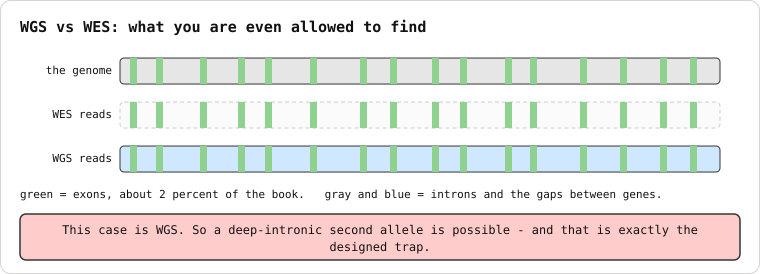

> **Legend** — green ticks: exons · gray bar: the whole genome · the dashed row is what WES sees, the blue row is what WGS sees.

**FASTQ** — the raw scrap file. Just the letters + a quality score per letter. Huge, unorganized.

**Alignment / mapping** — puzzle step: figure out where each scrap belongs on the reference book.

**Reference genome / GRCh38 (= hg38)** — the standard "official" human book everyone compares against. Version 38.
*Positions only mean something relative to a reference. `chr15:40,000,000` in GRCh38 ≠ same spot in GRCh37.*

**Contig** — one continuous named sequence in the reference. Chromosomes are contigs; so is every leftover fragment nobody could place.

**`chr` prefix (contig naming)** — the same chromosome is written `chr15` in some references and plain `15` in others. Both are GRCh38; only the *string* differs. Programs that compare names literally will silently find nothing.
*Example: this case's VCF says `15`, the submission format demands `chr15`. Convert in exactly one place in your code, never by hand.*

**Region (`contig:start-end`)** — the standard way to write a stretch of the genome: a contig name, a colon, and a 1-based coordinate range that is **inclusive at both ends**. Every genome tool takes one (`samtools view`, `bcftools view -r`, IGV's search box), so it is the closest thing genomics has to a URL. Watch the off-by-one: interval *files* (the `.bed` format, further down) are 0-based and half-open, so the same stretch is written with a different start there.
*Example:* `15:40100000-40200000` and `chr15:40,100,000-40,200,000` name the same 100,001 bp window on chromosome 15; the commas are decoration and the `chr` is the prefix question above.

**Analysis set / no-alt / decoy (hs38d1)** — the packaging of a reference for real analysis. **Alt contigs** are alternative versions of tricky regions; a **no-alt** set leaves them out so each read has one obvious home. **Decoy** sequence (`hs38d1`) is junk DNA added deliberately as a magnet, so reads that belong nowhere stick to it instead of piling up on a real gene and inventing a variant.
*Example: this VCF declares 1,690 contigs — 25 real ones (`1`–`22`, `X`, `Y`, `M`), 148 unplaced fragments, and 1,517 decoys.*

**Unplaced / random contig (`_random`, `Un_`)** — a real piece of human sequence that could not be pinned to a chromosome. Variants there are almost always noise for a diagnosis.

**BAM / CRAM** — the file of scraps AFTER alignment (each scrap now has an address). CRAM = same thing, squeezed smaller.

**bwa-mem2** — a popular aligner program (does the puzzle step).

**Duplicate reads / duplication rate** — copies of the *same* original scrap, made during library prep, not real independent evidence. They get marked and ignored, so they cost you coverage.
*Example: 9.3% here — normal. That is part of why 52× of raw letters becomes ~44× of usable depth.*

**Variant calling** — comparing the person's scraps to the reference and writing down every difference.

**Caller** — the program that does it. *DeepVariant, GATK HaplotypeCaller, Clair3.*

**VCF (Variant Call Format)** — the list of differences. One line per difference. Much smaller than FASTQ.
*This is the main hunting ground.*

```mermaid
flowchart LR
    G["GENOME<br/>3 billion letters<br/>in the child's cells"] --> SQ["SEQUENCER<br/>shreds it, reads scraps"]
    SQ --> FQ["FASTQ<br/>~70 GB<br/>scraps with NO address"]
    FQ --> AL["ALIGN to GRCh38<br/>bwa-mem2"]
    AL --> BM["BAM / CRAM<br/>~20 GB<br/>scraps WITH an address"]
    BM --> VC["VARIANT CALLING<br/>DeepVariant"]
    VC --> VF["VCF<br/>~200 MB<br/>only the differences"]
    style G fill:#e0d4f7,stroke:#333,color:#000
    style FQ fill:#ffcccc,stroke:#333,color:#000
    style BM fill:#ffe9b3,stroke:#333,color:#000
    style VF fill:#ccebc5,stroke:#333,color:#000
    style SQ fill:#e6e6e6,stroke:#333,color:#000
    style AL fill:#e6e6e6,stroke:#333,color:#000
    style VC fill:#e6e6e6,stroke:#333,color:#000
```

> **Legend** — purple: the real genome · red: raw and huge · yellow: aligned but still huge · green: small and usable · gray: the tools in between.

**The whole hackathon is a fight over what got lost between red and green.**

**FILTER / PASS** — the caller's confidence flag on each line. `PASS` = caller trusts it. Non-PASS lines get thrown away by default — dangerous, because the real answer might be sitting there.
*It is a **text column on a row the caller kept**, not a deletion: GATK's `VariantFiltration` writes the name of every threshold the line failed and leaves the line in the file. So "suppressed" means *downstream tools are expected to skip it*. When a line trips several thresholds the names are packed into one `;`-joined string, so `LowQual;QD2` is **one** record that failed two tests — counting it once under each name over-counts the file. Software analogy: a warning level on a log line, not a dropped log line.*
*Example:* 271,414 of this callset's 5,012,204 lines are non-PASS — 5.4 %. What is inside those lines for the candidate genes is measured in [methodology 049](step-0/methodology/049-suppressed-calls.md).

**mapping quality (MAPQ)** — the aligner's confidence, in [Phred](#2-reading-dna-sequencing-and-the-files-it-makes) units, that a [read](#2-reading-dna-sequencing-and-the-files-it-makes) came from the place it put it. It is low wherever the genome repeats itself, because the same read could have come from two or more places and the aligner cannot tell which. Not the same thing as base quality, which is the instrument's confidence in each letter. Software analogy: confidence in *which* bucket a hash landed in, as opposed to confidence in the bytes.
*Example:* MAPQ 0 means "this read maps equally well somewhere else" — common in [segmental duplications](#3-variants-the-differences-you-hunt) and near [telomeres](#1-dna-basics-read-this-first-everything-else-needs-it).

**MQ40** — a [FILTER](#2-reading-dna-sequencing-and-the-files-it-makes) label meaning *the mean [mapping quality](#2-reading-dna-sequencing-and-the-files-it-makes) at this site is under 40*. It fires in hard-to-map sequence, so it is a statement about **where** the variant is, not about whether it is real — which is exactly why non-PASS lines are worth mining: a real variant sitting in a repeat gets flagged too.
*Example:* the heaviest suppression reason in this callset — 177,522 lines, and 12 of the candidate panel's 20 suppressed lines.

**quality by depth (QD)** — the site's [QUAL](#2-reading-dna-sequencing-and-the-files-it-makes) score divided by the [read depth](#2-reading-dna-sequencing-and-the-files-it-makes) behind it. Raw QUAL grows with coverage, so a deeply covered site looks confident even on weak evidence; dividing normalises that out. Software analogy: a rate rather than a total.
*Example:* the **QD2** FILTER label = QD under 2, i.e. very little confidence per read. 35,402 lines here.

**tabix / bgzip / index** — compression + a table-of-contents so you can jump to `chr15` without reading the whole file.

**QC (quality control)** — checking the data isn't broken before trusting any result. *Tools: FastQC, MultiQC, samtools stats, bcftools stats, mosdepth.*

**Ti/Tv ratio** (also written **ts/tv**) — a sanity number: transitions divided by transversions (two chemically different kinds of letter swap). Real human WGS lands around 2.0–2.1. Way off = something is wrong.
*Example: 1.94 here — slightly noisy, acceptable.*

**bcftools stats section code** — the first column of every `bcftools stats` line, saying which table that line belongs to. One file holds a dozen stacked tables rather than one, so the code is how you tell them apart. Software analogy: a tagged-union log format — one line type per tag, and you dispatch on the tag. The ones this project reads: **SN** (summary numbers: records, SNPs, indels, multiallelic sites), **TSTV** (one row, the [Ti/Tv ratio](#4-quality-what-can-go-wrong-and-how-you-see-it)), **ST** (substitution spectrum: one row per `A>C`-style swap), **IDD** ([indel](#3-variants-the-differences-you-hunt) length distribution, negative = deletion), **DP** ([read depth](#2-reading-dna-sequencing-and-the-files-it-makes) distribution), **AF** (one row per non-reference allele-frequency bin — see the trap below), **SiS** (singleton stats: the counters for alleles seen exactly once).
*Two things about the delivered file are worth knowing. **The `AF` section here is a zygosity split, not a frequency spectrum**: it is computed from each record's own [AC/AN](#3-variants-the-differences-you-hunt), and with one sample AN is always 2, so bcftools emits exactly two bins — AC=1 (heterozygous) and AC=2 (homozygous alternate). Nothing about the general population is in it. And **`SiS` is the same numbers again**: bcftools prints the singleton counters once keyed by allele count and again as the first `AF` bin, so on this file the two lines are byte-identical. Which sections the delivery actually contains — and which it does not, `QUAL` included — is measured in [methodology 045](step-0/methodology/045-orphan-tables.md).*
*Example:* `ST	0	A>G	656121` — section `ST`, sample id `0`, 656,121 A-to-G substitutions.

**Quality binning / quantised quality** — modern Illumina instruments do not emit every possible [Phred score](#2-reading-dna-sequencing-and-the-files-it-makes). They round each one to a handful of representative values so the [FASTQ](#2-reading-dna-sequencing-and-the-files-it-makes) compresses far better. So a "quality distribution" is genuinely a few tall bars, not a smooth curve — and plotting it as a density curve invents detail the instrument never recorded. Software analogy: lossy quantisation before compression, like reducing a colour palette.
*Example:* this NovaSeq run uses exactly four levels — Phred 2, 11, 25 and 37 — measured in [`step-0/methodology/028`](step-0/methodology/028-viz-api.md).

**Sentieon** — a commercial re-implementation of the GATK variant-calling algorithms, much faster and giving near-identical results. Common in clinical labs, so you meet it in VCF headers rather than by choosing it.
*Example: this callset was made by Sentieon Haplotyper → Sentieon GVCFtyper → GATK `VariantFiltration`. Reading that chain tells you it is a **small-variant pipeline only** — no structural variants will ever appear in this file.*

**fastp / FastQC** — programs that read a FASTQ and report [Q30](#2-reading-dna-sequencing-and-the-files-it-makes), GC content, [duplication](#2-reading-dna-sequencing-and-the-files-it-makes), [insert size](#2-reading-dna-sequencing-and-the-files-it-makes) and adapter contamination. `fastp` also trims; `MultiQC` merges many reports into one page.

---

## 3. Variants (the differences you hunt)

**Variant** — one difference from the reference book.

**SNV (single nucleotide variant)** — one letter swapped. *`chr15:100 A>G` = at position 100, reference has A, this person has G.*

**Indel** — a few letters inserted or deleted. *`CT>C` = one T deleted.*

**REF / ALT** — REF = what the reference book says. ALT = what this person has.

**POS** — the position number on the chromosome.

**Variant tuple `(chrom, pos, ref, alt)`** — the 4 things that uniquely name a variant. *`("chr15", 40162526, "C", "T")`.*

**Normalization / left-alignment (`bcftools norm`)** — the SAME deletion can be written several ways. Normalization forces one standard spelling.
*Example: deleting a T from `AAAT` can be written as position 1 `AAAT>AAA` or position 4 `AT>A`. Same biology, different text. If you spell it differently than the answer key, the computer says WRONG.*

```text
The child lost one A from a run of three:

reference   pos: 100 101 102 103
                  A   A   A   T
patient           A   A       T      (one A gone - but WHICH A? nobody can tell)

three legal ways to write the exact same event:
    pos=100  REF=AA  ALT=A      <- leftmost, shortest   (the standard)
    pos=101  REF=AA  ALT=A
    pos=102  REF=AT  ALT=T

  answer key holds : chr15  100  AA  A
  you submit       : chr15  101  AA  A
  scorer compares  : ("chr15",100,"AA","A")  vs  ("chr15",101,"AA","A")
  result           : MISS.  Same biology. Different text. Zero points.
```

> **Legend** — the three indented lines are the same deletion written three legal ways · only the first survives `bcftools norm` · the bottom block is what the scorer actually compares.

`bcftools norm -f GRCh38.fa -m -both` forces the leftmost/shortest spelling on everything. **Run it before anything else.**

**Multiallelic** — one position where the person has two different ALTs. Splitting (`-m -both`) breaks it into separate lines.

**HGVS** — the doctor-style way to write a variant. *`NM_001211.6:c.1288A>T` or `p.Arg430Ter`. Different notation from VCF, needs conversion.*

**SV (structural variant)** — a BIG change: a whole chunk deleted, duplicated, flipped, or moved.
*Example: an entire exon of 200 letters gone. A normal SNV caller misses this completely.*
*Callers: Manta, Delly, smoove/LUMPY, GRIDSS.*

**CNV (copy number variant)** — you have 1 or 3 copies of a chunk instead of 2. Found by depth: half the reads = one copy missing.

```text
reference   : A C G T T A C G T T A C G T          size        who finds it
              ------------------------------------------------------------------
SNV         : A C G T T A C G T T A C G A          1 letter    any caller, easy
insertion   : A C G T T A A A C G T T A C          1-50        any caller, ok
deletion    : A C G T T . . G T T A C G T          1-50        any caller, ok
SV deletion : A C G . . . . . . . . C G T          >50, whole  Manta / Delly ONLY
                                                   exon gone   (normal caller: blind)
inversion   : A C G T T   ACGTTACG flipped         >50         SV callers only
CNV dup     : region present 3 times not 2         kb to Mb    depth counting
repeat exp  : CAG CAG CAG CAG CAG CAG ... x200     variable    ExpansionHunter
```

> **Legend** — letters shown as `.` were removed · the size column is how many letters the change spans · the last column is which tool can even see it.

The easy classes are already in the VCF. **The hidden second allele is almost certainly one of the hard rows.**

**Repeat expansion** — a short pattern repeated too many times. *`CAGCAGCAG...` x 200.*

**Mobile element insertion** — a jumping piece of DNA landed in a gene.

**VAF (variant allele fraction)** — what fraction of your reads show the ALT letter.
*Normal expectations: 0% = you don't have it, ~50% = one copy (het), ~100% = both copies (hom).*

**Mosaic / mosaicism** — the variant is only in SOME of your cells, not all. So VAF comes out weird, like 12%.
*Example: a mistake happened after you were an embryo, so only some cells carry it. Standard callers assume 0/50/100% and throw 12% away as noise.*

**Low-VAF scan** — deliberately hunting for those weird-fraction variants that got thrown away.

**Allele balance** — the average [VAF](#3-variants-the-differences-you-hunt) across all the heterozygous calls on a chromosome. Should sit at 0.5. It is a free whole-chromosome copy-number test: if a fraction of cells carry an extra copy, the average drifts off 0.5 and the depth drifts up.
*Example: measured 0.472–0.497 on every autosome here — flat. That is how we know no [mosaic aneuploidy](#5-the-disease--mva) is visible in this blood sample, without aligning a single read. It bounds the aneuploid fraction below roughly 10–15%; it does not disprove the diagnosis, because MVA is diagnosed on cultured cells, not blood.*

```text
30 reads stacked on one position. How many show the ALT letter?

  not present    0/30   |                              |    0%   nothing there
  MOSAIC         4/30   |####                          |   13%   <-- REAL, but the
                                                                      caller deletes it
                                                                      as "noise"
  het           15/30   |###############               |   50%   1 of your 2 copies
  hom           30/30   |##############################|  100%   both copies
```

> **Legend** — bar length = the fraction of reads carrying the ALT letter · the 13% row is real biology that a standard caller throws away as noise.

Every standard caller assumes only 0% / 50% / 100% exist. **MVA is a mosaicism disease — so the 13% row is exactly where a missed allele hides.**

**Zygosity** — how many copies you carry. **Het (heterozygous)** = 1 of 2 copies changed. **Hom (homozygous)** = both copies changed. **Hemizygous** = only 1 copy exists at all (like a boy's X chromosome).

**AC / AN (allele count / allele number)** — two `INFO` counters the caller writes on every record. **AN** = how many copies were looked at in total across all samples; **AC** = how many of them carried the ALT letter. Software analogy: a numerator and a denominator shipped separately so nobody has to trust a pre-divided float.
*With **one** sample AN is always 2 (you have two copies of each autosome), so AC can only be 1 or 2: **AC=1 is a het call, AC=2 a hom-alt call**. That is why the callset's own `INFO/AF` (= AC/AN) is only ever 0.5 or 1.0 and says nothing about the population — see the AF trap under [gnomAD's AF](#7-databases-and-annotation). Measured in this callset: 3,180,797 alleles at AC=1 and 1,898,267 at AC=2 ([methodology 045](step-0/methodology/045-orphan-tables.md)).*

**Singleton (allele sense)** — an allele seen exactly **once** in the whole cohort, i.e. AC=1. Not to be confused with **[singleton sequencing](#4-inheritance--how-the-answer-is-shaped)**, which means only the child was sequenced. Both words appear in this project and they mean different things: this case is a sequencing singleton, and in a sequencing singleton *every het call* is also an allele singleton, which is what collapses bcftools' `SiS` section into "the het half of the callset".

**Germline** — variant you were born with, in every cell. **Somatic** — acquired later, in some cells only (cancer works this way).

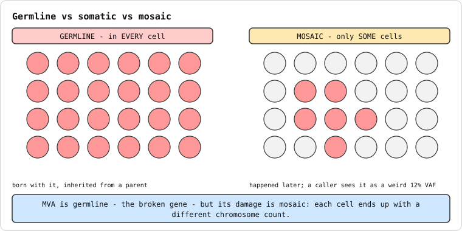

> **Legend** — each circle is one cell of the body · red: carries the variant · white: does not.

**Genotype likelihood (`PL` / `GL` / `GQ`)** — the caller's confidence numbers. A low `GQ` het is not proof of absence — look again.

**Reference bias** — the aligner slightly prefers reads that match the reference, so ALT counts run a bit low.

**Substitution spectrum (mutational spectrum)** — a count of every kind of letter swap: how many A>G, how many C>T, and so on. Twelve possible swaps, so twelve bars. It is a fingerprint of *how* the DNA changed, and real biology has a very lopsided one.
*Example: `C>T` and `T>C` dominate real human variation, because a chemically tagged C decays into T on its own all the time. Sequencing errors have no such preference — so a spectrum where all twelve bars are the same height is a callset full of artifacts.*

**Strand collapse (pyrimidine-centric notation)** — DNA has two strands that mirror each other, so the same event reads as `G>A` from one side and `C>T` from the other. Collapsing folds each swap together with its mirror image, turning twelve bars into six. Standard in mutational-signature work (COSMIC).
*Example: `G>A` counted separately from `C>T` splits one real signal in half and makes it look weaker than it is.*

**Indel length spectrum** — how many [indels](#3-variants-the-differences-you-hunt) of each length, from a single letter up to tens. Deletions plotted as negative, insertions as positive.
*Example: ±1 letter dwarfs everything else, so the count axis has to be logarithmic. Whether the length divides by three matters enormously — see [frameshift](#3-variants-the-differences-you-hunt).*

**Variant density** — variants called per megabase (million letters). Raw variant counts just track chromosome length and say nothing; dividing by length makes a long chromosome and a short one comparable.
*Example: ~1,540 variants per Mb, flat across every chromosome in this dataset. Flat is the expected result and worth confirming.*

**Het:hom ratio** — heterozygous calls divided by homozygous-alternate calls. An outbred person lands around 1.3–2.0.
*Example: 1.61 here (3,047,077 het / 1,898,267 hom). A low ratio would mean long stretches where both inherited copies are identical, which would argue for a homozygous answer rather than a [compound heterozygote](#4-inheritance--how-the-answer-is-shaped).*

**Karyogram / ideogram** — a picture of all the chromosomes drawn side by side to scale, used to mark where something sits. The classic cytogenetics figure.
*Example: the panel gene map in the exploration report is one — 24 bars, with a diamond at each candidate gene's real coordinates.*

**Segmental duplication / repeat region / mappability** — parts of the genome that look like each other, so scraps can't be placed confidently. Callers do badly here.

---

## 4. Inheritance — how the answer is shaped

**Autosomal** — on a normal chromosome (1–22), not X or Y. Boys and girls equally affected.

**Recessive** — you need BOTH copies broken to get sick. One broken copy = healthy carrier.
*Parents are usually healthy carriers, so the disease looks like it came from nowhere.*

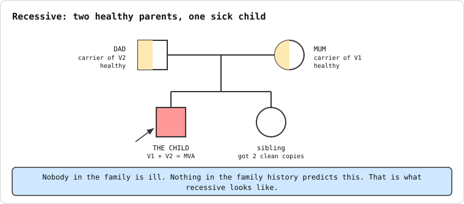

> **Legend** — square = male, circle = female · half-filled = healthy carrier · fully filled = affected · the arrow points at the proband, the patient the case is about.

**Dominant** — one broken copy is enough to get sick.

**Biallelic** — both copies of the gene are hit. Required for recessive disease.

**Compound heterozygous ("comp het")** — both copies broken, but by TWO DIFFERENT variants — one inherited from mom, one from dad.
*Example: from mom you get `BUB1B` with a stop-too-early mistake; from dad you get `BUB1B` with a splice mistake. Neither parent is sick. You are. **This is the shape of the answer in this hackathon.***

**Homozygous variant** — both copies broken by the SAME variant (usually when parents are related). Ruled out here.

**In trans** — the two variants sit on OPPOSITE copies (one from each parent). This is what makes you sick — no working copy left.

**In cis** — both variants sit on the SAME copy. Your other copy is fine, so you're healthy. Immediately eliminates that pair.

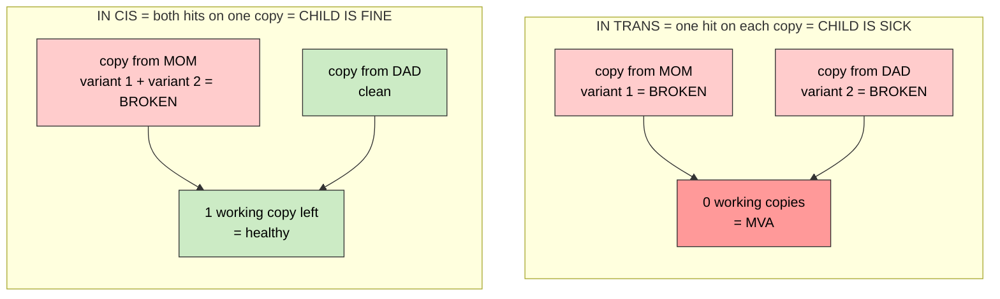

> **Legend** — red: a broken copy, and the outcome it leads to · green: a copy that still works, and its outcome · each box is one of the child's two gene copies.

Two rare variants in the same gene look identical in a VCF. **Only phasing tells trans from cis — and cis kills the hypothesis for free.**

**Phase / phasing** — figuring out whether two variants are in trans or in cis.

**Read-backed phasing** — if one single read scrap covers both variants, they're on the same copy (cis). Only works if they're close together (< ~1000 letters).
*Tools: WhatsHap, SmartPhase, HiPhase.*

**Phase block / PS tag** — a stretch where phasing was successfully worked out.

**`PGT` / `PID`** — the caller's own phasing columns in a VCF. `PGT` is the arrangement (`0|1` or `1|0`) and `PID` is the group id shared by variants phased together. Same `PID` + different `PGT` = *in trans*.
*Example: 15% of records here carry them, which sounds useful and is not — the reach is one [fragment](#2-reading-dna-sequencing-and-the-files-it-makes), ~266 letters. On BUB1B it settled 5 of 1,653 candidate pairs.*

**`1/2` genotype (multiallelic site)** — at one position the child carries **two different non-reference letters** and no reference copy. One of each, so one per parent copy: **compound heterozygosity proven by the genotype alone**, no read evidence needed. The one place phase is free.
*Example: 66,860 such sites in this callset. `bcftools norm -m -both` splits each into two rows that are in trans by construction.*

**Haplotype** — one full copy of a chromosome region, as inherited from one parent.

**Trio / duo / singleton** — sequencing the child + both parents (trio), + one parent (duo), or only the child (singleton). Trio makes phasing free. **Confirmed singleton here** — the VCF has exactly one sample column — so nothing is free and everything leans on rarity and consequence.

**Proband** — the patient the case is about. The submission must call them `PROBAND01`.
*Careful: the VCF's own sample column says `WGS_EX2312012` (the lab's accession number). The two strings are unrelated, and the mapping exists nowhere in the data — it is a convention of the challenge. Submitting the accession scores zero.*

**Accession number** — a lab's internal id for a sample or an order. Meaningless outside that lab, and usually the thing you must strip before publishing anything.

**Segregation** — checking the variants track with disease across the family.

**LoF (loss of function)** — the variant kills the protein completely.

**Truncating / nonsense / stop-gained** — the recipe hits a "STOP" too early, so you get half a protein.

**Frameshift** — an indel of a number not divisible by 3, so everything after it is read in the wrong grouping — total nonsense.

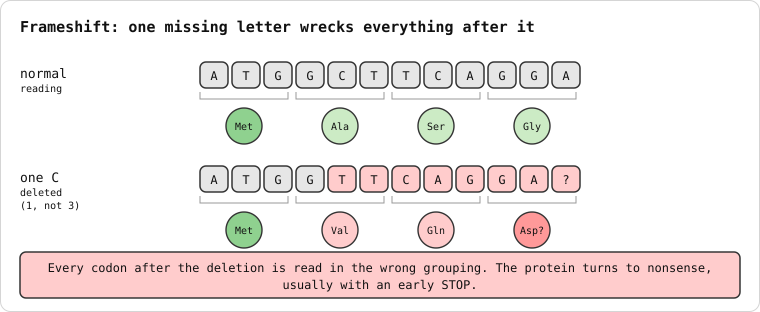

> **Legend** — gray letters are still read correctly · red letters are read in the wrong grouping · circles are the amino acids produced · red circles are nonsense.

**NMD (nonsense-mediated decay)** — the cell's quality checker destroys recipes with an early STOP. So truncating variants usually make zero protein.

**NMD escape** — if the early STOP is in the last exon, the checker misses it, so a partly-working protein IS made. Matters a lot: an "obvious LoF" might actually be a mild variant.

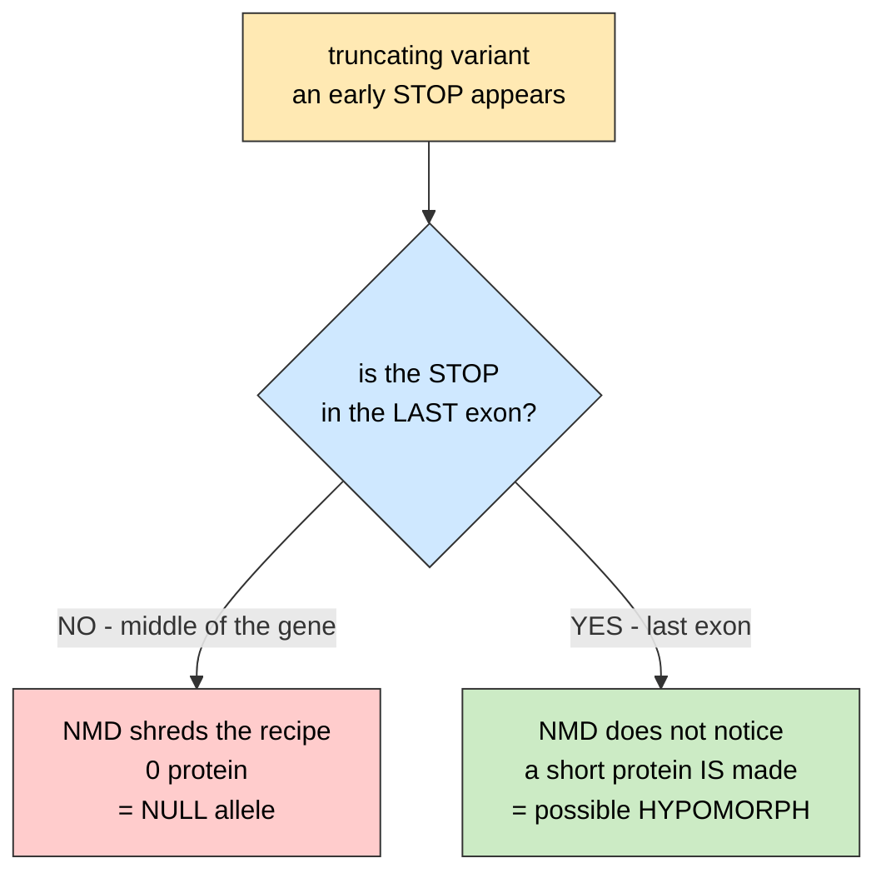

> **Legend** — yellow: the variant · blue: the question the cell effectively asks · red: the recipe is destroyed, a null allele · green: a short protein survives, a possible hypomorph.

**Null allele** — makes zero working protein.

**Hypomorph / hypomorphic** — makes SOME working protein, just less or weaker. "Leaky", not dead.
*Key rule for this case: two nulls in `BUB1B` = the baby doesn't survive. So the answer is almost certainly **one null + one hypomorph**.*

```text
                              working BUB1B protein produced
  healthy person            |####################|  100%   fine
  NULL + healthy copy       |##########          |   50%   healthy carrier (a parent)
  NULL + HYPOMORPH          |#####               |  ~25%   <-- MVA. THE ANSWER SHAPE.
  NULL + NULL               |                    |    0%   embryo does not survive
```

> **Legend** — bar length = how much working protein is produced · the arrow marks the one combination MVA patients actually carry.

So a pair of two obvious stop-codons should be **down**-ranked. One clean killer + one sneaky leaky allele is the biologically expected combination.

**Leaky splice variant** — a splice mistake that goes wrong only some of the time, so a fraction of correct protein still gets made. Classic hypomorph.

**GoF (gain of function)** — the opposite: protein does something new or too much.

**Penetrance / expressivity** — whether carriers actually get sick, and how badly.

---

## 5. The disease — MVA

**Mitosis** — cell division. One cell copies its chromosomes and splits into two identical cells.

**Chromosome segregation** — the part of mitosis where each daughter cell must get exactly one copy of each chromosome.

**Missegregation** — that step goes wrong; a daughter cell gets too many or too few chromosomes.

**Aneuploidy** — having the wrong NUMBER of chromosomes. *Trisomy = 3 copies instead of 2. Monosomy = 1 copy. Tetraploidy = everything doubled.*

**Mosaic aneuploidy** — only some of the body's cells have wrong chromosome counts.

**Variegated** — each affected cell has a DIFFERENT wrong count. Cell A has 3 copies of chr8, cell B has 1 copy of chr20.
*This means the mistakes are being generated over and over, not inherited once.*

```text
One MVA child. Eight of their cells looked at under a microscope:

  cell 1   46  ..............  normal
  cell 2   47  +chr8 .........  trisomy 8
  cell 3   45  -chr20 ........  monosomy 20
  cell 4   46  ..............  normal
  cell 5   47  +chr3 .........
  cell 6   48  +chr5 +chr9 ...  double trisomy
  cell 7   45  -chr7 .........
  cell 8   46  ..............  normal

  "mosaic"      -> only SOME cells are wrong          (5 of 8 here)
  "variegated"  -> each wrong cell is wrong DIFFERENTLY
```

> **Legend** — the number is that cell's chromosome count · `+chrN` = an extra copy · `-chrN` = a missing copy · 46 is normal.

Compare Down syndrome: **every** cell has the **same** extra chr21. That is inherited once. MVA is a mistake-making machine that never switches off.

**MVA (Mosaic Variegated Aneuploidy)** — the disease. Recessive. 25–50% of body cells carry random, differing chromosome miscounts. Under 50 patients worldwide.
*Symptoms: small head, poor growth, learning difficulty, and high cancer risk.*

**Karyotype** — a photo of all a cell's chromosomes lined up. How MVA is diagnosed: look at many cells, see different miscounts in each.

**Cytogenetic** — done by looking at chromosomes under a microscope (as opposed to reading letters).

**Microcephaly** — unusually small head/brain.

**ID (intellectual disability)** — learning and thinking difficulties.

**Rhizomelic** — the upper arm/thigh bones are short (the part closest to the body).

**Dysmorphism** — unusual facial or body features.

**Cancer predisposition** — much higher than normal chance of getting cancer.
*MVA cancers seen: Wilms tumour (kidney), rhabdomyosarcoma (muscle), ALL/leukemia (blood).*

**Malignancy / neoplasm / tumour** — cancer.

**Tumorigenesis** — the process of a cancer starting.

**SAC (spindle assembly checkpoint)** — the cell's safety inspector during division. It shouts "STOP" until every chromosome is properly gripped. Only then does the cell split.
*If the inspector is weak, the cell splits too early with chromosomes in the wrong places = aneuploidy.*

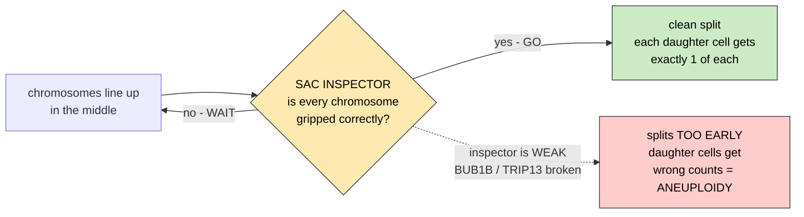

> **Legend** — yellow: the checkpoint decision · green: the correct outcome · red: what happens when the inspector is weak · the dotted arrow is the failure route, not the normal one.

**Anaphase** — the moment chromosomes get pulled apart. The SAC delays this until everything is ready.

**Kinetochore** — the handle on a chromosome that the pulling cables grab.

**Spindle** — the cables (microtubules) that pull chromosomes apart.

**Centrosome / centriole** — the two anchor points the cables shoot out from. Should be exactly two, giving a clean two-way pull (**bipolar**).

**Multipolar division** — too many anchor points, so the cell gets pulled 3+ ways. Chaos.

**Merotelic attachment** — one chromosome grabbed by cables from both sides at once. Wrong.

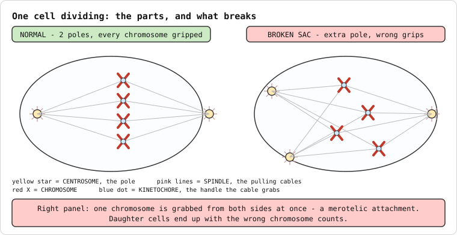

> **Legend** — yellow star: centrosome, the pole · pink lines: the spindle cables · red X: a chromosome · blue dot: the kinetochore, the handle · green header = normal, red header = broken.

**PCS (premature chromatid separation)** — chromosomes fall apart before they're supposed to. A hallmark seen in BUB1B patients.

**MCC (mitotic checkpoint complex)** — the actual "STOP" signal molecule. Built from BUBR1 + BUB3 + MAD2 + CDC20.

**APC/C** — the machine that starts the split. MCC blocks it. No MCC = split happens too soon.

**Ubiquitin ligase** — a protein that tags other proteins for destruction. APC/C is one.

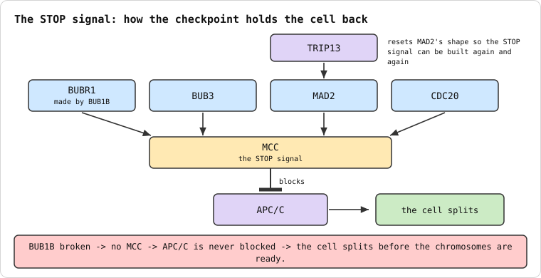

> **Legend** — blue: the four proteins that build the signal · yellow: the assembled STOP signal · purple: the enzymes · green: the outcome · the bar-ended line means blocks, not activates.

**BUB1B (protein name BUBR1)** — the main MVA gene, at `chr15q15.1`. Core part of the STOP signal. Its patients get cancer. **The prime suspect.**

**CEP57** — MVA gene 2, at `11q21`. Centrosome part. Patients have short upper limbs, usually NO cancer.

**TRIP13** — MVA gene 3, at `5p15.33`. Resets MAD2 so the STOP signal can be rebuilt. Cancer risk.

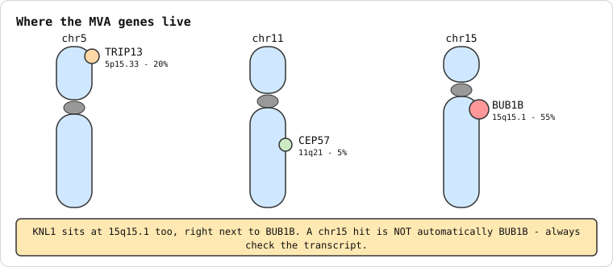

> **Legend** — blue: the chromosome arms · gray oval: the centromere · pin colour and size show how much prior belief each gene carries.

**CEP192, CENPE, SMC5, BUB1, BUB3, KNL1/CASC5, PLK4, MAD1L1, MAD2L1, CDC20, TTK/MPS1** — other division-machinery genes. Rare or suspected causes. Keep on the list, don't bet on them.

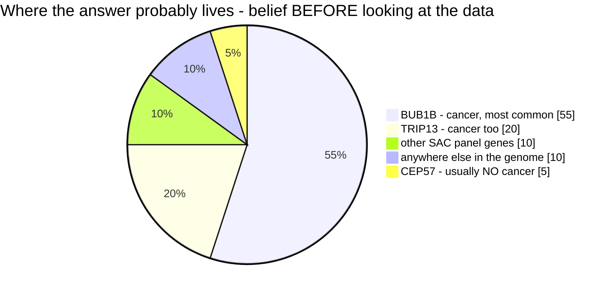

> **Legend** — slice size = how much belief each gene carries BEFORE any data is looked at · these are priors, not results.

The child has active cancer. CEP57 patients usually do not. **That single clinical fact is what moves the slices.**

**AAA+ ATPase** — a class of protein that burns fuel (ATP) to reshape other proteins. TRIP13 is one.

**Conformer** — a protein's shape. MAD2 has an "open" and a "closed" shape; TRIP13 flips it back.

**Panel** — the shortlist of genes you check first. *Here: BUB1B, TRIP13, CEP57 + the rest above.*

**Proteotoxic stress** — cells with wrong chromosome counts make too much of some proteins, and it piles up like garbage. Stressful, and a possible weak spot to attack with drugs.

**Clonal escape** — one stressed cell picks up a lucky mutation, ignores the rules and multiplies. That's cancer starting.

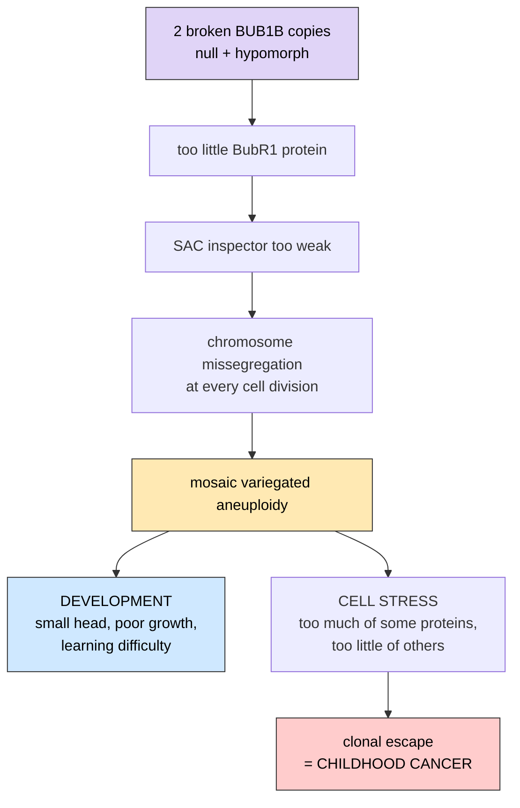

> **Legend** — purple: the genetic cause · yellow: the consequence inside the cell · blue: the developmental outcome · red: the cancer outcome · the split shows one cause producing two very different problems.

Track 2 asks you to write exactly this chain, then find a drug that cuts one of the arrows.

**Constitutional** — present from birth, body-wide (as opposed to appearing later in one tissue).

**Consanguineous** — parents are related (e.g. cousins). Makes homozygous recessive disease more likely.

**Cohesinopathy / centrosomopathy / chromosome-instability syndrome** — families of similar diseases where the chromosome machinery is broken. Useful lookalikes to compare against.

---

## 6. Describing symptoms — HPO

**Phenotype** — the observable traits: symptoms, measurements, what a doctor sees. (Opposite of genotype = the DNA.)

**HPO (Human Phenotype Ontology)** — a standard vocabulary of symptoms, each with a code. Stops people writing "small head" 10 different ways.
*Example: `HP:0000252` = Microcephaly. `HP:0002664` = Neoplasm.*

**Ontology** — an organized vocabulary where terms are linked parent-to-child.

**DAG (directed acyclic graph)** — the shape of that structure: arrows point from general to specific, and never loop back.
*Example: "Abnormality of the head" → "Microcephaly" → "Severe microcephaly".*

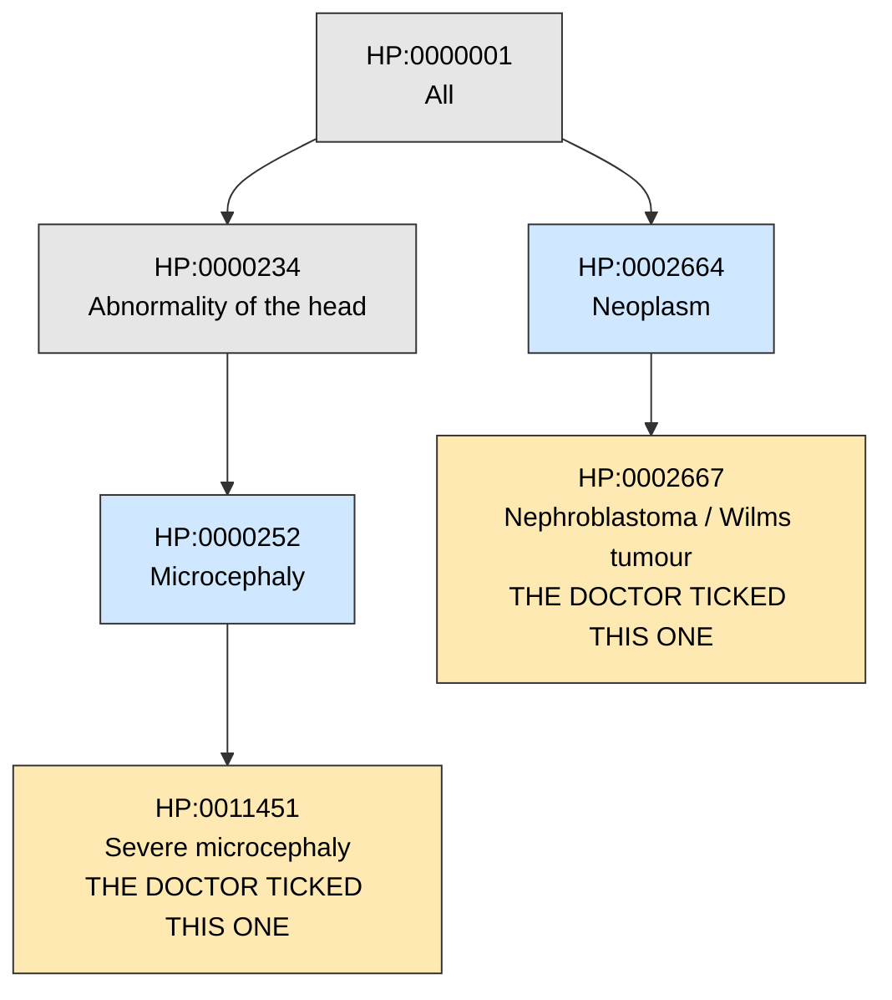

> **Legend** — gray: general parent terms · blue: intermediate terms · yellow: the terms a doctor actually ticked for this child · arrows run from general to specific and never loop back.

Arrows only point downward and never loop back = a DAG. Tick "Severe microcephaly" and you automatically also have every box above it. **Walk the arrows, never compare the words.**

**Ancestor closure** — if the patient has "Severe microcephaly", they automatically also have all the more general parent terms. You must walk up the arrows, not just compare text.

**Information content `IC(t) = −log p(t)`** — how surprising/specific a term is. Rare terms carry more information.
*"Neoplasm" in a kid is rare and very informative. "Abnormality of the body" is useless.*

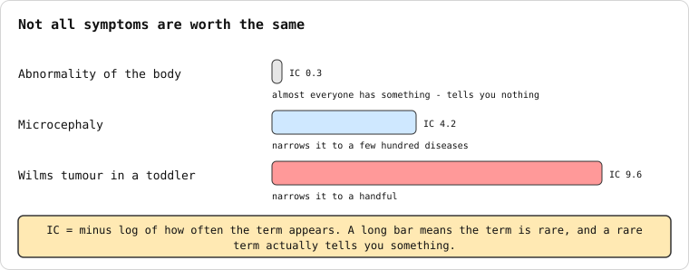

> **Legend** — bar length = information content · longer bar = rarer term = more useful for narrowing the diagnosis.

**Semantic similarity (Resnik / Lin / Jiang–Conrath / Phenomizer)** — math for "how alike are these two symptom lists", using the graph, not the words.

**Phenopacket** — a standard file format holding a patient's HPO terms and case info.

### The eight terms this child actually has

Straight from the challenge's phenotype document. Note what is *missing*: microcephaly and intellectual disability, the two features most associated with MVA in textbooks.

| HPO ID | Term | Plain English |
|---|---|---|
| `HP:0002859` | **Rhabdomyosarcoma** | A cancer of soft tissue that behaves like muscle. Rare in children, aggressive, and here it is the event that triggered the whole investigation. |
| `HP:0000121` | **Nephrocalcinosis** | Calcium deposits building up inside kidney tissue. Present since birth in this child. |
| `HP:0004322` | **Short stature** | Height well below the expected range for age — and below what the family's own height predicts. |
| `HP:0001508` | **Failure to thrive** | Not gaining weight or growing at the expected rate, repeatedly documented over time. |
| `HP:0003202` | **Skeletal muscle atrophy** | Reduced muscle bulk — visibly less muscle than expected. |
| `HP:0001622` | **Premature birth** | Born before 37 weeks. This child: 32 weeks. |
| `HP:0001518` | **Small for gestational age (SGA)** | Born much smaller than expected even for that early a birth. ~1 kg here. |
| `HP:0200067` | **Recurrent spontaneous abortion** | Repeated miscarriages — a *parental* feature, not the child's own. |

**IUGR (intrauterine growth restriction)** — the process behind [SGA](#6-describing-symptoms--hpo): the baby grew too slowly *in the womb*. SGA is the measurement at birth; IUGR is the cause.

**Why the parental term matters.** Miscarriage is often caused by an embryo having the wrong number of chromosomes. Repeated miscarriages in the parents are therefore a read-out of the *same* chromosome-instability mechanism the child is being tested for — the challenge document says explicitly to treat it as evidence, not background. The catch: gene-ranking tools assume every term describes the patient, so feeding them a parental term is a modelling choice. Run it both ways and report the difference.

**OMIM / Orphanet / GeneReviews / ClinGen / GenCC** — catalogues of genetic diseases: which gene causes what, and how well proven.

**MIM number** — an ID in OMIM. *MVA1 = MIM 257300.*

---

## 7. Databases and annotation

**Annotation** — attaching meaning to a raw variant. *"chr15:40162526 C>T" → "in BUB1B, exon 9, changes an amino acid, seen in 0 healthy people, predicted damaging".*

**VEP (Variant Effect Predictor)** — the standard tool that does that attaching. Two ways to run it: offline from a downloaded **cache** (~25 GB, genome-scale), or the **REST API** at `rest.ensembl.org` (no download, rate-limited to 55,000 requests/hour, batches of 200 variants — right size for a gene panel).
*Example: `mva-warehouse annotate-panel` sent the 874 panel alleles through the REST API in 5 requests ([methodology 031](step-0/methodology/031-vep-rest-panel-annotation.md)).*

**Consequence** — VEP's answer to "what does this variant do to the gene", as a controlled vocabulary term. `stop_gained` = creates a premature stop, truncating the protein; `missense_variant` = swaps one amino acid; `intron_variant` = lands between exons, usually harmless.

**Impact** — VEP's four-bucket severity rollup of the consequence: **HIGH** (protein destroyed), **MODERATE** (protein changed), **LOW** (protein grazed), **MODIFIER** (outside the protein — the overwhelming majority). A coarse first filter, not a verdict.
*Example: of the 874 panel alleles, 850 are MODIFIER and only 2 are HIGH+rare or MODERATE+rare.*

**rsID** — a variant's public catalogue number in **dbSNP** (NCBI's registry of every variant ever reported), like `rs1801516`. The VCF's `ID` column carries it when the caller recognised the site; `.` means unregistered. Known rsID ≠ harmless — it only means "seen before".

**dbSNP membership rate** — of all the records in a callset, the share that already carry an [rsID](#7-databases-and-annotation). A QC metric, not a biological one: a healthy modern human genome is almost entirely made of variants somebody has already seen, so a low rate means novelty, and novelty in bulk usually means artefacts — or an old dbSNP build behind the `ID` column. Read it only alongside the population it was measured over: filtering, dropping decoy contigs and restricting to SNVs each move it. *Example: this callset reads 87.96% over every delivered record and 93.89% over PASS biallelic SNVs, against a published 99.2% per genome.*

**Biallelic site** — one position with exactly **one** ALT allele, i.e. the opposite of a [multiallelic](#3-variants-the-differences-you-hunt) one. Careful: *biallelic* is used in two unrelated senses in this field. Here it is a property of a **VCF row** (how many ALTs are on the line); in the recessive-disease sense above it is a property of a **gene** (both copies hit). Nothing connects them. *Example: `REF=A ALT=G` is a biallelic site; `REF=A ALT=G,T` is not.*

**SNV/indel ratio** — [SNV](#3-variants-the-differences-you-hunt) count divided by [indel](#3-variants-the-differences-you-hunt) count in one callset. A shape check: substitutions vastly outnumber insertions and deletions, and a ratio that drifts low says the caller is emitting more indels than a reference pipeline would. Strongly caller-dependent — the same reads give 4.7 through DeepVariant and 6.2 through GATK — so it flags a difference, never a defect on its own. *Example: 4,086,641 SNPs / 930,181 indels = 4.393 here, against 4.611–4.798 across the 1000G superpopulations.*

**Plugin** — an add-on that lets VEP attach one more kind of score.

**ClinVar** — public database of variants already judged by labs: pathogenic, benign, or unknown.
*If your variant is already in ClinVar as pathogenic, you're nearly done.*

**Pathogenic / Likely pathogenic / VUS / Likely benign / Benign** — the 5 verdicts.

**VUS (variant of uncertain significance)** — "we don't know". Most variants are this.

**Review status / assertion criteria (ClinVar "gold stars")** — how a [ClinVar](#7-databases-and-annotation) verdict was *arrived at*, not how strong the evidence behind it is. ClinVar renders it as 0–4 stars: ★★★★ `practice_guideline` (a clinical guideline says so), ★★★ `reviewed_by_expert_panel` (a curated expert group), ★★ `criteria_provided,_multiple_submitters,_no_conflicts` (several labs, stated criteria, agreeing), ★ `criteria_provided,_single_submitter` (one lab, stated criteria), ☆☆☆☆ `no_assertion_criteria_provided` (somebody asserted it without saying how). Software analogy: a code-review trail, not a test result — it tells you who signed off and under what process, never whether the code works. A separate value, `criteria_provided,_conflicting_classifications`, means submitters disagree; the P/LP predicate excludes it, because a disagreement is the opposite of an assertion.
*Example: of the 2,129 pathogenic/likely-pathogenic ClinVar records inside the 8-gene panel, 111 are ★★★, 664 ★★, 1,265 ★ and 89 ☆☆☆☆ — nearly six in ten rest on a single submitter ([methodology 051](step-0/methodology/051-clinvar-presence.md)).*

**Variation ID** — ClinVar's own stable key for a record, e.g. `533901`. Use it rather than the [rsID](#7-databases-and-annotation): 4,442 of the 17,832 rows in our committed ClinVar extract have no rsID at all, and every one has a Variation ID. Resolvable at `ncbi.nlm.nih.gov/clinvar/variation/<id>/`.

**Presence cross-check** — running the ClinVar join *backwards*: instead of taking a variant the callset produced and asking what is known about it, take every site already classified pathogenic and ask whether the callset contains it. Both outcomes are results — a known-pathogenic site called heterozygous is a direct lead, and a gene whose known pathogenic sites are all absent says the case is not a repeat of a previously published family. The catch is spelling: an exact-string match under-counts indels unless both sides are [left-aligned](#3-variants-the-differences-you-hunt) first, so a presence count is a **lower bound**, never a ceiling.
*Example: 2,129 pathogenic/likely-pathogenic panel sites checked, 1 present — the BUB1B `stop_gained`, heterozygous and PASS — with 1,306 of the 2,129 indel-shaped and therefore subject to the spelling caveat ([methodology 051](step-0/methodology/051-clinvar-presence.md)).*

**gnomAD** — database of DNA from ~800,000 healthy-ish people. Tells you how common a variant is.

**AF (allele frequency)** — what fraction of people carry it. **popmax** = the highest frequency in any single population group (safer than the global average); gnomAD v4 renamed it **grpmax**.
*Two different fields share this name and only one of them is a population frequency. The gnomAD `AF` is. The **`INFO/AF` inside our own VCF is not** — it is [AC/AN](#3-variants-the-differences-you-hunt) computed **within the sample**, so with one sample it is only ever 0.5 or 1.0. Same field name, same column header in `bcftools stats`, completely different meaning; filtering on the wrong one silently throws away real candidates. The measured consequence is [data-findings §2.5](../ideation/data-findings.md).*
*Logic here: MVA has under 50 patients worldwide, so a causing variant must be super rare. But the cut-off depends on inheritance: the literature uses AF < 1e-3 (0.1%) for **dominant** disease and AF < 1e-2 (1%) for **recessive** and compound-het — healthy carriers keep a recessive allele circulating (Pedersen 2021, PMID 34267211; Whiffin 2017, PMID 28518168). Filtering compound-het candidates at 1e-3 silently drops real alleles sitting between 0.1% and 1%. The thresholds live in `ressources/reference/qc_norms.tsv`.*

**Constraint (pLI / LOEUF / missense z-score)** — measures whether a gene tolerates being broken in healthy people.
*High pLI = nobody healthy has a broken copy = breaking it is probably serious.*
*The recessive trap: gnomAD is full of healthy **carriers** of recessive disease alleles, so recessive-disease genes score as tolerant. Measured on our panel: BUB1B pLI = 2.6e-14 and CEP57 pLI = 6.8e-06 — the two established MVA genes look completely unconstrained. Never rank recessive candidates by constraint; show it only as context ([methodology 030](step-0/methodology/030-population-reference-data.md)).*

**dbNSFP** — one giant pre-computed table with dozens of prediction scores already joined together. Saves days.

**HGMD / DECIPHER / DGV / dbVar / gnomAD-SV** — more variant databases (disease variants, structural variants, patient cases).

**PubMed / Europe PMC / PubTator3 / LitVar2 / OpenAlex / Semantic Scholar** — ways to search scientific papers by program instead of by hand. PubTator3 already tags which genes and variants each paper mentions.

**PMID / DOI** — the ID number of a paper. Every claim must carry one, or it can't be checked.

**Case report** — a paper describing one real patient: their symptoms, the variants found, how it was confirmed. For an ultra-rare disease the world's knowledge is mostly case reports — and a validated challenge case may itself have been published as one. *Example: "Compound heterozygous BUB1B variants in a child with MVA and rhabdomyosarcoma" would be a direct answer-key candidate.*

**Reactome / STRING / Open Targets / PrimeKG** — databases of which proteins talk to which, and which drugs hit which target.

**AlphaFold DB / PDB / UniProt** — 3D shapes and facts about proteins. Lets you see where in the protein your variant lands.

**DrugBank / ChEMBL / ClinicalTrials.gov / DGIdb / PubChem** — drug databases. Needed for Track 2.

**GIAB (Genome in a Bottle) / 1000 Genomes** — public genomes from healthy volunteers, free to use. Perfect for testing your pipeline without touching patient data.

**Pinning a version** — writing down exactly which release of each database you used, so results can be reproduced later.

**Provenance** — the paper trail: which tool, which version, which settings produced this number.

---

## 8. Command-line tools you'll see

**bcftools / samtools** — the Swiss-army knives for VCF and BAM files. *`bcftools norm`, `bcftools view`, `bcftools stats`.*

**mosdepth** — measures coverage fast.

**IGV** — a picture viewer for reads. You look at the actual scraps stacked over a position and judge with your eyes. **igv.js / igv-reports** = the shareable web version.

**samplot** — draws pictures of structural variants.

**Exomiser / LIRICAL / AMELIE / Phen2Gene / GADO / Phenolyzer** — programs that take the symptom list + the VCF and rank which gene is guilty.
*Exomiser and LIRICAL are Java; Phen2Gene is Python and also answers over HTTP; Phenolyzer is Perl. We reimplemented the phenotype half in Python — see the four entries below.*

**Semantic similarity** — measuring how alike two symptom lists are by walking the [ontology](#6-describing-symptoms--hpo), never by comparing the words. "Rhabdomyosarcoma" and "nephroblastoma" share no letters and are one step apart in the graph.

**Most informative common ancestor (MICA)** — of all the terms two symptoms both descend from, the rarest one. That term's [information content](#6-describing-symptoms--hpo) *is* their similarity score. This is **Resnik similarity**.
*Example: Rhabdomyosarcoma and Nephroblastoma meet at "Neoplasm", which is informative. Rhabdomyosarcoma and Premature birth meet near the root, which is worth nothing.*

**Best-match-average (BMA)** — how you go from comparing two *terms* to comparing two *lists*. Each term takes its single strongest partner on the other side; those bests are averaged. Taking the best lets a real match survive six unrelated symptoms; averaging stops one lucky pairing carrying the whole score.
*Software analogy: a fuzzy join where every left row keeps only its best right match, then you average the match qualities.*

**Forward vs reverse direction** — BMA is not symmetric, and both halves are misleading alone. *Forward* asks "is each of the **child's** features explained by this gene?" and ignores everything else the gene does. *Reverse* asks "is each of the **gene's** features present in the child?" and punishes well-studied genes for the symptoms the child lacks. Report both; their gap says how heavily the gene is curated, not anything about the patient.
*Example: BUB1B has 112 curated features against this child's 7 — forward 2.11, reverse 0.55.*

**PhenoDigm** — the published scoring scheme built from MICA + BMA, normalised so a perfect match is 1.0. What Exomiser's phenotype scoring is made of.

**PHIVE / PhenIX / hiPHIVE** — Exomiser's phenotype scorers. **PHIVE** uses mouse models, **PhenIX** human disease annotations only, **hiPHIVE** combines human + mouse + zebrafish + a protein-interaction network. Counter-intuitively, hiPHIVE restricted to **human only** beats the full cross-species version: 82.8% vs 66.6% top-10 (Genome Medicine 17:127, 2025). That finding is why a Python reimplementation is practical at all — the parts that are hard to rebuild are the parts to leave out.

**MVStore / H2** — the embedded Java database format Exomiser ships its data in. No Python reader exists, which is what makes Exomiser's *variant* half genuinely Java-only. Its *phenotype* inputs (`hp.obo`, `genes_to_phenotype.txt`) are plain text and readable by anything.

**Entrez / NCBI gene ID** — a numeric gene identifier, e.g. `701` for BUB1B. An alternative to the [HGNC](#7-databases-and-annotation) symbol. Ours joins on symbols because that is what VEP returns; the numeric id is kept only because some services key on it.
*Gotcha: 375 rows of HPO's gene file carry `-` as the symbol, covering seven different genes. Loading them creates one fake gene that outranks real ones.*

**Gene prior** — a per-gene multiplier applied to a candidate pair's score. A **hand-set** prior ("BUB1B matters, multiply by 2") is an assumption and our register logs it as evidence of strength *zero*. A prior **derived** from a phenotype ranking over 5,267 genes is a measurement, and can carry real weight.
*Example: BUB1B ranks 6 of 5,267 on this child's symptoms, giving a prior of 1.455.*

**slivar / GEMINI / vembrane** — filter VCFs with written rules, including compound-het logic.

**plot-vcfstats** — turns `bcftools stats` output into charts: variant classes, [substitution spectrum](#3-variants-the-differences-you-hunt), [indel length spectrum](#3-variants-the-differences-you-hunt), depth. The reference for what a callset overview should show.

**Plotly** — a charting library whose figures are interactive in a plain HTML file: zoom, hover for exact values, toggle a series off. No server and no build step, which is why `MultiQC` and this repository's exploration report both use it.
*Example: `uv run mva-explore report ressources/data-profile` writes one such page — see [the exploration toolkit](step-0/exploration.md).*

**CSS** — the language that says how a web page *looks*: one rule per selector, each setting properties like `color` or `padding`. The browser applies every matching rule and the most specific one wins.

**Tailwind CSS** — a styling library where you never write a CSS rule; you put pre-made single-purpose class names on the element instead (`p-4` = padding 4, `text-sm` = small text). The build step scans your source **text** for class names and emits only the rules you actually used. That scan is the catch worth knowing: a class name assembled at runtime (`` `bg-${colour}` ``) is never seen, so its rule is never generated and the style silently does nothing.
*Example: `<div className="rounded-xl border border-chrome-800 p-4">` — four utility classes instead of one hand-written CSS rule.*

**Utility class** — one of those single-purpose class names. A **recipe** in this repository is a named string of them (`CARD = 'rounded-xl border border-chrome-800 bg-chrome-900/40 p-4'`) so eleven files stop retyping the same eight words. *Example:* `app/src/lib/ui.ts`.

**CSS custom property** (also **CSS variable**) — a value declared once under a name starting with `--` and read anywhere with `var(--name)`. It lives in the browser, so it can be swapped at runtime; a value baked into a JavaScript file cannot. *Example:* `--color-good-500: #00c950;` then `color: var(--color-good-500)`.

**Design token** — a named design value used instead of a literal one: a colour, a spacing, a radius. Software analogy: a constant, except it has to be readable from both CSS and code, which is why it usually exists twice. *Example:* `--color-broken-400` and `RAMP.broken[400]` are the same token in this repository's two halves.

**Hex colour** — a colour written as `#RRGGBB`, two hex digits per red/green/blue channel, in the **sRGB** space every screen understands. Eight digits add an alpha (opacity) channel. *Example:* `#00c950` = the app's "good" green; `#1c398e55` = a blue at ~33 % opacity.

**oklch** — a newer way to write a colour, as *lightness, chroma (how vivid), hue (which colour)* in a space built so equal numeric steps look like equal steps to the eye — unlike [hex](#8-command-line-tools-youll-see), where lightening a colour by hand shifts its hue. Tailwind v4 ships its palette in oklch. Converting it to hex is lossy at the edges (some oklch colours are outside sRGB and get clipped) but necessary for anything that parses colours itself, such as [Plotly](#8-command-line-tools-youll-see).
*Example: `oklch(72.3% 0.219 149.579)` is Tailwind's `green-500`, which converts to `#00c950`.*

**Semantic colour family** — a hue ramp named for what it *means* rather than what it *is*: this repository paints with `good` (green), `broken` (red), `decision` (yellow), `machinery` (blue), `raw` (purple), `chrome` (grey furniture) and `severity` (orange). The Tailwind hue each is cut from appears in one generator script and nowhere else, so renaming the meaning never means editing 900 call sites. *Example:* `bg-good-950` rather than `bg-emerald-950`.

**Shade** — one step on a family, numbered 50 (palest) to 950 (deepest). This repository uses 300/400 for text, 800/900 for borders and 950 for a tinted background, so a new family has an obvious answer for every role. *Example:* `text-broken-400` on `bg-broken-950`.

**Tone** — the six meanings a component is allowed to be tinted with: `neutral`, `good`, `broken`, `decision`, `machinery`, `raw`. A component takes a tone, never a **semantic colour family** and never a [hex](#8-command-line-tools-youll-see) — which is what stops a badge and the number above it from disagreeing about what green means. *Example:* `<Badge tone="decision">gap</Badge>`.

**Colourscale** — a list of `[position, colour]` stops between 0 and 1 that a chart interpolates to colour a continuous range. Sequential runs dark → hot; **diverging** puts a distinct colour at each end and a neutral one in the middle, for a value whose *direction* of deviation matters. *Example:* this repository's allele-balance scale puts green at 0.5 — the middle is the goal — with red below and purple above.


**pysam / cyvcf2** — Python libraries to read these files in code.

**DuckDB** — a database that runs *inside* your program, as a library, with the whole database in a single file. There is no server process, no port and no database accounts — the same arrangement as SQLite, but column-oriented and built for analytics. This is the single most commonly misunderstood thing about it: you cannot "expose DuckDB on a server", because there is nothing listening. Putting it on a shared machine means putting *the file* there and reaching it the way you already reach that machine.
*Example: `duckdb profile.duckdb "SELECT * FROM panel_variant_counts"` — the binary opens the file, answers, and exits.*

**Embedded database** — a database that is a library linked into your process rather than a service you connect to. The opposite is a **client–server database** (PostgreSQL, MySQL), where a long-running daemon owns the data and clients talk to it over a socket. Embedded means zero setup and no network attack surface; it also means one writer at a time, because the lock is a file lock. [DuckDB](#8-the-toolbox-what-each-program-does) and SQLite are embedded; Postgres is not.

**Parquet** — a file format that stores tables by column rather than by row, so scanning one column of millions of rows never reads the others. It also carries its own schema, so the column types survive the trip; a TSV does not, which is why a number written to a TSV comes back as text unless something re-infers it.
*Example: `vcf_chrom_allele_balance.parquet` — 24 rows, 1.3 KB, and `mean_dp` is a `DOUBLE` on the way out because it was one on the way in.*

**Row group** — the horizontal slice a [Parquet](#8-command-line-tools-youll-see) file is built from: a block of rows whose columns are compressed and *indexed* together, with the minimum and maximum of each column recorded in the footer. Those min/max statistics are what lets a reader skip a whole block without reading it, and the reason sorting a file by the column you filter on makes it dramatically cheaper to query. The group is also the writer's buffer — it holds a full group in memory before flushing it — so the size you choose is a direct memory cost.
*Example: 1,000,000 rows per group, so a read store shard of 4M reads has 4 skippable blocks.*

**Shard / partition** — one file of a table that is deliberately split across many files, rather than one enormous file. Splitting buys parallelism (readers take a file each) and pruning (a query that only concerns lane 1 never opens the others). **Hive partitioning** is the convention that puts the partitioning column *in the directory name* — `lane=1/read=2/part-0007.parquet` — so the value is readable without opening the file, and query engines turn a `WHERE lane = 1` into "open only that directory".
*Example: `s3://mva/reads/lane=3/read=1/part-0012.parquet`.*

**Arrow (Apache Arrow)** — a standard layout for a table *in memory*, column by column. Its point is that two programs agreeing on it can hand a table to each other with no conversion and no copying: a Rust library can produce reads and DuckDB can query them in place. [Parquet](#8-command-line-tools-youll-see) is the on-disk form of the same idea; Arrow is the in-memory one.

**Record batch** — a chunk of an [Arrow](#8-command-line-tools-youll-see) table, a few thousand rows at a time. Reading a file as a stream of batches is what makes a converter's memory bounded by the batch size rather than by the file size — the difference between converting an 11 GB FASTQ and running out of RAM trying.

**noodles / oxbow / polars-bio** — Rust libraries for reading bioinformatics file formats. `noodles` is the parser itself; **oxbow** and **polars-bio** wrap it and hand the result out as [Arrow](#8-command-line-tools-youll-see) batches, which is what makes them usable from Python without a per-record Python loop. This repository uses **oxbow** to convert [FASTQ](#2-reading-dna-sequencing-and-the-files-it-makes) to Parquet, measured at ~854,000 reads/second versus ~50,000 for a shell pipeline ([methodology 018](step-0/methodology/018-fastq-conversion-engine-choice.md)).

**Type inference / sniffing** — reading the first rows of a text table to guess each column's type. DuckDB's CSV reader does this; `mva-warehouse` leans on it deliberately rather than hand-rolling a guesser, so the staging step and an analyst's own `read_csv` can never disagree.

**Data warehouse** — one queryable copy of derived tables, kept apart from the raw data they came from. Here it is deliberately small: the [profile](step-0/exploration.md) tables, typed and joinable, on a machine the team shares. It is a *derived dataset* — rebuildable at any time, and therefore safe to delete.
*Example: `uv run mva-warehouse pg-ingest` — see [the infrastructure runbook](step-0/infrastructure.md).*

**Schema (namespace)** — a named group of tables inside one database, the way a package groups modules in code. A table's full address is `<schema>.<table>`, and two schemas can hold different tables with the same name. This warehouse uses exactly two: `warehouse` for ingested data and the hand-written append-only ledgers, and `results` for everything computed from them. The split is load-bearing — re-ingesting cannot destroy a derived table, and re-deriving cannot corrupt an input.
*Example: `warehouse.variants_raw` is the delivered callset; `results.contig_density` is a table computed from it.*

**`information_schema`** — a set of read-only views every SQL database exposes describing *itself*: which tables exist, which columns each has, and what type each column is. It is how a catalogue can list a database it was never told about. What it cannot supply is meaning — it knows `mean_vaf` is a floating-point number, not that 0.50 is the value a healthy diploid genome gives, which is why that sentence has to be written down in code.
*Example: `/api/catalog/columns` reads it live and returns 262 rows, one per column of the 38 tables.*

**PostgreSQL (Postgres)** — the mainstream open-source client–server database. A daemon owns the data; clients connect over a socket, authenticate, and many can read and write at the same time. Row-oriented, so it is slower than a column store for wide analytical scans — but that is not what you ask it for. Use it for the things that *change*: a ledger, a results table, anything several people append to.
*Example: measured on 5,012,204 variant records — 653 MB in Postgres versus 17 MB as [Parquet](#8-the-toolbox-what-each-program-does), and 287 ms versus 18 ms on the same filter query.*

**Single-writer lock** — the restriction that only one process may hold an [embedded database](#8-the-toolbox-what-each-program-does) file open. In DuckDB it is stricter than it sounds: a held write lock blocks **readers** as well, so one long write makes the file unreadable for everyone. This, not speed, is the reason a shared team store needs a real server.

**Attach (DuckDB)** — pointing DuckDB at another database so its tables appear alongside your own, queryable in one statement. This is how DuckDB acts as an engine over Postgres rather than a replacement for it.
*Example: `ATTACH 'host=box dbname=mva' AS pg (TYPE postgres);` then `CREATE TABLE pg.results AS SELECT … FROM read_parquet('variants.parquet')` — DuckDB does the scan, Postgres keeps the answer.*

**DuckLake** — a lakehouse format from the DuckDB project: the *data* stays as [Parquet](#8-the-toolbox-what-each-program-does) files, while the *catalog* (which files make up which table, and at which version) lives in a real database such as Postgres. That split buys concurrent writers and time travel without giving up columnar speed.

**Catalog** — the bookkeeping that says which files constitute which table. Keeping it in a transactional database is what lets several writers agree on what the table currently is.

**Time travel** — querying a table as it was at an earlier version, because every change was recorded as a snapshot instead of overwriting. Useful well beyond undo: it is an audit trail, which is what a scientific result needs when someone asks *which* version of the candidate table produced a submission.
*Example: `SELECT count(*) FROM lake.panel AT (VERSION => 1)` returned 8 while the live table held 9.*

**Row store vs column store** — whether a table is laid out one record at a time or one column at a time. A row store fetches a whole record cheaply, which suits transactions; a column store reads one field across millions of records without touching the others, which suits analytics. Postgres is the former, DuckDB and Parquet the latter — the reason both appear in this design rather than one winning.

**Source of truth** — the one copy everything else is derived from, kept unchanged on purpose. Here it is the delivered files in object storage: no parsing, no filtering, no typing. Anything wrong downstream can be rebuilt from it; it can never be rebuilt from anything else.
*Example: `s3://mva/source/` holds all 12 delivered files, 84.99 GB, byte-for-byte as published.*

**Checksum / SHA-256** — a short fingerprint computed from every byte of a file. Two files with the same SHA-256 are the same file; change one bit and the fingerprint changes completely. It is how you prove a transfer did not corrupt anything.
*Example: the delivered VCF is `bec64c68d3ad10d0…`, and the publisher says the same, so our copy is the delivery.*

**Git LFS (Large File Storage)** — a Git extension that keeps big files outside the repository and leaves a pointer behind. It records a real SHA-256 for each stored file; ordinary Git objects instead carry a 40-character **blob SHA-1**, computed over different bytes with a different algorithm. Comparing one against the other produces a mismatch that means nothing.

**Object versioning** — a store setting where writing to an existing key creates a *new version* beside the old one instead of replacing it. It makes an accidental overwrite recoverable, which is what turns "we keep the raw data" into something that survives a mistake.
*Example: the VCF was uploaded twice — from a laptop, then re-fetched on the server — and MinIO holds both versions.*

**Data lineage** — the record of which inputs produced which table, by which transformation. Not "it came from a VCF", but *which object, at which version, with which checksum, producing how many rows*. Without it, a disputed result cannot be traced back. Stored as an [append-only](#8-command-line-tools-youll-see) edge list: one row per (input → output) pair.
*Example: `warehouse.data_lineage` links `variants_raw` to `s3://mva/source/WGS_EX2312012_HGWCNDSX7.vcf.gz`, sha256 `bec64c68…`, version `3a79ea8b…`, 5,012,204 rows.*

**Lineage edge** — one row of that record: one output table, one input, one transformation. A derived table with no edge is a table nobody can vouch for. Read the edges with `mva-warehouse lineage-list`.
*Example: `results.panel_gene_density` ← `warehouse.panel_variant_counts, warehouse.mva_panel_grch38`, tool `mva-warehouse pg-derive`.*

**Superseding record** — how an append-only table is corrected: you append a *newer* row and say in its `notes` which earlier row it replaces. The wrong row stays, because the fact that the claim changed is itself evidence. Updating in place would destroy that.
*Example: the first `variants_raw` edge named a laptop path with no checksum; the superseding edge names the verified object in the bucket and carries `supersedes the edge produced at 2026-08-29 16:37:29`.*

**Append-only** — a table that only ever gains rows; nothing is edited or deleted. Used where the history *is* the point, such as an upload ledger or a lineage log. A record that can be quietly rewritten is not evidence.

**Landing zone / raw layer** — the first place data arrives, stored in its delivered form before anything is interpreted. Separating it from the typed, queryable layer means a parsing mistake is always recoverable.
*Example: `warehouse.variants_raw` — one row per VCF line, every field text, nothing filtered.*

**rsync** — a copy tool that transfers only the parts of a file that changed, and resumes where it left off. The right way to move a directory to a remote box repeatedly; `scp` re-sends everything every time.

**Idempotent** — an operation that gives the same result whether you run it once or five times. An upload that lands the same file twice records both attempts in the ledger but leaves one object in the store, so repeating it is safe. `mva-warehouse stage` is idempotent too: it rewrites `build/warehouse/*.parquet` from the profile directory, so running it twice costs time and changes nothing.

**SQL** — the language for asking a database questions.

**Snakemake / Nextflow** — tools that chain all the steps into one reproducible command.

**Container / digest** — a frozen box holding your exact software versions, so it runs the same everywhere.

**Modal** — a cloud service to rent CPUs/GPUs for the heavy steps.

**Hail / Spark** — big-data machinery, useful for thousands of patients, pointless for one.

**hap.py / rtg vcfeval** — compare two VCFs to score how well you called variants.

**verifyBamID / somalier** — check the sample isn't contaminated and that all the files really come from the same person.

**k-mer** — every possible chunk of length k from a sequence. *k=31 means every 31-letter window.*

**Mapping-free / alignment-free k-mer scan (MALVA, jellyfish, SKA2)** — search the raw FASTQ for a specific 31-letter fingerprint directly, skipping the whole align-and-call pipeline. Minutes instead of a day.
*Example: you know exactly what a published BUB1B variant looks like. Build its fingerprint, count how many raw scraps contain it. Done.*

**grep** — search text for a pattern. The simplest possible tool, and often enough.

**BED file** — a plain list of genome regions (chromosome, start, end). Used to say "only look here".

---

## 9. Prediction scores (guessing if a variant is harmful)

**In-silico prediction** — a computer's guess, no lab experiment. ("in silico" = in the chip.)

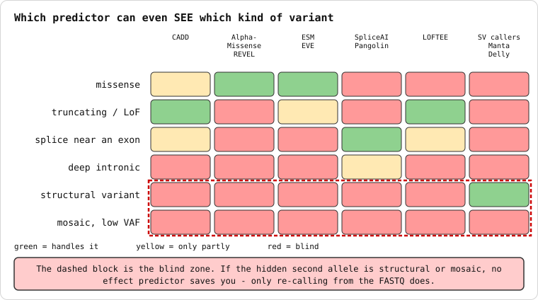

> **Legend** — green: the tool handles that class · yellow: only partly · red: blind to it · the red dashed box is the zone no effect predictor covers.

**Missense** — a variant that swaps one amino acid for another. Hardest class to judge: sometimes fatal, usually harmless.

**CADD** — a genome-wide "how bad does this look" score. Works on everything, but only roughly.

**REVEL / MetaRNN / BayesDel** — missense-only scores built by combining other scores.

**AlphaMissense** — DeepMind's missense score. Strong.

**ESM-2 / ESM1b / EVE / PrimateAI-3D** — models that learned protein language from millions of natural proteins, then judge whether your change "sounds wrong". They never saw ClinVar, which is an advantage (see circularity).

**SpliceAI / Pangolin / AbSplice / SQUIRLS** — predict whether a variant wrecks splicing. Critical here, because a leaky splice variant is the most likely hidden second allele.
*`±1000 nt window` = how far from the exon SpliceAI is allowed to look. The default ±50 is too narrow and misses deep-intronic answers.*

```text
        <------------ intron ------------>[  EXON  ]<--- intron --->
                          X                                          X = the real variant,
                                                                         300 letters deep
   default +/- 50 nt                  [~~~~~~~~~~~~~~]      variant NOT in the window -> missed
   wide    +/- 1000 nt   [~~~~~~~~~~~~~~~~~~~~~~~~~~~~~~~~] variant IS in the window  -> caught
```

> **Legend** — `[  EXON  ]` is the exon · `~~~` marks how far the model is allowed to look · `X` is the variant · at the default window it falls outside and is never scored.

**ReMM / Genomiser** — scores for non-coding variants. Noisy; only trust inside a gene you already suspect.

**AlphaGenome / Evo 2 / Enformer** — huge new models that read a big stretch of DNA and predict what it does. Powerful, uncalibrated, expensive.

**LOFTEE / NMDEscPredictor / pext** — sanity-check whether a "loss of function" variant really destroys the protein.

**phyloP / GERP / conservation** — has this exact letter stayed unchanged across many species for millions of years? If yes, it probably matters.

**Zero-shot** — the model was never trained on this task, it just knows enough to answer anyway.

**LLR (log-likelihood ratio)** — the model's score, in log form. Bigger = more surprising = more likely damaging.

**Uncalibrated** — the score orders things correctly but the number itself is not a real probability. "0.8" doesn't mean 80%.

**Circularity** — the trap: most predictors were TRAINED on ClinVar. So if your variant is already in ClinVar, the predictor "agreeing" is not independent evidence — it's just remembering.

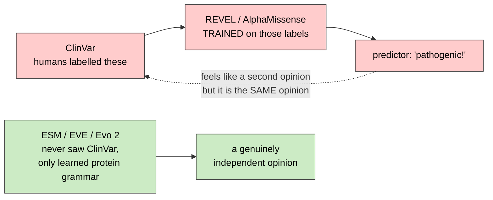

> **Legend** — red: the loop that only echoes its own training labels · green: a model that never saw ClinVar, so its opinion is genuinely new.

**Always report both.**

**Orthogonal** — an independent opinion, from a different source of information. Two orthogonal tools agreeing is real evidence; two circular ones agreeing is not.

**ΔΔG (delta-delta-G)** — predicted change in protein stability from the variant. *Tools: FoldX, Rosetta.*

**Domain / TPR / pseudo-kinase / KEN-box** — named functional parts of a protein. Landing inside one is worse than landing in a random spot.

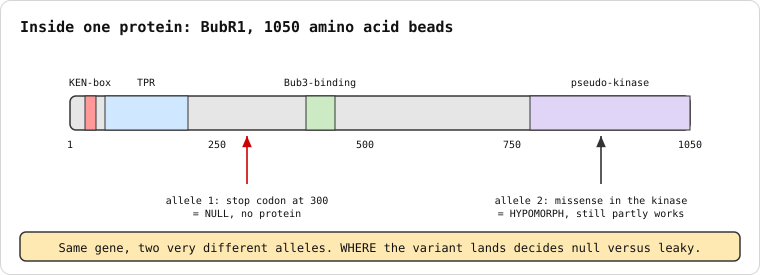

> **Legend** — gray bar: the whole protein, bead 1 to bead 1050 · coloured blocks: named working parts · red arrow: the null allele · black arrow: the hypomorph allele.

**Domain database (Pfam, SMART, PROSITE, Gene3D, SUPERFAMILY, CDD, PRINTS)** — seven independent catalogues that each scan a protein sequence and call out the domains they recognise. They overlap on purpose: the same region called by four of them is agreement, not duplication. **InterPro** is the umbrella that maps their accessions onto one shared id. *Example:* BUBR1's N-terminal region is `PF08311` to Pfam, `SM00777` to SMART and `PS51489` to PROSITE — all three `IPR013212` in InterPro. Ensembl serves them from `/overlap/translation/<protein id>`, mixed in with things that are *not* domains (PDB cross-references, AlphaFold models, disorder and coiled-coil predictions), so the list has to be filtered.

**Lollipop plot** — the standard way to draw variants against a protein: the x axis is amino-acid position, domains are bars along it, and each variant is a stem with a coloured head at its position. It answers "does this change hit a working part?" — the question a genomic coordinate cannot.

**Protein position (`protein_start`)** — which bead in the chain a variant changes, counted from 1. VEP reports it per transcript, and it is **absent** for anything outside the coding sequence — an intronic or splice-region change has no amino acid to name. *Example:* a `missense_variant` at `protein_start: 349` swaps bead 349.

---

## 10. ACMG — the official way to judge a variant

**ACMG/AMP guidelines** — the rulebook clinical labs use to call a variant pathogenic or not. A checklist of evidence codes.

**Evidence code** — one piece of evidence with a name and a strength.
- **PVS1** — Pathogenic, Very Strong: kills the protein (truncating in a gene where that's the known mechanism).
- **PS3** — Pathogenic Strong: lab experiment proves it's broken.
- **PS4** — Pathogenic Strong: seen much more in patients than in healthy people.
- **PM2** — Pathogenic Moderate: absent from gnomAD (too rare to be harmless).
- **PM3** — Pathogenic Moderate: found *in trans* with a known pathogenic variant. *Compound-het structure is itself evidence.*
- **PP3** — Pathogenic Supporting: computer predictors agree it's damaging.
- **PP4** — Pathogenic Supporting: the patient's symptoms match this gene's disease specifically.
- **PP1** — Pathogenic Supporting: tracks with disease through the family.
- **BP4 / BA1** — Benign codes: predictors say harmless / far too common in the population.

**Tavtigian Bayesian point system** — turns those codes into numbers you can add up.
*Supporting = 1 pt, Moderate = 2, Strong = 4, Very Strong = 8; benign codes count negative.
Total ≥ 10 → Pathogenic. 6–9 → Likely pathogenic. 0–5 → VUS. ≤ −7 → Benign.*
Value: one defensible number instead of an argument.

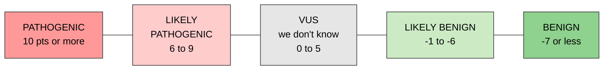

> **Legend** — left to right, red to green = pathogenic to benign · the numbers are Tavtigian points, which you add up.

```text
Worked example - one BUB1B candidate:

  PVS1  stop codon, kills the protein     very strong    +8
  PM2   zero healthy people carry it      moderate       +2
  PP3   SpliceAI + AlphaMissense agree    supporting     +1
  PM3   sits in trans with allele 2       moderate       +2
                                                        ----
                                          total         +13   ->  PATHOGENIC
```

> **Legend** — each row is one evidence code, its strength tier, and the points that tier is worth · the total picks a box on the scale above.

**ACMG SF v3.x (secondary findings)** — a separate official list of ~80 genes where, if you happen to spot a serious variant while looking for something else, you're supposed to report it (e.g. a heart-disease or cancer gene). Unrelated to the main question.

**Secondary / incidental finding** — exactly that: something important you found by accident.

**InterVar / TAPES / CharGer / Genebe** — programs that apply ACMG rules automatically. They produce a draft, not a verdict.

---

## 11. Math, probability and statistics words

**Prior** — what you believed before seeing the data. *"MVA is usually BUB1B, so start at 55% BUB1B."*

**Posterior** — what you believe after seeing the data.

**Bayesian** — the method of updating a prior into a posterior with evidence.

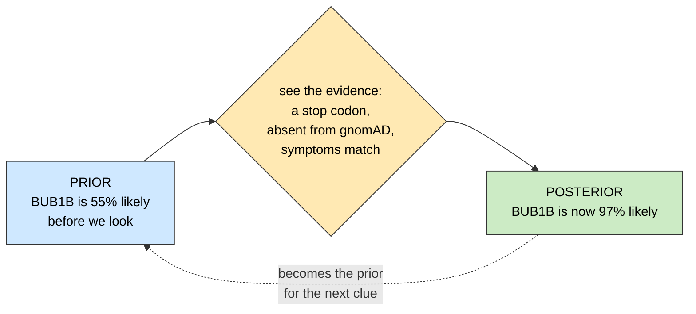

> **Legend** — blue: what you believed before · yellow: the evidence you saw · green: what you believe now · the dotted arrow means today's posterior is tomorrow's prior.

**Likelihood** — how well a hypothesis explains the data you saw.

**LR (likelihood ratio)** — `P(symptom | disease) ÷ P(symptom | not disease)`. Above 1 = supports the disease. Multiply LRs across symptoms.
*Example: "Neoplasm in a toddler" has a big LR for MVA. "Short stature" has an LR near 1 — almost no information.*

**Odds** — probability rewritten as a ratio. *70% = odds of 7:3.*

**Independence assumption** — pretending pieces of evidence don't overlap, so you can just multiply them. Usually a bit false (symptoms are correlated), so treat outputs as rankings, not true probabilities.

**Calibration** — does "0.9" actually happen 90% of the time? A calibrated score is a real probability.
*Measured by **Brier score**, **ECE (expected calibration error)**, **reliability diagram**. Fixed by **isotonic regression** or **Platt scaling**.*

**Hardy–Weinberg** — population genetics formula. If a bad allele has frequency `q`, then `q²` of people are homozygous for it.
*For two different alleles at frequencies p₁ and p₂, the compound-het chance is `2·p₁·p₂`. Since MVA has <50 patients worldwide, the alleles must be extraordinarily rare.*

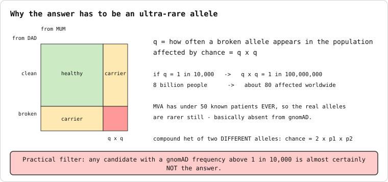

> **Legend** — the area of each square is how often that genotype occurs · green: healthy · yellow: healthy carrier · red: affected.

**Binomial** — the coin-flip distribution. *A true het at 30× depth: alt reads ~ Binomial(30, 0.5). Getting 4 out of 30 would be very odd.*

**Beta-binomial** — a binomial that allows extra sloppiness (real sequencing is noisier than a perfect coin).

**Overdispersion** — the data varies more than the simple model expects.

**Poisson / negative binomial** — distributions for counting things (like reads per bin). Used to spot deletions: half the expected reads = one copy lost.

**Null hypothesis (H₀)** — the boring explanation. *"This 5% VAF is just sequencing error."* You test whether the data can reject it.

**Power** — the chance your test would actually detect a real effect. *At 30× depth, power to spot a 10% mosaic variant at one site is poor — so restrict the search to one gene.*

**Multiple testing** — test 5 million positions and some will look significant by pure luck.

**FDR / Benjamini–Hochberg** — the correction for that. *Testing one gene needs almost no correction — the statistical reason to search a small region first.*

**HMM (hidden Markov model)** — a model for "the truth changes in stretches". Used to find where a copy-number change starts and stops.
*Hidden states = copy number 0,1,2,3. Observed = read depth. The model infers the invisible from the visible.*

**Segmentation** — chopping the genome into stretches of constant copy number.

**log2 ratio** — depth compared to normal, on a log scale. 0 = normal, −1 = half (one copy lost), +0.58 = 3 copies.
*A 20% mosaic trisomy only shifts it by ~0.14 — small but findable with enough bins.*

```text
walking along a chromosome, plotting depth as log2 ratio:

  +0.58  3 copies  |              ###########
   0.00  2 copies  |##############           ##########
  -1.00  1 copy    |                                   ########
                   +--------------------------------------------> position
                    normal        DUPLICATION  normal   DELETION

  a 20% MOSAIC trisomy is only +0.14 -- a whisper, not a shout:
   +0.14            |    . : . ' . : ' . : . ' . :
    0.00            |__________________________________
```

> **Legend** — `#` marks measured depth · the row a stretch sits on is its copy number · the dotted row shows how faint a 20% mosaic signal really is next to a clean deletion.

The HMM's job: decide where one flat stretch ends and the next begins, instead of trusting single noisy dots.

**BAF (B-allele frequency)** — at het positions, the fraction of reads from one parent's copy. Should sit at 0.5. Deviation reveals copy-number change, and it's MORE sensitive than depth.

**Entropy `H`** — how much you don't know, measured in **bits**. 1 bit = one perfect yes/no answer's worth.
*1225 equally likely possibilities = 10.3 bits of ignorance.*

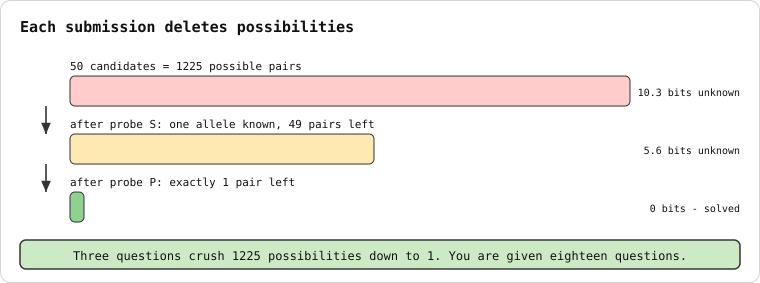

> **Legend** — bar length = how much of the search space is still alive · the label on the right is the uncertainty that remains, in bits.

**Information gain** — how much entropy an experiment removes. Pick the experiment that removes the most.

**Sequential Bayesian experimental design** — formal name for "choose the next question that teaches you the most, then update, then repeat".

**Group testing / Dorfman** — testing items in batches instead of one at a time, to find the bad ones with far fewer tests.
*Example: 100 blood samples, 1 infected. Pool 10 at a time = ~19 tests instead of 100.*

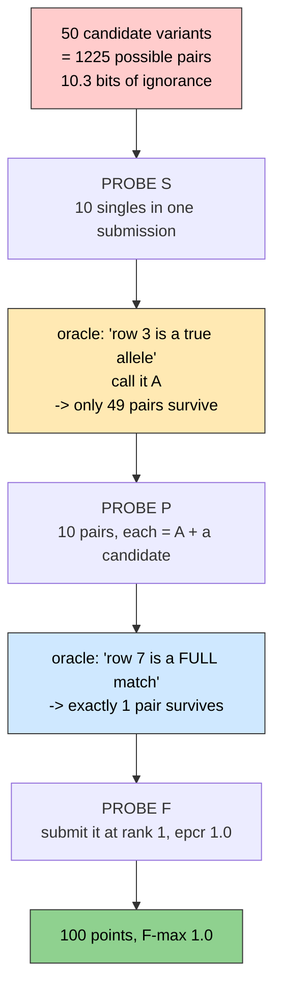

> **Legend** — red: the full unknown space · yellow and blue: what survives each probe · green: the solved state and the score it pays.

1225 possibilities crushed to 1 in **three** questions. That is group testing.

**Adaptive** — later questions depend on earlier answers (as opposed to fixing all questions upfront).

**Rényi–Ulam search** — the math of "20 questions" against a truthful answerer.

**Best-arm identification with fixed budget** — the math of "find the best option using exactly N tries".

**Minimax** — choose the move whose WORST possible outcome is least bad.

**Greedy** — take the best-looking step right now, without planning ahead. Often nearly optimal, always cheap.

**ILP (integer linear programming)** — exact optimization with whole numbers. Correct but overkill here.

**Combinatorics `C(N,2) = N(N−1)/2`** — how many ways to pick 2 items out of N.
*50 candidate variants → 1,225 possible pairs. 200 → 19,900.*

**Frozenset** — a programming set whose contents can't change and whose ORDER doesn't matter. `{A,B}` equals `{B,A}`.

**Bitmask / bit vector** — one bit per possibility, on or off. 19,900 possibilities fit in 2.5 KB, and you eliminate options with one fast AND operation.

**Constraint propagation** — once one fact is known, delete everything incompatible with it.
*Confirm allele A is real → every pair not containing A instantly dies.*

```text
alive before:   A-B   A-C   A-D   B-C   B-D   C-D        6 pairs
oracle says :   "A is one of the two true alleles"
alive after :   A-B   A-C   A-D    x     x     x         3 pairs

one answer, half the universe deleted -- with certainty, not probability.
```

> **Legend** — `x` marks a hypothesis the oracle's answer deleted with certainty · no probability involved.

**Deterministic** — same input always gives exactly the same output, no chance involved. *`bcftools norm` is deterministic.*

**Probabilistic** — deals in degrees of belief.

**Soundness** — never throwing away the right answer.

**Set algebra** — union (∪, everything in either), intersection (∩, only what's in both), subset (⊂).

**O(log n)** — how the time grows as data grows. `O(log n)` = doubling the data barely costs anything (searching an index). Great.

**Interval tree / pyranges** — a data structure that answers "which genes overlap this position?" instantly.

**Union-find / disjoint set** — a structure for grouping things that are linked. Used to build phase blocks.

**Priority queue** — a list that always hands you the highest-scoring item first.

**Append-only ledger** — a log you only ever add to, never edit. Keeps an honest record of all 18 submissions.

**Probe ledger** — the concrete table that does that: `warehouse.probe_ledger`, one row per spent [submission / probe](#13-hackathon-scoring-words), holding who spent it, its probe type ([S](#13-hackathon-scoring-words) / [P](#13-hackathon-scoring-words) / [F](#13-hackathon-scoring-words)), the exact payload uploaded, the [oracle](#13-hackathon-scoring-words)'s reply, and the rationale. A shared submission budget tracked in chat messages is a budget that gets double-spent.
*Example: `mva-warehouse probe-budget` → `all tracks: 0/18 spent, 18 remaining`.*

---

## 12. Machine learning words

**N = 1** — you have exactly ONE patient. Nothing to train on. This shapes every choice.

**Features** — the numbers describing each candidate, fed to a model. *AF, CADD, consequence type, phase, ...*

**Learning-to-rank (LTR)** — a model trained to ORDER a list correctly, rather than to label each item.

**LambdaMART / XGBoost / LightGBM** — the standard tree-ensemble programs used for that.

**Gradient boosting / tree ensemble** — many small decision trees, each fixing the previous one's mistakes.

**NDCG / MRR / recall@k / top-1** — scores for "how good is this ordering".
*MRR = average of 1/(rank of the right answer). Right answer at rank 1 → 1.0; at rank 4 → 0.25.*

**Synthetic proband** — a fake patient you build yourself: take a public healthy genome, paste in a known disease pair, attach matching symptoms. Now you have an answer key to test against, legally.

**Spike-in** — the pasting step. **VCF-level** = add lines to the variant list (tests ranking only). **Read-level (BAMSurgeon / VarBen)** = edit the raw scraps (tests whether you'd even FIND it — much more honest).

**Ablation** — remove one part of your pipeline and re-measure, to prove that part actually matters.

**Overfitting** — tuning until it works on your one example, then failing on everything else.

**Generalization** — working on cases you never saw. What the judges actually reward.

**PU learning (positive-unlabeled)** — you know some positives, but the "negatives" are really just unknowns. Needs special handling.

**Anomaly / one-class detection** — learn what normal looks like, then flag the weird. Useful when you don't know which gene to look for.

**Frozen feature extractor** — use a big pretrained model just to produce numbers; don't retrain it. The only sane option at N=1.

**Fine-tuning** — retraining a big model on your data. Meaningless with one patient.

**Knowledge graph (KG)** — a network of facts. *Variant → Gene → Pathway → Disease → Symptom, plus Drug → Target.*

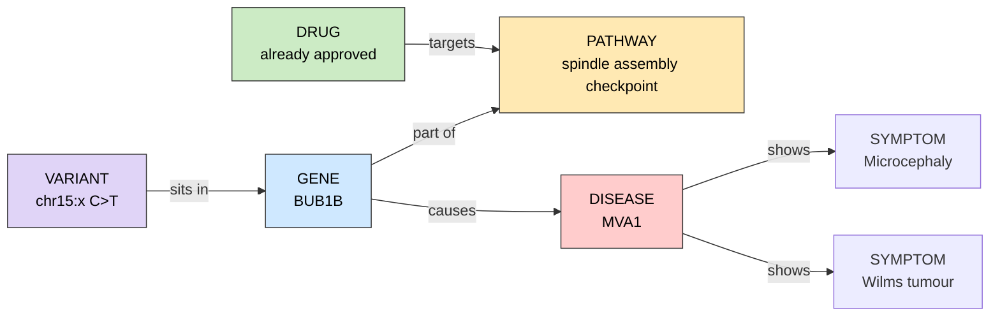

> **Legend** — purple: the variant · blue: the gene · yellow: the pathway · red: the disease and its symptoms · green: the drug, which is where Track 2 lives.

Track 1 walks left to right. **Track 2 is the same walk, one hop further, to the green box.**

**GNN (graph neural network) / R-GCN / TransE / embedding** — models that learn over a network like that.

**Link prediction** — guessing which missing connections should exist. *"Which drug connects to this gene?" is the same maths as "which gene connects to this symptom?".*

**Network propagation / random walk with restart** — start at the patient's symptoms and spread influence through the network; genes that light up are suspects. No training needed.

**PPI (protein–protein interaction)** — which proteins physically touch which.

**Ensembling** — combining several models' opinions.

**Borda count / reciprocal rank fusion (RRF)** — simple, robust ways to merge ranked lists. RRF adds up `1/(k + rank)` from each list. Needs no training — ideal here.

**Pairwise tournament (Bradley–Terry ranking)** — rank items by playing them against each other two at a time and counting wins, like a sports league, instead of scoring each alone. Bradley–Terry is the statistics that turns the win/loss record into a ranking. Judging "is pair A a better explanation than pair B?" is easier and more reliable than "score pair A from 0 to 1". *Example: 10 candidate pairs → 45 judged matches → a win-count ranking.*

**LLM (large language model)** — an AI like this one. Here: good at reading papers and drafting; must NEVER be trusted to state a genomic coordinate or a citation on its own.

**Agentic** — an LLM that calls tools and takes multiple steps by itself.

**Grounded / traceable / auditable** — every claim points back to a real source you can click. Ungrounded LLM output invents references, which destroys credibility instantly.

**Hallucination** — the model confidently making something up.

**Triage** — quickly sorting a big pile to find what's worth reading properly.

**Precision / Recall** — Precision = of what you flagged, how much was right. Recall = of what was right, how much you flagged.
*Flag 10 variants, 2 are the true pair → precision 2/10 = 0.2, recall 2/2 = 1.0.*

```text
5,000,000 candidate variants.  Exactly 2 of them are the true pair.

you submit 10 rows:      [T][T][ ][ ][ ][ ][ ][ ][ ][ ]      T = a true one
  precision = 2/10 = 0.20     of what you flagged, how much was right
  recall    = 2/2  = 1.00     of what was right, how much you flagged
  F         = 2 x 0.2 x 1.0 / (0.2 + 1.0) = 0.33

you submit 2 rows:       [T][T]
  precision = 1.00   recall = 1.00   F = 1.00   <-- the maximum. This is F-max.
```

> **Legend** — `[T]` is a true variant, `[ ]` is a wrong one · each block is one row you submitted.

F punishes guessing wide. **You cannot buy recall with more rows without paying in precision.**

**F-score** — one number combining both: `F = 2·P·R / (P + R)`. High only when BOTH are high.

**ROC-AUC vs PR-AUC** — two ways to summarize a classifier. With 2 right answers among 5 million, ROC-AUC looks great even for junk — use PR-AUC.

**Class imbalance** — vastly more negatives than positives. Exactly this case.

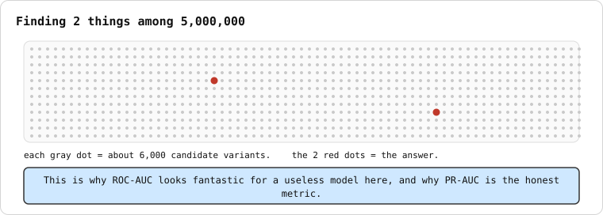

> **Legend** — each gray dot is about 6,000 candidate variants · the two red dots are the answer you have to find.

**Held-out test set** — data you never touched while building, kept to get an honest score.

---

## 13. Hackathon scoring words

**Oracle** — the scoring server. You send a guess, it immediately tells you how close you were. That feedback is information you can exploit.

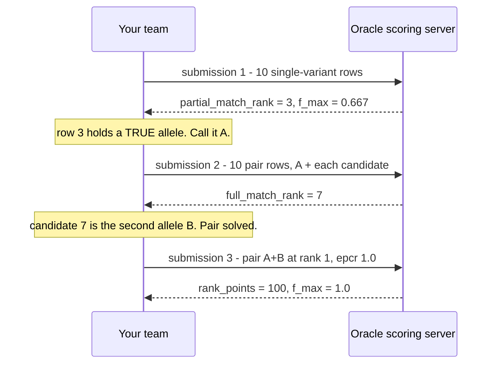

> **Legend** — solid right arrows: what you send · dashed left arrows: what the scorer sends back · the notes are what you can deduce from that reply.

Each submission is not a guess. **It is a question, and the answer narrows the next question.**

**Ground truth (GT) / answer key** — the real answer, held by the organizers.

**Submission / probe** — one guess. You get 6 each; a 3-person team gets 18 total.

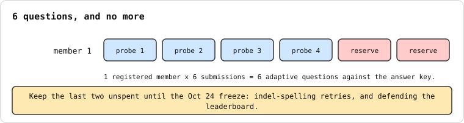

> **Legend** — blue: a submission you can spend now · red: one to hold back until the freeze · one row per team member.

**Row** — one line in your submission CSV. Up to 10 rows per submission. A row holds either one variant or a pair.

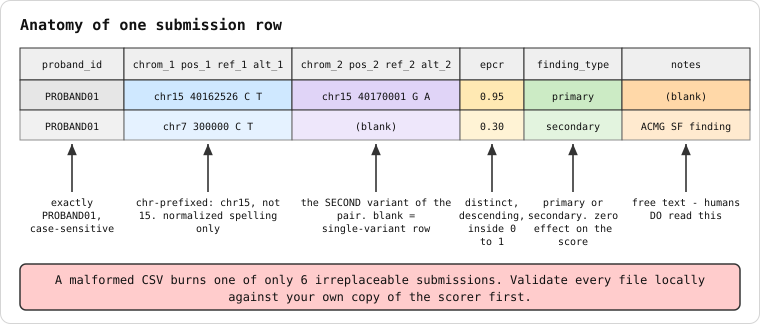

> **Legend** — gray: the header row · each column is coloured to match its callout underneath · the faded second row is a secondary-finding row.

**epcr** — the confidence number you attach to each row, between 0 and 1. It sets the ordering.

**Rank** — position after sorting by epcr, highest first. Rank 1 = your top guess.

**Rank points** — rank 1 → 100 pts, ranks 2–3 → 50, ranks 4–5 → 25, ranks 6–10 → 10.

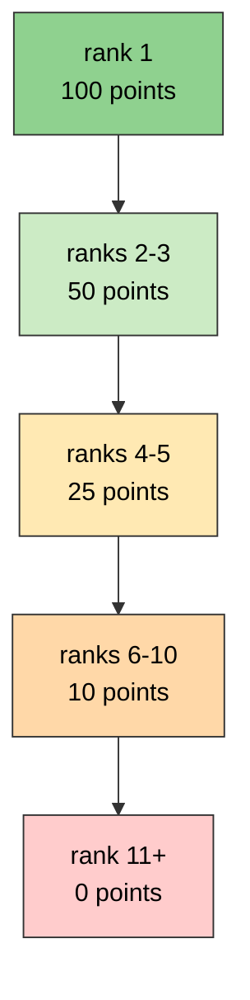

> **Legend** — green: full points · yellow and orange: partial-credit tiers · red: nothing at all.

A **partial** match scores half of its rung. A **full** match anywhere beats any partial match — even a full match down at rank 10.

**Full match** — one row contains EXACTLY the true pair. **Partial match** — a row contains one of the two true variants. Partial scores half.

**F-max** — the best F-score achievable by sweeping every epcr cut-off present in your file. Maxes at 1.0 only when your top row is exactly the true pair.

**Threshold sweep** — trying each epcr value as a cut-off and keeping the best result. Consequence: rows below the best cut-off can never hurt you — extra low-confidence rows are FREE.

```text
true pair = {V1, V2}          your submitted file:

  rank  epcr   row contents
    1   0.95   V1 + V2      <- exactly the true pair
    2   0.80   V9 + V3
    3   0.40   V7

now cut the file at every epcr value that appears in it:

  cut at 0.95 -> you predicted {V1,V2}           P=2/2=1.00  R=1.00  F=1.00  <-- BEST
  cut at 0.80 -> you predicted {V1,V2,V9,V3}     P=2/4=0.50  R=1.00  F=0.67
  cut at 0.40 -> you predicted {V1,V2,V9,V3,V7}  P=2/5=0.40  R=1.00  F=0.57

  F-max = 1.00   (the best cut wins; the worse cuts are simply ignored)
```

> **Legend** — each `cut at` line is one threshold in the sweep · `P` is precision, `R` is recall · the highest F wins and the rest are ignored.

So rows 2 and 3 **could not** lower your score. Secondary findings are genuinely free — add them.

**Tie-break by file order** — if two rows share an epcr, order is decided by which came first. Avoid it: always use strictly different, descending epcr values.

**Singles scan (probe S)** — submit 10 single variants to learn which of them is a true allele.

**Pair scan (probe P)** — you know allele A; submit 10 pairs (A + each candidate) to find B.

**Final strike (probe F)** — the confirmed pair at rank 1, epcr 1.0. Maximum score.


> **Legend** — blue: scanning probes that look for a signal · yellow: the follow-up probe that confirms · green: the final strike and the score it locks in.

**Decode table** — the lookup that translates the returned F-max number back into "which rows held the true alleles".

**Leaderboard freeze** — the deadline after which no more submissions count (Oct 24, 23:59 UTC).

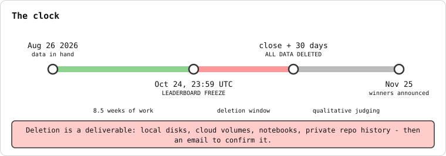

> **Legend** — green: time left to work · red: the deletion window · gray: judging · the circles are fixed dates you cannot move.

**Qualitative evaluation** — human judges reading your report. The tiebreaker when many teams hit the maximum automated score.

**Drug repurposing** — taking a drug already approved for something else and using it for this disease. Faster and safer than inventing a new one. *That's Track 2.*

**Aneuploidy-selective compound** — a drug that kills cells with wrong chromosome counts while sparing normal ones. *Examples from the literature: AICAR, 17-AAG, chloroquine.*

**Mechanism characterization** — explaining the full chain: which variant → what it does to the protein → what breaks in the cell → what happens to the patient.

**N-of-1** — a study or method built for a single patient.

**Reproducible** — someone else can rerun your code and get your exact numbers.

**Scalability** — your method would work on the next undiagnosed child too, not just this one.

---

## 14. Rules and privacy words

**Gated dataset** — you must apply and be approved before downloading.

**IRB (Institutional Review Board)** — the ethics committee that approved using this child's data. *Protocol #20252010.*

**Derived dataset** — anything you calculated FROM the patient data. Still counts as patient data. Must be deleted too.

**Resharing** — passing patient data to anyone else. Includes accidentally committing a VCF slice or an IGV screenshot to a public GitHub repo. Grounds for disqualification.

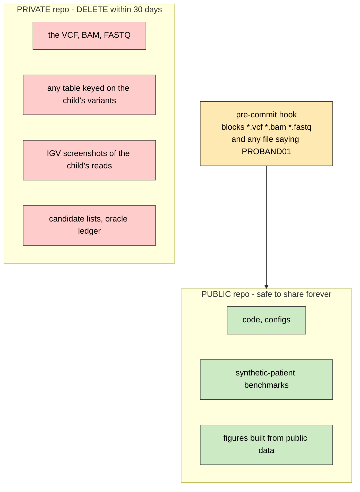

> **Legend** — green: safe to publish forever · red: patient data, deleted within 30 days · yellow: the guard that keeps one out of the other.

**Red can end your entry.** Anything computed FROM red is still red.

**Pre-commit hook** — a script that blocks a git commit if it spots a forbidden file. Cheap insurance.

**Embargo** — a period where you must not publish a paper about it. Code is fine; the journal article waits.

**Acknowledgement text** — the exact wording the organizers require you to include in anything public.

**De-identified** — names removed. Note this is NOT the same as impossible to identify — genomes are inherently identifying, which is why the rules are strict.

---

## 15. The research record — words for what you believe

Everything above this section is about the *data*. This section is about the *investigation*:
how a question becomes a claim, a claim becomes a test, and a test becomes something you can
put in a report. The words come from ordinary experimental science, and most of them have a
close software analogy.

The loop they describe:

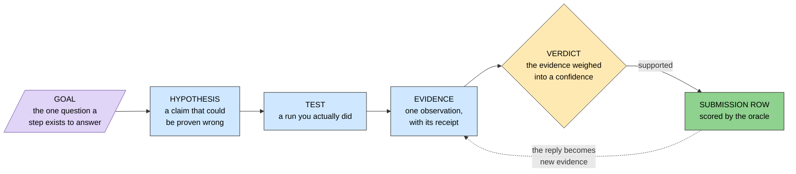

> **Legend** — purple: the raw input, the only thing not derived from something else · blue: neutral machinery, the stations that turn a claim into an observation · yellow: the decision point · green: the goal. The dotted arrow is the feedback edge — a score is not the end, it is more evidence.

**Research goal** — the single question a step exists to answer. Not a task ("normalize the VCF") but a question ("does every variant have exactly one spelling?"). A task is done when it runs; a goal is done when it is answered. *Example:* step 1's goal is whether an exact-match scorer can be trusted with an indel.

**Hypothesis** — a claim that could turn out to be wrong, stated before you test it. In software terms it is an assertion you write before the code that makes it pass. *Example:* "the causal pair sits in BUB1B."

**Falsifiable** — able to be proven wrong by some observation you could actually make. A claim nothing could disprove is not a hypothesis, it is an opinion. *Example:* "BUB1B is involved somehow" is not falsifiable; "both BUB1B alleles are rare and damaging" is.

**Prediction** — what you must observe *if* the hypothesis is true. Written before the run, so the result cannot be reinterpreted afterwards to fit. *Example:* "two BUB1B variants with gnomAD frequency below 1 in 1000, on opposite copies."

**Refutation condition** (`refuted_by`) — the observation that would kill the claim. The most valuable sentence in the whole record, and the one people skip. *Example:* "both BUB1B alleles turn out common in gnomAD, or phasing puts them on the same copy."

**Test** — a run you actually executed. Here, a methodology entry is the test: it carries the exact commands, the inputs, and the raw output, so someone else can repeat it. Not the same as a software unit test.

**Evidence** — one observation bearing on one claim. Not a conclusion — a single fact, tagged with which way it cuts. *Example:* "BUB1B is depleted of loss-of-function variants in gnomAD."

**Direction** — which way an observation cuts: **supports**, **refutes**, or **neutral**. Neutral is recorded rather than dropped, because "we looked and it told us nothing" is a real finding that stops the same look being repeated. *Example:* a coverage check that came back normal is neutral evidence, not absence of evidence.

**Strength** — how hard an observation cuts, from 0 to 1. A human judgment, not a computed statistic. *Example:* "absent from gnomAD entirely" is 0.8; "the gene is plausible" is 0.2.

**Source reference** (`source_ref`) — the receipt an observation came from: a methodology entry, a warehouse table, a [PMID](#7-databases-and-annotation), a [ClinVar](#7-databases-and-annotation) record, or an oracle reply. An observation with no receipt is not evidence, because nobody can check it. *Example:* `methodology/003`.

**Verdict** — the evidence weighed into a status and a number, with a written reason. *Example:* "supported at 0.8, because two independent paths reached BUB1B separately."

**Confidence** — how strongly the claim is currently believed, 0 to 1. It is a [posterior](#11-math-probability-and-statistics-words) in spirit, but see the warning below. *Example:* 0.69.

**Log-odds** — a way of adding up evidence. Instead of multiplying probabilities, you convert to `log(p / (1-p))`, where each piece of evidence becomes a number you simply **add**. Convert back at the end. Software analogy: working in log space to turn a product into a sum, exactly as you would to avoid floating-point underflow. *Example:* a confidence of 0.5 is log-odds 0; add +1.4 for a strong supporting observation and you are at 0.80.

**Heuristic, not calibrated** — the crucial caveat on every confidence in this repository. The arithmetic adds evidence as if each piece were independent, and it is not: two observations computed from the same VCF are the same fact counted twice. The number is for **ordering and triage** — which claim deserves attention next — never for a probability you would quote as a result. Say this wherever the number appears.

**Revision** — one recorded version of a claim. The register never edits: changing your mind appends a new revision, so the record of the belief *moving* survives. Software analogy: an event log, not a mutable row. *Example:* H001 revision 1 proposed, revision 2 supported at 0.8.

**Append-only** — a table you only ever add rows to. No `UPDATE`, no `DELETE`. It is what makes a record evidence rather than a claim about the past. *Example:* `warehouse.evidence`.

**Register** — the collection of all hypotheses and their revisions. *Example:* `warehouse.hypotheses`.

**Dossier** — one claim plus everything recorded about it: every revision, every evidence row, and the weighing over them. What gets exported as a Markdown file and rendered as a report section. *Example:* `docs/step-1/hypotheses/h001-bub1b.md`.

**Provenance vs belief** — two different questions, often confused. **Provenance** is *where did this byte come from* — answered by lineage and hashes. **Belief** is *what do we think is true and why* — answered by the register. A perfect provenance chain tells you nothing about whether a conclusion is right. *Example:* `data_lineage` says which VCF produced a table; `warehouse.evidence` says what that table made us believe.
