# Dictionary — every unclear word in this repository

**Standing:** the one glossary. Never duplicated elsewhere; enriched whenever a new domain
term, gene, file format or tool appears in the work. Rendered as a course at `/learn` in the
app — generated from this file by `app/tools/gen-dictionary.mjs`, never copied; a cross-link
here that names a missing heading fails that build, and so does a `*Context:*` line naming a
file or an entry that does not exist. Last checked 2026-09-06.

Explained like you're 12. Ordered so each word only uses words defined above it.

**How an entry is written.** One definition line and two optional italic lines under it:

- `**term** — what it means.` The definition, written for someone who has read only the
  entries above this one.
- `*Example: one concrete value.*` A real value from the work, never an invented one.
- `*Context: where it is used · source: path/to/owner.md · related: [term](#slug), [other](#slug) · see: [label](#anchor) · first seen 2026-09-05*`
  The metadata. Segments are separated by ` · ` (or `; ` before a key); every segment is
  optional. `source:` names the one repo-relative file that owns the term, `related:` the
  entries this one leans on, `see:` a figure, exhibit or page worth opening. `first seen` is normally left
  out — `app/tools/gen-dictionary.mjs` derives it from git, taking the author date of the
  earliest commit that added the term's bold marker to this file, and you only write it by
  hand for a term that existed in the work before it reached this page.

The Learn page renders those as the definition, the example beneath it, and a quiet metadata
footer carrying the date, the source, the related entries as links, and the exhibits.

Concrete values in `*Example:*` lines are illustrations, not the source of truth for a
measurement. Dataset numbers are owned by
[`../ideation/data-findings.md`](../ideation/data-findings.md); repository and
infrastructure numbers by [`current-state.md`](current-state.md).

Diagrams: `mermaid` blocks render automatically on GitHub, in VS Code with the Markdown preview,
and on Obsidian/Notion. If you are reading this in a plain text editor they will look like code — open it on
GitHub instead. Colour code used everywhere: **green = good / safe / the goal**, **red = broken / dangerous /
lost points**, **yellow = a decision point**, **blue = neutral machinery**, **purple = the raw input**.
Every diagram is followed by a `> **Legend**` line decoding its own colours and symbols, so you never
have to guess what a shape means.


---

## 1. DNA basics (read this first, everything else needs it)

**DNA** — the instruction book inside every cell. Written with only 4 letters: A, C, G, T.
*Example: ...ACGGTTACG... A human book is 3 billion letters long.*

**Base / nucleotide** — one letter of DNA (A, C, G, or T).

**Base pair (bp)** — DNA is two strands zipped together; A always pairs with T, C with G. One rung of the ladder = 1 bp.
*1 kb = 1,000 letters. 1 Mb = 1 million letters. 1 Gbp = 1 billion letters.*


> **Legend** — each coloured box is one DNA letter · A always faces T, C always faces G · the bracket on the left marks one base pair.

**Genome** — the whole instruction book of one person (all 3 billion letters).

**Chromosome** — the book is split into 23 volumes. Written `chr1`, `chr2`, ... `chr15`, `chrX`, `chrY`.
*Example: `chr15q15.1` = chromosome 15, long arm (`q`), region 15.1. Like "volume 15, page 15, paragraph 1".*


> **Legend** — blue: the chromosome body · gray oval: the centromere, the pinch in the middle · red stripe: the band being addressed · yellow boxes: the four parts of the address, in order.

**Gene** — one recipe inside the book. About 20,000 recipes. Each makes one protein.
*Example: the gene `BUB1B` is the recipe for a protein that checks cell division.*

**Protein** — the machine the recipe builds. Proteins do all the actual work in a cell.

**Amino acid / residue** — one bead in the protein chain. A gene's letters, read 3 at a time, spell out which bead comes next.


> **Legend** — gray boxes: DNA letters · the brackets show how they group in threes · each circle is the amino acid that triple codes for · red circle: STOP, the end of the recipe.

**Exon** — the parts of a gene that end up in the final recipe (the useful text).

**Intron** — the parts cut out and thrown away before the recipe is used (like commercials cut from a recorded show).

**CDS (coding sequence)** — the part of the [exons](#1-dna-basics-read-this-first-everything-else-needs-it) that is actually translated into protein. Exons also carry untranslated ends (UTRs); the CDS is the recipe proper. About 1 % of the genome, plus the [stop codon](#1-dna-basics-read-this-first-everything-else-needs-it) that ends it. Nearly every variant that breaks a protein sits in the CDS or within a few bases of its edges.
*Example: `ressources/reference/coding_regions.tsv` — every CDS of every protein-coding transcript, widened by 8 bases on each side and merged per gene: 223,048 intervals, 44.6 Mb ([methodology 069](iteration1/step-2/methodology/069-layer-2-coding-scan.md)).*

**Splice flank** — the few intronic bases on each side of an exon that the splicing machinery reads. A change there can wreck splicing without touching the CDS itself. The ±2 bases are the **canonical splice sites** (almost always damaging); VEP's `splice_region_variant` reaches ±8. That is why the coding intervals above are widened by 8, not 0.

**Splicing** — the cutting-out step. Cell removes introns, glues exons together.
*If splicing goes wrong, the recipe is garbled and the protein is broken.*

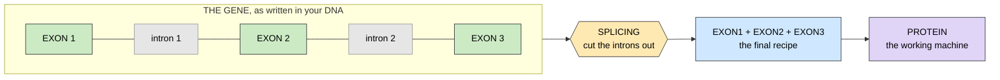

> **Legend** — green boxes: exons, kept · gray boxes: introns, cut out and thrown away · yellow hexagon: the splicing step · blue: the finished recipe · purple: the protein it builds.

**Deep intronic** — a change buried far inside an intron, far from any exon. Easy to miss, but can still wreck splicing.

**Transcript** — one specific version of a recipe (a gene can be spliced several ways). **MANE Select** = the one official version everyone agrees to quote.

**Canonical transcript** — the one version Ensembl nominates as the gene's representative, and the one every tool reports against by default. It matters that everybody uses the *same* one: an exon number, a domain boundary and a variant's amino-acid position are only comparable if they are all measured on the same transcript. *Example:* `ENST00000287598` for BUB1B; Ensembl writes the pointer with a version suffix (`.11`) that the transcript's own id lacks.

**Biotype** — Ensembl's label for *what kind of thing* a gene or transcript is. It is a classification, not a measurement, and the one that matters most is whether the thing makes a protein. Software analogy: a type tag on a record — you branch on it before deciding which fields are even meaningful. *Example:* `protein_coding` for BUB1B, `lncRNA` for DICER1-AS1, `protein_coding_CDS_not_defined` for a BUB1B transcript that is annotated but has no reading frame.

**lncRNA (long non-coding RNA)** — a gene that is copied into RNA and then *stops there*: the RNA is the product, and no protein is ever built from it. "Long" just means over ~200 [bases](#1-dna-basics-read-this-first-everything-else-needs-it); "non-coding" is the load-bearing half. It still has real [exons](#1-dna-basics-read-this-first-everything-else-needs-it) and is still spliced, so an exon track for one is honest — but it has no [amino acids](#1-dna-basics-read-this-first-everything-else-needs-it), no protein domains and no fold, so *every* protein-level question about it is not "unknown", it is "not applicable". Many lncRNAs sit head-to-head with a protein-coding gene and are named after it with an `-AS1` suffix, meaning **antisense** — read from the opposite [strand](#1-dna-basics-read-this-first-everything-else-needs-it) at the same locus. *Example:* `DICER1-AS1` (`ENSG00000235706`) overlaps DICER1's far end on chr14 and makes no protein; asking this project's `/api/panel/protein-structure` for it answers **422**, not an empty fold.

**Gene symbol** — the short human name of a gene, assigned by **HGNC** (the committee that owns human gene naming). It is the label everyone actually says out loud, and it is *not* a stable identifier: HGNC renames genes, and the old name becomes a **previous symbol**. A gene also collects **aliases** — informal names from papers and older nomenclature — which are not authoritative either. Software analogy: the symbol is a mutable display name, the [Ensembl](#1-dna-basics-read-this-first-everything-else-needs-it) `ENSG…` id is the primary key; join on the key, show the name. *Example:* `CENATAC` was renamed from `CCDC84` in 2020 (HGNC:30460), and `p31comet` is an alias for `MAD2L1BP` that no database is obliged to resolve.

**Ensembl symbol lookup** — the REST call that turns a gene symbol into a stable id: `GET rest.ensembl.org/lookup/symbol/homo_sapiens/<symbol>?expand=1`, which answers with the gene record and, with `expand=1`, every transcript. Two traps, both verified live in this project: it resolves the **current** symbol only — `CCDC84` gets a flat `400 {"error":"No valid lookup found for symbol CCDC84"}` — and the sibling endpoint `GET /xrefs/symbol/homo_sapiens/<symbol>`, which searches cross-references instead, *does* resolve a retired symbol but answers with a **list** of matches. So an alias is confirmed by the target id appearing in that list, never by the list having one entry: `CCDC84` returns two ids, both of which are CENATAC (one on the primary assembly, one on a patch scaffold). *Example:* `/lookup/symbol/homo_sapiens/BUB1B?expand=1` → `ENSG00000156970`, `biotype: protein_coding`, `canonical_transcript: ENST00000287598.11`.

**Strand** — which of the DNA's two mirrored strands a gene is read from. **Forward / plus (`+1`)** reads left-to-right along the coordinate axis, **reverse / minus (`-1`)** reads right-to-left. Consequence: on a minus-strand gene, exon 1 is the *rightmost* box on a chart. *Example:* TP53 is `-1`, BUB1B is `+1`.

**TSS (transcription start site)** — the first base actually copied into the transcript, i.e. where reading begins. On the minus strand it is the gene's *high* coordinate.

**Allele** — one copy of a gene. You have 2 copies of every gene: one from each parent.

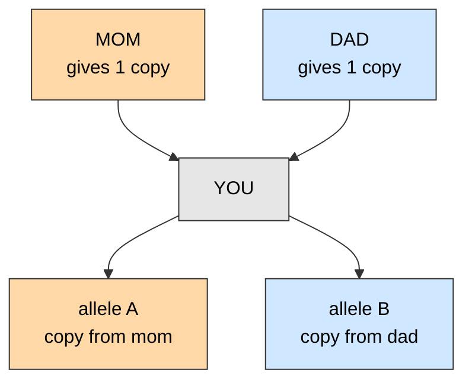

> **Legend** — orange: the copy that comes from mum · blue: the copy that comes from dad · gray: you, holding both at once.

**Diploid** — having 2 copies of each chromosome. Normal for humans.

**Genotype** — which 2 alleles you actually carry at one spot.

**Locus** — an address in the genome. *`15q15.1` is a locus.*

---

## 2. Reading DNA (sequencing) and the files it makes

**Sequencing** — machine reads the DNA letters. It cannot read the whole book at once, so it shreds it and reads tiny scraps.

**Read** — one scrap the machine read. Typically 150 letters long.
*Example: this case is 2 × 149 letters.*

**Base quality / Phred score / Q30** — a per-letter confidence number. Q30 means "1 chance in 1,000 this letter is wrong". People quote the **Q30 rate**: the share of letters at Q30 or better.
*Example: 92% Q30 in this dataset — good. Below ~80% and you start distrusting calls.*

**Paired-end** — machine reads both ends of each scrap. Two files, `R1` and `R2`, that pair up.


> **Legend** — blue: the R1 read · orange: the R2 read · gray: the middle, never read · the arrows show which direction each end is read from.

**Insert size (fragment length)** — the full length of the original scrap, R1 + the unread middle + R2. It is the physical reach of one piece of evidence.
*Example: 266 letters here. Two variants further apart than that can never sit on the same fragment, which is exactly why [phasing](#4-inheritance--how-the-answer-is-shaped) fails at gene scale in this case.*

**Lane / flowcell / instrument** — the machine's own subdivisions. One library of DNA is spread across several lanes and read in parallel; the lane number is in every read's name.
*Example: `@A01973:164:HGWCNDSX7:1:…` = instrument `A01973` (a NovaSeq 6000), flowcell `HGWCNDSX7`, lane `1`. This case is 4 lanes × 2 ends = 8 FASTQ files, all one library — so the lanes are technical repeats and you just merge them.*

**Coverage / depth (e.g. 30×)** — how many scraps cover each letter, on average. 30× = each letter was read ~30 times.
*More coverage = more confident. At 5× coverage, "nothing found here" means nothing.*

```text
reference    A   C   G   T   T   A   C   G   T   A   C
read 1       A   C   G   T   T   A
read 2           C   G   T   T   A   C   G
read 3                   T   T   A   C   G   T   A
read 4                           A   C   G   T   A   C
             --- --- --- --- --- --- --- --- --- --- ---
depth        1   2   2   3   3   4   3   3   2   2   1
             ^^^                                   ^^^
             thin edges: a variant here is a coin flip

Real data: ~30 scraps stacked on every letter (30x).
A hole in the stack is why "we found nothing in that exon" can be a lie.
```

> **Legend** — each `read` row is one 150-letter scrap · the `depth` row counts how many scraps cover that letter · the thin edges are where a call becomes a coin flip.

**WGS (whole genome sequencing)** — read the entire book, introns and all. ~85 GB of data.

**WES (whole exome sequencing)** — read only the exons (~2% of the book). Cheaper, but blind to introns.
*This case is WGS, so hidden intron answers ARE possible.*


> **Legend** — green ticks: exons · gray bar: the whole genome · the dashed row is what WES sees, the blue row is what WGS sees.

**FASTQ** — the raw scrap file. Just the letters + a quality score per letter. Huge, unorganized.

**Alignment / mapping** — puzzle step: figure out where each scrap belongs on the reference book.

**Reference genome / GRCh38 (= hg38)** — the standard "official" human book everyone compares against. Version 38.
*Positions only mean something relative to a reference. `chr15:40,000,000` in GRCh38 ≠ same spot in GRCh37.*

**Contig** — one continuous named sequence in the reference. Chromosomes are contigs; so is every leftover fragment nobody could place.

**`chr` prefix (contig naming)** — the same chromosome is written `chr15` in some references and plain `15` in others. Both are GRCh38; only the *string* differs. Programs that compare names literally will silently find nothing.
*Example: this case's VCF says `15`, the submission format demands `chr15`. Convert in exactly one place in your code, never by hand.*

**Region (`contig:start-end`)** — the standard way to write a stretch of the genome: a contig name, a colon, and a 1-based coordinate range that is **inclusive at both ends**. Every genome tool takes one (`samtools view`, `bcftools view -r`, IGV's search box), so it is the closest thing genomics has to a URL. Watch the off-by-one: interval *files* (the `.bed` format, further down) are 0-based and half-open, so the same stretch is written with a different start there.
*Example:* `15:40100000-40200000` and `chr15:40,100,000-40,200,000` name the same 100,001 bp window on chromosome 15; the commas are decoration and the `chr` is the prefix question above.

**Analysis set / no-alt / decoy (hs38d1)** — the packaging of a reference for real analysis. **Alt contigs** are alternative versions of tricky regions; a **no-alt** set leaves them out so each read has one obvious home. **Decoy** sequence (`hs38d1`) is junk DNA added deliberately as a magnet, so reads that belong nowhere stick to it instead of piling up on a real gene and inventing a variant.
*Example: this VCF declares 1,690 contigs — 25 real ones (`1`–`22`, `X`, `Y`, `M`), 148 unplaced fragments, and 1,517 decoys.*

**Unplaced / random contig (`_random`, `Un_`)** — a real piece of human sequence that could not be pinned to a chromosome. Variants there are almost always noise for a diagnosis.

**BAM / CRAM** — the file of scraps AFTER alignment (each scrap now has an address). CRAM = same thing, squeezed smaller.

**bwa-mem2** — a popular aligner program (does the puzzle step).

**Duplicate reads / duplication rate** — copies of the *same* original scrap, made during library prep, not real independent evidence. They get marked and ignored, so they cost you coverage.
*Example: 9.3% here — normal. That is part of why 52× of raw letters becomes ~44× of usable depth.*

**Variant calling** — comparing the person's scraps to the reference and writing down every difference.

**Caller** — the program that does it. *DeepVariant, GATK HaplotypeCaller, Clair3.*

**VCF (Variant Call Format)** — the list of differences. One line per difference. Much smaller than FASTQ.
*This is the main hunting ground.*
*Context: the primary input of this project — every warehouse table is derived from the one delivered VCF · source: docs/step-0/methodology/001-vcf-provenance-and-structure.md · related: Variant, Genotype, Variant calling, Checksum · see: [the delivery numbers](../ideation/data-findings.md)*

```mermaid
flowchart LR
    G["GENOME<br/>3 billion letters<br/>in the child's cells"] --> SQ["SEQUENCER<br/>shreds it, reads scraps"]
    SQ --> FQ["FASTQ<br/>~70 GB<br/>scraps with NO address"]
    FQ --> AL["ALIGN to GRCh38<br/>bwa-mem2"]
    AL --> BM["BAM / CRAM<br/>~20 GB<br/>scraps WITH an address"]
    BM --> VC["VARIANT CALLING<br/>DeepVariant"]
    VC --> VF["VCF<br/>~200 MB<br/>only the differences"]
    style G fill:#e0d4f7,stroke:#333,color:#000
    style FQ fill:#ffcccc,stroke:#333,color:#000
    style BM fill:#ffe9b3,stroke:#333,color:#000
    style VF fill:#ccebc5,stroke:#333,color:#000
    style SQ fill:#e6e6e6,stroke:#333,color:#000
    style AL fill:#e6e6e6,stroke:#333,color:#000
    style VC fill:#e6e6e6,stroke:#333,color:#000
```

> **Legend** — purple: the real genome · red: raw and huge · yellow: aligned but still huge · green: small and usable · gray: the tools in between.

**The whole hackathon is a fight over what got lost between red and green.**

**FILTER / PASS** — the caller's confidence flag on each line. `PASS` = caller trusts it. Non-PASS lines get thrown away by default — dangerous, because the real answer might be sitting there.
*It is a **text column on a row the caller kept**, not a deletion: GATK's `VariantFiltration` writes the name of every threshold the line failed and leaves the line in the file. So "suppressed" means *downstream tools are expected to skip it*. When a line trips several thresholds the names are packed into one `;`-joined string, so `LowQual;QD2` is **one** record that failed two tests — counting it once under each name over-counts the file. Software analogy: a warning level on a log line, not a dropped log line.*
*Example:* 271,414 of this callset's 5,012,204 lines are non-PASS — 5.4 %. What is inside those lines for the candidate genes is measured in [methodology 049](step-0/methodology/049-suppressed-calls.md).

**mapping quality (MAPQ)** — the aligner's confidence, in [Phred](#2-reading-dna-sequencing-and-the-files-it-makes) units, that a [read](#2-reading-dna-sequencing-and-the-files-it-makes) came from the place it put it. It is low wherever the genome repeats itself, because the same read could have come from two or more places and the aligner cannot tell which. Not the same thing as base quality, which is the instrument's confidence in each letter. Software analogy: confidence in *which* bucket a hash landed in, as opposed to confidence in the bytes.
*Example:* MAPQ 0 means "this read maps equally well somewhere else" — common in [segmental duplications](#3-variants-the-differences-you-hunt) and near [telomeres](#1-dna-basics-read-this-first-everything-else-needs-it).

**MQ40** — a [FILTER](#2-reading-dna-sequencing-and-the-files-it-makes) label meaning *the mean [mapping quality](#2-reading-dna-sequencing-and-the-files-it-makes) at this site is under 40*. It fires in hard-to-map sequence, so it is a statement about **where** the variant is, not about whether it is real — which is exactly why non-PASS lines are worth mining: a real variant sitting in a repeat gets flagged too.
*Example:* the heaviest suppression reason in this callset — 177,522 lines, and 12 of the candidate panel's 20 suppressed lines.

**quality by depth (QD)** — the site's [QUAL](#2-reading-dna-sequencing-and-the-files-it-makes) score divided by the [read depth](#2-reading-dna-sequencing-and-the-files-it-makes) behind it. Raw QUAL grows with coverage, so a deeply covered site looks confident even on weak evidence; dividing normalises that out. Software analogy: a rate rather than a total.
*Example:* the **QD2** FILTER label = QD under 2, i.e. very little confidence per read. 35,402 lines here.

**tabix / bgzip / index** — compression + a table-of-contents so you can jump to `chr15` without reading the whole file.

**Remote range query** — using that table-of-contents over the network: the index is downloaded
(a few MB), and the client then asks the server for **only the byte ranges** holding the rows it
wants. The big file is never downloaded. The same trick a video player uses to seek without
fetching the whole film.
*Example:* `tabix https://…/scores.tsv.bgz 17:43044295-43125364` returns the rows for that region out of a 37 GB file; htslib spells "this remote file, that local index" as `<url>##idx##<path>`.
*Context: how the GPN-MSA lane is fed — 35,881 wanted positions merge into 21,722 regions over 3,105,436 bases, 0.1 % of the genome, and the 37,274,961,495-byte upstream file is never held. One seek costs ~0.3 s whatever it returns, so merging near neighbours into one region is the whole economy of it · source: src/mva/zoo/tabix_plan.py, src/mva/zoo/tabix_subset.py, docs/iteration4/step-2/methodology/140-the-lane-that-can-see-a-nonsense-allele.md · related: tabix / bgzip / index, Precomputed scores, Provenance manifest · first seen 2026-09-20*

**QC (quality control)** — checking the data isn't broken before trusting any result. *Tools: FastQC, MultiQC, samtools stats, bcftools stats, mosdepth.*

**Ti/Tv ratio** (also written **ts/tv**) — a sanity number: transitions divided by transversions (two chemically different kinds of letter swap). Real human WGS lands around 2.0–2.1. Way off = something is wrong.
*Example: 1.94 here — slightly noisy, acceptable.*

**bcftools stats section code** — the first column of every `bcftools stats` line, saying which table that line belongs to. One file holds a dozen stacked tables rather than one, so the code is how you tell them apart. Software analogy: a tagged-union log format — one line type per tag, and you dispatch on the tag. The ones this project reads: **SN** (summary numbers: records, SNPs, indels, multiallelic sites), **TSTV** (one row, the [Ti/Tv ratio](#2-reading-dna-sequencing-and-the-files-it-makes)), **ST** (substitution spectrum: one row per `A>C`-style swap), **IDD** ([indel](#3-variants-the-differences-you-hunt) length distribution, negative = deletion), **DP** ([read depth](#2-reading-dna-sequencing-and-the-files-it-makes) distribution), **AF** (one row per non-reference allele-frequency bin — see the trap below), **SiS** (singleton stats: the counters for alleles seen exactly once).
*Two things about the delivered file are worth knowing. **The `AF` section here is a zygosity split, not a frequency spectrum**: it is computed from each record's own [AC/AN](#3-variants-the-differences-you-hunt), and with one sample AN is always 2, so bcftools emits exactly two bins — AC=1 (heterozygous) and AC=2 (homozygous alternate). Nothing about the general population is in it. And **`SiS` is the same numbers again**: bcftools prints the singleton counters once keyed by allele count and again as the first `AF` bin, so on this file the two lines are byte-identical. Which sections the delivery actually contains — and which it does not, `QUAL` included — is measured in [methodology 045](step-0/methodology/045-orphan-tables.md).*
*Example:* `ST	0	A>G	656121` — section `ST`, sample id `0`, 656,121 A-to-G substitutions.

**Quality binning / quantised quality** — modern Illumina instruments do not emit every possible [Phred score](#2-reading-dna-sequencing-and-the-files-it-makes). They round each one to a handful of representative values so the [FASTQ](#2-reading-dna-sequencing-and-the-files-it-makes) compresses far better. So a "quality distribution" is genuinely a few tall bars, not a smooth curve — and plotting it as a density curve invents detail the instrument never recorded. Software analogy: lossy quantisation before compression, like reducing a colour palette.
*Example:* this NovaSeq run uses exactly four levels — Phred 2, 11, 25 and 37 — measured in [`step-0/methodology/028`](step-0/methodology/028-viz-api.md).

**Sentieon** — a commercial re-implementation of the GATK variant-calling algorithms, much faster and giving near-identical results. Common in clinical labs, so you meet it in VCF headers rather than by choosing it.
*Example: this callset was made by Sentieon Haplotyper → Sentieon GVCFtyper → GATK `VariantFiltration`. Reading that chain tells you it is a **small-variant pipeline only** — no structural variants will ever appear in this file.*

**fastp / FastQC** — programs that read a FASTQ and report [Q30](#2-reading-dna-sequencing-and-the-files-it-makes), GC content, [duplication](#2-reading-dna-sequencing-and-the-files-it-makes), [insert size](#2-reading-dna-sequencing-and-the-files-it-makes) and adapter contamination. `fastp` also trims; `MultiQC` merges many reports into one page.

---

## 3. Variants (the differences you hunt)

**Variant** — one difference from the reference book.

**SNV (single nucleotide variant)** — one letter swapped. *`chr15:100 A>G` = at position 100, reference has A, this person has G.*

**Indel** — a few letters inserted or deleted. *`CT>C` = one T deleted.*

**REF / ALT** — REF = what the reference book says. ALT = what this person has.

**POS** — the position number on the chromosome.

**Variant tuple `(chrom, pos, ref, alt)`** — the 4 things that uniquely name a variant. *`("chr15", 40000000, "C", "T")`.*

**Normalization / left-alignment (`bcftools norm`)** — the SAME deletion can be written several ways. Normalization forces one standard spelling.
*Example: deleting a T from `AAAT` can be written as position 1 `AAAT>AAA` or position 4 `AT>A`. Same biology, different text. If you spell it differently than the answer key, the computer says WRONG.*

```text
The child lost one A from a run of three:

reference   pos: 100 101 102 103
                  A   A   A   T
patient           A   A       T      (one A gone - but WHICH A? nobody can tell)

three legal ways to write the exact same event:
    pos=100  REF=AA  ALT=A      <- leftmost, shortest   (the standard)
    pos=101  REF=AA  ALT=A
    pos=102  REF=AT  ALT=T

  answer key holds : chr15  100  AA  A
  you submit       : chr15  101  AA  A
  scorer compares  : ("chr15",100,"AA","A")  vs  ("chr15",101,"AA","A")
  result           : MISS.  Same biology. Different text. Zero points.
```

> **Legend** — the three indented lines are the same deletion written three legal ways · only the first survives `bcftools norm` · the bottom block is what the scorer actually compares.

`bcftools norm -f GRCh38.fa -m -both` forces the leftmost/shortest spelling on everything. **Run it before anything else.**

**Multiallelic** — one position where the person has two different ALTs. Splitting (`-m -both`) breaks it into separate lines.

**HGVS** (`hgvs_c` / `hgvs_p`) — the doctor-style way to write a variant, agreed by the Human Genome Variation Society. `hgvs_c` spells the change on the transcript's coding sequence, `hgvs_p` on the protein that transcript makes. *`NM_001211.6:c.1288A>T` or `p.Arg430Ter`. Different notation from VCF, needs conversion.*

**delins** (deletion–insertion) — an HGVS spelling for a change that removes some letters and
puts different ones in their place, rather than swapping one for one. At protein level it
replaces **two or more** residues at once.
*Example:* `p.Asp12_Leu13delinsHisGln` — residues 12 and 13 become histidine and glutamine.
*Context: VEP labels these `missense_variant` because the consequence class is coarse, so they arrive mixed in with one-residue substitutions. A protein-substitution model scores one changed letter against one reference letter and has nothing to say about them: 28 of the record set's 15,620 missense alleles are `delins` and are the whole reason the protein-window pass reaches 99.821 % rather than 100 % · source: docs/iteration4/step-1/methodology/141-a-window-for-every-substitution-the-spelling-actually-describes.md · related: HGVS, Indel, Consequence, Sequence window · first seen 2026-09-20*
*Example:* `ENST00000000002.3:c.22C>T` (cDNA) and `ENSP00000000002.3:p.Gln8Ter` (protein) — one synthetic change, written twice.
*Context: requested from Ensembl VEP REST with `hgvs=1` and parsed in `mva.pipeline.vep_response.parse`. It is the join key of every precomputed score table in the [model zoo](#24-the-model-zoo--words-for-iteration-4), so an allele with no HGVS spelling cannot be looked up at all — which is what iteration 4's claim P4-1a measures · source: src/mva/zoo/record_hgvs.py · related: Allele record, UniProt accession, VEP (Variant Effect Predictor) · first seen 2026-09-01*

**SV (structural variant)** — a BIG change: a whole chunk deleted, duplicated, flipped, or moved.
*Example: an entire exon of 200 letters gone. A normal SNV caller misses this completely.*
*Callers: Manta, Delly, smoove/LUMPY, GRIDSS.*

**CNV (copy number variant)** — you have 1 or 3 copies of a chunk instead of 2. Found by depth: half the reads = one copy missing.

```text
reference   : A C G T T A C G T T A C G T          size        who finds it
              ------------------------------------------------------------------
SNV         : A C G T T A C G T T A C G A          1 letter    any caller, easy
insertion   : A C G T T A A A C G T T A C          1-50        any caller, ok
deletion    : A C G T T . . G T T A C G T          1-50        any caller, ok
SV deletion : A C G . . . . . . . . C G T          >50, whole  Manta / Delly ONLY
                                                   exon gone   (normal caller: blind)
inversion   : A C G T T   ACGTTACG flipped         >50         SV callers only
CNV dup     : region present 3 times not 2         kb to Mb    depth counting
repeat exp  : CAG CAG CAG CAG CAG CAG ... x200     variable    ExpansionHunter
```

> **Legend** — letters shown as `.` were removed · the size column is how many letters the change spans · the last column is which tool can even see it.

The easy classes are already in the VCF. **The hidden second allele is almost certainly one of the hard rows.**

**Repeat expansion** — a short pattern repeated too many times. *`CAGCAGCAG...` x 200.*

**Mobile element insertion** — a jumping piece of DNA landed in a gene.

**VAF (variant allele fraction)** — what fraction of your reads show the ALT letter.
*Normal expectations: 0% = you don't have it, ~50% = one copy (het), ~100% = both copies (hom).*

**Mosaic / mosaicism** — the variant is only in SOME of your cells, not all. So VAF comes out weird, like 12%.
*Example: a mistake happened after you were an embryo, so only some cells carry it. Standard callers assume 0/50/100% and throw 12% away as noise.*

**Low-VAF scan** — deliberately hunting for those weird-fraction variants that got thrown away.

**Allele balance** — the average [VAF](#3-variants-the-differences-you-hunt) across all the heterozygous calls on a chromosome. Should sit at 0.5. It is a free whole-chromosome copy-number test: if a fraction of cells carry an extra copy, the average drifts off 0.5 and the depth drifts up.
*Example: measured 0.472–0.497 on every autosome here — flat. That is how we know no [mosaic aneuploidy](#5-the-disease--mva) is visible in this blood sample, without aligning a single read. It bounds the aneuploid fraction below roughly 10–15%; it does not disprove the diagnosis, because MVA is diagnosed on cultured cells, not blood.*

```text
30 reads stacked on one position. How many show the ALT letter?

  not present    0/30   |                              |    0%   nothing there
  MOSAIC         4/30   |####                          |   13%   <-- REAL, but the
                                                                      caller deletes it
                                                                      as "noise"
  het           15/30   |###############               |   50%   1 of your 2 copies
  hom           30/30   |##############################|  100%   both copies
```

> **Legend** — bar length = the fraction of reads carrying the ALT letter · the 13% row is real biology that a standard caller throws away as noise.

Every standard caller assumes only 0% / 50% / 100% exist. **MVA is a mosaicism disease — so the 13% row is exactly where a missed allele hides.**

**Zygosity** — how many copies you carry. **Het (heterozygous)** = 1 of 2 copies changed. **Hom (homozygous)** = both copies changed. **Hemizygous** = only 1 copy exists at all (like a boy's X chromosome).

**AC / AN (allele count / allele number)** — two `INFO` counters the caller writes on every record. **AN** = how many copies were looked at in total across all samples; **AC** = how many of them carried the ALT letter. Software analogy: a numerator and a denominator shipped separately so nobody has to trust a pre-divided float.
*With **one** sample AN is always 2 (you have two copies of each autosome), so AC can only be 1 or 2: **AC=1 is a het call, AC=2 a hom-alt call**. That is why the callset's own `INFO/AF` (= AC/AN) is only ever 0.5 or 1.0 and says nothing about the population — see the AF trap under [gnomAD's AF](#7-databases-and-annotation). Measured in this callset: 3,180,797 alleles at AC=1 and 1,898,267 at AC=2 ([methodology 045](step-0/methodology/045-orphan-tables.md)).*

**Singleton (allele sense)** — an allele seen exactly **once** in the whole cohort, i.e. AC=1. Not to be confused with **[singleton sequencing](#4-inheritance--how-the-answer-is-shaped)**, which means only the child was sequenced. Both words appear in this project and they mean different things: this case is a sequencing singleton, and in a sequencing singleton *every het call* is also an allele singleton, which is what collapses bcftools' `SiS` section into "the het half of the callset".

**Germline** — variant you were born with, in every cell. **Somatic** — acquired later, in some cells only (cancer works this way).


> **Legend** — each circle is one cell of the body · red: carries the variant · white: does not.

**Genotype likelihood (`PL` / `GL` / `GQ`)** — the caller's confidence numbers. A low `GQ` het is not proof of absence — look again.

**Reference bias** — the aligner slightly prefers reads that match the reference, so ALT counts run a bit low.

**Substitution spectrum (mutational spectrum)** — a count of every kind of letter swap: how many A>G, how many C>T, and so on. Twelve possible swaps, so twelve bars. It is a fingerprint of *how* the DNA changed, and real biology has a very lopsided one.
*Example: `C>T` and `T>C` dominate real human variation, because a chemically tagged C decays into T on its own all the time. Sequencing errors have no such preference — so a spectrum where all twelve bars are the same height is a callset full of artifacts.*

**Strand collapse (pyrimidine-centric notation)** — DNA has two strands that mirror each other, so the same event reads as `G>A` from one side and `C>T` from the other. Collapsing folds each swap together with its mirror image, turning twelve bars into six. Standard in mutational-signature work (COSMIC).
*Example: `G>A` counted separately from `C>T` splits one real signal in half and makes it look weaker than it is.*

**Indel length spectrum** — how many [indels](#3-variants-the-differences-you-hunt) of each length, from a single letter up to tens. Deletions plotted as negative, insertions as positive.
*Example: ±1 letter dwarfs everything else, so the count axis has to be logarithmic. Whether the length divides by three matters enormously — see [frameshift](#3-variants-the-differences-you-hunt).*

**Variant density** — variants called per megabase (million letters). Raw variant counts just track chromosome length and say nothing; dividing by length makes a long chromosome and a short one comparable.
*Example: ~1,540 variants per Mb, flat across every chromosome in this dataset. Flat is the expected result and worth confirming.*

**Het:hom ratio** — heterozygous calls divided by homozygous-alternate calls. An outbred person lands around 1.3–2.0.
*Example: 1.61 here (3,047,077 het / 1,898,267 hom). A low ratio would mean long stretches where both inherited copies are identical, which would argue for a homozygous answer rather than a [compound heterozygote](#4-inheritance--how-the-answer-is-shaped).*

**Karyogram / ideogram** — a picture of all the chromosomes drawn side by side to scale, used to mark where something sits. The classic cytogenetics figure.
*Example: the panel gene map in the exploration report is one — 24 bars, with a diamond at each candidate gene's real coordinates.*

**Segmental duplication / repeat region / mappability** — parts of the genome that look like each other, so scraps can't be placed confidently. Callers do badly here.

---

## 4. Inheritance — how the answer is shaped

**Autosomal** — on a normal chromosome (1–22), not X or Y. Boys and girls equally affected.

**Recessive** — you need BOTH copies broken to get sick. One broken copy = healthy carrier.
*Parents are usually healthy carriers, so the disease looks like it came from nowhere.*


> **Legend** — square = male, circle = female · half-filled = healthy carrier · fully filled = affected · the arrow points at the proband, the patient the case is about.

**Dominant** — one broken copy is enough to get sick.

**Biallelic** — both copies of the gene are hit. Required for recessive disease.

**Compound heterozygous ("comp het")** — both copies broken, but by TWO DIFFERENT variants — one inherited from mom, one from dad.
*Example: from mom you get `BUB1B` with a stop-too-early mistake; from dad you get `BUB1B` with a splice mistake. Neither parent is sick. You are. **This is the shape of the answer in this hackathon.***
*Context: the shape of the answer this challenge asks for — the pair finder enumerates exactly this · source: src/mva/pipeline/compound_het.py · related: Zygosity, Phasing, Allele, Variant*

**Homozygous variant** — both copies broken by the SAME variant (usually when parents are related). Ruled out here.

**In trans** — the two variants sit on OPPOSITE copies (one from each parent). This is what makes you sick — no working copy left.

**In cis** — both variants sit on the SAME copy. Your other copy is fine, so you're healthy. Immediately eliminates that pair.

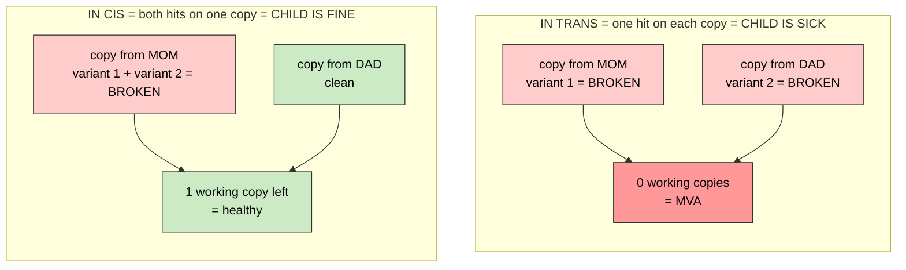

> **Legend** — red: a broken copy, and the outcome it leads to · green: a copy that still works, and its outcome · each box is one of the child's two gene copies.

Two rare variants in the same gene look identical in a VCF. **Only phasing tells trans from cis — and cis kills the hypothesis for free.**

**Phase / phasing** — figuring out whether two variants are in trans or in cis.

**Read-backed phasing** — if one single read scrap covers both variants, they're on the same copy (cis). Only works if they're close together (< ~1000 letters).
*Tools: WhatsHap, SmartPhase, HiPhase.*

**Phase block / PS tag** — a stretch where phasing was successfully worked out.

**`PGT` / `PID`** — the caller's own phasing columns in a VCF. `PGT` is the arrangement (`0|1` or `1|0`) and `PID` is the group id shared by variants phased together. Same `PID` + different `PGT` = *in trans*.
*Example: 15% of records here carry them, which sounds useful and is not — the reach is one [fragment](#2-reading-dna-sequencing-and-the-files-it-makes), ~266 letters. On BUB1B it settled 5 of 1,653 candidate pairs.*

**`1/2` genotype (multiallelic site)** — at one position the child carries **two different non-reference letters** and no reference copy. One of each, so one per parent copy: **compound heterozygosity proven by the genotype alone**, no read evidence needed. The one place phase is free.
*Example: 66,860 such sites in this callset. `bcftools norm -m -both` splits each into two rows that are in trans by construction.*

**Haplotype** — one full copy of a chromosome region, as inherited from one parent.

**Trio / duo / singleton** — sequencing the child + both parents (trio), + one parent (duo), or only the child (singleton). Trio makes phasing free. **Confirmed singleton here** — the VCF has exactly one sample column — so nothing is free and everything leans on rarity and consequence.

**Proband** — the patient the case is about. The submission must call them `PROBAND01`.
*Careful: the VCF's own sample column says `WGS_EX2312012` (the lab's accession number). The two strings are unrelated, and the mapping exists nowhere in the data — it is a convention of the challenge. Submitting the accession scores zero.*

**Accession number** — a lab's internal id for a sample or an order. Meaningless outside that lab, and usually the thing you must strip before publishing anything.

**Segregation** — checking the variants track with disease across the family.

**LoF (loss of function)** — the variant kills the protein completely.

**Truncating / nonsense / stop-gained** — the recipe hits a "STOP" too early, so you get half a protein.

**Frameshift** — an indel of a number not divisible by 3, so everything after it is read in the wrong grouping — total nonsense.


> **Legend** — gray letters are still read correctly · red letters are read in the wrong grouping · circles are the amino acids produced · red circles are nonsense.

**NMD (nonsense-mediated decay)** — the cell's quality checker destroys recipes with an early STOP. So truncating variants usually make zero protein.

**NMD escape** — if the early STOP is in the last exon, the checker misses it, so a partly-working protein IS made. Matters a lot: an "obvious LoF" might actually be a mild variant.

```mermaid
flowchart TB
    V["truncating variant<br/>an early STOP appears"] --> Q{"is the STOP<br/>in the LAST exon?"}
    Q -->|"NO - middle of the gene"| N["NMD shreds the recipe<br/>0 protein<br/>= NULL allele"]
    Q -->|"YES - last exon"| E["NMD does not notice<br/>a short protein IS made<br/>= possible HYPOMORPH"]
    style V fill:#ffe9b3,stroke:#333,color:#000
    style Q fill:#cfe8ff,stroke:#333,color:#000
    style N fill:#ffcccc,stroke:#333,color:#000
    style E fill:#ccebc5,stroke:#333,color:#000
```

> **Legend** — yellow: the variant · blue: the question the cell effectively asks · red: the recipe is destroyed, a null allele · green: a short protein survives, a possible hypomorph.

**Null allele** — makes zero working protein.

**Hypomorph / hypomorphic** — makes SOME working protein, just less or weaker. "Leaky", not dead.
*Key rule for this case: two nulls in `BUB1B` = the baby doesn't survive. So the answer is almost certainly **one null + one hypomorph**.*

```text
                              working BUB1B protein produced
  healthy person            |####################|  100%   fine
  NULL + healthy copy       |##########          |   50%   healthy carrier (a parent)
  NULL + HYPOMORPH          |#####               |  ~25%   <-- MVA. THE ANSWER SHAPE.
  NULL + NULL               |                    |    0%   embryo does not survive
```

> **Legend** — bar length = how much working protein is produced · the arrow marks the one combination MVA patients actually carry.

So a pair of two obvious stop-codons should be **down**-ranked. One clean killer + one sneaky leaky allele is the biologically expected combination.

**Leaky splice variant** — a splice mistake that goes wrong only some of the time, so a fraction of correct protein still gets made. Classic hypomorph.

**GoF (gain of function)** — the opposite: protein does something new or too much.

**Penetrance / expressivity** — whether carriers actually get sick, and how badly.

---

## 5. The disease — MVA

**Mitosis** — cell division. One cell copies its chromosomes and splits into two identical cells.

**Chromosome segregation** — the part of mitosis where each daughter cell must get exactly one copy of each chromosome.

**Missegregation** — that step goes wrong; a daughter cell gets too many or too few chromosomes.

**Aneuploidy** — having the wrong NUMBER of chromosomes. *Trisomy = 3 copies instead of 2. Monosomy = 1 copy. Tetraploidy = everything doubled.*

**Mosaic aneuploidy** — only some of the body's cells have wrong chromosome counts.

**Variegated** — each affected cell has a DIFFERENT wrong count. Cell A has 3 copies of chr8, cell B has 1 copy of chr20.
*This means the mistakes are being generated over and over, not inherited once.*

```text
One MVA child. Eight of their cells looked at under a microscope:

  cell 1   46  ..............  normal
  cell 2   47  +chr8 .........  trisomy 8
  cell 3   45  -chr20 ........  monosomy 20
  cell 4   46  ..............  normal
  cell 5   47  +chr3 .........
  cell 6   48  +chr5 +chr9 ...  double trisomy
  cell 7   45  -chr7 .........
  cell 8   46  ..............  normal

  "mosaic"      -> only SOME cells are wrong          (5 of 8 here)
  "variegated"  -> each wrong cell is wrong DIFFERENTLY
```

> **Legend** — the number is that cell's chromosome count · `+chrN` = an extra copy · `-chrN` = a missing copy · 46 is normal.

Compare Down syndrome: **every** cell has the **same** extra chr21. That is inherited once. MVA is a mistake-making machine that never switches off.

**MVA (Mosaic Variegated Aneuploidy)** — the disease. Recessive. 25–50% of body cells carry random, differing chromosome miscounts. Under 50 patients worldwide.
*Symptoms: small head, poor growth, learning difficulty, and high cancer risk.*

**Karyotype** — a photo of all a cell's chromosomes lined up. How MVA is diagnosed: look at many cells, see different miscounts in each.

**Cytogenetic** — done by looking at chromosomes under a microscope (as opposed to reading letters).

**Microcephaly** — unusually small head/brain.

**ID (intellectual disability)** — learning and thinking difficulties.

**Rhizomelic** — the upper arm/thigh bones are short (the part closest to the body).

**Dysmorphism** — unusual facial or body features.

**Cancer predisposition** — much higher than normal chance of getting cancer.
*MVA cancers seen: Wilms tumour (kidney), rhabdomyosarcoma (muscle), ALL/leukemia (blood).*

**Malignancy / neoplasm / tumour** — cancer.

**Tumorigenesis** — the process of a cancer starting.

**SAC (spindle assembly checkpoint)** — the cell's safety inspector during division. It shouts "STOP" until every chromosome is properly gripped. Only then does the cell split.
*If the inspector is weak, the cell splits too early with chromosomes in the wrong places = aneuploidy.*

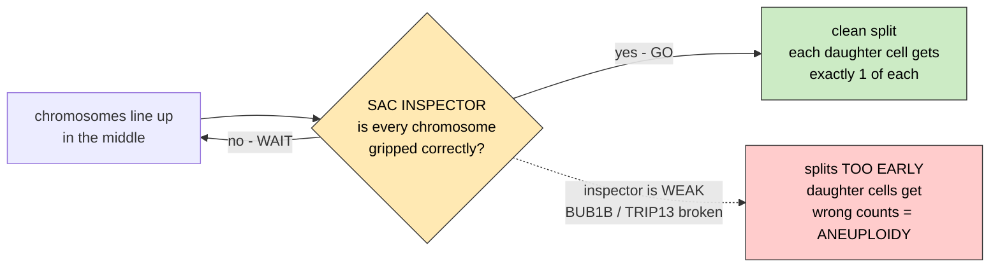

> **Legend** — yellow: the checkpoint decision · green: the correct outcome · red: what happens when the inspector is weak · the dotted arrow is the failure route, not the normal one.

**Anaphase** — the moment chromosomes get pulled apart. The SAC delays this until everything is ready.

**Kinetochore** — the handle on a chromosome that the pulling cables grab.

**Spindle** — the cables (microtubules) that pull chromosomes apart.

**Centrosome / centriole** — the two anchor points the cables shoot out from. Should be exactly two, giving a clean two-way pull (**bipolar**).

**Multipolar division** — too many anchor points, so the cell gets pulled 3+ ways. Chaos.

**Merotelic attachment** — one chromosome grabbed by cables from both sides at once. Wrong.


> **Legend** — yellow star: centrosome, the pole · pink lines: the spindle cables · red X: a chromosome · blue dot: the kinetochore, the handle · green header = normal, red header = broken.

**PCS (premature chromatid separation)** — chromosomes fall apart before they're supposed to. A hallmark seen in BUB1B patients.

**MCC (mitotic checkpoint complex)** — the actual "STOP" signal molecule. Built from BUBR1 + BUB3 + MAD2 + CDC20. Software analogy: a lock object one thread must hold before a shared resource (anaphase) can proceed — BubR1 is one of the proteins that assembles the lock.
*Example: this case's mechanism card names the pathway break exactly this way — "spindle assembly checkpoint (SAC) - mitotic checkpoint complex (MCC) formation and APC/C-CDC20 inhibition" — because reduced BubR1 means fewer MCC locks get assembled.*
*Context: the molecular target Track 2's checkpoint-reinforcement direction aims at · source: docs/iteration1/step-8/mechanism.md · related: Spindle assembly checkpoint, APC/C, BUB1B, Repurposing direction*

**APC/C** — the machine that starts the split, formally **APC/C–CDC20**: the anaphase-promoting complex only fires once its activator subunit CDC20 is loaded onto it, and MCC blocks exactly that loading step. No MCC = split happens too soon. Software analogy: a gate that opens only once a specific adapter (CDC20) is plugged in — the lock (MCC) works by holding that adapter hostage.
*Example: the mechanism card's immediate-effect line for this case reads "reduced BubR1 abundance and checkpoint signalling; weakened kinetochore-microtubule attachment error correction" — less MCC means less APC/C–CDC20 held back, hence premature anaphase.*
*Context: the checkpoint step a repurposed drug would have to reinforce, not inhibit · source: docs/iteration1/step-8/mechanism.md · related: MCC, Anaphase, BUB1B*

**Ubiquitin ligase** — a protein that tags other proteins for destruction. APC/C is one.


> **Legend** — blue: the four proteins that build the signal · yellow: the assembled STOP signal · purple: the enzymes · green: the outcome · the bar-ended line means blocks, not activates.

**BUB1B (protein name BUBR1)** — the main MVA gene, at `chr15q15.1`. Core part of the STOP signal. Its patients get cancer. **The prime suspect.**
*Context: the gene every iteration-1 hypothesis is about · source: docs/step-0/methodology/006-phasing-power-on-bub1b.md · related: MVA, Aneuploidy, Spindle assembly checkpoint, Compound heterozygous · see: [BUBR1 domains](assets/bubr1-domains.svg)*

**CEP57** — MVA gene 2, at `11q21`. Centrosome part. Patients have short upper limbs, usually NO cancer.

**TRIP13** — MVA gene 3, at `5p15.33`. Resets MAD2 so the STOP signal can be rebuilt. Cancer risk.


> **Legend** — blue: the chromosome arms · gray oval: the centromere · pin colour and size show how much prior belief each gene carries.

**CEP192, CENPE, SMC5, BUB1, BUB3, KNL1/CASC5, PLK4, MAD1L1, MAD2L1, CDC20, TTK/MPS1** — other division-machinery genes. Rare or suspected causes. Keep on the list, don't bet on them.

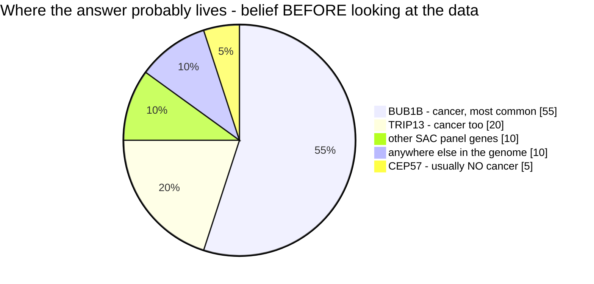

> **Legend** — slice size = how much belief each gene carries BEFORE any data is looked at · these are priors, not results.

The child has active cancer. CEP57 patients usually do not. **That single clinical fact is what moves the slices.**

**AAA+ ATPase** — a class of protein that burns fuel (ATP) to reshape other proteins. TRIP13 is one.

**Conformer** — a protein's shape. MAD2 has an "open" and a "closed" shape; TRIP13 flips it back.

**Panel** — the shortlist of genes you check first. *Here: BUB1B, TRIP13, CEP57 + the rest above.*

**Proteotoxic stress** — cells with wrong chromosome counts make too much of some proteins, and it piles up like garbage. Stressful, and a possible weak spot to attack with drugs.

**Clonal escape** — one stressed cell picks up a lucky mutation, ignores the rules and multiplies. That's cancer starting.

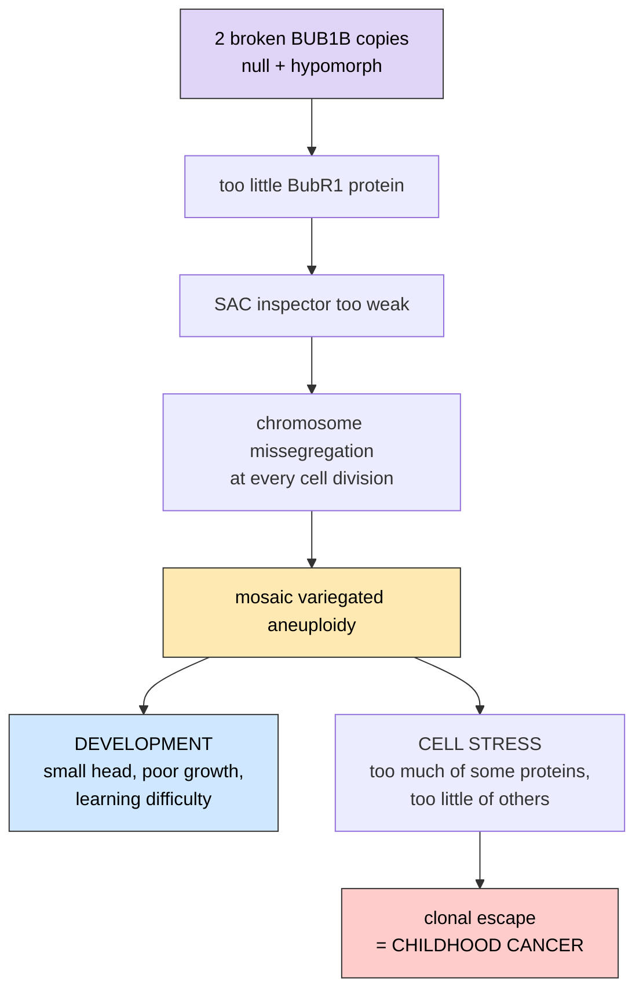

> **Legend** — purple: the genetic cause · yellow: the consequence inside the cell · blue: the developmental outcome · red: the cancer outcome · the split shows one cause producing two very different problems.

Track 2 asks you to write exactly this chain, then find a drug that cuts one of the arrows.

**Constitutional** — present from birth, body-wide (as opposed to appearing later in one tissue).

**Consanguineous** — parents are related (e.g. cousins). Makes homozygous recessive disease more likely.

**Cohesinopathy / centrosomopathy / chromosome-instability syndrome** — families of similar diseases where the chromosome machinery is broken. Useful lookalikes to compare against.

---

## 6. Describing symptoms — HPO

**Phenotype** — the observable traits: symptoms, measurements, what a doctor sees. (Opposite of genotype = the DNA.)

**HPO (Human Phenotype Ontology)** — a standard vocabulary of symptoms, each with a code. Stops people writing "small head" 10 different ways.
*Example: `HP:0000252` = Microcephaly. `HP:0002664` = Neoplasm.*
*Context: the vocabulary this child's symptoms are written in, and the graph every phenotype ranking walks · source: src/mva/phenotype/ontology.py · related: Phenotype, Ontology, DAG, Ancestor closure*

**Ontology** — an organized vocabulary where terms are linked parent-to-child.

**DAG (directed acyclic graph)** — the shape of that structure: arrows point from general to specific, and never loop back.
*Example: "Abnormality of the head" → "Microcephaly" → "Severe microcephaly".*

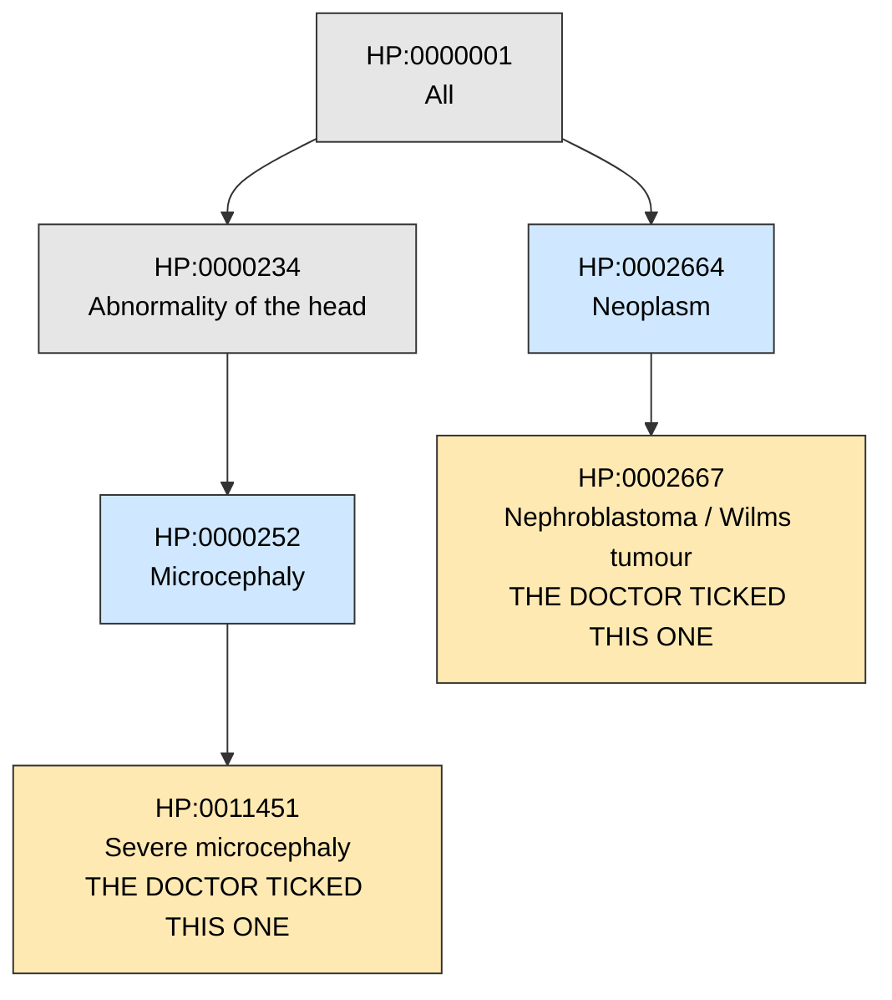

> **Legend** — gray: general parent terms · blue: intermediate terms · yellow: the terms a doctor actually ticked for this child · arrows run from general to specific and never loop back.

Arrows only point downward and never loop back = a DAG. Tick "Severe microcephaly" and you automatically also have every box above it. **Walk the arrows, never compare the words.**

**Ancestor closure** — if the patient has "Severe microcephaly", they automatically also have all the more general parent terms. You must walk up the arrows, not just compare text.

**Information content `IC(t) = −log p(t)`** — how surprising/specific a term is. Rare terms carry more information.
*"Neoplasm" in a kid is rare and very informative. "Abnormality of the body" is useless.*


> **Legend** — bar length = information content · longer bar = rarer term = more useful for narrowing the diagnosis.

**Semantic similarity (Resnik / Lin / Jiang–Conrath / Phenomizer)** — math for "how alike are these two symptom lists", using the graph, not the words.

**Phenopacket** — a standard file format holding a patient's HPO terms and case info.

### The eight terms this child actually has

Straight from the challenge's phenotype document. Note what is *missing*: microcephaly and intellectual disability, the two features most associated with MVA in textbooks.

| HPO ID | Term | Plain English |
|---|---|---|
| `HP:0002859` | **Rhabdomyosarcoma** | A cancer of soft tissue that behaves like muscle. Rare in children, aggressive, and here it is the event that triggered the whole investigation. |
| `HP:0000121` | **Nephrocalcinosis** | Calcium deposits building up inside kidney tissue. Present since birth in this child. |
| `HP:0004322` | **Short stature** | Height well below the expected range for age — and below what the family's own height predicts. |
| `HP:0001508` | **Failure to thrive** | Not gaining weight or growing at the expected rate, repeatedly documented over time. |
| `HP:0003202` | **Skeletal muscle atrophy** | Reduced muscle bulk — visibly less muscle than expected. |
| `HP:0001622` | **Premature birth** | Born before 37 weeks. This child: 32 weeks. |
| `HP:0001518` | **Small for gestational age (SGA)** | Born much smaller than expected even for that early a birth. ~1 kg here. |
| `HP:0200067` | **Recurrent spontaneous abortion** | Repeated miscarriages — a *parental* feature, not the child's own. |

**IUGR (intrauterine growth restriction)** — the process behind [SGA](#6-describing-symptoms--hpo): the baby grew too slowly *in the womb*. SGA is the measurement at birth; IUGR is the cause.

**Why the parental term matters.** Miscarriage is often caused by an embryo having the wrong number of chromosomes. Repeated miscarriages in the parents are therefore a read-out of the *same* chromosome-instability mechanism the child is being tested for — the challenge document says explicitly to treat it as evidence, not background. The catch: gene-ranking tools assume every term describes the patient, so feeding them a parental term is a modelling choice. Run it both ways and report the difference.

**Clinical dataset** — the second machine-readable input, beside the [VCF](#2-reading-dna-sequencing-and-the-files-it-makes): this child's symptoms as eight HPO terms and nothing else — no narrative, no phenopacket. Seven describe the child; the eighth, recurrent spontaneous abortion, describes the parents. What is *absent* matters too: microcephaly and intellectual disability, the two features textbooks tie to MVA, are not ticked, and HPO has no way to say "looked for and not found" — so the absence is recorded as a note, never scored.
*Example: `HP:0002859` Rhabdomyosarcoma is the event that triggered the whole investigation. The eight ids are written once, in `src/mva/phenotype/terms.py`, as `WITH_PARENTAL` (8 terms) and `PROBAND_ONLY` (7); every run reports both so the modelling choice about the parental term is visible.*
*Context: the input half that is not DNA — every gene ranking in this project starts from these eight ids · source: ressources/hackathon-rules/Challenge_Clinical_Phenotype_1.md · related: HPO, Phenotype, Ancestor closure, Information content IC · see: [the phenotype join](iteration1/step-3/methodology/071-phenotype-callset-join.md) · first seen 2026-09-05*

**OMIM / Orphanet / GeneReviews / ClinGen / GenCC** — catalogues of genetic diseases: which gene causes what, and how well proven.

**MIM number** — an ID in OMIM. *MVA1 = MIM 257300.*

**MedGen** — NCBI's index of genetic conditions, which mirrors each OMIM entry's
**preferred title and its synonyms** under the OMIM id, and lists the gene. Readable by
program (`esummary db=medgen`), unlike omim.org, which answers a script with `403`. Useful
because a disease often has two names and only one of them is the official one.
*Example: MedGen concept 1824055 carries `MIM 620185`, preferred title `Atelis syndrome 2`,
synonyms `MVA6` and `MOSAIC VARIEGATED ANEUPLOIDY SYNDROME 6`, gene `SMC5`.*

**Preferred title vs synonym** — a disease catalogue names one string the *title* and files
the rest as synonyms. Quoting a synonym as if it were the title is a small but real
overclaim: it hides that the entry describes something slightly different.
*Example: writing "SMC5 = MVA6" is true, but OMIM 620185's title is **Atelis syndrome 2**
and its phenotype is worded mosaic variegated **hyperploidy**, not aneuploidy.*

---

## 7. Databases and annotation

**Annotation** — attaching meaning to a raw variant. *"chr15:40000000 C>T" → "in BUB1B, exon 9, changes an amino acid, seen in 0 healthy people, predicted damaging".*

**VEP (Variant Effect Predictor)** — the standard tool that does that attaching. Two ways to run it: offline from a downloaded **cache** (~25 GB, genome-scale), or the **REST API** at `rest.ensembl.org` (no download, rate-limited to 55,000 requests/hour, batches of 200 variants — right size for a gene panel).
*Example: `mva-warehouse annotate-panel` sent the 874 panel alleles through the REST API in 5 requests ([methodology 031](step-0/methodology/031-vep-rest-panel-annotation.md)).*

**Consequence** — VEP's answer to "what does this variant do to the gene", as a controlled vocabulary term. `stop_gained` = creates a premature stop, truncating the protein; `missense_variant` = swaps one amino acid; `intron_variant` = lands between exons, usually harmless.

**Impact** — VEP's four-bucket severity rollup of the consequence: **HIGH** (protein destroyed), **MODERATE** (protein changed), **LOW** (protein grazed), **MODIFIER** (outside the protein — the overwhelming majority). A coarse first filter, not a verdict.
*Example: of the 874 panel alleles, 850 are MODIFIER and only 2 are HIGH+rare or MODERATE+rare.*

**rsID** — a variant's public catalogue number in **dbSNP** (NCBI's registry of every variant ever reported), like `rs1801516`. The VCF's `ID` column carries it when the caller recognised the site; `.` means unregistered. Known rsID ≠ harmless — it only means "seen before". The committed offline fixtures' invented alleles are labelled `synthetic-1`…`synthetic-3` on purpose, so nothing that reads as an rsID can be an invented one.

**dbSNP membership rate** — of all the records in a callset, the share that already carry an [rsID](#7-databases-and-annotation). A QC metric, not a biological one: a healthy modern human genome is almost entirely made of variants somebody has already seen, so a low rate means novelty, and novelty in bulk usually means artefacts — or an old dbSNP build behind the `ID` column. Read it only alongside the population it was measured over: filtering, dropping decoy contigs and restricting to SNVs each move it. *Example: this callset reads 87.96% over every delivered record and 93.89% over PASS biallelic SNVs, against a published 99.2% per genome.*

**Biallelic site** — one position with exactly **one** ALT allele, i.e. the opposite of a [multiallelic](#3-variants-the-differences-you-hunt) one. Careful: *biallelic* is used in two unrelated senses in this field. Here it is a property of a **VCF row** (how many ALTs are on the line); in the recessive-disease sense above it is a property of a **gene** (both copies hit). Nothing connects them. *Example: `REF=A ALT=G` is a biallelic site; `REF=A ALT=G,T` is not.*

**SNV/indel ratio** — [SNV](#3-variants-the-differences-you-hunt) count divided by [indel](#3-variants-the-differences-you-hunt) count in one callset. A shape check: substitutions vastly outnumber insertions and deletions, and a ratio that drifts low says the caller is emitting more indels than a reference pipeline would. Strongly caller-dependent — the same reads give 4.7 through DeepVariant and 6.2 through GATK — so it flags a difference, never a defect on its own. *Example: 4,086,641 SNPs / 930,181 indels = 4.393 here, against 4.611–4.798 across the 1000G superpopulations.*

**Plugin** — an add-on that lets VEP attach one more kind of score.

**ClinVar** — public database of variants already judged by labs: pathogenic, benign, or unknown.
*If your variant is already in ClinVar as pathogenic, you're nearly done.*

**Pathogenic / Likely pathogenic / VUS / Likely benign / Benign** — the 5 verdicts.

**VUS (variant of uncertain significance)** — "we don't know". Most variants are this.

**Review status / assertion criteria (ClinVar "gold stars")** — how a [ClinVar](#7-databases-and-annotation) verdict was *arrived at*, not how strong the evidence behind it is. ClinVar renders it as 0–4 stars: ★★★★ `practice_guideline` (a clinical guideline says so), ★★★ `reviewed_by_expert_panel` (a curated expert group), ★★ `criteria_provided,_multiple_submitters,_no_conflicts` (several labs, stated criteria, agreeing), ★ `criteria_provided,_single_submitter` (one lab, stated criteria), ☆☆☆☆ `no_assertion_criteria_provided` (somebody asserted it without saying how). Software analogy: a code-review trail, not a test result — it tells you who signed off and under what process, never whether the code works. A separate value, `criteria_provided,_conflicting_classifications`, means submitters disagree; the P/LP predicate excludes it, because a disagreement is the opposite of an assertion.
*Example: of the 2,129 pathogenic/likely-pathogenic ClinVar records inside the 8-gene panel, 111 are ★★★, 664 ★★, 1,265 ★ and 89 ☆☆☆☆ — nearly six in ten rest on a single submitter ([methodology 051](step-0/methodology/051-clinvar-presence.md)).*

**Variation ID** — ClinVar's own stable key for a record, e.g. `533901`. Use it rather than the [rsID](#7-databases-and-annotation): 4,442 of the 17,832 rows in our committed ClinVar extract have no rsID at all, and every one has a Variation ID. Resolvable at `ncbi.nlm.nih.gov/clinvar/variation/<id>/`.

**Presence cross-check** — running the ClinVar join *backwards*: instead of taking a variant the callset produced and asking what is known about it, take every site already classified pathogenic and ask whether the callset contains it. Both outcomes are results — a known-pathogenic site called heterozygous is a direct lead, and a gene whose known pathogenic sites are all absent says the case is not a repeat of a previously published family. The catch is spelling: an exact-string match under-counts indels unless both sides are [left-aligned](#3-variants-the-differences-you-hunt) first, so a presence count is a **lower bound**, never a ceiling.
*Example: 2,129 pathogenic/likely-pathogenic panel sites checked, 1 present — the BUB1B `stop_gained`, heterozygous and PASS — with 1,306 of the 2,129 indel-shaped and therefore subject to the spelling caveat ([methodology 051](step-0/methodology/051-clinvar-presence.md)).*

**gnomAD** — database of DNA from ~800,000 healthy-ish people. Tells you how common a variant is.

**AF (allele frequency)** — what fraction of people carry it. **popmax** = the highest frequency in any single population group (safer than the global average); gnomAD v4 renamed it **grpmax**.
*Two different fields share this name and only one of them is a population frequency. The gnomAD `AF` is. The **`INFO/AF` inside our own VCF is not** — it is [AC/AN](#3-variants-the-differences-you-hunt) computed **within the sample**, so with one sample it is only ever 0.5 or 1.0. Same field name, same column header in `bcftools stats`, completely different meaning; filtering on the wrong one silently throws away real candidates. The measured consequence is [data-findings §2.5](../ideation/data-findings.md).*
*Logic here: MVA has under 50 patients worldwide, so a causing variant must be super rare. But the cut-off depends on inheritance: the literature uses AF < 1e-3 (0.1%) for **dominant** disease and AF < 1e-2 (1%) for **recessive** and compound-het — healthy carriers keep a recessive allele circulating (Pedersen 2021, PMID 34267211; Whiffin 2017, PMID 28518168). Filtering compound-het candidates at 1e-3 silently drops real alleles sitting between 0.1% and 1%. The thresholds live in `ressources/reference/qc_norms.tsv`.*

**Constraint (pLI / LOEUF / missense z-score)** — measures whether a gene tolerates being broken in healthy people.
*High pLI = nobody healthy has a broken copy = breaking it is probably serious.*
*The recessive trap: gnomAD is full of healthy **carriers** of recessive disease alleles, so recessive-disease genes score as tolerant. Measured on our panel: BUB1B pLI = 2.6e-14 and CEP57 pLI = 6.8e-06 — the two established MVA genes look completely unconstrained. Never rank recessive candidates by constraint; show it only as context ([methodology 030](step-0/methodology/030-population-reference-data.md)).*

**dbNSFP** — one giant pre-computed table with dozens of prediction scores already joined together. Saves days.

**HGMD / DECIPHER / DGV / dbVar / gnomAD-SV** — more variant databases (disease variants, structural variants, patient cases).

**PubMed / Europe PMC / PubTator3 / LitVar2 / OpenAlex / Semantic Scholar** — ways to search scientific papers by program instead of by hand. PubTator3 already tags which genes and variants each paper mentions.

**PMID / DOI** — the ID number of a paper. Every claim must carry one, or it can't be checked.

**Case report** — a paper describing one real patient: their symptoms, the variants found, how it was confirmed. For an ultra-rare disease the world's knowledge is mostly case reports — and a validated challenge case may itself have been published as one. *Example: "Compound heterozygous BUB1B variants in a child with MVA and rhabdomyosarcoma" would be a direct answer-key candidate.*

**Reactome / STRING / Open Targets / PrimeKG** — databases of which proteins talk to which, and which drugs hit which target.

**AlphaFold DB / PDB / UniProt** — 3D shapes and facts about proteins. Lets you see where in the protein your variant lands. Each is defined properly in §9: **AlphaFold**, **pLDDT**, **mmCIF**, **UniProt accession**.

**DrugBank / ChEMBL / ClinicalTrials.gov / DGIdb / PubChem** — drug databases. Needed for Track 2.

**GIAB (Genome in a Bottle) / 1000 Genomes** — public genomes from healthy volunteers, free to use. Perfect for testing your pipeline without touching patient data.

**Pinning a version** — writing down exactly which release of each database you used, so results can be reproduced later.

**Provenance** — the paper trail behind one number or one file: which tool, at which version, with which settings, reading which inputs, produced it. It is what makes a result *checkable* by someone who was not there. The rule this project holds itself to is that provenance is **recorded by the tool that did the work**, never typed in afterwards — a paper trail a human can edit is a claim about the past, and a claim is exactly the thing provenance is supposed to replace.
*Example: `ressources/reference/structure_genes.tsv` is 23 gene records; beside it, `structure_genes.provenance.json` says they were resolved by `tools/build_gene_set.py` at commit `cb066b8` against `rest.ensembl.org` release `116` on 2026-09-03.*
*Context: recorded by the tool that did the work, on every run · source: docs/step-0/methodology/061-reference-data-provenance.md · related: Checksum, Source of truth, Reproducible*

**Structure gene set** — the table of genes a 3D protein exhibit is *allowed to draw a fold for*. Deliberately a **superset** of the genes the patient's variants were annotated against: reading one protein's shape against a related gene's needs that related gene on screen, and it carries no patient variant at all. One row per gene, resolved live against **Ensembl** by `tools/build_gene_set.py` and committed, so the offline app and the live server read the same list. Compare the **panel**, which is the smaller, annotation-defined set.
*Example: `ressources/reference/structure_genes.tsv` — 23 genes, of which 8 are the annotated panel, 5 are other documented MVA / spindle-checkpoint genes and 10 are comparison requests.*

**Display group** (`group`, `group_label`, `group_order`) — how a reference table tells the app to *arrange* its rows, as opposed to what it claims about them. Three fields on every row: an opaque short id (`panel`), the sentence a heading shows (`annotated panel (alleles painted)`), and the group's rank, which also decides its colour. The point is that the id is **free-form** — no code anywhere lists the groups — so another project renames and re-ranks every group by editing one TSV. A display group carries **no** claim about evidence or about the patient; the flag that does is `in_panel`.
*Example: rank 0 is drawn in the "goal" green and rank 1 in blue, so renaming `mva-sac` to `spindle-checkpoint` changes every heading and keeps every colour.*

---

## 8. Command-line tools you'll see

**bcftools / samtools** — the Swiss-army knives for VCF and BAM files. *`bcftools norm`, `bcftools view`, `bcftools stats`.*

**mosdepth** — measures coverage fast.

**IGV** — a picture viewer for reads. You look at the actual scraps stacked over a position and judge with your eyes. **igv.js / igv-reports** = the shareable web version.

**samplot** — draws pictures of structural variants.

**Exomiser / LIRICAL / AMELIE / Phen2Gene / GADO / Phenolyzer** — programs that take the symptom list + the VCF and rank which gene is guilty.
*Exomiser and LIRICAL are Java; Phen2Gene is Python and also answers over HTTP; Phenolyzer is Perl. We reimplemented the phenotype half in Python — see the four entries below.*

**Semantic similarity** — measuring how alike two symptom lists are by walking the [ontology](#6-describing-symptoms--hpo), never by comparing the words. "Rhabdomyosarcoma" and "nephroblastoma" share no letters and are one step apart in the graph.

**Most informative common ancestor (MICA)** — of all the terms two symptoms both descend from, the rarest one. That term's [information content](#6-describing-symptoms--hpo) *is* their similarity score. This is **Resnik similarity**.
*Example: Rhabdomyosarcoma and Nephroblastoma meet at "Neoplasm", which is informative. Rhabdomyosarcoma and Premature birth meet near the root, which is worth nothing.*

**Best-match-average (BMA)** — how you go from comparing two *terms* to comparing two *lists*. Each term takes its single strongest partner on the other side; those bests are averaged. Taking the best lets a real match survive six unrelated symptoms; averaging stops one lucky pairing carrying the whole score.
*Software analogy: a fuzzy join where every left row keeps only its best right match, then you average the match qualities.*

**Forward vs reverse direction** — BMA is not symmetric, and both halves are misleading alone. *Forward* asks "is each of the **child's** features explained by this gene?" and ignores everything else the gene does. *Reverse* asks "is each of the **gene's** features present in the child?" and punishes well-studied genes for the symptoms the child lacks. Report both; their gap says how heavily the gene is curated, not anything about the patient.
*Example: BUB1B has 112 curated features against this child's 7 — forward 2.11, reverse 0.55.*

**PhenoDigm** — the published scoring scheme built from MICA + BMA, normalised so a perfect match is 1.0. What Exomiser's phenotype scoring is made of.

**PHIVE / PhenIX / hiPHIVE** — Exomiser's phenotype scorers. **PHIVE** uses mouse models, **PhenIX** human disease annotations only, **hiPHIVE** combines human + mouse + zebrafish + a protein-interaction network. Counter-intuitively, hiPHIVE restricted to **human only** beats the full cross-species version: 82.8% vs 66.6% top-10 (Genome Medicine vol 17 art 127, 2025). That finding is why a Python reimplementation is practical at all — the parts that are hard to rebuild are the parts to leave out.

**MVStore / H2** — the embedded Java database format Exomiser ships its data in. No Python reader exists, which is what makes Exomiser's *variant* half genuinely Java-only. Its *phenotype* inputs (`hp.obo`, `genes_to_phenotype.txt`) are plain text and readable by anything.

**Entrez / NCBI gene ID** — a numeric gene identifier, e.g. `701` for BUB1B. An alternative to the [HGNC](#7-databases-and-annotation) symbol. Ours joins on symbols because that is what VEP returns; the numeric id is kept only because some services key on it.
*Gotcha: 375 rows of HPO's gene file carry `-` as the symbol, covering seven different genes. Loading them creates one fake gene that outranks real ones.*

**Gene prior** — a per-gene multiplier applied to a candidate pair's score. A **hand-set** prior ("BUB1B matters, multiply by 2") is an assumption and our register logs it as evidence of strength *zero*. A prior **derived** from a phenotype ranking over 5,267 genes is a measurement, and can carry real weight.
*Example: BUB1B ranks 6 of 5,267 on this child's symptoms, giving a prior of 1.455.*

**slivar / GEMINI / vembrane** — filter VCFs with written rules, including compound-het logic.

**plot-vcfstats** — turns `bcftools stats` output into charts: variant classes, [substitution spectrum](#3-variants-the-differences-you-hunt), [indel length spectrum](#3-variants-the-differences-you-hunt), depth. The reference for what a callset overview should show.

**Plotly** — a charting library whose figures are interactive in a plain HTML file: zoom, hover for exact values, toggle a series off. No server and no build step, which is why `MultiQC` and this repository's exploration report both use it.
*Example: `uv run mva-explore report ressources/data-profile` writes one such page — see [the exploration toolkit](step-0/exploration.md).*

**CSS** — the language that says how a web page *looks*: one rule per selector, each setting properties like `color` or `padding`. The browser applies every matching rule and the most specific one wins.

**Tailwind CSS** — a styling library where you never write a CSS rule; you put pre-made single-purpose class names on the element instead (`p-4` = padding 4, `text-sm` = small text). The build step scans your source **text** for class names and emits only the rules you actually used. That scan is the catch worth knowing: a class name assembled at runtime (`` `bg-${colour}` ``) is never seen, so its rule is never generated and the style silently does nothing.
*Example: `<div className="rounded-xl border border-chrome-800 p-4">` — four utility classes instead of one hand-written CSS rule.*

**Utility class** — one of those single-purpose class names. A **recipe** in this repository is a named string of them (`CARD = 'rounded-xl border border-chrome-800 bg-chrome-900/40 p-4'`) so eleven files stop retyping the same eight words. *Example:* `app/src/lib/ui.ts`.

**CSS custom property** (also **CSS variable**) — a value declared once under a name starting with `--` and read anywhere with `var(--name)`. It lives in the browser, so it can be swapped at runtime; a value baked into a JavaScript file cannot. *Example:* `--color-good-500: #00c950;` then `color: var(--color-good-500)`.

**Mermaid** — a text-to-diagram language: you write the boxes and arrows as words in a fenced ```` ```mermaid ```` block and a renderer draws them. GitHub, VS Code and this project's `/learn` page draw them; a plain text editor shows the source, which is why every diagram here also has a `> **Legend**` line that reads without the picture. *Example:* `flowchart LR; A --> B` draws two boxes with an arrow.

**Design token** — a named design value used instead of a literal one: a colour, a spacing, a radius. Software analogy: a constant, except it has to be readable from both CSS and code, which is why it usually exists twice. *Example:* `--color-broken-400` and `RAMP.broken[400]` are the same token in this repository's two halves.

**Hex colour** — a colour written as `#RRGGBB`, two hex digits per red/green/blue channel, in the **sRGB** space every screen understands. Eight digits add an alpha (opacity) channel. *Example:* `#00c950` = the app's "good" green; `#1c398e55` = a blue at ~33 % opacity.

**oklch** — a newer way to write a colour, as *lightness, chroma (how vivid), hue (which colour)* in a space built so equal numeric steps look like equal steps to the eye — unlike [hex](#8-command-line-tools-youll-see), where lightening a colour by hand shifts its hue. Tailwind v4 ships its palette in oklch. Converting it to hex is lossy at the edges (some oklch colours are outside sRGB and get clipped) but necessary for anything that parses colours itself, such as [Plotly](#8-command-line-tools-youll-see).
*Example: `oklch(72.3% 0.219 149.579)` is Tailwind's `green-500`, which converts to `#00c950`.*

**Semantic colour family** — a hue ramp named for what it *means* rather than what it *is*: this repository paints with `good` (green), `broken` (red), `decision` (yellow), `machinery` (blue), `raw` (purple), `chrome` (grey furniture) and `severity` (orange). The Tailwind hue each is cut from appears in one generator script and nowhere else, so renaming the meaning never means editing 900 call sites. *Example:* `bg-good-950` rather than `bg-emerald-950`.

**Shade** — one step on a family, numbered 50 (palest) to 950 (deepest). This repository uses 300/400 for text, 800/900 for borders and 950 for a tinted background, so a new family has an obvious answer for every role. *Example:* `text-broken-400` on `bg-broken-950`.

**Tone** — the six meanings a component is allowed to be tinted with: `neutral`, `good`, `broken`, `decision`, `machinery`, `raw`. A component takes a tone, never a **semantic colour family** and never a [hex](#8-command-line-tools-youll-see) — which is what stops a badge and the number above it from disagreeing about what green means. *Example:* `<Badge tone="decision">gap</Badge>`.

**Colourscale** — a list of `[position, colour]` stops between 0 and 1 that a chart interpolates to colour a continuous range. Sequential runs dark → hot; **diverging** puts a distinct colour at each end and a neutral one in the middle, for a value whose *direction* of deviation matters. *Example:* this repository's allele-balance scale puts green at 0.5 — the middle is the goal — with red below and purple above.


**pysam / cyvcf2** — Python libraries to read these files in code.

**DuckDB** — a database that runs *inside* your program, as a library, with the whole database in a single file. There is no server process, no port and no database accounts — the same arrangement as SQLite, but column-oriented and built for analytics. This is the single most commonly misunderstood thing about it: you cannot "expose DuckDB on a server", because there is nothing listening. Putting it on a shared machine means putting *the file* there and reaching it the way you already reach that machine.
*Example: `duckdb profile.duckdb "SELECT * FROM panel_variant_counts"` — the binary opens the file, answers, and exits.*

**Embedded database** — a database that is a library linked into your process rather than a service you connect to. The opposite is a **client–server database** (PostgreSQL, MySQL), where a long-running daemon owns the data and clients talk to it over a socket. Embedded means zero setup and no network attack surface; it also means one writer at a time, because the lock is a file lock. [DuckDB](#8-command-line-tools-youll-see) and SQLite are embedded; Postgres is not.

**Parquet** — a file format that stores tables by column rather than by row, so scanning one column of millions of rows never reads the others. It also carries its own schema, so the column types survive the trip; a TSV does not, which is why a number written to a TSV comes back as text unless something re-infers it.
*Example: `vcf_chrom_allele_balance.parquet` — 24 rows, 1.3 KB, and `mean_dp` is a `DOUBLE` on the way out because it was one on the way in.*

**Row group** — the horizontal slice a [Parquet](#8-command-line-tools-youll-see) file is built from: a block of rows whose columns are compressed and *indexed* together, with the minimum and maximum of each column recorded in the footer. Those min/max statistics are what lets a reader skip a whole block without reading it, and the reason sorting a file by the column you filter on makes it dramatically cheaper to query. The group is also the writer's buffer — it holds a full group in memory before flushing it — so the size you choose is a direct memory cost.
*Example: 1,000,000 rows per group, so a read store shard of 4M reads has 4 skippable blocks.*

**Shard / partition** — one file of a table that is deliberately split across many files, rather than one enormous file. Splitting buys parallelism (readers take a file each) and pruning (a query that only concerns lane 1 never opens the others). **Hive partitioning** is the convention that puts the partitioning column *in the directory name* — `lane=1/read=2/part-0007.parquet` — so the value is readable without opening the file, and query engines turn a `WHERE lane = 1` into "open only that directory".
*Example: `s3://mva/reads/lane=3/read=1/part-0012.parquet`.*

**Arrow (Apache Arrow)** — a standard layout for a table *in memory*, column by column. Its point is that two programs agreeing on it can hand a table to each other with no conversion and no copying: a Rust library can produce reads and DuckDB can query them in place. [Parquet](#8-command-line-tools-youll-see) is the on-disk form of the same idea; Arrow is the in-memory one.

**Record batch** — a chunk of an [Arrow](#8-command-line-tools-youll-see) table, a few thousand rows at a time. Reading a file as a stream of batches is what makes a converter's memory bounded by the batch size rather than by the file size — the difference between converting an 11 GB FASTQ and running out of RAM trying.

**noodles / oxbow / polars-bio** — Rust libraries for reading bioinformatics file formats. `noodles` is the parser itself; **oxbow** and **polars-bio** wrap it and hand the result out as [Arrow](#8-command-line-tools-youll-see) batches, which is what makes them usable from Python without a per-record Python loop. This repository uses **oxbow** to convert [FASTQ](#2-reading-dna-sequencing-and-the-files-it-makes) to Parquet, measured at ~854,000 reads/second versus ~50,000 for a shell pipeline ([methodology 018](step-0/methodology/018-fastq-conversion-engine-choice.md)).

**Type inference / sniffing** — reading the first rows of a text table to guess each column's type. DuckDB's CSV reader does this; `mva-warehouse` leans on it deliberately rather than hand-rolling a guesser, so the staging step and an analyst's own `read_csv` can never disagree.

**Data warehouse** — one queryable copy of derived tables, kept apart from the raw data they came from. Here it is deliberately small: the [profile](step-0/exploration.md) tables, typed and joinable, on a machine the team shares. It is a *derived dataset* — rebuildable at any time, and therefore safe to delete.
*Example: `uv run mva-warehouse pg-ingest` — see [the infrastructure runbook](step-0/infrastructure.md).*

**Schema (namespace)** — a named group of tables inside one database, the way a package groups modules in code. A table's full address is `<schema>.<table>`, and two schemas can hold different tables with the same name. This warehouse uses exactly two: `warehouse` for ingested data and the hand-written append-only ledgers, and `results` for everything computed from them. The split is load-bearing — re-ingesting cannot destroy a derived table, and re-deriving cannot corrupt an input.
*Example: `warehouse.variants_raw` is the delivered callset; `results.contig_density` is a table computed from it.*

**`information_schema`** — a set of read-only views every SQL database exposes describing *itself*: which tables exist, which columns each has, and what type each column is. It is how a catalogue can list a database it was never told about. What it cannot supply is meaning — it knows `mean_vaf` is a floating-point number, not that 0.50 is the value a healthy diploid genome gives, which is why that sentence has to be written down in code.
*Example: `/api/catalog/columns` reads it live and returns 262 rows, one per column of the 38 tables.*

**PostgreSQL (Postgres)** — the mainstream open-source client–server database. A daemon owns the data; clients connect over a socket, authenticate, and many can read and write at the same time. Row-oriented, so it is slower than a column store for wide analytical scans — but that is not what you ask it for. Use it for the things that *change*: a ledger, a results table, anything several people append to.
*Example: measured on 5,012,204 variant records — 653 MB in Postgres versus 17 MB as [Parquet](#8-command-line-tools-youll-see), and 287 ms versus 18 ms on the same filter query.*

**Single-writer lock** — the restriction that only one process may hold an [embedded database](#8-command-line-tools-youll-see) file open. In DuckDB it is stricter than it sounds: a held write lock blocks **readers** as well, so one long write makes the file unreadable for everyone. This, not speed, is the reason a shared team store needs a real server.

**Attach (DuckDB)** — pointing DuckDB at another database so its tables appear alongside your own, queryable in one statement. This is how DuckDB acts as an engine over Postgres rather than a replacement for it.
*Example: `ATTACH 'host=box dbname=mva' AS pg (TYPE postgres);` then `CREATE TABLE pg.results AS SELECT … FROM read_parquet('variants.parquet')` — DuckDB does the scan, Postgres keeps the answer.*

**DuckLake** — a lakehouse format from the DuckDB project: the *data* stays as [Parquet](#8-command-line-tools-youll-see) files, while the *catalog* (which files make up which table, and at which version) lives in a real database such as Postgres. That split buys concurrent writers and time travel without giving up columnar speed.

**Catalog** — the bookkeeping that says which files constitute which table. Keeping it in a transactional database is what lets several writers agree on what the table currently is.

**Time travel** — querying a table as it was at an earlier version, because every change was recorded as a snapshot instead of overwriting. Useful well beyond undo: it is an audit trail, which is what a scientific result needs when someone asks *which* version of the candidate table produced a submission.
*Example: `SELECT count(*) FROM lake.panel AT (VERSION => 1)` returned 8 while the live table held 9.*

**Row store vs column store** — whether a table is laid out one record at a time or one column at a time. A row store fetches a whole record cheaply, which suits transactions; a column store reads one field across millions of records without touching the others, which suits analytics. Postgres is the former, DuckDB and Parquet the latter — the reason both appear in this design rather than one winning.

**Source of truth** — the one copy everything else is derived from, kept unchanged on purpose. Here it is the delivered files in object storage: no parsing, no filtering, no typing. Anything wrong downstream can be rebuilt from it; it can never be rebuilt from anything else.
*Example: `s3://mva/source/` holds all 12 delivered files, 84.99 GB, byte-for-byte as published.*

**Checksum / SHA-256** — a short fingerprint computed from every byte of a file. Two files with the same SHA-256 are the same file; change one bit and the fingerprint changes completely. It is how you prove a transfer did not corrupt anything.
*Example: the delivered VCF is `bec64c68d3ad10d0…`, and the publisher says the same, so our copy is the delivery.*

**Git LFS (Large File Storage)** — a Git extension that keeps big files outside the repository and leaves a pointer behind. It records a real SHA-256 for each stored file; ordinary Git objects instead carry a 40-character **blob SHA-1**, computed over different bytes with a different algorithm. Comparing one against the other produces a mismatch that means nothing.

**Object versioning** — a store setting where writing to an existing key creates a *new version* beside the old one instead of replacing it. It makes an accidental overwrite recoverable, which is what turns "we keep the raw data" into something that survives a mistake.
*Example: the VCF was uploaded twice — from a laptop, then re-fetched on the server — and MinIO holds both versions.*

**Data lineage** — the record of which inputs produced which table, by which transformation. Not "it came from a VCF", but *which object, at which version, with which checksum, producing how many rows*. Without it, a disputed result cannot be traced back. Stored as an [append-only](#8-command-line-tools-youll-see) edge list: one row per (input → output) pair.
*Example: `warehouse.data_lineage` links `variants_raw` to `s3://mva/source/WGS_EX2312012_HGWCNDSX7.vcf.gz`, sha256 `bec64c68…`, version `3a79ea8b…`, 5,012,204 rows.*
*Context: the graph behind every derived table in the warehouse · source: src/mva/warehouse/lineage_edges.py · related: Provenance, Append-only, Checksum, Source of truth*

**Lineage edge** — one row of that record: one output table, one input, one transformation. A derived table with no edge is a table nobody can vouch for. Read the edges with `mva-warehouse lineage-list`.
*Example: `results.panel_gene_density` ← `warehouse.panel_variant_counts, warehouse.mva_panel_grch38`, tool `mva-warehouse pg-derive`.*
*Context: eleven stored columns — `produced_at`, `target_schema`, `target_table`, `target_rows`, `source_kind`, `source_ref`, `source_version`, `source_sha256`, `transform`, `tool`, `notes` — plus `is_current`, computed on read and never stored, because a stored flag would mean updating a table whose whole value is that it is never updated · source: src/mva/warehouse/lineage_edges.py · related: Data lineage, Append-only, Superseding record, Provenance manifest*

**Provenance manifest** — a small file committed *beside* a data file, saying where that file came from. It is what you write when there is nothing to derive: a public reference table, an ontology release, a gene record, a predicted protein structure are all **fetched**, not computed, so there is no input table and no transformation and a lineage edge for them would be invented. The manifest names the upstream URL and its release instead, the checksum of every input read and every output written, the tool, and the commit it ran at. Written by that tool on every run.
*Example: `ressources/reference/hpo_provenance.json` and `app/src/fixtures/data/protein/_provenance.json`; `GET /api/provenance/reference` lists every one of them in a single row shape.*

**Provenance vs lineage** — the same question at two grains, and the words are not interchangeable. **Lineage** is an edge in a graph: *this table came from that object by that transform*, and it only exists where something was derived. **Provenance** is the whole paper trail for one artefact, derived or not — which is why fetched reference data has a provenance manifest and no lineage edge. Every lineage edge is provenance; not all provenance is lineage.
*Example: `warehouse.hpo_gene_scores` has both — a `data_lineage` edge saying the staged Parquet produced it, and `hpo_provenance.json` saying which HPO release the Parquet was computed from. The AlphaFold trace behind a protein exhibit has only the second.*

**Superseding record** — how an append-only table is corrected: you append a *newer* row and say in its `notes` which earlier row it replaces. The wrong row stays, because the fact that the claim changed is itself evidence. Updating in place would destroy that.
*Example: the first `variants_raw` edge named a laptop path with no checksum; the superseding edge names the verified object in the bucket and carries `supersedes the edge produced at 2026-08-29 16:37:29`.*

**Append-only** — a table that only ever gains rows; nothing is edited or deleted. Used where the history *is* the point, such as an upload ledger or a lineage log. A record that can be quietly rewritten is not evidence.

**Landing zone / raw layer** — the first place data arrives, stored in its delivered form before anything is interpreted. Separating it from the typed, queryable layer means a parsing mistake is always recoverable.
*Example: `warehouse.variants_raw` — one row per VCF line, every field text, nothing filtered.*

**rsync** — a copy tool that transfers only the parts of a file that changed, and resumes where it left off. The right way to move a directory to a remote box repeatedly; `scp` re-sends everything every time.

**Idempotent** — an operation that gives the same result whether you run it once or five times. An upload that lands the same file twice records both attempts in the ledger but leaves one object in the store, so repeating it is safe. `mva-warehouse stage` is idempotent too: it rewrites `build/warehouse/*.parquet` from the profile directory, so running it twice costs time and changes nothing.

**SQL** — the language for asking a database questions.

**Snakemake / Nextflow** — tools that chain all the steps into one reproducible command.

**Container / digest** — a frozen box holding your exact software versions, so it runs the same everywhere.

**Liveness probe** — a request a service answers about *itself*: "am I running?" It touches nothing, so it answers in microseconds. What a container orchestrator asks before deciding to restart a process.
*Example: `GET /health` on this project's API → `{"ok": true, "service": "mva-viz-api"}` — true even if the database behind it is dead.*

**Dependency health check** — the harder question the [liveness probe](#8-command-line-tools-youll-see) cannot answer: "is everything I *need* working?" One check per backend, each doing the cheapest real thing that proves it — a `SELECT 1` on the database, one capped listing on the object store, one row read through the Parquet path. A dead backend becomes a `down` row in the answer, never an error, so the page reporting it can never itself be the thing that broke.
*Example: `GET /api/health/dependencies` → seven rows; the [Status page](step-0/methodology/053-dependency-health.md) draws one card each.*

**Timeout budget** — how long one check may take before it is declared `down`. It has to match what that check actually does: a database greet over the network is not a ping to the local process. Too short and a slow-but-alive service is reported as an outage, which sends a developer to fix something that was never broken.
*Example: `reference-snapshots` counts rows in two ingested reference tables and measured 1,934 ms, then 2,134 ms, then 3.1 s on the same healthy database — so its budget is 15 s, while the API's self-check keeps 2 s ([methodology 065](step-0/methodology/065-health-controls.md)).*

**Redaction (masking)** — replacing a value with a marker (`[redacted]`, `••••`) instead of showing it. Two different uses in this project, worth keeping apart: the API *always* scrubs credentials out of any text it returns, which is a hard rule; the Status page additionally *hides hosts and ports until asked*, which is presentation hygiene for a screenshot — the values are still in the response, so it prevents an accidental display, not access.
*Example: `mva@db.example:5432/mva` renders as `••••@••••:••••/mva` until you press `show`.*

**Modal** — a cloud service to rent CPUs/GPUs for the heavy steps.

**Hail / Spark** — big-data machinery, useful for thousands of patients, pointless for one.

**hap.py / rtg vcfeval** — compare two VCFs to score how well you called variants.

**verifyBamID / somalier** — check the sample isn't contaminated and that all the files really come from the same person.

**k-mer** — every possible chunk of length k from a sequence. *k=31 means every 31-letter window.*

**Mapping-free / alignment-free k-mer scan (MALVA, jellyfish, SKA2)** — search the raw FASTQ for a specific 31-letter fingerprint directly, skipping the whole align-and-call pipeline. Minutes instead of a day.
*Example: you know exactly what a published BUB1B variant looks like. Build its fingerprint, count how many raw scraps contain it. Done.*

**grep** — search text for a pattern. The simplest possible tool, and often enough.

**BED file** — a plain list of genome regions (chromosome, start, end). Used to say "only look here".

---

**GTF (Gene Transfer Format)** — Ensembl's gene-model file: one tab-separated line per gene, transcript, exon, [CDS](#1-dna-basics-read-this-first-everything-else-needs-it) or stop codon, with a semicolon-packed attribute column (`gene_id "…"; gene_name "…"; transcript_biotype "…";`). It is the coordinate source for "which bases are coding". Like a BED with a type column and a bag of key–value tags.
*Example: `Homo_sapiens.GRCh38.116.gtf.gz`, 141 MB, ~11 million lines, 2,977,130 of them CDS or stop-codon rows of protein-coding transcripts — the input to `tools/build_coding_regions.py`.*

## 9. Prediction scores (guessing if a variant is harmful)

**In-silico prediction** — a computer's guess, no lab experiment. ("in silico" = in the chip.)


> **Legend** — green: the tool handles that class · yellow: only partly · red: blind to it · the red dashed box is the zone no effect predictor covers.

**Missense** — a variant that swaps one amino acid for another. Hardest class to judge: sometimes fatal, usually harmless.

**CADD** — a genome-wide "how bad does this look" score. Works on everything, but only roughly.

**REVEL / MetaRNN / BayesDel** — missense-only scores built by combining other scores.

**AlphaMissense** — DeepMind's missense score. Strong.

**ESM-2 / ESM1b / EVE / PrimateAI-3D** — models that learned protein language from millions of natural proteins, then judge whether your change "sounds wrong". They never saw ClinVar, which is an advantage (see circularity).

**SpliceAI / Pangolin / AbSplice / SQUIRLS** — predict whether a variant wrecks splicing. Critical here, because a leaky splice variant is the most likely hidden second allele.
*`±1000 nt window` = how far from the exon SpliceAI is allowed to look. The default ±50 is too narrow and misses deep-intronic answers.*

```text
        <------------ intron ------------>[  EXON  ]<--- intron --->
                          X                                          X = the real variant,
                                                                         300 letters deep
   default +/- 50 nt                  [~~~~~~~~~~~~~~]      variant NOT in the window -> missed
   wide    +/- 1000 nt   [~~~~~~~~~~~~~~~~~~~~~~~~~~~~~~~~] variant IS in the window  -> caught
```

> **Legend** — `[  EXON  ]` is the exon · `~~~` marks how far the model is allowed to look · `X` is the variant · at the default window it falls outside and is never scored.

**ReMM / Genomiser** — scores for non-coding variants. Noisy; only trust inside a gene you already suspect.

**AlphaGenome / Evo 2 / Enformer** — huge new models that read a big stretch of DNA and predict what it does. Powerful, uncalibrated, expensive.

**LOFTEE / NMDEscPredictor / pext** — sanity-check whether a "loss of function" variant really destroys the protein.

**phyloP / GERP / conservation** — has this exact letter stayed unchanged across many species for millions of years? If yes, it probably matters.

**Zero-shot** (zero-shot inference) — the model was never trained on this task, it just knows enough to answer anyway: no labelled examples, no fine-tuning, the score read straight out of what the model already learned. The opposite of a supervised predictor, which was shown labelled pathogenic and benign variants.
*Example:* asking a protein language model how surprising an amino-acid substitution is, and calling that surprise a pathogenicity score, is zero-shot; REVEL, trained on catalogued labels, is not.
*Context: why the language-model lanes of the [model zoo](#24-the-model-zoo--words-for-iteration-4) count as independent evidence about a catalogued variant and REVEL does not · source: docs/iteration4/plan.md · related: Protein language model, DNA language model, Catalogue-adjacent · first seen 2026-09-18*

**LLR (log-likelihood ratio)** — the model's score, in log form. Bigger = more surprising = more likely damaging.

**Uncalibrated** — the score orders things correctly but the number itself is not a real probability. "0.8" doesn't mean 80%.

**Circularity** — the trap: most predictors were TRAINED on ClinVar. So if your variant is already in ClinVar, the predictor "agreeing" is not independent evidence — it's just remembering.

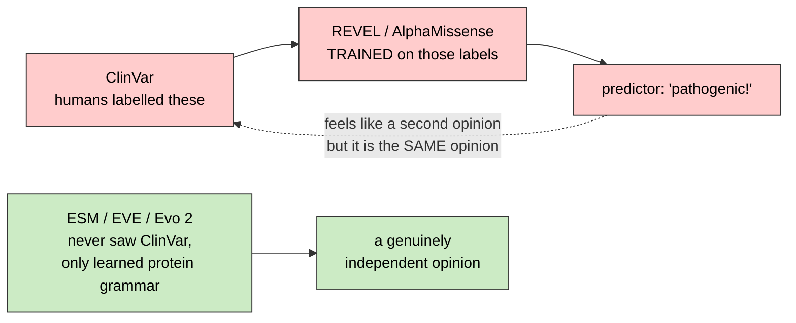

> **Legend** — red: the loop that only echoes its own training labels · green: a model that never saw ClinVar, so its opinion is genuinely new.

**Always report both.**

**Orthogonal** — an independent opinion, from a different source of information. Two orthogonal tools agreeing is real evidence; two circular ones agreeing is not.

**ΔΔG (delta-delta-G)** — predicted change in protein stability from the variant. *Tools: FoldX, Rosetta.*

**Domain / TPR / pseudo-kinase / KEN-box** — named functional parts of a protein. Landing inside one is worse than landing in a random spot.


> **Legend** — gray bar: the whole protein, bead 1 to bead 1050 · coloured blocks: named working parts · red arrow: the null allele · black arrow: the hypomorph allele.

**Domain database (Pfam, SMART, PROSITE, Gene3D, SUPERFAMILY, CDD, PRINTS)** — seven independent catalogues that each scan a protein sequence and call out the domains they recognise. They overlap on purpose: the same region called by four of them is agreement, not duplication. **InterPro** is the umbrella that maps their accessions onto one shared id. *Example:* BUBR1's N-terminal region is `PF08311` to Pfam, `SM00777` to SMART and `PS51489` to PROSITE — all three `IPR013212` in InterPro. Ensembl serves them from `/overlap/translation/<protein id>`, mixed in with things that are *not* domains (PDB cross-references, AlphaFold models, disorder and coiled-coil predictions), so the list has to be filtered.

**Lollipop plot** — the standard way to draw variants against a protein: the x axis is amino-acid position, domains are bars along it, and each variant is a stem with a coloured head at its position. It answers "does this change hit a working part?" — the question a genomic coordinate cannot.

**Protein position (`protein_start`)** — which bead in the chain a variant changes, counted from 1. VEP reports it per transcript, and it is **absent** for anything outside the coding sequence — an intronic or splice-region change has no amino acid to name. *Example:* a `missense_variant` at `protein_start: 349` swaps bead 349.

**UniProt accession** — the stable ID of a *protein sequence* in UniProt, the reference catalogue of proteins. VEP reports the reviewed (SwissProt) accession per transcript; the [model zoo](#24-the-model-zoo--words-for-iteration-4) drops the isoform suffix (`Q00000.4` → `Q00000`), because a precomputed score file is one per protein and indexes the bare accession. Same idea as an Ensembl gene ID, one level down the chain: a gene ID names the recipe, a translation ID (`ENSP…`) names one gene's protein in Ensembl's own numbering, and a UniProt accession names that protein in the numbering the rest of the protein world uses. Six or ten characters, letters and digits. Structure databases are keyed by it, so it is the join key you need before you can ask for a shape. *Example:* BUB1B's protein is `ENSP00000287598` to Ensembl and `O60566` to UniProt — the same 1050 beads, two id systems. Ensembl translates between them at `/xrefs/id/<ENSP>?external_db=Uniprot/SWISSPROT`, whose `primary_id` is the accession. Watch out: the neighbouring `display_id` is `O60566.231`, an accession plus a *sequence version*, and it 404s against a structure database.

**Alpha carbon (Cα)** — the one carbon atom every amino acid has in the same place, in the middle of the bead. Chain them and you get the **backbone**: the protein's spine, as a path through space. A full protein is ~8,000 atoms; its alpha carbons are ~1,000 points, one per bead. That is a ~90 % saving for no loss of the thing you actually want to see, which is the overall fold and how far apart two beads are. *Example:* BUBR1's Cα trace is 1,050 points; residue 1's is at `(27.21, 69.68, 11.46)` **ångström** (Å, a ten-billionth of a metre — the unit atoms are measured in). Two Cα atoms within ~8 Å are touching in space, however far apart they are along the sequence.

**Ångström (Å)** — the unit every atomic coordinate in a structure file is written in: 10⁻¹⁰ m, a ten-billionth of a metre. It exists because metres and nanometres are the wrong size for atoms — in ångström the numbers a reader cares about are single- and double-digit. The three scales worth memorising: a chemical bond is ~1.5 Å, two consecutive **alpha carbons** are ~3.8 Å apart, and a whole protein **domain** is ~30–40 Å across. *Example:* BUBR1's Cα for residue 1 sits at `(27.21, 69.68, 11.46)` Å in the model's own frame — an arbitrary origin, so only *differences* between two points mean anything, never a single coordinate.

**Cα distance** — the straight-line distance between two residues' **alpha carbons**, in **ångström**. It is the one number that answers "are these two changes hitting the same place?", and it is the reason a 3D view earns its place over a **lollipop plot**: a protein folds, so distance along the sequence is a poor proxy for distance in space. Two residues 300 amino acids apart on the chain can pack into one pocket, and two neighbours on the chain can point at opposite faces. Read it as a geometric band, not a verdict: under ~10 Å the two residues could share one binding pocket, 10–25 Å puts them in the same lobe of the fold, and beyond ~25 Å they are separate sites. Two caveats ride with every number: on an **AlphaFold** model a distance is only as good as the **pLDDT** at *both* ends (below 70 it is not quotable), and a short distance is a mechanism *hypothesis*, never a demonstration that either change breaks the other's function. *Example:* in the app's protein exhibit the picked pair is drawn as a line labelled `12.3 Å`.

**Secondary structure** — the two local shapes a stretch of backbone repeatedly folds into: an **alpha helix** (a corkscrew) and a **beta strand** (a flat extended piece; several side by side make a **sheet**). Everything else is **coil** or **loop**. It is the layer between the bare sequence (primary structure) and the whole 3D fold (tertiary structure) — think of it as the paragraph structure of the protein. Useful because a variant in the middle of a helix and one in a floppy loop are different risks. *Example:* residues 4–23 of BUBR1 are a helix; 1–2 are a strand. Absence of an annotation means **not annotated**, never "all coil" — a file that carries no secondary-structure table is silent, not flat.

**AlphaFold** — DeepMind's neural network that **predicts** a protein's 3D shape from its amino-acid sequence alone, and **AlphaFold DB** (`alphafold.ebi.ac.uk`) the free database of its predictions for essentially every known protein. It exists because measuring a real structure in a lab takes months per protein, and most proteins have never been measured. The word to keep in front of you is *prediction*: an AlphaFold model is a hypothesis about shape, and quoting one as if it were a measurement is a claim you have not earned — which is what **pLDDT** below is for. Keyed by **UniProt accession**, returns one entry per isoform, and every model has a **version** you must read from the reply rather than compose. *Example:* `GET https://alphafold.ebi.ac.uk/api/prediction/O60566` answers with three isoform models — `AF-O60566-F1` (1050 beads), `-2-F1` (933), `-3-F1` (1064) — each at `latestVersion: 6`. Picking the wrong one paints bead 349 of your variant onto bead 349 of a different protein. Contrast the **PDB** (Protein Data Bank), which holds *experimentally measured* structures — far fewer, usually partial, but measured.

**pLDDT** — AlphaFold's own confidence in **each individual bead's** position, 0–100 (the name is "predicted local distance difference test"). It is the honesty channel of a predicted structure, and the numbers have conventional meanings: **above 90** the bead's position is reliable to atomic detail; **70–90** the backbone is about right; **50–70** treat with caution; **below 50** the region is probably **intrinsically disordered** — floppy, with no single shape to predict, so the coordinates are close to meaningless. A prediction with low pLDDT is not a broken prediction; it is a correct statement that the answer is unknown, and drawing it in the same colour as a confident region is the mistake. *Example:* BUBR1's model scores 63.59 overall with **37.3 %** of its beads at very-low pLDDT, so more than a third of that protein supports no spatial claim at all. Any exhibit painting it has to show pLDDT, or it is asserting shape it does not have.

**mmCIF (macromolecular Crystallographic Information File)** — the standard text format for 3D structures, and the modern replacement for the old fixed-column PDB format. In software terms: a bundle of CSVs in one file, with named headers. A **category** is a table; a table with many rows is written as `loop_`, then one `_category.column` line per column, then whitespace-separated data rows. The table you want is `_atom_site`, one row per atom. *Example* — the first two atoms of BUBR1, with the columns lined up above them:

```
loop_
_atom_site.group_PDB   _atom_site.id            _atom_site.type_symbol
_atom_site.label_atom_id  _atom_site.label_alt_id  _atom_site.label_comp_id
_atom_site.label_asym_id  _atom_site.label_entity_id  _atom_site.label_seq_id
_atom_site.pdbx_PDB_ins_code  _atom_site.Cartn_x  _atom_site.Cartn_y
_atom_site.Cartn_z  _atom_site.occupancy  _atom_site.B_iso_or_equiv  …

ATOM 1 N N  . MET A 1 1 ? 26.584 70.797 10.710 1.00 42.81 ?   ← the nitrogen of bead 1
ATOM 2 C CA . MET A 1 1 ? 27.212 69.682 11.463 1.00 42.81 ?   ← the alpha carbon of bead 1
```

Read it as: keep rows where `label_atom_id` is `CA`, and each gives you one bead — its number (`label_seq_id`), its three-letter name (`label_comp_id`, `MET` = methionine = `M`), its position (`Cartn_x/y/z`), and its confidence. The confidence column is the trap: `B_iso_or_equiv` is a crystallographic *B-factor* in an experimental PDB entry, but AlphaFold reuses the same column for **pLDDT**, so the same number means two different things depending on which file you opened. Secondary structure, when present, lives in `_struct_conf` (helices as `conf_type_id` starting `HELX`; AlphaFold also writes strands here as `STRN`) and, in experimental entries, `_struct_sheet_range`.

---

## 10. ACMG — the official way to judge a variant

**ACMG/AMP guidelines** — the rulebook clinical labs use to call a variant pathogenic or not. A checklist of evidence codes.

**Evidence code** — one piece of evidence with a name and a strength.
- **PVS1** — Pathogenic, Very Strong: kills the protein (truncating in a gene where that's the known mechanism).
- **PS3** — Pathogenic Strong: lab experiment proves it's broken.
- **PS4** — Pathogenic Strong: seen much more in patients than in healthy people.
- **PM2** — Pathogenic Moderate: absent from gnomAD (too rare to be harmless).
- **PM3** — Pathogenic Moderate: found *in trans* with a known pathogenic variant. *Compound-het structure is itself evidence.*
- **PP3** — Pathogenic Supporting: computer predictors agree it's damaging.
- **PP4** — Pathogenic Supporting: the patient's symptoms match this gene's disease specifically.
- **PP1** — Pathogenic Supporting: tracks with disease through the family.
- **BP4 / BA1** — Benign codes: predictors say harmless / far too common in the population.

**Tavtigian Bayesian point system** — turns those codes into numbers you can add up.
*Supporting = 1 pt, Moderate = 2, Strong = 4, Very Strong = 8; benign codes count negative.
Total ≥ 10 → Pathogenic. 6–9 → Likely pathogenic. 0–5 → VUS. ≤ −7 → Benign.*
Value: one defensible number instead of an argument.

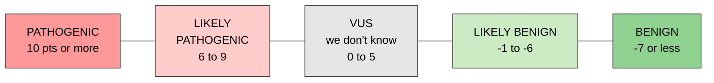

> **Legend** — left to right, red to green = pathogenic to benign · the numbers are Tavtigian points, which you add up.

```text
Worked example - one BUB1B candidate:

  PVS1  stop codon, kills the protein     very strong    +8
  PM2   zero healthy people carry it      moderate       +2
  PP3   SpliceAI + AlphaMissense agree    supporting     +1
  PM3   sits in trans with allele 2       moderate       +2
                                                        ----
                                          total         +13   ->  PATHOGENIC
```

> **Legend** — each row is one evidence code, its strength tier, and the points that tier is worth · the total picks a box on the scale above.

**ACMG SF v3.x (secondary findings)** — a separate official list of ~80 genes where, if you happen to spot a serious variant while looking for something else, you're supposed to report it (e.g. a heart-disease or cancer gene). Unrelated to the main question.

**Secondary / incidental finding** — exactly that: something important you found by accident.

**InterVar / TAPES / CharGer / Genebe** — programs that apply ACMG rules automatically. They produce a draft, not a verdict.

---

## 11. Math, probability and statistics words

**Prior** — what you believed before seeing the data. *"MVA is usually BUB1B, so start at 55% BUB1B."*

**Posterior** — what you believe after seeing the data.

**Bayesian** — the method of updating a prior into a posterior with evidence.

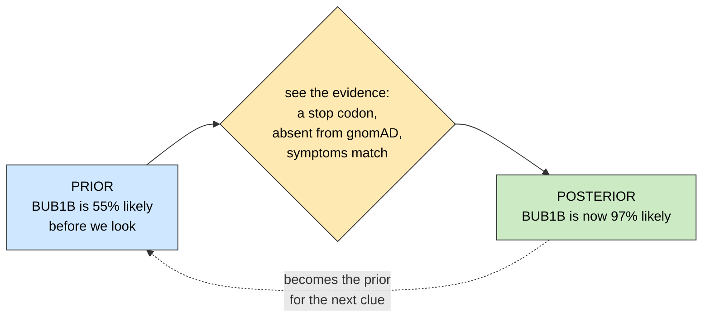

> **Legend** — blue: what you believed before · yellow: the evidence you saw · green: what you believe now · the dotted arrow means today's posterior is tomorrow's prior.

**Likelihood** — how well a hypothesis explains the data you saw.

**LR (likelihood ratio)** — `P(symptom | disease) ÷ P(symptom | not disease)`. Above 1 = supports the disease. Multiply LRs across symptoms.
*Example: "Neoplasm in a toddler" has a big LR for MVA. "Short stature" has an LR near 1 — almost no information.*

**Odds** — probability rewritten as a ratio. *70% = odds of 7:3.*

**Independence assumption** — pretending pieces of evidence don't overlap, so you can just multiply them. Usually a bit false (symptoms are correlated), so treat outputs as rankings, not true probabilities.

**Calibration** — does "0.9" actually happen 90% of the time? A calibrated score is a real probability.
*Measured by **Brier score**, **ECE (expected calibration error)**, **reliability diagram**. Fixed by **isotonic regression** or **Platt scaling**.*

**Hardy–Weinberg** — population genetics formula. If a bad allele has frequency `q`, then `q²` of people are homozygous for it.
*For two different alleles at frequencies p₁ and p₂, the compound-het chance is `2·p₁·p₂`. Since MVA has <50 patients worldwide, the alleles must be extraordinarily rare.*


> **Legend** — the area of each square is how often that genotype occurs · green: healthy · yellow: healthy carrier · red: affected.

**Binomial** — the coin-flip distribution. *A true het at 30× depth: alt reads ~ Binomial(30, 0.5). Getting 4 out of 30 would be very odd.*

**Beta-binomial** — a binomial that allows extra sloppiness (real sequencing is noisier than a perfect coin). One extra parameter, **ρ** (rho, the *intra-class correlation*), widens it: at ρ = 0 it is exactly binomial, and the variance is the binomial's multiplied by `1 + (n − 1)·ρ`.
*Example:* the child's autosomes fit ρ = 0.0162 pooled; per chromosome it runs from 0.0057 on chr5 to 0.067 on chr21 — twelvefold, which is why one shared value cannot serve as a null for every contig.
*Context: the null every allele-balance test in step 8 is scored against · source: src/mva/mosaic/betabinom.py · related: Overdispersion, B-deviation (Bdev), BAF (B-allele frequency), Detection limit · first seen 2026-09-18*

**Overdispersion** — the data varies more than the simple model expects. Counting reads is not coin-flipping: capture bias, GC content, PCR duplicates and one allele mapping better than the other all widen the spread, so a model that assumes a clean coin calls ordinary noise significant.
*Example:* read depth in this callset has a variance-to-mean ratio of 5.09 — five times a Poisson process — and allele balance is wider than binomial by ρ = 0.0162.
*Context: measured in this repository rather than assumed, in two places · source: src/mva/mosaic/betabinom.py · related: Beta-binomial, Poisson / negative binomial, B-deviation (Bdev) · first seen 2026-09-18*

**Poisson / negative binomial** — distributions for counting things (like reads per bin). Used to spot deletions: half the expected reads = one copy lost.

**Null hypothesis (H₀)** — the boring explanation. *"This 5% VAF is just sequencing error."* You test whether the data can reject it.

**Power** — the chance your test would actually detect a real effect. A negative result without it is not a result: "we looked and saw nothing" only means something once the sentence finishes with "and we would have seen anything above *this*".
*Example:* at 30× depth, power to spot a 10% mosaic variant at one site is poor — so restrict the search to one gene. Across a whole chromosome it is a different question, and there the fold-over statistic reaches 80% power at 2–3% of cells while the mean B-allele fraction never reaches it at all.
*Context: the pair (result, detection limit) is the unit step 8 reports · source: src/mva/mosaic/simulate.py · related: Detection limit, Null hypothesis (H₀), B-deviation (Bdev) · first seen 2026-09-18*

**Multiple testing** — test 5 million positions and some will look significant by pure luck.

**FDR / Benjamini–Hochberg** — the correction for that. *Testing one gene needs almost no correction — the statistical reason to search a small region first.*

**HMM (hidden Markov model)** — a model for "the truth changes in stretches". Used to find where a copy-number change starts and stops.
*Hidden states = copy number 0,1,2,3. Observed = read depth. The model infers the invisible from the visible.*

**Segmentation** — chopping the genome into stretches of constant copy number.

**log2 ratio** — depth compared to normal, on a log scale. 0 = normal, −1 = half (one copy lost), +0.58 = 3 copies.
*A 20% mosaic trisomy only shifts it by ~0.14 — small but findable with enough bins.*

```text
walking along a chromosome, plotting depth as log2 ratio:

  +0.58  3 copies  |              ###########
   0.00  2 copies  |##############           ##########
  -1.00  1 copy    |                                   ########
                   +--------------------------------------------> position
                    normal        DUPLICATION  normal   DELETION

  a 20% MOSAIC trisomy is only +0.14 -- a whisper, not a shout:
   +0.14            |    . : . ' . : ' . : . ' . :
    0.00            |__________________________________
```

> **Legend** — `#` marks measured depth · the row a stretch sits on is its copy number · the dotted row shows how faint a 20% mosaic signal really is next to a clean deletion.

The HMM's job: decide where one flat stretch ends and the next begins, instead of trusting single noisy dots.

**BAF (B-allele frequency)** — at het positions, the fraction of reads from one parent's copy. Should sit at 0.5. Deviation reveals copy-number change, and it's MORE sensitive than depth.
*Example:* pooled over this child's autosomes the BAF averages **0.4930**, not 0.5000 — reads carrying the reference allele map slightly more readily, so the centre a deviation is measured from has to be the measured one and never the nominal half.
*Context: reduced to (chromosome, arm, k alternate of n reads) counts, which is everything a model of allele balance needs and carries no genomic position · source: src/mva/warehouse/analysis_it2_mosaic.py · related: B-deviation (Bdev), Beta-binomial, Mosaic fraction · first seen 2026-08-29*

**B-deviation (Bdev)** — the distance of a site's BAF from the centre, `|BAF − centre|`, **averaged after taking the distance and not before**. That ordering is the whole idea: a mosaic gain splits heterozygous sites into two bands symmetric about the centre, so their plain average does not move at all, while folding the two bands onto each other before averaging makes the statistic grow from the first affected cell.
*Example:* chr21 shows Bdev 0.1003 against a null of 0.0780 — but its own overdispersion is 4× the genome's, so the excess is repeat content rather than mosaicism, which is why the fitted ρ is printed in the same table.
*Context: step 8's re-test of the flat karyogram, which used the plain average and therefore had no power · source: src/mva/mosaic/bdev.py · related: BAF (B-allele frequency), Power, Detection limit, Mosaic fraction · see: [the karyogram it re-tests](step-0/methodology/037-baf-karyogram.md) · first seen 2026-09-18*

**Detection limit** — the smallest real effect a test would have found, at a stated chance of finding it. Written as one number with its power attached: *detects a mosaic present in 3% of cells, 8 times in 10*.
*Example:* every autosome in this sample detects at 2–3% of cells; X and Y only at 5%, and they carry almost no heterozygous calls to begin with. Quoting "no mosaic aneuploidy detected" without those numbers would repeat the mistake step 8 exists to correct.
*Context: simulated from each arm's own depths, then read off its power curve · source: src/mva/mosaic/simulate.py · related: Power, B-deviation (Bdev), Mosaic fraction · first seen 2026-09-18*

**Mosaic fraction** — what share of the sampled cells carry the event. Not a severity score and not a diagnosis: it describes the tube that was sequenced.
*Example:* a 10% mosaic trisomy shifts a chromosome's read depth by 5% and splits its heterozygous sites into bands 4.8 percentage points either side of the centre — both small, which is why the estimate needs its interval.
*Context: estimated two ways in step 8, and they disagree informatively — the published band estimator reads 0.30–0.44 on a balanced contig at this depth, so it is reported with its own null subtracted, while the likelihood fit recovers an injected fraction to within 0.002 · source: src/mva/mosaic/bdev.py · related: Mosaic aneuploidy, Detection limit, Copy-neutral loss of heterozygosity (CN-LOH) · first seen 2026-09-18*

**Copy-neutral loss of heterozygosity (CN-LOH)** — one chromosome copy is replaced by a duplicate of the other. The cell still has two copies, so read depth does not move, but the two parental versions are no longer both present — heterozygous sites turn homozygous, or shift their balance exactly as a gain would.
*Example:* at 5% of cells a CN-LOH and a mitotic trisomy produce the same allele-fraction bands and differ only in depth, by 2.5% — inside ordinary GC variation between chromosomes, so the two cannot be told apart at that fraction and the pairwise margin is printed rather than a call.
*Context: one of the five per-chromosome models step 8 compares · source: src/mva/mosaic/models.py · related: Mosaic aneuploidy, BAF (B-allele frequency), BIC (Bayesian information criterion) · first seen 2026-09-18*

**BIC (Bayesian information criterion)** — a score for comparing models that fit the same data with different numbers of knobs: `−2 × log-likelihood + k × log N`. Lower wins. The second term is the fine for each extra knob and it grows with the amount of data, so on a big dataset a model has to earn its complexity.
*Example:* Kong 2018 calls a margin (ΔBIC) under **10** low-confidence, and that threshold is adopted here as written. Two of step 8's five models are *nested* — meiotic trisomy is mitotic trisomy plus one extra component — so when the extra component buys nothing the margin is exactly one penalty and the pair can never clear 10. A trisomy is therefore led but never confidently called.
*Context: only parameters fitted per chromosome are counted in k, because a comparison is meaningless unless every model counts the same way · source: src/mva/mosaic/madseq.py · related: Likelihood, Copy-neutral loss of heterozygosity (CN-LOH), Overdispersion · first seen 2026-09-18*

**Entropy `H`** — how much you don't know, measured in **bits**. 1 bit = one perfect yes/no answer's worth.
*1225 equally likely possibilities = 10.3 bits of ignorance.*


> **Legend** — bar length = how much of the search space is still alive · the label on the right is the uncertainty that remains, in bits.

**Information gain** — how much entropy an experiment removes. Pick the experiment that removes the most.

**Sequential Bayesian experimental design** — formal name for "choose the next question that teaches you the most, then update, then repeat".

**Group testing / Dorfman** — testing items in batches instead of one at a time, to find the bad ones with far fewer tests.
*Example: 100 blood samples, 1 infected. Pool 10 at a time = ~19 tests instead of 100.*

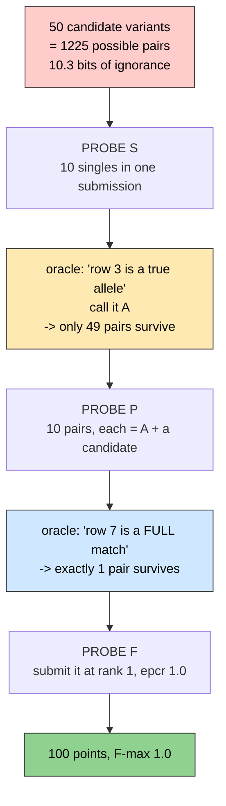

> **Legend** — red: the full unknown space · yellow and blue: what survives each probe · green: the solved state and the score it pays.

1225 possibilities crushed to 1 in **three** questions. That is group testing.

**Adaptive** — later questions depend on earlier answers (as opposed to fixing all questions upfront).

**Rényi–Ulam search** — the math of "20 questions" against a truthful answerer.

**Best-arm identification with fixed budget** — the math of "find the best option using exactly N tries".

**Minimax** — choose the move whose WORST possible outcome is least bad.

**Greedy** — take the best-looking step right now, without planning ahead. Often nearly optimal, always cheap.

**ILP (integer linear programming)** — exact optimization with whole numbers. Correct but overkill here.

**Combinatorics `C(N,2) = N(N−1)/2`** — how many ways to pick 2 items out of N.
*50 candidate variants → 1,225 possible pairs. 200 → 19,900.*

**Frozenset** — a programming set whose contents can't change and whose ORDER doesn't matter. `{A,B}` equals `{B,A}`.

**Bitmask / bit vector** — one bit per possibility, on or off. 19,900 possibilities fit in 2.5 KB, and you eliminate options with one fast AND operation.

**Constraint propagation** — once one fact is known, delete everything incompatible with it.
*Confirm allele A is real → every pair not containing A instantly dies.*

```text
alive before:   A-B   A-C   A-D   B-C   B-D   C-D        6 pairs
oracle says :   "A is one of the two true alleles"
alive after :   A-B   A-C   A-D    x     x     x         3 pairs

one answer, half the universe deleted -- with certainty, not probability.
```

> **Legend** — `x` marks a hypothesis the oracle's answer deleted with certainty · no probability involved.

**Deterministic** — same input always gives exactly the same output, no chance involved. *`bcftools norm` is deterministic.*

**Probabilistic** — deals in degrees of belief.

**Soundness** — never throwing away the right answer.

**Set algebra** — union (∪, everything in either), intersection (∩, only what's in both), subset (⊂).

**O(log n)** — how the time grows as data grows. `O(log n)` = doubling the data barely costs anything (searching an index). Great.

**Interval tree / pyranges** — a data structure that answers "which genes overlap this position?" instantly.

**Union-find / disjoint set** — a structure for grouping things that are linked. Used to build phase blocks.

**Priority queue** — a list that always hands you the highest-scoring item first.

**Append-only ledger** — a log you only ever add to, never edit. Keeps an honest record of all 6 submissions.

**Probe ledger** — the concrete table that does that: `warehouse.probe_ledger`, one row per spent [submission / probe](#13-hackathon-scoring-words), holding who spent it, its probe type ([S](#13-hackathon-scoring-words) / [P](#13-hackathon-scoring-words) / [F](#13-hackathon-scoring-words)), the exact payload uploaded, the [oracle](#13-hackathon-scoring-words)'s reply, and the rationale. A shared submission budget tracked in chat messages is a budget that gets double-spent.
*Example: `mva-warehouse probe-budget` → `all tracks: 0/6 spent, 6 remaining`.*

---

## 12. Machine learning words

**N = 1** — you have exactly ONE patient. Nothing to train on. This shapes every choice.

**Features** — the numbers describing each candidate, fed to a model. *AF, CADD, consequence type, phase, ...*

**Learning-to-rank (LTR)** — a model trained to ORDER a list correctly, rather than to label each item.

**LambdaMART / XGBoost / LightGBM** — the standard tree-ensemble programs used for that.

**Gradient boosting / tree ensemble** — many small decision trees, each fixing the previous one's mistakes.

**NDCG / MRR / recall@k / top-1** — scores for "how good is this ordering".
*MRR = average of 1/(rank of the right answer). Right answer at rank 1 → 1.0; at rank 4 → 0.25.*

**Synthetic proband** — a fake patient you build yourself: take a public healthy genome, paste in a known disease pair, attach matching symptoms. Now you have an answer key to test against, legally.

**Spike-in** — the pasting step. **VCF-level** = add lines to the variant list (tests ranking only). **Read-level (BAMSurgeon / VarBen)** = edit the raw scraps (tests whether you'd even FIND it — much more honest).

**Ablation** — remove one part of your pipeline and re-measure, to prove that part actually matters.

**Overfitting** — tuning until it works on your one example, then failing on everything else.

**Generalization** — working on cases you never saw. What the judges actually reward.

**PU learning (positive-unlabeled)** — you know some positives, but the "negatives" are really just unknowns. Needs special handling.

**Anomaly / one-class detection** — learn what normal looks like, then flag the weird. Useful when you don't know which gene to look for.

**Frozen feature extractor** — use a big pretrained model just to produce numbers; don't retrain it. The only sane option at N=1.

**Fine-tuning** — retraining a big model on your data. Meaningless with one patient.

**Knowledge graph (KG)** — a network of facts. *Variant → Gene → Pathway → Disease → Symptom, plus Drug → Target.*

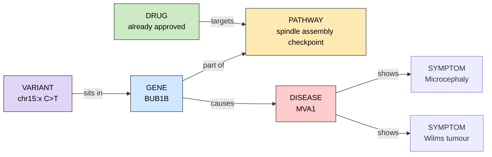

> **Legend** — purple: the variant · blue: the gene · yellow: the pathway · red: the disease and its symptoms · green: the drug, which is where Track 2 lives.

Track 1 walks left to right. **Track 2 is the same walk, one hop further, to the green box.**

**GNN (graph neural network) / R-GCN / TransE / embedding** — models that learn over a network like that.

**Link prediction** — guessing which missing connections should exist. *"Which drug connects to this gene?" is the same maths as "which gene connects to this symptom?".*

**Network propagation / random walk with restart** — start at the patient's symptoms and spread influence through the network; genes that light up are suspects. No training needed.

**PPI (protein–protein interaction)** — which proteins physically touch which.

**Ensembling** — combining several models' opinions.

**Borda count / reciprocal rank fusion (RRF)** — simple, robust ways to merge ranked lists. RRF adds up `1/(k + rank)` from each list. Needs no training — ideal here.

**Pairwise tournament (Bradley–Terry ranking)** — rank items by playing them against each other two at a time and counting wins, like a sports league, instead of scoring each alone. Bradley–Terry is the statistics that turns the win/loss record into a ranking. Judging "is pair A a better explanation than pair B?" is easier and more reliable than "score pair A from 0 to 1". *Example: 10 candidate pairs → 45 judged matches → a win-count ranking.*

**LLM (large language model)** — an AI like this one. Here: good at reading papers and drafting; must NEVER be trusted to state a genomic coordinate or a citation on its own.

**Agentic** — an LLM that calls tools and takes multiple steps by itself.

**Grounded / traceable / auditable** — every claim points back to a real source you can click. Ungrounded LLM output invents references, which destroys credibility instantly.

**Hallucination** — the model confidently making something up.

**Triage** — quickly sorting a big pile to find what's worth reading properly.

**Precision / Recall** — Precision = of what you flagged, how much was right. Recall = of what was right, how much you flagged.
*Flag 10 variants, 2 are the true pair → precision 2/10 = 0.2, recall 2/2 = 1.0.*

```text
5,000,000 candidate variants.  Exactly 2 of them are the true pair.

you submit 10 rows:      [T][T][ ][ ][ ][ ][ ][ ][ ][ ]      T = a true one
  precision = 2/10 = 0.20     of what you flagged, how much was right
  recall    = 2/2  = 1.00     of what was right, how much you flagged
  F         = 2 x 0.2 x 1.0 / (0.2 + 1.0) = 0.33

you submit 2 rows:       [T][T]
  precision = 1.00   recall = 1.00   F = 1.00   <-- the maximum. This is F-max.
```

> **Legend** — `[T]` is a true variant, `[ ]` is a wrong one · each block is one row you submitted.

F punishes guessing wide. **You cannot buy recall with more rows without paying in precision.**

**F-score** — one number combining both: `F = 2·P·R / (P + R)`. High only when BOTH are high.

**ROC-AUC vs PR-AUC** — two ways to summarize a classifier. With 2 right answers among 5 million, ROC-AUC looks great even for junk — use PR-AUC.

**Class imbalance** — vastly more negatives than positives. Exactly this case.


> **Legend** — each gray dot is about 6,000 candidate variants · the two red dots are the answer you have to find.

**Held-out test set** — data you never touched while building, kept to get an honest score.

---

## 13. Hackathon scoring words

**Oracle** — the scoring server. You send a guess, it immediately tells you how close you were. That feedback is information you can exploit.

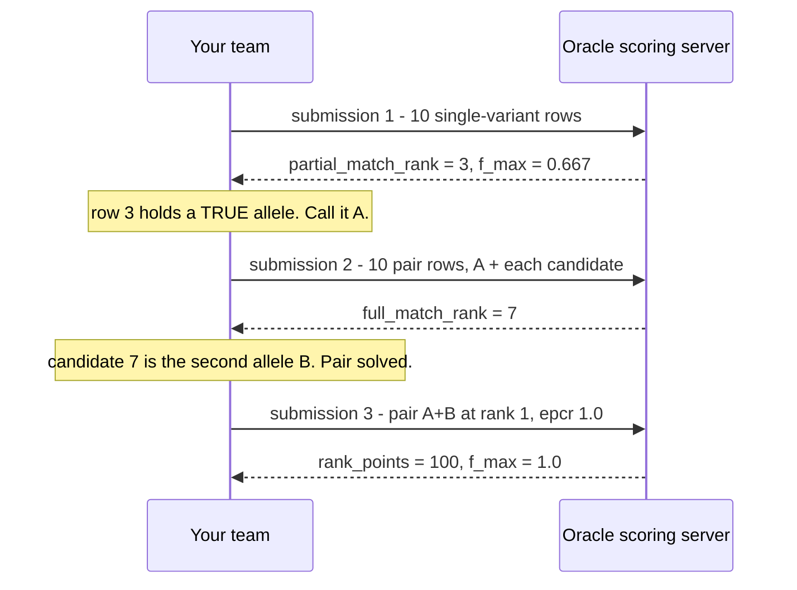

> **Legend** — solid right arrows: what you send · dashed left arrows: what the scorer sends back · the notes are what you can deduce from that reply.

Each submission is not a guess. **It is a question, and the answer narrows the next question.**

**Ground truth (GT) / answer key** — the real answer, held by the organizers.

**Submission / probe** — one guess. You get 6 per registered member; this team has one, so 6 total.


> **Legend** — blue: a submission you can spend now · red: one to hold back until the freeze · one row per registered team member.

**Row** — one line in your submission CSV. Up to 10 rows per submission. A row holds either one variant or a pair.


> **Legend** — gray: the header row · each column is coloured to match its callout underneath · the faded second row is a secondary-finding row.

**epcr** — the confidence number you attach to each row, between 0 and 1. It sets the ordering.
*Context: the one number you choose per row, and the only thing that decides which rung of the ladder a row lands on · source: ressources/hackathon-rules/track1_submission_template.csv · related: Rank, Row, Rank points, Threshold sweep*

**Rank** — position after sorting by epcr, highest first. Rank 1 = your top guess.

**Rank points** — rank 1 → 100 pts, ranks 2–3 → 50, ranks 4–5 → 25, ranks 6–10 → 10.
*Context: the automated half of the score; the qualitative review is the other half · source: src/mva/pipeline/scorer.py · related: Rank, epcr, Full match, F-max*

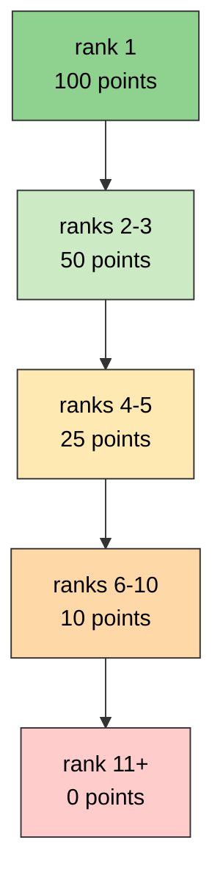

> **Legend** — green: full points · yellow and orange: partial-credit tiers · red: nothing at all.

A **partial** match scores half of its rung. A **full** match anywhere beats any partial match — even a full match down at rank 10.

**Full match** — one row contains EXACTLY the true pair. **Partial match** — a row contains one of the two true variants. Partial scores half.

**F-max** — the best F-score achievable by sweeping every epcr cut-off present in your file. Maxes at 1.0 only when your top row is exactly the true pair.
*Context: the field in the oracle's reply that carries the most information — the decode table is a lookup on it · source: src/mva/pipeline/scorer.py · related: Threshold sweep, Precision, Full match, Decode table*

**Threshold sweep** — trying each epcr value as a cut-off and keeping the best result. Consequence: rows below the best cut-off can never hurt you — extra low-confidence rows are FREE.

```text
true pair = {V1, V2}          your submitted file:

  rank  epcr   row contents
    1   0.95   V1 + V2      <- exactly the true pair
    2   0.80   V9 + V3
    3   0.40   V7

now cut the file at every epcr value that appears in it:

  cut at 0.95 -> you predicted {V1,V2}           P=2/2=1.00  R=1.00  F=1.00  <-- BEST
  cut at 0.80 -> you predicted {V1,V2,V9,V3}     P=2/4=0.50  R=1.00  F=0.67
  cut at 0.40 -> you predicted {V1,V2,V9,V3,V7}  P=2/5=0.40  R=1.00  F=0.57

  F-max = 1.00   (the best cut wins; the worse cuts are simply ignored)
```

> **Legend** — each `cut at` line is one threshold in the sweep · `P` is precision, `R` is recall · the highest F wins and the rest are ignored.

So rows 2 and 3 **could not** lower your score. Secondary findings are genuinely free — add them.

**Tie-break by file order** — if two rows share an epcr, order is decided by which came first. Avoid it: always use strictly different, descending epcr values.

**Singles scan (probe S)** — submit 10 single variants to learn which of them is a true allele.

**Pair scan (probe P)** — you know allele A; submit 10 pairs (A + each candidate) to find B.

**Final strike (probe F)** — the confirmed pair at rank 1, epcr 1.0. Maximum score.

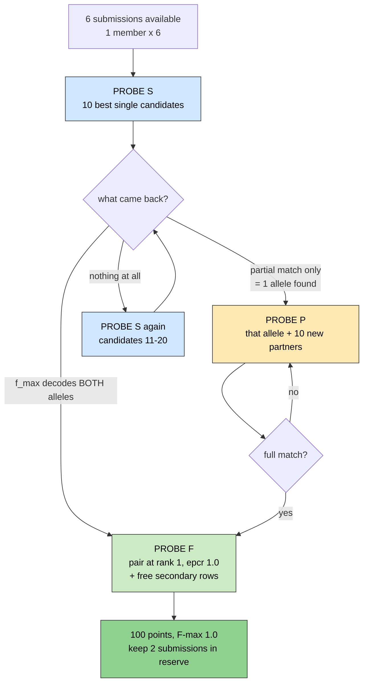

> **Legend** — blue: scanning probes that look for a signal · yellow: the follow-up probe that confirms · green: the final strike and the score it locks in.

**Decode table** — the lookup that translates the reply the oracle sends back into "which rows held the true alleles". Built *before* the upload by simulating the scorer against every answer key still thought possible, so the reply is read off a committed table instead of argued about afterwards. Two keys that would produce the same reply share a row: the table also states what this upload cannot tell apart.
*Example: iteration 1's layout produces 7 distinguishable replies over 8 keys — `f_max = 0.667` with `partial_match_rank = 1` means the pair row holds exactly one true allele.*
*Context: committed as `decode-table.md` inside the iteration folder — labels only, never positions · source: docs/iteration1/step-6/methodology/074-submission-v1-design.md · related: Oracle, F-max, Hypothesis space, Expected information gain · see: [the decode table](../figures/track1/track1-decode-table.png)*

**Hypothesis space** — the explicit list of answer keys you still consider possible before an upload, each with a prior weight. The [probe designer](#13-hackathon-scoring-words) simulates the scorer's reply for every member; two members that would produce the same reply are *indistinguishable* by that upload, and the reply you actually get deletes every member that would have produced a different one.
*Example: `{stop+missense, stop+intronic-A, missense+intronic-A, stop+unknown, missense+unknown}` — five keys; a pair row at rank 1 followed by two partner singles tells the five apart except `stop+intronic-A` vs `missense+intronic-A` ([`mva.pipeline.probe_design`](../src/mva/pipeline/probe_design.py)).*

**Expected information gain** — how many [bits](#11-math-probability-and-statistics-words) of uncertainty an upload is expected to remove, averaged over the hypothesis space with its priors. The number to compare two candidate row layouts on *before* spending a submission. Ceiling: the [entropy](#11-math-probability-and-statistics-words) of the prior — an upload that tells every member apart reaches it.
*Example: five equiprobable keys = 2.32 bits of prior entropy; a layout that leaves one pair of keys confused 40 % of the time gains 1.92 bits.*
*Context: computed for each candidate row layout before a submission is spent, and compared against the entropy ceiling · source: src/mva/pipeline/probe_design.py · related: Entropy H, Information gain, Hypothesis space, Decode table · see: [entropy bits](assets/entropy-bits.svg)*

**Submission iteration** — one upload, one folder. `submissions/<track>/iteration-<n>/` holds everything the organisers receive and everything a judge needs to check it: the report and its PDF, the methods form, the coordinate-free selector spec, and the decode table. The predictions CSV is *not* in it — it holds real positions, so it is built into `build/submission/` and only its sha256 is recorded. Research steps contribute evidence to an iteration; they never own a deliverable.
*Example: `submissions/track1/iteration-1/` — built and rehearsed on 2026-09-05, not uploaded, 0 of 6 submissions spent; the folder README records the CSV's sha256 `54854a6e…` and the two commands that rebuild it (resolve the selectors, then design the file).*
*Context: the unit of delivery for both tracks; one oracle reply opens the next one · source: submissions/README.md · related: Submission, Probe ledger, Reproducible, Derived dataset · see: [iteration tooling](iteration1/step-6/methodology/076-iteration-tooling.md) · first seen 2026-09-05*

**Selector (submission)** — how an allele is written down in a file that *can* be committed: a predicate over one warehouse result table that must match exactly one row. It names the reasons a variant is in the submission — gene, consequence, population frequency, ClinVar status — and a resolver turns them into coordinates at build time. Zero or several matches is an error that names the count and the selector, never a position.
*Example: `{"table": "results.coding_candidates", "where": [["rsid", "=", "rs6025"]]}`. Operators are whitelisted (`=`, `!=`, `<`, `<=`, `>`, `>=`, `like`, plus `is` / `is not` for null only), table and column names are validated, and values are bound as parameters — so a selector is data, not SQL a reviewer has to audit.*
*Context: the file that lets a report say *why* a row is there without saying *where* · source: src/mva/warehouse/submission_spec.py · related: SQL, ClinVar, gnomAD, Row · first seen 2026-09-05*

**Derived submission row** — a row of the predictions file whose every non-coordinate field was computed, not typed: the note quotes only columns of the result table the allele was selected from (zygosity, filter, depth, allele fraction, gnomAD frequency, ClinVar significance, dbSNP id); the epcr comes from the ladder below; a free-text *rationale* is allowed but may contain no number, so a figure can only reach the organisers from a table. The resolver refuses a selector file that carries an `epcr`, a `notes`, a numbered rationale, or an in-callset prior.
*Example: `H:H009 | primary | BUB1B stop_gained, het PASS DP 44 VAF 0.48, gnomAD 3.29e-05, ClinVar Pathogenic + BUB1B missense_variant, het PASS DP 44 VAF 0.49, gnomAD absent, ClinVar not listed | phase unresolved by reads; … | epcr = register weighing 0.9963 (triage heuristic, not a calibrated posterior)` — the iteration-1 rank-1 note, every value a table column.*
*Context: how iteration 1's CSV is built since 2026-09-09; the arithmetic is committed as `derivation.md` beside the selectors and shown on `/submissions` · source: src/mva/warehouse/submission_facts.py · related: Selector (submission), epcr, epcr anchor, Row, Data lineage · see: [entry 082](iteration1/step-6/methodology/082-derived-submission-rows.md) · first seen 2026-09-09*

**epcr anchor** — the one epcr that is *read* rather than shared out: the rank-1 row names the hypothesis it tests, and takes the research register's suggested confidence for that claim. Every other primary row then receives a share of what is left (1 − anchor) in proportion to its pair score (the ranker's rarity × severity per allele, summed); secondary rows sit below the lowest primary, ordered by allele score; and a hypothesis whose alleles are all in the callset takes the mass of the row that names them, so only a hypothesis naming an *unseen* allele declares a prior. The resolver checks that the anchor row is also the pair the ranker itself puts first — a register that says one thing and a heuristic that says another is an error, not a tie-break. The register's weighing is a transparent triage heuristic, not a calibrated posterior; the anchor inherits that caveat and the note says so.
*Example: iteration 1 — anchor H009 at 0.9963; the four alternative pairs share 0.0037 (0.0014, 0.0014, 0.00048, 0.00041); the three secondaries sit at 0.00021 and below; the anchor pair's prior is 0.78 once the three declared "unseen" priors (0.22) are taken out.*
*Context: replaces the hand-set epcr and priors of entry 074; changes the decode table's prior entropy (1.60 → 1.11 bits) and expected gain (1.46 → 0.96 bits) because the derived priors are more concentrated · source: src/mva/warehouse/submission_rows.py · related: epcr, Derived submission row, Hypothesis space, Prior, Confidence, Verdict, Decode table · see: [entry 082](iteration1/step-6/methodology/082-derived-submission-rows.md) · first seen 2026-09-09*

**Folder gate** — the checker that fails when an iteration folder is not what its own README says it is. It reads the folder's state — draft, ready or frozen — from that README, then checks the deliverables that state requires, that each rendered file is newer than the source it came from, that every methods-form row is answered and the abstract is under 500 words, that the selectors are internally consistent (no positions anywhere, at most 10 rows, epcr strictly descending), that the recorded sha256 matches the built CSV, and that nothing says TODO.
*Example: `uv run python tools/check_iteration.py` → `submissions/track1/iteration-1: ready — ok` — after it had correctly failed the folder for a PDF older than the `report.md` it was rendered from.*
*Context: a step of `tools/check-python.sh`, which the pre-push hook runs · source: tools/check_iteration.py · related: Submission iteration, epcr, Row, Idempotent · first seen 2026-09-05*

**Frozen iteration** — an iteration that has been uploaded, and is therefore read-only. Freezing stamps a dated banner on the folder's README and on the matching `docs/iteration<n>/` index; from then on the folder gate fails on any uncommitted change under it. The same command opens the next iteration beside it — the docs tree, the report skeleton, the methods form with its model number bumped, the selector spec copied as a starting point — and refuses to overwrite anything that already exists.
*Example: `uv run python tools/new_iteration.py --track track1 --reply '…' --dry-run` planned 8 step READMEs, 8 methodology indexes, one docs index and four submission files, and wrote nothing. The real run waits for a real reply.*
*Context: the loop that turns one oracle reply into the next iteration · source: tools/new_iteration.py · related: Submission iteration, Folder gate, Append-only · first seen 2026-09-05*

**Scorer cross-check** — grading the same submission bytes twice: once with our own transcription of the scoring rules, once by importing the organisers' `evaluation.py`, and failing the build on any disagreement. A transcription tested only against itself proves nothing — it agrees with itself by construction.
*Example: all 8 answer keys agree on all five compared fields (`full_match_rank`, `partial_match_rank`, `rank_points`, `f_max`, `f_max_threshold`) for the iteration-1 file. One hand-written expectation was wrong and the organisers' code corrected it: a key whose partner sits in a secondary row peaks at F-max 0.667, not 0.5.*
*Context: runs after every submission build and exits non-zero on a disagreement, so the decode table is a property of the published scorer rather than of our reading of it · source: src/mva/pipeline/scorer_reference.py · related: F-max, Rank points, Decode table, Reproducible · first seen 2026-09-05*

**Leaderboard freeze** — the deadline after which no more submissions count (Oct 24, 23:59 UTC).


> **Legend** — green: time left to work · red: the deletion window · gray: judging · the circles are fixed dates you cannot move.

**Qualitative evaluation** — human judges reading your report. The tiebreaker when many teams hit the maximum automated score.

**Aneuploidy-selective compound** — a drug that kills cells with wrong chromosome counts while sparing normal ones. *Examples from the literature: AICAR, 17-AAG, chloroquine.*

**Mechanism characterization** — explaining the full chain: which variant → what it does to the protein → what breaks in the cell → what happens to the patient.

**N-of-1** — a study or method built for a single patient.

**Reproducible** — someone else can rerun your code and get your exact numbers.

**Scalability** — your method would work on the next undiagnosed child too, not just this one.

**Judging rubric (Track 2)** — the four weighted questions an expert panel of researchers, clinicians and patient advocates scores the drug-repurposing submission against. There is no automatic scorer and no leaderboard: **Scientific Rigor 35 %** (is the variant mechanism characterisation sound, and is each proposed drug well supported by that mechanism?), **Potential Impact 25 %** (if independently validated, how much would this add to understanding or diagnosing the disease, for this child or for others?), **Innovation 25 %** (a genuinely creative angle, method or tool), **Scalability 15 %** (would it work on other individuals, diseases or larger datasets?). A report that answers only the first leaves 65 % of the score unaddressed, which is why each criterion owns named sections in the submission.
*Example:* `submissions/track2/iteration-2/report.md` §1 maps each criterion to the sections that answer it, the executed evidence behind it, and the weakest point known about it.
*Context: the criteria drive the section layout of both Track 2 submission folders · source: ressources/hackathon-rules/raw_hackathon.txt, ideation/hackathon-intel.md · related: Scalability, Reproducible, Evidence ladder, Transfer mechanism card, Decoy mechanism card · first seen 2026-09-20*

---

## 14. Drug repurposing — words for Track 2

The words above this chapter describe finding the causal variant. These describe the second,
separately scored half of the hackathon: given that finding, which already-approved drug's
mechanism plausibly helps. Most of these names are public databases, queried through a small
piece of tooling — [`ressources/track2/mechanism.json`](../ressources/track2/mechanism.json)
is the file that ties the two halves together, and everything below reads from it.

**Drug repurposing** — taking a drug already approved for one disease and using it for a
different one, because its target or pathway overlaps. Faster and safer than inventing a new
drug: the safety profile, dosing and manufacturing are already known and public.
*Example: BUB1B itself has no approved drug; this project instead searches for drugs against
the pathway it breaks — the spindle assembly checkpoint — and against the downstream stress
aneuploid cells suffer.*
*Context: what the hackathon's Track 2 asks for · source: docs/iteration1/step-8/README.md · related: Mechanism of action (MoA), Repurposing direction, Mechanism card*

**Track 2 (drug repurposing)** — the hackathon's second scored deliverable, alongside Track 1's
variant call. Desk research runs in parallel with Track 1 from week 2; ranking and verdicts
wait until Track 1's pair is confirmed, because a mechanism argued from an unconfirmed allele
is a guess dressed as rigour.
*Example: this project's Track 2 goal, verbatim — "Which market-approved drugs act on the
mechanism the confirmed alleles imply, and how strong is the evidence for each?"*
*Context: the deliverable this chapter's words belong to · source: docs/iteration1/step-8/README.md · related: Drug repurposing, Mechanism card, N-of-1 · first seen 2026-09-05*

**Mechanism card** — the one structured file that hands Track 1's finding to Track 2's drug
search: which gene, which two alleles, loss- or gain-of-function, the pathway broken, the
downstream consequences, and the repurposing directions to search under. Coordinate-free like
every other exported file, and versioned — a changed belief is a new version with a history
entry, never a silent edit.
*Example: `ressources/track2/mechanism.json` version 1 — BUB1B, one `stop_gained` (ClinVar
VCV000533901) plus one `missense_variant` (AlphaMissense 0.92, CADD 24.5), four repurposing
directions D1–D4.*
*Context: the input every drug-source query and the target-set builder reads; never hand-edited, only revised · source: ressources/track2/mechanism.json · related: Mechanism characterization, Compound heterozygous, Hypomorph, Repurposing direction · first seen 2026-09-05*

**Mechanism of action (MoA)** — how a drug actually works at the molecular level: which protein
it binds, and what that binding does (blocks it, activates it, marks it for destruction). The
standard field name in every drug database below, and the one sentence a candidate needs before
it counts as evidence rather than a name.
*Example: `mechanism_of_action` is a field this project's tooling is meant to read from both the
Open Targets and ChEMBL queries below.*
*Context: the fact every repurposing candidate must carry a citation for · source: docs/iteration1/step-8/mechanism.md · related: Drug repurposing, ChEMBL, Open Targets Platform · first seen 2026-09-05*

**Open Targets Platform** — a public knowledge graph joining genes, diseases and drugs, built by
EMBL-EBI and industry partners. Answers two questions this project needs: which known drugs
already hit a given gene, and at what trial phase. Software analogy: a search index over the
same kind of gene-disease-drug graph you'd build yourself from ClinVar, ChEMBL and clinical
trials, already joined and queryable.
*Example: a `known_drugs` query for `ENSG00000156970` (BUB1B) is one of the sources this
project's candidate table is meant to gather from, alongside ChEMBL and DGIdb.*
*Context: one of the constraint list's named public sources · source: ressources/track2/mechanism.json · related: ChEMBL, DGIdb, Mechanism of action (MoA), Market-approved (max phase 4) · first seen 2026-09-05*

**ChEMBL** — a public database of drug-like molecules and the biological targets they are known
to act on, maintained by EMBL-EBI. Software analogy: a curated package registry, except the
packages are molecules and the "dependencies" it records are the proteins they bind. Its
`max_phase` field is one of the two facts this project treats as evidence of regulatory
approval: `4` means approved for human use somewhere, not merely tested.
*Example: the mechanism card's eligibility rule, verbatim — "ChEMBL max_phase 4 or an FDA label
is the evidence of approval."*
*Context: one of two ways a candidate drug counts as market-approved · source: ressources/track2/mechanism.json · related: Market-approved (max phase 4), Mechanism of action (MoA), Open Targets Platform · first seen 2026-09-05*

**DGIdb (Drug Gene Interaction Database)** — a public aggregator that pools gene-drug interaction
claims from dozens of other sources (ChEMBL among them) behind one query. Software analogy: a
meta-search that re-exports other registries' listings, so the same drug-target pair can turn
up here with a different source citation than it has in ChEMBL directly.
*Example: this project's candidate table is meant to call a drug market-approved if DGIdb marks
it `approved` OR ChEMBL's `max_phase` is 4 OR Open Targets reports phase 4 — three independent
votes, not one.*
*Context: the third public source in the target → candidate-drug search · source: ressources/track2/mechanism.json · related: ChEMBL, Open Targets Platform, Market-approved (max phase 4) · first seen 2026-09-05*

**Reactome** — a public, hand-curated map of human biological pathways: which proteins take part
in which process, and how they connect. Software analogy: a call graph for biology — instead of
"function A calls function B," an edge says "protein A acts on protein B in this pathway."
*Example: BUB1B's UniProt id `O60566` is the seed this project's pathway step is meant to look
up in Reactome, to find every pathway it belongs to.*
*Context: the source of the pathway expansion the seed target list is widened through · source: docs/iteration1/step-8/mechanism.md · related: Pathway expansion (Reactome), Seed target / target set, MCC · first seen 2026-09-05*

**ClinicalTrials.gov** — the US registry of clinical trials, public and free to query. Tells you
whether a candidate drug has ever been tried against a disease like this one, and at what stage,
without needing a trial to have succeeded.
*Example: this project's tooling is meant to search it for the exact terms the mechanism card
names — the condition `"mosaic variegated aneuploidy"`, and the proband's tumour context,
`"rhabdomyosarcoma"`.*
*Context: evidence that a candidate has already been tried in a relevant disease, not just on-target · source: ressources/track2/mechanism.json · related: Market-approved (max phase 4), Mechanism card · first seen 2026-09-05*

**PubMed E-utilities** — the free programmatic interface to PubMed, the US National Library of
Medicine's index of biomedical papers. `esearch` turns a search term into a list of paper ids
(PMIDs); `esummary` turns those ids into title, journal and year. Software analogy: a search API
with pagination, in two calls instead of one.
*Example: the mechanism card's own literature list already cites four PMIDs this way — 15475955
(Hanks 2004, biallelic BUB1B causes MVA), 20516114 (Suijkerbuijk 2010, reduced BubR1 and a weak
checkpoint), 31184400 (rhabdomyosarcoma in BUB1B-MVA), 18548531 (BubR1-insufficient mouse).*
*Context: how a repurposing candidate earns a literature citation rather than just a database row · source: ressources/track2/mechanism.json · related: PMID / DOI, Mechanism card · first seen 2026-09-05*

**openFDA (drug labels)** — the FDA's public API over its own drug label database. A `404` means
no label exists for that generic name — itself useful evidence, not an error, because a drug
with an approval claim from ChEMBL or DGIdb but no FDA label at all is a weaker approval claim
than one with a label to point at.
*Example: the query shape this project's tooling is meant to use —
`drug/label.json?search=openfda.generic_name:"<name>"&limit=1` — checked only for candidates
already judged approved, to avoid spending the check on every drug in a candidate list.*
*Context: the second, independent check on a market-approved claim · source: ressources/track2/mechanism.json · related: Market-approved (max phase 4), ChEMBL, DGIdb · first seen 2026-09-05*

**DrugBank** — a widely cited public-facing drug database, but its programmatic API sits behind
a paid licence. This project's constraints state that explicitly rather than silently skip it:
named as a source by the methods form, but not one this project's tooling actually queries.
*Example: `ressources/track2/mechanism.json`'s own words — `"DrugBank": "licence required for
programmatic access; name-dropped by the form but not queried"`.*
*Context: the one named source this project deliberately does not call · source: ressources/track2/mechanism.json · related: ChEMBL, DGIdb, Market-approved (max phase 4) · first seen 2026-09-05*

**Market-approved (max phase 4)** — the challenge's eligibility bar for Track 2: only drugs
already approved for human use somewhere count, never an experimental compound however good its
rationale. Operationalised as "ChEMBL's `max_phase` field reads 4" or "an FDA label exists" — a
`max_phase` of 3 means it reached late trials and stopped there, evidence of promise, not
approval.
*Example: the mechanism card's constraint, verbatim — "market-approved drugs only (challenge
rules, Track 2 definition); ChEMBL max_phase 4 or an FDA label is the evidence of approval."*
*Context: the filter every candidate-drug row must pass before it is reportable · source: ressources/track2/mechanism.json · related: ChEMBL, openFDA (drug labels), DrugBank · first seen 2026-09-05*

**Repurposing direction** — one named hypothesis about *why* a class of drugs might help: a
short id (`D1`, `D2`, ...), a rationale sentence, and the list of genes to search drugs against
(its seed targets). A mechanism card states several, because a single mechanism usually opens
more than one plausible line of attack.
*Example: this case's four — D1 reinforce the checkpoint, D2 exploit aneuploidy stress, D3
stabilise the hypomorph protein, D4 prevent the tumour the child already has (rhabdomyosarcoma).*
*Context: the unit a candidate-drug search is organised around, one direction at a time · source: ressources/track2/mechanism.json · related: Mechanism card, Seed target / target set, Aneuploidy stress (proteotoxic / metabolic) · first seen 2026-09-05*

**Seed target / target set** — a seed target is one gene a repurposing direction names by hand,
because the literature already ties it to that direction's rationale. The target set is the
wider list a direction actually searches drugs against: every seed target, plus every gene
pathway expansion adds. Software analogy: a seed set of nodes you walk outward from in a graph,
one hop, along edges that mean "same pathway."
*Example: direction D1's seed targets in this case's card — `BUB1B, BUB1, MAD2L1, MAD1L1, BUB3,
TTK, CDC20, AURKB, KIF11, PLK1, TRIP13, CENPE` — twelve genes named before any pathway expansion
runs.*
*Context: what a candidate-drug search is actually run against, not the mechanism card's directions themselves · source: ressources/track2/mechanism.json · related: Repurposing direction, Pathway expansion (Reactome) · first seen 2026-09-05*

**Pathway expansion (Reactome)** — widening a direction's seed targets by asking Reactome which
other genes share a pathway with the mechanism card's gene, then keeping only the pathways whose
name plausibly matches the mechanism (this project's rule: the pathway's name contains
"checkpoint," "kinetochore" or "mitotic"). Turns a hand-picked gene list into a target set a
drug search can cover more completely.
*Example: BUB1B's UniProt id feeds the Reactome pathway lookup; every gene in a returned pathway
named, say, "Resolution of Sister Chromatid Cohesion," is meant to join the target set as a
pathway-role member rather than a seed-role one.*
*Context: the step between a mechanism card's seed targets and the full target set a drug source is queried against · source: docs/iteration1/step-8/mechanism.md · related: Reactome, Seed target / target set, Mechanism card · first seen 2026-09-05*

**Aneuploidy stress (proteotoxic / metabolic)** — the burden a cell carries simply from having
the wrong chromosome count, independent of which gene broke the checkpoint: too much of some
proteins and too little of others (proteotoxic stress), plus the extra energy an aneuploid cell
burns keeping itself alive (metabolic / energy stress). Published work kills aneuploid cells
selectively by adding to exactly this burden — energy stress (the AICAR class), autophagy
stress (the chloroquine class), or chaperone stress (the HSP90/HSF1 axis) — while sparing
euploid cells that were never this stressed to begin with.
*Example: this case's D2 repurposing direction lists `PRKAA1, PRKAA2, HSP90AA1, HSF1, ATG5,
MTOR` as its seed targets — the energy-sensing, chaperone and autophagy genes behind those three
published drug classes.*
*Context: the rationale for the one repurposing direction that does not touch the checkpoint at all · source: ressources/track2/mechanism.json · related: Proteotoxic stress, Repurposing direction, Aneuploidy-selective compound · first seen 2026-09-05*

---

## 15. Rules and privacy words

**Gated dataset** — you must apply and be approved before downloading.

**IRB (Institutional Review Board)** — the ethics committee that approved using this child's data. *Protocol #20252010.*

**Derived dataset** — anything you calculated FROM the patient data. Still counts as patient data. Must be deleted too.

**Resharing** — passing patient data to anyone else. Includes accidentally committing a VCF slice or an IGV screenshot to a public GitHub repo. Grounds for disqualification.

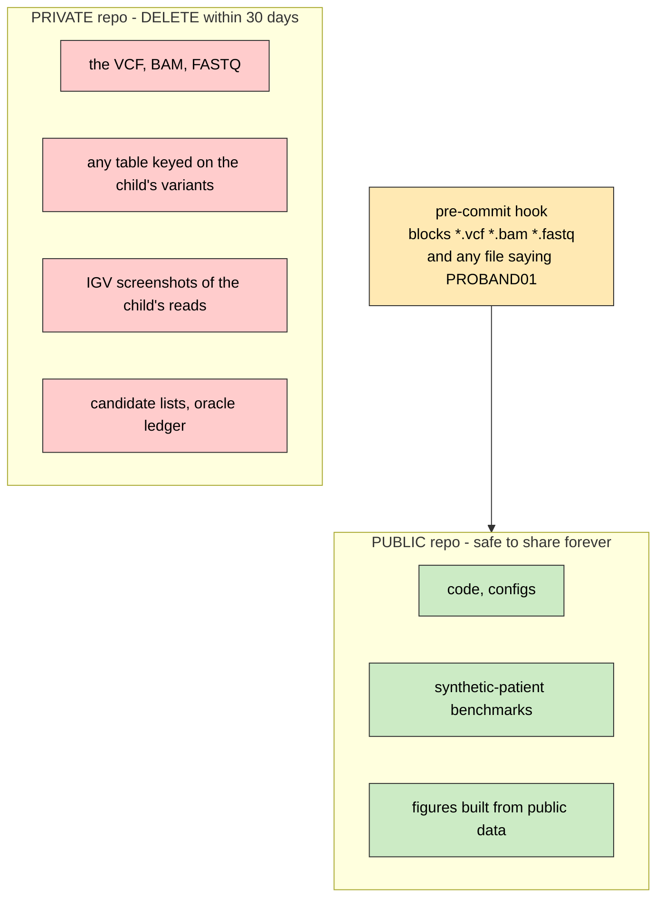

> **Legend** — green: safe to publish forever · red: patient data, deleted within 30 days · yellow: the guard that keeps one out of the other.

**Red can end your entry.** Anything computed FROM red is still red.

**Pre-commit hook** — a script that blocks a git commit if it spots a forbidden file. Cheap insurance.

**Coordinate gate** — the scan that fails the build when a patient genomic position appears in a file this repository could publish. Three rules: a submission CSV data row carrying a seven-digit-or-longer position; any `pos` from the resolved (and gitignored) submission spec, searched as a bare number; and any eight-digit number falling strictly inside the public candidate-gene span. Public gene-model coordinates and synthetic examples are exempt, each with a stated reason in an allowlist.
*Example: `uv run python tools/check_coordinates.py`. The first run found 11 hits, one a real leak — two positions written verbatim into a methodology entry and already pushed. They were redacted to `<pos-1>` / `<pos-2>`: the append-only rule yields to the no-coordinates rule, and the redaction says so. Second run: `coordinate gate: clean`.*
*Context: a step of `tools/check-python.sh` before the tests; the commit-message gate carries the same patterns, so a position cannot enter history either · source: tools/check_coordinates.py · related: Resharing, Derived dataset, Pre-commit hook, Redaction, Selector (submission) · first seen 2026-09-05*

**Embargo** — a period where you must not publish a paper about it. Code is fine; the journal article waits.

**Acknowledgement text** — the exact wording the organizers require you to include in anything public.

**De-identified** — names removed. Note this is NOT the same as impossible to identify — genomes are inherently identifying, which is why the rules are strict.

### Hosting the dashboard

These words all come from putting the app on the public internet (methodology 080). They are web-infrastructure terms, not biology — but they decide who can read this child's data, so they belong in the privacy chapter.

**Origin** — a web address reduced to the three things a browser uses to decide "is this the same place?": the scheme, the host and the port. Two addresses are the same origin only if all three match.
*Example: `http://localhost:5173` and `http://127.0.0.1:5173` are DIFFERENT origins to a browser, even though they are the same machine — which is why the API's allowed-origins list names both.*
*Context: the unit CORS and the session cookie are both defined in terms of · source: src/mva/viz/app.py · related: CORS, Same-origin request, Reverse proxy · first seen 2026-09-06*

**Same-origin request** — a request a page makes to its own origin, written as a path (`/api/overview`) with no host in it. The browser sends it without asking anyone's permission, and the page never has to know where the server actually is.
*Example: the hosted dashboard is built with `VITE_API_URL=/`, so every call becomes `/api/…` and the real backend address appears nowhere in the downloaded JavaScript.*
*Context: the mechanism that hides the backend from visitors · source: app/src/api/client.ts · related: Origin, API proxy, Environment-variable prefix · first seen 2026-09-06*

**CORS (Cross-Origin Resource Sharing)** — the browser rule that a page may only read a reply from a *different* origin if that server explicitly says the page's origin is allowed. The server says it in a response header; the browser enforces it. Server-to-server calls are unaffected — CORS is a browser rule, not a network one.
*Example: `MVA_VIZ_CORS=http://localhost:5173,http://127.0.0.1:5173` — the two dev-server origins. The hosted dashboard needs no entry, because its browser only talks to its own origin and the proxy behind it is not a browser.*
*Context: a blocked fetch and a dead server look identical from JavaScript (both a bare `TypeError`), which is why the app's status dot names both causes · source: src/mva/viz/app.py · related: Origin, Same-origin request · first seen 2026-09-06*

**Reverse proxy** — a server that sits in front of another server, takes the public requests, and passes them on. It is where the certificate and the public hostname live, so the real service can stay bound to `127.0.0.1` and be unreachable from outside.
*Example: Caddy on the VPS holds `https://viz.example.org`; `mva-viz-api` itself listens only on `127.0.0.1:8900` and would refuse to bind anything else without a token.*
*Context: installed by `tools/setup-viz-api-service.sh`, which prints the Caddy and nginx blocks · source: docs/step-0/infrastructure.md · related: Origin, Shared token, systemd unit · first seen 2026-09-06*

**API proxy (server-side)** — a small program on the server that receives the browser's same-origin request and re-sends it to the real API, adding the secret the browser is not allowed to hold. The browser sees only the proxy; the proxy sees both sides.
*Example: `app/api/[...path].ts` on Vercel takes `/api/panel/genes` and re-sends it to `$MVA_VIZ_API_URL/api/panel/genes` with `X-API-Key: $MVA_VIZ_API_TOKEN`.*
*Context: chosen over React Server Components because the app is a Vite single-page app — rewriting 340 files to hide the same fact was not worth it · source: docs/step-0/methodology/080-hosted-dashboard.md · related: Same-origin request, Shared token, Edge Function · first seen 2026-09-06*

**Shared token** — one long random string that stands for "you are allowed to call this API". Every caller sends the same one, in a header; the server compares it to the value it was configured with. No usernames, no accounts.
*Example: `MVA_VIZ_TOKEN` in the server's `.env`, sent by the proxy as the header `X-API-Key`. Generate it (`secrets.token_urlsafe(32)`), never choose it.*
*Context: two different tokens exist on two different hops — `MVA_API_TOKEN` guards the read-store API, `MVA_VIZ_TOKEN` guards the viz API. Neither is ever in a browser · source: src/mva/viz/auth.py · related: API proxy, Constant-time comparison, Environment-variable prefix · first seen 2026-09-06*

**Constant-time comparison** — comparing two secrets in a way that always takes the same amount of time, whether they differ at the first character or the last. Ordinary `==` stops at the first difference, and that timing tells an attacker how much of a guess was right — enough, over many tries, to recover the secret one character at a time.
*Example: `secrets.compare_digest(provided, expected)` in Python; a fixed-length XOR loop in the app's `timingSafeEqual`.*
*Context: used for both the API token and the dashboard password · source: src/mva/viz/auth.py · related: Shared token, HMAC · first seen 2026-09-06*

**HMAC (hash-based message authentication code)** — a fingerprint of a message computed with a secret key. Anyone holding the key can check the fingerprint; nobody without it can produce one. It proves a message was written by the server and not edited since.
*Example: `HMAC-SHA256("v1:1757260800")` under the key `DASHBOARD_SESSION_SECRET + ":" + DASHBOARD_PASSWORD`, which is what makes the dashboard's session cookie unforgeable.*
*Context: it is what lets the session be the cookie itself, with no session database behind it · source: app/server/session.ts · related: Signed session cookie, Constant-time comparison · first seen 2026-09-06*

**Signed session cookie** — a cookie holding an expiry plus an HMAC of that expiry. The server does not remember who is logged in; it re-checks the fingerprint on every request. Editing the expiry breaks the fingerprint, so the cookie cannot be extended by its holder.
*Example: `mva_dash=1757260800.k7Qf…T4` — expiry, dot, signature. Valid for 12 hours.*
*Context: because the password is part of the signing key, changing `DASHBOARD_PASSWORD` in the Vercel project invalidates every cookie already issued — a rotation is a logout for everyone · source: app/server/session.ts · related: HMAC, HttpOnly, Fail closed · first seen 2026-09-06*

**HttpOnly / Secure / SameSite** — three flags on a cookie. `HttpOnly` hides it from JavaScript, so a script injected into the page cannot read it. `Secure` stops it travelling over plain HTTP. `SameSite=Lax` stops another website's form post from carrying it along.
*Example: `mva_dash=…; Path=/; Max-Age=43200; HttpOnly; Secure; SameSite=Lax`.*
*Context: pinned by a test, because all three are silent when missing — nothing breaks, the cookie is just weaker · source: app/server/session.ts · related: Signed session cookie · first seen 2026-09-06*

**Edge Function** — a small server-side program that runs on the hosting provider's own network, close to the visitor, without anyone running a server. It gets a request and returns a response, and it holds the secrets the browser must not.
*Example: the four functions in `app/api/` — the catch-all proxy, the liveness probe, login and logout.*
*Context: called "serverless" because you do not operate the machine; there is still a server · source: app/api/ · related: API proxy, Routing Middleware · first seen 2026-09-06*

**Routing Middleware** — code that runs on *every* request before the hosting provider's cache and before any file is served. It can let the request through, rewrite it, or answer it itself. It is the only place a gate can sit if nothing at all may be served without a password.
*Example: `app/middleware.ts` returns the password page for a visitor with no valid session, so an unauthenticated request never receives `index.html` or a single JavaScript chunk.*
*Context: a login screen written as a page inside the app would already have shipped the app before it could refuse · source: app/middleware.ts · related: Edge Function, Signed session cookie, Fail closed · first seen 2026-09-06*

**Fail closed** — when a system is misconfigured, it refuses rather than allows. The opposite ("fail open") is what turns a missing setting into a public dashboard.
*Example: with `DASHBOARD_PASSWORD` unset the deployment answers `503` naming the missing variable; and `mva-viz-api --host 0.0.0.0` with no token exits `2` instead of printing a warning nobody reads.*
*Context: the reason both checks are refusals and not warnings · source: app/middleware.ts · related: Routing Middleware, Shared token, Coordinate gate · first seen 2026-09-06*

**`Cache-Control: no-store`** — a header telling every cache along the way, including the provider's shared CDN cache, to keep no copy of this reply. Without it a reply computed for one visitor can be handed to the next.
*Example: every reply the dashboard's proxy returns carries `no-store, private`, whatever the API said — `/api/panel/locus` returns real patient positions and no cache may retain them.*
*Context: the reply is still delivered to the authorised browser; this only stops it being stored in between · source: app/server/upstream.ts · related: API proxy, Reverse proxy, Resharing · first seen 2026-09-06*

**Environment-variable prefix (`VITE_`)** — the build tool copies a variable's value into the JavaScript it produces *only* if its name starts with `VITE_`. Everything else stays on the server. It is a mechanical rule, which is what makes it trustworthy: a secret without the prefix cannot leak into the bundle by accident.
*Example: `VITE_API_URL=/` is inlined into the app; `MVA_VIZ_API_TOKEN` and `DASHBOARD_PASSWORD` are not, and are readable only by the Edge Functions.*
*Context: the whole hiding strategy rests on this one naming rule · source: app/README.md · related: Same-origin request, Shared token, Edge Function · first seen 2026-09-06*

**systemd unit** — a small text file telling a Linux server how to start a program, keep it running, and restart it if it dies. It is how `mva-viz-api` survives a reboot instead of living in someone's terminal.
*Example: `/etc/systemd/system/mva-viz-api.service`, written by `tools/setup-viz-api-service.sh`; `sudo journalctl -u mva-viz-api -f` reads its log.*
*Context: the unit binds `127.0.0.1` deliberately — the public port belongs to the reverse proxy · source: tools/setup-viz-api-service.sh · related: Reverse proxy, Fail closed · first seen 2026-09-06*

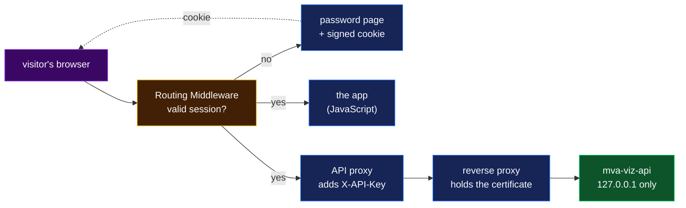

> **Legend** — purple: the untrusted visitor · yellow: the decision point (is there a valid session?) · blue: neutral machinery on the public side · green: the private service holding patient-derived data. Solid arrow: a request. Dashed arrow: a response header.

---

## 16. The research record — words for what you believe

Everything above this section is about the *data*. This section is about the *investigation*:
how a question becomes a claim, a claim becomes a test, and a test becomes something you can
put in a report. The words come from ordinary experimental science, and most of them have a
close software analogy.

The loop they describe:

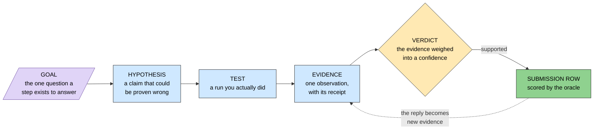

> **Legend** — purple: the raw input, the only thing not derived from something else · blue: neutral machinery, the stations that turn a claim into an observation · yellow: the decision point · green: the goal. The dotted arrow is the feedback edge — a score is not the end, it is more evidence.

**Research goal** — the single question a step exists to answer. Not a task ("normalize the VCF") but a question ("does every variant have exactly one spelling?"). A task is done when it runs; a goal is done when it is answered. *Example:* step 1's goal is whether an exact-match scorer can be trusted with an indel.

**Research iteration** — one whole route through the case: its own plan, its own numbered steps, its own claims, and — usually — its own submission folder. Not a retry of the previous one. Iteration 1 filtered the vendor callset top-down; iteration 2 re-derived the same answer blind from the raw reads; iteration 3 was drafted and absorbed rather than run; iteration 4 is the model zoo. Software analogy: a branch that re-implements a feature against the same spec, kept side by side so the two implementations can be compared rather than merged. Distinct from a [submission iteration](#13-hackathon-scoring-words), which is the *folder* one of these uploads.
*Example:* iteration 2's step 4 and iteration 4's step 4 share a number and nothing else — one is a likelihood-ratio ranking, the other a workflow DAG.
*Context: the switcher on `/steps` reads one of these at a time, and `GET /api/steps?iteration=` serves it · source: src/mva/science/step_maps/ · related: Step map, Research goal, Blind protocol, Submission iteration, Methodology entry · first seen 2026-09-19*

**Step map** — the declared list of steps of one research iteration, held in code rather than in a table: each step's slug, title, goal, status, the track it feeds, what it unblocks, and any figure it drew outside the usual directory. It is code because it is short, changes rarely, and a reviewer should see the whole map in one diff — the same reason a routing table is code. Everything that hangs off a step (claims, evidence, entries) accumulates at runtime and lives in the warehouse instead.
*Example:* `ITERATION2` declares nine steps, of which `step-7` is the only one whose `track` is `track2`.
*Context: read by `/api/steps`, by the report renderer and by the CLI's `--step` choices, so none of them can hold a different list · source: src/mva/science/steps.py · related: Research iteration, Research goal, Track 2 (drug repurposing) · first seen 2026-09-19*

**Hypothesis** — a claim that could turn out to be wrong, stated before you test it. In software terms it is an assertion you write before the code that makes it pass. *Example:* "the causal pair sits in BUB1B."
*Context: filed in the register before it is tested — `mva-science hypothesis-add` refuses a claim with no prediction and no refutation condition · source: src/mva/science/hypothesis.py · related: Falsifiable, Prediction, Refutation condition, Register*

**Falsifiable** — able to be proven wrong by some observation you could actually make. A claim nothing could disprove is not a hypothesis, it is an opinion. *Example:* "BUB1B is involved somehow" is not falsifiable; "both BUB1B alleles are rare and damaging" is.

**Prediction** — what you must observe *if* the hypothesis is true. Written before the run, so the result cannot be reinterpreted afterwards to fit. *Example:* "two BUB1B variants with gnomAD frequency below 1 in 1000, on opposite copies."

**Refutation condition** (`refuted_by`) — the observation that would kill the claim. The most valuable sentence in the whole record, and the one people skip. *Example:* "both BUB1B alleles turn out common in gnomAD, or phasing puts them on the same copy."

**Test** — a run you actually executed. Here, a methodology entry is the test: it carries the exact commands, the inputs, and the raw output, so someone else can repeat it. Not the same as a software unit test.

**Methodology entry** — the file a test is written down in: the question, the inputs with their versions and parameters, the exact commands, the observed output, and the conclusion drawn — enough for someone else to reproduce it. Numbered globally across every step, never reused, and never edited: a correction is a new entry that says which one it supersedes. From step 1 on it also carries the hypothesis, the prediction and the refutation condition, all written *before* the run, and the verdict after it.
*Example: `docs/iteration1/step-6/methodology/074-submission-v1-design.md`. Because the numbers are global, two steps working in parallel cannot claim the same one.*
*Context: the receipt an evidence row points at, and the reason a result can be re-derived a month later · source: docs/method.md · related: Test, Source reference, Append-only, Hypothesis · first seen 2026-09-05*

**Step narrative** — the written half of a research step: what it did, why the question belonged there, what it concluded, what it could not have started without, what the next step does with its answer, and what each of its figures means. Everything else about a step is *derived* — the goal from the step map, the claims from the register, the entries from the blind gate, the figures from the filesystem — so these are exactly the judgements no query can produce. Committed as `narrative.json` beside the step's README, and enforced: a step that has run and says nothing fails the build.
*Example:* `docs/iteration1/step-6/narrative.json` — the step that spent the first oracle submission, with what each of the eight possible replies would have meant.
*Context: written because the dashboard could render a step's goal, claims, entries and figures and still not say what the step concluded · source: src/mva/viz/steps_narrative.py, tools/check_step_narrative.py · related: Research goal, Methodology entry, Figure caption (reads / means), Research iteration · first seen 2026-09-19*

**Figure caption (reads / means)** — a figure's two-part reading, kept apart on purpose. **Reads** is what the chart literally shows — the axes, what one mark is, how it is coloured, the ordering — and is checkable against the image by anyone. **Means** is what the chart is evidence *for*, which is argued from the methodology entry that produced it and cites that entry. A chart with neither is decoration; this repository had about seventy of them before the captions were written.
*Example:* for the Track 1 funnel — *reads:* nine filter stages as horizontal bars on a log survivor axis, purple raw input through blue machinery to green answer; *means:* no single filter isolates the gene, only their combination does.
*Context: validated per step, so a figure with no caption and a caption for a figure that was never drawn both fail the gate · source: tools/check_step_narrative.py · related: Step narrative, Methodology entry, Research goal · first seen 2026-09-19*

**Evidence** — one observation bearing on one claim. Not a conclusion — a single fact, tagged with which way it cuts. *Example:* "BUB1B is depleted of loss-of-function variants in gnomAD."

**Direction** — which way an observation cuts: **supports**, **refutes**, or **neutral**. Neutral is recorded rather than dropped, because "we looked and it told us nothing" is a real finding that stops the same look being repeated. *Example:* a coverage check that came back normal is neutral evidence, not absence of evidence.

**Strength** — how hard an observation cuts, from 0 to 1. A human judgment, not a computed statistic. *Example:* "absent from gnomAD entirely" is 0.8; "the gene is plausible" is 0.2.

**Source reference** (`source_ref`) — the receipt an observation came from: a methodology entry, a warehouse table, a [PMID](#7-databases-and-annotation), a [ClinVar](#7-databases-and-annotation) record, or an oracle reply. An observation with no receipt is not evidence, because nobody can check it. *Example:* `methodology/003`.

**Verdict** — the evidence weighed into a status and a number, with a written reason. *Example:* "supported at 0.8, because two independent paths reached BUB1B separately."

**Confidence** — how strongly the claim is currently believed, 0 to 1. It is a [posterior](#11-math-probability-and-statistics-words) in spirit, but see the warning below. *Example:* 0.69.

**Log-odds** — a way of adding up evidence. Instead of multiplying probabilities, you convert to `log(p / (1-p))`, where each piece of evidence becomes a number you simply **add**. Convert back at the end. Software analogy: working in log space to turn a product into a sum, exactly as you would to avoid floating-point underflow. *Example:* a confidence of 0.5 is log-odds 0; add +1.4 for a strong supporting observation and you are at 0.80.

**Heuristic, not calibrated** — the crucial caveat on every confidence in this repository. The arithmetic adds evidence as if each piece were independent, and it is not: two observations computed from the same VCF are the same fact counted twice. The number is for **ordering and triage** — which claim deserves attention next — never for a probability you would quote as a result. Say this wherever the number appears.

**Revision** — one recorded version of a claim. The register never edits: changing your mind appends a new revision, so the record of the belief *moving* survives. Software analogy: an event log, not a mutable row. *Example:* H001 revision 1 proposed, revision 2 supported at 0.8.

**Append-only** — a table you only ever add rows to. No `UPDATE`, no `DELETE`. It is what makes a record evidence rather than a claim about the past. *Example:* `warehouse.evidence`.

**Register** — the collection of all hypotheses and their revisions. *Example:* `warehouse.hypotheses`.

**Dossier** — one claim plus everything recorded about it: every revision, every evidence row, and the weighing over them. What gets exported as a Markdown file and rendered as a report section. *Example:* `docs/iteration1/step-1/hypotheses/h001-bub1b.md`.

**Provenance vs belief** — two different questions, often confused. **Provenance** is *where did this byte come from* — answered by lineage and hashes. **Belief** is *what do we think is true and why* — answered by the register. A perfect provenance chain tells you nothing about whether a conclusion is right. *Example:* `data_lineage` says which VCF produced a table; `warehouse.evidence` says what that table made us believe.

**Audit trail** — the two append-only ledgers nobody could reconstruct after the fact: what we *spent* and what we *believed*. The probe ledger records every oracle upload — who sent it, the payload, the reply, the rationale, which hypotheses it bears on — against a hard budget of 6. The register records every hypothesis revision and every evidence row. Lineage answers *what was computed*; the audit trail answers *what was done in the outside world, and what it made us think*. Both live in the ingest schema rather than the results schema, because they are hand-written operational state, not a derived table.
*Example: `uv run mva-warehouse probe-budget` → 0 of 6 spent, 6 remaining. `uv run mva-science probe-link <probe_id> --hypothesis H009 --direction supports` files the reply as `kind=oracle` evidence with `source_ref` `probe:<n>`, which is what ties an irreversible action to the belief it moved.*
*Context: the half of the record that no rerun can rebuild · source: src/mva/warehouse/probes.py · related: Probe ledger, Register, Revision, Append-only, Provenance vs belief · first seen 2026-09-05*

---

## 17. Working blind — words for iteration 2

Iteration 1 found the answer and the oracle confirmed it. Iteration 2 goes looking for it
**again**, from the raw reads and the symptoms, as if nobody knew — because a result found
twice by two routes that share no code is the strongest replication a single sample allows,
and because a method that only works when you already know the answer transfers to nothing.
These are the words that discipline makes necessary.

```mermaid
flowchart LR
  S[/"8 HPO terms<br/>(symptoms only)"/]:::raw
  R["SYMPTOM RANKING<br/>every curated gene,<br/>scored — no DNA read"]:::machine
  T{"TIERS<br/>core · net ·<br/>mechanism-term"}:::decide
  G["TARGET SET<br/>the genes later<br/>steps read DNA for"]:::good
  D["DECOY SET<br/>matched genes that<br/>should find nothing"]:::machine
  B["BENCHMARK<br/>recall@N on<br/>held-out diseases"]:::machine
  S --> R --> T --> G
  G -.->|"matched on gene shape"| D
  R --> B
  B -->|"0.36, not 0.90"| G
  classDef raw fill:#e0d4f7,stroke:#7a5cab,color:#000
  classDef machine fill:#cfe8ff,stroke:#333,color:#000
  classDef decide fill:#ffe9b3,stroke:#333,color:#000
  classDef good fill:#8fd18f,stroke:#333,color:#000
```

> **Legend** — purple: the raw input, here the clinic's words rather than any DNA · blue: neutral machinery · yellow: the decision point, where a gene is assigned a tier · green: the output later steps consume. The arrow returning from the benchmark is the one that mattered: the measured recall changed what the target set is allowed to claim.

**Blind protocol** — a rule that this iteration may not read the earlier one's answer until the one step whose job is to compare them. The gene is written all over the repository, so it cannot be a secret; what makes it checkable is that every [methodology entry](#16-the-research-record--words-for-what-you-believe) declares what it read and a gate refuses one that names an iteration-1 candidate table too early. Software analogy: not a sandbox, but a code review that rejects a forbidden import.
*Example: `uv run mva-science check --blind iteration2` → "1 iteration2 entries, every one declaring its inputs — still blind".*
*Context: what makes iteration 2's rediscovery worth anything · source: src/mva/science/blind.py · related: Hypothesis, Methodology entry, Unblinding · first seen 2026-09-11*

**Unblinding** — the single moment the comparison is allowed: one entry, marked as such, that reads iteration 1's tables and says whether the blind route found the same pair. Everything after it may read them too; nothing before it may. *Example:* step 6's entry, not yet written.
*Context: the gate's own switch, so "when did we look" is a recorded fact rather than a memory · source: src/mva/science/blind.py · related: Blind protocol · first seen 2026-09-11*

**Target set** — the genes later steps will actually read DNA for, chosen from the symptoms alone. *Example:* 404 genes, chosen from the child's 8 HPO terms with the callset never opened.
*Context: the input to the k-mer bait of step 2 · source: docs/iteration2/step-1/methodology/084-the-blind-target-set.md · related: Tier, Recall@N, Enrichment vs coverage · first seen 2026-09-11*

**Tier** — which band of the target set a gene is in, and therefore where human attention starts: **core** (top 50 by symptom score), **net** (ranks 51–300), **mechanism-term** (admitted by the disease-mechanism rule whatever its rank), **uncurated** (no HPO annotation at all, so unscorable). Every tier is read by the machinery; the tier ranks the humans' time, not the computer's. *Example:* 62 core, 272 net, 70 mechanism-term.
*Context: which band of the target set a gene sits in, as `results.it2_targets.tier` · source: src/mva/phenotype/targets.py · related: Target set, Mechanism-term rule · first seen 2026-09-11*

**Mechanism-term rule** — admitting every gene the ontology annotates under a chromosome-instability term, whatever its symptom score, because a clinician would use the disease name. It is **prior knowledge, not evidence**: such a row is tagged, its pure symptom-score rank is printed beside it, and a rediscovery claim may only be made on that pure ranking. Otherwise the rule would hand the answer a seat and the seat would be mistaken for a finding. *Example:* 51 of 404 target genes entered this way and earned no claim by doing so.
*Context: the plan's own bias fix (gap B1) · source: docs/iteration2/plan.md · related: Tier, Target set · first seen 2026-09-11*

**Decoy set** — genes that look like the targets and should find nothing: matched on coding length and exon count, carrying none of the child's symptoms, drawn once from a recorded seed and never edited. Running the whole pipeline over them measures how often it nominates a gene by chance. Software analogy: a negative control fixture — the test that fails if your matcher matches anything. *Example:* 396 decoys for 404 targets.
*Context: the read route's null, which it otherwise lacks · source: src/mva/phenotype/targets.py · related: Null hypothesis (H₀), Target set · first seen 2026-09-11*

**Recall@N** — out of many test cases, the share whose right answer appears in the top *N* of a ranking. The number that says whether a cutoff is defensible. *Example:* recall@300 = 0.36 — of 200 held-out diseases, 72 had their causal gene inside the top 300.
*Context: how H012 was tested · source: src/mva/phenotype/benchmark.py · related: Held-out, Enrichment vs coverage, Target set · first seen 2026-09-11*

**Held-out** — hiding the answer from the method before asking it to find the answer. Here, a disease's own curated description of its gene is removed before that disease is ranked; the gene keeps what its *other* diseases say. Without this the benchmark measures a lookup and scores near 1.0. Software analogy: not testing a cache against the values you just wrote into it. *Example:* 49 of 200 genes turned out to be described by the withheld disease alone, so removing it removed the gene — recorded as a miss, not hidden.
*Context: the rule that makes the recall curve worth reading · source: src/mva/phenotype/benchmark.py · related: Recall@N, Overfitting · first seen 2026-09-11*

**Zemojtel-style degradation** — deliberately worsening a test query before ranking it, so the benchmark measures the ranker under clinic conditions rather than textbook ones. Two operations, both from the benchmark Exomiser was published with (Zemojtel 2014): **imprecision** replaces one or two terms by their ontology parent (a real record says "seizure" where the curation says the exact subtype), and **noise** adds one or two unrelated terms (the child has features the disease does not explain). Without it a benchmark scores the ranker on inputs no clinic produces. *Example:* every held-out query is subsampled to 7 terms, 1–2 of them blurred to a parent and 1–2 unrelated terms added, drawn per query from the run's seed.
*Context: applied to every query of every recall run of step 1 — method from Zemojtel 2014, parameters untuned to this corpus and recorded as a limitation; measured in [methodology 084](iteration2/step-1/methodology/084-the-blind-target-set.md) and re-tested at the full population in [091](iteration2/step-1/methodology/091-recall-at-the-full-population.md) · source: src/mva/phenotype/benchmark.py · related: Held-out, Recall@N, HPO (Human Phenotype Ontology), Bootstrap interval · first seen 2026-09-12*

**Bootstrap interval** — an uncertainty range built by re-running the arithmetic on resamples of your own results instead of assuming a distribution. Draw *n* outcomes **with replacement** from the *n* you have, recompute the number, repeat a thousand times, and report the middle 95% of the answers. It says how much of a measurement is the method and how much is the particular cases that happened to be drawn. Software analogy: property-based testing for a statistic — re-roll the inputs and see how far the output moves. *Example:* recall@300 = 0.360 with a 95% bootstrap interval of [0.295, 0.420] over 200 held-out diseases; the interval is seeded, so it reproduces exactly.
*Context: printed by `Result.interval` beside every recall number step 1 reports, because a recall with no interval is a guess; first quoted in [methodology 084](iteration2/step-1/methodology/084-the-blind-target-set.md), and the interval the full-population re-test of [091](iteration2/step-1/methodology/091-recall-at-the-full-population.md) was judged against · source: src/mva/phenotype/benchmark.py · related: Recall@N, Held-out, Zemojtel-style degradation · first seen 2026-09-12*

**Enrichment vs coverage** — two different promises a gene list can make. **Coverage** says "the answer is in here"; **enrichment** says "the answer is likelier in here than outside". A measured recall of 0.36 permits only the second. Saying "coverage" when you have enrichment turns a gene's absence into a false exoneration. *Example:* iteration 2's target set is an enrichment, so step 2 not finding a gene means nothing about that gene, and step 4 reads all of them.
*Context: the decision recorded when H012 was refuted · source: docs/iteration2/step-1/methodology/084-the-blind-target-set.md · related: Target set, Recall@N · first seen 2026-09-11*

**Mode-of-inheritance prior** — using how a disease is passed down as a weight rather than as a filter. The parents' recurrent miscarriages say little about which symptom the child has, but a lot about which *kind* of gene to expect: recessive, and lethal in a fetus carrying two broken copies. So recessive genes with a curated prenatal-loss term are up-weighted ×1.5, dominant-only genes ×0.5, and every ranking using the prior is reported again with it switched off. *Example:* a family-history term that would have distorted the symptom ranking becomes evidence in the one place it genuinely carries information.
*Context: the plan's fix for the family-history term (gap B2) · source: src/mva/pipeline/inheritance.py · related: Recessive, Compound heterozygous ("comp het") · first seen 2026-09-11*

**Network proximity** — scoring a gene that has no recorded symptoms by the company it keeps: its high-confidence protein-interaction partners among the top-ranked genes. It is the weak, last-resort tier, because a neighbour's phenotype is not the gene's own. *Example:* the `uncurated` tier, which matters because 73.6% of protein-coding genes have no HPO curation at all.
*Context: the small version of Exomiser's hiPHIVE random walk, whose 741 MB matrix was declined · source: src/mva/phenotype/network.py · related: Tier, Target set · first seen 2026-09-11*

---

## 18. Reading the raw reads — words for iteration 2's step 2

Step 1 chose genes without opening any DNA. Step 2 goes to the 1.07 billion raw reads and
asks what alleles they carry **in those genes only**, using callers that share no code with
the vendor's. Doing that without aligning the whole genome needed a new instrument, and
these are its words. Everything here builds on k-mer,
[insert size](#2-reading-dna-sequencing-and-the-files-it-makes) and
[phase block](#4-inheritance--how-the-answer-is-shaped) above.

```mermaid
flowchart LR
  G[/"reference genome<br/>GRCh38"/]:::raw
  T["target + decoy genes<br/>from step 1"]:::machine
  C["CUT<br/>every 31-mer of those<br/>genes, canonical form"]:::machine
  U{"UNIQUENESS FILTER<br/>occurs once in<br/>the genome?"}:::decide
  B["k-mer BAIT<br/>36,038,037 k-mers"]:::good
  R[/"1,071,835,104<br/>raw reads"/]:::raw
  S["SWEEP<br/>every 16th offset<br/>of every read"]:::machine
  K["14,657,560 reads kept<br/>1.37% of the store"]:::good
  X["dropped as repeated<br/>8.79% — the gate that failed"]:::bad
  G --> C
  T --> C --> U
  U -->|"yes"| B
  U -->|"no, it lies"| X
  B --> S
  R --> S --> K
  classDef raw fill:#e0d4f7,stroke:#7a5cab,color:#000
  classDef machine fill:#cfe8ff,stroke:#333,color:#000
  classDef decide fill:#ffe9b3,stroke:#333,color:#000
  classDef good fill:#8fd18f,stroke:#333,color:#000
  classDef bad fill:#f4a3a3,stroke:#333,color:#000
```

> **Legend** — purple: the raw inputs, the public reference and the child's reads · blue: neutral machinery · yellow: the decision point, kept or dropped · green: what survives and is used · red: what was thrown away, and the pre-registered gate it failed.

**Reverse complement** — the same stretch of DNA read from the other strand: flip the order and swap each letter for its partner (A↔T, C↔G). The molecule is double-stranded, so a sequencer reports a fragment from whichever strand it happened to read, and the two spellings mean the same place.
*Example:* `AGGT` and `ACCT` are reverse complements of each other.
*Context: why every k-mer search has to look twice, or normalise once · source: src/mva/kmer/encode.py · related: k-mer, Canonical k-mer · first seen 2026-09-12*

**Canonical k-mer** — of a k-mer and its reverse complement, whichever sorts smaller, used as the single name for both. Storing only the canonical form halves the table and removes the need to search both strands. Software analogy: normalising a key before you put it in the map, like lower-casing an email address.
*Example:* `AGGT` and `ACCT` both store as `ACCT`.
*Context: the representation the whole step-2 engine is built on · source: src/mva/kmer/encode.py · related: Reverse complement, k-mer bait · first seen 2026-09-12*

**2-bit packing** — writing each base as two bits (A=00, C=01, G=10, T=11) so a 31-letter k-mer fits in one 64-bit integer and comparing two k-mers is comparing two numbers. 32 is the ceiling: a 33-mer needs 66 bits.
*Example:* 36 million 31-mers occupy 288 MB rather than 1.1 GB of text.
*Context: why the bait fits in memory on a laptop · source: src/mva/kmer/encode.py · related: Canonical k-mer, k-mer bait · first seen 2026-09-12*

**k-mer bait** — the set of every canonical k-mer belonging to the regions you care about, used as a filter: a read sharing any k-mer with the bait probably came from one of those regions, and everything else is discarded unread. It replaces aligning the whole genome when you only want part of it. Software analogy: a hash-set membership test standing in for a full join.
*Example:* 404 target genes + 396 decoys, padded, = 42 Mb of reference = 36,038,037 k-mers after filtering, which recovered 1.37% of the read store.
*Context: step 2's instrument and its innovation claim; the cost is set by bytes of sequence, not by bait size — 36,000× more k-mers costs 1.05× per read · source: docs/iteration2/step-2/methodology/085-the-bait-and-where-it-runs.md · related: Canonical k-mer, Uniqueness filter, Stride, Decoy set · first seen 2026-09-12*

**Uniqueness filter (off-target k-mer)** — dropping bait k-mers that also occur somewhere else in the genome, because they would pull in reads from that other place and invent variants there. About half the human genome is repetitive, so this is not a corner case. The share dropped is the honest measure of how repetitive your chosen genes are.
*Example:* 8.79% of the bait was dropped as repeated — against a pre-registered gate of "under 5%", which **failed**, and no available padding or k reaches it (8.38% to 10.25%).
*Context: a gate this step failed and reported as failed rather than retuned · source: docs/iteration2/step-2/methodology/086-can-the-off-target-gate-be-reached.md · related: k-mer bait, Segmental duplication · first seen 2026-09-12*

**Stride** — testing only every *s*-th position of a read instead of all of them, to do less work. A read overlapping the bait by at least `k + s − 1` letters still hits, so the saving costs a little sensitivity at the very edges rather than in the middle.
*Example:* stride 16 tests ~8 windows of a 150 bp read instead of 120 — 15× less work — and measured recall was 0.905 against a pre-registered 0.90.
*Context: fixed before the run and its recall cost measured, not assumed (H021) · source: src/mva/kmer/membership.py · related: k-mer bait, Bait recall · first seen 2026-09-12*

**Bait recall** — the share of reads that really do carry an allele of interest which the bait actually kept. Measured by an independent instrument, not asserted: take variants the delivered callset already reports, search for them with the old exact-match strike, and ask how many of those reads the new bait retained. *Example:* 0.9052, with a wide interval [0.815, 0.974].
*Context: the new instrument validated by the old one, before any biological conclusion was drawn from it · source: docs/iteration2/step-2/methodology/087-the-pass-and-what-it-recovered.md · related: Stride, k-mer bait · first seen 2026-09-12*

**On-target rate** — of the reads that survived selection and were aligned, the share that landed where they were supposed to. The direct check that the selection worked. *Example:* 98.87% of 15,829,813 alignment records mapped, at a median depth of 44× over the baited intervals.
*Context: the gate between selection and calling · source: src/mva/calling/align.py · related: k-mer bait, Coverage / depth (e.g. 30×) · first seen 2026-09-12*

**Mark duplicates** — flagging reads that are copies of the same original fragment (same start, same end) so a caller counts them once. Without it, one lucky fragment amplified ten times looks like ten independent votes for a variant. See also duplicate reads above.
*Example:* `samtools markdup` after coordinate sorting, before any caller runs.
*Context: a standard step named here because skipping it inflates confidence rather than coverage · source: src/mva/calling/align.py · related: Insert size (fragment length), On-target rate · first seen 2026-09-12*

**Pileup caller vs haplotype caller** — two ways to decide what a position says. A **pileup** caller stacks the letters every read shows at that one position and does statistics on the column (`bcftools mpileup | call -m`). A **haplotype** caller instead reconstructs the two local sequences the reads are most consistent with and reads the variants off those (freebayes over observed haplotypes; the vendor's Sentieon Haplotyper by local reassembly). The second is better around indels; the first has fewer assumptions to be wrong about.
*Example:* step 2 ran one of each and they agreed with the delivered callset at 99.57% and 99.27%.
*Context: why "two callers" here is not two copies of the same idea · source: src/mva/calling/smallvars.py · related: Method class, Concordance · first seen 2026-09-12*

**Method class** — the *kind* of evidence a caller uses, as opposed to its name. For structural variants the classes are read-pair/split-read (delly, Manta) and local assembly (dysgu, GRIDSS). Agreement between two names of the same class mostly means they share a blind spot; agreement across classes is real corroboration.
*Example:* Kosugi 2019 measured precision by class, which is why step 2's SV rule says "two method classes" and survived having to swap every caller it originally named.
*Context: what H018 and H023 are actually written about; it let the tools change without the claim changing · source: src/mva/calling/sv.py · related: Pileup caller vs haplotype caller, Bait-edge artefact, SV (structural variant) · first seen 2026-09-12*

**Bait-edge artefact** — a fake structural variant created by the selection itself. A baited alignment is islands of coverage with emptiness between them, and a read-pair caller reads the emptiness as one enormous deletion. Two controls stop it: a call must be at least 50 bp (below that it is an indel the small-variant callers already counted), and over half its span must be territory the bait actually covered.
*Example:* the first consensus run reported a 13 Mb deletion and a 40 Mb inversion in a living child; with the controls, 164 credible calls remain and the median deletion is 302 bp.
*Context: a property of any baited SV call, inherited by every later step, not a step-2 bug · source: src/mva/warehouse/analysis_it2_sv.py · related: Method class, k-mer bait · first seen 2026-09-12*

**Cis / trans** — whether two variants sit on the **same** inherited copy of a gene (*cis*) or on **different** copies (*trans*). A compound heterozygote needs *trans*: one broken copy from each parent leaves no working copy. Two damaging variants in *cis* leave one copy intact and usually explain nothing.
*Example:* step 2's two lead alleles are 10,911 bp apart with no read or fragment spanning both, so neither *cis* nor *trans* could be shown.
*Context: the question read-backed phasing exists to answer, and the gap step 3 inherits · source: src/mva/calling/phase.py · related: Phase block / PS tag, Compound heterozygous ("comp het") · first seen 2026-09-12*

**Concordance** — the share of positions where two independent methods give the same genotype, counted only where **both** actually reported one. It is a check on the instrument, never a way of discovering anything: a site only one caller saw is invisible to it by construction.
*Example:* 0.9957 (bcftools) and 0.9927 (freebayes) against the delivered callset at single-base substitutions, over ~45,500 co-called sites.
*Context: H022, the check that licenses the rest of step 2 · source: src/mva/warehouse/analysis_it2.py · related: Pileup caller vs haplotype caller, Ascertainment circularity · first seen 2026-09-12*

**Ascertainment circularity** — scoring your discoveries with a resource that was itself built from what you were trying to improve on, so the new route can only rediscover the old one's findings. It does not announce itself; it shows up as a smaller number, not an error.
*Example:* step 2's scoring query annotated alleles by joining a table built from the vendor's callset, so the 1,199 alleles only the new callers found had no consequence, failed the "protein-altering" test for want of one, and vanished. Annotating them separately made the target and decoy sets come out **exactly equal** and refuted H020.
*Context: the defect a completion audit found after the step had been declared closed · source: docs/iteration2/step-2/methodology/090-the-alleles-the-vendor-never-reported.md · related: Decoy set, Concordance, Null hypothesis (H₀) · first seen 2026-09-12*

## 19. Counting instead of aligning — words for iteration 2's step 3

**k-mer multiplicity** — how many times a particular k-mer appears in the reads, as opposed to whether it appears at all. Membership is a yes/no; multiplicity is a number, and a genotype is a statement about that number. The distinction is why step 3 needed a new instrument rather than a longer run of step 2's.
*Example:* the step-3 pass scanned 1,876,842,047 read windows in 765 s to count 763,020 probe k-mers.
*Context: the question `mva.kmer.count` answers and `mva.kmer.membership` cannot · source: docs/iteration2/step-3/methodology/095-the-probes-and-the-counting-kernel.md · related: k-mer, Canonical k-mer, k-mer bait · first seen 2026-09-13*

**Probe (reference/alternate k-mer pair)** — the k letters around a variant, written twice: once as the reference has them and once as the allele has them. The two k-mers differ only by the variant, so counting each in the reads says how many copies carry it. Three pairs are designed per allele, spread across the variant, because a single probe can be destroyed by *another* variant the same person carries a few bases away — and three windows fail independently, so that shows up as disagreement instead of as a genotype.
*Example:* 381,510 surviving pairs over 164,044 alleles; 95,372 alleles got all three.
*Context: the instrument the whole step rests on, following FastGT · source: src/mva/kmer/probes.py · related: k-mer multiplicity, Calibration marker · first seen 2026-09-13*

**Alternate-k-mer uniqueness** — requiring the *alternate* spelling of a probe to occur nowhere in the reference genome, and its reference partner exactly once. The alternate is the spelling being searched for, so if it already exists somewhere else, reads from that other place are counted as this allele being present.
*Example:* 37,306 probe pairs (8.5% of those designed) were dropped because their alternate k-mer already occurs in GRCh38. Step 2's witness set filtered the *reference* side instead and lost reads because of it.
*Context: the correction step 2 earned, applied · source: docs/iteration2/step-2/methodology/087-the-pass-and-what-it-recovered.md · related: Uniqueness filter (off-target k-mer), Probe (reference/alternate k-mer pair) · first seen 2026-09-13*

**Calibration marker** — a variant whose genotype is already settled, used to fit a model rather than to discover anything. Counting the probes of thousands of known heterozygotes tells you what "one copy" looks like *in this sample, at this depth, through this bait* — which no published constant can.
*Example:* 7,223 heterozygous and 7,481 homozygous-alternate markers, all drawn from inside the baited intervals so the bait's own recovery rate cancels out of the ratio being fitted.
*Context: how the genotype model learns this sample's coverage · source: src/mva/kmer/genotype.py · related: Probe (reference/alternate k-mer pair), Negative binomial · first seen 2026-09-13*

**Negative binomial** — a distribution for counts that are more spread out than pure chance would make them. A Poisson distribution assumes the spread is fixed by the average; a negative binomial adds one parameter for the extra spread, which real sequencing depth always has because some places are systematically easier to read than others.
*Example:* fitted here at a per-copy coverage of 17.96 with a dispersion of 4.68.
*Context: the emission model of the k-mer genotyper, following FastGT · source: src/mva/kmer/genotype.py · related: Over-dispersion, Variance-to-mean ratio, Calibration marker · first seen 2026-09-13*

**Over-dispersion** — the condition a negative binomial exists to describe: more variance in the counts than the average alone predicts. Ignoring it makes a model overconfident about every count it sees, which is how a merely thin region becomes a confident false deletion.
*Example:* measured here, not assumed — see the variance-to-mean ratio below.
*Context: why a Poisson model was refused · source: src/mva/kmer/genotype.py · related: Negative binomial, Variance-to-mean ratio · first seen 2026-09-13*

**Variance-to-mean ratio** — the spread of a set of counts divided by their average. Poisson predicts exactly 1; anything above it is over-dispersion, and the number says how much.
*Example:* **2.91** on this sample's calibration markers — so a Poisson model would have been about three times too confident about every count.
*Context: the one number that says whether the negative binomial was necessary · source: docs/iteration2/step-3/methodology/096-the-alleles-at-their-multiplicity.md · related: Over-dispersion, Negative binomial · first seen 2026-09-13*

**k-mer genotype** — reading how many copies of a gene carry an allele by counting its k-mer spellings in the reads, with no aligner and no caller in the chain. One copy puts the alternate spelling into about half the reads covering that place, two into nearly all, none into a handful from sequencing error.
*Example:* both alleles of step 2's lead pair were called heterozygous at 11/12 and 18/16 reference-to-alternate counts, posterior 1.0, all three probes agreeing.
*Context: the third, independent reading of the same bytes · source: src/mva/kmer/genotype.py · related: Probe (reference/alternate k-mer pair), Genotype posterior, Negative binomial · first seen 2026-09-13*

**Genotype posterior** — the probability the model puts on each of "no copies", "one copy" and "two copies", given the two counts it saw. Reported instead of a threshold, so a reader can see how close a call was rather than only which side of a line it landed.
*Example:* a call needs 0.95 before it is a call; below that it is a no-call.
*Context: what replaces a pair of cut-offs · source: src/mva/kmer/genotype.py · related: k-mer genotype, No-call · first seen 2026-09-13*

**No-call** — "the instrument could not say", recorded as its own answer. It is a different finding from "the allele is absent", and collapsing the two is how a gap in the data becomes a result. Here it means the posterior missed the floor, or the allele had too few surviving probes for its agreement to mean anything.
*Example:* 73,067 of 164,044 alleles, mostly published alleles that could not be given three usable probes.
*Context: the state the model returns rather than guessing · source: src/mva/kmer/genotype.py · related: Genotype posterior, Allele dropout · first seen 2026-09-13*

**Allele dropout** — an allele that is genuinely present but shows a count of zero, by bad luck rather than by absence. Its probability comes from the fitted model, not from an optimistic formula: over-dispersion puts far more weight on zero than Poisson does, so the optimistic figure would make every absence look decisive.
*Example:* computed from the fitted negative binomial and reported beside every absence claim.
*Context: the quantity behind the word "absent" · source: src/mva/kmer/genotype.py · related: Negative binomial, No-call · first seen 2026-09-13*

**Minimum count threshold** — the smallest alternate count that an allele which is *not* there would be unlikely to reach by sequencing error alone. Anything at or below it is not evidence of presence.
*Example:* 2, at a fitted error rate of 0.000247 and a false-positive rate of 1 in 1,000. That error rate turned out to be too tight: four published alleles cleared it at alternate fractions of 0.06–0.09, a tenth of what a real heterozygote shows, and are recorded as an artefact rather than as findings.
*Context: what "present at all" was defined to mean, and where the definition strained · source: docs/iteration2/step-3/methodology/096-the-alleles-at-their-multiplicity.md · related: Allele dropout, Genotype posterior · first seen 2026-09-13*

**MAPQ (mapping quality)** — the aligner's own phred-scaled statement of how likely it is that a read was placed in the right spot. `MAPQ 0` is the special value meaning "this sequence occurs in more than one place and I picked one at random" — not a low score but a refusal to answer.
*Example:* the median gene in this sample has a MAPQ-0 fraction of 0.000044, and the off-target reads sit at a median MAPQ of 60 — the maximum — meaning the bait pulled in reads that genuinely belong elsewhere and the aligner confidently sent them there.
*Context: the gate that decided which genes step 3 was allowed to report on · source: src/mva/calling/mapq.py · related: Reachability, Segmental duplication · first seen 2026-09-13*

**Reachability** — whether a gene can be measured here at all: enough unique bait k-mers survive, and the aligner was willing to place its reads. A gene that fails is **flagged, never dropped** — an absence inside it is not a finding, and deleting the row would make that indistinguishable from having found nothing.
*Example:* 21 of 792 genes are unreachable, none of them core or mechanism-term. They still yield confident genotypes for 17.6% of their alleles against 59.6% elsewhere, so the rule is a 3.4-fold enrichment rather than an absolute limit — which refuted the claim that said it was one.
*Context: the replacement for the off-target gate that could not be reached · source: docs/iteration2/step-3/methodology/093-where-the-aligner-was-unsure.md · related: MAPQ (mapping quality), Uniqueness filter (off-target k-mer) · first seen 2026-09-13*

**Segmental duplication** — a long stretch of DNA that occurs in two or more near-identical copies elsewhere in the genome. It defeats both instruments in the same way and for the same reason: the uniqueness filter removes the bait's k-mers there, and the aligner refuses to place the reads.
*Example:* `NEB`, `GTF2I`, `GTF2IRD2` and `ANAPC1` carry 61 of the 68 thin exons step 2 measured, and every one has a known paralogue or pseudogene.
*Context: what the 8.79% of unusable bait is actually made of · source: docs/iteration2/step-2/methodology/086-can-the-off-target-gate-be-reached.md · related: Reachability, Uniqueness filter (off-target k-mer) · first seen 2026-09-13*

**Copy number** — how many copies of a stretch of DNA a sample carries. Two is normal for an autosome; one means a deletion on one chromosome, three a duplication. Counted here as a ratio of k-mer counts rather than by alignment.
*Example:* the convention is stated once — a diploid region reads as 2.0, a heterozygous exon deletion as 1.0.
*Context: what step 3 asks of every exon, after asking about every allele · source: src/mva/kmer/copynumber.py · related: k-mer multiplicity, Local-flank denominator, Null band · first seen 2026-09-13*

**Local-flank denominator** — dividing a region's k-mer counts by the counts from the sequence immediately either side of it, rather than by a genome-wide average. The neighbouring sequence shares the region's coverage bias, so dividing by it cancels the bias; a genome-wide average does not, and would read every unusually-composed exon as a deletion.
*Example:* 2,000 unique flanking k-mers per gene, split between the two sides. The genome-wide median is computed too and kept as a cross-check, and the disagreement between the two is a reported column rather than something averaged away.
*Context: GeneToCN's central finding, applied · source: src/mva/kmer/copynumber.py · related: Copy number, Null band · first seen 2026-09-13*

**Null band** — the spread of a measurement over things that have no reason to show the effect being looked for, used as the threshold for the things that might. It answers "low compared to what" with a number measured on this sample instead of an imported constant.
*Example:* copy number over the decoy genes' exons — 396 genes matched to the targets on coding length and exon count and carrying none of the child's symptoms — with an exon below its 2.5th percentile counting as a deletion candidate.
*Context: why a copy number that merely sounds low is not a finding · source: src/mva/kmer/copynumber.py · related: Copy number, Decoy set, Local-flank denominator · first seen 2026-09-13*

**Chromosome dosage (k-mer dosage)** — how much sequence a whole chromosome contributed to the reads, measured by counting reference-unique k-mers assigned to it. A chromosome present in more copies is hit more often, in proportion, so the count is a copy number without an aligner, a caller or a coordinate anywhere in the chain. It is the mirror image of the allele-balance route: it can see chromosomes that have no heterozygous sites to read (X and Y in a male proband) and is blind to copy-neutral loss of heterozygosity, which changes *whose* copy is present without changing how much sequence there is.
*Example:* 7,330–8,699 unique 31-mers per contig plus a 7,999-mer genome-wide calibration set, each expected ~22 hits at 44× depth; a trisomy in a share *f* of cells raises the ratio by *f*/2, so 10% of cells is a 5% shift.
*Context: step 8's second instrument, run once over the whole read store · source: src/mva/kmer/dosage.py, docs/iteration2/step-8/methodology/121-the-second-instrument-and-the-shards-it-did-not-need.md · related: Copy number, k-mer multiplicity, Uniqueness filter (off-target k-mer), Absolute denominator (k-mer mass), B-deviation (Bdev), Mosaic fraction · first seen 2026-09-19*

**Absolute denominator (k-mer mass)** — dividing by the total sequence observed rather than by the median chromosome. A median denominator assumes most chromosomes are normal, which is precisely the assumption *variegated* aneuploidy breaks; the total mass assumes nothing. Both are computed and their disagreement is a reported column, because where they part company is where the median moved.
*Example:* the ratio against the autosomal median beside the ratio against a genome-wide calibration set, and the gap between them per chromosome.
*Context: the defence against the failure mode the disease is named for · source: src/mva/kmer/dosage.py · related: Chromosome dosage (k-mer dosage), Local-flank denominator, Copy number · first seen 2026-09-19*

**Uniform thinning (deliberate subsample)** — measuring on a fraction of the reads *on purpose*, when the quantity being measured is a **ratio**. Reads are stored in shards that are flowcell partitions — lane and read number — not genomic ones, so any subset of shards is a uniform sample with respect to the genome: it multiplies every chromosome's expected count by the same factor, which cancels in a quotient. The ratio stays unbiased and only its variance rises, so the cost is precision and never a systematic error. The argument does **not** transfer to genotyping, which needs the absolute multiplicity at one site — there a sampled count is simply wrong.
*Example:* 32 of 272 shards, 11.6% of the library, gives 20,706 observations per chromosome and a relative standard error of 0.69% — 7.2 sigma against the 5% shift a 10% mosaic trisomy produces, in 67 minutes instead of 9.4 hours.
*Context: how step 8's dosage pass was afforded, and why the flag that licenses it is separate from the one that means "timing probe" · source: tools/run_it2_dosage_pass.py, docs/iteration2/step-8/methodology/121-the-second-instrument-and-the-shards-it-did-not-need.md · related: Shard / partition, Lane / flowcell / instrument, Chromosome dosage (k-mer dosage), k-mer multiplicity · first seen 2026-09-19*

**FastGT** — the published method this step's genotyping follows: count the k-mers of known variants directly in raw reads and classify them with an empirical-Bayes negative binomial. Pajuste 2017, *Sci Rep* (PMID 28566690). Its classifier is the thing ported here; it validated single-base substitutions only, so indel probes here use the idea and not the published accuracy.
*Example:* its rule of at least three k-mer pairs per allele is why three probes are designed rather than one.
*Context: the direct precedent for genotyping without an aligner · source: docs/iteration2/plan.md · related: k-mer genotype, Negative binomial, Probe (reference/alternate k-mer pair) · first seen 2026-09-13*

**GeneToCN** — the published method this step's copy number follows: estimate copy number from k-mer frequencies with a local flanking denominator. Pajuste 2023, *Sci Rep* (PMID 37853040). Its smallest validated unit is 5.5 kb, well above a coding exon, which is why the exon scale here is conditional on a k-mer count rather than assumed.
*Example:* it judged 268 gene-specific k-mers unreliable against 3,095 reliable; the line drawn here, before any exon was measured, is 300.
*Context: the precedent, and the limit that made the exon scale conditional · source: docs/iteration2/plan.md · related: Copy number, Local-flank denominator, Null band · first seen 2026-09-13*

## 20. Ordering instead of filtering — words for iteration 2's step 4

**Likelihood ratio (LR)** — how many times more likely an observation is if a hypothesis is true than if it is not. It is the unit that replaces a filter: a filter says *in or out*, a likelihood ratio says *this observation multiplies the odds by 4.33*, and nothing is ever removed. Below 1 the observation argues against the hypothesis; at exactly 1 it says nothing.
*Example:* a gene the child's symptoms rank first is worth ×66.96, one nobody has curated ×0.379 — down-weighted 2.6-fold, not deleted.
*Context: the arithmetic the whole of step 4 is built on, following LIRICAL (Robinson 2020, PMID 32755546) · source: src/mva/pipeline/likelihood.py · related: Prior odds, Evidence lane, Posterior · first seen 2026-09-18*

**Prior odds** — the odds of a hypothesis before any evidence, written as `p / (1 − p)` rather than as a probability, because odds are what a likelihood ratio multiplies. Step 4's prior is uninformative on purpose: one gene in 19,723 is causal, so every gene starts at the same place and the ordering is produced entirely by evidence.
*Example:* 1 / 19,723 = 5.07 × 10⁻⁵, which as odds is 5.07 × 10⁻⁵ almost exactly.
*Context: the number every lane multiplies · source: src/mva/pipeline/pair_lr.py · related: Likelihood ratio (LR), Posterior · first seen 2026-09-18*

**Posterior** — the odds after every likelihood ratio has been applied, converted back to a probability. In this project it is a **transparent product of pre-registered terms used for ordering**, never a calibrated probability that a gene causes the disease, and it is quoted with that sentence attached.
*Example:* the leading gene's ratio of 341,019 on a prior of 5.07 × 10⁻⁵ gives posterior odds of 17.3 — about 0.95 as a probability, which is why the ratio and not the probability is the number reported.
*Context: what the ordering is, and what it is not · source: src/mva/pipeline/likelihood.py · related: Prior odds, Confidence · first seen 2026-09-18*

**Evidence lane** — one named strand of evidence with its own likelihood ratio, its own source and its own correlation group. Splitting the scoring into lanes is what makes "why is this gene at rank 1" answerable by reading a table instead of re-reading the code.
*Example:* the leading pair's lanes are `phenotype ×52.08`, `left:consequence ×350`, `right:alphamissense ×4.33`, two `frequency ×2.08` terms, and seven lanes that said nothing.
*Context: the unit the scoring is decomposed into · source: src/mva/pipeline/likelihood.py · related: Correlation group, Likelihood ratio (LR) · first seen 2026-09-18*

**Correlation group** — a set of lanes that were trained or curated on overlapping data, so multiplying them all would count one piece of evidence several times. Within a group only the strongest lane contributes; the rest are kept in the record with a ratio of 1 and a note saying which lane damped them.
*Example:* AlphaMissense was trained partly on ClinVar, so a ClinVar-pathogenic missense allele contributes ×18.7 once, not ×18.7 × ×4.33.
*Context: the rule that stops a posterior being inflated by its own sources · source: src/mva/pipeline/likelihood.py · related: Evidence lane, AlphaMissense · first seen 2026-09-18*

**ACMG Bayesian ladder** — the four ACMG/AMP evidence strengths — supporting, moderate, strong, very strong — read as four fixed likelihood ratios rather than as criteria to be counted. Tavtigian 2018 (PMID 29300386) showed the counting rules are reproduced by a prior of 0.10 and a geometric ladder: 350, and then its square root, fourth root and eighth root.
*Example:* 350 / 18.7 / 4.33 / 2.08. Benign evidence divides where pathogenic evidence multiplies, so a *supporting benign* observation is ×1/2.08.
*Context: where every genotype lane's number comes from · source: src/mva/pipeline/acmg.py · related: Evidence lane, Likelihood ratio (LR) · first seen 2026-09-18*

**AlphaMissense** — a deep-learning predictor that scores every possible missense substitution in the human proteome and assigns one of three classes: likely benign, ambiguous, likely pathogenic. Cheng 2023, *Science* (PMID 37733863). Used here through its own class, not a threshold chosen by us.
*Example:* it spoke for 19,353 allele slots — 22.2 % of all of them, the single largest lane in the ranking — and its call on the leading gene's second allele is `likely_pathogenic`.
*Context: the missense lane, served by Ensembl VEP REST · source: docs/iteration2/step-4/methodology/098-the-lanes-and-what-they-were-calibrated-against.md · related: Evidence lane, SpliceAI, Correlation group · first seen 2026-09-18*

**SpliceAI** — a deep-learning predictor of whether a variant changes splicing, reported as four delta scores: acceptor gain, acceptor loss, donor gain, donor loss. Jaganathan 2019, *Cell* (PMID 30661751). The overall score is the largest of the four, which is the authors' own definition.
*Example:* their published cut-offs are 0.2 for high recall, 0.5 recommended, 0.8 for high precision; 32,534 of the 38,087 coding alleles carry a delta score.
*Context: the splice lane, served by Ensembl VEP REST · source: docs/iteration2/step-4/methodology/098-the-lanes-and-what-they-were-calibrated-against.md · related: Evidence lane, AlphaMissense · first seen 2026-09-18*

**LOFTEE** — a rule set that decides whether a protein-truncating variant really destroys the protein, by asking *where* the truncation falls. Karczewski 2020, *Nature* (PMID 32461654). Not run here — Ensembl's REST endpoint does not serve the plugin — so its published rules are reimplemented over VEP's own fields and the result is called *LOFTEE-style*, never LOFTEE.
*Example:* a stop in the NMD-competent body of a transcript is worth ×350; the same stop in the last exon is worth ×4.33.
*Context: the truncating lane, reimplemented and labelled as such · source: src/mva/pipeline/genotype_lr.py · related: NMD escape, ACMG Bayesian ladder · first seen 2026-09-18*

**NMD escape** — a premature stop codon that the cell's nonsense-mediated decay machinery does not detect, so the shortened protein is still made. Decay does not reach the last exon, which is why a stop there is much weaker evidence than the same stop earlier in the gene.
*Example:* the published rule is "the last exon, or the last 50 bases of the penultimate exon". Ensembl REST reports which exon of how many but not exon lengths, so the last exon is read directly and the penultimate one is lowered a rung rather than guessed either way.
*Context: why "where" matters as much as "what" for a truncation · source: src/mva/pipeline/genotype_lr.py · related: LOFTEE, LoF · first seen 2026-09-18*

**P(trans)** — the probability that two variants in one gene sit on **opposite** copies of the chromosome. A recessive diagnosis needs that; two variants on the same copy leave one working copy and are not a diagnosis. With no parental DNA and no sequencing fragment spanning the pair, the only remaining estimate is a population statistic.
*Example:* gnomAD serves `p_compound_heterozygous` per pair from the genotype-combination counts of everyone carrying both (Guo 2024, PMID 38057443) — and returned it for **none** of this case's 25 leading pairs.
*Context: the second half of step 4's goal · source: src/mva/pipeline/ptrans.py · related: Phase / phasing, Unphaseable, Compound heterozygous · first seen 2026-09-18*

**Undetermined (P(trans) state)** — the honest answer when no co-occurrence estimate exists for a pair, because at least one of its alleles is not in the reference dataset. The pair is reported at the uninformative prior of 0.5 and labelled, rather than being given 0 (which would be evidence against it) or 1 (which would manufacture a diagnosis).
*Example:* 25 of 25 leading pairs. Only 5 of their 50 alleles are in gnomAD v2 at all — the method is least available exactly where an ultra-rare disease needs it most.
*Context: a missing measurement kept visible as one · source: docs/iteration2/step-4/methodology/101-the-phase-that-cannot-be-measured.md · related: P(trans), Unphaseable · first seen 2026-09-18*

**Unphaseable** — the fifth failure category: both alleles real, both present at one copy each, no read fragment spanning them and no parental DNA. It is a statement that phase *cannot be established*, not that it is unfavourable, and it is the category this case's lead pair falls into.
*Example:* the lead pair's two alleles are 10,911 bases apart against ~266-base sequencing fragments.
*Context: added by plan §11.5 to the four categories step 1 pre-registered · source: docs/iteration2/plan.md · related: P(trans), Phase block · first seen 2026-09-18*

**Degrading recessive ratio** — LIRICAL's answer to a gene with one damaging allele and no partner: raise its likelihood ratio to the power of the fraction of required alleles actually seen, rather than zeroing it. One of two keeps the square root. A missing partner may be a call the pipeline never made, in an exon no bait covered, or an allele class no caller reports.
*Example:* 2,670 single-allele hypotheses were scored this way; none reached the top 20, which is what makes keeping them cheap.
*Context: what replaces the biallelic filter · source: src/mva/pipeline/genotype_lr.py · related: Likelihood ratio, Compound heterozygous · first seen 2026-09-18*

**Permutation null** — re-running a whole analysis on inputs drawn at random with the same *shape* as the real ones, to see how high chance alone gets. It answers "did the input matter", which a large score on its own never does.
*Example:* 1,000 random seven-term symptom sets, each drawn to match the child's own term-depth profile, each re-ranking all 11,465 genes.
*Context: the specificity test step 4 pre-registered · source: src/mva/pipeline/nulls.py · related: Decoy null, Empirical p-value, Term-depth profile · first seen 2026-09-18*

**Term-depth profile** — how far below the root of the ontology each of a patient's symptom terms sits. A random term set drawn to match it is random in *content* but comparable in *specificity*, which is what makes it a fair null: a set of seven very general terms would be easy to beat for reasons that have nothing to do with the case.
*Example:* this child's seven terms sit at depths 6, 7, 4, 5, 5, 3, 5.
*Context: what makes the permutation null fair rather than merely random · source: tools/run_it2_lr_nulls.py · related: Permutation null, Decoy null · first seen 2026-09-18*

**Empirical p-value** — how often a null run reached or beat the observed result, written as `(exceeded + 1) / (draws + 1)`. The `+1` is not a rounding convenience: a finite null cannot demonstrate a probability of zero, and printing `0.000` from a thousand draws would claim it had.
*Example:* 0 of 1,000 permuted runs reached the observed leader, so p = 1/1001 = 0.000999 — reported as "below 0.001", never as zero.
*Context: how the permutation null is read · source: src/mva/pipeline/nulls.py · related: Permutation null · first seen 2026-09-18*

**Decoy null** — scoring a matched control set through the **identical** code path and measuring how far apart the two end up. It tests the *scoring*, where discriminating power actually lives, rather than the gene list — step 2 measured targets and decoys as indistinguishable before any filter, so any separation here was produced by the ranking itself.
*Example:* 396 decoys matched to the targets on coding length and exon count, drawn in step 1 before any DNA was read.
*Context: finding F4, made measurable · source: src/mva/pipeline/nulls.py · related: Decoy set, AUC · first seen 2026-09-18*

**AUC (area under the ROC curve)** — the probability that a randomly chosen member of one group scores higher than a randomly chosen member of the other, with ties counted as half. 0.5 means the two groups are indistinguishable. A point estimate alone is not a result: an interval that covers 0.5 says "no measured separation" however large the point looks.
*Example:* reported here with a 1,000-resample bootstrap interval, and read as a separation only when that interval excludes 0.5.
*Context: how the decoy null is quantified · source: src/mva/pipeline/nulls.py · related: Decoy null, Bootstrap interval · first seen 2026-09-18*

**Network proximity** — scoring a gene nobody has curated by how strongly it interacts with the genes that *are* well-scored. It is a third kind of evidence, weaker than a phenotype match, and it is capped accordingly: a neighbour has no phenotype evidence of its own, only a neighbour that has some.
*Example:* STRING's high-confidence partners (score ≥ 700) of the top 50 ranked genes give 1,575 edges and 569 uncurated neighbours — and **none of them reached the top 25**, so the lane was built, measured, and found not to matter here.
*Context: plan §11.5's answer to the 73.6 % of genes with no curation · source: src/mva/phenotype/network.py · related: Likelihood ratio (LR) · first seen 2026-09-18*

## 21. Reading the literature without being read by it — words for iteration 2's step 5

**Allele catalogue** — the published record of which exact variants have been written about, asked **allele-first**: take the variants this patient carries and ask the literature about each one, rather than asking a gene what its famous variants are. The direction is the whole design. A gene's famous alleles are somebody else's alleles and measure only how studied the gene is; the reverse question has a complete denominator — every allele the ranking scored — and a zero in it means something.
*Example:* 1,924 alleles across 815 genes, asked of **LitVar 2.0** one dbSNP identifier at a time.
*Context: the shape of step 5's first question · source: src/mva/knowledge/catalogue.py · related: rsID, PubMed / Europe PMC / PubTator3 / LitVar2 / OpenAlex / Semantic Scholar · first seen 2026-09-18*

**Unqueryable (never asked)** — an item the instrument could not have an opinion about, recorded as its own outcome rather than folded into "no". A literature index keyed on dbSNP identifiers cannot answer about a variant that has no identifier; calling that "nobody has published about it" turns a gap in a public catalogue into a finding about a patient. Carried in code as a sentinel (`NOT_ASKED = -1`), never as a zero.
*Example:* 10 of 1,924 alleles have no dbSNP identifier, so the coverage figure draws three bands — published, asked-and-silent, never-asked — and never one percentage.
*Context: the denominator rule the whole step is built on · source: src/mva/knowledge/catalogue.py · related: Allele catalogue, No-call · first seen 2026-09-18*

**Case-report anchor** — a published paper that discusses a candidate gene **alongside several of this patient's own clinical features**. It is the literature's version of a phenotype match: one paper covering five of seven features is a much stronger statement than five papers covering one each, which is why the count is per paper and not per gene.
*Example:* one **PubTator 3.0** search per (gene, HPO term label) pair; a paper returned by five of the seven searches matches five features.
*Context: step 5's second question · source: src/mva/knowledge/anchors.py · related: HPO (Human Phenotype Ontology), PubMed / Europe PMC / PubTator3 / LitVar2 / OpenAlex / Semantic Scholar · first seen 2026-09-18*

**Script-derived anchor** — an anchor set generated from a gene list by code, never typed from a reading list. In a **blind protocol** this is not tidiness: the papers a human reaches for are the discovery papers of the gene the previous iteration already found, so a hand-written bibliography is a leak wearing a citation. The entry prints which anchor came out of which gene, so the derivation can be checked rather than trusted.
*Example:* the plan's own bibliography (Hanks 2004, Snape 2011, Yost 2017, Mirzaa 2014) enters step 5 only if the queries produce it.
*Context: plan §10 gap B3, fixed before the step ran · source: tools/build_it2_anchors.py · related: Case-report anchor, Blind protocol · first seen 2026-09-18*

**Citation-volume baseline** — ranking the same genes by how many papers mention them at all, and holding the real ranking against it. It is the null that matters most for any literature route: the gene at the top of a biomedical search is usually the gene most has been written about, so a knowledge ordering that agrees with a raw hit count has measured fame rather than biology. Deliberately kept out of the score it judges — the knowledge score breaks its ties on the gene symbol, which carries nothing, so that this comparison stays independent.
*Example:* `GENE[Title/Abstract]` counted through NCBI E-utilities, one query per gene, against the knowledge ordering by **Spearman rank correlation** and **top-k overlap**.
*Context: step 5's fourth question, which judges the other three · source: src/mva/knowledge/baselines.py · related: Decoy null, Spearman rank correlation, Top-k overlap · first seen 2026-09-18*

**Spearman rank correlation (ρ)** — how well one ordering predicts another, computed on ranks rather than values, so it is unmoved by how far apart the scores are. Ties share a **mid-rank** (the average of the positions they occupy) instead of being broken arbitrarily, because a coarse score — a matched-term count takes eight values — would otherwise manufacture a disagreement the data does not contain.
*Example:* ρ ≥ 0.9 against the citation baseline, with an identical top 5, is the pre-registered condition that would refute the knowledge route's claim to add anything.
*Context: half of how step 5's route is weighed · source: src/mva/knowledge/baselines.py · related: Citation-volume baseline, Top-k overlap · first seen 2026-09-18*

**Top-k overlap** — how many names two orderings share in their first *k* positions. It fails differently from a correlation and is reported beside it: a route can reshuffle a long tail while leaving the leaders untouched, and only the overlap notices — which matters, because the leaders are the only rows anyone acts on.
*Example:* k = 5, fixed before the run.
*Context: the second half of the same weighing · source: src/mva/knowledge/baselines.py · related: Spearman rank correlation (ρ), Citation-volume baseline · first seen 2026-09-18*

**Ranking route vs confirmation route** — the two things a route may be in a fusion, decided by measurement rather than by intuition. A **ranking route** contributes an ordering; a **confirmation route** contributes only a yes/no about a candidate another route ranked, and enters at weight zero. Iteration 2 demoted the read route this way when its measured discrimination came out at zero, and step 5 files the same two conditions for itself in advance: a route must separate targets from matched decoys **and** reorder the citation baseline before it may rank anything.
*Example:* a route that separates but does not reorder has found famous genes; one that reorders but cannot beat its decoys has found noise. Both are confirmation routes.
*Context: what step 6 is entitled to do with each route · source: src/mva/knowledge/baselines.py · related: Decoy null, Citation-volume baseline, Reciprocal rank fusion · first seen 2026-09-18*

**Saturated evidence column** — a column that is almost always true and therefore orders almost nothing, whatever it means individually. Worth naming because it looks like strong evidence until the denominator is drawn: a field where 95 % of rows say yes cannot separate the 5 % from anything.
*Example:* 1,821 of the 1,914 askable alleles carry at least one publication — LitVar holds a citation for nearly any variant with a dbSNP identifier — so "this allele has been published about" is nearly free and is reported as a count, never as a discriminator.
*Context: measured in step 5, and the reason the knowledge score leans on matched terms instead · source: docs/iteration2/step-5/methodology/102-the-sources-and-what-they-could-be-asked.md · related: Allele catalogue, Unqueryable (never asked) · first seen 2026-09-18*

**Structural context (domain + pLDDT)** — the second opinion step 5 gives a missense allele in place of a protein language model: does the changed residue fall inside an annotated **InterPro** domain, and does **AlphaFold** have a confident opinion about the shape there? It is not a pathogenicity score and is never read as one — **AlphaMissense** already supplies that — it is the question of whether the position is one where a swap plausibly matters. Only InterPro entries typed `domain` count; families and superfamilies span most of a protein and would make the test pass for almost any residue, so they are stored and reported in their own column instead.
*Example:* a residue at 95.4 % along a 1,050-residue protein, pLDDT 91.1 — confident structure, and outside every annotated domain.
*Context: plan claim H025 restated as H040 after ESM1b was cut · source: src/mva/knowledge/protein.py · related: pLDDT, Domain database (Pfam, SMART, PROSITE, Gene3D, SUPERFAMILY, CDD, PRINTS), AlphaMissense · first seen 2026-09-18*

## 22. Fusing the routes — words for iteration 2's step 6

**Reciprocal rank fusion (RRF)** — merging several ranked lists by adding `w / (k + rank)` from each and re-sorting the sums. It needs no training data and no shared score scale, which is exactly the situation an N-of-1 case is in: four instruments that each produce an ordering and none of which is calibrated against the others. The constant `k` damps the top of every list so one route's rank 1 cannot by itself outweigh agreement further down, and it is **fixed before the run** — tuning it afterwards is how a fusion lies. A candidate missing from a list gets one rank worse than the list's cutoff, never a score of zero: "not in my top 50" is a weaker statement than "worst".
*Example:* k = 60, equal weights, top 50 per route, absent = rank 51. A pair at rank 1 in one route and rank 9 in another scores 1/61 + 1/69 = 0.0309.
*Context: the arithmetic of iteration 2's step 6; the formula is Cormack 2009's; the reference implementation `ranx` was considered and not adopted, so the tests compute every sum by hand from the published formula · source: src/mva/pipeline/fusion.py · related: Borda count / reciprocal rank fusion (RRF), Rank inheritance, Leave-one-route-out, Ranking route vs confirmation route · first seen 2026-09-18*

**Rank inheritance** — the rule that lets a list of *genes* join a fusion whose unit is a *candidate pair*: a gene's rank is copied onto every pair in that gene, an allele's onto every pair it belongs to. Without it a gene-level instrument could not vote at all. With it, ties are manufactured — a gene with eleven scored pairs occupies eleven consecutive rows — so an inherited rank is flagged as inherited everywhere it is shown, and "top 20 pairs" must never be read as "top 20 genes".
*Example:* 206 of step 6's 233 exported rank rows are inherited; the top 20 fused pairs are three genes.
*Context: pre-registered in the iteration-2 plan §3 before any route ran · source: src/mva/pipeline/fusion.py · related: Reciprocal rank fusion (RRF), Agreement matrix · first seen 2026-09-18*

**Independent-evidence count** — how many genuinely different **raw sources** speak for a candidate, after the routes that read the same source are counted once. Rank fusion cannot see this: it treats every list it is handed as a separate witness, so four correlated routes look like four confirmations. The count is the correction — the size of the union of the routes' declared inputs — and a candidate backed by four routes and one input is labelled as such.
*Example:* the fused leader carries 3 of 4 — the symptom terms, the callset and the raw reads — and not the literature, because the knowledge route never listed it.
*Context: the fix for gap F1 of the iteration-2 plan's own review · source: src/mva/pipeline/fusion.py · related: Route-dependency graph, Reciprocal rank fusion (RRF) · first seen 2026-09-18*

**Route-dependency graph** — a drawing of which instrument consumed which other's output, and which raw sources two instruments share. It is **declared**, not derived from the code: a graph read out of the call sites would only ever say what the code does, and the claim being audited is what each route *read*. The dashed edges — the shared inputs — are the ones the independent-evidence count collapses.
*Example:* six of step 6's eight edges; two routes ranked on the same eight symptom terms and two read the same callset.
*Context: drawn on `/track1/iteration2/step-6` and in entry 107 · source: tools/it2_step6_routes.py · related: Independent-evidence count, Data lineage · first seen 2026-09-18*

**Leave-one-route-out** — re-running a fusion once per instrument with that instrument silenced, to find out whether the answer was ever a consensus. If removing one route changes which candidate is first, that route was carrying the result and the fusion is it wearing several coats. It is the ablation an ensemble owes its reader, and it is reported beside the primary result rather than instead of it.
*Example:* silencing the genome-wide likelihood route moved iteration 2's fused leader from rank 1 to rank 62; silencing either of the other two left it at rank 1.
*Context: pre-registered as claim H042 before the fusion ran, and refuted by it · source: src/mva/pipeline/fusion.py · related: Ablation, Reciprocal rank fusion (RRF) · first seen 2026-09-18*

**Agreement matrix** — routes down one axis, candidates along the other, each cell holding the rank that route gave that candidate. It is the figure that makes a fusion readable, because it shows the two things a single ordering hides: which instrument actually found the leader, and which instruments never listed it at all. A cell that is the "absent" default is drawn differently from a real rank — otherwise silence reads as agreement.
*Example:* one green cell at rank 1, a column of grey beside it: one route nominated the leader and one route had never heard of it.
*Context: iteration 2's headline figure, on `/track1/iteration2/step-6` · source: src/mva/warehouse/analysis_it2_fusion.py · related: Rank inheritance, Reciprocal rank fusion (RRF) · first seen 2026-09-18*

**Frozen artifact (hash before the comparison)** — writing a result to a file and recording its **sha256** in the append-only record *before* the step that could be tempted to change it runs. It converts "we did not steer this" from an assertion into something a reader can check with one command, and it costs nothing: a run re-done until it agreed with the answer would not hash to the digest already written down.
*Example:* step 6's fused ranking, 274 pairs, `a596abf8…`, hashed in entry 108 before any iteration-1 table was read.
*Context: required by the iteration-2 plan's §4b gate for step 6 · source: src/mva/pipeline/fusion_freeze.py · related: Blind protocol, Unblinding, Provenance · first seen 2026-09-18*

## 23. Grading a drug — words for iteration 2's step 7 (Track 2)

Track 1 ends in an allele the scorer can check. Track 2 ends in a *suggestion* a panel reads, so
the words below are about how a suggestion earns its place: what counts as evidence for a drug,
how much, and what a control for the whole search looks like.

**Evidence ladder** — a fixed list of five *rungs*, stated on the mechanism card before any drug is looked up, that says what kind of evidence a candidate has and what it does not have. From the top: (5) approved for a related indication with paediatric use, (4) a clinical trial in a related indication, (3) an animal model of the mechanism, (2) a cell model of the mechanism, (1) mechanism only. A drug is placed on the *highest* rung it passes, and the rung is printed beside the drug wherever it is argued. A rung is a **kind** of evidence, not a score: two rung-2 drugs are not equally good, and the row keeps the PMIDs so a reader can tell them apart.
*Example:* niacin sits on rung 3 for direction D3 because an NAD⁺ precursor raised BubR1 in mice; metformin sits on rung 2 for D2 because an AMPK activator was aneuploidy-selective in cells.
*Context: pre-registered in the iteration-2 plan (§3 step 7), written onto mechanism card v3, applied by `mva.drugs.ladder` · source: docs/iteration2/step-7/methodology/110-the-card-revised-and-the-claims-filed-before-the-search.md · related: Rung, Automated versus curated rung, Repurposing direction, Mechanism card · first seen 2026-09-18*

**Rung** — one step of the evidence ladder. "Rung 1" means *named, never submitted*: the drug acts on a target in the direction's set and nothing more is known.
*Example:* 359 approved drugs enter the ladder; most leave it at rung 1.
*Context: the `rung` column of `ressources/track2/evidence_ladder.tsv` · source: src/mva/drugs/ladder.py · related: Evidence ladder · first seen 2026-09-18*

**Automated versus curated rung** — the two tests that can put a drug on a rung, kept in separate columns. The **automated** rung comes from facts a program can look up for any card: approval, a US label and its paediatric section, a registered trial in the tumour context, a registered study admitting children. The **curated** rung comes from one paper read by a person and written into `evidence.tsv` with its PMID. The drug's rung is the higher of the two, and both are printed, so a reader sees which one is carrying it — and the automated one is the only one a *decoy* card can also get.
*Example:* vincristine reaches automated rung 5 (approved, rhabdomyosarcoma trials, paediatric label) and has no curated row; niacin has curated rung 3 and automated rung 1.
*Context: columns `automated_rung`, `curated_rung` · source: src/mva/drugs/ladder.py · related: Evidence ladder, Decoy mechanism card, Proxy evidence · first seen 2026-09-18*

**Proxy evidence** — a cited result for a compound on the *same axis* as the approved drug, but not the drug itself: the paper tested AICAR, the approved AMPK activator is metformin. The row keeps the rung and carries `proxy=true` with the compound actually tested in `proxy_of`, so the inheritance is visible, never silent. Molecule-level evidence ranks above proxy evidence at the same rung.
*Example:* chloroquine was in the aneuploidy-selective screen (proxy=false); hydroxychloroquine inherits it (proxy=true, proxy_of chloroquine).
*Context: `ressources/track2/evidence.tsv` · source: docs/iteration2/step-7/methodology/110-the-card-revised-and-the-claims-filed-before-the-search.md · related: Evidence ladder, Automated versus curated rung · first seen 2026-09-18*

**Anti-direction (the do-not table)** — a drug class the mechanism says would make things *worse*, listed on the card with a mechanism-of-action pattern so the ladder flags it automatically. For a child whose checkpoint is already weak: agents that weaken the spindle assembly checkpoint further (*do not*), and spindle poisons, which need a working checkpoint to arrest cells (*caution* — they are also the standard rhabdomyosarcoma chemotherapy, so this is a hypothesis for the treating team, not advice to withhold treatment). The do-not table is, clinically, the more useful half of Track 2.
*Example:* every vinca alkaloid and taxane in the candidate table carries flag A2.
*Context: `anti_directions` on mechanism card v3; `ressources/track2/do_not.tsv` · source: docs/iteration2/step-7/methodology/113-the-ladder-the-shortlist-and-the-do-not-table.md · related: SAC (spindle assembly checkpoint), Mitotic slippage, Evidence ladder · first seen 2026-09-18*

**Mitotic slippage** — a cell exiting mitosis without dividing properly because the checkpoint that should have held it gave way. It is why a spindle poison can *fail* in a checkpoint-deficient cell: the drug's arrest depends on the very mechanism that is broken.
*Example:* the reason A2 is a caution: MVA1 cells have a weakened checkpoint (PMID 20516114) and slip (PMID 30601084).
*Context: the mechanism behind anti-direction A2 · source: PMID 30601084 (Sinha 2019) · related: Anti-direction (the do-not table), SAC (spindle assembly checkpoint) · first seen 2026-09-18*

**Standard of care (excluded from a repurposing)** — the drugs already given for the tumour context. They reach a high automated rung for free (approved, trials, paediatric use) and are set aside from the shortlist because giving a child the chemotherapy they are already getting is not a repurposing. They are named in the do-not table so a reader sees they were considered, not missed.
*Example:* vincristine, dactinomycin, cyclophosphamide, ifosfamide, doxorubicin, etoposide, irinotecan, vinorelbine, temozolomide, carboplatin, cisplatin, topotecan.
*Context: `case.context_standard_of_care` on the card · source: PMID 41749943, 40421977 · related: Anti-direction (the do-not table), Shortlist · first seen 2026-09-18*

**Shortlist** — the ladder rows the report may argue: rung 2 or higher, not standard of care, not an anti-direction, attached to a named direction. Ordered by rung, then molecule-level before proxy evidence, then paediatric evidence, then how much has been written about the drug with the mechanism (descriptive, and last for that reason). Each row prints its reasons in words.
*Example:* `ressources/track2/shortlist.tsv`, column `why`.
*Context: src/mva/drugs/shortlist.py · related: Evidence ladder, Proxy evidence, Standard of care (excluded from a repurposing) · first seen 2026-09-18*

**Decoy mechanism card** — the same child, a different gene: a copy of the mechanism card with the clinical side kept and the gene, alleles and directions replaced by a gene that is *not* the answer. The unchanged pipeline runs on it. Whatever drugs come out for the decoy as readily as for the real gene were nominated by the clinical queries or by drug-database density, not by the mechanism — that direction is **non-specific**. Only the automated stages are comparable; a decoy gets no hand-read literature.
*Example:* NTRK3 (a seeded draw from step 1's matched decoy set) and XDH (an unrelated metabolic enzyme).
*Context: plan §10 gap N3 — Track 1 had permutation nulls, Track 2 had none · source: src/mva/drugs/decoy.py, docs/iteration2/step-7/methodology/112-two-decoy-cards-through-the-same-pipeline.md · related: Decoy set, Automated versus curated rung, Jaccard index · first seen 2026-09-18*

**Transfer mechanism card** — the same pipeline, a *different case*. Where a decoy keeps the child and swaps the gene, a transfer card swaps everything case-shaped: another disease with its own OMIM and MONDO identifiers, its own HPO terms read out of the public annotation file rather than typed, its own tumour context and its own standard-of-care list. It carries **no alleles** and no hand-read `evidence.tsv`, so only the automated rungs (1, 4, 5) exist for it. What it measures is **portability** — that the code is case-agnostic in fact, not only in claim — not whether the second case's drug list is any good. The template's case-agnostic blocks (the anti-directions, the evidence ladder, the constraints) are copied and the card says which and why.
*Example:* `ressources/track2/transfer/TRIP13/mechanism.json` — TRIP13 / mosaic variegated aneuploidy syndrome 3 (OMIM:617598, MONDO:0054736), tumour context nephroblastoma, 19 HPO terms read from `phenotype.hpoa`.
*Context: the Scalability criterion; the comparison is `ressources/track2/transfer_comparison.tsv` · source: src/mva/drugs/transfer.py, docs/iteration2/step-7/methodology/138-a-second-case-through-the-same-pipeline.md · related: Decoy mechanism card, Automated versus curated rung, HPO (Human Phenotype Ontology), Evidence ladder · first seen 2026-09-20*

**phenotype.hpoa (HPO disease annotation)** — the Human Phenotype Ontology's own table of *which symptoms each rare disease shows*: one row per (disease, HPO term), with the frequency observed and the paper it came from. A `#version:` line at the top names the release, and a row whose `qualifier` column is `NOT` states the disease does **not** show that feature — such a row must never become a search term. It is the file a second case's clinical terms are read from, so nobody has to type them.
*Example:* 19 rows for `OMIM:617598`, including `HP:0002667` (nephroblastoma) at frequency 6/6; release `2026-09-02`.
*Context: read by `mva.drugs.transfer.hpo_annotation`; the same download also feeds `genes_to_phenotype.txt` · source: build/reference-scratch/phenotype.hpoa · related: HPO (Human Phenotype Ontology), Transfer mechanism card · first seen 2026-09-20*

**Jaccard index** — the overlap of two sets as a fraction: shared ÷ everything in either. 0 is disjoint, 1 is identical. Used here over the approved drug names of a real direction and of a decoy card.
*Example:* a direction with 40 approved drugs and a decoy with 47, sharing 12, has Jaccard 12 ÷ 75 = 0.16 — above the pre-registered 0.10 line, so non-specific.
*Context: `ressources/track2/decoy_comparison.tsv`; the threshold is H049's · source: src/mva/drugs/compare.py · related: Decoy mechanism card · first seen 2026-09-18*

**Base name (salt folding)** — a drug's name with the salt or formulation words taken off the end, so `METFORMIN HYDROCHLORIDE` and `METFORMIN` are counted once. Only trailing words from a fixed list are removed; `SODIUM PHENYLBUTYRATE` keeps its leading word because there it is part of the molecule's name.
*Example:* 3,859 candidate rows fold to 359 distinct approved drugs.
*Context: src/mva/drugs/names.py · related: Shortlist · first seen 2026-09-18*

**Pediatric Use (label section 8.4)** — the part of a US drug label, mandated by the FDA's labelling rule, that discusses use in children. Its *presence* means the manufacturer had to say something about children — sometimes "safety and effectiveness have not been established" — so it is a pointer to read, never a licence. openFDA returns it as the field `pediatric_use`.
*Example:* the `pediatric_label` column of the ladder.
*Context: automated rung 5 test, with a registered study admitting children as the alternative · source: src/mva/drugs/sources/openfda.py · related: openFDA (drug labels), Evidence ladder · first seen 2026-09-18*

**Drug × mechanism literature** — for each approved drug, how many PubMed records mention the drug together with the mechanism (gene, protein, pathway, disease) and with the tumour context. A count of papers, kept as a descriptive column and never turned into a rung: a drug can be mentioned beside a mechanism in a hundred papers that argue against it, and step 5 measured that literature volume ranks badly (ρ = 0.024 against a hit count).
*Example:* `ressources/track2/drug_mechanism_literature.tsv`, two rows per drug.
*Context: src/mva/drugs/mechlit.py · related: PubMed E-utilities, Evidence ladder, Ranking route vs confirmation route · first seen 2026-09-18*

**Measured fact (on the card)** — one row of the mechanism card's `measured_facts` block: a thing iteration 2 measured about the genotype, with the entry that measured it and what it implies for a drug. The card is append-only, so a fact that lands is a new version plus a history row, never an edit: F8, the aneuploid fraction in the sample, read *unmeasured* on version 3 and was measured by step 8 on version 4.
*Example:* F2, allele dosage: both lead alleles at one-copy multiplicity in the raw reads — a null + hypomorph genotype, so stabilising the remaining protein (D3) is a live direction.
*Context: mechanism card version 4 (all nine facts measured) · source: docs/iteration2/step-7/methodology/120-the-card-at-version-4-and-the-second-submission-draft.md · related: Mechanism card, Hypomorph / hypomorphic, Append-only · first seen 2026-09-18*

## 24. The model zoo — words for iteration 4

Iterations 1 and 2 each asked *one* instrument what it thought of an allele, and argued about
the answer. Iteration 4 asks **every** credible published model the same question through one
contract, and makes the disagreement itself the result. These are the words that contract is
written in. Nothing here is trained: every model is used exactly as its authors published it.

**Model zoo** — every credible open variant-effect model, run over the same allele records
through one interface, cached in one table, and merged into one report no single model
produces. A zoo rather than a pipeline because the models are not stages feeding one another —
they are independent opinions about the same rows, and the point is where they differ.
*Example:* the MVP roster is four lanes — AlphaMissense, REVEL, SpliceAI and ESM1b — chosen
because all four are reachable without a GPU.
*Context: iteration 4, the one running beside iteration 2 · source: docs/iteration4/plan.md, src/mva/zoo/ · related: Research iteration, Adapter, Inference tier, Feature store · first seen 2026-09-18*

**Allele id** — a short fingerprint of one genetic change, computed from the change itself, that
names it without saying *where* in the genome it is.
*Example:* `b50f371246f588f4` — the first 16 hex characters of SHA-256 over `1:100000:C:G`.
*Context: it exists because the coordinate gate (`tools/check_coordinates.py`) forbids a patient position in any tracked file: the position stays in `build/it4/records.parquet`, and the id is what appears in tables, reports and model inputs. The same expression is written twice, as `allele_id` in Python and `allele_id_sql` in SQL, and a test asserts the two agree on every contig spelling · source: src/mva/zoo/types.py, src/mva/zoo/record.py · related: Allele record, Coordinate gate, Checksum / SHA-256 · first seen 2026-09-18*

**Allele record** — one normalized row per genetic change, carrying every spelling of that
change a model might read: which gene, which transcript, the cDNA and protein notation, the
protein accession, the frequency, the ClinVar class, and the sequence windows. In software
terms it is the single DTO in front of a dozen consumers: a new model is a new *reader*, never
a new query against the warehouse.
*Example:* `AlleleRecord(allele_id="b50f3712…", gene="GENEA", consequence="stop_gained", hgvs_c="ENST00000000002.3:c.22C>T", hgvs_p="ENSP00000000002.3:p.Gln8Ter", uniprot="Q00000")` — the synthetic row of `tests/test_vep_response_hgvs.py`. A real example would name the child's allele, so none is written here.
*Context: built from `results.coding_alleles` joined to the annotation tables and unioned with iteration 2's read-derived alleles; lands in `results.it4_allele_records` · source: src/mva/zoo/types.py, src/mva/zoo/record.py, docs/iteration4/step-1/methodology/114-one-record-per-allele-and-what-it-can-be-spelled-as.md · related: Allele id, HGVS, Sequence window, Catalogue field · first seen 2026-09-18*

**Catalogue field** — a field on the allele record whose value came out of a curated *catalogue*
of known answers (ClinVar), rather than out of a measurement or a model. Distinct from
**catalogue-adjacent**, which describes a model, not a field.
*Example:* `clin_sig = "benign"`; running with `--mask-catalogue` replaces it with `NULL`.
*Context: a model trained on ClinVar can "know" the answer rather than predict it, so running the zoo a second time with these fields nulled is what makes the catalogue-free / catalogue-aware comparison honest (plan decision D4), and `CATALOGUE_FIELDS` with `AlleleRecord.masked()` is where the nulling happens · source: src/mva/zoo/types.py · related: Allele record, Catalogue-adjacent, Circularity · first seen 2026-09-18*

**Inference tier** — what it costs to get one model's opinion, in three steps: tier 1 = look the
answer up in a table somebody else already computed, tier 2 = run the model here on the laptop's
CPU, tier 3 = run it on a rented GPU. A property of *how we reach* the model, not of how good it
is.
*Example:* AlphaMissense is tier 1 in this repository (its scores are already a warehouse column), ESM2 650M is tier 2 (hours of laptop CPU), Evo 2 is tier 3 (an H100 on Modal).
*Context: the `tier` field of every model card, and the reason the MVP roster is four tier-1 lanes · source: src/mva/zoo/models.toml, src/mva/zoo/types.py · related: Model card, Precomputed scores, Zero-shot · first seen 2026-09-18*

**Precomputed scores** — a published file in which somebody has already run a model over *every*
variant it can speak about, so using the model means a table join rather than an inference run.
The software analogy is a materialised view: the expensive query ran once, at the publisher's
expense, and everyone downstream does a lookup.
*Example:* Brandes 2023 published ESM1b's effect for all ~450 million missense changes over 42,336 human protein isoforms as a 1.24 GiB zip; scoring our callset against it is a join on protein accession plus protein change, not a GPU job.
*Context: what makes the MVP runnable on a laptop in a day · source: docs/iteration4/plan.md, tools/fetch_zoo_tables.py · related: Inference tier, Model card, UniProt accession · first seen 2026-09-18*

**Model card** — the README of one model: its name, the exact published version scored against,
where its numbers come from, what its licence allows, whether it has seen variant catalogues,
and — after a run — how much of our data it could actually speak about. Generated from a
registry entry, never hand-written, so a model cannot be used without one.
*Example:* `docs/iteration4/cards/revel.json` — tier 1, source `vep-rest`, plugin flag `REVEL`, non-commercial, catalogue-adjacent, PMID 27666373, enabled.
*Context: the reusable half of iteration 4's step 2, generated by `mva.zoo.registry.write_cards()` from one TOML registry · source: docs/iteration4/cards/README.md, docs/iteration4/step-2/methodology/119-four-lanes-fetched-licensed-and-joined.md · related: Inference tier, Catalogue-adjacent, Non-commercial licence, Provenance manifest · first seen 2026-09-18*

**Non-commercial licence** — terms that allow research or academic use but forbid commercial use,
and usually forbid redistributing the file. A constraint on what the repository may *ship*, not
on what the hackathon may *run*: hackathon use is non-commercial.
*Example:* AlphaMissense is CC BY-NC-SA 4.0 and SpliceAI's precomputed scores are under Illumina's non-commercial terms, so this repository commits the fetch script and the file's sha256 digest, and never the score file itself.
*Context: the `non_commercial` column of the generated licence table · source: src/mva/zoo/registry.py, docs/iteration4/cards/licences.md · related: Model card, Provenance manifest, Precomputed scores · first seen 2026-09-18*

**Catalogue-adjacent** — said of a model that was trained on a variant catalogue (ClinVar, HGMD
and friends), so it may have *memorised* the answer for a variant that is already catalogued
rather than predicted it. Not a disqualification — a flag, because such a model cannot be counted
as an independent opinion about a known variant.
*Example:* REVEL is an ensemble trained on catalogued pathogenic/benign labels and is flagged `catalogue_adjacent = true`; AlphaMissense, SpliceAI and ESM1b are not. The merged ranking is therefore printed twice — with and without the adjacent lanes.
*Context: the ablation the plan never cuts (decision D4) · source: docs/iteration4/plan.md · related: Model card, Catalogue field, Circularity, Zero-shot · first seen 2026-09-18*

**Protein language model (pLM)** — a model trained only to predict amino acids in protein
sequences, the way a text language model predicts words. Having read millions of natural
proteins, it finds a substitution "surprising" exactly where evolution rarely allows one, and
that surprise is used as a damage score. It never saw a clinical label.
*Example:* ESM1b reports a log-likelihood ratio per substitution — at most 0, and the more negative the more surprising — so the adapter negates it to keep the zoo's convention that a higher score means more damaging.
*Context: the ESM1b, ESM2 and ESM-C lanes of the roster · source: src/mva/zoo/models.toml, PMID 37563329 · related: Zero-shot, DNA language model, Catalogue-adjacent, Structural context (domain + pLDDT) · first seen 2026-09-18*

**DNA language model** — the same idea one level down: a model trained to predict DNA bases
rather than amino acids, so it can score *any* variant — non-coding, synonymous, splice-region —
not only those that change a protein.
*Example:* GPN-MSA publishes precomputed scores for all ~9 billion possible single-base changes in GRCh38 (tier 1, no GPU); Evo 2 and Nucleotide Transformer v2 are the tier-3, GPU versions of the same idea.
*Context: the widest-coverage lanes on the roster, all optional in the MVP · source: src/mva/zoo/models.toml, PMID 39747647, PMID 39609566 · related: Protein language model, Zero-shot, Inference tier · first seen 2026-09-18*

**Sequence window** — a fixed-length stretch of sequence centred on the change, given to a model
that reads sequence rather than a table: an amino-acid string for a protein language model, a DNA
string for a DNA language model. Written in both the reference and the altered form, so the model
can score the difference.
*Example:* `protein_window_ref` / `protein_window_alt` (± n amino acids) and `dna_window_ref` / `dna_window_alt` (8,192 bp).
*Context: columns declared on the allele record from the start. The **protein** pair is filled — 15,592 of 15,620 missense alleles, entry 141 — and the DNA pair is still null (opt-B). They are patient sequence, so they may only ever live in `build/it4/records.parquet` · source: src/mva/zoo/types.py, src/mva/zoo/record_window.py · related: Allele record, Protein language model, DNA language model, Masked marginal, Coordinate gate · first seen 2026-09-18, protein half filled 2026-09-20*

**Masked marginal** (masked-marginal scoring) — how a protein language model is turned into a
variant score. Hide the changed residue from the model, ask what it expects there, and subtract:
`log P(mutant) − log P(reference)`, both read off the **same** prediction so the two residues are
compared under identical context. One forward pass per allele. The standard recipe for this task.
*Example:* ESM2 650M over a 129-residue window returns a number at most 0; more negative = the model finds the substitution less plausible = more likely damaging, so the adapter negates it to keep the zoo's "higher = more damaging" convention.
*Context: the arithmetic of the zoo's first tier-2 lane — nothing is looked up, the model runs on the laptop's CPU. Measured at 2.19 alleles/s in batches of 64, against 0.56/s in batches of 8 · source: src/mva/zoo/adapters/local_process.py · related: Protein language model, Sequence window, LLR (log-likelihood ratio), Zero-shot, Inference tier · first seen 2026-09-20*

**Adapter** — the thin piece of code that makes one model look like every other model to the rest
of the pipeline: hand it allele records, get score rows back. Same idea as a database driver — the
caller writes one piece of code and swaps the driver underneath. One file per model, so adding a
model is adding a file, never editing a shared one.
*Example:* `warehouse_column.py` answers for AlphaMissense by reading a column the warehouse already holds; `vep_rest.py` answers for REVEL by asking Ensembl. Both satisfy the same three methods — `coverage()`, `score()`, `submit()`.
*Context: the protocol is pinned before any lane is written, which is what lets four lanes be built in parallel · source: src/mva/zoo/types.py, src/mva/zoo/adapters/ · related: Model zoo, Inference tier, Batch job · first seen 2026-09-18*

**Batch job** — one run of one model over many alleles at once, instead of one request per allele.
Batching is what makes a remote model affordable: 40,000 single calls to a rate-limited server
would take days, where 200 alleles per call takes minutes.
*Example:* the VEP REST lane sends 200 alleles per HTTP POST — Ensembl's documented ceiling — and a batch the server refuses is split in half and retried rather than lost whole.
*Context: the batching is iteration 1's, reused unchanged by the zoo's REST lane; the cache writes in batches of 5,000 rows for the same reason · source: src/mva/pipeline/annotate_vep.py, src/mva/zoo/adapters/vep_rest.py · related: Adapter, Inference tier · first seen 2026-09-18*

**Cache key** — the columns that decide whether a stored result already exists. Ask for something
whose key is already present and you get the stored answer instead of a new computation.
*Example:* the score cache's key is `(model, version, allele_id)`. A new version of the same model on the same allele is a *different* key, so it is stored beside the old row rather than replacing it.
*Context: the skip is performed as a SQL anti-join, so a repeat run costs one round trip per batch rather than one per row, and `KEY_COLUMNS` is where the three columns are named · source: src/mva/zoo/cache.py, docs/iteration4/step-3/methodology/122-every-lane-scored-once-and-only-once.md · related: Append-only cache, No-op re-run, Allele id · first seen 2026-09-18*

**Append-only cache** — a store that is only ever added to: no row is updated, no row is deleted.
A correction is a new row (a new model version), never an edit of the old one — the same
discipline this repository already applies to its lineage table and its hypothesis register,
for the same reason: a record that can be edited is not evidence.
*Example:* writing the same `(model, version, allele_id)` twice inserts nothing the second time, and the first row keeps the `run_id` of the run that produced it.
*Context: src/mva/zoo/cache.py (`write`) · related: Cache key, No-op re-run, Append-only, Data lineage · first seen 2026-09-18*

**Feature store** — one table of pre-computed inputs that every downstream job reads, instead of
each job recomputing them. Here: every model's verdict on every allele in one place, so the
ranker, the per-model report and the merge all read the same numbers.
*Example:* `warehouse.allele_scores` holds `allele_id, model, version, digest, score, aux, venue, licence, run_id, ts`. The ranking step never calls a model — it reads this table.
*Context: the idea iteration 3's draft proposed and iteration 4 absorbed as its step 3 · source: src/mva/zoo/cache.py, src/mva/zoo/types.py · related: Append-only cache, Cache key, Adapter, Research iteration · first seen 2026-09-18*

**No-op re-run** — running the same command a second time and having it do nothing, because
everything it would produce is already there. The property that makes a long pipeline safe to
interrupt: after a crash you re-run the whole thing and pay only for what had not finished. The
same property stated of a whole pipeline stage is called **idempotence**.
*Example:* `uv run mva-zoo score --model alphamissense` twice in a row prints `inserted 0, skipped <n> (already cached)` the second time, and the table is unchanged.
*Context: the remote lane gets the same property from a checkpoint file that holds allele ids and numbers only, and the writer returns `Written(inserted, skipped)` so the second run can say what it skipped · source: src/mva/zoo/cache.py, docs/iteration4/step-3/methodology/122-every-lane-scored-once-and-only-once.md · related: Cache key, Append-only cache, Idempotent · first seen 2026-09-18*

**Case config** — the one block of the zoo's run file that says *which
illness, in which child, in which iteration* a run is about — and the only thing that changes
when the same code is pointed at another patient. In software terms it is the twelve-factor
move: the environment-specific values leave the source and become configuration, so the binary
is the same everywhere and only the file differs.
*Example:* `[case] label = "Mosaic Variegated Aneuploidy — challenge proband 1"`, `iteration = "iteration4"`, `table_prefix = "it4"`, `confirmed_gene = "BUB1B"`, `confirmed_pair_rule = "lof+missense"`, `phenotype_term_set = "with-parental"`, `hpo_table = "hpo_gene_scores"`. An unsolved case sets `confirmed_gene = ""` and every report then says *no confirmed pair declared* rather than inventing one.
*Context: added 2026-09-19 when the gene was hard-coded as `pairs.CONFIRMED_GENE = "BUB1B"`; the decision and the honest list of what the block does **not** yet reach (the `it4_` table names, `figures/it4/`, the child's HPO term count) are in docs/notes/zoo-case-config.md, and the walkthrough for a second case is docs/iteration4/reusability.md · source: src/mva/zoo/case_config.py, src/mva/zoo/zoo.example.toml, src/mva/zoo/cases/README.md · related: Model zoo, Research iteration, Allele record, Data lineage · first seen 2026-09-19*

**Confirmed-pair rule** — how a run decides *which* pair of a gene is "the" confirmed pair, when
that gene carries several candidate pairs. A configuration choice, not a discovery: it changes
which pair a report is written about, never which pair is biologically right.
*Example:* `lof+missense` (the default) prefers the pair carrying one truncating allele plus one missense allele — the shape a recessive loss-of-function case usually takes — and falls back to flagging every pair, saying so in words, when that does not single one out. `all` flags every pair of the gene and claims nothing about shape.
*Context: the knob exists because the rule used to be an unnamed `if` inside the pair builder; the sentence it produces (`confirmed_note`) is carried into the run manifest so a reader can see which rule fired · source: src/mva/zoo/pairs.py, src/mva/zoo/case_config.py · related: Case config, Compound heterozygous ("comp het"), Truncating / nonsense / stop-gained, LoF (loss of function) · first seen 2026-09-19*

**Run id as config digest** — naming a run after the fingerprint of the file that configured it,
rather than after the clock. Two runs of the same configuration are then *the same run*, which
is what lets every stage be re-run safely; any edit to the configuration is a different run id,
so results can never be quietly reattributed to a setup that did not produce them.
*Example:* `it4-dcda40a4df2c` — `[case] table_prefix` plus the first 12 hex characters of SHA-256 over `zoo.example.toml`. Adding the `[case]` block to that file changed the digest to `it4-cf39acb4d64c`, so iteration 4's committed results stay under the old id and were **not** re-run.
*Context: the property the eight-stage workflow's idempotence rests on; the manifests that carry it are docs/iteration4/runs/*.json, and the rule for any case is stated in that folder's README · source: src/mva/zoo/case_config.py, src/mva/zoo/workflow.py · related: Checksum / SHA-256, No-op re-run, Case config, Provenance manifest · first seen 2026-09-19*

## 25. Walking a knowledge graph — words for iteration 4's step 7 (Track 2)

Step 7 asks a public knowledge graph which approved drugs sit a few hops from the child's
disease, and checks the answer against a decoy disease walked the same way.

**MONDO id** — an identifier from the Mondo Disease Ontology, which merges OMIM, Orphanet and other disease catalogues into one id per disease. Written `MONDO:` plus seven digits. Software analogy: a canonical primary key that several legacy systems' keys map onto.
*Example:* `MONDO:0009759` = mosaic variegated aneuploidy syndrome 1; `MONDO:0010209` = xanthinuria type I.
*Context: the mechanism card's `case.mondo`; the walk's starting point · source: ressources/track2/mechanism.json, docs/iteration4/step-7/methodology/142-a-graph-walk-from-the-disease-node.md · related: OMIM / Orphanet / GeneReviews / ClinGen / GenCC, MIM number, Knowledge graph (KG) · first seen 2026-09-23*

**PrimeKG** — a public knowledge graph for precision medicine (Chandak 2023, PMID 36732524): 129,375 nodes of ten types (disease, gene/protein, drug, pathway, phenotype, …) and 8,100,498 edge rows (both counted on the v2.1 download) built from 20 curated resources. Shipped as one CSV edge table, `kg.csv`; licence CC0 1.0 on Harvard Dataverse. Software analogy: a property-graph export with typed nodes and labelled edges, one row per directed copy of an undirected edge.
*Example:* the row `disease_protein, mosaic variegated aneuploidy syndrome, BUB1B` says a disease is linked to a gene; `drug_protein, Vincristine, TUBB` says a drug acts on a protein.
*Context: fetched by tools/fetch_primekg.py into build/primekg/ (never committed), digest in ressources/track2/primekg.provenance.json · source: docs/iteration4/step-7/methodology/142-a-graph-walk-from-the-disease-node.md · related: Knowledge graph (KG), MONDO id, Reactome / STRING / Open Targets / PrimeKG · first seen 2026-09-23*

**Grouped disease node** — a PrimeKG disease node that stands for several near-identical MONDO diseases at once; its id joins the member numbers with `_`. A MONDO id is found by matching it against every member. Consequence: a walk from one disease starts from the whole group and reaches every group member's genes.
*Example:* `MONDO:0009759` (MVA1) resolves to the node `mosaic variegated aneuploidy syndrome`, members MVA, MVA1, MVA2 and MVA3, linked to BUB1, BUB1B, BUB3, CEP57 and TRIP13.
*Context: resolved in src/mva/drugs/primekg.py (`disease_nodes`) and recorded in each ranking's manifest under `source.resolved_nodes` · related: PrimeKG, MONDO id · first seen 2026-09-23*

**Metapath** — a path template: the fixed sequence of edge and node types a route through a knowledge graph must follow. Software analogy: a typed query pattern, like a Cypher `MATCH (d:Disease)-[:ASSOC]-(g:Gene)-[:TARGET]-(x:Drug)`.
*Example:* `ppi` = disease → gene → gene → drug (one protein–protein interaction in the middle); `pathway` = disease → gene → pathway → gene → drug.
*Context: the walk's three metapaths are `DEFAULT_METAPATHS` in src/mva/drugs/graph_walk.py · related: PrimeKG, Degree-weighted path count (DWPC) · first seen 2026-09-23*

**Node degree / hub** — a node's degree is how many distinct neighbours it has. A **hub** is a node with a very high degree, such as a protein that interacts with thousands of others. A path through a hub says little, because a hub is next to almost everything.
*Example:* XDH has degree 62 over the four walked relations, so a one-gene path through it weighs 1/62 ≈ 0.016.
*Context: measured over the walked relations only (disease_protein, protein_protein, pathway_protein, drug_protein) · source: src/mva/drugs/graph_walk.py (`Graph.degree`) · related: Metapath, Degree-weighted path count (DWPC) · first seen 2026-09-23*

**Degree-weighted path count (DWPC)** — a way to score how strongly two nodes are connected: count every path between them along the metapaths, but let each path weigh the product of `degree ** -damping` over its intermediate nodes, so routes through hubs count less. Damping 1 is plain inverse degree; damping 0 is a raw path count. From Himmelstein 2015 (Hetionet).
*Example:* a drug reached by one path through a gene of degree 4 and a partner of degree 2 scores 1/4 × 1/2 = 0.125.
*Context: the walk's score, `ressources/track2/ranking-walk.tsv` column `score`; every path behind a top-20 drug is in `ranking-walk.paths.tsv` · source: src/mva/drugs/graph_walk.py · related: Metapath, Node degree / hub, Decoy mechanism card · first seen 2026-09-23*

**Promiscuous drug / cofactor** — a drug node linked to very many proteins: a multi-kinase inhibitor, or a nutrient or enzyme cofactor (zinc, NADH, pyridoxal phosphate) that DrugBank records against every enzyme that uses it. A walk that does not penalise the drug end ranks these high for almost any disease.
*Example:* NADH has 153 drug–protein edges in PrimeKG and appears in the top 20 of both the MVA walk and the xanthinuria decoy walk.
*Context: the two drugs the real and decoy walks share (entry 142) · related: Node degree / hub, Degree-weighted path count (DWPC), Decoy mechanism card · first seen 2026-09-23*
