# 069 — Which alleles can alter a protein, genome-wide? Building layer 2

**Step:** step-2   **Hypotheses tested:** H004 (pre-registered here, verdict in [070](070-genome-wide-annotation-and-verdict.md))
**Written:** 2026-09-05, from executed runs whose output is quoted below.

## Question

The delivered VCF carries no annotation, and Ensembl VEP REST cannot be asked about five
million alleles. Which of the proband's alleles *can* change a protein — and how do we get
that set into the warehouse as a typed, joinable layer instead of re-parsing raw text?

This is the first research entry, so it also records the **tooling step 2 needed**: a
genome-wide coding-interval reference, a layer-2 derivation stack, and a resumable
genome-wide annotator. None existed ([toolset gaps](../../../toolset.md#gaps--what-has-no-tool-yet)).

## Hypothesis and prediction — written before the run

**H004** (`mva-science show H004`): *No protein-coding gene outside the eight-gene panel
carries a candidate biallelic set of rare protein-altering PASS alleles that outranks the
BUB1B pair: BUB1B is the only gene that is biallelic on PASS calls **and** carries a ClinVar
pathogenic allele **and** sits in the top 30 of the panel-blind phenotype ranking.*

Prediction: in `results.gene_biallelic`, BUB1B is flagged `biallelic_pass` with
`n_plp_pass >= 1` and `phenotype_rank <= 30`, and no other gene satisfies all three at once.
Other `biallelic_pass` genes will exist — everyone carries a few genes with two rare
missense alleles — but none will combine a pathogenic ClinVar allele with a top-30 rank.

## What would refute it

Another gene with `biallelic_pass` true, at least one ClinVar-pathogenic or LoF allele, and
a phenotype rank of 30 or better. Or BUB1B failing to appear as `biallelic_pass` at all,
which would mean the coding-region join or the annotation lost one of its alleles.

## Method

```mermaid
flowchart LR
  GTF[/"Ensembl 116 GTF<br/>gene models, 141 MB"/]:::raw
  VCF[/"warehouse.variants_raw<br/>5,012,204 rows, all text"/]:::raw
  GTF -->|"tools/build_coding_regions.py<br/>CDS + stop codon, ±8 bp, merged per gene"| CR[("<b>warehouse.coding_regions</b><br/>223,048 intervals · 19,750 genes · 44.6 Mb")]:::machine
  CR --> J{{"binned range join<br/>pos // 100 kb"}}:::machine
  VCF --> J
  J -->|"pg-derive coding_alleles"| CA[("<b>results.coding_alleles</b><br/>38,437 (gene, allele) rows<br/>every FILTER kept")]:::good
  CA -->|"annotate-coding<br/>191 VEP REST requests, checkpointed"| AN[("<b>warehouse.coding_annotations</b><br/>panel-shaped")]:::machine
  CA --> CC
  AN -->|"pg-derive coding_candidates"| CC[("<b>results.coding_candidates</b><br/>rare · protein-altering · ClinVar P/LP flags")]:::machine
  CC -->|"pg-derive gene_biallelic<br/>⋈ hpo_gene_scores"| GB[("<b>results.gene_biallelic</b><br/>one row per gene")]:::decide
  classDef raw fill:#f3e8ff,stroke:#7e22ce,color:#581c87
  classDef machine fill:#dbeafe,stroke:#1d4ed8,color:#1e3a8a
  classDef good fill:#dcfce7,stroke:#15803d,color:#14532d
  classDef decide fill:#fef9c3,stroke:#ca8a04,color:#713f12
```



> **Legend** — **purple = raw input** (public gene models, the delivered callset); **blue =
> neutral machinery** (derived tables and the join); **green = the layer this entry
> delivers**; **yellow = the decision table** the verdict in 070 reads. Solid arrows are
> executed pipeline stages.

Three design choices, each a reusable tool:

1. **Coding intervals, not gene spans.** A gene span (what the panel BED uses) is 95 %
   intron. The GTF's `CDS` and `stop_codon` rows of every `protein_coding` transcript are
   widened by 8 bp (covers the ±2 canonical splice sites and VEP's splice-region window
   intronically) and merged per gene. 1.4 % of the genome. Deep-intronic and UTR variants
   fall outside by construction — a stated blind spot, not an oversight.
2. **A binned range join.** DuckDB would otherwise hash on `chrom` and test every position
   against every interval on that contig. Both sides carry `pos // 100000`; intervals are
   exploded to one row per bin they touch (`unnest(range(...))`). Test:
   `tests/test_warehouse_analysis_coding.py` includes an interval that straddles a bin edge.
3. **`{res}` in a derivation.** Until now a derivation could read only the ingest schema.
   `coding_candidates` and `gene_biallelic` build on `results.coding_alleles`, so
   `mva.warehouse.derivation` gained a second placeholder, resolved by `pg-derive` to the
   result schema. Sound because the registry runs in declaration order. A cross-step
   platform change, recorded here because step 2 needed it.

## Inputs

| Input | Value |
|---|---|
| GTF | `Homo_sapiens.GRCh38.116.gtf.gz`, Ensembl release 116, 141,121,632 bytes; sha256 in `ressources/reference/coding_regions.provenance.json` |
| Callset | `warehouse.variants_raw`, 5,012,204 rows (lineage: `data_lineage` edge from `s3://mva/source/…vcf.gz`) |
| Contigs kept | the 25 canonical (`length(chrom) <= 2`) — matches the VCF's bare spelling |
| Genotypes kept | het `0/1 1/0 0|1 1|0 1/2 2/1 1|2 2|1`, hom-alt `1/1 1|1 2/2 2|2` |
| FILTER | **all values kept**, carried as a column |
| Flank | 8 bp |

## Commands

```bash
# 1. the reference (public, committed with its manifest)
uv run python tools/build_coding_regions.py --gtf <scratch>/Homo_sapiens.GRCh38.116.gtf.gz
uv run mva-warehouse stage && uv run mva-warehouse pg-ingest --tables coding_regions

# 2. layer 2, first table
uv run mva-warehouse pg-derive --only coding_alleles

# 3. the genome-wide annotation (resumable; see 070 for the run)
uv run mva-warehouse annotate-coding --dry-run
uv run mva-warehouse annotate-coding
```

## Observed

`build_coding_regions.py` (5.5 s wall clock):

```
cds rows  2,977,130  (all transcripts)
wrote     ressources/reference/coding_regions.tsv  223,048 intervals, 19,750 genes, 44,609,568 bp  (flank ±8)
manifest  ressources/reference/coding_regions.provenance.json  (sha256 393f2573…)
```

`pg-ingest --tables coding_regions` (23 s): `223,048 rows`, lineage edge appended,
`source_version` = `Ensembl release 116 GTF, Homo_sapiens.GRCh38.116.gtf.gz 141,121,632 bytes, built 2026-09-05T…`.

`pg-derive --only coding_alleles` — about 17 minutes wall clock (started 14:41, table
present at 14:58 local; `derivation_runs.run_at = 2026-09-05 12:44:15 UTC`). The cost is
pulling 5,012,204 text rows over the WAN, as for every full-callset derivation.

```
results.coding_alleles  38,437 rows
```

| Measured | Value |
|---|---|
| (gene, allele) rows | 38,437 |
| distinct alleles | 38,087 |
| genes touched | 11,465 |
| PASS rows | 36,843 |
| non-PASS rows | 1,594 — `MQ40` 1,048 · `QD2` 245 · `LowQual;QD2` 124 · others 177 |
| zygosity | het 23,909 · hom 14,130 · multi (`1/2`) 398 |
| panel genes present | BUB1B 2 · CENPE 6 · CEP192 7 · SMC5 1 · TP53 1 · **CEP57, TRIP13, DICER1: 0 coding alleles** |

The two BUB1B rows are the two alleles entry 031 found. TRIP13 having *no* coding allele
at any FILTER level is consistent with its callability deficit ([048](../../../step-0/methodology/048-gene-background.md)).

`annotate-coding --dry-run`:

```
alleles      38,087 distinct in results.coding_alleles
checkpointed 0 already answered under build/coding-annotations
to ask       38,087 in 191 request(s) of up to 200
```

## Evidence recorded

None against H004 yet — this entry builds the instrument; the measurement is 070. Every
number above is a property of the dataset and now has its owner in
[`data-findings.md` §8](../../../../ideation/data-findings.md).

## Verdict

**Pending.** H004 stays `proposed` until 070 reads `gene_biallelic`.

## Next test

070: run `annotate-coding` to completion, derive `coding_candidates` and `gene_biallelic`,
read the top of the table against H004's three conditions, and record the verdict with the
arithmetic from `mva-science verdict H004`.

## Tooling this entry added

| Piece | Where | Tested by |
|---|---|---|
| coding-interval builder | `tools/build_coding_regions.py` | `tests/test_build_coding_regions.py` |
| staged reference table + lineage | `src/mva/warehouse/reference_coding.py` | `tests/test_warehouse_reference.py` |
| layer-2 derivations | `src/mva/warehouse/analysis_coding.py` | `tests/test_warehouse_analysis_coding.py` |
| `{res}` placeholder | `src/mva/warehouse/derivation.py`, `postgres.py` | same |
| genome-wide annotator, checkpointed | `src/mva/warehouse/annotate_coding.py`, verb `annotate-coding` | `tests/test_warehouse_annotate_coding.py` |
| bulk write for annotation tables | `src/mva/warehouse/annotate.py` (`table=` parameter) | same |

**No patient coordinate appears in this entry.** The checkpoint directory
`build/coding-annotations/` holds real positions and is gitignored.
