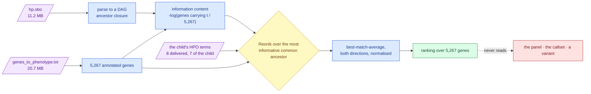

# 067 — Ranking every gene by the child's symptoms, without a JVM


**Numbering:** filed as 056 on 2026-09-03; renumbered 067 on 2026-09-04 because step-0 already held a 056. Content unchanged.
**Verified:** 2026-09-03, against HPO release `hp/releases/2026-06-23`.

**On pre-registration, stated plainly.** [`method.md`](../../../method.md) requires a research
entry to carry its hypothesis and refutation condition *written before the run*. This entry
does not, because the first execution was **building and validating the instrument** — the
numbers below are observations produced while checking that the machinery works, not a
pre-registered test that passed. The claims they support are registered afterwards, as
claims, and the confirmatory test is named in §7. Recording that honestly is cheaper than
a result nobody can trust.

## 1. Question

[`roadmap.md`](../../../roadmap.md) step 3 and `src/mva/science/steps.py` declare the goal:

> Does an unbiased genome-wide ranking driven by the child's HPO terms agree with the
> panel-first candidate list?

The reason it matters is a bias in everything before it. The current lead — two rare
protein-altering alleles in one gene ([data-findings](../../../../ideation/data-findings.md)
§6.1) — was found by filtering an **eight-gene panel chosen by hand** from what is known
about the disease. That prior is circular: the search found MVA genes because it only
looked at MVA genes. `analysis_funnel.py` says so outright, that no genome-wide ranking
exists here and its table must not imply one.

So: rank genes from the symptoms alone, never showing the ranker the panel, the callset, or
a variant, and see where the panel's genes land.

## 2. Why not Exomiser itself

Exomiser is the standard tool for this and it is a Java application. Measured, not assumed
— read from the release archives over HTTP range requests, without downloading them:

| Artifact | Format | Verdict |
|---|---|---|
| `2402_hg38_variants.mv.db`, 31.5 GB unpacked | H2 2.x MVStore, storage format 3 | **Java-only.** No PyPI MVStore reader exists; `jaydebeapi`+`jpype1` start a JVM |
| `*_transcripts_*.ser` | Java `ObjectOutputStream` | **Java-only** |
| `hp.obo`, `genes_to_phenotype.txt`, `phenix/out/{1..20}.out` | plain text | **Python-readable today** |

Two further facts settle it independently of the language: `2402_hg38.zip` is 23.2 GB
compressed, and this machine has 20 GB free.

**The finding that makes a reimplementation viable.** Genome Medicine vol 17 art 127 (2025), PMID
41121346 — the Exomiser optimisation study — measures hiPHIVE configurations on the UDN
cohort:

| Configuration | Top-10 |
|---|---|
| No phenotype prioritisation | 40.9% |
| PHIVE (mouse) | 58.1% |
| PhenIX | 62.8% |
| hiPHIVE, all-species default | 66.6% |
| **hiPHIVE, `prioritiser-params=human`** | **82.8%** |

Human-only wins by 16.2 points. The two components that are genuinely hard to reproduce —
the 741 MB STRING protein-interaction random-walk matrix and the mouse and zebrafish models
— are the ones the evidence says to switch off. What is left is a DAG walk and a log.

**Every number in this entry is from a human-only reimplementation of hiPHIVE's phenotype
path. None of it is Exomiser output and none of it may be reported as such.**

## 3. Method



> **Legend** — **purple = raw public input**; **blue = neutral machinery**; **yellow = the
> decision point** where two symptom lists are compared on the graph rather than by text;
> **green = the goal**; **red = what the ranker is deliberately never shown**. The dotted
> arrow is an *absence* of a dependency, and it is the whole basis of the claim.

Scoring, precisely: two terms are alike to the extent that the most specific term they both
descend from is itself rare (Resnik). Two *sets* are compared by taking each term's single
best partner and averaging — best-match-average, the rollup PhenoDigm and therefore hiPHIVE
use. Both directions are computed, because forward alone ignores everything else a gene
does and reverse alone punishes heavily curated genes; the mean is divided by the score the
child's own term set achieves against itself, putting it on 0–1.

## 4. Inputs and commands

```bash
uv run tools/build_phenotype_data.py --top 25
uv run mva-phenotype rank --limit 12 --panel
uv run mva-phenotype gene BUB1B
uv run mva-phenotype delta
uv run mva-phenotype agreement --limit 12
```

| Input | Value |
|---|---|
| Ontology | `https://purl.obolibrary.org/obo/hp.obo`, release `hp/releases/2026-06-23`, 11,222,341 bytes, sha256 `a5092cbd…76b1b` |
| Annotations | `https://purl.obolibrary.org/obo/hp/hpoa/genes_to_phenotype.txt`, 20,732,778 bytes, sha256 `26cb7ee0…1ab3f` |
| Terms | The 8 delivered HPO terms, owned by `src/mva/phenotype/terms.py` |
| Code | `src/mva/phenotype/`, 9 modules; `tools/build_phenotype_data.py` |

## 5. Observed output

**Corpus:** 20,413 terms parsed, 19,836 non-obsolete written; **5,267 annotated genes**.

**A data defect found and handled.** 375 rows of `genes_to_phenotype.txt` carry `-` as the
gene symbol, spanning **7 distinct NCBI gene ids**. Loading them fuses those seven into one
fabricated gene whose curated feature list is the union of all of them — which then scores
against almost any query, because a long enough feature list eventually contains something.
Before the fix that phantom ranked **22nd**. Dropped at parse time.

**Where the eight panel genes landed, out of 5,267 — the ranker never saw the panel:**

| Gene | Panel role | Rank, all 8 terms | Rank, the child's 7 |
|---|---|---|---|
| BUB1B | MVA1 | 14 | **6** |
| DICER1 | rhabdomyosarcoma differential | 13 | **8** |
| TP53 | Li-Fraumeni differential | 23 | **11** |
| CEP57 | MVA2 | 27 | **17** |
| TRIP13 | MVA3 | 45 | **26** |
| CENPE | atypical, case reports | 1,065 | 1,010 |
| SMC5 | candidate | 4,490 | 4,485 |
| CEP192 | candidate | — | not curated in HPO |

**Why BUB1B scored what it did** (`mva-phenotype gene BUB1B`, 112 curated features):

| The child's feature | Matched through | IC |
|---|---|---|
| Rhabdomyosarcoma | Rhabdomyosarcoma (exact) | 5.52 |
| Small for gestational age | Small for gestational age (exact) | 2.85 |
| Premature birth | Abnormality of prenatal development or birth | 1.56 |
| Nephrocalcinosis | Abnormal renal morphology | 1.48 |
| Short stature | Short stature (exact) | 1.27 |
| Failure to thrive | Decreased body weight | 1.14 |
| Skeletal muscle atrophy | Abnormal skeletal muscle morphology | 0.96 |

**The parental-term question, answered.** [`roadmap.md`](../../../roadmap.md) §2b lists as
unresolved whether `HP:0200067` (recurrent spontaneous abortion — a *parental* feature)
belongs in the proband's term set. Every panel gene rises when it is removed:

| Gene | With | Without | Moved |
|---|---|---|---|
| BUB1B | 14 | 6 | **+8** |
| CEP57 | 27 | 17 | +10 |
| DICER1 | 13 | 8 | +5 |
| TP53 | 23 | 11 | +12 |
| TRIP13 | 45 | 26 | +19 |
| CENPE | 1,065 | 1,010 | +55 |
| SMC5 | 4,490 | 4,485 | +5 |

The mechanism is visible in the with-parental list: `HP:0200067` is a rare term (IC 6.08)
and pulls recurrent-miscarriage genes — TOP6BL (2), ANXA5 (4), ENPP1 (10), ABCC6 (12) —
above every panel gene. A term that describes the parents competes with the terms that
describe the child.

**Independent cross-check.** Phen2Gene, a different algorithm on a different knowledge base:

| Service | Result |
|---|---|
| Phen2Gene (`phen2gene.wglab.org`) | 18,882 genes ranked; **BUB1B at 26**, top 0.14% |
| Monarch semsim (`api-v3.monarchinitiative.org`) | 50-row window, renal-dominated; BUB1B not returned |

Monarch's `/search` caps at 50 and its window here is driven by nephrocalcinosis, so it
neither confirms nor contradicts BUB1B — a gene it did not return has not been ranked last.
Its `multicompare` sibling, which would take our own candidate list, answers 500 when given
object sets without their own phenotype lists.

## 6. Conclusions

Stated as observations. The register owns verdicts.

1. **The panel-first candidate gene survives a scorer that never saw the panel.** BUB1B is
   6th of 5,267 on the child's own seven features, and 26th of 18,882 on an unrelated
   method. The candidate list is no longer only corroborated by the prior that produced it.
2. **The ranking independently reconstructs the panel's own confidence ordering.** The five
   genes the panel file annotates as established (MVA1, MVA2, MVA3 and the two
   rhabdomyosarcoma differentials) all land in the top 26; the two it labels "case reports"
   and "candidate" fall to 1,010 and 4,485. That ordering was never given to the ranker.
3. **The parental term should be excluded from the proband's term set**, and the cost of
   including it is measured: BUB1B falls 8 places. Both sets are kept and both are reported.
4. **Phenotype ranking is not blocked by annotation.** It needs no callset, so it ran
   before roadmap steps 1 and 2 rather than after them. The sequencing argument in
   `roadmap.md` assumed a dependency that does not exist.
5. **Rhabdomyosarcoma is doing most of the work.** It is the rarest of the child's features
   (IC 5.52) and drives the top of the list. The renal and growth terms are individually
   weak, which is why a gene matching only nephrocalcinosis (SLC12A1, BSND, KCNJ1) still
   reaches the top 20 — a limitation of a 7-term query, not a finding about the child.

## 7. Limitations, and the confirmatory test

- **This is not Exomiser**, and not full hiPHIVE: no mouse, no zebrafish, no
  protein-interaction random walk. Those are excluded on the published evidence that
  human-only scores better, but "better on the UDN cohort" is not "better here".
- **The run is not pre-registered**, per the note at the top. What it establishes is that
  the instrument works and what it says; the claim it supports is registered separately.
- **A gene absent from HPO curation is unranked, not ranked last.** CEP192 has no curated
  features, which is missing knowledge and not evidence against it.
- **Rank is not a diagnosis.** The ranking is over genes; it says nothing about which
  alleles are broken, and it must not be fused into per-variant evidence.
- **The confirmatory test still to run:** join this ranking to the callset's rare
  protein-altering alleles and check whether the top-ranked genes carrying a compound-het
  candidate pair are the same ones the panel-first route produced. That test can refute
  the corroboration in a way re-running a deterministic ranking cannot.

## 7b. Provenance and lineage

Added 2026-09-03, after the first execution. Every number above is now traceable to the
bytes and the code that produced it.

### The manifest

`tools/build_phenotype_data.py` writes `ressources/reference/hpo_provenance.json` beside
the tables it produces: both upstream URLs, the release, a **streamed SHA-256 per input**,
byte counts, the term and gene counts, the output row counts, the build timestamp, the
`git` short commit of the code that computed the scores, the licence, and an explicit
statement that no patient data is an input.

**Why a manifest rather than a literal in the lineage spec.** gnomAD and ClinVar are
fetched from versioned URLs whose content is fixed for a release, so a hard-coded digest
stays true. HPO publishes monthly and its PURLs always serve the **current** release — so a
literal release and digest in `warehouse/reference.py` would silently become a lie the
first time anyone re-ran the builder, while still reading like provenance. The spec is
therefore *derived* from the manifest the same run produced
(`reference._hpo_lineage`), which makes that failure impossible rather than merely
unlikely. Pinned by `TestHpoProvenance` in `tests/test_warehouse_reference.py`.

The `hpo_gene_scores` `source_version` folds in **both** input digests, because a score is
a function of the ontology *and* the annotation corpus, and disagreeing on either
invalidates the table.

### The edges, live in the warehouse

```bash
uv run mva-warehouse stage
uv run mva-warehouse pg-ingest --tables hpo_term_ic hpo_gene_scores
uv run mva-warehouse lineage-list --current
```

`--tables` scopes the ingest to the two new tables, so nothing already in the schema is
replaced. Observed output — two rows appended to `warehouse.data_lineage`:

| target | rows | source | version | sha256 | tool |
|---|---|---|---|---|---|
| `warehouse.hpo_gene_scores` | 10,520 | `ressources/reference/hpo_gene_scores.tsv` | HPO release `hp/releases/2026-06-23` | `26cb7ee00c73…` | `mva-warehouse pg-ingest` |
| `warehouse.hpo_term_ic` | 19,836 | `ressources/reference/hpo_term_ic.tsv` | HPO release `hp/releases/2026-06-23` | `a5092cbdf605…` | `mva-warehouse pg-ingest` |

### Transfer cross-check

Row counts landed exactly as written (10,520 and 19,836), and a value check against the
live table agrees with the committed file — two different tools reading the same bytes:

```
uv run mva-warehouse pg-query "SELECT term_set, gene_symbol, rank, round(score,6) AS score,
  genes_considered FROM pg.warehouse.hpo_gene_scores WHERE gene_symbol='BUB1B'"

proband-only   BUB1B  6   0.454802  5267
with-parental  BUB1B  14  0.36093   5267
```

### What is deliberately *not* recorded

- **No integrity fingerprint.** `mva.warehouse.integrity` is the VCF path's tool, invoked
  by `vcf-verify` for a SHA-256 round trip. Reference tables are committed text under git,
  which already answers "did these bytes change", and gnomAD, ClinVar and `qc_norms` carry
  none either. Adding one here would be inconsistent, not safer.
- **No `source_files` ledger row.** That ledger records uploads into the delivery bucket.
  These are public files fetched from the internet into gitignored scratch, never uploaded,
  and they are not part of the delivery.

### A pre-existing gap found while doing this

`clinvar_panel` carries **no `source_sha256`** — it names a ClinVar release but does not
identify the bytes. It is left empty rather than filled in: the 193 MB VCF still in
`build/reference-scratch/` cannot be shown to be the same download that produced the
committed extract on 2026-08-31, and a digest that might name different bytes is a false
receipt, which is worse than an absent one. `qc_norms` legitimately has none — it is
hand-curated with no upstream file. A test now asserts that any digest which *is* declared
is a whole 64-character hex string, and that every table added under this rule carries one.

## 8. What this unblocks

`mva.phenotype.prior.gene_prior()` turns the ranking into the `gene_prior` dict
`mva.pipeline.ranking.rank_pairs` already accepts. Until now nothing supplied one in
production, and `mva.science.dossier` correctly recorded any hand-set prior as **neutral
evidence of strength zero** — "a stated assumption, not the data alone". A prior derived
from 5,267 measured comparisons is a different object, and the dossier line for it becomes
a citation rather than a disclosure.

Nothing in `mva.pipeline` was changed to make that work.
