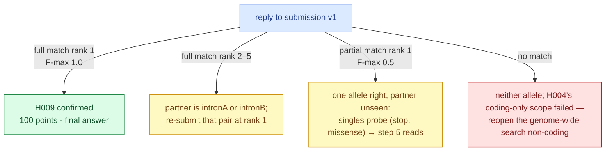

# 074 — Submission v1: the pair at rank 1, every other row a question

**Step:** step-6   **Hypotheses tested:** H009 (moved to `testing`; the oracle settles it)
**Written:** 2026-09-05. **Nothing was uploaded** — `probe-budget` still reads 0 of 6.

## Question

Given a supported candidate pair, what should the ten rows of the first upload hold so that
(a) if the pair is right the upload already scores the maximum, and (b) if it is wrong the
reply says as much as possible about *how* it is wrong?

## Hypothesis and prediction — written before the run

**H009:** the causal pair is the BUB1B stop_gained (ClinVar pathogenic, MVA syndrome 1)
with the gnomAD-absent BUB1B missense, in trans. Predicted reply for a rank-1 row holding
exactly those two alleles: `full_match_rank = 1`, `rank_points = 100`, `f_max = 1.0`.

## What would refute it

No full match for that row. A partial match at rank 1 means exactly one of the two alleles
is causal; no match at all means neither is.

## Method — the submission as a measurement

The scorer returns `full_match_rank`, `partial_match_rank`, `f_max` and its threshold. Read
against an explicit **hypothesis space** — every answer key still considered possible —
those four numbers are a measurement, not a score. `mva.pipeline.probe_design` simulates
the reply for each key with the local scorer replica, groups keys by the reply they
produce (the **decode table**), and reports the expected information gain in bits.

Two facts the designer surfaced while the layout was being chosen, both verified by tests
in `tests/test_probe_design.py`:

1. **Singles below the pair are nearly useless.** A single allele ranked under the pair
   changes the reply only if it *is* the true partner, and even then it cannot say which
   member of the pair it partners (`test_singles_below_the_pair_name_the_partner_but_not_which_member_it_joins`).
2. **Alternative pair rows decode directly.** A row `(A, C)` at rank *r* produces
   `full_match_rank = r` if and only if `{A, C}` is the key — unambiguous, and it earns
   50 or 25 points instead of the 10 a late row would. So ranks 2–5 hold pairs, not singles.

The residual ambiguity is structural: if the key is `{stop, X}` with *X* absent from the
callset, no row below the pair can tell it from `{missense, X}`. That reply (partial at
rank 1, F-max 0.5) is the trigger for step 5 (reads) and for a follow-up singles probe
with the two alleles at ranks 1 and 2.



> **Legend** — **green = the goal** (the pair confirmed); **yellow = a decision point** (a
> reply that names the next probe); **red = lost** (the coding-only scope was wrong);
> **blue = machinery**.

## Inputs

| Input | Value |
|---|---|
| Candidate alleles | the two BUB1B alleles of H003/H004; the two rare intronic BUB1B alleles as the only in-callset alternative partners (`results.panel_candidates`, `is_rare_recessive`) |
| Partner plausibility | Ensembl VEP REST with `SpliceAI=1 AlphaMissense=1 CADD=1`: missense AlphaMissense 0.92 (likely pathogenic), CADD 24.5; both intronic alleles SpliceAI 0.00 on every delta |
| Secondary findings | `results.coding_candidates` where `is_clinvar_plp` and gnomAD AF < 0.02: heterozygous LoF in LZTR1 (dominant schwannomatosis predisposition), Factor V Leiden (F5, low-penetrance risk), heterozygous LoF in FLG (semi-dominant ichthyosis). Recessive carrier states (GNRHR, CIAO1, ZFYVE26) are noted in the report, not submitted |
| Priors | 0.70 pair · 0.12 stop+unseen · 0.05 missense+unseen · 0.05 other gene · 0.08 across the four intronic pairings — stated, not fitted |
| Spec | `build/submission/spec.json` (gitignored: holds coordinates) |

## Commands

```bash
uv run python tools/design_submission.py --spec build/submission/spec.json \
    --out build/submission/track1_submission_v1.csv --decode-md build/submission/decode_v1.md
uv run python tools/render_track1_figures.py          # decode table as a figure
uv run mva-science evidence-add --hypothesis H009 ...  # rows 19–26
uv run mva-science hypothesis-revise H009 --status testing --reasoning '...'
uv run mva-warehouse probe-budget                      # 0/6 spent, 6 remaining
```

## Observed

```
wrote build/submission/track1_submission_v1.csv  (8 rows, LF)
sha256 fbc9e750dea5ebee1da0465e47e6cb20fe53e51e9961a7320fff0750ada92e6a
```

Layout (labels only; the file holds the coordinates):

| rank | epcr | type | row |
|---|---|---|---|
| 1 | 0.95 | primary | **BUB1B stop_gained + BUB1B missense** — H009 |
| 2 | 0.30 | primary | stop_gained + intronic allele A (gnomAD-absent) |
| 3 | 0.29 | primary | missense + intronic allele A |
| 4 | 0.20 | primary | stop_gained + intronic allele B (rare, ClinVar VUS) |
| 5 | 0.19 | primary | missense + intronic allele B |
| 6 | 0.05 | secondary | LZTR1 heterozygous stop_gained, ClinVar P/LP, gnomAD 1.4e-6 |
| 7 | 0.04 | secondary | F5 Factor V Leiden, heterozygous |
| 8 | 0.03 | secondary | FLG heterozygous stop_gained, ClinVar P |

Rehearsal — the written bytes re-read as the scorer reads them, graded against every key:

| key | rank points | F-max | full match rank | partial match rank |
|---|---|---|---|---|
| stop+missense | **100** | **1.000** | 1 | — |
| stop+intronA | 50 | 0.800 | 2 | — |
| missense+intronA | 50 | 0.800 | 3 | — |
| stop+intronB | 25 | 0.667 | 4 | — |
| missense+intronB | 25 | 0.667 | 5 | — |
| stop+unseen | 50 | 0.500 | — | 1 |
| missense+unseen | 50 | 0.500 | — | 1 |
| neither | 0 | 0.000 | — | — |

Decode table (`figures/track1/track1-decode-table.png`): 7 distinguishable replies over 8
keys; prior entropy 1.603 bits, expected posterior 0.149 bits, **expected information gain
1.455 bits**; the only ambiguity is the pair `{stop+unseen, missense+unseen}` at mass 0.17.
Template conformance: header byte-identical to `track1_submission_template.csv`, `chr`
prefix added by `Variant.from_vcf`, distinct descending epcr, ≤ 10 rows, LF line endings
(the deliberate difference from the CRLF template, [046](../../../step-0/methodology/046-probe-builder.md)).

## Evidence recorded

```
evidence 19  H009 supports 0.6  measurement  methodology/070      — the only surviving biallelic set genome-wide
evidence 20  H009 supports 0.6  annotation   ClinVar:VCV000533901 — P/LP, multiple submitters, MVA1; exon 17/23
evidence 21  H009 supports 0.5  annotation   methodology/074      — missense: gnomAD-absent, kinase domain, AlphaMissense 0.92, CADD 24.5; SpliceAI 0 for the intronic alternatives
evidence 22  H009 supports 0.5  literature   PMID:15475955        — Hanks 2004: biallelic BUB1B, truncating + missense
evidence 23  H009 supports 0.3  literature   PMID:20516114        — Suijkerbuijk 2010: hypomorphic missense, reduced BUBR1
evidence 24  H009 supports 0.3  literature   PMID:31184400        — rhabdomyosarcoma in BUB1B-MVA
evidence 25  H009 neutral  0.0  absence      methodology/074      — phase unresolved
evidence 26  H009 neutral  0.0  absence      methodology/037      — no bulk mosaicism signal; below detection floor
```

## Verdict

**Not committed.** `mva-science verdict H009` suggests 1.00 from six supporting rows — the
heuristic saturates, and these rows are not independent (all describe the same two
alleles). Committing a confidence from them would be asserting what the oracle exists to
measure. H009 is at **revision 2, `testing`**: designed, rehearsed, not uploaded.

## Next test

The upload itself, when the user opens step 6. Gate status:

| Gate | Status |
|---|---|
| (a) callset normalized | candidate-level: both alleles are SNVs at bi-allelic sites ([073](../../step-1/methodology/073-normalization-of-the-candidates.md)); genome-wide `bcftools norm` see 073 |
| (b) hypotheses filed with prediction and refutation | H003–H009 filed; H009 the submission claim |
| (c) CSV rehearsed byte-for-byte on the replica | done, above |
| (d) ≥ 2 independent methods agree | panel VEP filter, ClinVar site-first join, genome-wide coding scan, phenotype ranking — four |

After the reply: `probe-log --type F` (or `S` if read as a probe), then `probe-link` to
H009 with the reply as `kind=oracle` evidence, then the decode-table row that matched names
the next step.
