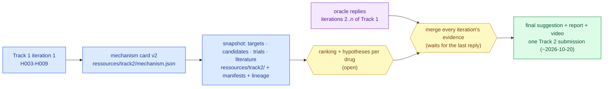

# Step 8 — Track 2, drug repurposing

**Standing:** opened 2026-09-06 — the mechanism hand-off is written
([`mechanism.md`](mechanism.md), [`ressources/track2/mechanism.json`](../../../ressources/track2/mechanism.json)),
H010 and H011 are pre-registered, and the case-agnostic data layer `mva.drugs` gathers targets,
candidates, trials and literature from public APIs (first run: [078](methodology/078-track2-data-layer.md)).
Verdicts and the ranking still wait on step 6 — the mechanism rests on an *inferred* trans pair.
Method: [`../../method.md`](../../method.md).

---

## The goal

> **Which market-approved drugs act on the mechanism the confirmed alleles imply, and how
> strong is the evidence for each?**

## Why it matters

- Track 2 is a separate scored deliverable, not a footnote to Track 1.
- It is the only part of the work that reaches the child: a repurposed drug is one already
  approved and therefore available.
- The mechanism argument is the product. A drug named without a cited path from the allele
  to its target is worth nothing.
- **Timing:** desk research opens in **week 2**, in parallel with steps 1–7. Ranking and
  verdicts wait until step 6 confirms the pair — a mechanism argued from an unconfirmed
  allele is a guess dressed as rigour.

## Already done

- **The hand-off from Track 1**: [`mechanism.md`](mechanism.md) answers Q15 (loss- vs
  gain-of-function, pathway, downstream consequence) from the iteration-1 record; its
  structured twin `ressources/track2/mechanism.json` (version 1) is what the tooling reads —
  coordinate-free, four repurposing directions with seed targets.
- **Claims filed before any search ran**: H010 (hypomorphic loss of function, no
  gain-of-function component) and H011 (no approved drug acts directly on BubR1; candidates
  come from pathway neighbours and stress/proteostasis/tumour-context directions).
- **The data layer** `src/mva/drugs/` — one adapter per public source (Open Targets, ChEMBL,
  DGIdb, Reactome, ClinicalTrials.gov, PubMed, openFDA), cached, every output with a
  provenance manifest; `mva-drugs snapshot` writes `ressources/track2/*.tsv`. First run and
  its counts: [078](methodology/078-track2-data-layer.md).

## Remaining

- **Mechanism characterisation, structured along methods-form Q14:** loss- versus
  gain-of-function, the pathway, and the downstream consequence. Here: spindle-assembly
  checkpoint weakening → chromosome missegregation → aneuploidy → proteotoxic stress and
  tumorigenesis.
- Directions named in the brief, none yet investigated: agents that reinforce the
  checkpoint; aneuploidy-selective stressors exploiting proteotoxic and metabolic stress;
  proteostasis strategies if the allele is a hypomorph (partly working, not dead); a
  cancer-prevention framing for the child's actual malignancy.
- **Sources**, per the form: **DrugBank, ChEMBL, ClinicalTrials.gov, OMIM, PubMed**.
  **Market-approved drugs only.** LLM-assisted search is explicitly legitimate.
- Every candidate registered as a hypothesis with its refutation condition before it is argued.

## Strategy — how Track 2 reaches its final suggestion

> **Legend** — **purple = raw input** (the oracle's replies); **blue = machinery** (what exists
> today); **yellow = a decision point** (ranking; the merge); **green = the goal**.

- Each Track 1 iteration is **linked** to Track 2 through the hypotheses the card cites: today
  iteration 1 (H003–H009). The dashboard's `/track2` page lists the linked iterations.
- Every new oracle reply revises the card (new version, `history` entry), never edits it; the
  snapshot is re-run and its lineage edges name the card version.
- **The final suggestion is produced once, after every Track 1 iteration is done**: all
  iterations' evidence and the register are merged, the ranking re-run on the confirmed pair,
  and the report written from that merged state. Until then `/track2` is a report *in
  progress*: evidence and strategy, no verdict on any drug.
- Lineage and catalog: each `ressources/track2/*.tsv` has a provenance manifest and
  `data_lineage` edges (`target_schema = track2`: card, API hosts, `track1/iteration-1`,
  and the target set); the API's catalog block documents every column in plain English.

## Deliverables

| | |
|---|---|
| Report | the written submission, structured along methods-form Q14 |
| Code | a public repository, code only — no data slices |
| Video | 3 minutes |
| Submission | one submitter for the team |

## Exit criterion

A ranked candidate list where every drug carries a cited mechanistic link to the confirmed
alleles, and each verdict is registered.

## Report artifact

The drug × mechanism evidence table, and a pathway diagram from the allele to each
intervention point.

## Tooling this step may need

A case-agnostic drug-source fetcher — one adapter per source — and the evidence-table
renderer. Recorded in this step's methodology.

## The record

| | |
|---|---|
| Hypotheses | none recorded yet — [`hypotheses/`](hypotheses/), written by `mva-science export` |
| Tests | none run under this step — entries land in [`methodology/`](methodology/), numbered from 069 |
| Rendered | `figures/science-report.html` |
