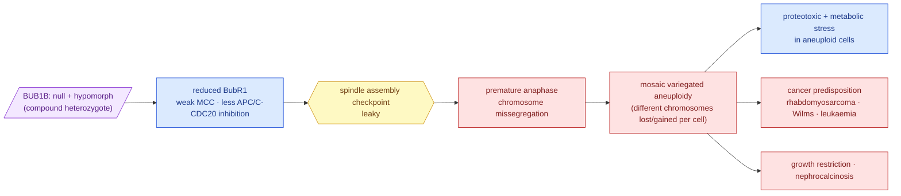

# Mechanism — the Track 1 → Track 2 hand-off

**Standing:** written 2026-09-06 from the iteration-1 record; the structured twin is
[`ressources/track2/mechanism.json`](../../../ressources/track2/mechanism.json) (version 1),
which the Track 2 tooling reads. Coordinate-free by rule. The trans configuration of the
pair is **inferred, not confirmed** — H009 is `testing` until the oracle replies; every
sentence below that depends on it says so.

This page answers methods-form **Q15** for Track 2 (*how did you characterize the variant's
mechanism: loss- vs gain-of-function, pathway disrupted, downstream consequence*), in that
order, and ends with the repurposing directions the tooling searches.

## 1. Loss- or gain-of-function?

**Loss of function, hypomorphic.** The proband carries two different damaged copies of
**BUB1B** (a compound heterozygote — one copy from each parent):

| allele | what it does to the protein | evidence |
|---|---|---|
| `stop_gained`, exon 17 of 23 | a **null** allele: the protein stops early, upstream of the C-terminal kinase domain | ClinVar VCV000533901, pathogenic/likely pathogenic for MVA1 ([070](../step-2/methodology/070-genome-wide-annotation-and-verdict.md), [074](../step-6/methodology/074-submission-v1-design.md)) |
| `missense_variant`, exon 23 of 23 | a **hypomorph** (a partly working copy): one amino acid swapped inside the kinase domain (CDD cd14029); never seen in gnomAD; AlphaMissense 0.92, CADD 24.5 | [074](../step-6/methodology/074-submission-v1-design.md) |

Complete loss of BubR1 is embryonic-lethal (mouse and human), so an MVA1 genotype is
always *null + hypomorph* or *hypomorph + hypomorph* — Hanks 2004 (PMID 15475955),
Suijkerbuijk 2010 (PMID 20516114). This genotype has exactly that shape. Nothing here is
a gain of function: no dominant-negative or neomorphic activity is reported for BUB1B.

## 2. Pathway disrupted

**The spindle assembly checkpoint (SAC)** — the mechanism that holds a dividing cell in
metaphase until every chromosome is attached to the spindle. BubR1 is a core component of
the **mitotic checkpoint complex (MCC)**, which inhibits **APC/C–CDC20** and thereby
anaphase; it also recruits PP2A-B56 to kinetochores to stabilise correct attachments.
Less BubR1 (Suijkerbuijk 2010 measured strongly reduced protein in MVA cells) means a
**leaky checkpoint**: anaphase can start with unattached chromosomes.

> **Legend** — **purple = the raw input** (the genotype Track 1 found); **blue = machinery**
> (the molecular consequence); **yellow = the decision point** (the checkpoint, which is
> where a drug could act); **red = what goes wrong** downstream — each red box is a
> possible intervention target in its own right.

## 3. Downstream consequence

1. **Premature anaphase → chromosome missegregation** (the immediate cellular event).
2. **Mosaic variegated aneuploidy**: different cells lose or gain different whole
   chromosomes — the disease's name and its karyotype.
3. **Aneuploidy stress**: cells with the wrong chromosome count carry proteotoxic and
   energy stress and are selectively vulnerable to agents that add to it — the published
   basis for aneuploidy-selective killing.
4. **Cancer predisposition**: rhabdomyosarcoma (the proband's presenting tumour,
   PMID 31184400), Wilms tumour, leukaemia.
5. **Growth restriction** (short stature, failure to thrive, intrauterine growth
   restriction) and **nephrocalcinosis** — the clinical terms delivered with the case.

## 4. What this implies for repurposing

Four directions, each a list of *seed targets* the tooling expands through Reactome and
queries in Open Targets, ChEMBL and DGIdb (market-approved drugs only):

| id | direction | why |
|---|---|---|
| D1 | **reinforce the checkpoint / reduce chromosomal instability** | compensate for weak BubR1 signalling: agents that prolong mitotic arrest or stabilise kinetochore–microtubule attachments |
| D2 | **exploit aneuploidy stress** | aneuploid cells are selectively vulnerable to energy stress (AICAR class), autophagy stress (chloroquine class) and chaperone stress (HSP90/HSF1 axis) |
| D3 | **stabilise a hypomorph** | a partly working protein can be stabilised or its turnover slowed — BubR1 acetylation controls its stability; deacetylase and chaperone routes |
| D4 | **prevent the tumour the child actually gets** | rhabdomyosarcoma chemoprevention / surveillance rationale in aneuploidy-driven tumours |

Every candidate that comes out of the search is filed as a hypothesis with a prediction
and a refutation condition **before** it is argued in the report ([`method.md`](../../method.md)).

## Assumptions, limitations, validation

- **Assumption:** the two alleles are in *trans*. Inferred from the recessive model and the
  absence of any other BUB1B candidate; not read from reads or parents. Tested by the oracle.
- **Assumption:** the missense allele is a hypomorph, not a null. Supported by its position
  (last exon, kinase domain — a truncation there would escape nonsense-mediated decay) and
  by the MVA1 literature; no functional assay exists for this allele.
- **Limitation:** bulk blood WGS cannot measure the aneuploid fraction ([037](../../step-0/methodology/037-baf-karyogram.md)); the mechanism's cellular consequence is taken from the literature, not measured in this child.
- **Validation:** the gene, the two consequence classes and the ClinVar classification were
  reached by four independent instruments ([report §1](../../../submissions/track1/iteration-1/report.md)).
