# Iteration 2 — execution map: adopt, reuse, build, show

**Standing:** written 2026-09-10 as the companion of [`plan.md`](plan.md). The plan says *what*
each step asks and *how it would be refuted*; this page says *with which tools*, *which of them
already exist in `src/mva/` and `app/`*, *which must be written*, and *what the dashboard shows
for each step*. Nothing here has run. Tool versions, container digests and licences are pinned
in the methodology entry that first installs each tool, never here. The platform inventory it
builds on is [`../toolset.md`](../toolset.md) (verified 2026-09-05); the dashboard map below was
re-read from `app/src/app/modules/index.ts` and `app/src/api/hooks.ts` on 2026-09-10.

Written for a software engineer: `technical term (plain meaning)` on first use; the dictionary is
[`../dictionary.md`](../dictionary.md).

---

## 1. Three verbs, one rule

Every tool need in the plan falls into one of three verbs, and the rule for choosing is fixed:

| Verb | Meaning | When |
|---|---|---|
| **Adopt** | run a published, peer-reviewed tool as a black box behind a thin adapter | the method has a paper, a maintained release and a benchmark; we are not the experts |
| **Reuse** | call something already in `src/mva/` or `app/` | it exists, is tested, and the plan's step is a new caller of it |
| **Build** | write a new module | the plan's idea has no published implementation (the k-mer bait, the pair LR, the decoy null, the blind gate), or the published one is dead (MAD-seq) |

Adopted tools never touch the warehouse directly: each gets an **adapter** (a subprocess wrapper
that pins the version, writes a provenance manifest and parses the output into a `results.it2_*`
table through the existing `Derivation` registry). That keeps the case-agnostic promise: swap
the caller, keep the table.

```mermaid
flowchart LR
  subgraph raw["raw inputs"]
    H[/"8 HPO terms"/]:::raw
    R[/"FASTQ · Parquet read store"/]:::raw
    V[/"VCF · layer 1"/]:::raw
  end
  subgraph adopt["ADOPT — published tools"]
    A1["Phen2Gene · STRING · Exomiser/LIRICAL (ref)"]:::machine
    A2["minimap2 · DeepVariant · Manta/Delly/LUMPY/GRIDSS · Truvari · mosdepth · WhatsHap/HapCUT2"]:::machine
    A3["KMC 3 / Jellyfish · GenomeTester4 · GeneToCN scripts"]:::machine
    A4["AlphaMissense · SpliceAI · gnomAD chets · Pejaver table"]:::machine
    A5["PubTator 3 · LitVar 2 · ESM1b · InterPro/AlphaFold DB"]:::machine
    A7["Open Targets · ChEMBL · DGIdb · LINCS/cmapPy · ClinicalTrials.gov"]:::machine
  end
  subgraph reuse["REUSE — src/mva today"]
    U1["phenotype.prioritise · similarity · prior · remote"]:::good
    U2["reads.scan (strike) · reads.api jobs"]:::good
    U3["warehouse.Derivation · lineage · annotate_coding"]:::good
    U4["pipeline.compound_het · ranking · probe_design"]:::good
    U5["science registers · steps · check"]:::good
    U6["drugs.* · render.* · viz routers · app Exhibit/Plot"]:::good
  end
  subgraph build["BUILD — new modules"]
    B1["phenotype.benchmark · network · targets (+ decoy)"]:::decide
    B2["reads.bait · calling/* adapters"]:::decide
    B3["kmer/* (probes, NB genotype, CN, dosage)"]:::decide
    B4["pipeline.likelihood · ptrans · nulls · fusion"]:::decide
    B5["knowledge/* · mosaic/* · science blind gate"]:::decide
  end
  H --> U1 --> B1
  R --> U2 --> B2 --> A2
  R --> B3 --> A3
  V --> U3 --> B4 --> A4
  A1 --> B1
  A5 --> B5
  A7 --> U6
  B1 & B2 & B3 & B4 & B5 --> U5
  U5 --> APP["dashboard: /steps · /genome · /phenotype · /science · /learn"]:::good
  classDef raw fill:#f3e8ff,stroke:#7e22ce,color:#581c87
  classDef machine fill:#dbeafe,stroke:#1d4ed8,color:#1e3a8a
  classDef decide fill:#fef9c3,stroke:#ca8a04,color:#713f12
  classDef good fill:#dcfce7,stroke:#15803d,color:#14532d
```

> **Legend** — **purple = raw input**; **blue = adopted external tool** (black box behind an
> adapter); **green = existing code reused** and the dashboard it feeds; **yellow = the modules
> this iteration must write** (each a decision about where the logic lives). Arrows are data
> flow, left to right.

---

## 2. Where things run

| Stage | Machine | Why |
|---|---|---|
| Ranking, SQL, likelihood fits, figures, dashboard | laptop (arm64, 16 GiB) | pure Python + Postgres client; everything in `src/mva/` today runs here |
| k-mer strike over the read store, KMC/Jellyfish counts, GenomeTester4 | Linux server (holds the Parquet read store) | I/O-bound; the tools are Linux-only ([plan §3 step 2, feasibility](plan.md)) |
| minimap2, DeepVariant, SV callers, mosdepth, phasers | Linux server or a cloud VM with **Apptainer/Singularity** (rootless containers; no Docker on either machine assumed) | amd64 container images; a recovered read set of millions of pairs, not a billion |
| Exomiser + LIRICAL reference run | cloud VM, ~1 h | 23 GB data bundle exceeded local disk (067) |
| LLM tournament, ESM1b scoring | laptop (API) / server GPU-less CPU for ESM1b 650 M (slow but feasible per residue set) | ESM1b only scores the handful of top-pair missense residues |

Raw FASTQ never leaves the delivery bucket; the recovered read subset moves between our machines
only; no patient read or k-mer is committed (`tools/check_coordinates.py` gains the candidate
31-mers, [plan §5](plan.md)).

---

## 3. Step by step — adopt, reuse, build, show

Each block: the adopted tools (with licence class and the reason), the existing code the step
calls, the modules to write (package placement obeys [`../../src/mva/README.md`](../../src/mva/README.md)
layering; ≤ 400 lines each), and the dashboard exhibits. "Show" rows are the plan's *report
artifacts* made concrete as app exhibits; §4 explains the shared plumbing they all use.

### Step 1 — blind target set

| Verb | What | Notes |
|---|---|---|
| Adopt | **HPO** release files (`hp.obo`, `phenotype.hpoa`, `genes_to_phenotype.txt`) | already fetched by `tools/build_phenotype_data.py`; re-pin the release date |
| Adopt | **Phen2Gene** (Zhao 2020; Python, knowledge base download) | second ranker; run locally, record KB version. Licence: check at install |
| Adopt | **STRING** REST API (network proximity for the `uncurated` tier) | small: neighbours of the top-50 only; CC BY 4.0 |
| Adopt | **Exomiser / LIRICAL** on the cloud VM | reference points for H022; AGPL-3 / check |
| Reuse | `mva.phenotype.prioritise.rank_genes`, `.delta`; `similarity.compare`; `prior.gene_prior`; `remote` (hosted-ranker agreement); `mva-phenotype rank / delta / agreement` | the 067 ranker is the primary instrument |
| Build | `mva.phenotype.benchmark` — held-out recall@N with Zemojtel-style degradation (imprecision + noise), bootstrap intervals; CLI verb `mva-phenotype benchmark` | case-agnostic: takes any term list and the HPO corpus |
| Build | `mva.phenotype.network` — STRING neighbour scoring for zero-annotation genes | its own module so the human-only ranker stays pure |
| Build | `mva.phenotype.targets` — tiering (`core`, `net`, `uncurated`, `mechanism-term`), pure-score rank column, the **matched decoy set** (seeded; length + exon-count matching from the Ensembl gene table) → `results.it2_targets`, `results.it2_decoys` via a new `Derivation` | the decoy generator is reused by steps 2–3 and 7 |
| Build | `mva.pipeline.inheritance` — the small mode-of-inheritance factor (plan §10 B2) read from OMIM inheritance fields | leaf module; consumed by step 4 |
| Show | `/phenotype` gains: recall-at-N curve with N marked (Plot line + band), tier column and pure-score rank in the ranking table, two-ranker overlap (Plot bar of shared/unique), decoy-set card; `/steps/step-1` (see §4) | every exhibit wrapped in `Exhibit` with a legend |

### Step 2 — alleles from the reads

| Verb | What | Notes |
|---|---|---|
| Adopt | **KMC 3** or **Jellyfish 2** (genome-wide k-mer table for bait uniqueness); **BBDuk** as the hashed-membership fallback engine | GPL-3 / GPL-3 / BSD; picked by the scaling test |
| Adopt | **minimap2 `-ax sr`** (MIT) → **samtools** sort/index | index built in minutes; bwa-mem2 only if a prebuilt index is available |
| Adopt | **DeepVariant** (BSD-3, amd64 container) | second small-variant caller, disjoint error model from Sentieon |
| Adopt | **Manta** (GPL-2), **Delly** (BSD-3), **LUMPY/smoove** (MIT), **GRIDSS** (GPL-3) | four callers, two method classes (plan §10 V1) |
| Adopt | **Truvari** (MIT) merge; **mosdepth** (MIT) per-exon depth | defined SV consensus; coverage |
| Adopt | **WhatsHap** (MIT) and **HapCUT2** (BSD) | two phasers must agree |
| Adopt | **igv-reports** (MIT) — standalone HTML snapshots of each candidate locus | "IGV shots" without a desktop IGV; aggregates only, no raw read committed |
| Adopt | **GIAB HG002** reads + SV truth set (Zook 2020) | positive control through the same chain |
| Reuse | `mva.reads.scan.survivors / kmers / counts` (the strike, both strands); `mva.reads.api` async jobs; `mva.pipeline.annotate_vep` + `warehouse.annotate_coding` (VEP port, resumable) for the new alleles; `pipeline.compound_het.candidate_pairs / classify_phase` for pair enumeration; `warehouse.lineage` for every table | the bait pass is one more probe set for the strike |
| Build | `mva.reads.bait` — reference 31-mer bait from Ensembl exons ± tiered padding, uniqueness filter against the genome-wide table, expected-recovery arithmetic printed before the pass, the **scaling test** (10³–10⁶ patterns on the 6 M-read sample) | case-agnostic "give me the reads for these genes" |
| Build | `mva.reads.recover` — write the surviving read pairs back to paired FASTQ for the aligner | the seam between the store and the alignment stage |
| Build | new package **`mva.calling/`** — one adapter per adopted tool (`align.py`, `deepvariant.py`, `sv_callers.py`, `truvari.py`, `coverage.py`, `phase.py`), each: pinned version, manifest, parse to `results.it2_read_alleles`, `it2_sv_calls`, `it2_exon_depth`, `it2_phase_blocks`; a **bait-edge flag** and a **Kosugi type-precision prior** column on every SV | a leaf package (imports `io` only) so the layering check passes |
| Build | `results.it2_read_pairs` derivation (SQL) — biallelic candidates incl. SV/coverage-loss partners; the same SQL over `it2_decoys` for the false-lead rate (H036) | SQL in `warehouse/analysis_it2.py`, registered in `DERIVATIONS` |
| Show | new `/steps/step-2`: read-recovery funnel (reuse `pages/callset/Funnel.tsx` pattern), per-exon coverage heatmap over the target set (reuse `pages/reads/Flowcell.tsx` heatmap pattern), SV table with a **type-precision badge** (`Badge`, green DEL/INS, yellow DUP/INV, grey edge-flagged), DeepVariant-vs-VCF discordance table, **phase-block diagram** per candidate gene (new SVG: exons on a rule, het SNVs as ticks, blocks as bars, the gap in red), igv-reports HTML in `FigureLightbox`; decoy-vs-target false-lead bar | figures also written as PNG to `figures/track1/iteration2/` so the submission dossier lists them |

### Step 3 — alignment-free genotype and copy number

| Verb | What | Notes |
|---|---|---|
| Adopt | **KMC 3 / Jellyfish 2** (uniqueness against GRCh38 + known alt alleles); **GenomeTester4** `glistmaker/glistquery/glistcompare` (GPL-3, Linux) as the second, independent counter | the two-methods rule |
| Adopt | **GeneToCN** `GeneToKmer.py` selection rules and `KmerToCN.py` arithmetic (licence: check the repository before vendoring) | reused as scripts, wrapped |
| Adopt (port) | **FastGT** `genotypes.c` negative-binomial classifier (GPL-3) → Python on `scipy.stats.nbinom` | 126 lines; the port is tested against FastGT's own published simulation numbers |
| Reuse | `mva.reads.scan.counts` (probe and calibration literals in the same strike); `warehouse.Derivation`, `lineage` | one pass, three purposes (bait, probes, dosage) |
| Build | new package **`mva.kmer/`** — `probes.py` (≥ 3 ref/alt k-mer pairs per allele, expanded-reference uniqueness), `genotype.py` (NB fit on 20 k calibration markers, posterior per call, variance-to-mean QC, dropout and false-positive thresholds), `copynumber.py` (local-flank CN, surviving-k-mer count per exon, 1,000-exon null band, depth titration), `dosage.py` (per-chromosome 31-mer dosage for step 8) → `results.it2_kmer_genotypes`, `it2_exon_cn`, `it2_chrom_dosage` | leaf package; k-mer literals stay under `build/` |
| Show | `/steps/step-3`: k-mer count scatter ref vs alt with the calibration cloud and fitted class boundaries (Plot scatter, three tones), variance-to-mean tile (`StatTile`), depth-response curve on downsampled reads, per-gene **exon CN strip** with k-mer count per exon (Plot bar + text), local-vs-genome-wide denominator disagreement map (heatmap) | the scatter is the step's headline figure |

### Step 4 — likelihood-ratio ranking over the VCF

| Verb | What | Notes |
|---|---|---|
| Adopt | **AlphaMissense** predictions (CC BY 4.0, bulk file) — missense lane; **SpliceAI** precomputed scores (Illumina licence — check redistribution; use, do not commit) — splice lane; **LOFTEE** rule set re-implemented from Karczewski 2020 — truncating lane; **Pejaver 2022** Table 2 bin edges (read from the paper) | one calibrated tool per lane |
| Adopt | **gnomAD co-occurrence** (`broadinstitute/gnomad_chets`, Guo 2024) for P(trans); LOEUF from gnomAD constraint (already in `analysis_reference.py`) | licence: check |
| Adopt | **IHW** (Ignatiadis 2016) — R package; run via `rpy2` on the server or re-implement the weighted-BH step in Python with a test against the R output | small; the Python route keeps the laptop dependency-free |
| Adopt | **Exomiser 14 / LIRICAL** on the VM as reference comparators | H022 |
| Reuse | `warehouse.coding_annotations` (platform table, allowed by the blind protocol); `pipeline.ranking.rank_pairs / allele_score` as the **baseline comparator** (Exomiser-style mean of two best scores); `pipeline.compound_het`; `phenotype.prioritise` scores; `analysis_reference.py` gnomAD/constraint | the LR ranker sits beside the old ranker, never replaces it in place |
| Build | `mva.pipeline.likelihood` — lane assignment, Tavtigian/Pejaver ladder, correlation groups (CADD/ClinVar never both at full strength), non-PASS down-weight, inheritance factor; `mva.pipeline.ptrans` — gnomAD lookup with the *undetermined* fallback; `mva.pipeline.nulls` — phenotype permutation (1,000 term sets), genotype-only ranking, **spike-in harness** over the HG002 VCF; `mva.pipeline.pairs_lr` derivation → `results.it2_pair_posteriors` | `pipeline` stays a leaf: it takes rows in, gives rows out; SQL glue lives in `warehouse/analysis_it2.py` |
| Show | `/steps/step-4`: top-20 posterior chart (Plot horizontal bar), the **three-bar LR decomposition** for the top pair (phenotype / genotype / combined — Exomiser Fig. 3 grammar) with same-family evidence shaded as one group, CADD PHRED distribution per consequence class with Pejaver bin edges drawn, permutation-null histogram with the observed value as a red line, spike-in recall curve, P(trans) tile with its *undetermined* state visible | `/compare` gains a "posterior" column beside the iteration-1 candidate table |

### Step 5 — knowledge engine

| Verb | What | Notes |
|---|---|---|
| Adopt | **PubTator 3.0** and **LitVar 2.0** APIs (NCBI, public), **ClinVar** via E-utilities / weekly TSV | allele catalogue; E-utilities already used by the citation check |
| Adopt | **ESM1b** (`facebook/esm1b_t33_650M_UR50S`, MIT, via `huggingface-hub` already a dependency); **InterPro** REST and **AlphaFold DB** API (domain, pLDDT) | zero-shot missense scoring |
| Adopt | **Claude API** for the evidence tournament — model id pinned to the exact dated version, temperature 0, prompts and retrieval context committed under `ressources/track1/tournament/`, every PMID resolved by script | see [`plan §3 step 5`](plan.md) reproducibility contract |
| Reuse | `mva.drugs.sources.pubmed` (E-utilities client, cache, manifest) as the fetch layer; `mva.science.evidence` for every retained judgment (source = PMID) | the same PMID plumbing serves both tracks |
| Build | new package **`mva.knowledge/`** — `catalogue.py` (PubTator + LitVar + ClinVar join to `results.it2_read_alleles`), `anchors.py` (script-derived case-report anchors from OMIM + PubTator, plan §10 B3), `protein.py` (ESM1b LLR + domain map), `tournament.py` (bracket, hashed inputs, κ between runs, PubMed-count and posterior-only baselines) | imports `drugs.sources.pubmed` only if layering allows; else a copy of the small client into `io` |
| Show | `/steps/step-5`: catalogue-overlap table (`DataTable`), phenotype-match ranking with PMIDs as links, **tournament bracket** (new SVG: pairs as nodes, judged matches as edges, each edge labelled with its PMID count), κ tile, baseline-correlation tile | a judgment without a resolvable PMID is not rendered |

### Step 6 — fusion and unblinding

| Verb | What | Notes |
|---|---|---|
| Adopt | **ranx** (Python rank-fusion library, MIT) as the reference implementation to test our RRF against | tiny; keeps the arithmetic honest |
| Reuse | `mva.pipeline.probe_design.design / entropy` for the upload decision (expected information gain); `mva.science` registers and `mva-science verdict`; `tools/design_submission.py` if outcome row 4 fires | nothing new for the oracle |
| Build | `mva.pipeline.fusion` — RRF with k = 60, unit = pair, rank inheritance rule, top-50 per route, leave-one-route-out, error-rate weights, the **route-dependency graph** and **independent-evidence count**; export + hash before the comparison | the hash is written to the entry before unblinding |
| Build | `mva.science` **blind gate** — `mva-science check --blind iteration2` parses each iteration-2 entry's `## Inputs` table and refuses an iteration-1 candidate table before the unblinding entry exists; the blinding checklist is generated from it | recorded under step 1's methodology as the first tool it needed |
| Show | `/steps/step-6`: **agreement matrix** (routes × candidate pairs, Plot heatmap, green = rank 1) — the headline figure; route-dependency graph (reuse the shared lineage SVG component of §4); leave-one-route-out table; blinding checklist rendered from the gate output; the unblinding timestamp and hash as a `FieldList` | the page shows nothing about iteration 1 until the gate says unblinded |

### Step 7 — Track 2 enrichment

| Verb | What | Notes |
|---|---|---|
| Adopt | **LINCS 2020 L1000** level-5 signatures via **cmapPy** (public; clue.io key optional); **ClinicalTrials.gov v2** API (already an adapter); **DrugBank** open-data subset only (the full set needs an academic licence — flag, never scrape); **openFDA** labels (already) | signature reversal and paediatric trials |
| Reuse | everything under `mva.drugs` (`mechanism`, `pathway`, `candidates`, `snapshot`, `provenance`, the seven source adapters); `tools/record_track2_lineage.py`; `/api/track2` and `app/src/pages/track2/*` | the data layer exists; the ranking does not ([toolset gaps](../toolset.md)) |
| Build | `mva.drugs.ladder` — evidence-ladder rung assignment per drug with its citation; `mva.drugs.decoy` — the two decoy mechanism cards through the same pipeline (plan §10 N3); `tools/track2_cmap_query.py`, `tools/track2_esm1b_score.py` (shares `knowledge.protein`), `tools/track2_trials.py` | card v3 as a `history` entry, never an edit |
| Show | `/track2` gains: the drug × mechanism **evidence table** with rung badges (green ≥ 4, yellow 2–3, red 1 = named, never submitted), the **"do not" anti-direction table**, the decoy comparison (BubR1 card vs two decoys, same rungs), a **pathway diagram** from allele to each intervention point (mermaid, committed source), card version history (already rendered) | rigor is 35 % of the Track 2 score; the exhibit is the argument |

### Step 8 — mosaic aneuploidy bound

| Verb | What | Notes |
|---|---|---|
| Adopt (re-implement) | **MAD-seq** five-model comparison from Kong 2018's equations (beta-binomial × negative binomial, BIC, ΔBIC < 10 low-confidence) — the Bioconductor package is gone | Python on `scipy` MLE, checked against the paper's simulation table |
| Adopt | **DANFIP** CDF fit (Markello 2012) — a formula, not a package | fraction estimate on the upper band |
| Reuse | `warehouse.analysis_karyogram.BAF_BINS` (the 037 derivation and its `LOW_CONFIDENCE_N_HET` rule) as the starting SQL; `mva.kmer.dosage` from step 3; `pages/genome/BafKaryogram.tsx` and `Karyotype.tsx` as the rendering pattern | the re-test sits beside the old figure |
| Build | new package **`mva.mosaic/`** — `bdev.py` (fold-over B-deviation, beta-binomial over-dispersion, per-arm), `madseq.py`, `simulate.py` (mixing simulation, 1–3 affected chromosomes, detection limit at 80 % power), `baseline.py` (leave-one-chromosome-out median, absolute k-mer-mass scale) → `results.it2_mosaic_chrom` (autosomes + X) | leaf package |
| Show | `/genome` gains a **step-8 panel** beside the flat karyogram: per-chromosome Bdev distribution (Plot violin), dosage with bootstrap interval (error bars), detection-limit curve, ΔBIC per model as a small-multiples strip; the power argument written under it as an `Explainer`; the mechanism card on `/track2` gains the burden-and-limit row | every "nothing detected" carries its limit on the chart itself |

---

## 4. Dashboard — what changes for every step

The app is a Vite + React SPA with one route manifest (`app/src/app/modules/index.ts`), one
chart wrapper (`components/Plot.tsx` over plotly.js, `components/Exhibit.tsx` mandatory with a
legend), one API client (`api/client.ts`, envelope `{data, cached_at, source}`, fixture fallback),
and one guardrail: every endpoint has a fixture, a `fixtureMatrix.ts` row and a blessed hash.
Today **research steps have no page of their own** — they appear only as rows in the
`/submissions` contributions table and on `/track2`. Iteration 2 fixes that once, for every
iteration:

| Change | Where | Why |
|---|---|---|
| **`/api/steps`** — the step map from `mva.science.steps` (per iteration, with status, goal, hypotheses by step from the register, gate table of plan §4b with measured values, `## Inputs` of each entry for the blind checklist, figures by step from `figures/track1/<iteration>/step-<n>/`) | new `viz/routes_steps.py`; `STEPS_BY_ITERATION` in `science/steps.py` (plan gap P1) | one endpoint, no hand-written prose per step |
| **`/steps` page** — the research journey: a timeline of steps (yellow = running, green = verdict committed, red = refuted, grey = planned), each step a card with goal, its hypotheses and their state, its gate row (pass/fail), its figures, its inputs (both sources named), and a "how this was made" lineage graph | new `pages/Steps.tsx` + `pages/steps/*`; one manifest entry | the *cumulative* view CLAUDE.md asks for; a beginner can read the iteration without opening docs |
| **`/steps/step-<n>`** deep pages — the exhibits listed in §3 | lazy chunks under `pages/steps/step1/…step8/` | each step's report artifact is an interactive exhibit first, a PNG second |
| **One shared lineage graph component** — today the SVG layout is duplicated three times (`provenance/LineageGraph.tsx`, `submissions/LineageView.tsx`, `track2/LineageView.tsx`) | `components/LineageGraph.tsx` + `lib/graphLayout.ts`; the three pages call it | the per-step lineage view and the route-dependency graph of step 6 are the fourth and fifth callers — refactor before adding |
| **Hypotheses by step** filter on `/science` | `pages/science/HypothesisBoard.tsx` already carries the step slug column | one control, no new endpoint |
| **`/genome`** step-8 panel, **`/phenotype`** recall curve and tiers, **`/compare`** posterior column, **`/track2`** evidence ladder | existing pages, new `Exhibit`s | the cross-references the two-sources directive asks for live where the data already is |
| **`/learn`** — the dictionary terms plan §7 lists (k-mer bait, likelihood ratio, posterior, RRF, Bdev, decoy set, evidence ladder, …) with "see it" links to the new exhibits | `docs/dictionary.md` → `tools/gen-dictionary.mjs`; `pages/learn/seeIt.ts` rows | `learn-links.test.tsx` fails the build if an anchor disappears — the exhibits are load-bearing |
| **`/provenance`** — `results.it2_*` tables appear automatically through `warehouse.data_lineage` rows | nothing to write beyond the lineage rows each derivation records | the existing view is the proof of the "complete lineage" rule |
| **Fixtures** — every new endpoint: `fixtures/data/*.json` captured from the live API, a registry entry, a matrix row, a re-blessed hash | `app/src/fixtures/*`, `app/src/test/fixtureHashes.json` | the hosted dashboard must render with the API down |
| **AI export** — new exhibits register themselves through `Exhibit`; the whole-case markdown export then carries iteration 2 | `lib/aiExport/*` | free |

Colour discipline on every new exhibit: green = good / the goal, red = broken / lost, yellow =
a decision point, blue = machinery, purple = raw input; each `Exhibit` carries its legend.

---

## 5. Build order — the spine first

Matches the plan's cut order ([plan §4](plan.md)): the spine is built first, the cuts last.

| Order | Build | Unblocks |
|---|---|---|
| 0 | `STEPS_BY_ITERATION` + `/api/steps` + `/steps` skeleton (cards from the step map, no exhibits yet); `mva-science check --blind`; decoy-set generator | every step has a page from day one; the gate exists before the first entry |
| 1 | `phenotype.benchmark`, `.network`, `.targets`; `/phenotype` exhibits | step 1 |
| 2 | `reads.bait` scaling test → `reads.recover`; `kmer.probes`, `.genotype`, `.dosage`; `pipeline.likelihood`, `.ptrans`, `.nulls` in parallel on the laptop | the single read pass; step 4 |
| 3 | `calling/*` adapters on the server; `kmer.copynumber`; `mosaic/*` | steps 2, 3, 8 |
| 4 | `knowledge.catalogue`, `.anchors`, `.protein`; `pipeline.fusion`; `/steps/step-<n>` exhibits as results land | steps 5, 6 |
| 5 | `drugs.ladder`, `.decoy`, the three Track 2 scripts; `/track2` exhibits | step 7 |
| cuts | `knowledge.tournament`; Exomiser VM; GRIDSS + HG002 control; exon-scale CN; `mosaic.madseq` | in the plan's cut order, each cut recorded as a limitation |

Each module ships with tests, a provenance manifest and a `data_lineage` row; each adopted tool
with an adapter that pins its version and licence. The methodology entry that first needs a
tool records it (CLAUDE.md: tooling is filed under the step that needed it).

---

## 6. What this page does not decide

- Exact tool versions, container digests, licences of the tools marked "check" — pinned in the
  installing entry after `--help` and the repository's LICENSE are read.
- Whether the strike or a hashed k-mer filter carries the bait — the step-2 scaling test decides.
- Whether IHW runs in R or in Python — decided by whether `rpy2` installs cleanly on the server.
- Anything about results. Nothing here has run.
