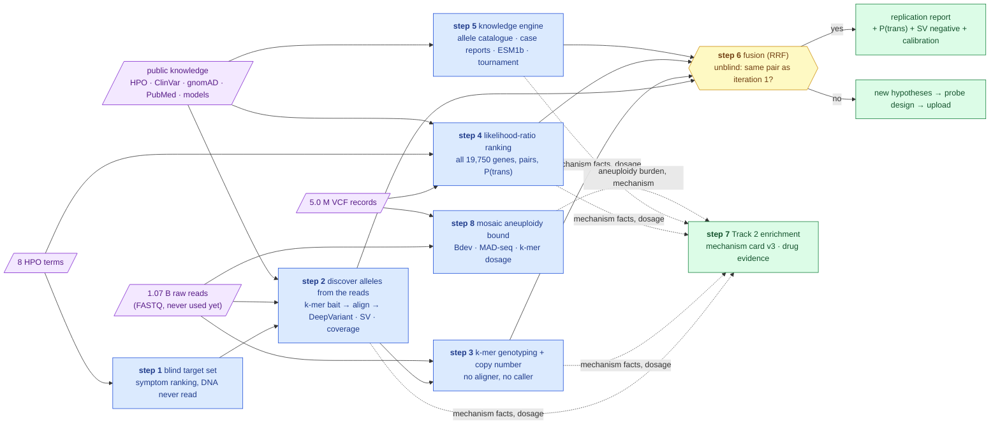

# Iteration 2 — the plan: rediscover the pair blind, by independent means, and feed Track 2 along the way

**Standing:** plan, written 2026-09-09, revised 2026-09-10 (blind protocol) after the oracle
confirmed submission 1
([083](../iteration1/step-6/methodology/083-oracle-reply-submission-1.md)), and revised again
2026-09-10 by the **gap review** of §9, fed by the first five papers read in
[`papers/iteration2/`](../../papers/iteration2/README.md), and a third time the same day by the
**bias and gap review** of §10, fed by the three papers §9 had only cited (Zemojtel 2014,
Kong 2018, Kosugi 2019 — now read) and by a re-read of the clinical document (every correction
names its paper and page there). The tools, reuse and dashboard map for executing it is
[`execution.md`](execution.md). Nothing in this
page is a result; every step below files its hypotheses before it runs and records its runs in
its own `methodology/` (next global number: **084**). Portfolio owner:
[`ideation/solution-paths.md`](../../ideation/solution-paths.md); statistical backing:
[`ideation/statistical-methods-survey.md`](../../ideation/statistical-methods-survey.md);
method: [`../method.md`](../method.md). Citations: §8, PubMed-verified on 2026-09-09.

Written for a software engineer. Domain terms appear as `technical term (plain meaning)` on
first use; the dictionary is [`../dictionary.md`](../dictionary.md).

---

## 1. Why iteration 2 exists, and what it is not

- Submission 1 scored **100 rank points, F-max 1.0, full match at rank 1**. The causal pair —
  BUB1B stop_gained + BUB1B missense, in trans — is confirmed by the only authority there is.
  Nothing left to *find* for Track 1's automated score.
- What is left is the **qualitative tiebreak** (Oct 24 – Nov 24): report quality, reproducible
  code, innovation, scalability ([intel §4](../../ideation/hackathon-intel.md)), and **Track 2**,
  scored separately (35 % rigor / 25 % impact / 25 % innovation / 15 % scalability).
- Iteration 1 was **top-down**: trust the caller's VCF, apply hard filters, check convergence.
  Iteration 2 is its **mirror**, run **blind**: it starts from the raw reads, the VCF and the
  eight HPO terms as if no candidate were known — no allele, no gene, no ClinVar id from
  iteration 1 is an input to any step until the fusion step compares the two iterations.
  A pair rediscovered from scratch by a disjoint route is the strongest replication a single
  sample allows, and it is what makes the tooling transferable to a case with no answer key.
- Iteration 2 is **not** a replay of iteration 1's steps. It does not spend an oracle upload
  unless §6 says one carries information; 5 of 6 remain.

### The blind protocol

| Allowed as input | Not allowed until step 6 |
|---|---|
| the 8 HPO terms of the clinical document — 7 proband terms + 1 parental term, handled as step 1 says; the FASTQ; the VCF; public knowledge (HPO, Ensembl, gnomAD, ClinVar, PubMed, protein models) | the identity of the two iteration-1 alleles; the gene name as a *filter*; iteration 1's decode table, register verdicts and figures |
| the step-0 platform (read store, warehouse, annotator, register, scorer replica) | any table under `results.*` derived by iteration 1 that encodes the candidate (`gene_biallelic`, `coding_candidates`) — iteration 2 re-derives its own under `results.it2_*` |

The candidate gene is written in this repository and in the register, so the blinding is a
**procedural rule, not a secret**: every iteration-2 step lists its inputs in its methodology
entry, and a reviewer can check that none of them is an iteration-1 candidate table. Public
catalogues (all ClinVar P/LP alleles genome-wide, all HPO-annotated genes) are allowed because
they carry no information about *this* child.

> **Legend** — **purple = raw input**; **blue = machinery** (one research step each);
> **yellow = the decision point** (unblinding: do the independent routes agree with
> iteration 1?); **green = the goal** (a replication report, or a designed probe — and Track 2
> fed from every step). Dotted arrows are side-products Track 2 consumes. Step 8 is not
> blind (it names no candidate) and runs on both raw inputs.

---

## 2. Goals — one per step

Eight steps, declared in `src/mva/science/steps.py` under `ITERATION = "iteration2"` once this
plan is agreed. Slugs restart at `step-1`: iteration 2 is a new exploration, and its folders
live under `docs/iteration2/`, so they cannot collide with iteration 1's. **Today the module is
inconsistent** (§9, gap P1): `ITERATION` already says `iteration2` while `STEPS` still holds
iteration 1's eight goals, so `mva-science steps` prints iteration-1 goals under
`docs/iteration2/step-<n>/`. The declaration below is therefore also a refactor — one step map
per iteration — recorded in this iteration's step-1 methodology as the first tool it needed.

| Step | Slug | Goal (one question) | Reads | VCF | HPO |
|---|---|---|---|---|---|
| 1 | `step-1` | Which genes do the child's symptoms alone nominate — a target set chosen with the DNA never read? | | | ✓ |
| 2 | `step-2` | Which alleles do the raw reads carry in the target set, discovered without the vendor caller — small variants, structural variants, per-exon coverage, and read-backed phase? | ✓ | | (via step 1) |
| 3 | `step-3` | Read without an aligner or a caller, are the discovered alleles at heterozygous multiplicity, is every target-gene exon at two copies, and which public ClinVar P/LP alleles are present at all? | ✓ | | |
| 4 | `step-4` | Over every protein-coding gene in the VCF, with no hard filter, which biallelic pair has the highest posterior, and what is its P(trans)? | | ✓ | ✓ |
| 5 | `step-5` | Does public knowledge — published alleles, case reports, protein-language models — nominate or corroborate a pair for this phenotype? | | | ✓ |
| 6 | `step-6` | Fused across steps 2–5 and then unblinded, does iteration 2 rediscover iteration 1's pair, and is a second upload informative? | | | |
| 7 | `step-7` | Which mechanism facts from steps 2–5 and 8 revise the Track 2 card, and what does the drug evidence say for each direction? | | | |
| 8 | `step-8` | Is mosaic aneuploidy detectable in the sequenced sample with a statistic that has power, and what cell-fraction bound does the data set per chromosome? | ✓ | ✓ | (disease definition) |

Track 2's standing goal (step 8 of iteration 1, *which market-approved drugs act on the
confirmed mechanism*) stays; step 7 is its iteration-2 contribution, not a replacement.

---

## 3. The steps in detail

### Step 1 — the blind target set (`step-1`)

*Plain words.* Before any DNA is read, rank every gene that has ever been linked to a human
symptom by how well its known symptoms match the child's eight. The instrument exists
([067](../iteration1/step-3/methodology/067-phenotype-ranking-without-java.md), a Python
reimplementation of Exomiser's human-phenotype path) and reads two public ontology files and
the HPO terms — never the callset. The panel of iteration 1 is **not** an input.

- **Target set = top-N genes by symptom score**, N fixed in advance at **300** (plus every gene
  the ontology annotates with a chromosome-instability or aneuploidy term, whatever its rank —
  a term-driven rule, not a gene list). Written to `results.it2_targets` with its rank and
  score. The choice of N is the step's main assumption and is stated as such: a causal gene
  outside the top 300 would be missed by steps 2–3 and could only be found by step 4.
- **Term set, stated.** The clinical document lists eight terms; one, HP:0200067 (recurrent
  spontaneous abortion), is a *parental* feature. Entry 067 showed it pulls
  recurrent-miscarriage genes into the top ranks and belongs outside the proband's set — a
  retrospective finding, cited here, not re-derived. Primary ranking: the **seven proband
  terms**; the eight-term ranking runs beside it as the sensitivity case (`mva-phenotype
  delta` exists for exactly this), and the two target sets are **unioned**, so neither choice
  can hide a gene. Every later step that says "the HPO terms" means this union.
- **The organisers' reading of the family-history term (§10, gap B2).** The clinical document
  says in its own notes that the recurrent-miscarriage history "should be treated as part of the
  phenotypic input, not merely as background". Demoting it to a sensitivity case (as the
  paragraph above still does for the *proband* ranking) would quietly override the data
  provider. It is therefore used in a **second channel where it carries real information**: as a
  **mode-of-inheritance prior**. Recurrent loss in the parents of an affected child raises the
  weight of recessive genes whose biallelic genotype is embryonic-lethal or causes early loss
  (a fact the HPO-to-gene annotation of HP:0200067 encodes, and OMIM inheritance fields
  confirm). Step 4's genotype LR therefore carries a pre-registered inheritance factor:
  recessive gene with a recorded prenatal-lethal or miscarriage association ×1.5, plain
  recessive ×1.0, dominant-only ×0.5 — chosen now, small on purpose, and reported with the
  ranking recomputed without it. The proband ranking (7 terms) and the eight-term ranking stay
  **co-primary** in the union, and the report shows both.
- **Term-driven core rows are a mechanism prior, not a blind finding (§10, gap B1).** "Every gene
  the ontology annotates with a chromosome-instability or aneuploidy term, whatever its rank"
  pre-loads exactly the gene class the disease name points at: the term set for *mosaic
  variegated aneuploidy* resolves to a handful of genes, so this rule alone guarantees the
  answer a seat in the core tier and would let a "rediscovery" be claimed that the symptom
  ranker did not earn. The rule stays — a clinician would use the disease name — but its rows
  are tagged `tier = mechanism-term`, every core gene's **pure symptom-score rank** is printed
  beside it, and the rediscovery claim of step 6 is made **only on the pure-score ranking**;
  the mechanism-term rows count as prior knowledge, not evidence. If the confirmed gene enters
  the target set through this rule alone, the report says so in its first paragraph.
- **Recall measured before N is trusted.** A cutoff without a recall number is a guess. Build
  a held-out benchmark from public data only: for each of ≥ 200 recessive diseases in the HPO
  annotation corpus, take its curated term list, subsample 7 terms (the child's proband term
  count), then **degrade the set the way Exomiser's own benchmark did** (Zemojtel 2014, §8 G —
  the source of the 97 % / 87 % top-1 figures that Smedley 2015 quotes in one sentence without
  N or protocol): replace 1–2 terms by a parent term (imprecision) and add 1–2 random terms
  (noise). Drop the gene's own row from the corpus, rank, record where the causal gene lands.
  Report **recall@50, @300, @1000 and top-1** with a bootstrap interval. Recall@N of a
  phenotype-only ranker is *not* the statistic Exomiser reports (top-1, full pipeline, real
  genomic background) — the entry says so, and step 4's spike-in harness supplies the
  comparable number. External reference points: Yuan 2022 (§8 G) measured LIRICAL, Exomiser,
  PhenIX, AMELIE and Xrare on two diagnosed cohorts (top-50 recall in the high 80s to mid 90s
  per cent) — H012's 0.90 is read against that, not chosen in a vacuum. Tool:
  `mva-phenotype benchmark` (new verb, case-agnostic). Nothing about this child enters the
  benchmark.
- **Uncurated genes are a named blind spot, not an omission.** The human-only ranker of 067
  scores only genes with an HPO annotation. Full hiPHIVE never leaves a gene unscored: a
  random walk over the interactome gives a zero-annotation gene a proximity score (Smedley
  2015 p. 2007–2008). Step 1 reports **how many protein-coding genes have no HPO curation**
  and adds a third tier, `uncurated`, ranked by network proximity to the top-50 (STRING
  neighbours — small enough to run locally, unlike the 741 MB hiPHIVE matrix 067 declined).
  Steps 2–3 do not bait that tier; step 4's genotype-only ranking is its safety net; the report
  states which kind of causal gene this design would miss.
- **Tiers, not a truncation** (a schema field `tier` in `results.it2_targets`, not a new
  step): **core** = top 50 by score plus every gene the ontology annotates with a
  chromosome-instability / aneuploidy term regardless of rank; **net** = ranks 51–300. Steps
  2–3 run on *both* tiers — the streaming pass costs the same — but human review (IGV shots,
  case-report reading) starts with core. **No tier is pre-filtered on VCF presence**: a gene
  with zero VCF signal is exactly what an SV or a caller dropout looks like, and is the case
  step 2 exists to find.
- **What the benchmark can and cannot say (Zemojtel 2014, read — §10, gaps Z1–Z3).** PhenIX's
  86.5 % top-1 (Fig. 1, 8,504 simulation runs) carries no confidence interval, and its ground
  truth comes from the same HPO/OMIM corpus that builds the scoring database — the benchmark
  above inherits that circularity (the held-out gene's *disease* row is dropped, but every
  other disease was annotated by the same curators), and Yuan 2022's cohorts inherit part of
  it too. The recall curve is therefore labelled an **internal consistency check**, and the
  spike-in harness of step 4 is the number quoted as recall. PhenIX ranks a gene by its single
  most pathogenic variant and, by its authors' statement, cannot find a gene outside its
  2,741-gene panel; step 1's `uncurated` tier and step 4's pair-aware LR are the two places
  this plan goes past it, and the report says so instead of claiming a "mirror". Zemojtel's
  prospective arm left 29 of 40 patients unsolved and never triaged why; **failure categories
  are pre-registered here** for step 6's trace: (i) causal gene outside the curated tier,
  (ii) causal allele non-coding, synonymous or deep-intronic — the paper's own disclosed miss
  was a synonymous splice-disrupting SLC39A4 allele, (iii) a term coded at the wrong depth or
  a term absent from the gene's annotation, (iv) a caller dropout. Every candidate that step 6
  finds "lost" is assigned one of these four, or a new fifth that is then added.
- **Second opinion**: Phen2Gene (Zhao 2020, §8 G — a different algorithm, different knowledge
  base) on the same terms; the overlap of the two top-300 lists is reported. Yuan 2022 (§8 G)
  quantifies how much two good rankers are *expected* to disagree, which is what H030's 50 %
  is calibrated against.
- **Hypotheses:** H012 recall@300 on the held-out benchmark is ≥ 0.90 (refutation: < 0.90 —
  then N is raised until it is, *before* step 2's bait is built, and the raise is recorded);
  H013 the target set contains at least one gene whose curated disease is a recessive
  chromosome-instability syndrome (refutation: none); H030 the two rankers agree on ≥ 50 % of
  the top 300 (refutation: < 50 %); H035 fewer than 20 % of protein-coding genes are
  uncurated in HPO (refutation: ≥ 20 % — the target set's coverage claim is weakened and the
  `uncurated` tier is reported as the larger blind spot it then is).
- **Cost:** minutes for the ranking; ~1 h for the benchmark. **Report artifact:** the ranked,
  tiered target set with both rankers' positions; the recall-at-N curve with the chosen N
  marked.

### Step 2 — discover the alleles from the reads (`step-2`)

*Plain words.* The FASTQ is the raw sequencer output: 1.07 billion short DNA fragments
(**reads**, ~150 letters) with no position attached. Iteration 1 never touched it. Here the
reads are the *only* genomic input, and the variants are called by a caller that shares no
code with the one that produced the delivered VCF.

1. **Bait.** From the Ensembl gene models, take every coding exon ± 50 kb of every target gene
   (step 1) and cut the *reference* sequence into 31-mers (substrings of length 31). Stream all
   reads once through the Aho-Corasick multi-pattern strike
   ([024](../step-0/methodology/024-the-kmer-strike-works.md)–[027](../step-0/methodology/027-aho-corasick-confirmed.md))
   and keep every read pair that shares a 31-mer with the bait. Reference bait carries no
   patient information; a read that differs from the reference at one base still shares the
   30 neighbouring 31-mers, so variant-carrying reads are kept.
   **Scale, computed before the pass (§9, gap S2).** 300 genes × (exons ± 50 kb) is tens of
   megabases of reference and **tens of millions** of distinct 31-mers. The strike was
   validated at 20 literals ([027](../step-0/methodology/027-aho-corasick-confirmed.md):
   5.6 min over the full store) and never at 10⁷. So: (a) a **scaling test** at 10³, 10⁴,
   10⁵ and 10⁶ patterns on the 6 M-read laptop sample runs first and picks the engine —
   `contains_any` if its time and memory hold, otherwise a hashed canonical-k-mer membership
   filter (BBDuk `bbduk.sh k=31` or a KMC 3 set query; software without a method paper,
   pinned by version in the entry); (b) the padding is **tiered** — core tier ± 50 kb (SV
   reach), net tier ± 2 kb (splice and near-intronic) — an assumption named as such; (c) bait
   k-mers present more than once in GRCh38 are dropped **and counted**, which needs a
   genome-wide k-mer table built once on the server (KMC 3, or Jellyfish 2.2.10 — the
   counter PanGenie uses). Expected recovery = bait bp × depth ÷ (2 × read length): at 44×
   and 150 bp that is ~15 read pairs per 100 bp of bait, i.e. **millions** of pairs for a
   45 Mb bait, not hundreds of thousands; the QC gate's 0.5–2× window is applied to *this*
   number, printed in the entry before the pass.
2. **Align** the recovered set (millions of pairs, not a billion; the expectation is
   computed in 1) to the **full** GRCh38 analysis set with minimap2 `-ax sr` or bwa-mem2 (see
   the feasibility note), so a read that belongs elsewhere maps elsewhere.
3. **Call** small variants with **DeepVariant** (neural-network caller, different error model
   than Sentieon Haplotyper); **structural variants** with Manta, Delly and LUMPY (smoove),
   merged with **Truvari** (English 2022, §8 G — a defined merge on type, distance, reciprocal
   overlap, size and sequence similarity, not an ad hoc overlap) and reported when ≥ 2 callers
   agree, with the expected false-discovery rate per SV type and size range taken from
   Kosugi 2019's short-read benchmark (§8 G) and printed beside every call; **coverage** per
   exon with mosdepth. Every DeepVariant PASS call in a target gene that is **absent from the
   delivered VCF** is listed with its IGV shot — that set, not the concordant one, is what a
   second caller is for. **Positive control:** the same bait-and-call chain on public GIAB
   HG002 reads against its SV truth set (Zook 2020, §8 G) — conditional on compute, and its
   absence is stated if it does not run.
4. **Annotate** the calls with the existing annotator port (VEP: gene, consequence, gnomAD
   frequency, ClinVar, CADD, AlphaMissense, SpliceAI) → `results.it2_read_alleles`.
5. **Enumerate biallelic candidates** per target gene: two heterozygous rare protein-altering
   or splice-affecting alleles, or one such allele plus an SV / exon-coverage loss, or one
   homozygous allele → `results.it2_read_pairs`, ranked by the step-4 genotype LR.
6. **Phase from the reads — the win the reads make near-free.** For every candidate pair,
   run **WhatsHap** on the recovered alignments (with `--indels`, and read pairs treated as one
   fragment) **and HapCUT2** (Edge 2017, §8 G — a maximum-likelihood phaser with a per-block
   phred-scaled quality, a different model from WhatsHap's weighted MEC); a phase claim needs
   both to agree, and every block boundary where they disagree is reported. *Plain words:* a read or a read pair comes from one physical DNA molecule, so
   two variants seen on the same fragment are on the same copy (**cis**); two variants that
   never share a fragment while each shares fragments with the other's *reference* base are on
   different copies (**trans**). Two alleles far apart cannot share a 150 bp read or a ~500 bp
   fragment, so the chain runs through the **heterozygous SNVs in between**: allele 1 phases
   to SNV a, SNV a to SNV b, … to allele 2. Whether the chain closes depends on how densely the
   child is heterozygous across that gene — measured, not assumed: report the phase-block
   structure per candidate gene, the gap that breaks the chain if it breaks, and the fraction
   of the distance covered. A closed chain is **direct evidence of trans** and outranks the
   population estimate of step 4 (gnomAD P(trans), poorly calibrated for ultra-rare pairs);
   an open chain is reported as such, with both numbers side by side.

- **Structural variants, made concrete by Kosugi 2019 (read — §10, gaps V1–V4).** The
  benchmark's own finding is that pairing callers of *different* method classes (read-pair,
  read-depth, split-read, assembly) buys more precision than pairing two of the same class
  (1.82× vs 1.63×, at 0.33× vs 0.5× of the recall retained; Fig. 6–7). Manta, Delly and LUMPY
  are all read-pair/split-read tools, so **GRIDSS** (assembly-based, top tier for DEL and DUP
  in Table 1; Cameron 2017, §8 G) joins the set, and the ≥ 2-caller rule requires **two
  method classes**, not two names. Precision is **type-specific**: on real data the best DUP
  caller reaches 57.1 % precision and Manta 40.4 %; INV caps at 49.1 % (Table 1), and
  simulation-to-real rank correlation is weak for DUP (ρ = 0.48) and INV (0.57) but strong for
  DEL (0.72). So H016 is stated per type below, a DUP or INV consensus is reported as
  *coin-flip-precision evidence* that needs an orthogonal confirmation (exon coverage in step
  2, k-mer CN in step 3), and no translocation is claimed at all (Kosugi did not evaluate
  them). The benchmark ran on **GRCh37 with 2019 tool versions**; its numbers enter the report
  as a **prior**, and the HG002 positive-control run above — on GRCh38, our versions, *through
  the bait chain* — is the number printed beside each call. **Bait-edge artefact control,
  new:** a baited alignment has a coverage cliff at every ±50 kb boundary and unpaired mates
  wherever a fragment straddles it — exactly the signature a read-pair or read-depth caller
  reads as a deletion or breakpoint. Every SV call within one insert-size of a bait edge is
  flagged, and the HG002 control reports how many false calls the edges alone produce.
- **Decoy target set — the read route's own null (§10, gap N1).** Steps 2–3 have no analogue of
  step 4's permutation null: nothing says how often a *random* 300-gene set would yield a
  "biallelic candidate" by chance. So the same bait pass carries a **decoy set** of 300
  protein-coding genes drawn at random, matched to the target set on coding length and exon
  count, with no HPO annotation for any of the eight terms. Every rule of steps 2–3 (calling,
  rare-allele filter, pair enumeration, k-mer genotype, CN) runs on the decoys identically, and
  the count of decoy genes that produce a biallelic candidate is the **empirical false-lead
  rate** of the read route — printed beside H014 and used as the step-6 weight of this route.
  The decoy list is drawn with a recorded seed before step 1 finishes and never edited.
- **Synonymous and near-splice alleles are not benign by default (Zemojtel 2014, §10, gap
  Z2).** Every synonymous allele within 50 bp of an exon boundary and every intronic allele
  inside SpliceAI's window is kept in `results.it2_read_alleles` with its SpliceAI Δ-score,
  and enters pair enumeration when Δ ≥ 0.2 (the published "recall" cut, pre-registered), not
  only the 0.5 "precision" cut.
- **Hypotheses (filed before the run):** H014 at least one target gene carries a biallelic
  candidate set in the read-derived calls (refutation: none); H015 for every target gene the
  DeepVariant calls at PASS agree with the delivered VCF at ≥ 99 % of sites where both call
  (a concordance check, not an input — computed after the calls exist; refutation: < 99 %);
  H016 no SV called by ≥ 2 callers of different method classes, outside the bait-edge zone,
  overlaps a coding exon of a gene that also carries a rare heterozygous protein-altering
  allele (refutation: a DEL or INS does — that gene becomes the lead pair; a DUP or INV does —
  the gene becomes a lead *only* when exon coverage or k-mer CN confirms the dosage change,
  else it is reported as an unconfirmed low-precision call); H036 the decoy set yields fewer
  biallelic candidates than the target set per gene (refutation: as many or more — the read
  route has no discriminating power on its own and enters step 6 at reduced weight); H031 for the top candidate pair, WhatsHap either closes a phase chain between
  the two alleles or reports the exact gap that prevents it (refutation: neither — a tooling
  failure, re-run before any conclusion).
- **Cost:** one streaming pass over the Parquet read store (hours, local); alignment and
  calling of the recovered set overnight, local. Route 5B (align all 1.07 B reads) stays
  closed.
- **Compute feasibility — a named risk, checked first.** Step 0 was already disk-bound (the
  23 GB Exomiser bundle forced a cloud box). New installs here: the GRCh38 analysis set
  (~3 GB) and an aligner index; DeepVariant (a container image of several GB); Manta, Delly
  and smoove (conda or containers). **Measured 2026-09-10**, to be re-recorded in the first
  step-2 entry: the laptop is Apple Silicon (arm64) with 16 GiB RAM and ~41 GiB free disk, no
  Docker, no conda; the read store and the timed strike live on the Linux server. DeepVariant
  ships amd64 images, Manta is Linux-only, GenomeTester4's Makefile links `-lrt`. Decision,
  pre-registered: the **alignment, calling and k-mer-counting stages run on the server or a
  Linux cloud VM by default**; the laptop keeps SQL, model fits and figures. bwa-mem2 index
  *construction* needs tens of GB of RAM and is **not** attempted on the laptop — a prebuilt
  index or **minimap2 -ax sr** (index built in minutes, ~10 GB RAM). The recovered read set is
  small enough to move between our own machines; raw FASTQ never leaves the delivery's
  bucket. Container digests and tool versions go in the entry.
- **Report artifact:** the read-recovery funnel (reads → baited → aligned → called → rare →
  biallelic); per-exon coverage heat map over the target set; IGV evidence shots for every
  candidate (aggregates and renders only — no raw patient read is committed).
- **Innovation claim:** targeted variant discovery from FASTQ with a reference-k-mer bait and
  no whole-genome alignment — a case-agnostic "give me the reads for these genes" tool.

### Step 3 — alignment-free genotyping and copy number (`step-3`)

*Plain words.* Each allele found in step 2 defines k-mers (substrings of length k) that
contain the variant base. Count exact occurrences of the reference k-mers and the alternate
k-mers across all 1.07 B reads: two counts near half the depth means **heterozygous** (one
copy each). No alignment, no caller, no reference coordinate system touched — a third,
independent reading of the same bytes. The published precedent for *this exact use* — count
one allele's k-mers, no panel, no aligner — is **FastGT** (Pajuste 2017, §8 A), and its design
is what this step follows. PanGenie (§8 A) is cited for the Poisson emission family only: its
accuracy comes from a haplotype panel and from borrowing genotypes across neighbouring
variants, which this step does not have, and it cannot type an allele absent from every panel
haplotype (Ebler 2022, Discussion p. 524) — the case's private alleles are exactly that.
Revised 2026-09-10 from the paper reviews (§9, gaps K1–K6).

- **Probe design (FastGT rules).** Per allele, **≥ 3 independent k-mer pairs** (ref / alt),
  windows shifted across the positions that cover the variant: one probe can be killed by a
  private neighbouring variant in this child and read as the wrong genotype (Pajuste 2017,
  Results p. 2), so a call needs agreement across probes. **k = 31** is kept for consistency
  with the step-2 bait — inside FastGT's "equally suitable" 24–32 band for marker retention
  (Fig. 5) — but the retention curve at k = 25 vs 31 is measured on the calibration set and
  reported, and accuracy vs k is untested literature-wide (FastGT p. 6 says so); the entry
  says so too. **Uniqueness** is checked against an *expanded reference*: GRCh38 **plus** the
  alternate-allele k-mers of known variants in the region (gnomAD-common and the calibration
  set), not the bare reference (FastGT, Methods p. 7) — a k-mer unique in the reference can
  collide with another locus's common alternate allele. Counter for the uniqueness pass: KMC 3
  or Jellyfish 2 over GRCh38; GenomeTester4's `glistmaker` / `glistquery` / `glistcompare`
  (Kaplinski 2015, §8 G) as the published set-algebra alternative, built on the server.
- **Genotype model — fitted, not eyeballed.** FastGT's classifier is an empirical-Bayes
  **negative-binomial** model (over-dispersed counts; 8 parameters: error rate, three class
  priors, per-copy coverage λ, two dispersion terms) fitted per individual on 100,000 markers
  (`genotypes.c`, 126 lines, GPL-3.0 — ported to Python on `scipy.stats.nbinom`). The
  **calibration set** grows to **10,000 PASS het + 10,000 hom-alt SNVs** from the VCF (same
  pass, no extra cost) so the fit has markers to stand on; λ is **self-estimated** from those
  counts and printed beside the externally quoted 44× as an internal-consistency check. Each
  call reports a **posterior over {hom-ref, het, hom-alt, no-call}**; the variance-to-mean
  ratio of the calibration counts is a QC number (Poisson predicts 1, over-dispersion is
  expected). The 95 % het band stays as the non-parametric view of the same data.
- **What "absent" means.** Dropout (false negative): P(count = 0 | present) from the fitted
  negative binomial, not from a Poisson tail. The survey's Poisson figure — λ = 0.8·depth·VAF
  with 0.8 = (L − k + 1)/L for 150 bp reads and k = 31, giving 2e−8 at 44× — is quoted as the
  optimistic bound it is. False positive: an absent allele's k-mer can show non-zero counts
  from sequencing error (PanGenie models this as a geometric copy-number-0 state); the error
  rate is fitted on the calibration set's hom-ref side and a **minimum-count threshold**
  derived from it must be exceeded before any allele is called present — H018 rests on this.
- **Which alleles.** Every allele in `results.it2_read_alleles` that is rare and
  protein-altering or splice-affecting; **every ClinVar P/LP allele in every target gene**
  (public catalogue, no patient information — discovery, not confirmation: the catalogue names
  the known-pathogenic alleles a recessive-disease gene could carry, and the reads say which
  are present); the calibration set. Indel alleles are typed with the same k-mer-pair mechanism
  but flagged: FastGT validated SNVs only (Methods p. 7), so an indel probe uses the idea, not
  the published numbers.
- **Copy number without alignment (GeneToCN rules, Pajuste 2023, §8 A).**
  CN = 2 × median(region unique-k-mer counts) ÷ median(**local flanking** unique-k-mer counts),
  with ≥ 2,000 flanking k-mers per gene split 5′/3′ (Methods p. 7) — the paper's point is that
  a *local* denominator tracks regional coverage bias; the genome-wide median is a **secondary
  QC column**, and disagreement between the two denominators is itself a flag. K-mer selection:
  unique at edit distance ≤ 1 (`-mm 1`), GC 20–65 % over a 250 bp window (`GeneToKmer.py`); a
  per-gene paralog check records how many k-mers survive at `-mm 1` vs `-mm 0`. Convention
  stated once: diploid ≈ 2.0, a heterozygous exon deletion ≈ 1.0. **Exon scale is unvalidated
  by the paper** — its smallest validated unit is 5.5 kb, and it judged 268 gene-specific
  k-mers (SMN1) unreliable against 3,095 (AMY1) reliable (p. 6) — so every exon's **surviving
  unique-k-mer count is printed beside its CN**, exons below ~300 surviving k-mers are pooled
  to the gene, and the deletion cut is **calibrated from a 1,000-exon null band** (non-CNV
  exons genome-wide), not imported. A depth titration (downsample to 30 / 20 / 10×) shows
  where the estimate breaks — the paper's own stated open question (Discussion p. 8).
- **Hypotheses:** H017 every step-2 heterozygous call in the target set is called het by the
  fitted model with posterior ≥ 0.95 and all ≥ 3 probes agree (refutation: one is not →
  re-examined as mosaic, private neighbour, or artefact); H018 at least one ClinVar P/LP
  allele of a target gene is present at het multiplicity above the fitted error threshold
  (refutation: none — then the pair, if any, is novel on both sides); H019 no target-gene exon
  (or pooled gene) falls below the 2.5th percentile of the 1,000-exon null CN band
  (refutation: one does — a deletion candidate for step 6).
- **Cost:** shares the step-2 read pass (bait, probe and calibration sets merged into one
  strike); hours on the server, free. Counting engines: the Aho-Corasick strike for the probe
  and calibration literals (tens of thousands — covered by step 2's scaling test), GeneToCN's
  `KmerToCN.py` arithmetic and plot reused, GenomeTester4 on the server as the **second,
  independent counter** the two-methods rule asks for.
- **Report artifact:** k-mer count scatter (ref vs alt) with the calibration cloud, the fitted
  class boundaries and every discovered allele plotted (FastGT Fig. 2 analogue); the
  variance-to-mean diagnostic; the depth-response curve on this proband's own downsampled
  reads (FastGT Fig. 4 analogue); per-exon copy-number strip per target gene with the
  surviving-k-mer count per exon (GeneToCN Fig. 2 analogue) and the local-vs-genome-wide
  denominator disagreement map.
- **Innovation claim:** caller-independent genotyping *and* CNV from k-mers on an N-of-1 case
  with no BAM — each half has peer-reviewed precedent (§8 A); the combination, the fitted
  per-call posterior at exon scale, and the two-denominator QC do not.

### Step 4 — probabilistic ranking over the VCF, no funnel (`step-4`)

*Plain words.* Iteration 1 used **hard filters** (rare AND protein-altering AND biallelic AND
PASS) — a gene is in or out. A **likelihood ratio** (LR) says how much more likely an
observation is if the gene is causal than if it is not; multiplying LRs gives a **posterior**
per gene, and no gene is ever dropped, only down-weighted. LIRICAL (§8 C) is the published
form; its recessive genotype LR *degrades* when only one allele is seen, instead of zeroing.
This step is genome-wide, not limited to step 1's target set — it is the safety net for a
causal gene the symptom ranking missed.

- **Inputs:** the delivered VCF re-annotated genome-wide (`warehouse.coding_annotations`
  is a step-0/iteration-1 *platform* table keyed by allele, not a candidate table, and is
  reused; the derived pair tables are rebuilt as `results.it2_*`), the HPO scores of step 1.
- **Phenotype LR:** from `warehouse.hpo_gene_scores`, converted per LIRICAL's formulation.
- **Genotype LR:** Tavtigian/Pejaver Bayesian ACMG ladder (prior 0.10; LR 2.08 / 4.33 / 18.7 /
  350 for supporting / moderate / strong / very strong) over VEP, gnomAD, ClinVar and the
  in-silico columns, with **one calibrated tool per consequence lane, chosen before any score
  is seen** — Pejaver 2022's own recommendation (§9, gap L1): **AlphaMissense** for missense
  (strength from its published calibration), **SpliceAI** for anything inside a splice window,
  **LOFTEE-style rules** (Karczewski 2020, §8 G — transcript position, NMD escape, last-exon
  truncation) plus ClinVar for protein-truncating alleles. **CADD enters only outside those
  lanes and as a tie-break.** Reasons, from the paper itself: its PHRED score is a *rank* among
  ~9 billion possible substitutions, not a probability (Rentzsch 2019, p. D889); it is validated
  missense-only (AUROC ≈ 0.90 gene-matched) with no stop_gained, splice or indel breakdown in
  the paper; and under Pejaver's calibration the folk threshold "CADD 20" sits in
  *benign-moderate* territory. The Pejaver score bins are read from the paper's own table
  before use — the bin labels fetched by script during the review were inconsistent and are
  **unverified**. CADD and ClinVar are **correlated evidence** (CADD's hyperparameters were
  tuned on ClinVar-vs-ExAC), so they never both enter one product at full strength. The CADD
  **version and genome build** stored in `warehouse.coding_annotations` are checked and
  recorded: third-party lookups have served lifted v1.3 scores as GRCh38 (the paper's own
  warning, p. D892). Non-PASS calls enter with a down-weight, not a cut — LIRICAL's degrading
  genotype LR (Robinson 2020); Exomiser's own recessive filter is **binary** and, in
  single-sample mode, passes any gene with two heterozygous calls and never checks phase
  (Smedley 2015, p. 2005) — which is exactly why the next bullet exists.
- **Pairs, not genes:** every heterozygous pair and every homozygous allele per gene scored;
  **P(trans)** from gnomAD variant co-occurrence (Guo 2024, `broadinstitute/gnomad_chets`) —
  the only published parent-free, BAM-free phase estimate; quoted with its caveat (poorly
  calibrated for ultra-rare pairs). **Defined only when both alleles are in gnomAD** (§9, gap
  L2): a pair with a gnomAD-absent allele gets the paper's rare-pair base rate for trans and
  the label *undetermined* — pre-registered here, never zero and never silently 1. Baseline
  comparator printed beside the pair posterior: Exomiser's gene-level rule, compound-het gene
  score = mean of the two best variant scores (Smedley 2015, p. 2012).
- **Reference run:** true Exomiser + LIRICAL on a cloud VM (the 23 GB bundle exceeded local
  disk, [067 §2](../iteration1/step-3/methodology/067-phenotype-ranking-without-java.md)),
  human-only hiPHIVE per Cooperstein 2025. Our reimplementation vs the reference tool is
  itself a validation exhibit.
- **Null calibration — how high would a gene rank by chance?** ~19,750 genes and many more
  pairs are scored, so a large posterior alone proves little. Two nulls, both pre-registered:
  (a) **phenotype permutation** — 1,000 random 7-term sets drawn from the ontology with the
  child's term-depth profile, the full ranking recomputed each time, recording the top
  posterior and how many pairs exceed the observed top pair → an empirical p-value and an
  expected count of false leads; (b) **genotype-only ranking** — the same pairs with the
  phenotype LR set to 1, showing what the DNA alone would have nominated; (c) **spike-in
  recall** — solution-path 6c, dropped from the first draft and restored (§9, gap L3):
  recessive ClinVar P/LP pairs for ≥ 50 genes injected into a public callset (the GIAB HG002
  VCF — no patient data), each with a term set sampled from its disease's HPO annotation and
  degraded Zemojtel-style as in step 1; the rank of the injected gene is the ranker's measured
  recall *with genomic background*, the quantity Exomiser's 97 % / 87 % refer to. Multiple
  testing across genes is then handled with **IHW** (independent hypothesis weighting,
  Ignatiadis 2016, §8 G) using depth and gene constraint (LOEUF) as covariates, and the number
  of pairs tested is printed next to every posterior.
- **Hypotheses:** H020 the top posterior pair genome-wide is in a gene of the step-1 target
  set (refutation: it is not — the target set was too small, and step 2 is re-run on that
  gene); H021 the runner-up gene's posterior is at least one order of magnitude lower
  (refutation: within 10× — two leads go to step 6); H022 Exomiser (human-only) ranks the same
  top gene in its top 5 (refutation: rank > 5); H032 under the phenotype-permutation null,
  fewer than 1 in 1,000 random term sets produce a top posterior ≥ the observed one
  (refutation: ≥ 1 in 1,000 — the lead is not phenotype-specific and is reported as such).
- **Cost:** hours desk + SQL; ~1 h cloud for the Exomiser box.
- **Report artifact:** posterior chart, top 20 pairs; the LR arithmetic for the top pair
  printed line by line as a three-bar decomposition (phenotype, genotype, combined — the
  visual grammar of Exomiser's own worked example, Smedley 2015 Fig. 3), with same-family
  evidence terms (CADD, AlphaMissense, ClinVar) shaded as one correlation group; the CADD
  PHRED distribution per consequence class with the Pejaver bin edges drawn; the spike-in
  recall curve.

### Step 5 — knowledge engine (`step-5`, iteration 1's step 7, never run)

- **Allele catalogue:** PubTator 3.0 + LitVar 2.0 + ClinVar → every published allele of every
  target gene → joined to step 2's read-derived alleles and step 3's k-mer genotypes.
- **Case-report hunt:** the literature of the target set's diseases against the child's
  phenotype vector (male, rhabdomyosarcoma, nephrocalcinosis, growth restriction, no
  microcephaly listed). **Anchors are derived, not typed (§10, gap B3):** the first draft listed
  five chromosome-instability papers by name, and those are the discovery papers of the genes
  iteration 1 found — a hand-written anchor list is a leak through the blind. The anchor set
  is now generated by script from the target set: for every core-tier gene, its OMIM disease
  entries and the PubMed records they cite, plus the PubTator hits for gene + each HPO term
  label. The §8 D papers are still in the bibliography, but they enter step 5 only if the
  script produces them, and the entry prints which anchors came from which target gene.
- **Protein model:** ESM1b zero-shot score and domain mapping for every missense in a step-4
  top-20 pair; second opinion vs AlphaMissense.
- **LLM evidence tournament:** pairwise judged matches among the step-4 top-20 pairs; every
  judgment carries a PMID or is discarded; logged. **Reproducibility contract:** model id
  pinned to an exact dated version, temperature 0, fixed seed where the API supports one,
  prompts and the retrieval context committed under `ressources/track1/tournament/` with a
  hash per match; every judgment stored with its input hash and the cited PMIDs; the whole
  bracket run **twice** and the agreement between runs reported (Cohen's κ); every PMID a
  judgment cites is resolved against PubMed by script, and a judgment with an unresolvable
  citation is void. The tournament is one route among four in step 6, never the sole basis
  of a rank.
- **Does the tournament add information (§10, gap N2)?** Reproducibility (κ, the double run) is
  not discriminating power. The bracket's ranking is compared with two trivial baselines fixed
  now — PubMed hit count per gene, and the step-4 posterior alone — by Spearman correlation and
  by top-5 overlap; if the tournament reorders nothing beyond citation volume, it is dropped
  from the step-6 fusion and reported as a negative result.
- **Hypotheses:** H023 the catalogue holds at least one published allele present in this
  child (refutation: none); H024 at least one published case matches ≥ 5 of the child's 7 proband terms
  and names a gene in the step-4 top 20 (refutation: none); H025 ESM1b and AlphaMissense
  agree on "damaging" for every missense in the step-4 top pair (refutation: disagreement).
- **Cost:** hours–days of API and desk work; runs beside steps 2–4.
- **Report artifact:** catalogue-overlap table; phenotype-match ranking with citations;
  tournament bracket.

### Step 6 — fusion, unblinding, and the second-upload decision (`step-6`)

- **Reciprocal rank fusion** (Cormack 2009) of the step-2, 3, 4 and 5 pair rankings → one
  iteration-2 ranking, frozen and exported **before** the comparison. **Weighting,
  pre-registered:** RRF score = Σ_routes w_r / (k + rank_r) with **k = 60** (Cormack's
  constant) and **equal weights w_r = 1** as the primary result. **Unit of fusion = the
  biallelic pair** (gene, allele A, allele B); a route that ranks alleles (step 3) or genes
  (the phenotype score inside step 4) is mapped to pairs by a rule fixed now — an allele's rank
  is inherited by every pair it belongs to, a gene's by every pair in the gene — and every
  route contributes its **top 50** pairs, so a pair absent from a route's list gets rank 51
  everywhere, never zero. Two sensitivity analyses are reported
  beside it, not instead of it: leave-one-route-out (does any single route carry the
  result?) and weights proportional to each route's measured recall on the step-1 benchmark
  (step 1) or its calibration band (steps 3–4). No weight is tuned after unblinding.
- **Unblind:** compare against iteration 1's confirmed pair and against the oracle reply.
  The comparison is the first place an iteration-1 candidate table is read.
- **The routes are not independent votes (§10, gap F1).** Step 3 genotypes the alleles step 2
  discovered; step 4's genotype LR ranks pairs from the same annotator; step 5's tournament is
  seeded with step 4's top 20. RRF treats four correlated lists as four witnesses. So the
  fusion figure carries a **route-dependency graph** (which route consumed which other's
  output) and, beside the RRF score, an **independent-evidence count**: how many *disjoint
  inputs* (reads, VCF, HPO, literature) speak for the pair. A pair with one input behind four
  routes is labelled as such. Route weights in the second sensitivity analysis are the routes'
  own measured error rates — the step-1 recall, the step-2/3 decoy false-lead rate (H036), the
  step-4 permutation null — not step-level bands guessed now.
- **Decision table**, fixed now:

| Outcome | Meaning | Action |
|---|---|---|
| iteration-2 rank 1 = the confirmed pair | rediscovered blind by a disjoint route; P(trans), SV negative, calibration all quantified | replication report; **no upload** — an upload is spent only if §6 finds one that measures something |
| confirmed pair present but not rank 1 | a route is mis-calibrated — which one, and why, is the finding | report the miss honestly; fix the instrument; no upload |
| confirmed pair absent from iteration-2's top 20 | a blind spot in the mirror method (target set too small, bait missed, LR mis-weighted) | trace which step lost it; that trace is the report's most valuable section; no upload |
| iteration 2 nominates a *second* biallelic pair with comparable posterior | a possible dual diagnosis or an artefact | pre-registered decode table; upload only if expected information gain > 0 |

- **A miss is classified, not just traced.** The third outcome row's "trace which step lost it"
  uses the four pre-registered failure categories of step 1 (curated-tier, allele class, term
  coding, caller dropout) so that the miss is reported as a category with a fix, in the same
  words a reviewer of any later case would use.
- **Hypothesis:** H026 the fused ranking places the confirmed pair first, and no single route
  places it below rank 3. Refutation: any route with the pair outside its top 3.
- **Report artifact:** the agreement matrix (routes × candidate pairs) — the iteration's
  headline figure; the blinding checklist (inputs per step) as a table.

### Step 7 — Track 2 enrichment along the way (`step-7`)

Track 2 is scored once, submitted late (~2026-10-20), and its rigor rests on the *confirmed*
mechanism. Steps 2–5 each produce facts the mechanism card should carry; step 7 collects them
as they land and revises `ressources/track2/mechanism.json` (v3, `history` entry, never an
edit), re-runs `mva-drugs snapshot`, and files one hypothesis per drug direction. Step 7 is
**not blind** — it works on the confirmed pair from day one; it consumes iteration-2 facts only
after step 6 has unblinded them.

| From step | Fact for Track 2 | Why it matters for a drug |
|---|---|---|
| oracle (083) | trans configuration **confirmed** | the card's "inferred" caveat becomes "confirmed" — the single biggest rigor upgrade |
| 2, 3 | no exon deletion, both alleles at het dosage; no third allele | a **null + hypomorph** genotype, not null + null: proteostasis and checkpoint-reinforcement directions stay plausible (some BubR1 exists to stabilise) |
| 4 | calibrated pathogenicity LR for the missense; P(trans) | quantifies "hypomorph" instead of asserting it |
| 5 | published MVA1 patients with kinase-domain missense; their clinical course; any reported treatment | patient-level precedent for each direction; the malignancy context (rhabdomyosarcoma) |
| 5 | ESM1b + structure: does the missense hit the kinase active site or the fold? | catalytic-dead vs unstable protein decides between "stabilise BubR1" and "bypass BubR1" |
| 8 | aneuploidy burden in the sequenced sample, its detection limit, and the MAD-seq mechanism call (nondisjunction vs anaphase lag) | grounds the "aneuploidy-selective stress" direction in a measured burden — or states that the sample shows none within its limit |

- **Evidence ladder, pre-registered (rigor is 35 % of the Track 2 score).** Every candidate
  drug is placed on one rung before it is argued, and the rung is printed in the evidence
  table: (5) approved for a related indication with paediatric use; (4) clinical trial in a
  related indication; (3) in-vivo model of aneuploidy or SAC deficiency; (2) cell model in
  aneuploid or SAC-deficient cells (Tang & Amon 2011-class); (1) mechanism only. A drug on
  rung 1 is named, never submitted. **Anti-directions** (agents that would weaken the
  checkpoint further, Sinha 2019) are listed as a "do not" table — clinically the more useful
  half for a child who will receive chemotherapy.
- **Drug directions** (from the brief and the card), each to become a registered hypothesis
  with a refutation condition before it is argued: (1) checkpoint reinforcement / reduced
  chromosomal instability; (2) aneuploidy-selective stressors (proteotoxic and metabolic
  stress in aneuploid cells); (3) proteostasis / BubR1 stabilisation for a hypomorph;
  (4) cancer-prevention framing for the child's malignancy. Sources per the methods form:
  DrugBank, ChEMBL, ClinicalTrials.gov, OMIM, PubMed; **market-approved only**.
- **Seeds per direction, from the verified bibliography (§8 F)** — starting points for the
  search, not candidates until each has a registered hypothesis:
  (1) checkpoint: Cohen-Sharir 2021 and Quinton 2021 (aneuploid cells depend on the SAC and
  KIF18A) and Sinha 2019 (mitotic slippage — why weakening the SAC further is the
  *anti*-direction in a SAC-deficient child); Mps1/TTK and Aurora inhibitors are clinical-stage
  only and are named as mechanism, not submitted.
  (2) aneuploidy-selective stress: Tang & Amon 2011 (AICAR, 17-AAG, chloroquine — the core
  seed), Ippolito 2024 (human aneuploid cells need RNA/protein degradation → proteasome and
  autophagy), Chui 2019 (mTORC1 → rapalogues).
  (3) proteostasis / BubR1 dosage: Baker 2013 (more BubR1 protects), Sieben 2020 (patient allele
  series — which alleles are rescuable), Pun 2024 (SIRT2 stabilises BubR1 — NAD⁺ axis),
  Zhang 2023 (BubR1 rescue as endpoint).
  (4) malignancy context: Laberko 2019 (the only interventional MVA1 management, HSCT),
  Nakano 2024 (surveillance in genomic-instability disorders), Gizaw 2025 (statins halt
  rhabdomyosarcoma growth — an approved-drug lead), Corradini 2025 and André 2020 (approved
  maintenance and metronomic regimens), Huang 2024 (canagliflozin sensitises to paclitaxel).
  Cross-cutting: Subramanian 2017 (CMap/L1000 signature reversal against the Sheltzer 2012/2013
  aneuploidy signature), Steiert 2024 (NLP-assisted repurposing evidence — precedent for the
  PMID-grounded tournament), Pushpakom 2019 (framework for the rigor section).
- **A control for the repurposing pipeline itself (§10, gap N3).** Track 2's rigor rests on
  qualitative rungs while Track 1 gets permutation nulls — an inconsistency in how "confidence
  is never asserted" is honoured. So the same `mva-drugs` adapters, CMap query and evidence
  ladder run on **two decoy mechanism cards**: a random recessive gene from the step-2 decoy
  set, and a deliberately unrelated well-drugged pathway (a metabolic enzyme). If a drug
  direction earns rung ≥ 2 for the decoys as readily as for BubR1, the pipeline nominates it
  for everything and the direction is reported as non-specific. The decoy tables ship in the
  Track 2 report's limitations section.
- **Hypotheses:** H027 no approved drug targets BubR1 directly (already H011 — re-tested on
  the refreshed snapshot); H028 at least one approved compound per direction has a cited
  cellular-model result in aneuploid or SAC-deficient cells; H029 for each shortlisted drug,
  ClinicalTrials.gov or the literature holds paediatric safety data. Refutation stated per row.
- **Report artifact:** the drug × mechanism evidence table with a pathway diagram from allele
  to each intervention point; the card's version history rendered on `/track2`.
- **Execution, tool by tool** (each a case-agnostic script with a provenance manifest; no
  "collect as they land"):

| Question | Tool / script | Source and version pinned in the manifest |
|---|---|---|
| Which approved drugs reverse the aneuploidy expression signature? | `tools/track2_cmap_query.py` — submit the Sheltzer 2012/2013 aneuploidy gene set to the CMap/L1000 Touchstone query (clue.io API, which needs a registered key; fallback: the public LINCS 2020 L1000 level-5 signatures through `cmapPy`, same gene set), keep FDA-approved perturbagens (Subramanian 2017) | clue.io build or LINCS release, gene-set file hash |
| Does the missense hit the kinase active site or the fold? | `tools/track2_esm1b_score.py` — ESM1b log-likelihood ratio (Brandes 2023) for the missense, plus InterPro/CDD domain lookup and the AlphaFold pLDDT at the residue | model checksum, InterPro release, AlphaFold DB version |
| Which approved drugs touch the pathway neighbours (SAC, APC/C, PP2A-B56, proteostasis, SIRT2)? | existing `mva-drugs` adapters (Open Targets, ChEMBL, DGIdb, Reactome) re-run on card v3's target list | API retrieval window, as today |
| Is each shortlisted drug approved, and with paediatric data? | `tools/track2_trials.py` — DrugBank approved list + ClinicalTrials.gov v2 API filtered to age < 18 | DrugBank release, query date |
| What did published MVA / aneuploidy-syndrome patients receive? | step-5 catalogue and case-report tooling, Track 2 query set | PubMed retrieval date |

- **Bibliography:** §8, Track 2 block.
- **Deliverable the first draft forgot:** Track 2 requires a **3-minute video pitch**
  (YouTube/Vimeo) beside the report and the public repository
  ([intel §5](../../ideation/hackathon-intel.md)). Its script is written from the evidence
  table and the pathway diagram, committed under `submissions/track2/`, and recorded in the
  Track 2 iteration README with the link.

### Step 8 — the mosaic aneuploidy bound (`step-8`, added 2026-09-10)

*Plain words.* The disease is named for **mosaic aneuploidy** — some cells carry a wrong
number of copies of a chromosome, and different chromosomes in different cells (variegated).
Iteration 1's karyogram ([037](../step-0/methodology/037-baf-karyogram.md)) reported every
autosome flat, but it tested the *mean* B-allele fraction per 1 Mb bin, and the survey's own
framing correction 1 ([statistical-methods-survey](../../ideation/statistical-methods-survey.md))
says that statistic has ~zero power for a mosaic gain: at cell fraction *f* the heterozygous
sites split into two bands symmetric about 0.5, so the mean stays 0.5. The flat map is
therefore an **untested claim, not a negative result** (§9, gap M1). This step re-tests it with
statistics that have power, on both raw inputs, and states the detection limit the data allow.
Neither the clinical document nor the delivery says which tissue was sequenced; a karyotype's
aneuploid fraction is measured in cultured lymphocytes and need not match the sequenced DNA —
so every result here is "in the sequenced sample", cross-referenced to the clinical definition,
never equated with it. Step 8 names no candidate and is not blind.

- **VCF route (`AD` at PASS heterozygous sites):** the fold-over **B-deviation**
  `Bdev = |BAF − 0.5|` per chromosome and per arm against the genome-wide null; the **DANFIP**
  CDF fit (Markello 2012, §8 A) for a fraction estimate `f̂ = (2·BAF − 1)/(1 − BAF)` on the upper
  band; a beta-binomial with over-dispersion fitted from all autosomal het sites, so the
  p-values are not anticonservative (survey correction 3).
- **Reads route (free in the step-2/3 pass):** ~10,000 reference-unique 31-mers sampled per
  chromosome from GRCh38 (reference sequence only — the probe set carries no patient
  information), counted in the same strike → per-chromosome **k-mer dosage** relative to the
  autosomal median, with a bootstrap interval. A 10 % mosaic trisomy shifts a chromosome's
  dosage by 5 %; the interval says whether 5 % is resolvable at this depth.
- **Joint model:** **MAD-seq** (Kong 2018, §8 G) — a hierarchical Bayesian model over allele
  balance *and* relative depth from ordinary WGS that detects mosaic aneuploidy and copy-neutral
  loss of heterozygosity and discriminates the mitotic mechanism (nondisjunction vs anaphase
  lag). Kong 2018, read (§10, gaps M2–M4): five per-chromosome models (normal, monosomy,
  mitotic trisomy, meiotic trisomy, copy-neutral LOH) — a beta-binomial mixture on allele
  fraction times a negative binomial on depth — compared by BIC, with **ΔBIC < 10 declared
  low-confidence** by the authors; that threshold is adopted as is. Its > 99 % sensitivity and
  < 2 % FDR at 5 % fraction are **simulation figures** (2,000 het sites, 100×), and the real
  validation mostly re-detected known abnormalities; the plan quotes them as such and relies on
  its own mixing simulation below. The R/JAGS package has been **removed from Bioconductor** and
  its repository is stale, so the model is **re-implemented in Python** from the paper's
  equations (which the review confirmed match the released source line for line), with
  `scipy` maximum-likelihood fits per model rather than MCMC — a stated simplification, checked
  against the paper's simulation table before use. Run on the delivered VCF's `AD`/`DP` and on
  the reads-route dosage; its mechanism call is a Track 2 fact (step 7).
- **The baseline problem is this disease's defining feature (Kong 2018, Discussion — §10, gap
  M2).** MAD-seq assumes a genome-wide diploid baseline and its authors say the model degrades
  when several chromosomes are abnormal at once. *Variegated* aneuploidy is exactly that —
  different chromosomes in different cells — and the Bdev null and the k-mer dosage null above
  both divide by an autosome-wide median, so all three routes share the failure mode. Three
  pre-registered defences: (a) the baseline is the **median of per-chromosome estimates with
  each chromosome left out in turn**, and a chromosome whose exclusion shifts the baseline by
  more than the bootstrap interval is flagged; (b) the mixing simulation injects **two and
  three simultaneously affected chromosomes** at 5, 10 and 20 % and reports whether each is
  still recovered; (c) the reads-route dosage uses the k-mer counts' own sum as an absolute
  scale (total 31-mer mass ÷ genome size), which does not depend on any chromosome being
  normal. Chromosome **X is included** — the proband is male, one X, so a gain shows as a
  dosage shift with no allele-fraction signal, and the report says which route can see it.
- **Detection limit, stated:** per chromosome, the smallest *f* the Bdev test detects at 80 %
  power given its het-site count and depth, simulated by mixing site-level `AD` (survey
  baseline: EM-mosaic). "Nothing detected" is quoted with that limit, never alone.
- **Hypotheses:** H033 no autosome shows a Bdev fold-over or dosage shift consistent with a
  mosaic fraction above its own detection limit (refutation: one does — reported with f̂ and the
  MAD-seq mechanism; 037 is superseded by a new entry, never edited); H034 the detection limit
  is ≤ 10 % cell fraction for every autosome (refutation: a chromosome with a worse limit is
  named as a blind spot).
- **Cost, revised (§10, gap M4):** SQL over layer 1 is hours; the five-model fit ×
  24 chromosomes × the mixing simulation (three fractions × three multi-chromosome designs ×
  200 replicates) is a day of desk compute, not "one fit"; the reads half rides the step-2/3
  pass.
- **Report artifact:** per-chromosome panel — Bdev distribution, dosage with interval,
  detection-limit curve — beside iteration 1's flat karyogram, with the power argument written
  under it; the mechanism card gains "aneuploidy burden in the sequenced sample" and its limit.
- **Cross-reference to the clinical data:** the clinical document lists no karyotype and no
  term that a blood-DNA aneuploidy fraction would predict; the step says so and never reads a
  fraction as a severity statement.

---

## 4. Order, cost, dependencies

| Week | Runs | Depends on | Cost |
|---|---|---|---|
| 0 | the step map refactor (`steps.py`, one map per iteration) and the blind gate (§5); step 2's engine scaling test on the 6 M-read sample | nothing | desk, minutes |
| 1 | step 1 (minutes); step 4 (SQL + LR) and step 5 (catalogue, case reports) in parallel; step 8's VCF route (SQL + fit); the single read pass of steps 2–3–8 started with step 1's bait | warehouse tables (exist) | desk; one server I/O pass |
| 1–2 | step 2 alignment, DeepVariant, SV consensus, coverage; step 3 counts from the same pass; step 7 card v3 from 083 | steps 1–2 | overnight local |
| 2 | Exomiser cloud run; step 5 tournament on step 4's top 20 | step 4 | ~1 h cloud |
| 2–3 | step 6 fusion, unblinding; step 7 drug hypotheses + snapshot; iteration-2 report | steps 2–5 | desk |
| 3 | decision per §3 step 6; upload only if informative; Track 2 report drafting continues | step 6 | 0–1 upload |

Total ≈ 2–3 weeks wall clock beside Track 2 writing; cloud cost limited to the Exomiser box.

**If time runs short — the cut order, fixed now (§10, gap P6).** Track 2 is due ~2026-10-20 and
the plan above is generous. The load-bearing spine is: step 1 → the single read pass (steps 2–3
small variants, k-mer genotypes, step 8 dosage) → step 4 → step 6 fusion → the report. Cut in
this order, each cut recorded as a limitation, never silently: (1) the LLM tournament of step 5;
(2) the Exomiser cloud reference run (the 067 reimplementation stands, labelled as such);
(3) GRIDSS and the HG002 control (SV consensus then drops to "reported, unvalidated");
(4) the exon-scale CN of step 3 (gene scale stays); (5) the MAD-seq mechanism call (Bdev and
dosage stay). Nothing in the spine is cut; a spine step that cannot run ends the iteration with
a report that says so.
Route 5B (full-genome re-alignment and re-call, ~1.5 days local) stays closed.

---

## 4b. Data triage along the way — the QC gates each step must pass

Every step ends with a triage table in its methodology entry: what came in, what was kept,
what was dropped and why, and the number that says the step is trustworthy. A step whose
gate fails does not feed the next one; the failure is the finding.

| Step | Gate (measured, recorded, both sources named where relevant) | Pass rule (pre-registered) |
|---|---|---|
| 1 | held-out recall@N; two-ranker overlap; count of core / net rows; term-driven rows listed | recall@300 ≥ 0.90; every core row has a curated disease |
| 2 bait | engine scaling test (time and RSS at 10³–10⁶ patterns); reads recovered vs expected (bait bp × 44 ÷ 300); bait k-mer uniqueness (k-mers also present elsewhere in GRCh38 are dropped from the bait and counted) | the chosen engine finishes the full store in < 1 h projected; recovered within 0.5–2× of expected; off-target k-mers < 5 % of bait |
| 2 align | mapping rate, on-target rate, duplicate rate, insert-size distribution, per-exon depth of every target gene | on-target ≥ 80 %; no target exon < 10× without a note |
| 2 call | DeepVariant QUAL/DP distributions; concordance with the delivered VCF at co-called sites (**computed after the calls exist**, a check not an input); SV caller agreement counts | concordance ≥ 99 % (H015); every discordant site listed with its IGV shot |
| 3 | negative-binomial fit on 10,000 het + 10,000 hom-alt SNVs (λ, dispersion, error rate, variance-to-mean ratio); probes per allele and their agreement; per-exon surviving unique-k-mer count; local and genome-wide denominators; 1,000-exon null CN band | every discovered het call at posterior ≥ 0.95 with all probes agreeing, or flagged (H017); every exon CN printed with its k-mer count and both denominators |
| 4 | pairs tested, permutation null summary, IHW weights, gnomAD / ClinVar / VEP versions | H032; every posterior printed with the count of pairs tested |
| 5 | catalogue size per gene, PMIDs resolved / unresolved, tournament κ | unresolved citations = 0 in any retained judgment; κ reported |
| 6 | routes fused, pairs per route, leave-one-out table, unblinding timestamp | fused ranking exported before the comparison, hash recorded |
| 7 | card version, snapshot manifests, approved-only filter counts, paediatric-data counts, evidence-ladder rung per drug | every submitted drug: approved = yes, mechanism citation ≥ 1, rung ≥ 2 |
| 8 | het sites and depth per chromosome (autosomes + X); over-dispersion estimate; detection limit per chromosome; leave-one-chromosome-out baseline shift; multi-chromosome simulation recovery; ΔBIC per model per chromosome | every "nothing detected" carries its detection limit (H034); no ΔBIC < 10 call is reported as a mechanism |

Cross-cutting: every `results.it2_*` table gets a `warehouse.data_lineage` row naming the
reads or the VCF **and** the HPO terms where both were used; every figure carries the entry
that produced it; every number about the dataset has its owner in
[`ideation/data-findings.md`](../../ideation/data-findings.md) (a new §7 for iteration 2).

---

## 5. Process rules this iteration honours

- Each step: hypotheses filed with `mva-science hypothesis-add` (prediction + refutation)
  **before** the run; entries numbered from 084; verdicts via `mva-science verdict --commit`
  with a reason; confidence quoted as a heuristic.
- No genomic coordinate in any tracked file; the k-mer sequences themselves are patient
  sequence and stay under `build/` — `tools/check_coordinates.py` gains the candidate 31-mers
  as patterns (a step-0 platform fix, named to `step-2`).
- Every table, figure and manifest names both inputs where relevant (reads or callset, and the
  HPO terms) and its lineage row; every artifact states assumptions, limitations, validation
  and QC beside its result.
- Every step produces its report artifact as it runs; the dashboard gains the iteration-2
  steps through `steps.py` and the `/submissions` page through the iteration folder.
- Iteration 1 stays frozen. A correction to an iteration-1 statement is a new entry here that
  cites it (step 8's re-test of 037 is the first).
- **The step map is per iteration.** `src/mva/science/steps.py` gains one `STEPS` map per
  iteration (`STEPS_BY_ITERATION`), `research_steps()` and the dashboard's step page read the
  current one, and iteration 1's map stays importable for its frozen record. Recorded in this
  iteration's step-1 methodology, the first step that needed it (CLAUDE.md: a tool is filed
  under the step that needed it).
- **Blinding is a gate, not a promise.** `mva-science check --blind iteration2` reads the
  `## Inputs` table every iteration-2 entry must carry and refuses an entry that names an
  iteration-1 candidate table (`results.gene_biallelic`, `results.coding_candidates`, the
  decode table) before step 6's unblinding entry exists. The checklist §1 promised as a report
  artifact is then generated from the gate's output, never typed.

---

## 6. When an upload is worth spending

5 of 6 remain. An upload is spent only when a pre-registered decode table shows expected
information gain > 0 bits on a live hypothesis. After 083 the Track 1 hypothesis space for
the *pair* is a single point; a second upload can still measure: (a) secondary-finding rows
(qualitative review value, no score change), (b) a deliberately different spelling of the same
pair to probe the scorer's normalization — **not** done, it teaches nothing about the child.
Default: **no second upload** unless step 6's fourth outcome row fires. The remaining budget
is a reserve, and saying so is part of the report.

---

## 7. Deliverables of iteration 2

| Deliverable | Where |
|---|---|
| Replication report (Track 1, iteration 2) | `submissions/track1/iteration-2/report.md` → PDF; methods form model 2 |
| Target-set ranking with recall-at-N curve, read-recovery funnel, phase-block diagram per candidate gene, permutation-null histogram, agreement matrix, k-mer scatter, exon-CN strips, posterior chart, coverage heat map, SV table, catalogue table | `figures/track1/iteration2/`, scripts in `tools/` |
| Track 2 card v3 + refreshed snapshot + drug hypotheses | `ressources/track2/`, `docs/iteration2/step-7/` |
| Reusable tools: reference-k-mer read bait + targeted caller (case-agnostic), negative-binomial k-mer genotyper + local-flank k-mer CN, LR pair ranker with per-lane calibration, RRF fuser, catalogue fetcher, spike-in harness, matched decoy-set generator, mosaic-fraction bound (Bdev / dosage / MAD-seq re-implementation, leave-one-chromosome-out baseline), blind gate (`mva-science check --blind`), per-iteration step map | `src/mva/…`, each with tests and a provenance manifest |
| Track 2 **3-minute video pitch** — script from the evidence table and pathway diagram, link recorded | `submissions/track2/iteration-1/` |
| Dictionary entries: k-mer, k-mer bait, blind protocol, likelihood ratio, posterior, reciprocal rank fusion, copy number, structural variant consensus, hypomorph (extend), P(trans), negative binomial / over-dispersion, B-deviation (Bdev), mosaic fraction, k-mer dosage, phase block, Truvari merge, LOFTEE, spike-in, evidence ladder | `docs/dictionary.md` |

---

## 8. Bibliography — verified against PubMed on 2026-09-09

Each row: what it supplies to the step (A = steps 2–3, B = step 2, C = step 4, D = step 5, G = added by the gap review of 2026-09-10 across steps 1–4 and 8, F = step 7). A PMID here was checked with NCBI E-utilities; "DOI"
rows have no PMID. Two PMIDs quoted earlier from memory were wrong and are corrected here
(Cortex, DANFIP).

### Step A — alignment-free genotyping and copy number

| Citation | PMID / DOI | Contribution |
|---|---|---|
| Ebler J et al. 2022. Pangenome-based genome inference allows efficient and accurate genotyping across a wide spectrum of variant classes. *Nat Genet* | 35410384 | PanGenie: k-mer counts → genotype likelihoods (Poisson emission) |
| Grytten I et al. 2022. KAGE: fast alignment-free graph-based genotyping of SNPs and short indels. *Genome Biol* | 36195962 | alignment-free genotyping of known variants at WGS scale |
| Pajuste FD et al. 2017. FastGT: an alignment-free method for calling common SNVs directly from raw sequencing reads. *Sci Rep* | 28566690 | direct precedent: known variants genotyped by unique k-mer frequency in FASTQ |
| Pajuste FD et al. 2023. GeneToCN: an alignment-free method for gene copy number estimation directly from NGS reads. *Sci Rep* | 37853040 | k-mer frequency → copy number; the exon-deletion check |
| Petescia A et al. 2025. Alignment-free detection of differences between sequencing datasets. *iScience* | 41362761 | kdiff: differential k-mer abundance finds CNVs |
| Iqbal Z et al. 2012. De novo assembly and genotyping of variants using colored de Bruijn graphs. *Nat Genet* | 22231483 | Cortex: reference-free variant discovery |
| Rhie A et al. 2020. Merqury: reference-free quality, completeness, and phasing assessment for genome assemblies. *Genome Biol* | 32928274 | k-mer containment arithmetic; "allele k-mer at expected multiplicity" |
| Standage DS et al. 2019. Kevlar: a mapping-free framework for accurate discovery of de novo variants. *iScience* | 31377530 | mapping-free discovery is publishable clinical genetics |
| Markello TC et al. 2012. Sensitive quantification of mosaicism using high density SNP arrays and the cumulative distribution function. *Mol Genet Metab* | 22277120 | DANFIP: allele-balance CDF → mosaic-fraction bound |

### Step B — re-alignment, second caller, structural variants

| Citation | PMID | Contribution |
|---|---|---|
| Poplin R et al. 2018. A universal SNP and small-indel variant caller using deep neural networks. *Nat Biotechnol* | 30247488 | DeepVariant |
| Chen X et al. 2016. Manta: rapid detection of structural variants and indels for germline and cancer sequencing applications. *Bioinformatics* | 26647377 | SV caller 1 |
| Rausch T et al. 2012. DELLY: structural variant discovery by integrated paired-end and split-read analysis. *Bioinformatics* | 22962449 | SV caller 2 |
| Layer RM et al. 2014. LUMPY: a probabilistic framework for structural variant discovery. *Genome Biol* | 24970577 | SV caller 3 (smoove) |
| Pedersen BS, Quinlan AR 2018. Mosdepth: quick coverage calculation for genomes and exomes. *Bioinformatics* | 29096012 | per-exon coverage |
| Patterson M et al. 2015. WhatsHap: weighted haplotype assembly for future-generation sequencing reads. *J Comput Biol* | 25658651 | read-backed phasing and its reach limit |

### Step C — likelihood-ratio ranking

| Citation | PMID | Contribution |
|---|---|---|
| Robinson PN et al. 2020. Interpretable clinical genomics with a likelihood ratio paradigm. *Am J Hum Genet* | 32755546 | LIRICAL: phenotype LR × genotype LR; degrading AR genotype LR |
| Smedley D et al. 2015. Next-generation diagnostics and disease-gene discovery with the Exomiser. *Nat Protoc* | 26562621 | reference implementation |
| Cooperstein IB et al. 2025. An optimized variant prioritization process for rare disease diagnostics: recommendations for Exomiser and Genomiser. *Genome Med* | 41121346 | human-only hiPHIVE parameters (already cited in 067) |
| Tavtigian SV et al. 2018. Modeling the ACMG/AMP variant classification guidelines as a Bayesian classification framework. *Genet Med* | 29300386 | prior 0.10, LR ladder |
| Pejaver V et al. 2022. Calibration of computational tools for missense variant pathogenicity classification and ClinGen recommendations for PP3/BP4 criteria. *Am J Hum Genet* | 36413997 | calibrated strength for in-silico scores |
| Guo MH et al. 2024. Inferring compound heterozygosity from large-scale exome sequencing data. *Nat Genet* | 38057443 | P(trans) without parents or BAM |
| Cheng J et al. 2023. Accurate proteome-wide missense variant effect prediction with AlphaMissense. *Science* | 37733863 | missense score |
| Jaganathan K et al. 2019. Predicting splicing from primary sequence with deep learning. *Cell* | 30661751 | SpliceAI |
| Rentzsch P et al. 2019. CADD: predicting the deleteriousness of variants throughout the human genome. *Nucleic Acids Res* | 30371827 | CADD |

### Step D — knowledge engine and disease biology

| Citation | PMID / DOI | Contribution |
|---|---|---|
| Brandes N et al. 2023. Genome-wide prediction of disease variant effects with a deep protein language model. *Nat Genet* | 37563329 | ESM1b zero-shot |
| Wei CH et al. 2024. PubTator 3.0: an AI-powered literature resource for unlocking biomedical knowledge. *Nucleic Acids Res* | 38572754 | entity search for the allele catalogue |
| Allot A et al. 2023. Tracking genetic variants in the biomedical literature using LitVar 2.0. *Nat Genet* | 37268776 | published-allele catalogue |
| Hanks S et al. 2004. Constitutional aneuploidy and cancer predisposition caused by biallelic mutations in BUB1B. *Nat Genet* | 15475955 | BUB1B–MVA1; null + hypomorph model |
| Suijkerbuijk SJ et al. 2010. Molecular causes for BUBR1 dysfunction in the human cancer predisposition syndrome MVA. *Cancer Res* | 20516114 | BubR1 hypomorph mechanism |
| Snape K et al. 2011. Mutations in CEP57 cause mosaic variegated aneuploidy syndrome. *Nat Genet* | 21552266 | MVA2 anchor |
| Yost S et al. 2017. Biallelic TRIP13 mutations predispose to Wilms tumor and chromosome missegregation. *Nat Genet* | 28553959 | MVA3 anchor |
| Mirzaa GM et al. 2014. Mutations in CENPE define a novel kinetochore-centromeric mechanism for microcephalic primordial dwarfism. *Hum Genet* | 24748105 | CENPE anchor |
| Cormack GV, Clarke CLA, Buettcher S 2009. Reciprocal rank fusion outperforms Condorcet and individual rank learning methods. *SIGIR* | DOI 10.1145/1571941.1572114 | RRF (step 6) |

Surfaced by search, **not** PubMed-verified — verify before citing: KATK (bioRxiv 2020),
SparkGeno+ (2023), UK Biobank exome-wide compound-het phasing (*Cell Genomics* 2024), a Korean
1,452-family genome-sequencing study (*npj Genom Med* 2025, singleton vs family yield).

### Step G — added by the gap review of 2026-09-10 (PubMed-verified by E-utilities the same day)

Surfaced by the five paper reviews in [`papers/iteration2/`](../../papers/iteration2/README.md)
and a literature scout; every PMID below was re-checked in one `esummary` batch (two PMIDs the
reviews quoted were wrong and are corrected here: GenomeTester4, QuicK-mer2). Ranked reading
list for a later iteration: the papers README.

| Citation | PMID / DOI | Serves | Contribution |
|---|---|---|---|
| Zemojtel T et al. 2014. Effective diagnosis of genetic disease by computational phenotype analysis of the disease-associated genome. *Sci Transl Med* | 25186178 | step 1, 4 | the actual source and protocol (N, noise and imprecision terms, spike-ins) of the 97 % / 87 % top-1 figures Smedley 2015 quotes |
| Köhler S et al. 2009. Clinical diagnostics in human genetics with semantic similarity searches in ontologies. *Am J Hum Genet* | 19800049 | step 1 | Phenomizer: the IC / Resnik / best-match formula 067 reimplements — cited by number only in Smedley 2015 |
| Smedley D et al. 2013. PhenoDigm: analyzing curated annotations to associate animal models with human diseases. *Database* | 23660285 | step 1 | the cross-species algorithm behind PHIVE / hiPHIVE |
| Zhao M et al. 2020. Phen2Gene: rapid phenotype-driven gene prioritization for rare diseases. *NAR Genom Bioinform* | 32500119 | step 1 | the second-opinion ranker, previously run uncited |
| Yuan X et al. 2022. Evaluation of phenotype-driven gene prioritization methods for Mendelian diseases. *Brief Bioinform* | 35134823 | step 1, 4 | LIRICAL / Exomiser / PhenIX / AMELIE / Xrare recall-at-rank on two diagnosed cohorts — the external calibration for H012, H022, H030 |
| Ignatiadis N et al. 2016. Data-driven hypothesis weighting increases detection power in genome-scale multiple testing. *Nat Methods* | 27240256 | step 4 | IHW, the method paper the plan named without a citation |
| Edge P, Bafna V, Bansal V 2017. HapCUT2: robust and accurate haplotype assembly for diverse sequencing technologies. *Genome Res* | 27940952 | step 2 | the second read-backed phaser; per-block phred quality |
| English AC et al. 2022. Truvari: refined structural variant comparison preserves allelic diversity. *Genome Biol* | 36575487 | step 2 | a defined SV merge in place of "≥ 2 overlap" |
| Kosugi S et al. 2019. Comprehensive evaluation of structural variation detection algorithms for whole genome sequencing. *Genome Biol* | 31159850 | step 2 | per-caller precision / recall by SV type and size — the FDR printed beside each SV call |
| Cameron DL et al. 2017. GRIDSS: sensitive and specific genomic rearrangement detection using positional de Bruijn graph assembly. *Genome Res* | 29097403 | step 2 | the assembly-class SV caller Kosugi 2019 ranks top-tier for DEL/DUP — the second method class the consensus rule needs |
| Zook JM et al. 2020. A robust benchmark for detection of germline large deletions and insertions. *Nat Biotechnol* | 32541955 | step 2 | GIAB HG002 SV truth set — the positive control |
| Kaplinski L, Lepamets M, Remm M 2015. GenomeTester4: a toolkit for performing basic set operations on k-mer lists. *GigaScience* | 26640690 | step 3 | `glistmaker` / `glistquery` / `glistcompare`; FastGT and GeneToCN are built on it |
| Deorowicz S et al. 2015. KMC 2: fast and resource-frugal k-mer counting. *Bioinformatics* | 25609798 | step 2, 3 | the low-RAM genome-wide k-mer table for bait and probe uniqueness |
| Kimura K, Koike A 2015. Ultrafast SNP analysis using the Burrows-Wheeler transform of short-read data. *Bioinformatics* | 25609790 | step 3 | FastGT's named competitor; why alignment-free *discovery* is a harder problem than genotyping |
| Shen F, Kidd JM 2020. Rapid, paralog-sensitive CNV analysis of 2457 human genomes using QuicK-mer2. *Genes* | 32013076 | step 3 | the alignment-free CNV alternative that handles paralogs — GeneToCN never benchmarks against it |
| Nurk S et al. 2022. The complete sequence of a human genome. *Science* | 35357919 | step 3 | T2T-CHM13: k-mer uniqueness against a gap-free reference differs from GRCh38 in segmental duplications |
| Sibbesen JA et al. 2018. Accurate genotyping across variant classes and lengths using variant graphs. *Nat Genet* | 29915429 | step 3 | BayesTyper, PanGenie's nearest k-mer-graph competitor |
| Ebler J, Marschall T 2025. Pangenome-based genome inference using integer programming. *Genome Res* | 40841174 | step 3 | why real PanGenie is not run here: closed-world panel; the IP reformulation if it ever is |
| Rentzsch P et al. 2021. CADD-Splice — improving genome-wide variant effect prediction using deep learning-derived splice scores. *Genome Med* | 33618777 | step 4 | the splice lane CADD 2019 never validated |
| Schubach M et al. 2024. CADD v1.7: using protein language models, regulatory CNNs and other nucleotide-level scores to improve genome-wide variant predictions. *Nucleic Acids Res* | 38183205 | step 4 | the model actually served today (v1.7.x) — not the v1.4 the 2019 paper validates |
| Karczewski KJ et al. 2020. The mutational constraint spectrum quantified from variation in 141,456 humans. *Nature* | 32461654 | step 4 | LOFTEE: the protein-truncating lane's rule set, and LOEUF for IHW |
| Kong Y et al. 2018. Detecting, quantifying, and discriminating the mechanism of mosaic chromosomal aneuploidies using MAD-seq. *Genome Res* | 29773658 | step 8, 7 | mosaic aneuploidy from WGS allele balance + depth, with mechanism |

Preprint, DOI only: Ebler J et al. 2026, "Scalable and rare-variant aware genome inference
across the 1kGP cohort", DOI 10.64898/2026.06.29.735275 — the same group's attempt to lift
PanGenie's closed-world limit; read before ever deploying a panel method on a private allele.

### Step F — Track 2

63 of 65 rows verified against PubMed on 2026-09-09; the two exceptions are flagged in the row. Suijkerbuijk 2010 is *Cancer Res* (journal corrected). Rows marked *not approved* name a mechanism, not a candidate — Track 2 submits market-approved drugs only.

**BubR1 and MVA biology (mechanism, dosage, allele series)**

| Citation | PMID / DOI | Contribution |
|---|---|---|
| Hanks S et al. 2004, *Nat Genet* — Constitutional aneuploidy and cancer predisposition caused by biallelic mutations in BUB1B | 15475955 | BUB1B biallelic = MVA1; null + hypomorph genotype model |
| Suijkerbuijk SJ et al. 2010, *Cancer Res* — Molecular causes for BUBR1 dysfunction in MVA | 20516114 | reduced BubR1 protein levels, not absent function, cause MVA — dosage argument for proteostasis direction |
| Baker DJ et al. 2004, *Nat Genet* — BubR1 insufficiency causes early onset of aging-associated phenotypes and infertility in mice | 15208629 | hypomorphic BubR1 mouse: aneuploidy + progeroid phenotype; the disease model |
| Baker DJ et al. 2013, *Nat Cell Biol* — Increased expression of BubR1 protects against aneuploidy and cancer and extends healthy lifespan | 23242215 | raising BubR1 dosage is protective → rationale for BubR1-stabilising / expression-raising strategies |
| Sieben CJ et al. 2020, *J Clin Invest* — BubR1 allelic effects drive phenotypic heterogeneity in MVA progeria syndrome | 31738183 | patient allele series in mice; links specific alleles to phenotype severity — directly relevant to a stop + kinase-domain missense |
| Pun R et al. 2024, *Semin Cancer Biol* — BubR1 and SIRT2: insights into aneuploidy, aging, and cancer | 39490401 | SIRT2 deacetylation stabilises BubR1; SIRT2/NAD+ axis as a druggable proteostasis lever |
| Zhang N et al. 2023, *Nat Aging* — Unique progerin C-terminal peptide ameliorates HGPS phenotype by rescuing BUBR1 | 37118121 | BubR1 rescue as a therapeutic endpoint in a progeroid model |
| Pun R et al. 2025, *Aging Cell* — BubR1 insufficiency drives cardiac aging pathology | 40607964 | organ-level consequences of BubR1 insufficiency |
| Snape K et al. 2011, *Nat Genet* — Mutations in CEP57 cause MVA syndrome | 21552266 | MVA2 differential (no cancer predisposition) |
| Yost S et al. 2017, *Nat Genet* — Biallelic TRIP13 mutations predispose to Wilms tumor and chromosome missegregation | 28553959 | MVA3 differential with cancer |
| Wijshake T / Baker DJ progeroid BubR1 work | — — **unverified** | do not cite without a specific title |

**Aneuploidy-selective vulnerabilities (direction 2)**

| Citation | PMID / DOI | Contribution |
|---|---|---|
| Tang YC, Amon A et al. 2011, *Cell* — Identification of aneuploidy-selective antiproliferation compounds | 21315436 | AICAR, 17-AAG (HSP90i), chloroquine kill aneuploid cells preferentially — core repurposing seed |
| Torres EM et al. 2007, *Science* — Effects of aneuploidy on cellular physiology in haploid yeast | 17702937 | origin of the aneuploidy-stress concept |
| Oromendia AB et al. 2012, *Genes Dev* — Aneuploidy causes proteotoxic stress in yeast | 23222101 | proteotoxic stress mechanism → HSP90/proteasome/autophagy directions |
| Sheltzer JM et al. 2012, *PNAS* — Transcriptional consequences of aneuploidy | 22802626 | conserved aneuploidy transcriptional signature |
| Sheltzer JM et al. 2013, *Cancer Res* — Signature of primary aneuploidy in chromosomally unstable cancer cells | 24041940 | signature usable as a CMap/LINCS query |
| Santaguida S, Amon A 2015, *Nat Rev Mol Cell Biol* — Short- and long-term effects of chromosome mis-segregation and aneuploidy | 26204159 | review anchoring the mechanism section |
| Santaguida S et al. 2017, *Dev Cell* — Chromosome mis-segregation generates cell-cycle-arrested cells eliminated by the immune system | 28633018 | senescence + immune clearance of aneuploid cells — immunomodulation direction |
| Dodgson SE et al. 2016, *Genes Dev* — Ubp3 confers aneuploidy tolerance | 27807036 | deubiquitinase / proteasome dependency of aneuploid cells |
| Ippolito MR et al. 2024, *Cancer Discov* — Increased RNA and protein degradation required in human aneuploid cells | 39247952 | recent human-cell confirmation of proteotoxic dependency |
| Chui MH et al. 2019, *Cancer Res* — CIN and mTORC1 activation contribute to proteotoxic stress | 31530568 | mTOR axis link (rapalogues) |
| Cohen-Sharir Y et al. 2021, *Nature* — Aneuploidy renders cancer cells vulnerable to mitotic checkpoint inhibition | 33505028 | aneuploid cells depend on SAC and KIF18A; Mps1/TTK inhibitor sensitivity |
| Quinton RJ et al. 2021, *Nature* — Whole-genome doubling confers unique genetic vulnerabilities | 33505027 | KIF18A dependency of WGD/CIN cells |
| Marquis C et al. 2021, *Nat Commun* — Chromosomally unstable tumor cells specifically require KIF18A | 33619254 | KIF18A as CIN-selective target (clinical inhibitors exist, not approved) |
| Cohen-Sharir Y et al. 2021, *Mol Cell Oncol* — Relevance of aneuploidy for therapies targeting SAC and KIF18A | 34027049 | commentary tying the three 2021 papers together |

**Checkpoint and p53 axis (direction 1 — and why weakening the SAC further is the anti-direction)**

| Citation | PMID / DOI | Contribution |
|---|---|---|
| Thompson SL, Compton DA 2010, *J Cell Biol* — Proliferation of aneuploid human cells is limited by a p53-dependent mechanism | 20123995 | p53 restrains aneuploid proliferation → MDM2 inhibitors as p53-reinforcing candidates (caution: not approved) |
| Lima I et al. 2025, *Drug Discov Today* — The spindle assembly checkpoint: molecular mechanisms and kinase-targeted drug discovery | 40216293 | current SAC-drug landscape review |
| Zeng Y et al. 2023, *J Med Chem* — Development of MPS1 inhibitors: recent advances | 38095579 | Mps1/TTK inhibitor chemistry; none approved — states the caveat |
| Wang S et al. 2019, *Eur J Med Chem* — Small-molecule Mps1 inhibitors, medicinal chemistry perspective | 31121430 | same, earlier |
| Sinha D et al. 2019, *Cell Cycle* — Mitotic slippage | 30601084 | why weakening SAC further is dangerous in a SAC-deficient patient (anti-direction) |
| Du J et al. 2019, *Mol Cancer Ther* — Aurora A-selective inhibitor LY3295668 | 31530649 | Aurora A inhibition; clinical-stage only |
| Nguyen TT et al. 2026, *Mol Cancer Ther* — HSP90/AURKA inhibitor conjugate | 41576363 | HSP90 + Aurora dual targeting, preclinical |
| Huang H et al. 2024, *Biochem Pharmacol* — Canagliflozin sensitises cancer cells to paclitaxel | 38513740 | approved drug (SGLT2i) modulating mitotic-drug response — repurposing lead to vet |

**Rhabdomyosarcoma and MVA management (direction 4)**

| Citation | PMID / DOI | Contribution |
|---|---|---|
| Nishitani-Isa M et al. 2019, *Pediatr Int* — Rhabdomyosarcoma with PCS-MVA syndrome | 31184400 | RMS in MVA reported case (already cited in Track 1) |
| Vempuluru VS et al. 2026, *Orbit* — Wilms + orbital RMS in MVA3 | 42595739 | RMS in MVA3 (TRIP13) |
| Ochiai K et al. 2019, *Pediatr Blood Cancer* — Long-term remission of bilateral Wilms tumors from PCS | 31081598 | treatment outcome in MVA cancers |
| Laberko A et al. 2019, *Orphanet J Rare Dis* — HSCT in a patient with MVA1 | 31053147 | only published interventional management of MVA1 |
| Nakano Y et al. 2024, *Clin Cancer Res* — Cancer screening and surveillance in children with genomic instability disorders | 39264246 | surveillance recommendations — cancer-prevention framing |
| Schneider KW et al. 2020, *Transl Androl Urol* — Germline predisposition to genitourinary RMS | 33209717 | RMS germline predisposition context |
| Pavone P et al. 2022, *Neurol Sci* — MVA1 and a novel BUB1B variant | 35804254 | recent BUB1B case |
| Esposito M et al. 2024, *Int J Legal Med* — Sudden postnatal collapse and BUB1B mutation | 38664248 | BUB1B natural history |
| Hübner CT et al. 2022, *Mol Syndromol* — MVA and Noonan in the same family | 36588761 | case |
| Nakano K et al. 2026, *Cancers* — Novel treatment strategies for rhabdomyosarcoma | 41749943 | current RMS therapeutic landscape |
| Houghton PJ et al. 2025, *Expert Opin Ther Targets* — RMS molecular therapeutics | 40838488 | RMS targets review |
| Corradini N et al. 2025, *Curr Opin Oncol* — Maintenance therapy for pediatric sarcoma | 40421977 | approved-drug maintenance regimens (vinorelbine/cyclophosphamide) |
| André N et al. 2020, *Trends Cancer* — Metronomic maintenance for high-risk pediatric malignancies | 32601045 | metronomic approved drugs — repurposing-adjacent |
| Gizaw NY et al. 2025, *EMBO Mol Med* — Inhibiting cholesterol synthesis halts RMS growth | 41249736 | statins (approved) in RMS — repurposing candidate |
| Wang Y et al. 2025, *Pediatr Discov* — Thiostrepton suppresses RMS via PI3K-AKT | 41036313 | repurposed antibiotic in RMS (preclinical) |
| Bleloch JS et al. 2024, *Cancer Med* — High-throughput repurposing for TBX2/TBX3 cancers (incl. RMS) | 39403898 | repurposing screen methodology in sarcoma |

**Repurposing frameworks and sources**

| Citation | PMID / DOI | Contribution |
|---|---|---|
| Pushpakom S et al. 2019, *Nat Rev Drug Discov* — Drug repurposing: progress, challenges and recommendations | 30310233 | canonical repurposing framework |
| Ochoa D et al. 2021, *NAR* — Open Targets Platform | 33196847 | target-disease evidence source used by `mva.drugs` |
| Ochoa D et al. 2023, *NAR* — Next-generation Open Targets Platform | 36399499 | current platform paper |
| Buniello A et al. 2025, *NAR* — Open Targets Platform: therapeutic hypotheses | 39657122 | latest platform update |
| Freshour SL et al. 2021, *NAR* — DGIdb 4.0 | 33237278 | drug–gene interaction source |
| Zdrazil B et al. 2024, *NAR* — ChEMBL in 2023 | 37933841 | bioactivity source |
| Knox C et al. 2024, *NAR* — DrugBank 6.0 | 37953279 | approved-drug source named in methods form |
| Subramanian A et al. 2017, *Cell* — Next-generation Connectivity Map (L1000) | 29195078 | signature-reversal repurposing (aneuploidy signature query) |
| Milacic M et al. 2024, *NAR* — Reactome 2024 | 37941124 | pathway neighbourhood source |
| Cortial L et al. 2024, *Front Med* — AI in drug repurposing for rare diseases: mini-review | 38841574 | rare-disease AI repurposing review |
| Wan Z et al. 2025, *Adv Sci* — Applications of AI in drug repurposing | 40047357 | AI methods survey |
| Steiert D et al. 2024, *PLoS Comput Biol* — Repurposing via NLP, embeddings, real-world evidence | 39264975 | LLM/NLP-assisted evidence — legitimises the LLM tournament |
| Aamer N et al. 2026, *BMC Bioinformatics* — Comic: explainable repurposing via contrastive masking | 41514421 | explainability for KG-based repurposing |
| Keramida P et al. 2025, *Medicines* — AI-driven drug repurposing: applications and challenges | 41283338 | challenges/limitations to quote |
| Gulisano M et al. 2026, *Pharmacol Res* — Organoids as decision systems in repurposing | 42526670 | validation-gap argument (limitations section) |
| Tu R et al. 2024, bioRxiv — Repurposing via consilience of KG completion | 39149283 — preprint | not peer-reviewed; cite as preprint only |

Not resolved: a specific Wijshake/Baker progeroid-BubR1 title; OMIM and ClinicalTrials.gov have no single canonical paper and are cited as databases with access dates.

---

## 9. Gap review — 2026-09-10

Method: the first draft was read against the five papers in
[`papers/iteration2/`](../../papers/iteration2/README.md) (one Sonnet-class review per paper,
each citing page and section; a sixth pass scouted the literature for what the plan lacked),
against the repository's own state (`mva-science steps`, `git status`, `df -h`, `uname -m`), and
against the clinical document. Every gap names its evidence and where the fix landed. IDs: P =
process, S = step 2 (reads), K = step 3 (k-mers), L = step 4 (likelihood), M = mosaicism,
T = Track 2.

| ID | Gap in the first draft | Evidence | Fix, and where |
|---|---|---|---|
| P1 | `steps.py` has `ITERATION = "iteration2"` but iteration 1's `STEPS`; `mva-science steps` prints iteration-1 goals under `docs/iteration2/step-<n>/` | run of `uv run mva-science steps`, 2026-09-10 | per-iteration step map (§2, §5); filed under iteration-2 step 1 |
| P2 | "the 8 HPO terms" throughout, though 067 showed the parental term must leave the proband set and the Track 2 card carries 7 | clinical document; 067 §"The parental-term question"; `mechanism.json` `hpo_terms` (7) | step 1 "Term set, stated": 7 primary, 8 as sensitivity, union of target sets (§1 table, §3 step 1) |
| P3 | blinding promised as a checklist, enforced by nobody | §1 of the first draft | `mva-science check --blind` gate (§5, §7) |
| P4 | Track 2's 3-minute video pitch absent from the deliverables | intel §5 | §3 step 7, §7 |
| P5 | compute assumed local; laptop is arm64 / 16 GiB / ~41 GiB free / no Docker; DeepVariant is amd64, Manta and GenomeTester4 Linux-only | `uname -m`, `sysctl hw.memsize`, `df -h`, `which docker`, live Makefile check | server / Linux VM default for alignment, calling, counting (§3 step 2 feasibility) |
| S1 | step-1 benchmark called a "mirror" of Exomiser's, which is a top-1, full-pipeline figure whose protocol lives in Zemojtel 2014, not Smedley 2015 | Smedley 2015 p. 2007 (one sentence, two numbers) | noise + imprecision degradation, top-1 reported, spike-in harness for the comparable number (§3 steps 1, 4) |
| S2 | bait scale unstated: "a few hundred thousand pairs"; the strike was validated at 20 literals, the bait is ~10⁷ | 027; arithmetic bait bp × depth ÷ 300 | scaling test, tiered padding, engine fallback, expectation printed before the pass (§3 step 2, §4b) |
| S3 | SV consensus "≥ 2 agree" unsourced; no FDR, no positive control | scout: Truvari, Kosugi 2019, Zook 2020 | Truvari merge, per-type FDR, HG002 control (§3 step 2) |
| S4 | one phaser for the central trans claim | scout: HapCUT2 | two phasers must agree (§3 step 2) |
| S5 | uncurated genes invisible to the human-only ranker; hiPHIVE never leaves a gene unscored | Smedley 2015 p. 2007–2008; 067 §6 | `uncurated` tier by network proximity, count reported, H035 (§3 step 1) |
| K1 | one k-mer per allele; FastGT uses up to 3 to survive a private neighbouring variant | Pajuste 2017 Results p. 2 | ≥ 3 probes, agreement required (§3 step 3) |
| K2 | count threshold + 2,000-marker percentile band stood in for a model; FastGT fits a negative binomial on 100,000 markers | Pajuste 2017 Results p. 3; `genotypes.c` | fitted NB, 20,000 markers, per-call posterior, variance-to-mean QC (§3 step 3) |
| K3 | dropout from a Poisson tail; the cited method uses over-dispersed counts; no false-positive model | Pajuste 2017; Ebler 2022 Methods "Observable states" | NB dropout, geometric error state, minimum-count threshold (§3 step 3) |
| K4 | uniqueness checked against bare GRCh38 only | Pajuste 2017 Methods p. 7 ("expanded reference") | GRCh38 + known alternate alleles (§3 step 3) |
| K5 | CN denominator genome-wide; GeneToCN's design is a *local* flank; "≤ 0.6" imported, never validated at exon scale (smallest unit 5.5 kb; 268 k-mers judged unreliable) | Pajuste 2023 p. 2, 6, 7; `KmerToCN.py` | local flank primary, genome-wide as QC, k-mer count per exon, 1,000-exon null band, titration (§3 step 3) |
| K6 | PanGenie cited as if it backed single-allele counting; it needs a panel and cannot type private alleles | Ebler 2022 Discussion p. 524 | FastGT is the precedent; PanGenie cited for the emission family only (§3 step 3) |
| L1 | CADD, AlphaMissense, SpliceAI and ClinVar all multiplied into one LR; CADD PHRED is a rank, validated missense-only, correlated with ClinVar; Pejaver recommends one tool per lane and puts CADD 20 in benign-moderate | Rentzsch 2019 p. D887–D892; Pejaver 2022 | one calibrated tool per lane, CADD as tie-break, version + build check (§3 step 4) |
| L2 | gnomAD P(trans) undefined for a gnomAD-absent allele — the one case the plan exists for | Guo 2024 method | pre-registered fallback: rare-pair base rate, label *undetermined* (§3 step 4) |
| L3 | spike-in / positive-control harness of solution path 6c dropped | `ideation/solution-paths.md` Path 6c | null (c) in step 4 |
| L4 | RRF unit undefined across allele-, gene- and pair-level routes; list lengths unfixed | Cormack 2009 | pair unit, mapping rule, top-50 per route (§3 step 6) |
| M1 | iteration 1's "no mosaic aneuploidy" rests on mean BAF per bin, which the survey's own correction 1 says has ~zero power for a mosaic gain | 037 §"Per-chromosome summary"; survey framing correction 1 | new step 8: Bdev, DANFIP, k-mer dosage, MAD-seq, detection limit per chromosome |
| T1 | Track 2 rigor had no pre-registered evidence rubric; no anti-direction table | intel §5 (35 % rigor) | evidence ladder rungs 1–5, "do not" table (§3 step 7) |
| T2 | clue.io needs a registered key | tool table | LINCS 2020 / `cmapPy` fallback (§3 step 7) |
| — | two PMIDs quoted by the reviews were wrong (GenomeTester4 26380086 → 26640690; QuicK-mer2 32079650 → 32013076) | `esummary` batch, 2026-09-10 | corrected in §8 G; every future citation goes through the same batch check |

What the review did **not** change: the blind protocol, the step order, the no-upload default
(§6), the RRF constant k = 60, the 300-gene N (pending H012), and the Track 2 directions.
Everything in this section is still a plan; the numbers quoted from papers are theirs, not ours,
and every one of ours will come from an executed run in this iteration's `methodology/`.

---

## 10. Bias and gap review — second pass, 2026-09-10

Method: the three papers §9 had cited from their abstracts (Zemojtel 2014, Kong 2018, Kosugi
2019) were read in full (one Sonnet-class `paper-analyst` report each, in
[`papers/iteration2/`](../../papers/iteration2/README.md)); the plan was then re-read once for
**bias** — places where the design, while formally blind, already knows the answer — and once
for **missing controls**, against the clinical document's own notes. IDs: B = bias, Z =
Zemojtel, V = structural variants (Kosugi), M = mosaicism (Kong), N = missing null or control,
F = fusion, P = process. Every fix names where it landed.

| ID | Gap or bias | Evidence | Fix, and where |
|---|---|---|---|
| B1 | the term-driven core rule ("every gene annotated with a chromosome-instability / aneuploidy term, whatever its rank") guarantees the answer's gene a core seat — a rediscovery it did not earn from the symptoms | step 1 first draft; HPO annotation of the MVA terms resolves to a handful of genes | rows tagged `mechanism-term`; pure symptom-score rank printed; step 6's rediscovery claim made on the pure ranking only (§3 step 1) |
| B2 | the parental miscarriage term demoted to a sensitivity case, though the clinical document's notes say it "should be treated as part of the phenotypic input, not merely as background" | `Challenge_Clinical_Phenotype_1.md`, "Family History as a Signal" | second channel: a small, pre-registered mode-of-inheritance factor in step 4's LR; 7- and 8-term rankings co-primary (§3 step 1) |
| B3 | step 5's case-report anchors were five named papers — the discovery papers of iteration 1's gene — inside a step that is supposed to be blind | §3 step 5 first draft vs §8 D | anchors generated by script from the target set's OMIM and PubTator records (§3 step 5) |
| Z1 | PhenIX's 86.5 % top-1 has no interval and its truth set is the corpus that built the scorer; step 1's benchmark inherits the circularity | Zemojtel 2014 Fig. 1, Methods | recall curve labelled an internal consistency check; spike-in harness is the quoted recall (§3 step 1) |
| Z2 | the paper's one disclosed miss is a synonymous splice-disrupting allele; the plan's allele filters were "protein-altering or splice-affecting" with no stated synonymous rule | Zemojtel 2014, SLC39A4 case | synonymous / near-splice alleles kept with SpliceAI Δ ≥ 0.2 (§3 step 2) |
| Z3 | 29 of 40 prospective failures never triaged; step 6's "trace which step lost it" had no categories either | Zemojtel 2014 prospective arm | four pre-registered failure categories (§3 steps 1, 6) |
| V1 | Manta + Delly + LUMPY are one method class; Kosugi's own result is that cross-class pairs gain more precision | Kosugi 2019 Fig. 6–7 (1.82× vs 1.63×) | GRIDSS added; consensus = two method classes (§3 step 2, §8 G) |
| V2 | "≥ 2 callers agree" treated every SV type alike; real-data DUP precision ≤ 57 %, INV ≤ 49 %, sim-to-real correlation weak for both | Kosugi 2019 Table 1 | H016 restated per type; DUP/INV need dosage confirmation (§3 step 2) |
| V3 | Kosugi's numbers are GRCh37, 2019 versions, whole-genome alignments; the plan aligns a *baited* subset on GRCh38 | Kosugi 2019 Methods; §3 step 2 | benchmark numbers are a prior; HG002 through our chain is the printed number (§3 step 2) |
| V4 | a baited alignment has coverage cliffs and orphaned mates at every bait edge — a false-deletion generator no SV caller was benchmarked against | geometry of the bait; Kosugi (no such setting evaluated) | bait-edge flag; edge-only false-call count from HG002 (§3 step 2) |
| M2 | MAD-seq, Bdev and k-mer dosage all assume a genome-wide diploid baseline; Kong's authors say the model degrades with several abnormal chromosomes — which is what *variegated* means | Kong 2018 Discussion | leave-one-chromosome-out baseline, multi-chromosome simulation, absolute k-mer-mass scale (§3 step 8, §4b) |
| M3 | MAD-seq's > 99 % / < 2 % figures are simulation-only; its package is gone from Bioconductor and the repository is stale; "published code pinned by commit" promised a dependency that no longer installs | Kong 2018 Table 1 (9 of 14 rows previously known); Bioconductor removal | Python re-implementation from the equations, checked against the paper's simulation table; ΔBIC < 10 = low confidence (§3 step 8) |
| M4 | step 8 cost "one Python fit, hours" against 5 models × 24 chromosomes × a simulation grid | Kong 2018 Methods (2 chains × 20 k steps per model per chromosome) | cost revised to a day; MAD-seq mechanism call is cut (5) in the cut order (§3 step 8, §4) |
| M5 | "every autosome" — the proband is male; a mosaic X gain has no allele-fraction signal and was invisible to the plan | clinical document (male); step 8 first draft | X included through the dosage route (§3 step 8, §4b) |
| N1 | steps 2–3 had no null: nothing said how often a random gene set yields a "biallelic candidate" | §3 steps 2–3 first draft | 300-gene matched decoy set in the same pass; H036; false-lead rate weights the route in step 6 (§3 steps 2, 6) |
| N2 | the tournament had reproducibility checks but no test that it adds information beyond citation volume | §3 step 5 first draft | PubMed-count and posterior-only baselines; dropped from fusion if it reorders nothing (§3 step 5) |
| N3 | Track 2 rigor was qualitative rungs while Track 1 got permutation nulls | §3 step 7 vs step 4 | two decoy mechanism cards through the same pipeline (§3 step 7) |
| F1 | RRF treated four correlated routes as independent witnesses; weights "proportional to recall" used step-level bands, not measured error rates | §3 step 6 first draft; Cormack 2009 assumes independent systems | route-dependency graph, independent-evidence count, error-rate weights (§3 step 6) |
| P6 | no cut order; the plan cannot finish before Track 2's deadline if everything runs | §4; intel §5 (Track 2 ~2026-10-20) | spine + five ordered cuts (§4) |
| — | `docs/README.md` still described the plan as "seven steps" | index line for `iteration2/plan.md` | corrected to eight |

Not changed by this pass: the blind protocol (strengthened, not replaced), the no-upload
default (§6), the step order, k = 60, N = 300 pending H012. Numbers quoted from the three
papers are theirs, with page or table; none is ours until a methodology entry produces it.
