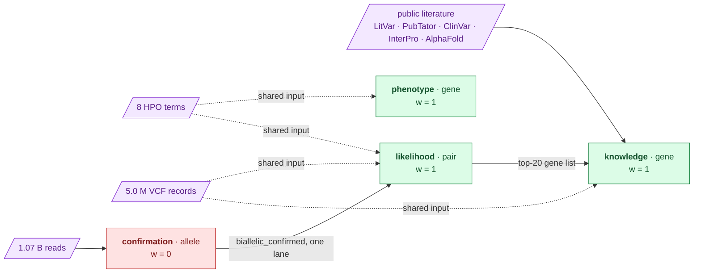

# 107 — Four instruments looked at this case. Which of them is entitled to a vote?

**Written:** 2026-09-18. **Step:** `step-6` (iteration 2).
**Hypotheses:** none settled here. This is the instrument entry: it fixes who may rank,
with what weight, and what each route read — before
[108](108-the-ranking-frozen-before-anyone-looked.md) fuses anything. H041–H044 were filed
before it ran.

**Supersedes nothing.** It is the first entry of step 6 and the last one written while the
iteration is still blind in the ordinary sense — no iteration-1 table is read here or in 108.

## What this entry decides

Reciprocal rank fusion adds `w / (k + rank)` over a set of lists. Nothing in that formula
knows whether a list is any good, so the decision that matters is made *before* the sum:
**which lists are allowed in, and at what weight**. Both answers come from measurements the
earlier steps already published, not from a judgement made here.

## Inputs

| Source | What was read | Version / receipt |
|---|---|---|
| derived | `results.it2_targets` — 404 rows, `score_rank` = the pure symptom-score ordering | [084](../../step-1/methodology/084-the-blind-target-set.md) |
| derived | `build/it2/step-1/benchmark-full.json` — the held-out recall curve, read for N = 300 | [091](../../step-1/methodology/091-recall-at-the-full-population.md) |
| derived | `results.it2_lr_pairs` — 51,920 scored biallelic hypotheses | [099](../../step-4/methodology/099-every-gene-ordered-with-nothing-filtered-out.md) |
| derived | `results.it2_lr_nulls` — 1,000 permuted symptom sets | [100](../../step-4/methodology/100-two-nulls-and-an-ablation.md) |
| derived | `results.it2_knowledge_ranks` — 815 genes with a knowledge score and a PubMed count | [105](../../step-5/methodology/105-does-the-literature-beat-a-hit-count.md) |
| derived | `results.it2_kmer_pairs`, `results.it2_kmer_genotypes`, `results.it2_exon_cn` | [090](../../step-2/methodology/090-the-alleles-the-vendor-never-reported.md), [096](../../step-3/methodology/096-the-alleles-at-their-multiplicity.md), [097](../../step-3/methodology/097-copy-number-without-an-aligner.md) |
| derived | `results.it2_decoys` — 396 size-matched control genes, the denominator of every admission test | [084](../../step-1/methodology/084-the-blind-target-set.md) |
| clinical | the eight HPO terms, indirectly: they are what the phenotype route and the phenotype lane of the likelihood route ranked on | `Challenge_Clinical_Phenotype_1.md` |

**No iteration-1 candidate table was read** — not its biallelic table, not its filtered
candidate table, not its decode file. Every row above is an iteration-2 `results.it2_*`
table or a public corpus. The comparison those iteration-1 tables exist for is
[109](109-what-the-mirror-found.md)'s, and the gate is what enforces the order:
`uv run mva-science check --root docs --blind iteration2`.

Seed **20260918** for every bootstrap, so each interval below reproduces exactly.

## Commands

```
uv run python tools/fuse_it2_routes.py
```

## The admission rule, and why it is not step 6's

A route may rank only if it **separates** its targets from matched decoys *and* **reorders**
a trivial baseline. That conjunction is `RouteWeight.ranking_route` in
`src/mva/knowledge/baselines.py`, written by step 5 for its own use
([105](../../step-5/methodology/105-does-the-literature-beat-a-hit-count.md)). Step 6 calls
it rather than restating it: a second copy of a rule is a second copy able to disagree.

For the read route the decision was taken earlier still and is quoted, not recomputed:
`plan.md` §11.6 pre-registered it as a **confirmation route at weight 0** on the strength of
[087](../../step-2/methodology/087-the-pass-and-what-it-recovered.md) and
[090](../../step-2/methodology/090-the-alleles-the-vendor-never-reported.md), before any of
this ran.

## Observed — the four routes

| Route | Unit | Admission statistic | Verdict | w (equal) | w (measured) |
|---|---|---|---|---|---|
| `phenotype` (step 1) | gene | held-out recall@300 **0.335** [0.318, 0.350] | ranks | 1 | **0.3346** |
| `likelihood` (step 4) | **pair** | target-vs-decoy **AUC 0.706** [0.655, 0.751]; permutation p = **0.056** (55 of 1,000) | ranks | 1 | **0.9441** |
| `knowledge` (step 5) | gene | target-vs-decoy **AUC 0.634** [0.595, 0.672]; ρ vs citation count **0.024**, top-5 overlap **0/5** | ranks | 1 | **0.6337** |
| `confirmation` (steps 2+3) | allele | discrimination **0** — 10 of 396 targets against 10 of 396 decoys, Fisher p = **0.589** | **confirms, never ranks** | **0** | **0** |

The likelihood route's AUC was **recomputed here** from the same rows the fusion ranks, one
best pair per gene, rather than quoted from step 4. It reproduces 0.706 [0.655, 0.751] to
three decimals — the number that admits the route and the number in the fused table cannot
drift apart because they are the same computation.

The measured weights are each route's own error rate, as `plan.md` §3 requires: the symptom
route's held-out recall, `1 − p` of the likelihood route's permutation null, the knowledge
route's own separation. **None of them is a band chosen now.**

## The route-dependency graph



> **Legend** — **purple = raw input**; **green = a route entitled to rank**; **red = a route
> measured to order nothing, kept at weight 0 so its measurement stays visible**. A **dotted
> arrow** is a *shared* input: two routes reading it are not two witnesses, and the
> independent-evidence count in [108](108-the-ranking-frozen-before-anyone-looked.md)
> collapses them. Solid arrows are a route consuming another route's output.

Four routes, **four** raw inputs, and only one of the four inputs is read by a single route.
That is the whole reason the fused table carries an independent-evidence count beside its
score: `phenotype` and `likelihood` share the eight symptom terms, `likelihood` and
`knowledge` share the callset, and `knowledge` was seeded with `likelihood`'s top-20 gene
list. RRF cannot see any of that. The graph is **declared**, not derived from the code — the
claim being audited is what each route *read*, and code only ever says what code does.

## The pair identity, and what it costs

A pair is `gene | left class:rsid | right class:rsid`. No position appears, which is what the
blind protocol and `tools/check_coordinates.py` require. Two variants of the same consequence
class in the same gene, at least one without a dbSNP identifier, then share a spelling:
**51,920 scored hypotheses collapse to 51,410 keys**, and each surviving key records in
`collapsed_rows` how many it stood for. The collapse keeps the best-scoring representative,
so it can only ever lose a *worse* duplicate — but it is a loss, it is 510 rows, and it is a
column rather than a silence.

## Assumptions, limitations and quality checks

* **The confirmation triple is gene-level, not allele-level.** `results.it2_kmer_genotypes`
  keys on `(symbol, origin, allele_ordinal)` and carries no dbSNP identifier, so it cannot be
  joined to one side of a pair. What it can answer is answered per gene: a read-confirmed
  heterozygous allele, a confident single-copy call, no exon below the copy-number null band.
  A pair therefore inherits its gene's confirmation. **228** pairs in the fused universe are
  covered, over **64** genes; **168** of them carry all three.
* **`phenotype` is admitted on recall, not on a decoy test.** Its targets *are* its own
  output, so a target-versus-decoy AUC for it would be circular. Held-out recall on 3,240
  diseases is the non-circular measurement available, and at 0.335 it says the route is an
  enrichment, never coverage — every absence downstream is "not nominated", not "excluded".
* **`knowledge`'s top-5 overlap with the citation baseline is 0/5 with 2 genes tied at the
  cutoff**, so part of that statistic is decided alphabetically
  ([105](../../step-5/methodology/105-does-the-literature-beat-a-hit-count.md) says so first).
  The separation, whose interval excludes 0.5, is what carries the admission.
* **A disqualified route is kept, never deleted.** `confirmation` appears in every table,
  every figure and the frozen export, at weight 0. Deleting it would hide the measurement
  that disqualified it, which is a result.
* **Reproducibility:** the whole stage is one command with one seed. Two consecutive runs
  produced byte-identical output (checked in [108](108-the-ranking-frozen-before-anyone-looked.md)).

## Conclusion

Three routes rank, one confirms. The weights are measured, the shared inputs are declared,
and nothing about iteration 1 has been read. [108](108-the-ranking-frozen-before-anyone-looked.md)
runs the fusion and freezes it.
