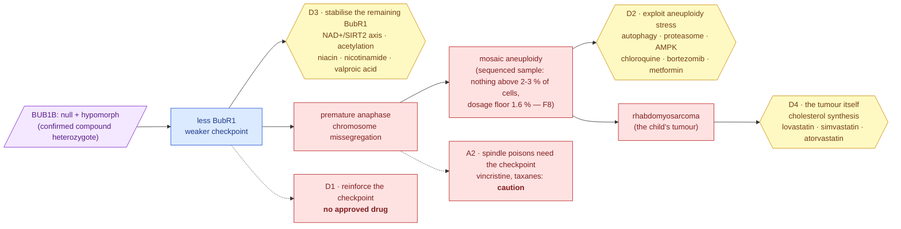

# Step 7 — Track 2 enrichment

**Standing:** **complete, 2026-09-20.** Eight claims filed before their tests, eight settled —
**all eight supported** (H045–H050, H061, H065). The mechanism card is at **version 5**: the one row
step 7 was open for, the aneuploidy burden in the sample (fact **F8**), was measured by
[step 8](../step-8/README.md) and added on 2026-09-19 ([120](methodology/120-the-card-at-version-4-and-the-second-submission-draft.md)),
then rewritten on 2026-09-20 to carry step 8's **second instrument** — the k-mer dosage route, which
covers X and Y and supplies a positive control ([133](methodology/133-the-card-at-version-five-and-the-second-instrument.md));
a pre-registered digest test showed neither revision moved a rung. The Track 2 submission draft is
[`submissions/track2/iteration-2/`](../../../submissions/track2/iteration-2/README.md) (iteration 1
superseded, never uploaded). Iteration 2, `step-7`. Method: [`../../method.md`](../../method.md).

**Goal** (from the step map):

> Which mechanism facts from steps 2–5 and 8 revise the Track 2 card, and what does the drug
> evidence say for each direction?

Design: [`plan.md`](../plan.md) §3 step 7 and §11.10. **Not blind by design** — the step works
on the confirmed pair; every iteration-2 fact it uses was unblinded by [109](../step-6/methodology/109-what-the-mirror-found.md) first.

## The headline, in plain words

The child has two broken copies of the gene `BUB1B`, confirmed by the challenge's own answer
key. The protein it makes, BubR1, is the brake that stops a dividing cell from splitting its
chromosomes before they are all attached. One copy makes nothing; the other makes a weakened
protein. Step 7 asked, for each of four ways a drug could help, **which already-approved medicine
has real evidence behind it** — and graded every candidate on a five-rung ladder written down
before any drug was looked up.

- **Eleven drugs carry a cited mechanism result** (rung 2 or 3): statins for the child's tumour
  (lovastatin has a molecule-level result in rhabdomyosarcoma cells *and* an existing trial),
  the NAD⁺ precursors niacin and nicotinamide for raising BubR1 (a mouse result, inherited by
  proxy), chloroquine and three same-axis proxies for the stress aneuploid cells carry, and two
  HDAC inhibitors for BubR1's acetylation switch.
- **Fifty more drugs reach the top rung automatically** — approved, in a rhabdomyosarcoma trial,
  given to children — and the report says exactly what that means: *already being tried in this
  tumour*, not a finding of this work. A decoy gene got 64 such drugs with the gene never
  consulted.
- **The do-not table is the clinically useful half.** Thirteen spindle poisons — including
  the vincristine the child would receive as standard chemotherapy — need the very checkpoint
  that is broken here (*caution*, flagged for the treating team, never advice to withhold), and
  no approved drug weakens the checkpoint further (*do not*: the class exists only in trials).
- **Direction D1, "strengthen the checkpoint", has no drug.** That is a result, not a gap.

## Results

| | |
|---|---|
| mechanism card | **version 5** — trans confirmed (083), measured facts F1–F9, new seeds, anti-directions, the ladder; [110](methodology/110-the-card-revised-and-the-claims-filed-before-the-search.md), then F8 measured ([120](methodology/120-the-card-at-version-4-and-the-second-submission-draft.md)) and F8 on two instruments ([133](methodology/133-the-card-at-version-five-and-the-second-instrument.md)) |
| snapshot on card v3 | 277 targets · 3,859 candidate rows · **359** distinct approved drugs · 748 trial rows |
| drugs graded | **329** (approved base names + 4 curated-only) |
| drugs by best rung | 5: **62** · 3: **2** · 2: **5** · 1: **260** |
| per direction, drugs at rung ≥ 2 | D1 **0** of 30 · D2 **4** of 84 · D3 **4** of 50 · D4 **63** of 205 |
| shortlist | **61** rows — **11** with a curated mechanism result, 50 *context trial only* |
| do-not table | **23** drugs — 13 caution (A2 spindle poisons), 10 standard of care, 0 do-not (no approved A1 drug) |
| decoy control | D4 vs NTRK3 Jaccard **0.249**; every other direction < 0.10 against both decoys |
| paediatric pointers | 290 of 329 drugs have a study admitting children; 208 a label section 8.4; all 11 argued rows have at least one |
| literature per drug | 658 PubMed counts (drug AND mechanism / drug AND tumour); descriptive, never a rung |

## Claims — all eight resolved

| Id | Verdict | Conf. | Claim |
|---|---|---|---|
| H045 | **supported** | 0.80 | D1 yields no submittable drug and becomes the do-not table |
| H046 | **supported** | 0.70 | D2 holds an approved compound with a molecule-level cell result (chloroquine) |
| H047 | **supported** | 0.60 | D3 has an approved-drug route on the NAD⁺/SIRT2 axis with in-vivo BubR1 evidence — by proxy; the automated stage found none |
| H048 | **supported** | 0.80 | D4 holds a non-cytotoxic approved agent (lovastatin) at rung ≥ 2 with paediatric data |
| H049 | **supported** | 0.85 | the automated stages are non-specific: D4 overlaps a decoy at Jaccard ≥ 0.10 |
| H050 | **supported** | 0.70 | every argued drug has a paediatric pointer |
| H061 | **supported** | 0.85 | card v4 (F8 measured) moved no rung, no shortlist row, no do-not row — byte-identical digests |
| H065 | **supported** | 0.90 | card v5 (F8 on a second instrument) moved nothing either — the same three digests, on the first re-grade |

The register shows revisions 2 → 3 → 4 for these claims; [113](methodology/113-the-ladder-the-shortlist-and-the-do-not-table.md)
records why (a verdict committed before its evidence landed, then corrected in the open).

### The two things the step changed its mind about, in the open

- **The trial-based rung grades the tumour direction alone.** The first run put 85 drugs at
  rung 5 on mechanism directions because they had a rhabdomyosarcoma trial. The decoy
  comparison showed that rung to be gene-independent; the rule was narrowed and the run
  repeated before any verdict — recorded with before/after counts in 113.
- **The automated stage cannot reach the deepest lead.** The one in-vivo mechanism result
  (NAD⁺ repletion raising BubR1) attaches to a target no public source drugs with an approved
  molecule. Niacin and nicotinamide exist in the ladder because a person put them there, and
  the row says `curated_only`.

## What step 7 read from every earlier step

| From | Fact (on the card) | Where it matters |
|---|---|---|
| oracle, [083](../../iteration1/step-6/methodology/083-oracle-reply-submission-1.md) | F1 trans **confirmed** | the mechanism section argues from a confirmed genotype |
| step 2, [088](../step-2/methodology/088-the-alleles-the-reads-carry.md) / [092](../step-2/methodology/092-depth-per-exon-and-the-phasing-drawn.md) | F4 no structural variant in the gene; phase unmeasured in the reads | trans is the oracle's statement, and the report says so |
| step 3, [096](../step-3/methodology/096-the-alleles-at-their-multiplicity.md) / [097](../step-3/methodology/097-copy-number-without-an-aligner.md) | F2 both alleles at one copy; F3 every exon at two copies | a null + hypomorph genotype: stabilising BubR1 (D3) is live |
| step 4, [099](../step-4/methodology/099-every-gene-ordered-with-nothing-filtered-out.md) / [101](../step-4/methodology/101-the-phase-that-cannot-be-measured.md) | F6 AlphaMissense lane 4.33; F7 P(trans) undetermined | "damaging" quantified; population phasing cannot corroborate F1 |
| step 5, [106](../step-5/methodology/106-where-the-missense-sits-in-the-protein.md) | F5 missense outside every curated domain, pLDDT 91 | the catalytic-dead-vs-unstable question stays **open**; D3 is a dosage argument |
| step 6, [109](../step-6/methodology/109-what-the-mirror-found.md) | F9 the blind mirror found the same pair | the drug argument rests on a rediscovered, confirmed answer |
| step 8, [116](../step-8/methodology/116-the-statistic-that-has-power-and-the-limit-it-buys.md) | **F8 measured**: no autosome above its 2–3 % detection limit in the sequenced sample (80 % power); tissue unnamed; X/Y and sub-arm untestable by allele balance | D2 is argued from the literature only and ranked below D3 and D4; nothing on the ladder moves (H061) |
| step 8, [121](../step-8/methodology/121-the-second-instrument-and-the-shards-it-did-not-need.md) / [123](../step-8/methodology/123-the-denominator-that-assumes-nothing-read-back.md) | **F8 on a second instrument**: k-mer dosage reads one copy of X (0.4873) and Y (0.5083) against 0.5 expected, puts no autosome beyond its composition-corrected null, floor **1.6 %** of cells; the denominator that assumes nothing agrees to 0.017 % | F8's X/Y gap closed and the negative result gains a positive control; nothing on the ladder moves (H065) |

The clinical dataset enters through the tumour context (rhabdomyosarcoma, HP:0002859) and the
seven proband terms on the card; the genomic dataset through the gene, the alleles and F1–F7.

## The pathway, from allele to intervention point



> **Legend** — **purple = the raw input** (the confirmed genotype); **blue = machinery** (the
> molecular consequence); **yellow = a decision point** — each is a direction with the
> approved drugs that reached rung ≥ 2 under it; **red = what goes wrong**, and the two
> dotted red boxes are the direction with no drug and the anti-direction. Dotted arrows are
> "would act here", not "does".

## Methodology

| Entry | What it did | Claims |
|---|---|---|
| [110](methodology/110-the-card-revised-and-the-claims-filed-before-the-search.md) | card v2 → v3; the snapshot refreshed; H045–H050 filed; the decoys chosen; the curated table written | filed |
| [111](methodology/111-the-automated-stages-literature-trials-and-labels-per-drug.md) | per approved drug: PubMed with the mechanism and the tumour, ClinicalTrials.gov studies admitting children, the label's paediatric section | one refuting row for H047 |
| [112](methodology/112-two-decoy-cards-through-the-same-pipeline.md) | NTRK3 and XDH through the unchanged pipeline; Jaccard per direction | **H049** |
| [113](methodology/113-the-ladder-the-shortlist-and-the-do-not-table.md) | the ladder, the shortlist, the do-not table; the post-hoc rule refinement | **H045, H046, H047, H048, H050** |
| [114](methodology/114-the-dashboard-surface-for-step-7.md) | the `/track2` hero (approach · suggestion · output), the pathway diagram, the panel-judged folder on `/submissions` — every number computed from the payload | machinery |
| [120](methodology/120-the-card-at-version-4-and-the-second-submission-draft.md) | card v4 from step 8's measured burden; the digest test; the reader fault it caught; the iteration-2 submission draft | **H061** |
| [133](methodology/133-the-card-at-version-five-and-the-second-instrument.md) | card v5 from step 8's second instrument (the k-mer dosage route); the digest test re-run | **H065** |

## How to reproduce it

```bash
uv run mva-drugs snapshot                                        # card v3 → ressources/track2/*.tsv
uv run python tools/track2_decoys.py --symbol NTRK3 --uniprot Q16288 --protein "NT-3 growth factor receptor (TrkC)" --pattern "NTRK|neurotrophin|Trk" --picked-by "seeded draw from results.it2_decoys"
uv run python tools/track2_decoys.py --symbol XDH --uniprot P47989 --protein "xanthine dehydrogenase/oxidase" --pattern purine --picked-by "an unrelated, well-drugged metabolic enzyme"
uv run python tools/track2_enrich.py                             # ladder, shortlist, do-not, decoy comparison
uv run python tools/render_track2_figures.py                     # figures/track2/
uv run python tools/record_track2_lineage.py --dry-run           # 63 edges under target_schema track2
uv run python tools/record_track2_lineage.py                     # appends the ones not already there
uv run mva-science export                                        # the hypothesis mirror
```

## What this step cannot tell you

- **Whether any of these drugs helps this child.** The challenge's own words: submissions are
  hypotheses for follow-up, not evidence that a medicine works. Rung 3 is one mouse paper.
- **Which tissue F8 describes.** No autosome carries a mosaic population above 2–3 % *in the
  sequenced sample* by allele balance, and none beyond its composition-corrected null on the
  dosage route (floor **1.6 %** of cells); the delivery does not name the tissue, sub-arm events
  were never testable by either route, and copy-neutral loss of heterozygosity is invisible to
  the dosage route. D2 is argued from published aneuploid-cell biology only.
- **Whether the missense copy is unstable or catalytically dead.** F5 leaves it open; D3 is
  argued as *more BubR1*, not as *refold this BubR1*.
- **Anything about a drug the sources never listed** beyond what a person put in `evidence.tsv`
  — four of the eleven argued drugs are `curated_only`, and the row says so.

## Exhibits

`/track2` on the dashboard opens with **Track 2 in one screen** — the five-stage approach
flow, the eleven argued drugs as cards grouped by direction with the red caution strip, and the
output funnel with links to every artefact — followed by the pathway diagram from the alleles to
each intervention point ([114](methodology/114-the-dashboard-surface-for-step-7.md)). The
static figures are `figures/track2/`: `evidence-ladder`, `rung-funnel`,
`decoy-overlap`, `pediatric-evidence`, `mechanism-literature`; the interactive page is
`figures/track2-report.html`.

## The record

| | |
|---|---|
| Hypotheses | [`hypotheses/`](hypotheses/README.md) — H045–H050, H061, H065, written by `mva-science export` |
| Tests run | [`methodology/`](methodology/README.md) — entries 110–114, 120 and 133 |
| Tables | `ressources/track2/` — 12 TSVs, one provenance manifest each; decoys under `decoys/` |
| Lineage | `warehouse.data_lineage`, `target_schema = track2` — 63 edges per card revision, 104 in the append-only ledger after card v5 |
