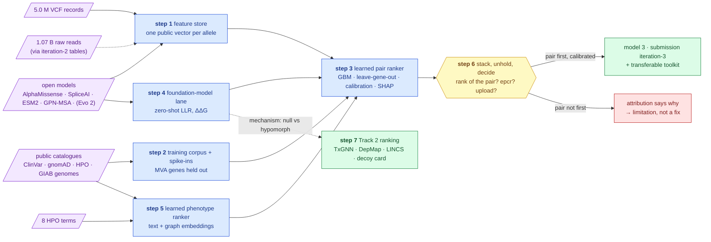

# Iteration 3 — the plan: a ranker that *learns* from public data, with the answer held out

**Standing:** **draft**, written 2026-09-13. Nothing in this page is a result. Nothing has been
built, declared in `src/mva/science/steps.py`, or filed in the register. The plan is agreed
first, then cut into steps, then run. Every number quoted below belongs to the entry it links;
none is an iteration-3 measurement. Next free global methodology number: **095**
(`docs/step-0/methodology/094` is the highest on disk). Next free register id: **H030** — the
plan labels its claims `P3-x` and never pre-assigns ids, because iteration 2's plan did and
collided (H027–H029, see [`../iteration2/plan.md` §3 step 7](../iteration2/plan.md)).

Written for a software engineer. Domain terms appear as `technical term (plain meaning)` on
first use; the dictionary is [`../dictionary.md`](../dictionary.md).

Read before acting: [`../iteration2/plan.md` §1, §11](../iteration2/plan.md) (what iteration 2
found and still owes), [`../method.md`](../method.md) (how a claim is filed),
[`../toolset.md`](../toolset.md) (what exists).

---

## 1. Why iteration 3 exists, and what it is not

- **Track 1's automated score is at its ceiling.** Submission 1 scored 100 rank points, F-max
  1.0, full match at rank 1; the causal pair — BUB1B stop_gained + BUB1B missense, in trans —
  is confirmed ([083](../iteration1/step-6/methodology/083-oracle-reply-submission-1.md)).
  What is still scored is the **qualitative tiebreak** (report, reproducible code, innovation,
  scalability — [intel §4](../../ideation/hackathon-intel.md)) and **Track 2**.
- **Iteration 1 was hand rules, top-down.** Its ranker is a transparent additive score with
  constants chosen by hand (`src/mva/pipeline/ranking.py`: rarity ∈ {1.0, 0.5, 0.05},
  severity ∈ {1.0, 0.6, 0.1, 0.0}). Nothing in the repository is *learned* except the
  on-sample negative-binomial fit in `mva.kmer.genotype`.
- **Iteration 2 is the blind mirror, still running** (steps 3–8 open). Its runs taught four
  things a learned model can act on and a hand rule cannot:
  - the symptom-only ranker has held-out recall@300 = **0.335** — the target set is an
    enrichment, never coverage ([084](../iteration2/step-1/methodology/084-the-blind-target-set.md),
    [091](../iteration2/step-1/methodology/091-recall-at-the-full-population.md));
  - **73.6 %** of protein-coding genes carry no HPO curation and cannot be scored by an
    ontology ranker at all ([084](../iteration2/step-1/methodology/084-the-blind-target-set.md));
  - **the filter discriminates, not the gene list** — targets and decoys reach a biallelic
    candidate at the same rate until a rarity + consequence rule is applied
    ([090](../iteration2/step-2/methodology/090-the-alleles-the-vendor-never-reported.md));
  - the lead pair is **unphaseable** from short reads; trans evidence must come from
    population statistics ([088](../iteration2/step-2/methodology/088-the-alleles-the-reads-carry.md)).
- **The methods form rewards exactly this.** Judges prefer *automated* output over manual
  curation and accept up to six models per participant ([intel §10.2](../../ideation/hackathon-intel.md));
  iteration 3's submission is **model 3**: the genuine output of a model fitted on public data.

**Iteration 3 asks one question:** *can a model learned from public catalogues alone — never
shown this child's answer, with the causal gene and every known MVA gene held out of
training — rank the confirmed pair first among every biallelic pair in the proband's callset,
give it a calibrated probability usable as `epcr`, and say which evidence carried it?* Along
the way it asks whether **sequence foundation models** (protein and DNA language models) add
information the calibrated clinical tools lack, and it gives Track 2 the **ranking it does not
have** (nothing in `mva.drugs` ranks a drug — [079](../step-0/methodology/079-track2-in-the-dashboard.md)).

**What iteration 3 is not:**
- not a replay of iteration 1 or 2, and not a replacement for iteration 2's likelihood-ratio
  route (step 4 there) — the learned ranker is a **comparator and a stacker** over the same
  candidate set, and the two are reported side by side;
- not a black box: every model ships its training corpus manifest, held-out metrics with
  intervals, calibration curve, per-feature attributions for the lead pair, and ablations;
- not a new oracle spend by default (§6);
- not blocked on iteration 2: it consumes iteration-2 tables where they exist
  (`results.it2_read_alleles`, `it2_decoys`, `it2_targets`, k-mer genotypes) and runs
  without them where they do not.

### The held-out protocol (iteration 3's version of the blind rule)

Iteration 2 blinds *inputs*. Iteration 3 cannot — a supervised model needs labels, and the
labels are public catalogues that *contain* BUB1B. So the rule is **hold-out**, enforced at
three places:

| Where | Rule |
|---|---|
| **training corpus** | every allele and pair in **BUB1B, CEP57, TRIP13, CENPE, CEP192, SMC5** (the MVA genes of [intel §3](../../ideation/hackathon-intel.md)) is removed from training; so is every disease whose HPO annotation set overlaps the proband's 8 terms above a stated threshold (the exact threshold is pre-registered in step 2) |
| **evaluation** | every metric is **leave-gene-out** (`GroupKFold` by gene) or **leave-disease-out**; a spiked-in pair is never scored by a fold that saw its gene |
| **inference** | two modes, both reported: **catalogue-free** (ClinVar `clin_sig` and any catalogue-derived flag withheld as a feature) and **catalogue-aware**. The rediscovery claim is made on catalogue-free; catalogue-aware is the upper bound |

Scores that were themselves *trained* on ClinVar (REVEL, ClinPred, CADD's ClinVar-vs-ExAC
tuning — [Rentzsch 2019](../../papers/iteration2/README.md)) are labelled **catalogue-adjacent**
and get their own ablation: the rank of the lead pair with and without them is printed. This
is the leak a reviewer will look for first, so the plan names it first.

> **Legend** — **purple = raw input** (the case's two data sources, the public catalogues,
> the open models); **blue = machinery** (one research step each); **yellow = the decision
> point** (does the learned ranker put the confirmed pair first, and is an upload
> informative?); **green = the goal** (a third automated model with a calibrated probability,
> and a Track 2 ranking); **red = the honest failure path** — the model is refuted and its
> attributions say why. Dotted arrows are side-products.

---

## 2. Goals — one per step

Seven steps, to be declared in `src/mva/science/steps.py` as `ITERATION3` once this plan is
agreed (§5 says how, given iteration 2 is still open). Slugs restart at `step-1`; folders live
under `docs/iteration3/`.

| Step | Slug | Goal (one question) | VCF | Reads | HPO | Public |
|---|---|---|---|---|---|---|
| 1 | `step-1` | Can every coding allele in the callset — and the 1,199 alleles only the reads saw — be given the same public feature vector (frequency, consequence, constraint, AlphaMissense, SpliceAI, CADD, REVEL, ESM2, GPN-MSA) with lineage, and what fraction of alleles does each score actually cover? | ✓ | (tables) | | ✓ |
| 2 | `step-2` | Can a labelled corpus of recessive biallelic pairs — positives from ClinVar, negatives from healthy public genomes — be built from public data alone with the MVA genes held out, and is it large enough to fit and to spike in? | | | ✓ (disease terms) | ✓ |
| 3 | `step-3` | Trained on that corpus and never on this child, does a gradient-boosted pair model rank the confirmed pair first among all biallelic pairs in the callset, is its probability calibrated, and which features carried it? | ✓ | (tables) | ✓ | ✓ |
| 4 | `step-4` | Do zero-shot sequence-model scores — protein language model, DNA language model, predicted stability change — separate the confirmed alleles from the proband's other rare alleles, and add rank information beyond the calibrated tools? | ✓ | | | ✓ |
| 5 | `step-5` | Does a learned phenotype-to-gene ranker — text and graph embeddings, trained leave-disease-out — beat the ontology ranker's recall, and does it score the 73.6 % of genes the ontology cannot? | | | ✓ | ✓ |
| 6 | `step-6` | Stacked with iteration 2's likelihood-ratio route and then unheld, does iteration 3 rediscover the pair, what `epcr` does the calibrated probability give it, and is a third upload informative? | | | | |
| 7 | `step-7` | Do knowledge-graph, cell-line and signature-based repurposing models converge on approved drugs for the mechanism the confirmed alleles imply, how do they rank against a decoy mechanism card, and what does each say about the child's tumour context? | | | ✓ | ✓ |

Track 2's standing goal (iteration 1 step 8) and iteration 2's step 7 (card v3, evidence
ladder) stay; iteration 3's step 7 adds the **ranking** and the **controls** they lack.

---

## 3. The steps in detail

Each step: question · inputs · method · tools · pre-registered claims (`P3-n`, filed with
prediction and refutation *before* the run; ids assigned at filing from H030) · outputs ·
venue and cost · cut rule · dictionary terms. Every table gets a `warehouse.data_lineage` row;
every figure names its producing script (figure-freshness gate,
[`../iteration2/plan.md` §11.7](../iteration2/plan.md)).

### Step 1 — the feature store

**Question.** One public feature vector per allele, coverage measured per score.

**Why first.** Every downstream step reads it; iteration 2's step 4 also needs AlphaMissense,
SpliceAI and LOFTEE and has not built them ([`../iteration2/execution.md` §3](../iteration2/execution.md)).
Built once, under this step's methodology, and iteration 2 step 4 cites the entry — the
CLAUDE.md rule "a tool a step needs is recorded in that step's methodology" is honoured by
naming the consuming step in the entry.

**Inputs.** `results.coding_alleles` (38,087 distinct coding alleles, all VEP-annotated —
[data-findings §6.3](../../ideation/data-findings.md)); `warehouse.it2_read_annotations`
(1,199 read-only alleles); `ressources/reference/gnomad_constraint.tsv` (v4.1);
`hpo_gene_scores.tsv`; GIAB genomes' alleles from step 2 (the same store serves training and
inference — one code path, one lineage).

**Method.**
- **Extend the checkpointed annotator** (`mva-warehouse annotate-coding`, VEP REST release 116)
  with the plugin fields the REST endpoint accepts: `AlphaMissense`, `SpliceAI`, `CADD`,
  `REVEL`, `LoF` (LOFTEE), `LOEUF`, `ClinPred`, `EVE`, `NMD`, `MaxEntScan`. Verified today
  against the endpoint documentation: 200 variants per POST; 38,087 + 1,199 alleles ≈ 197
  requests per pass. The route already worked for the two BUB1B alleles in
  [074](../iteration1/step-6/methodology/074-submission-v1-design.md); it has never run in bulk.
- **GPN-MSA precomputed scores** (Benegas 2025, PMID 39747647; hg38, all SNVs, downloadable) —
  a DNA language model score that covers **non-coding** positions, looked up locally. This is
  the only lane that can score an intronic allele without a GPU.
- **ESM2 masked-marginal log-likelihood ratio** (Lin 2023, PMID 36927031; 650 M-parameter
  model, MIT, CPU) for every **rare protein-altering** allele (875 in the coding scan + the
  read-only missense set — a few thousand forward passes, laptop-feasible). Brandes 2023's
  precomputed ESM1b scores (PMID 37563329) are used instead wherever the per-gene file is
  cheaper to fetch than the pass.
- **Gene-level features**: gnomAD v4.1 constraint (`oe_lof`, `loeuf`, `oe_mis`, `mis_z` — used
  as *features*, never as a recessive filter: BUB1B pLI is 2.6e-14, [data-findings §6.1](../../ideation/data-findings.md));
  DOMINO dominant-vs-recessive probability (Quinodoz 2017, PMID 28985496 — its published
  score table); HPO ontology similarity (`hpo_gene_scores.tsv`, already computed); STRING
  proximity (`mva.phenotype.network`, built in iteration 2 step 1).
- **Coverage report**: per score, the fraction of alleles with a value, by consequence class.
  A score that covers 30 % of missense is a 30 % feature and the model must see the
  missingness (GBMs handle NA natively; the indicator is kept explicit).
- **Correlation matrix** across lanes (Spearman) — the redundancy the stacker must not
  double-count, and a figure.

**Pre-registered claims.**
- `P3-1` AlphaMissense returns a score for ≥ 95 % of missense alleles; refuted below 80 %
  (then missense is a two-lane problem, not one).
- `P3-2` SpliceAI returns a delta for ≥ 95 % of alleles within ±8 bp of a splice site.
- `P3-3` The calibrated missense lanes (AlphaMissense, REVEL, ESM2) are correlated at
  Spearman ρ ≥ 0.6 pairwise; refuted below 0.4 for any pair (then they are not one lane and
  the stacker treats them separately).

**Outputs.** `warehouse.allele_scores` (one row per allele × score × version, append-only,
source and fetch time on every row); `results.it3_allele_features` (the wide, model-ready
table); `figures/track1/iteration3/feature-coverage.png`,
`feature-correlation.png`; a provenance manifest per external download (model name, version,
digest, licence).

**Venue and cost.** Laptop. REST: ~200 requests × a few seconds; ESM2: hours, CPU; GPN-MSA:
one download (several GB) + local lookup. **Licences recorded**: AlphaMissense scores are
CC BY-NC-SA 4.0 and CADD is non-commercial — fine for this hackathon, stated in the manifest
and the report.

**Cut rule.** If the REST plugins throttle, fall back to the two lanes with local files
(GPN-MSA, ESM2) and record the coverage loss.

**Dictionary.** feature store, feature vector, missingness, protein language model, DNA
language model, masked-marginal log-likelihood ratio, non-commercial licence.

### Step 2 — the public training corpus and the spike-in harness

**Question.** Labelled pairs from public data only, MVA genes held out, large enough to fit.

**The analogy for a software engineer.** A supervised model is a function fitted to labelled
examples. There is no labelled example from this child (N = 1, no parents), so every example
is public: *known disease-causing pairs* and *pairs from healthy people*. The trap is
**leakage** — training on the row you will later test on. Hold-out by gene is the fix, and it
is enforced in code, not by promise.

**Inputs.** ClinVar release (already downloaded for `clinvar_panel.tsv`; the full release is
needed here — the release date and digest recorded); HPO annotations (`phenotype.hpoa`,
which carries mode-of-inheritance terms — HP:0000007 *autosomal recessive* — so the AR gene
list comes from HPO, no OMIM licence needed); gnomAD v4.1 frequencies via VEP; **GIAB
benchmark VCFs** HG001–HG007 on GRCh38 (public, ~150 MB each) as healthy genomes.

**Method.**
- **Positives**: pairs of ClinVar P/LP alleles (review status ≥ 2 stars) in the same
  autosomal-recessive gene — synthetic compound heterozygotes — plus each P/LP allele paired
  with itself (a homozygote). Limit per gene to cap the contribution of heavily curated genes
  (CFTR, GJB2) — the cap is pre-registered.
- **Negatives, two kinds**: (a) pairs of rare alleles (gnomAD AF < 1e-3 or absent) in the
  same gene found in a **GIAB healthy genome** — realistic, because every healthy genome
  carries dozens of rare biallelic genes that cause nothing; (b) pairs of common or ClinVar
  Benign alleles in AR disease genes — the easy negatives.
- **Phenotype feature for training rows**: for a positive in disease *d*, the query term set
  is *d*'s HPO annotations degraded by the Zemojtel protocol (imprecision + noise), which
  `mva.phenotype.benchmark` already implements; for a GIAB negative, a random disease's
  degraded terms. The similarity feature is then computed identically at training and at
  inference (the proband's 8 terms).
- **Hold-out**: remove the six MVA genes and every disease whose annotation set has Resnik
  similarity to the proband's 8 terms above the pre-registered threshold.
- **The spike-in harness** (promised twice — [solution-paths Path 6](../../ideation/solution-paths.md),
  plan §9 Z1 — never built): for disease *d* with AR gene *g* (not held out) and ≥ 2 ClinVar
  P/LP alleles, insert the pair into a GIAB genome, use *d*'s degraded terms as the query,
  run the whole ranker (step 3), record the rank of the spiked pair. 200–300 spike-ins
  stratified by consequence class (LoF+LoF, LoF+missense, missense+missense, splice) →
  **recall@1, @10 with bootstrap intervals**. This is the quoted recall of the method, on
  cases with a known answer, and the number the methods form's "strengths and limitations"
  can cite. Spike-ins run **catalogue-free** (else the ClinVar flag finds them trivially).

**Pre-registered claims.**
- `P3-4` ≥ 500 positive pairs across ≥ 150 AR genes after hold-out and caps; refuted below
  200 (then the model is a logistic regression on a handful of features, and says so).
- `P3-5` GIAB genomes carry a median ≥ 20 rare-biallelic genes each under the same filter the
  proband's callset gets — the realistic negative rate; refuted below 5.

**Outputs.** `results.it3_corpus_pairs` (label, gene, disease, source, fold id),
`results.it3_spikeins`; `figures/.../corpus-composition.png`; a corpus manifest (ClinVar
release, GIAB versions, filters, caps, held-out genes and diseases).

**Venue and cost.** Laptop: ClinVar parsing (`mva.io.readers` extended), 7 GIAB VCFs through
the *same* coding scan SQL as the proband (a parameterised `vcf-ingest` — the platform is
already case-agnostic by design), VEP REST for their rare alleles (~1–2 k per genome).

**Cut rule.** If VEP volume for seven genomes is too slow, use three (HG001, HG002, HG005 —
three ancestries) and record it.

**Dictionary.** training corpus, label, positive / negative, leakage, hold-out, GroupKFold,
spike-in (extend), GIAB, review status (stars), synthetic compound heterozygote.

### Step 3 — the learned pair ranker

**Question.** Does the model put the confirmed pair first, is it calibrated, what carried it?

**Method.**
- **Unit = the pair**, order-invariant: per-allele features enter as (min, max) over the two
  alleles plus pair features (both LoF; same exon; distance class; P(trans) from gnomAD
  co-occurrence when available, with an *undetermined* state; phase from PGT/PID or read
  phase blocks when available — for the lead pair it is *unphaseable*, and the feature says so).
- **Model**: gradient-boosted trees (LightGBM; `HistGradientBoosting` from scikit-learn as
  the dependency-light fallback) — handles missingness, mixed scales, interactions, fits in
  seconds on this corpus. A **logistic regression** on the same features is the transparent
  baseline; if the GBM does not beat it on held-out folds, the logistic model is the one
  shipped.
- **Validation**: `GroupKFold` by gene (5 folds); AUROC and AUPRC per fold; **recall@1 / @10
  on spike-ins** (step 2); **calibration** — isotonic regression fitted on out-of-fold
  predictions, reliability diagram, Brier score. The calibrated probability is what becomes
  `epcr`, so it must mean what it says.
- **Attribution**: SHAP values (TreeSHAP) for every pair in the proband's top 20; a waterfall
  for the lead pair is a report figure. For the software engineer: SHAP is a per-row,
  per-feature decomposition of the prediction that sums to the output — an explanation, not a
  causal claim, and the report says so.
- **Ablations** (each a run, each a row in one table): without catalogue-adjacent scores;
  without foundation-model lanes (step 4); without the phenotype feature (a pure-genomics
  ranker); without gene-level constraint. The rank of the lead pair under each ablation is the
  table's column.
- **Comparators on the identical candidate set**: iteration 1's hand score
  (`mva.pipeline.ranking`), iteration 2's likelihood-ratio route (when its step 4 has run),
  Exomiser's published compound-het rule (mean of the two best variant scores —
  [Smedley 2015](../../papers/iteration2/README.md)) reimplemented as a formula over the same
  features.
- **Decoy null**: the 396 matched decoys of `results.it2_decoys` ranked by the same model —
  the separation between target-tier and decoy genes, and the permutation null over shuffled
  labels.
- **Optional lane — non-PASS rescue as positive-unlabelled learning** (survey framing #4,
  [statistical-methods-survey](../../ideation/statistical-methods-survey.md)): the 271,414
  non-PASS calls are *unlabelled*, not negative. Elkan–Noto reweighting over filter reason
  and mappability. Stretch; cut first inside this step.

**Pre-registered claims.**
- `P3-6` (the headline) In catalogue-free mode, the confirmed pair ranks **1st** among all
  biallelic pairs of the callset under the pre-registered filter; refuted if outside the top
  10 — then the attributions name the missing feature and the model is reported as a
  *refuted discovery instrument*, not tuned until it passes.
- `P3-7` Spike-in recall@10 ≥ 0.80 [interval reported]; refuted below 0.60.
- `P3-8` Calibration: Brier ≤ 0.10 on held-out folds and the reliability curve within ±0.1
  of the diagonal in every populated bin; refuted otherwise — then `epcr` is a rank, not a
  probability, and the submission says so.
- `P3-9` The GBM beats the logistic baseline by ≥ 0.02 AUPRC on held-out folds; refuted
  otherwise — the logistic model ships.

**Outputs.** `results.it3_pair_scores` (every pair, raw score, calibrated probability, fold
provenance, mode); `results.it3_ablations`; `results.it3_attributions`; model artefacts under
`build/it3/models/` with a **model card** (data, hold-out, metrics, licence, version, digest)
rendered to the dashboard; figures: reliability diagram, spike-in recall curve, SHAP
waterfall for the lead pair, target-vs-decoy separation, ablation table.

**Venue and cost.** Laptop, minutes per fit. Dependencies added under an **optional `ml`
group** (`lightgbm`, `scikit-learn`, `shap`) so the base install stays stdlib-light
([hand-rolled-vcf-reader note](../notes/hand-rolled-vcf-reader.md)).

**Dictionary.** gradient-boosted trees, logistic regression, AUROC / AUPRC, recall@k,
calibration, reliability diagram, Brier score, isotonic regression, SHAP, ablation, model card,
positive-unlabelled learning.

### Step 4 — the foundation-model lane

**Question.** Do zero-shot sequence models add information beyond the calibrated tools?

**Why a step of its own.** It is the innovation criterion's clearest hook, it needs the only
GPU work in the plan, and it feeds Track 2 a mechanism fact (null vs hypomorph) the drug
directions depend on.

**Method.**
- **Protein language model**: ESM2 LLR (from step 1) for every rare missense allele in the
  proband's biallelic genes; the distribution of LLR for the confirmed missense against the
  other rare missense alleles of the callset — a percentile, with the same for AlphaMissense
  beside it.
- **DNA language model, precomputed**: GPN-MSA scores for all alleles, including the intronic
  and UTR alleles of the biallelic genes that Layer 2 never annotated — the first genome-wide
  non-coding lane in the repository.
- **DNA language model, zero-shot on GPU (optional)**: Evo 2 (Brixi et al., *Nature* 2026,
  bioRxiv 10.1101/2025.02.18.638918; open weights, Arc Institute) delta log-likelihood for
  the alleles of the proband's top-50 pairs and the spike-in pairs — a few thousand windows.
  The 1 B-parameter checkpoint fits a 16 GB GPU; venue is the **amd64 VM/GPU day** iteration
  2 already proposes ([§11.9](../iteration2/plan.md)) or a hosted inference endpoint if one is
  available (to verify). **Cut first** in this step; if cut, the lane is GPN-MSA + ESM2 and the
  limitation is recorded.
- **Predicted stability change (ΔΔG)** of the confirmed missense on the AlphaFold BubR1 model
  (already fetched request-scoped from AlphaFold DB — [current-state §1](../current-state.md)):
  RaSP (Blaabjerg 2023, PMID 37184062) or ThermoMPNN (Dieckhaus 2024, PMID 38285937), both
  open, CPU-feasible for one protein. A destabilising ΔΔG supports *hypomorph* (partly
  functional protein) over *null*; that is the fact Track 2's direction D3 (proteostasis)
  needs and iteration 2's card marks as inferred.
- **Information test**: each lane enters step 3 as a feature; the ablation "without
  foundation-model lanes" is the measured contribution. A lane that changes no held-out metric
  and no lead-pair rank is reported as *no added information here* — not dropped silently
  (the rule iteration 2 set for its LLM tournament, [§10 N2](../iteration2/plan.md)).

**Pre-registered claims.**
- `P3-10` The confirmed missense sits in the top decile of ESM2 LLR among the callset's rare
  missense alleles; refuted below the median.
- `P3-11` Adding the foundation-model lanes improves spike-in recall@10 by ≥ 0.02 or moves
  the lead pair's rank; refuted if neither moves — recorded as *no added information*.
- `P3-12` Predicted ΔΔG for the confirmed missense is destabilising beyond the tool's own
  stated threshold; refuted if within the neutral band — then the hypomorph reading rests on
  the clinical literature alone and the card says so.

**Outputs.** `results.it3_sequence_scores`; `figures/.../llr-percentile.png`,
`ddg-on-structure.png` (residue highlighted on the AlphaFold model — the viewer already exists
in the app); a per-model provenance manifest (checkpoint, digest, licence, hardware, runtime).

**Cut rule.** Evo 2 first; ΔΔG second (it is one protein and cheap, so it should survive).

**Dictionary.** foundation model, zero-shot, log-likelihood ratio, ΔΔG (stability change),
hypomorph (extend), percentile.

### Step 5 — the learned phenotype ranker

**Question.** Can a learned phenotype-to-gene ranker beat recall@300 = 0.335 and reach the
uncurated 73.6 %?

**Method.**
- **Text-embedding lane** (addresses the uncurated blind spot directly): embed each HPO term's
  definition and each gene's public function text (UniProt function, NCBI gene summary —
  fetched through the existing cached client pattern) with an open sentence-embedding model on
  CPU (`sentence-transformers`, e.g. a `bge` or `MiniLM` checkpoint, version and digest
  recorded). Gene score = aggregated cosine similarity to the 8 terms. **Every** protein-coding
  gene with a function text gets a score — the ontology ranker scores 5,267.
- **Graph-embedding lane**: node2vec-style embeddings over the HPO–disease–gene–STRING graph,
  then a supervised link predictor (logistic or GBM) trained **leave-disease-out**; the
  proband's term set is a new "disease" node at inference.
- **Benchmark**: the existing `mva.phenotype.benchmark` (Zemojtel degradation, bootstrap
  intervals) at the full population, identical protocol to
  [091](../iteration2/step-1/methodology/091-recall-at-the-full-population.md); recall@300 per
  lane and for the fused ranking; **recall on the uncurated stratum** separately, which the
  ontology ranker has by construction at 0.
- **LLM-as-ranker (comparator only, not a discovery lane)**: an LLM asked to rank genes for
  these 8 terms *knows* MVA → BUB1B from its training text, so it fails the held-out protocol.
  If run at all it is reported as a **knowledge lane** with that caveat, never fused into the
  rediscovery claim. Iteration 2 placed its LLM tournament first to cut; the same applies.

**Pre-registered claims.**
- `P3-13` The text-embedding lane scores ≥ 90 % of protein-coding genes (vs 26.4 % curated);
  refuted below 60 %.
- `P3-14` The fused learned ranker's held-out recall@300 exceeds 0.335 by more than the
  bootstrap interval width; refuted if the intervals overlap.
- `P3-15` On the uncurated stratum, recall@300 > 0 with a positive lower interval bound.

**Outputs.** `results.it3_gene_scores` (per gene, per lane, fused); recall curves per lane
(one figure), uncurated-stratum recall; the ranking enters step 3 as the phenotype feature
(both the ontology score and the learned score, so their contribution is separable).

**Venue and cost.** Laptop, CPU embeddings: ~20k genes × short texts, minutes to an hour.

**Dictionary.** embedding, cosine similarity, sentence-embedding model, node2vec, link
prediction, stratum, knowledge lane vs discovery lane.

### Step 6 — stack, unhold, decide

**Question.** Rediscovery, `epcr`, upload.

**Pre-registered before any stacking runs.**
- **Stacker** = the step-3 model with iteration 2's likelihood-ratio posterior as one more
  feature (when available) — trained on the corpus like every other feature; **not** a
  hand-weighted fusion. Reciprocal rank fusion is the transparent fallback and both are printed.
- **Unholding** = one methodology entry that compares the held-out ranking to the register's
  confirmed pair, lists every input table, and passes the blind gate's `## Inputs` check
  extended with the hold-out manifest (`mva-science check --blind` gains a `--held-out` mode
  that reads step 2's manifest — a step-6 tool).
- **Failure categories**, extended from iteration 2's five: (vi) *leakage found* — a held-out
  gene or a catalogue-adjacent score explains the rank; the pair's rank under the strictest
  ablation is the reported one.
- **Submission iteration-3** (`submissions/track1/iteration-3/`, the same tooling:
  `spec.selectors.json` → `design_submission.py` → rehearsal on the replica + the organisers'
  `evaluation.py` → `check_iteration.py`): row 1 = the model's top pair with `epcr` = its
  calibrated probability; rows 2–10 = the model's next pairs as `secondary` with `notes`
  built from the attributions (which features, which rank in the decoy null). Rows are
  derived, never typed ([082](../iteration1/step-6/methodology/082-derived-submission-rows.md)).
  The **methods form, model 3**: automated (yes), public data only (yes), pair-capable (yes),
  runtime and cost from the manifests (Q17), strengths and limitations from the ablation
  table (Q18).

**Claims.**
- `P3-16` The stacked ranking places the pair first and its calibrated probability exceeds
  every other pair's by a margin larger than the calibration error; refuted otherwise.

**Upload.** §6.

### Step 7 — Track 2 with models: a ranking, and its controls

**Question.** Convergence of three independent public evidence engines on approved drugs,
against a decoy.

**Where Track 2 stands.** A candidate *space* (3,766 rows, 336 distinct approved drugs), four
directions D1–D4 on a v2 card that predates the confirmation, **no ranking, no report, no
video, no form** ([078](../iteration1/step-8/methodology/078-track2-data-layer.md),
[079](../step-0/methodology/079-track2-in-the-dashboard.md)); deadline ~2026-10-20. Iteration 2
step 7 owns card v3 and the evidence ladder; this step owns the **models and the controls**.

**Method — three engines, each public, each with a stated licence.**
1. **Knowledge-graph model — TxGNN** (Huang 2024, PMID 39322717; MIT; pretrained weights
   downloadable; zero-shot indication/contra-indication prediction for a disease node over
   7,957 drugs). Query the MVA disease node (the card's MONDO id) — **pre-run check**: the node
   exists in its graph (PrimeKG, Chandak 2023, PMID 36732524). Keep approved drugs only.
   Environment is old (Python 3.8, DGL 0.5.2) → isolated `uv` project under `tools/track2/`;
   CPU inference unconfirmed. **Fallback if it does not run in one day**: PrimeKG
   neighbourhood scoring (a graph walk, no model) and the limitation recorded.
2. **Cell-line evidence — DepMap** (public CSV releases: CRISPR gene effect, expression, PRISM
   repurposing drug sensitivity — Corsello 2020, PMID 32613204). Two questions: (a) approved
   drugs to which **BUB1B-low** lines (bottom expression decile, or lines carrying damaging
   BUB1B alleles) are differentially sensitive — direction D2, aneuploidy-selective stress;
   (b) approved drugs to which **rhabdomyosarcoma** lines are sensitive — the child's tumour
   context, D4. Effect sizes with FDR, not p-values alone.
3. **Signature connectivity — LINCS L1000** (Subramanian 2017, PMID 29195078): the BUB1B
   knock-down consensus signature against approved-compound signatures; compounds that
   *oppose* it are D1 candidates (SAC reinforcement), those that *mimic* it are flagged as
   anti-directions. Access: the public iLINCS API or the GEO level-5 release; `clue.io` needs
   a registered key (iteration 2 noted this). Cut first among the three.

**Fusion and controls.**
- Per-drug evidence card: direction fit (card D1–D4), TxGNN score and rank, DepMap effect and
  FDR, LINCS connectivity, trial evidence in the tumour context (`trials.tsv`), openFDA label
  present, **pediatric-use section present** (a filter for the child, from the labels already
  fetched). Fusion by **reciprocal rank fusion** — transparent, printed — with a learned
  fusion only if a held-out test on known repurposing successes for other recessive
  chromosomal-instability disorders can be built (likely not; say so).
- **Decoy mechanism card** ([§10 N3](../iteration2/plan.md)): the same three engines run for
  an unrelated recessive gene's card; the overlap of the two top-20 lists is the specificity
  number. A ranking that returns the same proteasome inhibitors for every card has learned
  "cancer", not "this mechanism".
- **Mechanism input from step 4**: ΔΔG → hypomorph supports D3 (proteostasis / stabilisation);
  a null-like reading weakens it. The card's history entry records which.

**Pre-registered claims.**
- `P3-17` At least two of the three engines place ≥ 3 of the same approved drugs in their
  top 20; refuted if the overlap is ≤ 1 (the engines do not converge, and the report ranks by
  direction fit alone).
- `P3-18` Top-20 overlap with the decoy card ≤ 5 drugs; refuted above 10 (the ranking is not
  mechanism-specific).
- `P3-19` The rhabdomyosarcoma-context lane's top approved drugs coincide with the standard
  RMS regimen already in `trials.tsv` (vincristine, doxorubicin, ifosfamide, irinotecan) — a
  positive control that the DepMap lane recovers known biology; refuted if none appears in
  its top 10.

**Outputs.** `ressources/track2/ranking.tsv` (+ provenance), `decoy-ranking.tsv`,
evidence cards as JSON, `figures/track2/engine-convergence.png` (three-set overlap),
`specificity-vs-decoy.png`, per-drug rung badges on `/track2`; the **report section following
form Q14** (LoF vs GoF → pathway → downstream consequence → drug direction) and the **3-minute
video script** built from the evidence table.

**Venue and cost.** Laptop for DepMap and fusion (CSV downloads, hundreds of MB); TxGNN CPU if
it runs, else the VM day; LINCS depends on API access.

**Cut order.** LINCS → learned fusion → TxGNN (fallback to graph walk). DepMap and the decoy
card are not cut: they are the rigor argument.

**Dictionary.** knowledge graph, graph neural network, zero-shot repurposing, gene effect
(CRISPR), drug sensitivity screen, connectivity score, decoy card, specificity, positive
control, pediatric-use section.

---

## 4. Order, cost, dependencies

Today is 2026-09-13. Leaderboard freeze **2026-10-24**; Track 2 deadline **~2026-10-20**.
Iteration 2 still owes steps 3–8 and the amd64 VM day decision. Iteration 3 is designed to run
**beside** it, sharing two things: the feature store (step 1 here, consumed by iteration 2
step 4) and the VM/GPU day (Evo 2 here, DeepVariant/Manta/Exomiser there).

| # | Work | Blocked by | Venue | Cost (laptop days, rough) |
|---|---|---|---|---|
| 1 | step 1 — REST plugin bulk pass, GPN-MSA download, ESM2 pass, coverage + correlation | nothing | laptop | 2 |
| 2 | step 2 — ClinVar + HPO AR corpus, GIAB genomes through the coding scan, spike-in harness | 1 (features for GIAB alleles) | laptop | 3 |
| 3 | step 5 — text + graph embedding rankers, benchmark | nothing (parallel with 1–2) | laptop | 2 |
| 4 | step 3 — model, CV, calibration, SHAP, ablations, comparators, decoy null | 1, 2, 3 | laptop | 3 |
| 5 | step 4 — LLR percentiles, GPN-MSA non-coding lane, ΔΔG; Evo 2 on the VM day if it happens | 1 | laptop (+ GPU day) | 1 (+1) |
| 6 | step 7 — DepMap lanes, TxGNN, decoy card, fusion, report section, video script | nothing (parallel from day 1; ΔΔG from 5 lands as a history entry) | laptop | 4 |
| 7 | step 6 — stack, unhold, submission folder, methods form model 3, upload decision | 4, 5 | laptop | 2 |
| 8 | dashboard pages, dictionary, iteration README, plan revision §N after runs | each step as it closes | laptop | 2 |

≈ 19 laptop days of work over ~5 weeks, in parallel with iteration 2's remainder — tight, and
the cut order (§4b) is pre-registered for that reason. Track 2 (step 7) starts on day 1
because its deadline is the earliest.

### 4b. Cut order, pre-registered

1. Evo 2 on GPU (step 4) — lane becomes GPN-MSA + ESM2.
2. LINCS connectivity (step 7) — ranking rests on TxGNN + DepMap.
3. Positive-unlabelled rescue lane (step 3).
4. Graph-embedding lane (step 5) — text-embedding lane alone.
5. TxGNN → PrimeKG graph walk (step 7).
6. Seven GIAB genomes → three (step 2).

Never cut: the hold-out, the spike-in harness, the calibration, the ablations, the decoy card.
Those are what make the result a result.

### 4c. Quality gates each step must pass

| Gate | Threshold | Why |
|---|---|---|
| hold-out manifest | every training row's gene ∉ held-out set, asserted in a test and printed in the entry | the leak a reviewer checks first |
| feature coverage | printed per score and consequence class before any fit | a model on a 30 %-covered feature must know it |
| out-of-fold only | every reported metric is out-of-fold; in-sample numbers never appear in a report | standard, and easy to violate by accident |
| calibration | reliability diagram + Brier per fold, before `epcr` is derived | `epcr` claims to be a probability |
| ablation table | complete before the rediscovery claim is written | the claim is only as strong as its strictest ablation |
| figure freshness | producing script + source table named; stale figures fail | inherited from iteration 2 §11.7 |
| coordinate gate | `tools/check_coordinates.py` on every commit; model artefacts, spike-in VCFs and any DNA stay under `build/` | no patient position or sequence in git |
| licence manifest | every external model/score names its licence | non-commercial terms are recorded, not discovered |

---

## 5. Process rules this iteration honours, and one it has to settle

- One goal per step, declared in `steps.py`; hypotheses filed with prediction and refutation
  **before** the run; verdicts committed with a reason; confidence quoted as a triage
  heuristic, never a posterior ([`../method.md`](../method.md)).
- Methodology entries from **095**, appended, never edited; tooling filed under the step
  that needed it, cross-step fixes under step-0 naming the step.
- No genomic position, no patient sequence, no model artefact trained on patient data in a
  tracked file. The models here are trained on **public** data, so the artefact is not
  patient-derived — but the *inference table* over the proband's pairs is, and stays in `build/`.
- Every table: `warehouse.data_lineage` row naming raw + clinical sources, parameters, tool,
  version. Every download: a provenance manifest beside the bytes.
- Module ≤ 400 lines; layering per [`../../src/mva/README.md`](../../src/mva/README.md):
  proposed new packages `mva.features` (score adapters + coverage; imports `io` only),
  `mva.corpus` (public corpus + spike-ins; imports `io`, `pipeline`, `phenotype`),
  `mva.learn` (models, folds, calibration, attribution export — a **leaf**), and
  `mva.drugs.rank` / `mva.drugs.engines` (TxGNN, DepMap, LINCS adapters) inside the existing
  Track 2 layer. `mva.knowledge` is iteration 2 step 5's name and is not reused. Heavy
  dependencies under an optional `ml` group.
- Dashboard: each step gets `/steps/it3-step-n` built from its own payload; the model card,
  reliability diagram, SHAP waterfall, spike-in curve, feature-coverage heat map, Track 2
  convergence and decoy plots are pages, not only PNGs; the iteration appears in
  `/submissions` automatically once its folder exists.

**The one thing to settle before declaring steps (decision D1, §10):** iteration 2 is open and
its folder is not frozen (no upload planned by default). `steps.py` supports one map per
iteration and steps carry their own `iteration` field, so `ITERATION3` can be declared
without moving `ITERATION`; but the CLI defaults (`hypothesis-add`, `check --blind`,
`new_iteration.py`, `check_iteration.py`'s frozen-state rules) assume one current iteration.
Two options: (a) finish iteration 2 first, close it *without* upload (a folder state the
iteration gate must learn), then open 3; (b) run both, with an explicit `--iteration` on the
CLI verbs (a step-0 platform entry naming iteration 3 step 1). The plan assumes **(b)**
because Track 2's date does not wait for iteration 2's step 8.

---

## 6. When an upload is worth spending

**5 of 6 remain**; ≥ 1 is reserved to the freeze. The pair is known, so a third upload carries
**0 bits** about the child — the rule of [`../iteration2/plan.md` §6](../iteration2/plan.md)
says *do not spend*. Iteration 3 adds one argument on the other side, and leaves the call to
the user (decision D2): the methods form scores **models**, prefers **automated** ones, and
each uploaded model gets its own form row. A submission whose rows are the genuine output of
a model fitted on public data, with a calibrated `epcr`, is the strongest possible answer to
form Q10–Q15 — and it exists only if it is uploaded. Cost: one of five, leaving three plus the
reserve. Default in this plan: **prepare the folder fully, rehearse it, and upload only if
`P3-6` holds in catalogue-free mode**; a model that does not rank the pair first is reported,
not uploaded.

---

## 7. Deliverables of iteration 3

| Deliverable | Where |
|---|---|
| Track 1 report, iteration 3: the learned ranker, its validation, its attributions, the comparison with iterations 1 and 2 | `submissions/track1/iteration-3/report.md` → PDF; methods form model 3 |
| Feature-coverage heat map, lane-correlation matrix, corpus composition, spike-in recall curves (per lane, fused), reliability diagram, SHAP waterfall for the lead pair, ablation table, target-vs-decoy separation, LLR percentile plot, ΔΔG on structure, phenotype recall curves incl. the uncurated stratum, Track 2 engine convergence and decoy specificity | `figures/track1/iteration3/`, `figures/track2/`; scripts in `tools/` |
| Track 2: ranked candidate table with evidence cards, decoy ranking, Q14-structured mechanism section, video script | `ressources/track2/`, `submissions/track2/iteration-1/`, `docs/iteration3/step-7/` |
| Reusable tools (case-agnostic): feature store with score adapters and coverage report; public corpus builder with gene hold-out; spike-in harness over GIAB genomes; pair-level GBM with grouped CV, calibration and attribution export; text/graph phenotype rankers with the existing benchmark; sequence-model scoring adapters (ESM2, GPN-MSA, Evo 2, ΔΔG); Track 2 engines (TxGNN, DepMap, LINCS) + decoy-card control + RRF | `src/mva/features`, `mva.corpus`, `mva.learn`, `mva.phenotype.embed`, `mva.drugs.engines`, each tested, manifested, ≤ 400 lines |
| Model cards (one per fitted model) on the dashboard | `/steps/it3-step-3`, `/steps/it3-step-5`, `/track2` |
| Dictionary entries (§3 lists per step) | `docs/dictionary.md` |
| Papers folder with `paper-analyst` reports for §8 A | `papers/iteration3/` |

---

## 8. Bibliography and tools

### A. Papers — PMIDs verified by one E-utilities `esummary` batch on 2026-09-13

Each row says what the plan takes from it. Reports to be written in `papers/iteration3/`
before the step that leans on the paper runs; the plan is revised in a §N after each.

| Paper | PMID | Backs | What the plan takes |
|---|---|---|---|
| Cheng J et al. 2023, AlphaMissense, *Science* | 37733863 | step 1, 4 | the calibrated missense lane; CC BY-NC-SA licence recorded |
| Lin Z et al. 2023, ESM2, *Science* | 36927031 | step 1, 4 | 650 M model on CPU, masked-marginal LLR |
| Brandes N et al. 2023, ESM1b variant effects, *Nat Genet* | 37563329 | step 1, 4 | precomputed genome-wide missense LLR; the zero-shot protocol |
| Benegas G et al. 2025, GPN-MSA, *Nat Biotechnol* | 39747647 | step 1, 4 | precomputed hg38 scores incl. non-coding — the only GPU-free DNA-LM lane |
| Gao H et al. 2023, PrimateAI-3D, *Science* | 37262156 | step 1 | a second primate-constraint missense lane if its scores are obtainable; else cited |
| Jaganathan K et al. 2019, SpliceAI, *Cell* | 30661751 | step 1 | the splice lane; Δ ≥ 0.2 recall cut inherited from iteration 2 (Z2) |
| Zeng T & Li YI 2022, Pangolin, *Genome Biol* | 35449021 | step 1 | the second splice model, if VEP or local scoring reaches it |
| Schubach M et al. 2024, CADD v1.7, *NAR* | 38183205 | step 1 | the version actually served; catalogue-adjacent |
| Ioannidis NM et al. 2016, REVEL, *AJHG* | 27666373 | step 1, 3 | catalogue-adjacent ensemble; ablated |
| Alirezaie N et al. 2018, ClinPred, *AJHG* | 30220433 | step 1 | catalogue-adjacent; ablated |
| Pejaver V et al. 2022, calibration of missense tools, *AJHG* | 36413997 | step 3 | **must be read** (iteration 2's reading list #7): its bin edges are the reference the calibrated `epcr` is compared against |
| Li S et al. 2020, CAPICE, *Genome Med* | 32831124 | step 3 | the closest precedent for a GBM over consequence-agnostic features; what it did not do (pairs, phenotype) is where this plan goes |
| Karczewski KJ et al. 2020, gnomAD constraint / LOFTEE, *Nature* | 32461654 | step 1, 3 | LOEUF as a feature, LOFTEE as the truncating lane rule |
| Quinodoz M et al. 2017, DOMINO, *AJHG* | 28985496 | step 1 | dominant-vs-recessive gene probability as a feature |
| Robinson PN et al. 2020, LIRICAL, *AJHG* | 32755546 | step 3, 6 | the likelihood-ratio paradigm the stacker is compared with |
| Yuan X et al. 2022, phenotype-prioritizer benchmark, *Brief Bioinform* | 35134823 | step 5 | external calibration of recall-at-rank for the phenotype lanes |
| Zhao M et al. 2020, Phen2Gene, *NAR Genom Bioinform* | 32500119 | step 5 | the second ranker already run in iteration 2; comparator |
| Dalla-Torre H et al. 2025, Nucleotide Transformer, *Nat Methods* | 39609566 | step 4 | the alternative DNA LM if Evo 2 is cut and a GPU exists |
| Blaabjerg LM et al. 2023, RaSP, *eLife* | 37184062 | step 4, 7 | fast ΔΔG on the AlphaFold model |
| Dieckhaus H et al. 2024, ThermoMPNN, *PNAS* | 38285937 | step 4, 7 | second ΔΔG predictor; two must agree |
| Huang K et al. 2024, TxGNN, *Nat Med* | 39322717 | step 7 | zero-shot repurposing for a rare disease node |
| Chandak P et al. 2023, PrimeKG, *Sci Data* | 36732524 | step 7 | the knowledge graph; the fallback graph walk |
| Subramanian A et al. 2017, LINCS L1000, *Cell* | 29195078 | step 7 | connectivity against the BUB1B knock-down signature |
| Corsello SM et al. 2020, PRISM repurposing, *Nat Cancer* | 32613204 | step 7 | approved-drug sensitivity across cell lines |
| Liu X et al. 2020, dbNSFP v4, *Genome Med* | 33261662 | step 1 | the bulk-score alternative if REST plugins throttle (large download) |
| Edge P et al. 2017, HapCUT2, *Genome Res* | 27940952 | step 3 | phase feature source where blocks exist (iteration 2 reading list #5) |

Preprint / non-PubMed: Brixi G et al., Evo 2 — bioRxiv 10.1101/2025.02.18.638918, published
in *Nature* 2026 (article s41586-026-10176-5; PMID to be fetched when read). LightGBM (Ke et al.
2017, NeurIPS), SHAP (Lundberg & Lee 2017, NeurIPS), Elkan & Noto 2008 (KDD, PU learning) —
conference papers, DOIs to be recorded in the papers folder.

**Dropped as unverifiable today** (the PMIDs found for them resolved to unrelated papers):
VARITY, MetaRNN, BayesDel. They are not cited until a verified id exists.

### B. Open-source models and tools — venue and licence

| Tool | Licence | Runs where | Role |
|---|---|---|---|
| Ensembl VEP REST + plugins (AlphaMissense, SpliceAI, CADD, REVEL, LoF, LOEUF, ClinPred, EVE, NMD) | Apache-2 (VEP); score licences vary | REST, 200 variants/POST | bulk annotation, step 1 |
| GPN-MSA precomputed scores | see release | laptop, local lookup | non-coding lane |
| ESM2 650M (`facebook/esm2_t33_650M_UR50D`) | MIT | laptop CPU | protein LM LLR |
| Evo 2 (`evo2_1b_base` / 7B) | open weights (Arc) | GPU day only | optional DNA LM zero-shot |
| RaSP / ThermoMPNN | open | laptop CPU | ΔΔG |
| LightGBM / scikit-learn / shap | MIT / BSD / MIT | laptop | model, CV, calibration, attribution |
| sentence-transformers + an open checkpoint | Apache-2 / model licence | laptop CPU | text-embedding phenotype lane |
| GIAB HG001–HG007 GRCh38 VCFs | public domain | laptop | healthy genomes for negatives and spike-ins |
| ClinVar release, HPO `phenotype.hpoa`, gnomAD v4.1 constraint | public | laptop | corpus |
| TxGNN + PrimeKG | MIT | isolated env, CPU or VM | Track 2 engine 1 |
| DepMap public release (CRISPR, expression, PRISM) | CC BY 4.0 | laptop | Track 2 engine 2 |
| LINCS L1000 (iLINCS API / GEO) | public | laptop | Track 2 engine 3 (cut first) |
| Existing: `mva.phenotype.benchmark`, `mva.pipeline.probe_design`, scorer replica, `design_submission.py`, `mva.drugs` cached client, `/api/*` payload pattern | repo | laptop | reused, not rebuilt |

---

## 9. Risks, biases, limitations — named now

| # | Risk | Mitigation in the plan |
|---|---|---|
| R1 | **Leakage** through catalogue-adjacent scores or a held-out gene slipping into training | hold-out manifest asserted in a test; catalogue-free mode is the headline; ablation without adjacent scores printed |
| R2 | **Circularity** — AlphaMissense/ESM were trained on sequence data that includes human variation, not on ClinVar; but REVEL/ClinPred were. Also the confirmed missense may itself be in ClinVar | R1 plus the `clin_sig` withholding; the report names which lanes are adjacent |
| R3 | **Synthetic positives are not real compound heterozygotes** — two P/LP alleles paired arbitrarily; real pairs have correlated properties (one null, one hypomorph is common) | stratified spike-ins by consequence class report recall per class; the limitation is stated in the form's Q18 |
| R4 | **Distribution shift** — GIAB genomes are healthy adults sequenced differently; the proband's callset has its own caller and filter | the same coding scan SQL and the same filter run on both; filter-rate parity (`P3-5`) is measured, not assumed |
| R5 | **Overfitting to the one case** — tuning until the pair ranks first | `P3-6` is pre-registered; a failing model is reported as refuted; hyperparameters are fixed before the proband is scored and recorded in the model card |
| R6 | **Compute** — no GPU, no Docker, 16 GiB; Modal unfunded | every core lane is CPU; Evo 2 is optional and first to cut; TxGNN has a graph-walk fallback |
| R7 | **Time** — five weeks, iteration 2 unfinished, Track 2 due first | Track 2 starts day 1; cut order pre-registered; §4 budget printed |
| R8 | **Old software stacks** (TxGNN: Python 3.8, DGL 0.5.2) | isolated `uv` env; one-day timebox |
| R9 | **Licences** — non-commercial scores in a competition entry | recorded per manifest; hackathon use is non-commercial; the public repo redistributes no score files, only fetch scripts |
| R10 | **The LLM knows the answer** | LLM lane is comparator-only, labelled knowledge lane, never fused |
| R11 | **Confidence theatre** — a calibrated probability read as certainty | the reliability diagram is beside every `epcr`; the report says the calibration set is public pairs, not this child |
| R12 | **Iteration concurrency** in the tooling | decision D1 before any step is declared |

---

## 10. Decisions for the user before steps are declared

| # | Decision | Plan's default |
|---|---|---|
| D1 | Run iteration 3 beside the open iteration 2 (explicit `--iteration` on CLI verbs, small step-0 entry) or finish iteration 2 first | **beside** — Track 2's date forces it |
| D2 | Upload submission iteration-3 as methods-form model 3 (0 bits about the child, one of five uploads) | **prepare fully; upload only if `P3-6` holds catalogue-free** |
| D3 | Buy one amd64 GPU/VM day shared with iteration 2's VM proposal (Evo 2 + DeepVariant + Exomiser + TxGNN) | **yes if under budget**; else the cuts of §4b apply and are recorded |
| D4 | Include an LLM-as-ranker comparator at all | **no** unless time remains after step 6 |
| D5 | Add `lightgbm`, `scikit-learn`, `shap`, `sentence-transformers`, `transformers` as an optional `ml` dependency group | **yes**, optional group, base install unchanged |
| D6 | Seven GIAB genomes or three | **seven**, cut to three per §4b |

---

## 11. What "done" looks like

- Seven steps closed with committed verdicts on `P3-1`…`P3-19`, entries 095 onward.
- A model card that a stranger can reproduce: corpus manifest, held-out metrics with
  intervals, calibration, attributions, ablations, licence, runtime, cost.
- The confirmed pair's rank under the strictest ablation, printed in the report whatever it is.
- Track 2: a ranked, evidence-carded, decoy-controlled candidate list; a Q14-structured
  mechanism section; a video script.
- A toolkit that runs on the next N-of-1 recessive case with a different VCF and a different
  term set, by changing inputs and no code — the scalability answer to form Q17.
