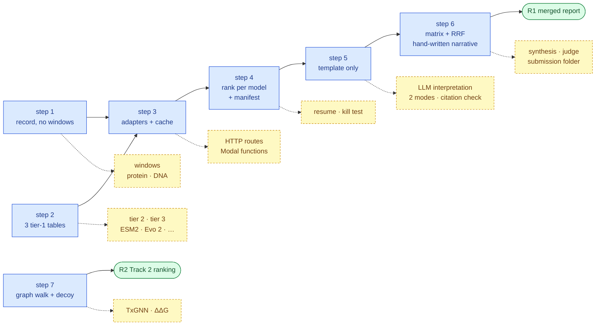
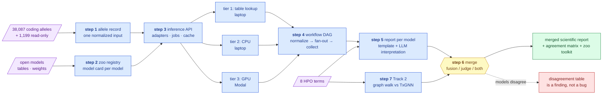
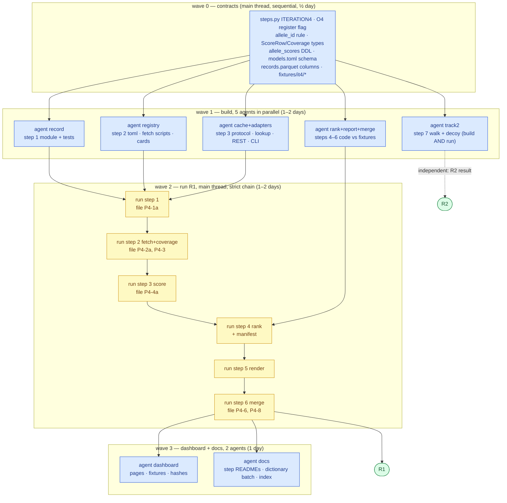

# Iteration 4 — the model zoo: every open model, one inference API, one merged report

**Standing:** **draft**, written 2026-09-13 with the user, question by question; **revised
2026-09-17** — MVP / optional split added (§1b and the *Scope* block of every step), missing
sections filled (§5b deliverables, §5c process rules, §11 ids, §12 open items); **revised
2026-09-18** — §7b parallel execution: build/run split, agent waves, file ownership. Nothing here is a
result; nothing is declared in `src/mva/science/steps.py` or filed in the register. Every number
quoted belongs to the entry it links. Next free global methodology number: **098**
(`097-copy-number-without-an-aligner.md` is the highest on disk, re-checked 2026-09-17 — re-check
again before filing). Claims are labelled `P4-x`; register ids are assigned at filing time, never
here (iteration 2's plan pre-assigned and collided).

Scope labels used throughout: **MVP** = on the critical path to a result, never cut;
**opt-A** = first additions once the MVP runs end-to-end; **opt-B** = nice-to-have, cut first.
A claim tagged **opt** is filed only if its substep runs.

Written for a software engineer. Domain terms appear as `technical term (plain meaning)` on first
use; the dictionary is [`../dictionary.md`](../dictionary.md).

Relation to other iterations: **none by design.** Iteration 4 reads the same warehouse tables
every iteration reads and writes its own; it does not consume iteration 2's open steps and does
not replay iteration 3's draft (which stays a draft — its feature-store idea is absorbed here as
step 1). It can start today and run beside anything.

---

## 1. The question, in one line

*Given the child's ~40k coding alleles and the confirmed BUB1B pair, what does every credible
open model say — run under one contract, with lineage — and what does a merged, reproducible
report conclude that no single model does?*

Nothing is trained or fine-tuned. Every model is a **frozen published artefact** (weights or a
precomputed score table). The learning in this iteration is *organisational*: one input format,
one API, one workflow, one report template, three merge methods. That is what makes it
reusable on the next case.

Decisions taken with the user on 2026-09-13 (they shape everything below):

| # | Decision | Chosen |
|---|---|---|
| D1 | Zoo scope | variant scorers + open LLM as **report writer** + Track 2 engines. No phenotype→gene tools (Exomiser/LIRICAL) this iteration. |
| D2 | GPU | **small paid**, Modal, $20–50 cap |
| D3 | API shape | **batch-first FastAPI**, job id, results cached in the warehouse; extends the existing `/api/jobs` pattern |
| D4 | Rigor | **report-both**: catalogue-free where a model allows it; ClinVar-trained scores flagged *catalogue-adjacent*; nothing held out because nothing is trained |
| D5 | Alleles | **coding + read-only**: 38,087 coding alleles + 1,199 alleles only the reads saw ([data-findings §6.3](../../ideation/data-findings.md)) |
| D6 | GPU models | Evo 2 1B · Nucleotide Transformer v2 500M · ESM-C · Boltz-2 |
| D7 | LLM | **two modes**, switchable: Nebius (open weights) through LiteLLM · Claude Code CLI / skill |
| D8 | Track 2 | PrimeKG graph walk **and** TxGNN, compared |
| D9 | Per-model report | fixed template; LLM fills one *interpretation* section only |
| D10 | Merge | **three methods behind one config key**: deterministic fusion + LLM synthesis · LLM-judged · fusion only |
| D11 | Workflow | own Python DAG, `mva.zoo`, checkpointed in the warehouse, resumable |
| D12 | Iteration | self-contained, runs any time |

---

## 1b. The MVP — the fewest steps that yield a result

**A result is:** one merged report that states, for every model that ran, the confirmed pair's
rank and percentile among the callset's biallelic pairs, the agreement matrix between models,
and the RRF consensus rank printed with and without catalogue-adjacent lanes — every number
traceable to a `warehouse.allele_scores` row with lineage. No LLM, no GPU, no HTTP route is
needed to reach it.

Two independent results, two critical paths:

| result | steps on the path | what the MVP of each step is | days |
|---|---|---|---|
| **R1 Track 1** merged report | 1 → 2 → 3 → 4 → 6 (step 5 = template only) | record without sequence windows · three tier-1 tables · adapter protocol + cache, no HTTP · rank-per-model + manifest, no resume · template without LLM section · deterministic merge (`fusion`), hand-written narrative | **7** |
| **R2 Track 2** ranking | 7 (graph walk + decoy) | PrimeKG walk over the card's MONDO node; decoy card; provenance | **2** |

R2 does not depend on R1 and can be dropped without touching R1; R1 does not need step 7.



> **Legend** — **blue solid = MVP** (the critical path); **yellow dashed = optional**, attached
> to the step that would host it; **green = the two results**. A dashed box never blocks a solid one.

The MVP is *not* a lesser iteration: it already delivers the reusable contract (record → adapter →
cache → rank → template → merge). Everything optional widens the zoo or automates prose.

---

## 2. The shape



> **Legend** — **purple = raw input** (the child's alleles and terms; the published models);
> **blue = machinery** (one step each; the three hosting tiers); **yellow = the decision point**
> (which merge method the config selects); **green = the goal**; **red = the honest path** —
> models disagreeing is reported as a result.

---

## 3. Terms a software engineer needs first

- **variant-effect predictor**: `f(allele) → damage score`. Most models here. A linter that
  scores one changed line.
- **precomputed scores**: the authors ran their model on every possible single-letter change and
  published the table. Lookup, no compute. Like a CDN cache of every response. Covers
  AlphaMissense, GPN-MSA, EVE, PrimateAI-3D, SpliceAI (SNVs), ESM1b (Brandes).
- **zero-shot inference**: forward pass of a frozen model on your input. Needed where the table
  has no row (insertions/deletions, unusual transcripts) or the model publishes no table.
- **protein language model (pLM)**: transformer over amino-acid strings (ESM2, ESM-C). Score =
  log-likelihood ratio of mutant vs wild-type residue.
- **DNA language model**: transformer over raw DNA windows (Evo 2, Nucleotide Transformer,
  GPN-MSA). Score = Δ log-likelihood of the window with and without the change. Only lane that
  scores non-coding DNA.
- **catalogue-adjacent**: a score whose training set included ClinVar (REVEL, CADD, ClinPred).
  It may "know" the answer. Reported, but flagged, and the merged rank is printed with and
  without it.
- **reciprocal rank fusion (RRF)**: merge N ranked lists by summing `1/(k + rank_i)`. No
  weights to tune, robust to scale differences. The transparent default.
- **model card**: one page per model — what it is, version, weights digest, licence, input,
  output, coverage, known failure modes. Ours are JSON rendered to the dashboard.

---

## 4. Steps — one goal each

| Step | Slug | Goal (one question) | Inputs |
|---|---|---|---|
| 1 | `step-1` | Can every allele in scope be expressed as **one normalized record** that every model class can read — genomic change, transcript, protein change, DNA window, protein window — with lineage? | VCF-derived tables, reads tables, reference FASTA, transcripts |
| 2 | `step-2` | Which open models are **credible, runnable, and licensed** for this case, and what is each one's coverage of the record set? | public model releases |
| 3 | `step-3` | Can one **batch inference API** serve every model through the same contract, cache every score with provenance, and dispatch GPU work to Modal without sending more than a sequence window? | step 1, step 2 |
| 4 | `step-4` | Does a **checkpointed DAG** run the whole zoo end-to-end, resumably, from one command — and what does it cost in wall-clock and dollars? | step 3 |
| 5 | `step-5` | Can one **report template** describe every model identically — coverage, distribution, the confirmed pair's rank and percentile, limitations — with an LLM writing only the interpretation, in both LLM modes? | step 4 tables, HPO terms |
| 6 | `step-6` | Do the models **agree**, and what does the **merged report** conclude under each of the three merge methods? | step 5 |
| 7 | `step-7` | Do a **graph walk and a GNN** over the same knowledge graph converge on the same approved drugs for the mechanism, and how does each rank against a decoy? | Track 2 card, PrimeKG, HPO terms |

---

## 5. The steps in detail

### Step 1 — the allele record

**Output schema** (`results.it4_allele_records`, one row per allele, all fields nullable except
the key):

| field | meaning | source |
|---|---|---|
| `allele_id` | stable hash of the change (the coordinate stays in `build/`; the id is what leaves) | derived |
| `gene`, `transcript`, `consequence` | which gene, which transcript, what kind of change | existing VEP layer 2 |
| `hgvs_c`, `hgvs_p` | the change spelled at cDNA and protein level (the notation every tool accepts) | VEP |
| `protein_window` | wild-type and mutant amino-acid string around the change (pLM input) | UniProt/Ensembl sequence + `hgvs_p` |
| `dna_window_ref`, `dna_window_alt` | 8,192-bp reference and altered sequence centred on the change (DNA-LM input) | reference FASTA (already pinned) |
| `is_read_only` | seen only by the raw reads, never by the VCF | `warehouse.it2_read_annotations` |
| `af_gnomad`, `clin_sig` | frequency, ClinVar class — the *catalogue* fields, stored but maskable | VEP |

**Method.** One module `mva.zoo.record` builds the row from existing tables plus the pinned
reference; a `--mask-catalogue` flag nulls `clin_sig` for catalogue-free runs. Sequence windows
live **only** in `build/it4/records.parquet` (patient sequence; coordinate gate covers it).

**Scope.**

| substep | label | why |
|---|---|---|
| `allele_id`, gene, transcript, consequence, `hgvs_c`/`hgvs_p`, `is_read_only`, catalogue fields, `--mask-catalogue` | **MVP** | every tier-1 lookup keys on these |
| lineage row + provenance manifest for `records.parquet` | **MVP** | repo rule |
| `protein_window` | opt-A | needed only by tier-2/3 pLMs (ESM2, ESM-C) |
| `dna_window_ref/alt` | opt-B | needed only by tier-3 DNA-LMs (Evo 2, NT-v2) |
| `P4-1` | opt (filed with the windows) | measures window completeness, not record completeness |

MVP claim instead: `P4-1a` ≥ 99 % of the 38,087 coding alleles get a non-null `hgvs_p` **or**
`hgvs_c` from the existing VEP layer; refuted below 95 % — then the missing class is named and
the tier-1 coverage figures are reported per class.

**Claims.**
- `P4-1` (opt) ≥ 98 % of coding alleles get a complete protein window; ≥ 99.5 % get both DNA
  windows. Refuted below 90 % / 95 % — then the record is two records (coding vs any) and the
  plan says so.

**Cost.** Laptop, one afternoon for the MVP; half a day more per window class. The pieces exist
(`pipeline/annotate_vep.py`, reference FASTA, `analysis_coding.py`).

**Ranking input, stated now.** Biallelic pairs come from the callset (`pipeline/compound_het.py`).
The 1,199 read-only alleles have no VCF partner, so in the MVP they are **scored but not paired**;
their per-model percentiles are reported in a separate table. Pairing a read-only allele with a
VCF allele of the same gene is opt-A and is filed as its own substep of step 4.

**Dictionary.** allele record, HGVS notation, sequence window, catalogue field.

### Step 2 — the zoo registry

One `models.toml` in `src/mva/zoo/`, one entry per model; a model card JSON generated from it
plus the observed coverage. Candidate roster (the *credible* check is a step-2 result, not
assumed):

| Model | Input class | Tier | Licence | Catalogue-adjacent? | Note |
|---|---|---|---|---|---|
| AlphaMissense | missense, precomputed | 1 | CC BY-NC-SA 4.0 | no (freq + structure) | hg38 table ~1 GB gz |
| ESM1b precomputed (Brandes 2023) | missense | 1 | MIT | no | per-gene files |
| EVE | missense, precomputed | 1 | MIT | no | ~3k genes only — coverage is the finding |
| PrimateAI-3D | missense, precomputed | 1 | check on fetch | no | |
| GPN-MSA | any SNV incl. non-coding, precomputed | 1 | check on fetch | no | the GPU-free DNA-LM lane |
| SpliceAI | splice, precomputed SNV + local indel | 1/2 | Illumina, non-commercial | no | Δ ≥ 0.2 recall cut (iteration 2 Z2) |
| Pangolin | splice, local | 2 | open | no | second splice opinion |
| REVEL · CADD v1.7 · ClinPred | missense / any | REST (VEP plugins) | mixed, CADD non-commercial | **yes** | flagged; ablated in merge |
| ESM2 650M | missense, zero-shot | 2 | MIT | no | laptop CPU, hours |
| RaSP / ThermoMPNN | ΔΔG stability on AlphaFold model | 2 | open | no | one protein; **hypomorph vs null** fact for Track 2 |
| Evo 2 1B | any, zero-shot DNA-LM | 3 | Arc open weights | no | H100 recommended by authors; minutes of use |
| Nucleotide Transformer v2 500M | any, zero-shot DNA-LM | 3 | CC BY-NC-SA | no | HF `transformers`, any GPU |
| ESM-C 600M | missense, zero-shot pLM | 3 | Cambrian non-commercial | no | newer than ESM2; agreement figure |
| Boltz-2 | structure, wild-type vs mutant BubR1 | 3 | MIT | no | **visual + confidence delta**, not a scorer; one protein |
| TxGNN · PrimeKG | disease node → drugs | 2/3 | MIT | n/a | step 7 |

**Scope.**

| substep | label | why |
|---|---|---|
| `models.toml` schema + card generator + licence manifest | **MVP** | the registry *is* the reusable part |
| **AlphaMissense**, **ESM1b (Brandes)**, **SpliceAI SNV** tables | **MVP** | three lanes = an agreement matrix and an RRF exist; two model classes (pLM, structure-aware, splice); all precomputed, laptop only |
| one catalogue-adjacent lane (REVEL **or** CADD via VEP REST plugin — whichever the REST layer already answers) | **MVP** | the with/without-adjacent ablation is a never-cut output |
| GPN-MSA, PrimateAI-3D, Pangolin | opt-A | widen tier 1/2 at download cost only |
| ESM2 650M (tier 2, CPU) | opt-A | first zero-shot lane; needs `protein_window` |
| EVE, RaSP/ThermoMPNN | opt-B | EVE coverage is a footnote; ΔΔG serves step 7 opt |
| Evo 2, NT-v2, ESM-C, Boltz-2 | opt-B | tier 3, Modal; cut order §7 |
| `P4-2` | opt (threshold re-stated for the MVP below) | the "≥ 8" target assumes optional lanes |

MVP claim instead: `P4-2a` all **four** MVP lanes run end-to-end on the record set on the laptop
in one day; refuted if any one cannot be fetched, licensed or joined — then that lane is replaced
from the opt-A list and the substitution is recorded.

**Claims.**
- `P4-2` (opt) ≥ 8 of the roster run end-to-end on the record set inside the budget; refuted below 5.
- `P4-3` Every precomputed missense table that runs covers ≥ 90 % of the callset's missense alleles
  **except EVE** (predicted < 30 %); refuted if any other table is below 70 %. MVP-filed for the
  two MVP missense tables; re-filed as a new revision as lanes are added.

**Cost.** Downloads (several GB, laptop), licence reading, one card per model. 1 day for the MVP
four; ~half a day per additional tier-1 lane.
Non-commercial terms: hackathon use is non-commercial; the public repo ships **fetch scripts and
digests, never the score files**.

**Dictionary.** model card, precomputed scores, catalogue-adjacent, non-commercial licence.

### Step 3 — the inference API

**Contract** (one for every model):

```
POST /api/zoo/score        {model: str, allele_ids: [..], mode: "catalogue-free"|"aware"}
                        →  {job_id}
GET  /api/zoo/jobs/{id}/wait → {rows: [{allele_id, model, version, score, aux, venue, ts}]}
GET  /api/zoo/models       → model cards + coverage
GET  /api/zoo/scores?allele_id=… → every model's row for one allele
```

**Adapter protocol** (`mva.zoo.adapters`, one module per model, ≤ 400 lines):

```python
class Adapter(Protocol):
    name: str; version: str; tier: Literal[1, 2, 3]
    def coverage(self, records) -> Coverage
    def score(self, records) -> Iterator[ScoreRow]      # tier 1/2: local
    def submit(self, records) -> RemoteJob               # tier 3: Modal
```

- **Tier 1** adapters = DuckDB lookup over the downloaded table (parquet-converted once).
- **Tier 2** = local process (ESM2 via `transformers` on CPU; RaSP; Pangolin).
- **Tier 3** = a Modal function per model, weights in a Modal volume, input = **sequence
  windows only** (never a coordinate, never HPO). Result parquet pulled back into the cache.
- **Cache** = `warehouse.allele_scores` (append-only: `allele_id, model, version, digest, score,
  aux json, venue, licence, run_id, ts`). A re-run with the same `(model, version, allele_id)`
  is a no-op. This *is* the feature store iteration 3 planned.
- **Lineage**: one `warehouse.data_lineage` row per `(model, version, run_id)`.

**Scope.**

| substep | label | why |
|---|---|---|
| `Adapter` protocol, `Coverage`/`ScoreRow` types, tier-1 DuckDB lookup adapter (one class, parameterised by table) | **MVP** | one adapter serves all MVP tables |
| `warehouse.allele_scores` cache + no-op on same key + lineage row per run | **MVP** | never cut (§7) |
| `mva-zoo score --model X` CLI (in-process, no server) | **MVP** | the DAG calls this; a result needs no HTTP |
| VEP REST plugin adapter (the adjacent lane) | **MVP** | reuses `annotate_vep.py` request layer |
| `GET /api/zoo/models`, `GET /api/zoo/scores` (read-only routes over the cache) | opt-A | dashboard reads; cheap once the cache exists |
| `POST /api/zoo/score` + `/jobs/{id}/wait` (batch job routes) | opt-A | needed only for dashboard-triggered runs |
| tier-2 local-process adapter (ESM2) | opt-A | with step 2 opt-A |
| Modal project, volumes, tier-3 `submit()` path, cost logging | opt-B | GPU lanes |
| `P4-4` | opt (Modal half); laptop half MVP-filed as `P4-4a` | |

MVP claim instead: `P4-4a` a cold MVP run (four lanes, ~40k records) completes in **≤ 1 h laptop
wall-clock** at zero dollars; refuted above 4 h — then the join is profiled and the fix recorded.

**Claims.**
- `P4-4` (opt) A cold full-zoo run over ~40k records costs **≤ $30 on Modal** and **≤ 8 h laptop
  wall-clock**; refuted above $50 or 24 h — then the cut order (§7) applies and the report
  prints the measured numbers.

**Cost.** 1 day for the MVP (protocol, lookup adapter, cache, CLI). +1 day HTTP routes,
+1 day Modal. The job plumbing exists (`viz/serve.py`, `/api/jobs`).

**Dictionary.** adapter, inference tier, batch job, cache key, volume.

### Step 4 — the workflow DAG

`mva.zoo.workflow`: stages as functions, each writes a table + lineage row, each idempotent.

```
normalize  →  registry-check  →  fan-out(score × model)  →  collect  →  rank-per-model
           →  report-per-model  →  merge  →  render
```

- `mva-zoo run --config zoo.toml` runs all; `--from collect` resumes; every stage prints its
  checkpoint. Same pattern as `annotate-coding`.
- **Rank-per-model**: for each model, the biallelic pairs of the callset (existing
  `pipeline/compound_het.py`) ranked by the model's pair score = `(min, max)` of the two allele
  scores → the confirmed pair's **rank and percentile** per model. This is the one number every
  report shares.
- A **run manifest** (`build/it4/runs/<run_id>.json`): config digest, model versions, venues,
  cost, wall-clock — the methods form's Q17 answer, measured.

**Scope.**

| substep | label | why |
|---|---|---|
| stages as functions, each writing a table + lineage row; `mva-zoo run` runs all in order | **MVP** | one command to a result |
| **rank-per-model** over `compound_het` pairs → confirmed pair's rank and percentile | **MVP** | the one number every report shares |
| run manifest (config digest, versions, venues, wall-clock, dollars = 0 for the MVP) | **MVP** | methods form Q17 |
| `--from <stage>` resume + skip-if-checkpoint-exists | opt-A | saves time once tier-2/3 lanes exist; MVP re-runs are minutes |
| kill-mid-fan-out test (`P4-5`) | opt-A | asserts the resume |
| read-only allele pairing with same-gene VCF alleles | opt-A | see step 1 |
| per-stage cost attribution for Modal lanes | opt-B | with tier 3 |

**Claims.**
- `P4-5` (opt) The DAG resumes from any stage without recomputation of finished stages (asserted
  by a test that kills it mid-fan-out).

**Cost.** 1 day for the MVP; +1 day resume and its test.

**Dictionary.** DAG, idempotent stage, checkpoint, run manifest.

### Step 5 — the report per model

**Template** (`docs/iteration4/reports/<model>.md`, rendered from `results.it4_model_reports`
JSON — same sections, same order, every model):

1. Model card (from step 2)
2. Inputs and coverage (fraction of records scored, by consequence class)
3. Score distribution (histogram; the two confirmed alleles marked)
4. **The confirmed pair**: rank among all biallelic pairs, percentile of each allele, catalogue-free
   and catalogue-aware if both apply
5. What the clinical terms say (the 8 HPO terms vs the gene — same sentence for every model,
   from `hpo_gene_scores.tsv`; a model that ignores phenotype says so)
6. **Interpretation** — the *only* LLM-written section, ≤ 200 words, every sentence cited to a
   row of sections 2–5 by id; generated in **both modes** and both kept
7. Limitations, licence, runtime, cost

**LLM modes** (`mva.zoo.narrate`, config `llm.mode`):
- `nebius`: LiteLLM → Nebius AI Studio, open-weights model named in config (e.g. a Qwen3 or
  Llama 3.3 checkpoint; the exact id recorded per run). Key from `NEBIUS_API_KEY`.
- `claude-code`: `claude -p` headless call, or a repo skill, with the same prompt and the same
  JSON. Model id recorded from the CLI's response.
- Prompt = the section JSON + the template rule "cite every sentence"; temperature 0; the prompt
  and reply are stored (`results.it4_narratives`) so the section is reproducible and auditable.
- **The LLM never sees a ranking task.** It knows MVA→BUB1B from training text; it is an
  explainer of numbers already computed, and the report says so.

**Scope.**

| substep | label | why |
|---|---|---|
| template sections 1–5 and 7, rendered from `results.it4_model_reports` JSON, one file per model | **MVP** | deterministic; every number is a table cell |
| histogram figure per model with the two confirmed alleles marked (`tools/render_it4_figures.py`) | **MVP** | report-ready material as it runs |
| section 6 *Interpretation* in **one** LLM mode (`claude-code`: no new key, no new dependency) | opt-A | prose automation, not a result |
| second mode (`nebius` via LiteLLM) + prompt/reply storage in `results.it4_narratives` | opt-A | the mode comparison D7 asked for |
| citation checker + `P4-7` | opt-A | filed with the modes |
| both modes on every model, side by side in the report | opt-B | |

In the MVP, section 6 is written by hand, signed *hand-written, 2026-MM-DD*, and the template
marks the slot so an LLM run later replaces it without changing sections 1–5 and 7.

**Claims.**
- `P4-6` Every catalogue-free lane places the confirmed pair in the **top decile** of biallelic
  pairs; refuted if any lane places it below the median — reported as that lane's blind spot.
  **MVP-filed** over the MVP lanes; new revision per added lane.
- `P4-7` (opt) Both LLM modes produce interpretations whose every sentence resolves to a cited row
  (checked mechanically); refuted if either mode's uncited-sentence rate exceeds 10 %.

**Cost.** 1 day for the MVP (template + renderer + figure); +1 day narrate module, both modes and
the citation checker.

**Dictionary.** report template, interpretation section, citation check, LLM mode.

### Step 6 — the merged report

**Deterministic layer (always computed):**
- **Agreement matrix**: Spearman ρ between every pair of models over shared alleles — a heat map.
- **Per-lane rank of the confirmed pair**: one bar chart, catalogue-free vs aware.
- **Fusion**: RRF over per-model pair rankings → the zoo's consensus rank; printed **with and
  without** catalogue-adjacent lanes.
- **Disagreement table**: alleles in the top 1 % of one lane and bottom half of another — a
  finding to explain, not to hide.

**Merge methods** (`merge.method` in config; all three implemented, one selected per run,
the others can be run for comparison):

| method | what it does | when |
|---|---|---|
| `fusion+synthesis` | deterministic layer + LLM synthesises the narrative from the per-model interpretations and the matrix, cited | default |
| `judge` | LLM reads the per-model reports and ranks the models by evidential value; its ranking and rationale are printed beside the RRF | comparison; flagged non-reproducible |
| `fusion` | deterministic layer only; narrative written by hand | fallback, no LLM |

**Scope.**

| substep | label | why |
|---|---|---|
| deterministic layer: agreement matrix (heat map), per-lane rank bar chart, RRF with/without adjacent, disagreement table | **MVP** | never cut (§7); this *is* R1 |
| `merge.method = fusion` (hand-written narrative) | **MVP** | no LLM needed for a result |
| merged report `docs/iteration4/report.md` with lineage to every table | **MVP** | the R1 artefact |
| `fusion+synthesis` (LLM narrative, cited) | opt-A | needs step 5 opt-A narrate module |
| `judge` method + `P4-9` | opt-B | flagged non-reproducible; cut order §7 |
| `submissions/track1/iteration-4/` folder: rehearsed CSV, methods form, decode table, README | opt-A | upload default is *no*; the folder is a rehearsal, not a result |

**Claims.**
- `P4-8` The RRF consensus places the confirmed pair **first** among biallelic pairs with
  catalogue-adjacent lanes excluded; refuted if outside the top 5 — the disagreement table names
  the lanes responsible. **MVP-filed** over the MVP lanes; new revision per added lane.
- `P4-9` (opt) Under `judge`, the LLM's model ranking correlates with the lanes' catalogue-free
  pair rank at Spearman ρ ≥ 0.5; refuted below 0.2 — the judge is then reported as uninformative.

**Outputs.** MVP: `docs/iteration4/report.md` (merged report, figures in `figures/it4/`).
opt-A: `submissions/track1/iteration-4/report.md` (+ PDF) built from it; methods form row
**model 4** — automated (yes), public models only (yes), runtime and cost from the run manifest.
**Upload default: no** — the pair is confirmed, a fourth upload carries no information about the
child ([`../iteration2/plan.md` §6](../iteration2/plan.md)). The folder is prepared and rehearsed;
the user decides.

**Cost.** 1 day for the MVP; +1 day synthesis and the folder; +1 day judge.

**Dictionary.** agreement matrix, reciprocal rank fusion, disagreement table, LLM-as-judge.

### Step 7 — Track 2, two engines, one graph

- **PrimeKG graph walk**: disease node (the card's MONDO id) → gene → pathway/protein → drug
  nodes; score = path count weighted by inverse degree; approved drugs only (openFDA label
  present, `mva.drugs` already has it). Deterministic; every path printable.
- **TxGNN** (pretrained weights, MIT): zero-shot indication prediction for the same node.
  Python 3.8 / DGL 0.5.2 → **Modal image**, one-day timebox; fallback = graph walk alone,
  recorded.
- **Decoy card**: both engines for an unrelated recessive gene's card; top-20 overlap = specificity.
- **Mechanism input**: RaSP/ThermoMPNN ΔΔG (step 2 lane) → hypomorph vs null → which drug
  direction (D1–D4 of the card) the evidence supports.

**Scope.**

| substep | label | why |
|---|---|---|
| PrimeKG download + digest, walk engine, approved-drug filter via `mva.drugs` | **MVP (R2)** | deterministic, laptop, every path printable |
| decoy card + top-20 overlap (`P4-11`) | **MVP (R2)** | the specificity control; never cut (§7) |
| `ressources/track2/ranking-walk.tsv` + provenance + overlap figure + Q14 section | **MVP (R2)** | the R2 artefact |
| TxGNN on Modal + `P4-10` | opt-B | one-day timebox; Python 3.8 / DGL image risk |
| ΔΔG (RaSP/ThermoMPNN) → hypomorph vs null → drug direction | opt-B | needs step 2 opt-B lane; without it the Q14 section says *direction not resolved by this iteration* |
| `submissions/track2/iteration-<n>/` folder (same layout as Track 1) | opt-A | when the ranking is upload-worthy; `tools/new_iteration.py` scaffolds it |

**Claims.**
- `P4-10` (opt) Graph walk and TxGNN share ≥ 3 approved drugs in their top 20; refuted at ≤ 1.
- `P4-11` Top-20 overlap with the decoy card ≤ 5; refuted above 10. **MVP-filed.**
- `P4-12` (MVP) The walk's top 20 contains ≥ 2 of the drug candidates already in
  `ressources/track2/drug_candidates.tsv` (iteration 2 step 7's literature-derived list); refuted
  at 0 — then either the graph or the literature list is wrong about the mechanism, and the
  report says which paths were expected and absent.

**Outputs.** MVP: `ressources/track2/ranking-walk.tsv` + provenance, overlap figure, the Q14
section (mechanism → pathway → consequence → drug direction). opt-B adds `ranking-txgnn.tsv`.

**Cost.** 2 days for the MVP; parallel from day 1 (Track 2 deadline ~2026-10-20 is the
earliest). +1 day TxGNN, +½ day ΔΔG wiring.

---

## 5b. Deliverables of iteration 4

| deliverable | label | where | source of truth |
|---|---|---|---|
| allele records | MVP | `build/it4/records.parquet` (gitignored) + `results.it4_allele_records` | step 1 entry |
| zoo registry + cards + licence manifest | MVP | `src/mva/zoo/models.toml`, `docs/iteration4/cards/<model>.json` | step 2 entry |
| score cache | MVP | `warehouse.allele_scores` (append-only) + `warehouse.data_lineage` rows | step 3 entries |
| run manifest | MVP | `build/it4/runs/<run_id>.json`; copied coordinate-free to `docs/iteration4/runs/` | step 4 entry |
| per-model reports + histograms | MVP | `docs/iteration4/reports/<model>.md`, `figures/it4/` | step 5 entry |
| merged report R1 | MVP | `docs/iteration4/report.md` | step 6 entry |
| Track 2 ranking R2 + decoy figure | MVP | `ressources/track2/ranking-walk.tsv` + `.provenance.json` | step 7 entry |
| dashboard: `/track1/<iteration>/step-<n>` pages for iteration 4, zoo cards page, agreement-matrix view, lineage view | MVP (one page per step, as each step closes) | `app/` | `GET /api/…` over the warehouse |
| dictionary entries (every term listed per step) | MVP | `docs/dictionary.md` | |
| `submissions/track1/iteration-4/` rehearsed folder | opt-A | | `tools/check_iteration.py` green |
| `submissions/track2/iteration-<n>/` | opt-A | | same gate |
| narratives (prompt + reply, both modes) | opt-A | `results.it4_narratives` | step 5 entry |
| Modal volumes list in the **data-deletion checklist** | with tier 3 | `docs/notes/data-deletion-checklist.md` (create if absent; check `docs/README.md` for an owner first) | |
| reusable toolkit `mva.zoo` (`record`, `registry`, `adapters/`, `cache`, `workflow`, `rank`, `report`, `merge`, `narrate`) | MVP minus `narrate` | `src/mva/zoo/`, each ≤ 400 lines, tested | |

## 5c. Process rules this iteration honours

- **Declare before running.** Seven `Step` entries with `iteration="iteration4"` go into
  `src/mva/science/steps.py` (`ITERATION4`, registered in `STEPS_BY_ITERATION`) *before* step 1
  runs. `ITERATION` stays `"iteration2"` until the user says otherwise — iteration 4 steps carry
  their iteration explicitly, which the `Step.iteration` field already supports. Iteration 3 is
  **not** declared (draft absorbed here; its plan stays a draft and says so).
- **Register.** Every `P4-x` is filed with `mva-science hypothesis-add` before its test, with the
  refutation condition quoted from this plan; MVP claims first, opt claims only when the substep
  is scheduled. Open item O4 (the `--iteration` flag) is settled before the first filing.
- **Methodology.** One entry per test, `docs/iteration4/step-<n>/methodology/0NN-*.md`, numbered
  from 098 globally; hypothesis, prediction and refutation sections written before the run.
- **Both sources.** Every per-model report carries section 5 (the eight HPO terms vs the gene);
  every model that ignores phenotype says so in one sentence. The Track 2 Q14 section names the
  HPO terms the mechanism explains.
- **Lineage.** One `data_lineage` row per table write; one per `(model, version, run_id)`;
  the report's every figure names its script and source table.
- **Coordinates and sequence.** `build/it4/` is the only home of records, windows and raw scores;
  `allele_id` is the only key that leaves. `tools/check_coordinates.py` runs before every commit.
- **Dashboard first-class.** A step is not closed until its `/track1/<iteration>/step-<n>` page renders from
  the live API and its fixture is re-captured and re-blessed.
- **Cuts are recorded.** A substep dropped from the plan is a one-line note in the step's
  README with the reason and the date, never a silent omission.

---

## 6. Hosting, honestly

Machine: arm64, 16 GiB, no Docker, no GPU. Tiers:

| tier | where | what | cost |
|---|---|---|---|
| 1 | laptop, DuckDB over parquet | all precomputed tables | disk only (~10 GB) |
| 2 | laptop CPU | ESM2 650M (hours), RaSP, Pangolin, SpliceAI indels, graph walk | electricity |
| 3 | **Modal** | Evo 2 1B (H100 per the authors' stack; A100 to try), NT-v2 500M, ESM-C 600M, Boltz-2, TxGNN | on-demand GPU, minutes per model; H100 ≈ $4/h, A100 ≈ $2/h at time of writing — **verify on signup**; Modal starter credits, if still offered, may cover it |

Rules for tier 3:
- input = sequence windows + `allele_id` only; no coordinate, no HPO, no VCF.
- every Modal volume is listed in the **data-deletion checklist** (challenge rule: delete all
  data everywhere within 30 days of close — [intel](../../ideation/hackathon-intel.md)).
- every function logs GPU type, seconds, and dollars into the run manifest.

---

## 7. Order, cost, cut order

**MVP first, in this order** (R1 critical path + R2 in parallel):

| # | work | label | blocked by | days |
|---|---|---|---|---|
| 1 | step 1 record (no windows) + declare steps in `steps.py` + file MVP claims | MVP | — | 1 |
| 2 | step 2 registry + 4 MVP tables + cards + licence manifest | MVP | — (parallel) | 1 |
| 3 | step 7 graph walk + decoy + R2 outputs | MVP (R2) | — (parallel, day 1) | 2 |
| 4 | step 3 adapter protocol + lookup adapter + REST adapter + cache + CLI | MVP | 1, 2 | 1 |
| 5 | step 4 `mva-zoo run` + rank-per-model + manifest | MVP | 4 | 1 |
| 6 | step 5 template + renderer + histograms | MVP | 5 | 1 |
| 7 | step 6 deterministic merge + `report.md` (R1) | MVP | 6 | 1 |
| 8 | dashboard pages + dictionary + step READMEs, as each step closes | MVP | each step | 1½ |

**R1 in 7 laptop days, R2 in 2 (parallel); $0.**

**Then, opt-A** (each independent unless noted):

| # | work | blocked by | days |
|---|---|---|---|
| A1 | step 1 `protein_window` + step 2 ESM2 + step 3 tier-2 adapter | 4 | 1½ |
| A2 | step 2 GPN-MSA, PrimateAI-3D, Pangolin lanes | 4 | 1½ |
| A3 | step 3 read-only HTTP routes, then batch job routes | 4 | 1 |
| A4 | step 4 resume + kill test (`P4-5`) | 5 | 1 |
| A5 | step 5 narrate: `claude-code` mode, then `nebius`, citation checker (`P4-7`) | 6 | 1½ |
| A6 | step 6 `fusion+synthesis` + `submissions/track1/iteration-4/` rehearsed | A5 | 1 |
| A7 | read-only allele pairing | 5 | ½ |

**Then, opt-B:**

| # | work | blocked by | days |
|---|---|---|---|
| B1 | step 1 DNA windows + Modal project + tier-3 adapters: NT-v2 first (plain `transformers`), Evo 2 second | A1 | 2 |
| B2 | ESM-C, Boltz-2 on Modal | B1 | 1 |
| B3 | EVE, RaSP/ThermoMPNN + ΔΔG → drug direction | 4 | 1 |
| B4 | TxGNN on Modal (`P4-10`) | B1 | 1 |
| B5 | `judge` merge (`P4-9`) | A5 | ½ |

Full plan ≈ **7 + 8 + 5½ ≈ 20½ laptop days**; Modal spend target ≤ $30, all of it in opt-B.

**Cut order, pre-registered (opt-B first, then opt-A):** Boltz-2 → TxGNN (walk stays) → ESM-C
(ESM2 stays) → `judge` → Evo 2 (NT-v2 stays — it needs no custom CUDA stack; R1 reversed
against the 09-13 draft) → EVE / RaSP → PrimateAI-3D → `nebius` mode (`claude-code` stays) →
HTTP job routes → resume test.
**Never cut (= the MVP):** the allele record, the cache with provenance, the per-model template,
the agreement matrix, RRF with/without adjacent lanes, the decoy card, the run manifest, one
dashboard page per step. *Both LLM modes' stored prompts* move from never-cut to opt-A: an
iteration without an LLM still has a result.

The day counts above are **sequential** days. §7b shows how parallel agents compress them.

---

## 7b. Parallel execution — what runs beside what, and what waits

**The one idea: split every step into *build* and *run*.** Code (a module, its tests, its
dashboard page) can be written by parallel agents against **pinned contracts and synthetic
fixtures**; the *runs* that produce results form a strict data chain and are executed one after
another by the main thread, which is also the only writer of methodology entries and register
rows. Nothing waits on real data to be *built*; everything waits on real data to be *run*.

### Waves



> **Legend** — **blue = build work**, parallelisable, disjoint files; **yellow = a run that
> produces a result and files a claim** (main thread, one at a time, in data order); **green =
> the two results**. Solid arrows = must wait; dashed = independent.

| wave | who | what | waits for | wall-clock |
|---|---|---|---|---|
| 0 | main thread | pin every shared interface (list in the diagram); write `fixtures/it4/` — 200 synthetic allele records (allowlisted coordinates), a 50-row fake score table per MVP lane, a 20-pair `compound_het` sample; declare steps; settle O4 | — | ½ day |
| 1 | 5 agents | build steps 1–7 against the fixtures; each agent's tests pass on fixtures alone; agent *track2* also **runs** (its inputs are public) | wave 0 | 1–2 days |
| 2 | main thread | the R1 data chain, one run per step, each filing its entry and claims before the next starts | wave 1 agents *record*, *registry*, *cache+adapters* for R1–R3; *rank+report+merge* for R4–R6 | 1–2 days |
| 3 | 2 agents | dashboard pages from the live API + fixture re-capture; READMEs, dictionary, index | wave 2 (real shapes to render) | 1 day |

**R1 in ≈ 4 wall-clock days instead of 7; R2 lands during wave 1.**

### Why the chain in wave 2 is strict

| run | needs from the previous run |
|---|---|
| step 2 coverage | real `allele_id` set and `hgvs_p` from step 1 to compute coverage per table |
| step 3 score | records **and** downloaded, parquet-converted tables |
| step 4 rank | the full `allele_scores` cache for every MVP lane — a partial cache gives a wrong percentile |
| step 5 render | `rank-per-model` table + coverage |
| step 6 merge | every per-model report's rank row; the agreement matrix needs all lanes at once |

A step's **claim is filed and its verdict recorded before the next run starts** — that is what
keeps the register append-only and the entries reproducible. The runs are minutes each; the chain
is strict for integrity, not for compute.

### Optional work — parallel groups

Once wave 2 closes, opt-A items are independent agents except where noted:

| group | agents in parallel | waits for |
|---|---|---|
| G1 | A1 ESM2 lane (window + adapter + models.toml entry) · A2 more tier-1 tables · A7 read-only pairing | R1 closed |
| G2 | A3 HTTP routes · A4 resume + kill test | R1 closed; disjoint from G1 |
| G3 | A5 narrate (`claude-code` then `nebius`, checker) | R1 closed; **serial inside**: checker after first mode |
| G4 | A6 synthesis + submission folder | G3 |
| re-run | main thread: re-run the chain from step 3 with new lanes; re-file `P4-3`, `P4-6`, `P4-8` as new revisions | G1 |
| opt-B | B1 Modal + NT-v2 → B2 ESM-C/Boltz-2 → B4 TxGNN (serial: one Modal project, one image lineage) · B3 EVE/ΔΔG parallel to B1 · B5 judge after G3 | G1 (windows) |

### File ownership — one writer per path

| path | owner | others |
|---|---|---|
| `src/mva/science/steps.py`, `src/mva/zoo/__init__.py`, `src/mva/zoo/types.py`, `warehouse` DDL, `fixtures/it4/` | main thread, wave 0 | read-only afterwards |
| `src/mva/zoo/record.py` + tests | agent *record* | — |
| `src/mva/zoo/models.toml`, `registry.py`, `tools/fetch_zoo_tables.py`, `docs/iteration4/cards/` | agent *registry* | later lanes append a `models.d/<model>.toml` fragment, never edit the shared file |
| `src/mva/zoo/adapters/*.py` (one module per model), `cache.py`, `cli.py` | agent *cache+adapters* | a new lane = a new adapter file, no shared edit |
| `src/mva/zoo/workflow.py`, `rank.py`, `report.py`, `merge.py`, `tools/render_it4_figures.py` | agent *rank+report+merge* | — |
| `src/mva/drugs/graph_walk.py`, `ressources/track2/ranking-walk.*`, `figures/it4/track2-*` | agent *track2* | — |
| `docs/iteration4/step-<n>/methodology/`, register rows, `build/it4/` real data | **main thread only** | agents never file entries or touch patient data |
| `docs/dictionary.md`, `docs/README.md`, `docs/iteration4/README.md` | agent *docs* (wave 3) | wave-1 agents write their terms into `docs/iteration4/step-<n>/terms.draft.md`; *docs* merges once |
| `app/src/**` | agent *dashboard* (wave 3) | wave-1 agents may add API routes under `src/mva/viz/api_zoo*.py` only |

Rules every agent gets in its brief (from the standing memory on parallel sessions):
- pinned contract quoted verbatim, files listed, **nothing outside the list**;
- a status file `build/it4/agents/<name>.md` (what ran, what passed, what is blocked);
- stage by explicit path, never `git add -A`; `tools/check-python.sh` green before reporting;
- no methodology entry, no register row, no real data — report the command that the main
  thread should run instead.

### Shared hot spots, and how they are avoided

| hot spot | risk | rule |
|---|---|---|
| `models.toml` | two lanes edit one file | registry reads `models.toml` **plus** `models.d/*.toml`; one fragment per later lane |
| `dictionary.md` ordering (each term after its dependencies) | five agents inserting concurrently break the order | drafts per step; one merge pass by *docs* |
| `warehouse.data_lineage`, `allele_scores` | concurrent writers on one DuckDB file | only the main thread's runs write; agents write fixtures to `build/it4/fixtures.duckdb` |
| methodology numbers | two entries claim 098 | main thread files; numbers assigned at filing, in wave 2 order |
| `app/src/test/fixtureHashes.json` | any two app edits collide | one dashboard agent, wave 3 |

---

## 8. Quality gates

| gate | rule | why |
|---|---|---|
| coordinate gate | `tools/check_coordinates.py`; `build/it4/` holds records, windows, raw scores | no patient position or sequence in git |
| provenance | every `allele_scores` row: model, version, digest, licence, venue, run_id | a score without its source is not a result |
| catalogue flag | every lane's card says adjacent yes/no; merge prints both ranks | the leak a reviewer checks first |
| citation check | every LLM sentence resolves to a row id; failure rate printed | the LLM explains, never invents |
| cost manifest | dollars and seconds per model per run | methods form Q17, scalability |
| licence manifest | one line per model; non-commercial terms named | recorded, not discovered |
| module size / layering | ≤ 400 lines; `mva.zoo` imports `io`, `pipeline`, `warehouse`; nothing imports `mva.viz` | repo rules |
| figure freshness | producing script + source table named | inherited |

---

## 9. Reusability — what transfers to the next case

Change the inputs, not the code:

- `mva.zoo.record` — any VCF-derived allele table + pinned reference → allele records
- `models.toml` + adapters — add a model = add a TOML entry + one ≤ 400-line adapter
- `mva-zoo run` — one command, resumable, costed
- report template + narrate — same sections for any case; LLM mode is a config key
- merge — three methods, one flag
- Track 2 engines — any MONDO node

---

## 10. Risks named now

| # | risk | mitigation |
|---|---|---|
| R1 | Evo 2 needs the authors' CUDA stack (H100-class); fails on cheaper GPUs | NT-v2 is the first tier-3 DNA-LM (plain `transformers`); Evo 2 second, A100 then H100 for minutes; Evo 2 is cut before NT-v2 (§7, reversed 2026-09-17) |
| R9 | MVP lanes are all missense/splice: a non-coding or in-frame indel allele of the confirmed pair scores in no MVP lane | step 1 reports the confirmed alleles' consequence classes on day 1; if a lane gap hits the pair, GPN-MSA (opt-A) is promoted into the MVP and the promotion is recorded |
| R10 | REVEL/CADD not in the warehouse; the VEP REST plugin may not answer for indels | the adjacent lane is MVP for missense only; the ablation is reported over the alleles it covers |
| R2 | catalogue leakage through REVEL/CADD/ClinPred | flagged lanes; merged rank printed with and without |
| R3 | LLM "knows" BUB1B | LLM never ranks; citation check; both modes' prompts stored |
| R4 | non-commercial licences | manifest; fetch scripts only in the public repo |
| R5 | patient sequence on third-party GPU | windows only; volumes on the deletion checklist |
| R6 | Modal cost overrun | hard cap in config; manifest per run; `P4-4` |
| R7 | precomputed tables large (GPN-MSA several GB; CADD whole-genome ~80 GB — **not** downloaded, REST plugin instead) | tier 1 = parquet subset for the ~40k records only |
| R8 | time, beside iteration 2 | Track 2 day 1; cut order §7 |

---

## 11. Papers and tools (verified ids reused from the iteration-3 bibliography; new ones marked)

| item | id | role |
|---|---|---|
| AlphaMissense, Cheng 2023 | PMID 37733863 | tier-1 missense |
| ESM2, Lin 2023 | PMID 36927031 | tier-2 pLM |
| ESM1b variant effects, Brandes 2023 | PMID 37563329 | tier-1 pLM table |
| GPN-MSA, Benegas 2025 | PMID 39747647 | tier-1 DNA-LM |
| SpliceAI, Jaganathan 2019 | PMID 30661751 | splice |
| Pangolin, Zeng & Li 2022 | PMID 35449021 | splice |
| CADD v1.7, Schubach 2024 | PMID 38183205 | adjacent |
| REVEL, Ioannidis 2016 | PMID 27666373 | adjacent |
| ClinPred, Alirezaie 2018 | PMID 30220433 | adjacent |
| PrimateAI-3D, Gao 2023 | PMID 37262156 | tier-1 missense |
| Nucleotide Transformer, Dalla-Torre 2025 | PMID 39609566 | tier-3 DNA-LM |
| RaSP, Blaabjerg 2023 | PMID 37184062 | ΔΔG |
| ThermoMPNN, Dieckhaus 2024 | PMID 38285937 | ΔΔG |
| TxGNN, Huang 2024 | PMID 39322717 | Track 2 |
| PrimeKG, Chandak 2023 | PMID 36732524 | Track 2 |
| Evo 2, Brixi et al. | bioRxiv 10.1101/2025.02.18.638918; *Nature* 2026 — **PMID to fetch** (opt-B lane; fetch when scheduled) | tier-3 DNA-LM |
| Boltz-2, Passaro et al. 2025 | bioRxiv 10.1101/2025.06.14.659707 — **from memory, verify by Crossref before citing** | structure |
| ESM-C, EvolutionaryScale 2024 | technical release, no paper — record `github.com/evolutionaryscale/esm` tag + weights digest at fetch | tier-3 pLM |
| RRF, Cormack, Clarke & Buettcher 2009 | SIGIR, DOI 10.1145/1571941.1572114 — **from memory, verify by Crossref before citing** | merge |
| LiteLLM, Modal, Nebius AI Studio | software — versions recorded per run | plumbing |

**Verification status (2026-09-17):** the PMIDs above the Evo 2 row were verified by iteration 3's
E-utilities batch on 2026-09-13 and are reused unchanged. The two DOIs marked *from memory* were
**not** checked against any service in this revision; the step that first cites one runs the
check and records it in its methodology entry. MVP steps cite only verified rows (AlphaMissense,
ESM1b, SpliceAI, REVEL or CADD, PrimeKG) plus RRF, so the RRF DOI check lands in step 6's entry.

`paper-analyst` reports go to `papers/iteration4/` before the step that leans on each; MVP
needs AlphaMissense, ESM1b (Brandes), SpliceAI, PrimeKG.

---

## 12. Open before declaring steps

| # | question | plan default |
|---|---|---|
| O1 | Which Nebius model id for `nebius` mode (opt-A) | largest open-weights instruction model available at run time; recorded |
| O2 | Optional dependency groups | **two**: `zoo` (`duckdb` only — MVP, laptop) and `zoo-ml` (`transformers`, `torch`, `litellm`, `modal`); base install unchanged |
| O3 | Upload as model 4 | prepare, rehearse (opt-A), **do not upload** unless the user decides |
| O4 | Register CLI needs `--iteration iteration4` on `hypothesis-add` / `check` | one step-0 platform entry naming iteration 4 step 1; **blocks the first MVP filing** — settle on day 1 |
| O5 | Which adjacent lane is MVP: REVEL or CADD | whichever the existing VEP REST layer returns for the callset's missense alleles without a new plugin request; check on day 2, record |
| O6 | Decoy card gene for step 7 | an autosomal-recessive gene with a MONDO disease node, no mitosis/SAC role, no shared pathway with BUB1B in PrimeKG; candidate chosen and justified in step 7's first entry, never here |
| O7 | Does the confirmed pair fall in an MVP lane's consequence class (R9) | step 1 day-1 output decides whether GPN-MSA is promoted |
| O8 | `ITERATION` constant | stays `"iteration2"`; iteration 4 steps carry `iteration="iteration4"` explicitly (§5c) |
| O9 | Owner doc for the data-deletion checklist | `docs/README.md` index checked before creating `docs/notes/data-deletion-checklist.md`; only needed once tier 3 runs |
