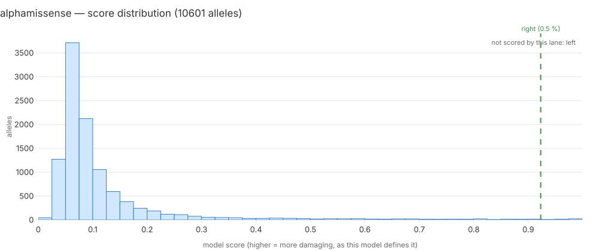

# alphamissense — model report

**Case:** Mosaic Variegated Aneuploidy — challenge proband 1; confirmed pair gene `BUB1B`.

**Standing:** generated 2026-09-20T13:25:43+00:00 by `mva.zoo.report.render_model_report` from run `it4-5e25dd45eee2`, catalogue mode `catalogue-free`.

Every number below is a key of `it4_model_reports.report_json` for this run. Section 6 is the only written section.

## 1. Model card

| field | value |
|---|---|
| name | AlphaMissense |
| version | AlphaMissense hg38 2023 |
| inference tier | 1 |
| licence | CC-BY-NC-SA-4.0 |
| catalogue-adjacent | no |
| reference (PMID) | 37733863 |

Already in the warehouse: iteration 2 ran the VEP AlphaMissense plugin, so this lane is a
column read and needs no download. 10,601 of 38,087 annotated alleles carry a score — that
is the missense share of a coding callset, not a failure. Coverage is measured against the
missense records only (plan P4-3, target >= 90%). Failure mode: a record whose consequence
is missense but whose row predates the iteration-2 annotation pass reads null.

## 2. Inputs and coverage

Scored **10601 of 39286** allele records (27.0%).

| consequence class | scored | records | fraction |
|---|---|---|---|
| `3_prime_UTR_variant` | 0 | 555 | 0.0% |
| `5_prime_UTR_variant` | 0 | 235 | 0.0% |
| `coding_sequence_variant` | 0 | 4 | 0.0% |
| `downstream_gene_variant` | 0 | 5 | 0.0% |
| `frameshift_variant` | 0 | 564 | 0.0% |
| `incomplete_terminal_codon_variant` | 0 | 2 | 0.0% |
| `inframe_deletion` | 0 | 277 | 0.0% |
| `inframe_insertion` | 0 | 211 | 0.0% |
| `intergenic_variant` | 0 | 1 | 0.0% |
| `intron_variant` | 0 | 5490 | 0.0% |
| `mature_miRNA_variant` | 0 | 2 | 0.0% |
| `missense_variant` | 10601 | 15620 | 67.9% |
| `non_coding_transcript_exon_variant` | 0 | 129 | 0.0% |
| `protein_altering_variant` | 0 | 5 | 0.0% |
| `splice_acceptor_variant` | 0 | 128 | 0.0% |
| `splice_donor_5th_base_variant` | 0 | 121 | 0.0% |
| `splice_donor_region_variant` | 0 | 423 | 0.0% |
| `splice_donor_variant` | 0 | 122 | 0.0% |
| `splice_polypyrimidine_tract_variant` | 0 | 385 | 0.0% |
| `splice_region_variant` | 0 | 2455 | 0.0% |
| `start_lost` | 0 | 51 | 0.0% |
| `stop_gained` | 0 | 289 | 0.0% |
| `stop_lost` | 0 | 131 | 0.0% |
| `stop_retained_variant` | 0 | 35 | 0.0% |
| `synonymous_variant` | 0 | 12036 | 0.0% |
| `upstream_gene_variant` | 0 | 10 | 0.0% |

A class with a low fraction is this lane's blind spot, stated rather than averaged away: a pair with an unscored half is excluded from this lane's ranking, never scored zero.

## 3. Score distribution

10601 scored alleles; min 0.0001, mean 0.120464, max 0.9992.

| quantile | score |
|---|---|
| p01 | 0.0313 |
| p10 | 0.048 |
| p25 | 0.0588 |
| p50 | 0.0774 |
| p75 | 0.118 |
| p90 | 0.2125 |
| p99 | 0.8141 |

The confirmed pair's two alleles, marked on the histogram:

| allele | half | score | percentile |
|---|---|---|---|
| `addc19de8fa29228` | left | — | — |
| `93e077ae83ac2642` | right | 0.9229 | 0.47 % |

## 4. The confirmed pair

This lane did not score both halves of the confirmed pair (`BUB1B`), so it is recorded as having **no opinion** on it — not a bad one. 10333 pairs were ranked here.

| half | percentile among this lane's scored alleles |
|---|---|
| left | — |
| right | 0.47 % |

Percentile is a position from the top: rank 1 of 20 is 5.00 %. The pair score is `(min, max)` of the two allele scores, sorted by `min` first — a pair is only as damaging as its weaker half.

Catalogue mode: `catalogue-free`.

## 5. What the clinical terms say

Against the child's 8 HPO terms, `BUB1B` ranks #14 of 5267 genes considered (phenotype score 0.36093, term set `with-parental`, `warehouse.hpo_gene_scores`). `alphamissense` scores the molecular change only and never sees the phenotype, so this line is context for the reader, not an input to the score above.

## 6. Interpretation

This section exists in more than one version — the numbers above are identical for all of them. Each version carries a badge saying who wrote it, in which mode, and how many of its sentences resolve to a row of sections 2-5 (`mva.zoo.narrate_check`).

### 6.1 Generated — mode `claude-code`, model `claude-opus-5[1m]`, 9/9 sentences cited

<!-- interpretation: generated 2026-09-19 | llm:claude-code | model:claude-opus-5[1m] | cited 9/9 -->

This lane scored 10601 of 39286 allele records, about 27.0% of the set [cov.scored][cov.total][cov.fraction]. All of those scores fall on missense records, of which the lane covered 67.9% [cov.missense_variant]. It returned no score at all for synonymous, intron, frameshift, splice region, splice donor region and 3' UTR records [cov.synonymous_variant][cov.intron_variant][cov.frameshift_variant][cov.splice_region_variant][cov.splice_donor_region_variant][cov.3_prime_UTR_variant]. Silence on those classes is absence of evidence, not evidence of harmlessness [cov.synonymous_variant][cov.intron_variant]. Across the 10601 scored alleles, scores run from 0.0001 to 0.9992, with a median of 0.0774, a mean of 0.120464, a p90 of 0.2125 and a p99 of 0.8141, so most scores sit low [dist.n][dist.min][dist.max][dist.p50][dist.mean][dist.p90][dist.p99]. For the confirmed pair in the gene `BUB1B`, only the right half was scored, at 0.9229, percentile 0.47%, while the left half was not scored and has no percentile [pair.gene][dist.mark.right][dist.mark.left][pair.left_percentile]. The lane ranks 10333 biallelic pairs but has no rank for this one, and is recorded as having no opinion rather than a bad one, because pairs with an unscored half are excluded, not scored zero [pair.n_ranked][pair.rank]. The run was scored in `catalogue-free` mode, which nulls every field a ClinVar-trained model could have learned from [pair.mode]. A separate phenotype line is context for the reader, not an input to these scores [hpo.rank].

### 6.2 Hand-written

<!-- interpretation: hand-written 2026-09-19 | llm:none -->

**Citation rule:** every sentence names the section and row it rests on.

This lane scores 27.0 % of the record set and 67.9 % of its own class, missense
(§2) — a coverage gap that is a property of this delivery, not of the published
table. On the alleles it does score it is decisive about the confirmed pair's
missense half: 0.9229, the **top 0.47 %** of 10,601 scored alleles (§3, marks).
It has nothing at all to say about the partner allele, which is a `stop_gained`
change and outside a missense model's domain (§3, marks, left = —). Because a
pair is only as damaging as its weaker half, the lane is recorded as having **no
opinion** on the pair rather than a bad one, and 53,014 of 63,347 pairs leave its
ranking for the same reason (§4). Read together, §3 and §4 say something sharper
than either alone: the lane's verdict on the half it can see is close to maximal,
and the MVP roster gives it no way to turn that into a verdict on the pair. The
phenotype ranks `BUB1B` #14 of 5,267 independently of all of this (§5).

_hand-written 2026-09-19_

Only this section is written rather than computed. Sections 1-5 and 7 are rendered from the stored JSON and change only when a number changes.

## 7. Limitations, licence, runtime, cost

| field | value |
|---|---|
| licence | CC-BY-NC-SA-4.0 |
| venue | laptop |
| wall-clock (s) | 0 |
| cost (USD) | 0 |
| run id | `it4-5e25dd45eee2` |

- Scored 27.0% of the record set; the unscored remainder is this lane's blind spot and its pairs are excluded from the ranking, not scored zero.
- 53014 biallelic pairs had an unscored half and left this ranking.
- Ran on `laptop` at zero marginal cost.
