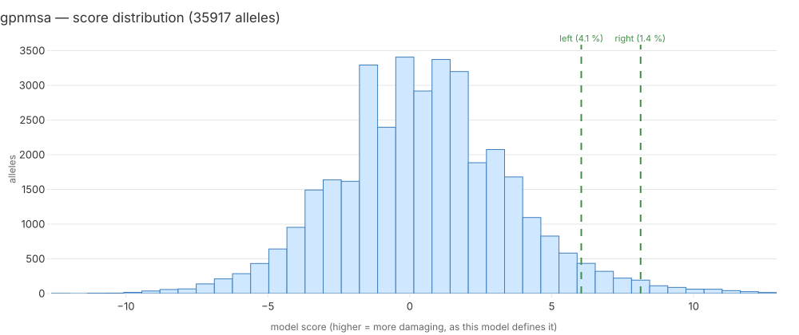

# gpnmsa — model report

**Case:** Mosaic Variegated Aneuploidy — challenge proband 1; confirmed pair gene `BUB1B`.

**Standing:** generated 2026-09-20T13:25:43+00:00 by `mva.zoo.report.render_model_report` from run `it4-5e25dd45eee2`, catalogue mode `catalogue-free`.

Every number below is a key of `it4_model_reports.report_json` for this run. Section 6 is the only written section.

## 1. Model card

| field | value |
|---|---|
| name | GPN-MSA |
| version | GPN-MSA hg38 precomputed scores (songlab) |
| inference tier | 1 |
| licence | MIT |
| catalogue-adjacent | no |
| reference (PMID) | 39747647 |

The GPU-free DNA language model lane: precomputed scores for all ~9 billion possible SNVs in
GRCh38, columns chrom/pos/ref/alt/score, bgzipped TSV with a tabix index alongside
(`scores.tsv.bgz.tbi`). URL found 2026-09-18 from the dataset card; size not stated there —
verify on fetch. This is the one tier-1 lane that also scores non-coding and synonymous
alleles, so it is the widest coverage on the roster. Keying on the coordinate means the join
happens inside `build/it4/` and only `allele_id` leaves.

## 2. Inputs and coverage

Scored **35917 of 39286** allele records (91.4%).

| consequence class | scored | records | fraction |
|---|---|---|---|
| `3_prime_UTR_variant` | 486 | 555 | 87.6% |
| `5_prime_UTR_variant` | 203 | 235 | 86.4% |
| `coding_sequence_variant` | 0 | 4 | 0.0% |
| `downstream_gene_variant` | 4 | 5 | 80.0% |
| `frameshift_variant` | 0 | 564 | 0.0% |
| `incomplete_terminal_codon_variant` | 1 | 2 | 50.0% |
| `inframe_deletion` | 0 | 277 | 0.0% |
| `inframe_insertion` | 0 | 211 | 0.0% |
| `intergenic_variant` | 1 | 1 | 100.0% |
| `intron_variant` | 4274 | 5490 | 77.8% |
| `mature_miRNA_variant` | 2 | 2 | 100.0% |
| `missense_variant` | 15547 | 15620 | 99.5% |
| `non_coding_transcript_exon_variant` | 111 | 129 | 86.1% |
| `protein_altering_variant` | 0 | 5 | 0.0% |
| `splice_acceptor_variant` | 107 | 128 | 83.6% |
| `splice_donor_5th_base_variant` | 100 | 121 | 82.6% |
| `splice_donor_region_variant` | 373 | 423 | 88.2% |
| `splice_donor_variant` | 104 | 122 | 85.2% |
| `splice_polypyrimidine_tract_variant` | 256 | 385 | 66.5% |
| `splice_region_variant` | 1826 | 2455 | 74.4% |
| `start_lost` | 48 | 51 | 94.1% |
| `stop_gained` | 278 | 289 | 96.2% |
| `stop_lost` | 124 | 131 | 94.7% |
| `stop_retained_variant` | 28 | 35 | 80.0% |
| `synonymous_variant` | 12034 | 12036 | 100.0% |
| `upstream_gene_variant` | 10 | 10 | 100.0% |

A class with a low fraction is this lane's blind spot, stated rather than averaged away: a pair with an unscored half is excluded from this lane's ranking, never scored zero.

## 3. Score distribution

35917 scored alleles; min -12.63, mean 0.467016, max 12.92.

| quantile | score |
|---|---|
| p01 | -6.76 |
| p10 | -3.36 |
| p25 | -1.46 |
| p50 | 0.4 |
| p75 | 2.3 |
| p90 | 4.23 |
| p99 | 8.6584 |

The confirmed pair's two alleles, marked on the histogram:

| allele | half | score | percentile |
|---|---|---|---|
| `addc19de8fa29228` | left | 6.04 | 4.09 % |
| `93e077ae83ac2642` | right | 8.13 | 1.38 % |

## 4. The confirmed pair

| gene | rank | of pairs | percentile | min score | max score |
|---|---|---|---|---|---|
| `BUB1B` | 508 | 54865 | 0.93 % | 6.04 | 8.13 |

| half | percentile among this lane's scored alleles |
|---|---|
| left | 4.09 % |
| right | 1.38 % |

Percentile is a position from the top: rank 1 of 20 is 5.00 %. The pair score is `(min, max)` of the two allele scores, sorted by `min` first — a pair is only as damaging as its weaker half.

Catalogue mode: `catalogue-free`.

## 5. What the clinical terms say

Against the child's 8 HPO terms, `BUB1B` ranks #14 of 5267 genes considered (phenotype score 0.36093, term set `with-parental`, `warehouse.hpo_gene_scores`). `gpnmsa` scores the molecular change only and never sees the phenotype, so this line is context for the reader, not an input to the score above.

## 6. Interpretation

<!-- interpretation: generated 2026-09-20 | llm:claude-code | model:claude-opus-5[1m] | cited 9/9 -->

This lane scored 35,917 of the 39,286 allele records in the set, about 91.4% [cov.scored][cov.total][cov.fraction]. Coverage is uneven by class: essentially complete for synonymous and missense records [cov.synonymous_variant][cov.missense_variant], but 74.4% for splice_region and 66.5% for splice_polypyrimidine_tract [cov.splice_region_variant][cov.splice_polypyrimidine_tract_variant]. Frameshift records were not scored at all, 0 of 564, so the lane can say nothing about that class; silence there is missing measurement, not evidence of absence [cov.frameshift_variant]. A pair with an unscored half is excluded rather than zeroed, so the 54,865 ranked pairs are a filtered universe that omits any pair with a frameshift half [pair.n_ranked][cov.frameshift_variant]. Scores span -12.63 to 12.92, with a median of 0.4, a p90 of 4.23 and a p99 of 8.6584 [dist.min][dist.max][dist.p50][dist.p90][dist.p99]. The confirmed pair in BUB1B has halves scoring 6.04 and 8.13, at 4.09% and 1.38% from the top, and ranks 508 of 54,865 [dist.mark.left][dist.mark.right][pair.gene][pair.rank]. Those are positions in this lane's own distribution, not a claim about cause [pair.rank]. The run was catalogue-free, which nulls every field a ClinVar-trained model could have learned from [pair.mode]. The clinical line — BUB1B at #14 of 5267 against 8 HPO terms — is context only and never entered the score [hpo.rank].

Only this section is written rather than computed. Sections 1-5 and 7 are rendered from the stored JSON and change only when a number changes.

## 7. Limitations, licence, runtime, cost

| field | value |
|---|---|
| licence | MIT |
| venue | laptop |
| wall-clock (s) | 0 |
| cost (USD) | 0 |
| run id | `it4-5e25dd45eee2` |

- Scored 91.4% of the record set; the unscored remainder is this lane's blind spot and its pairs are excluded from the ranking, not scored zero.
- 8482 biallelic pairs had an unscored half and left this ranking.
- Ran on `laptop` at zero marginal cost.
