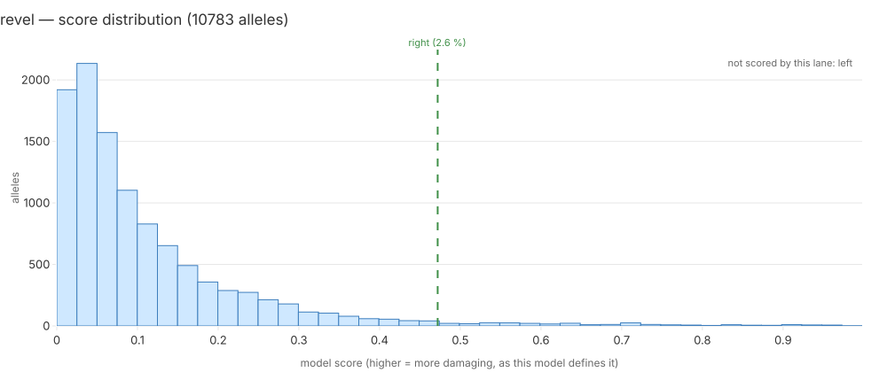

# revel — model report

**Case:** Mosaic Variegated Aneuploidy — challenge proband 1; confirmed pair gene `BUB1B`.

**Standing:** generated 2026-09-19T23:02:34+00:00 by `mva.zoo.report.render_model_report` from run `it4-2962e3117b5c`, catalogue mode `catalogue-free`.

Every number below is a key of `it4_model_reports.report_json` for this run. Section 6 is the only written section.

## 1. Model card

| field | value |
|---|---|
| name | REVEL |
| version | REVEL 1.3 via VEP REST |
| inference tier | 1 |
| licence | REVEL non-commercial (free for non-commercial use; other uses by arrangement) |
| catalogue-adjacent | yes |
| reference (PMID) | 27666373 |

The catalogue-adjacent lane, and the reason the merge is always printed twice (with and
without adjacent lanes). REVEL is an ensemble trained on catalogued pathogenic/benign sets,
so it has seen labels the other three have not.
Plugin flag verified 2026-09-18 against the Ensembl REST docs for `/vep/human/hgvs`
(https://rest.ensembl.org/documentation/info/vep_hgvs_get): the parameter is spelled `REVEL`
and is boolean (`REVEL=1`). Tier 1 because REST serves a precomputed table; it is the source
that is remote, not the computation.
Failure modes: REST rate limits (batch of 200 per POST, retry on 429); a record with no HGVS
spelling cannot be asked at all.

## 2. Inputs and coverage

Scored **10783 of 39286** allele records (27.5%).

| consequence class | scored | records | fraction |
|---|---|---|---|
| `3_prime_UTR_variant` | 0 | 555 | 0.0% |
| `5_prime_UTR_variant` | 0 | 235 | 0.0% |
| `coding_sequence_variant` | 0 | 4 | 0.0% |
| `downstream_gene_variant` | 0 | 5 | 0.0% |
| `frameshift_variant` | 0 | 564 | 0.0% |
| `incomplete_terminal_codon_variant` | 0 | 2 | 0.0% |
| `inframe_deletion` | 0 | 277 | 0.0% |
| `inframe_insertion` | 0 | 211 | 0.0% |
| `intergenic_variant` | 0 | 1 | 0.0% |
| `intron_variant` | 0 | 5490 | 0.0% |
| `mature_miRNA_variant` | 0 | 2 | 0.0% |
| `missense_variant` | 10778 | 15620 | 69.0% |
| `non_coding_transcript_exon_variant` | 0 | 129 | 0.0% |
| `protein_altering_variant` | 0 | 5 | 0.0% |
| `splice_acceptor_variant` | 1 | 128 | 0.8% |
| `splice_donor_5th_base_variant` | 0 | 121 | 0.0% |
| `splice_donor_region_variant` | 0 | 423 | 0.0% |
| `splice_donor_variant` | 0 | 122 | 0.0% |
| `splice_polypyrimidine_tract_variant` | 0 | 385 | 0.0% |
| `splice_region_variant` | 0 | 2455 | 0.0% |
| `start_lost` | 3 | 51 | 5.9% |
| `stop_gained` | 1 | 289 | 0.4% |
| `stop_lost` | 0 | 131 | 0.0% |
| `stop_retained_variant` | 0 | 35 | 0.0% |
| `synonymous_variant` | 0 | 12036 | 0.0% |
| `upstream_gene_variant` | 0 | 10 | 0.0% |

A class with a low fraction is this lane's blind spot, stated rather than averaged away: a pair with an unscored half is excluded from this lane's ranking, never scored zero.

## 3. Score distribution

10783 scored alleles; min 0, mean 0.113433, max 0.998.

| quantile | score |
|---|---|
| p01 | 0.004 |
| p10 | 0.016 |
| p25 | 0.032 |
| p50 | 0.07 |
| p75 | 0.143 |
| p90 | 0.258 |
| p99 | 0.69218 |

The confirmed pair's two alleles, marked on the histogram:

| allele | half | score | percentile |
|---|---|---|---|
| `addc19de8fa29228` | left | — | — |
| `93e077ae83ac2642` | right | 0.472 | 2.59 % |

## 4. The confirmed pair

This lane did not score both halves of the confirmed pair (`BUB1B`), so it is recorded as having **no opinion** on it — not a bad one. 10456 pairs were ranked here.

| half | percentile among this lane's scored alleles |
|---|---|
| left | — |
| right | 2.59 % |

Percentile is a position from the top: rank 1 of 20 is 5.00 %. The pair score is `(min, max)` of the two allele scores, sorted by `min` first — a pair is only as damaging as its weaker half.

Catalogue mode: `catalogue-free`.

## 5. What the clinical terms say

Against the child's 8 HPO terms, `BUB1B` ranks #14 of 5267 genes considered (phenotype score 0.36093, term set `with-parental`, `warehouse.hpo_gene_scores`). `revel` scores the molecular change only and never sees the phenotype, so this line is context for the reader, not an input to the score above.

## 6. Interpretation

This section exists in more than one version — the numbers above are identical for all of them. Each version carries a badge saying who wrote it, in which mode, and how many of its sentences resolve to a row of sections 2-5 (`mva.zoo.narrate_check`).

### 6.1 Generated — mode `claude-code`, model `claude-opus-5[1m]`, 10/10 sentences cited

<!-- interpretation: generated 2026-09-19 | llm:claude-code | model:claude-opus-5[1m] | cited 10/10 -->

This lane scored 10,783 of the set's 39,286 allele records, 27.5% of the total [cov.scored][cov.total][cov.fraction]. Coverage concentrates in one class: 69.0% of missense records [cov.missense_variant]. It scored none of the 12,036 synonymous, 5,490 intron, 2,455 splice_region, 564 frameshift, 555 3_prime_UTR or 423 splice_donor_region records [cov.synonymous_variant][cov.intron_variant][cov.splice_region_variant][cov.frameshift_variant][cov.3_prime_UTR_variant][cov.splice_donor_region_variant]. Only 3 of 51 start_lost, 1 of 289 stop_gained and 1 of 128 splice_acceptor records were scored [cov.start_lost][cov.stop_gained][cov.splice_acceptor_variant]. An absent score means the lane had nothing to say about that record, not that the record is harmless [cov.synonymous_variant]. Scored values span 0 to 0.998, with mean 0.113433, median 0.07, p90 0.258 and p99 0.69218 across 10,783 alleles [dist.n][dist.min][dist.max][dist.mean][dist.p50][dist.p90][dist.p99]. For the confirmed pair in `BUB1B`, the left half was never scored and the right half scores 0.472, at percentile 2.59% [pair.gene][dist.mark.left][dist.mark.right]. A pair with an unscored half is excluded from the 10,456 ranked pairs rather than zeroed, so this pair has no rank, no left percentile, and the lane holds no opinion on it [pair.n_ranked][pair.rank][pair.left_percentile][pair.right_percentile]. The run was `catalogue-free`, nulling every field a ClinVar-trained model could have learned from [pair.mode]. Separately, `BUB1B` ranks #14 of 5267 genes against 8 HPO terms, but `revel` never sees the phenotype, so that line is context, not an input [hpo.rank].

### 6.2 Hand-written

<!-- interpretation: hand-written 2026-09-19 | llm:none -->

**Citation rule:** every sentence names the section and row it rests on.

The one **catalogue-adjacent** lane: REVEL's training set included ClinVar, so it
may already know this answer, and every merged number in this iteration is printed
with and without it. It answered for 10,783 alleles (§2) — realised coverage, not
the 100 % a remote lane's estimate reports, because it cannot know what the server
will say until it asks. It puts the confirmed pair's missense half in the **top
2.59 %** of what it scored (§3, marks), which is the same verdict AlphaMissense
and ESM1b reach without the catalogue; that agreement is the useful part, since
three lanes of different provenance converging on one allele is harder to explain
by leakage than one. It is missense-only, so the `stop_gained` half is unscored
and the lane has **no opinion** on the pair (§4). The phenotype ranking of
`BUB1B` (§5) is independent evidence: REVEL never sees it.

_hand-written 2026-09-19_

Only this section is written rather than computed. Sections 1-5 and 7 are rendered from the stored JSON and change only when a number changes.

## 7. Limitations, licence, runtime, cost

| field | value |
|---|---|
| licence | REVEL non-commercial (free for non-commercial use; other uses by arrangement) |
| venue | laptop |
| wall-clock (s) | 0 |
| cost (USD) | 0 |
| run id | `it4-2962e3117b5c` |

- Catalogue-adjacent: this model's training data included ClinVar, so it may be recalling a published verdict rather than predicting one. The consensus rank is reported with and without this lane.
- Scored 27.5% of the record set; the unscored remainder is this lane's blind spot and its pairs are excluded from the ranking, not scored zero.
- 52891 biallelic pairs had an unscored half and left this ranking.
- Ran on `laptop` at zero marginal cost.
