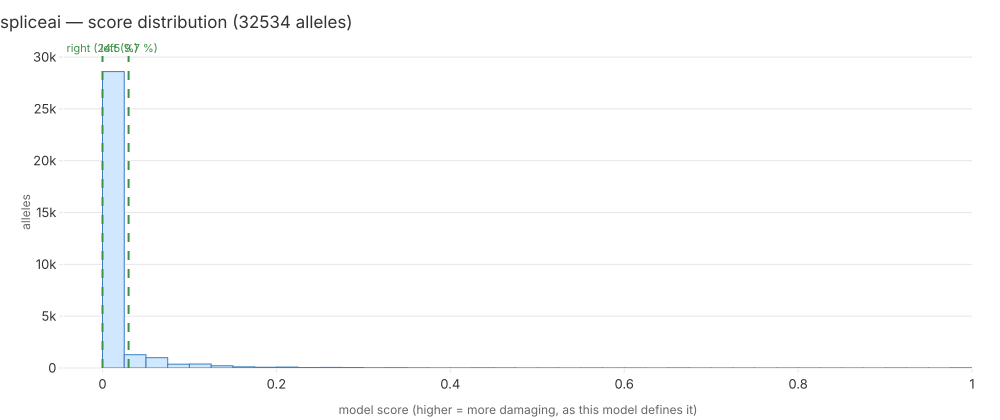

# spliceai — iteration 4 model report

**Standing:** generated 2026-09-19T16:57:25+00:00 by `mva.zoo.report.render_model_report` from run `it4-dcda40a4df2c`, catalogue mode `catalogue-free`.

Every number below is a key of `results.it4_model_reports.report_json` for this run. Section 6 is the only written section.

## 1. Model card

| field | value |
|---|---|
| name | SpliceAI |
| version | SpliceAI via VEP plugin (iteration 2 annotation pass) |
| inference tier | 1 |
| licence | Illumina SpliceAI non-commercial (academic use) |
| catalogue-adjacent | no |
| reference (PMID) | 30661751 |

Also already in the warehouse (32,534 of 38,087 rows non-null) — the second no-download lane.
`spliceai_ds_max` is the maximum delta score over the four events; the raw per-event string is
kept as aux. Iteration 2 used the published delta >= 0.2 recall cut (Z2); the zoo keeps the
raw number and leaves the cut to the ranker. Failure mode: indels outside the precomputed SNV
set read null; the code is GPL-3.0 but the precomputed scores are the non-commercial artefact.

## 2. Inputs and coverage

Scored **32534 of 39286** allele records (82.8%).

| consequence class | scored | records | fraction |
|---|---|---|---|
| `3_prime_UTR_variant` | 371 | 555 | 66.8% |
| `5_prime_UTR_variant` | 161 | 235 | 68.5% |
| `coding_sequence_variant` | 2 | 4 | 50.0% |
| `downstream_gene_variant` | 1 | 5 | 20.0% |
| `frameshift_variant` | 330 | 564 | 58.5% |
| `incomplete_terminal_codon_variant` | 0 | 2 | 0.0% |
| `inframe_deletion` | 110 | 277 | 39.7% |
| `inframe_insertion` | 0 | 211 | 0.0% |
| `intergenic_variant` | 0 | 1 | 0.0% |
| `intron_variant` | 4471 | 5490 | 81.4% |
| `mature_miRNA_variant` | 0 | 2 | 0.0% |
| `missense_variant` | 13163 | 15620 | 84.3% |
| `non_coding_transcript_exon_variant` | 47 | 129 | 36.4% |
| `protein_altering_variant` | 0 | 5 | 0.0% |
| `splice_acceptor_variant` | 86 | 128 | 67.2% |
| `splice_donor_5th_base_variant` | 99 | 121 | 81.8% |
| `splice_donor_region_variant` | 333 | 423 | 78.7% |
| `splice_donor_variant` | 84 | 122 | 68.8% |
| `splice_polypyrimidine_tract_variant` | 108 | 385 | 28.1% |
| `splice_region_variant` | 2006 | 2455 | 81.7% |
| `start_lost` | 35 | 51 | 68.6% |
| `stop_gained` | 216 | 289 | 74.7% |
| `stop_lost` | 108 | 131 | 82.4% |
| `stop_retained_variant` | 29 | 35 | 82.9% |
| `synonymous_variant` | 10773 | 12036 | 89.5% |
| `upstream_gene_variant` | 1 | 10 | 10.0% |

A class with a low fraction is this lane's blind spot, stated rather than averaged away: a pair with an unscored half is excluded from this lane's ranking, never scored zero.

## 3. Score distribution

32534 scored alleles; min 0, mean 0.015335, max 1.

| quantile | score |
|---|---|
| p01 | 0 |
| p10 | 0 |
| p25 | 0 |
| p50 | 0 |
| p75 | 0 |
| p90 | 0.03 |
| p99 | 0.27 |

The confirmed pair's two alleles, marked on the histogram:

| allele | half | score | percentile |
|---|---|---|---|
| `addc19de8fa29228` | left | 0.03 | 9.74 % |
| `93e077ae83ac2642` | right | 0 | 24.53 % |

## 4. The confirmed pair

| gene | rank | of pairs | percentile | min score | max score |
|---|---|---|---|---|---|
| `BUB1B` | 11980 | 50696 | 23.63 % | 0 | 0.03 |

| half | percentile among this lane's scored alleles |
|---|---|
| left | 9.74 % |
| right | 24.53 % |

Percentile is a position from the top: rank 1 of 20 is 5.00 %. The pair score is `(min, max)` of the two allele scores, sorted by `min` first — a pair is only as damaging as its weaker half.

Catalogue mode: `catalogue-free`.

## 5. What the clinical terms say

Against the child's 8 HPO terms, `BUB1B` ranks #14 of 5267 genes considered (phenotype score 0.36093, term set `with-parental`, `warehouse.hpo_gene_scores`). `spliceai` scores the molecular change only and never sees the phenotype, so this line is context for the reader, not an input to the score above.

## 6. Interpretation

<!-- interpretation: hand-written 2026-09-19 | llm:none -->

**Citation rule:** every sentence names the section and row it rests on.

The only lane in this zoo with a number for **both** halves of the confirmed pair,
and the reason is coverage, not insight: it scores any SNV near a splice site
regardless of consequence class, 82.8 % of the record set including 74.7 % of
`stop_gained` alleles (§2). Its two numbers are 0.03 and 0.00 (§3, marks) — a
delta score of 0.03 is far below SpliceAI's own lowest published cut-off, 0.2, so
the honest reading is **no splice effect on either allele**, which is what one
should expect of a nonsense change and a missense change that act through
protein, not splicing. That is why the pair lands at rank 11,980 of 50,696, the
23.63rd percentile (§4): the lane is not wrong about the pair, it is answering a
different question. Its distribution says as much — the median score is 0 and
even p90 is 0.03 (§3), so the pair sits where most of the callset sits. The
phenotype ranks `BUB1B` #14 of 5,267 (§5) and SpliceAI never sees it.

_hand-written 2026-09-19_

Only this section is written rather than computed. Sections 1-5 and 7 are rendered from the stored JSON and change only when a number changes.

## 7. Limitations, licence, runtime, cost

| field | value |
|---|---|
| licence | Illumina SpliceAI non-commercial (academic use) |
| venue | laptop |
| wall-clock (s) | 0 |
| cost (USD) | 0 |
| run id | `it4-dcda40a4df2c` |

- Scored 82.8% of the record set; the unscored remainder is this lane's blind spot and its pairs are excluded from the ranking, not scored zero.
- 12651 biallelic pairs had an unscored half and left this ranking.
- Ran on `laptop` at zero marginal cost.
