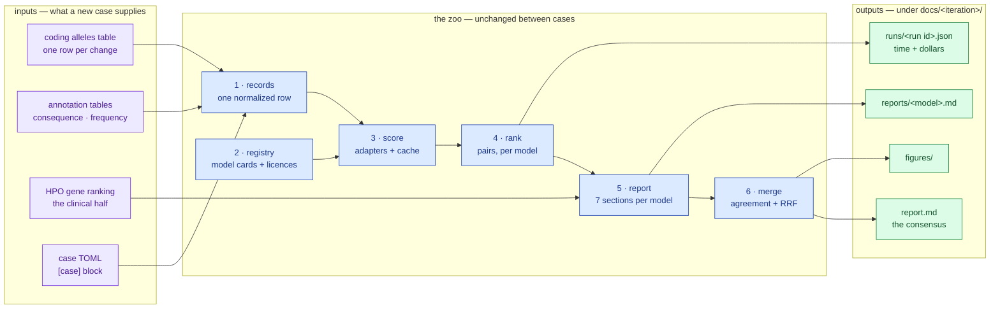

# Running the zoo on a new case

**Standing:** written 2026-09-19, iteration 4 wave 3, against the code at commit `6bc57ac`.
The mechanism is tested (`tests/test_zoo_case_config.py` runs the whole workflow on a second
case); **no second real illness has been run**, so everything below about a real case is the
procedure, not a measured result. What the case config does *not* yet reach is listed in
[`../notes/zoo-case-config.md`](../notes/zoo-case-config.md) and repeated at the bottom.

Written for a software engineer with no genetics background. Domain terms are introduced as
`technical term (plain meaning)` and defined in [`../dictionary.md`](../dictionary.md).

---

## 1. What the zoo is, in one paragraph

The zoo is a fan-out/fan-in pipeline. **In:** one row per candidate DNA change in one
patient. **Out:** a ranking of *pairs* of changes, once per model, plus a consensus across
models, plus a report per model. The models are frozen third-party predictors — nothing is
trained here — so each one is a pure function `allele → score`, and adding one is a TOML
entry plus a ≤ 400-line adapter. Everything case-specific is one `[case]` block in a config
file; everything else is the same code for every illness.



> **Legend** — purple = the raw input a new case supplies; blue = neutral machinery that does
> not change between cases; green = what a reader of the case gets. An arrow means "feeds".

---

## 2. What a new case must supply

| input | shape | where it comes from | if you don't have it |
|---|---|---|---|
| **coding alleles** | one row per ALT allele: `gene, chrom, pos, ref, alt, gt, pgt, pid, zygosity` | `results.coding_alleles`, built by `mva-warehouse` from the patient's VCF (**variant call format** — a row-oriented text record per change) | nothing runs; this is the callset |
| **annotations** | `consequence` (what kind of change), `af_gnomad` (how common it is in the population), optional `clin_sig` (what the ClinVar catalogue already says) | `warehouse.coding_annotations`, `warehouse.it2_insilico_annotations` | records still build; coverage-by-class and the `lof+missense` rule degrade |
| **HPO gene ranking** | `gene_symbol, rank, score, genes_considered, term_set` | `mva-phenotype` over the child's HPO terms (**Human Phenotype Ontology** — the controlled vocabulary a clinician's observations are coded in) | section 5 of every report prints "produced no `<gene>` row" — honest, but the clinical half is missing |
| **model tables** | whatever each lane needs: a warehouse column, a downloaded table, or a REST endpoint | `tools/fetch_zoo_tables.py`, `src/mva/zoo/models.toml` | that lane is reported as unscored, never as scored-zero |
| **the case TOML** | the `[case]` block | you write it: `cp src/mva/zoo/cases/mva-example.toml src/mva/zoo/cases/<name>.toml` | `mva-zoo run` uses iteration 4's case |

The reference genome (the coordinate system positions are expressed in) must be the same one
the model tables were published against — GRCh38 here. A case on another build needs its
tables re-fetched, not re-coded.

---

## 3. The six commands

```bash
# 0. the case file — the only thing you edit
cp src/mva/zoo/cases/mva-example.toml src/mva/zoo/cases/<name>.toml
$EDITOR src/mva/zoo/cases/<name>.toml      # [case]: label, iteration, table_prefix,
                                           # confirmed_gene (or "" if unsolved), rule,
                                           # phenotype_term_set, hpo_table
CASE=src/mva/zoo/cases/<name>.toml

# 1. one normalized record per allele (+ an HGVS spelling pass against Ensembl VEP)
uv run mva-zoo records --config "$CASE"

# 2. what lanes exist, at what version, under what licence
uv run mva-zoo models

# 3. what fraction of this callset a lane can answer for — before spending anything
uv run mva-zoo coverage --config "$CASE" --model alphamissense

# 4. score one lane and append to the cache (re-running is a no-op)
uv run mva-zoo score --config "$CASE" --model alphamissense

# 5. the eight stages end to end: records → registry → fan-out → collect →
#    rank → report → merge → render
uv run mva-zoo run --config "$CASE"

# 6. the figures the reports link
uv run python tools/render_it4_figures.py
```

`mva-zoo run --case-gene GENEX --iteration demo` overrides `[case]` without editing the file;
`--iteration` also moves every default output path to `docs/demo/`.

**The run id is the sha256 of the case file.** The same file re-run is the same run — which
is what makes every stage safe to repeat — and any edit starts a new one.

---

## 4. What comes out

| artifact | where | what it is |
|---|---|---|
| allele records | `<results schema>.it4_allele_records` + `build/<prefix>/records.parquet` | the coordinate-free table plus the private one with coordinates |
| scores | `warehouse.allele_scores` | append-only, one row per `(model, version, allele_id)`, with venue, licence and run id |
| ranks | `<results schema>.it4_model_ranks` | the top pairs per lane plus the confirmed pair's row, whatever its rank |
| per-model reports | `docs/<iteration>/reports/<model>.md` | seven fixed sections; only §6 is written rather than computed |
| the merged report | `docs/<iteration>/report.md` | agreement matrix, RRF with and without catalogue-adjacent lanes, disagreement table |
| run manifest | `docs/<iteration>/runs/<run id>.json` | config digest, model versions, venues, seconds per stage, dollars |
| lineage | `warehouse.data_lineage` | one edge per table per run: target, source, transform, tool |
| figures | `figures/<prefix>/` | one score histogram per lane with the confirmed pair marked, the agreement heat map, the confirmed-rank bars |

Every number in a report is a key of the stored report JSON, so a reader can diff the prose
against the row it came from.

---

## 5. What it cost here

Quoted from the entries that measured it — do not re-state these numbers elsewhere, link
the entry.

| stage | measured | entry |
|---|---|---|
| records + HGVS pass | "wall-clock **6,317.5 s = 1 h 45 m 18 s**", of which "the 196 VEP batches took ≈ 3,100 s and the per-row `INSERT` of 39,286 rows into a remote Postgres took ≈ 2,900 s" | [114](step-1/methodology/114-one-record-per-allele-and-what-it-can-be-spelled-as.md) |
| fetching one downloaded lane | a "1.24 GiB download"; the reshaping "did the 12,183 members this case needs in **95 s, 169,457,840 rows**" | [119](step-2/methodology/119-four-lanes-fetched-licensed-and-joined.md) |
| scoring four lanes cold | "**total** **6,320 s = 1 h 45 m 20 s**", "**58,480**" rows, "**$0**" — and "The three offline lanes together take **53 seconds** for 47,697 rows" | [122](step-3/methodology/122-every-lane-scored-once-and-only-once.md) |
| the whole DAG, warm | "≈ 15 s warm (113 s on the first full pass), **$0**, four models at four named versions, every venue `laptop`" | [128](step-4/methodology/128-one-command-eight-stages-and-three-things-a-fixture-could-not-catch.md) |

Two things a planner should take from that: **the wall-clock is one remote service**, not the
joins (entry 122: "6,267 s of the 6,320 is REVEL"), and the cold and warm numbers must not be
added (entry 128 says so explicitly). A laptop, no GPU, no dollars.

---

## 6. What is still case-specific

Honest list. The full inventory with file names is
[`../notes/zoo-case-config.md`](../notes/zoo-case-config.md).

- **Table names.** `it4_allele_records` and `it4_model_ranks` are still literals in
  `types.py` and `rank.py`; only the reports table follows `[case] table_prefix`. A second
  case with a different prefix would write its records and ranks into iteration 4's tables.
- **`build/it4/` and `figures/it4/` defaults.** Overridable per command, but the defaults are
  this case's, and `tools/render_it4_figures.py` is hard-wired to them.
- **The HPO term count** (`report_stats.HPO_TERM_COUNT = 8`) is this child's, and section 5
  of every report prints it.
- **The model roster.** `models.toml` lists lanes that suit a missense/splice question. A
  case whose answer is a nonsense (premature stop) allele needs a DNA-level lane — which is
  exactly what iteration 4's own result showed (entries 129, 130).
- **Nothing about the *biology* transfers.** The zoo ranks; it does not decide what is
  causal. The confirmed-gene knob only says which pair to *report on*, never which is right.

## 7. Where to look next

| you want | read |
|---|---|
| the case config's keys and the rejected alternatives | [`../notes/zoo-case-config.md`](../notes/zoo-case-config.md) |
| the module map of the zoo | [`../../src/mva/zoo/README.md`](../../src/mva/zoo/README.md) |
| how a second case is proved to work | `tests/test_zoo_case_config.py` |
| what iteration 4 actually found | [`README.md`](README.md), [`report.md`](report.md) |
| adding a model rather than a case | [`plan.md`](plan.md) §5 step 2, `src/mva/zoo/models.toml` |
