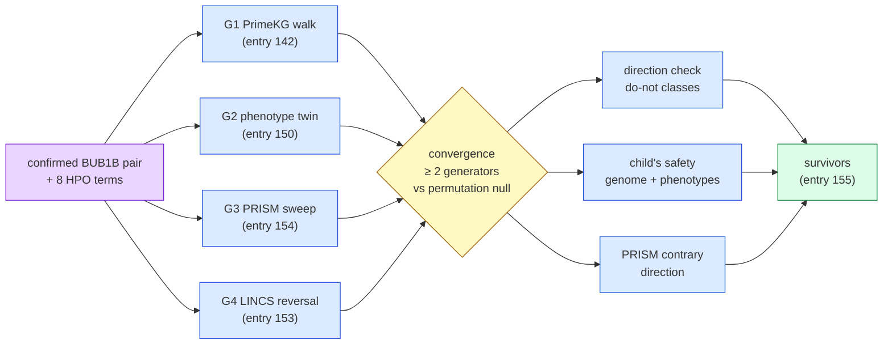

# Step 10 — Track 2: iteration 4's own answer

**Standing:** **run 2026-09-25**, marked **done**: H093 refuted, H094 refuted, H095 supported
weakly (entries 154, 155); claims filed before any run (commit `1b02e44`). Iteration 4, `step-10`, track 2. Status in
`src/mva/science/step_maps/iteration4.py`. Every number this page will quote is owned by an
entry under [`methodology/`](methodology/).

**Goal** (from `steps.py`):

> From iteration 4's evidence alone, which approved drugs do its independent generators (the
> PrimeKG walk, the phenotype twin, a screen-wide PRISM sweep, LINCS signature reversal)
> converge on beyond chance, and which of those survive every iteration-4 check (mechanism
> direction, the child's own safety, a decoy)?

**Feeds:** [`submissions/track2/iteration-4/`](../../../submissions/track2/iteration-4/README.md),
the Track 2 submission built from iteration 4 only (user decision, 2026-09-25).

## Why this step exists

Steps 7 and 9 made iteration 4's instruments. But E4 (entry 151) and E5+E6 (entry 152) tested
drugs taken from **iteration 2's shortlist** (`ressources/track2/shortlist.tsv`). A submission
built from iteration 4 alone cannot borrow that list. This step:

1. **generates** candidates from four iteration-4 sources that share no data;
2. **tests** whether they agree more often than chance (a permutation null);
3. **re-runs** iteration 4's checks on the new set: direction, the child's own safety, decoys.

E7 in step 9 ("grade D5 on the ladder") is answered here. The ladder was iteration 2's; the
grading is now convergence plus checks.

## Inputs — both sources

| source | what it gives this step | owner |
|---|---|---|
| the genome | the confirmed pair: one `stop_gained` (nonsense: the protein is cut short) and one missense allele in `BUB1B` (oracle reply, entry 083) | Track 1 |
| the genome | mechanism class: the missense scored as damaging by three zoo models (entry 129) and as destabilising (87th percentile ΔΔG, entry 149) | steps 5, 9 |
| the clinical terms | the 8 HPO terms: phenotype twin (entry 150), safety against the child's own phenotypes (entry 152) | `Challenge_Clinical_Phenotype_1.md` |
| public data | PrimeKG, MGI, PRISM/DepMap, LINCS L1000, OnSIDES, FAERS, CPIC | each entry's Inputs |

## The chain

> **Legend** purple = the raw inputs (genome and clinical terms) · blue = machinery, one
> independent source or one check each · yellow = the decision point (convergence against a
> null) · green = the answer: the drugs that survive every check.

## The generator rules — fixed 2026-09-25, before any join

A generator is a source that **proposes** drugs. A check only **filters** them. A check never
votes for a drug it could have generated.

| id | generator | the rule that makes its list | approved means | its universe (for the null) |
|---|---|---|---|---|
| G1 `walk` | PrimeKG walk from the MVA disease node (entry 142) | top **50** openFDA-labelled drugs by walk score | an openFDA label | every openFDA-labelled drug the walk reached |
| G2 `twin` | the phenotype twin's published interventions (entry 150) | every approved analogue in `model_interventions.tsv` whose row **supports** a direction | the row's `analogue_status` says approved | the approved drugs named by any row, plus every approved drug in the other three universes (the twin's space is literature, so it has no natural universe; the widest one is used. This page first said that makes the null harder to beat; entry 155 measured the opposite — a wider universe makes it easier, p 0.263 vs 0.329 — and the rule stands as registered) |
| G3 `prism` | screen-wide PRISM sweep (entry 154) | union of the top **0.5 %** of eligible Launched compounds on each contrast (aneuploidy, rhabdomyosarcoma) | PRISM `Launched` | every eligible Launched compound |
| G4 `lincs` | signature reversal (entry 153) | approved drugs in the top **100** reversers of **both** SigCom LINCS and iLINCS | ChEMBL max phase 4 or an openFDA label | every approved compound present in both engines |

**Join key:** one normalised name, `mva.drugs.names.base_name` (salts and formulations folded).
**Null:** 10,000 draws; each list replaced by an equal-sized draw from its own universe; the
statistic is the number of drugs named by ≥ 2 generators; one-sided p (H094).
**Retrospective note:** dasatinib is already known in G2 (entry 150) and near the top of the
aneuploidy contrast (entry 151). Every convergence count is reported with and without it.

## The checks (H095)

| id | check | pass | source |
|---|---|---|---|
| K1 | direction | not a checkpoint-kinase inhibitor (Mps1/TTK, Aurora); spindle poisons carried as a **caution** | entry 151 (measured), E1/E2 mechanism |
| K2 | the child's safety | not flagged by **both** sources: the genome (PharmCAT/CPIC) and the phenotype (OnSIDES/FAERS) | entry 152 method, re-run on this set |
| K3 | contrary screen | PRISM does not measure it pointing against its proposed direction (δ < 0, one-sided p < 0.05 the other way) | entry 154 table |

## The table contract (every generator writes this)

`ressources/track2/it4/generators/<id>.tsv` + `<id>.universe.tsv` + `<id>.provenance.json`.

| column | meaning |
|---|---|
| `generator` | `walk` · `twin` · `prism` · `lincs` |
| `rank` | 1 = best, within the generator |
| `drug` | the join key, `base_name` of the drug |
| `drug_label` | how the source spells it |
| `approved` | `true` / `false`, by the generator's own rule above |
| `approval_evidence` | e.g. `openFDA NDA…`, `PRISM Launched`, `ChEMBL max_phase 4` |
| `score`, `score_name` | the generator's native score and what it is |
| `direction_hint` | the direction the source itself argues (`D3` dosage, `D5` senescence/mTOR, `D4` tumour context, `D2` aneuploidy stress, `none`) |
| `evidence` | one line, coordinate-free |
| `source_ids` | pipe-separated PMIDs, DrugBank, ChEMBL or BRD ids |

The universe file has two columns: `drug`, `approved`.

## Experiments

| id | what | claims | entry | status |
|---|---|---|---|---|
| S1 | screen-wide PRISM sweep (generator G3) | H093 `P4-28` | [154](methodology/154-screen-wide-prism-sweep.md) | done 2026-09-25 — H093 refuted; G3 = 8 drugs |
| S2 | convergence, checks, candidate table | H094 `P4-29`, H095 `P4-30` | [155](methodology/155-convergence-and-checks.md) | done 2026-09-25 — H094 refuted (p 0.263); H095 met, weakly: dasatinib the one survivor |

G4 runs in step 9 as E3 (entry 153, H092 `P4-27`) and hands its list here.

## What happened

**S1 — the screen-wide PRISM sweep** ([154](methodology/154-screen-wide-prism-sweep.md), note
[S1](submission-notes/S1.md)). Entry 151's tests, unchanged, over **613** launched drugs measured
on ≥ 3 rhabdomyosarcoma lines and ≥ 20 lines per aneuploidy arm. **No drug reaches q < 0.10 in
either contrast** (best q 0.122 RMS, 0.287 aneuploidy), so **H093 is refuted as registered**.
The same code finds dabrafenib and vemurafenib for melanoma lines at q ≈ 10⁻⁹ over 2,032 drugs,
so the null is the screen's, not the pipeline's. The RMS contrast is three lines for 619 of 633
copies and fires at 9.6 % raw (4.4 % once line fragility is removed). G3 lists 8 drugs, none
corrected-significant; dasatinib is aneuploidy rank 4 of 613, on the list's boundary.

> **Legend** — green = q < 0.10 (BH over the whole family); yellow = G3-listed (top 0.5 % of
> one contrast); blue = every other eligible drug; grey band = central 95 % of Cliff's delta over
> 200 seeded unrelated eligible Launched drugs; dashed yellow = the p value BH needs for
> q < 0.10 (control: the largest passing p; the two real contrasts: 0.10 / 613, which no drug
> reaches); purple label = dasatinib, marked only because entry 151 already reported it.

**S2 — convergence, checks, the candidate table**
([155](methodology/155-convergence-and-checks.md), note [S2](submission-notes/S2.md)).

- **The lists.** The four generators list 50 drugs (walk), 2 (twin), 8 (PRISM) and 3 (LINCS). Together they name 62 approved drugs.
- **Only one drug appears in two lists:** dasatinib (twin #1, PRISM #8). A 10,000-draw null (seed 20260925) gives mean 0.30 and 95th percentile 1.0, so one agreement is chance: **p 0.263**. **H094 is refuted as registered.**
- **Sensitivities agree.** Without dasatinib, and without G4 (whose positive control failed, entry 153), p runs 0.261–1.
- **Dasatinib passes K1, K2 and K3.**
  - K1: its MOA is in no do-not class.
  - K2: neither the genome nor the phenotype source flags it; they are silent, which is not the same as safe.
  - K3: aneuploidy δ +0.135.
- **H095 is met literally, weakly.** The lead was known before the join, and K3 re-reads G3's own contrast.
- **The only K2 fail** is vincristine, as in entry 152. No Mps1/Aurora inhibitor appears in any list.
- **Correction to the G2 universe rule above.** The widest twin universe makes the null *easier* to beat, not harder: G2's own 4-drug universe gives p 0.329. The verdict does not change.

> **Legend** — blue bars = the null distribution; yellow bars = null counts above its 95th
> percentile (the pre-registered bar the observed count had to reach); solid line = the observed
> count, green when it clears the bar, red when it does not; only the first panel is a verdict
> input.

> **Legend** — generator columns: blue = the generator names the drug (#rank within it); K
> columns: green = pass, yellow = caution (kept, reason in the table), red = fail, grey = not
> run; survivor: green = converges and fails no check, red = does not.

## Data handling

No patient data leaves the laptop in this step except the PharmCAT result already produced by
entry 152. Nothing patient-derived is committed. No genomic position appears in any file.
