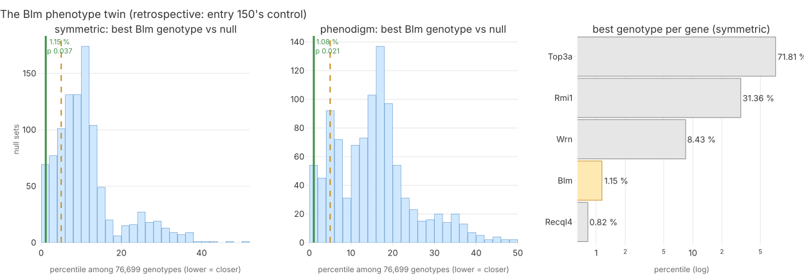
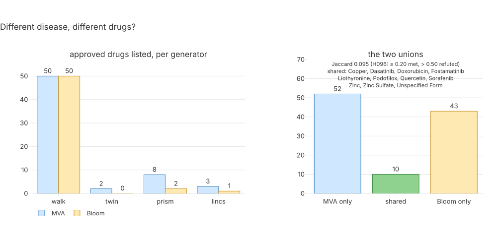

# 156 — Iteration 4's Track 2 chain on a second disease: Bloom syndrome

**Step:** iteration 4, [step 11](../README.md), experiment T1. **Date:** 2026-09-25. **Claim:**
H096 (`P4-31`). **Sources:** the clinical side is Bloom syndrome's public HPO annotation
(`phenotype.hpoa`, OMIM:210900); the genomic side is the gene `BLM` only. No patient of either
case is read. The MVA proband enters only through clause (c), as the other case's committed
generator lists.

## Question

Does iteration 4's Track 2 chain — phenotype twin, PrimeKG walk, PRISM sweep, LINCS reversal,
convergence, checks — run on a second rare disease by **configuration alone**, and does it
propose a different drug set?

## Hypothesis and prediction

Registered before this entry (commit 379e86d), quoted from `uv run mva-science show H096`:

> **P4-31:** iteration 4's Track 2 chain runs on a second rare disease, Bloom syndrome, by
> configuration alone, and proposes a drug set distinct from the MVA case's.
>
> **Prediction.** With a case configuration for Bloom syndrome (gene BLM, its disease node in
> PrimeKG and MONDO, its HPO terms read from phenotype.hpoa, a lineage contrast fixed from the
> literature before the run), and zero source-code lines changed: (a) every stage writes its
> table with a provenance manifest - the phenotype twin over MGI, the PrimeKG walk, the PRISM
> sweep, LINCS reversal (or a recorded reason it has no BLM signature), convergence with its
> null, and checks K1 and K3 (K2 runs its label half only, with no patient genome); (b) the
> phenotype twin ranks a Blm genotype in the top 5 % of MGI genotypes; (c) the union of the four
> generator lists shares at most 20 % of its drugs with the MVA case's union (Jaccard index
> <= 0.20).

**Retrospective limb.** Entry 150 already ran Bloom → *Blm* as its positive control (median
2.73 % / 1.40 % over 20 draws of 8 terms). Clause (b) is filed `retrospective:`; (a) and (c)
are the test.

### What "configuration" means here — fixed before any run

| counts as configuration | counts as a code change (refutes a) |
|---|---|
| a JSON / TSV data file (the case directory `ressources/track2/transfer-it4/BLM/`) | any new or edited `.py` file needed to make a stage **run** on Bloom |
| a hand-curated literature table built by the **same method** as MVA's (entry 150's intervention table, entry 152's HPO→MedDRA mapping) | any new or edited `.py` file needed to make a stage's output **truthful** (a manifest or row text that names the MVA case) |
| committed CLI flags; symlinks into `build/` | |

Each stage is scored one of: **config** (committed CLI + flags + data files, output truthful);
**config, mislabelled** (it runs, but code-generated text names BUB1B / the child; correcting it
needs code); **code** (Bloom cannot be expressed without Python).

### Static survey of the configuration surface — read from the code before any run

Reading the six stages' tools (no stage executed) already shows where Bloom cannot be expressed
by flags. Every gap is listed so the run cannot hide one:

| # | stage | file:line | what is fixed in code | class |
|---|---|---|---|---|
| 1 | twin | `tools/phenotype_twin.py` `COMMITTED` | the committed output directory is a constant: a flag-only run **overwrites MVA's** `ressources/phenotype/phenotype_twin*` | code |
| 2 | twin | `tools/phenotype_twin.py` `write()` | the manifest's `sources` text names "the case's HPO terms" and BUB1B | mislabelled |
| 3 | walk (G1) | `src/mva/drugs/convergence_build.py:166` | manifest `sources.genomic` says "BUB1B and its PrimeKG disease genes" | mislabelled |
| 4 | twin (G2) | `src/mva/drugs/convergence_build.py:240,244` | manifest says "the child's 8 HPO terms", "the gene BUB1B" | mislabelled |
| 5 | sweep (G3) | `tools/screen_sweep.py` `plan()`; `src/mva/drugs/screen_sweep_run.py:91` | lineage codes, annotation column, hints, control lists are Python constants (no flag); the lineage contrast's tag is the literal `"rms"` | code |
| 6 | reversal (G4) | `tools/signature_reversal.py` `plan()` | the perturbed gene, control genes, claim text are Python constants (no flag) | code |
| 7 | reversal (G4) | `src/mva/drugs/signature_reversal_tables.py:205` | every generator row's `evidence` says "reverses the BUB1B-loss signature" | mislabelled |
| 8 | convergence | `tools/converge.py` | `K1Rule` has no flag (MVA's Mps1/Aurora do-not classes are the default); `EXTRA_GENES` (vincristine→CYP3A5/CEP72, valproate→POLG) is a constant | code |
| 9 | K1 | `src/mva/drugs/checks.py:109,113` | fail / caution reasons say "checkpoint-kinase inhibitor", "spindle poison" | mislabelled |
| 10 | K2 | `tools/patient_safety.py` `do_table` | manifest says "the child's WGS callset", "the proband's 7 own HPO terms", furosemide/calcitriol controls | mislabelled |
| 11 | candidates | `src/mva/drugs/convergence_run.py:302` | manifest `sources` says "BUB1B mechanism", "the child's callset" | mislabelled |

**Consequence, stated before the run:** by this entry's own definition, gaps 1, 5, 6 and 8
already refute clause (a). The run still goes ahead, so the rest of the chain is measured.

### The minimal code change, flagged

One new file, `tools/transfer_it4.py`, no existing line edited. It reads the case file and:

- builds the Bloom `SweepPlan` / `ReversalPlan` / `RunPlan` from the committed dataclasses
  (gaps 5, 6, 8), reusing `tools/screen_sweep.py`'s and `tools/signature_reversal.py`'s own
  source-file lists;
- calls `tools/phenotype_twin.py`'s `run_all` with its output directory pointed at the case
  directory (gap 1);
- rewrites the MVA text of gaps 2–4, 7, 9–11 in the written outputs, recording every
  substitution (file, from, to, count) in `transfer.provenance.json` and re-hashing.

### Analysis choices H096 leaves open — fixed here, before any run

All values live in [`case.json`](../../../../ressources/track2/transfer-it4/BLM/case.json).

| stage | choice | value | why |
|---|---|---|---|
| clinical input | HPO terms | the **42** aspect-P terms `phenotype.hpoa` (release 2026-09-02) annotates to OMIM:210900; 0 NOT rows | "read from phenotype.hpoa" (H096) |
| disease node | MONDO | MONDO:0008876, verified by Monarch (name "Bloom syndrome", xref OMIM:210900); one PrimeKG node | H096 |
| twin | query, gene, null | all 42 terms; `Blm`; 1,000 IC-matched sets, seed 0 | entry 150's protocol |
| twin | (b) rule | best *Blm* genotype, pessimistic percentile, symmetric **and** Phenodigm ≤ 5 %; refuted if symmetric > 25 % | entry 150: a claim holds only if both rollups agree |
| twin | within-pathway | *Rmi1, Rmi2, Top3a* (BTR complex), *Wrn, Recql4* (other RecQ syndromes) | context, not a verdict input |
| twin | controls | entry 150's 8-disease panel, unchanged | query-independent: a determinism check |
| G2 | intervention table | entry 150's method: PubMed esearch (queries in Commands), titles screened, abstracts read, same 19 columns; the G2 rule unchanged | a published *Blm*-mouse intervention with an approved analogue; **0 rows is a valid result** |
| G1 | walk | from MONDO:0008876, top 50 openFDA-labelled drugs, damping 1.0 | entry 142 / 155 unchanged |
| G3 | lineage contrast | 47 OncotreeCodes: every Lymphoid / Myeloid code in Model 24Q4 except PCM and MDS | the Bloom Syndrome Registry: leukemia and lymphoma are 33 % of 251 cancers, more than any solid tumour (PMID 35420546) |
| G3 | annotation contrast | `LoHFraction` median split (OmicsSignatures 24Q4) | Bloom's cancer mechanism is LOH by mitotic recombination (PMID 11101838) |
| G3 | the rest | ≥ 3 in-group lines, ≥ 20 per arm, BH α 0.10, top 0.5 %, seed 20260924, 2,000 resamples, positive control skin × RAF/MEK | entry 154 unchanged |
| G3 | negative-band exclusions | entry 151's list + DNA-damage / replication-stress words | the band must be unrelated to either case |
| G4 | signature | BLM row of `xpr_mean_coeff_mat` (BLM is present, checked by name only) | H096's CRISPR branch |
| G4 | positive control | *RMI1, RMI2, TOP3A* in the top 5 % of mimicking genes in `l1000_xpr` or `l1000_shRNA` | BLM's complex partners; RMI2 and TOP3A loss give Bloom-like syndromes (PMIDs 27977684, 30057030) |
| G4 | decoys and cuts | 20 decoys, seed 20260925; both engines' top 100; ≤ 1 decoy | entry 153 unchanged |
| convergence | join and null | ≥ 2 generators; 10,000 draws, seed 20260925; twin universe = widest (S2 rule) | entry 155 unchanged |
| K1 | do-not / caution | fail: `DNA ALKYLATING AGENT`, `DNA CROSS-LINKING`; caution: topoisomerase, intercalator, DNA-damage, DNA-synthesis / replication, RNR, PARP, ATR, CHK, WEE1 | GeneReviews: alkylating agents and radiation avoided when possible; chemotherapy dose-reduced (PMID 20301572) |
| K2 | label half | OnSIDES v3.1.1 against the 42 terms, mapped to MedDRA by entry 152's method; genome half **not run** (no patient genome; an empty `pgx_summary.json`) | H096 |
| K3 | contrasts | D2 → `lohfraction`, D4 → the lineage contrast | entry 155's rule |
| (c) | the unions | approved listed drugs of the four generators (`read_generator`, join key `base_name`), each case; Jaccard = \|A∩B\| / \|A∪B\| | H096 |

## What would refute it

Registered: any source-code change is needed to run the second case, **or** any stage fails to
write its table, **or** the *Blm* twin ranks outside the top 25 %, **or** the Jaccard index of
the two unions exceeds 0.50. Between 0.20 and 0.50, clause (c) is not met and not refuted.
Also fixed before the run: one non-verdict sensitivity, convergence without G4 (as S2 did,
because G4's positive control failed on MVA). The walk's reproduction check (`reproduces()`,
which compares any walk to MVA's entry-142 table) is expected to fail and is not a check here.

## Inputs

No new download except the LINCS per-signature files for BLM; every other file is the copy the
MVA entries fetched, digests re-verified by the tools.

| input | release | sha256 (first 16) | licence | owner entry |
|---|---|---|---|---|
| `phenotype.hpoa` | 2026-09-02 | `e89aa39c8f97bf5a` | HPO licence | 150 |
| MGI reports, `mp.obo`, `hp.obo`, three SSSOM files | entry 150's table | entry 150's table | MGI / CC BY 4.0 | 150 |
| PrimeKG `kg.parquet` | 2.1 (doi:10.7910/DVN/IXA7BM) | `7a0df2feece6aeac` | CC0-1.0 | 142 |
| PRISM 24Q2 extended primary matrix / compound list | figshare 25917643 | `3b6554cfc6c765af` / `7e78f5901c1a97d2` | CC BY 4.0 | 151 |
| DepMap 24Q4 `Model.csv` / `OmicsSignatures.csv` | figshare.plus 27993248 | `b7a0c1385e6cef30` / `2eb6d83065db5b59` | CC BY 4.0 | 151 |
| PRISM 20Q2 primary / secondary treatment info | figshare 20564034 | `f92e58eb04b0db5c` / `f0ec000acda7c1a0` | CC BY 4.0 | 154 / 151 |
| LINCS 2021 `xpr_mean_coeff_mat.tsv.gz`, `geneinfo_beta.txt` | S3 2023-09-05 / LINCS2020 beta | `f8b115513c365340` / `e739d06bad42ff92` | public | 153 |
| 20 BLM per-cell-line CRISPR signatures (SigCom, new) | LINCS 2021 | per file in `build/it4/track2-t1/lincs/raw/per-signature/*.provenance.json` | public | this entry |
| SigCom LINCS, iLINCS, ChEMBL, openFDA (APIs, shared cache) | 2026-09-25 | roll-ups in `lincs_reversal.provenance.json` | public | 153 |
| OnSIDES v3.1.1 | v3.1.1 | entry 152 | CC BY 4.0 | 152 |
| PubMed (E-utilities) | 2026-09-25 | search replies in `build/it4/track2-t1/g2_*.json` | NCBI public | this entry |

Case configuration (all in [`ressources/track2/transfer-it4/BLM/`](../../../../ressources/track2/transfer-it4/BLM/)):
`case.json` (every choice above), `model_interventions.tsv` (G2 input, 4 rows),
`hpo_to_adverse_terms.tsv` (K2 mapping, 57 rows over the 42 terms, 23 terms used for the flag,
33 MedDRA ids, each verified on ≥ 1 OnSIDES label), `no-genome/pgx_summary.json` (declares no
gene), `relabel.json` (24 substitutions), `transfer_stages.tsv` (the survey, for the figure).

## Commands

```bash
B=ressources/track2/transfer-it4/BLM; G=$B/generators; E=docs/iteration4/step-11/methodology/156-the-chain-on-bloom-syndrome.md
uv run python tools/transfer_it4.py twin                                   # gap 1   123 s
uv run python tools/converge.py walk --card $B/case.json --out-dir $G --entry $E   # config  251 s
uv run python tools/transfer_it4.py sweep                                  # gap 5    28 s
ln -s ../../../track2-e3/raw/{xpr_mean_coeff_mat.tsv.gz,geneinfo_beta.txt} build/it4/track2-t1/lincs/raw/  # reuse; the two .provenance.json files copied
uv run python tools/transfer_it4.py lincs fetch                            # gap 6    44 s
uv run python tools/transfer_it4.py lincs run                              # gap 6  2,737 s (API queries)
uv run python tools/converge.py twin --interventions $B/model_interventions.tsv \
  --other-universe $G/walk.universe.tsv --other-universe $G/prism.universe.tsv \
  --other-universe $G/lincs.universe.tsv --out-dir $G --entry $E            # config   0.3 s
uv run python tools/transfer_it4.py converge                               # gap 8     7 s
uv run python tools/transfer_it4.py scan                                   # MVA words left in outputs
uv run python tools/transfer_it4.py relabel                                # gaps 2-4, 7, 9-11
uv run python tools/render_step11_t1.py                                    # three figures + clause (c)
uv run pytest -q tests/test_transfer_it4.py                                # 2 passed
```

- Wall time 3,190 s in total (86 % of it the LINCS API queries). Cost **$0**. No GPU, no Modal.
- Logs: `build/it4/track2-t1/{twin,walk,sweep,lincs-fetch,lincs-run,twin-gen,converge,render}.log`.
- G2 search: PubMed Q1 (Bloom / *Blm*-deficient model words AND mice AND rescue / treatment
  words, NOT bleomycin) 133 hits; Q2 (the same AND drug words) 38 hits, 10 new; plus 4 MGI
  genotype PMIDs not already hit: 147 titles screened, 6 abstracts read.
- Two edits to `tools/transfer_it4.py` after the runs, recorded: `relabel` now re-hashes to a
  fixed point (the first pass left one second-order digest stale: `candidates.provenance.json`
  digests `lincs.provenance.json`, which the pass itself had re-hashed) and keeps counts across
  re-runs; the twin's constant is set through `__dict__` for mypy. Neither changes a stage's output.

## Observed output

### Clause (a) — stage by stage


> **Legend** — blue = the MVA run, built for that case; Bloom column: green = configuration
> alone, yellow = ran from flags but wrote MVA-case text that `tools/transfer_it4.py relabel` had
> to correct, red = needed new code (`tools/transfer_it4.py`), grey = not written; "gap" = the
> static-survey row above; seconds = wall time from the log.

| stage | how it ran | wrote (rows) | manifest | wall |
|---|---|---|---|---|
| phenotype twin | glue (gap 1) | `phenotype_twin_genotypes.tsv` 13 + `phenotype_twin.json` | yes, relabelled (gap 2) | 123 s |
| G1 walk | `converge.py walk` + flags | `walk.tsv` 50, universe 1,026 (239 approved) | yes, relabelled (gap 3) | 251 s |
| G2 twin generator | `converge.py twin` + flags | `twin.tsv` **0**, universe 1,288 | yes, relabelled (gap 4) | 0.3 s |
| G3 PRISM sweep | glue (gap 5) | `prism_sweep.tsv` 28, `prism.tsv` 2, universe 14 | yes, relabelled (gap 5) | 28 s |
| G4 LINCS reversal | glue (gap 6) | `lincs_reversal.tsv` 6,699, `lincs.tsv` 1, universe 1,157 | yes; rows relabelled (gap 7) | 2,781 s |
| convergence + K1 + K3 | glue (gap 8) | `candidates.tsv` 53 | yes, relabelled (gaps 9, 11) | 7 s |
| K2 label half | inside the convergence run | `candidate_safety.tsv` 53 | yes, relabelled (gap 10) | (in 7 s) |

- Every stage wrote its table and a manifest — once `tools/transfer_it4.py` existed (378 lines,
  zero existing lines edited).
- `relabel` applied **136** substitutions from 24 rules (53 + 53 of them the K2 genome wording,
  9 the K1 caution wording) and corrected 7 manifest digests; every digest in the case directory
  was then re-verified (31 checked, 0 stale). `scan` afterwards finds only legitimate MVA words
  (the calibration panel's MVA1 → *Bub1b* control, `method_entry`, column names of the table contract).
- A 12th coupling surfaced in the run: the walk's `reproduces_entry_142` block compares any walk
  to MVA's table (here: not identical, as expected); it has no flag to switch off.
- No MVA file was written: every output path is under the case directory or `build/it4/track2-t1/` (`git status` shows no change under `ressources/phenotype/` or `ressources/track2/it4/`).

### Clause (b) — the *Blm* twin (retrospective)



> **Legend** — blue bars = the best-genotype percentile for 1,000 IC-matched random term sets of
> the same size; solid line = the real query's best genotype, green when ≤ 5 % (clause b), red
> above 25 %, yellow between; dashed yellow = the 5 % bar; right: yellow = *Blm*, grey = the case's
> within-pathway genes (context).

| rollup | best *Blm* genotype | rank / 76,699 | percentile | null median | empirical p |
|---|---|---|---|---|---|
| symmetric | `Blm<tm1Ches>/Blm<tm4Ches>` + LGB-cre (conditional, 1 MP term) | 881 | **1.15 %** | 9.83 % | 0.037 |
| Phenodigm | `Blm<tm1Grdn>/+` (heterozygous null, 2 MP terms) | 828 | **1.08 %** | 15.34 % | 0.021 |
| forward (not a verdict input) | `Blm<tm3Ches>/Blm<tm3Ches>` | 2,114 | 2.76 % | 24.12 % | 0.001 |

- Query: 42 terms, 41 bridge to MP (20 by tier 2); "Abnormally high-pitched voice" has no bridge.
- 13 *Blm* genotypes scored; gene rank 703 / 24,195 (symmetric), 671 (Phenodigm).
- **Not specific to *Blm*:** *Recql4*'s best genotype ranks higher (0.82 % symmetric). *Wrn* 8.43 %,
  *Rmi1* 31.4 %, *Top3a* 71.8 %; *Rmi2* has no MGI genotype.
- The winners carry 1–2 MP terms: entry 150's sparse-annotation bias of the symmetric rollup.
- Determinism: all eight calibration controls reproduce entry 150 exactly (Bloom → *Blm* median
  2.73 % / 1.40 %; MVA1 → *Bub1b* 10.38 % / 6.34 %; …).

### The generators

| generator | Bloom | what drives it |
|---|---|---|
| G1 walk | 50 of 239 labelled reached drugs | PrimeKG's Bloom node links **BLM, FOXF1, KIT, UNG**; the top paths run through KIT (fostamatinib #1, dasatinib #2, ponatinib, pazopanib, imatinib) — the walk sees a KIT disease, not a helicase disease |
| G2 twin | **0** | 4 curated rows: two mechanism-only cellular rescues (53BP1 deletion; MALT1 / IKKβ reintroduction), one context row (BLM transgene), one warning (PARP-inhibitor hypersensitivity, olaparib the analogue). No *Blm*-model intervention names a supporting approved drug |
| G3 PRISM | 2 of 14 eligible | see below |
| G4 LINCS | 1 (mepivacaine) | see below |

**G3.** The 98 haematological lines are measured only by the REP.1M / REP.300 screens (median 95
and 89 heme lines per compound); REP.PRIMARY (5,271 compounds, the bulk of the Launched label)
measures **0** heme lines. Of REP.1M / REP.300's compounds, 1,489 have no phase in any 20Q2 file,
so only **14** Launched drugs are eligible (613 in entry 154).

| drug | contrast | n in / out | Cliff's δ | p | q (BH over 14) |
|---|---|---|---|---|---|
| cyproterone | haematological (tag `rms`) | 93 / 774 | +0.216 [0.105, 0.329] | 0.00033 | **0.0046** |
| calcium levofolinate | LoHFraction high vs low | 350 / 358 | +0.075 | 0.042 | 0.587 |

- Cyproterone clears q < 0.10 on the lineage contrast, but its within-line rank-normalised δ is
  **−0.244** (p 0.9999): the raw effect is the heme lines' general fragility, not a drug effect.
- No drug is significant in both contrasts; the LoHFraction family's best q is 0.587.
- Positive control unchanged from entry 154 (skin lines × RAF/MEK): dabrafenib rank 1,
  vemurafenib rank 2 of 2,032.

**G4.** The BLM consensus is the plain mean of its **20** per-cell-line signatures (r = 1.000).
BLM itself is an inferred gene in L1000 and is **not lowered** by its own knockout (rank 9,917 of
12,327 from the bottom), so the knockout's effect on its target cannot be shown in this data.

| quantity | BLM | (MVA, entry 153) |
|---|---|---|
| compounds in both engines' top 100 | **17** (decoys: 0–2) | 8 (decoys: max 7) |
| … approved, in ≤ 1 decoy's top | 1: mepivacaine (SigCom 17, iLINCS 3; 0 decoys) | 2 |
| positive control (RMI1 / RMI2 / TOP3A top 5 %) | **failed**: RMI2 rank 1,304 of 5,156 CRISPR genes; RMI1, TOP3A beyond depth; shRNA none in depth | failed |
| decoys passing the control | 2 of 20 (CRISPR), 0 of 20 (shRNA) | 2 / 4 |
| status by entry 153's rule | **uninterpretable** | uninterpretable |

### Convergence and checks

- **Nothing converges:** 0 drugs in ≥ 2 generators; null mean 0.05, 95th percentile 1, p = 1.0
  (10,000 draws, seed 20260925). Without G4: p = 1.0. **No survivor.**
- K1 (Bloom rule): **1 fail** (cisplatin, `DNA ALKYLATING AGENT`), 26 cautions (topoisomerase
  inhibitors: the anthracyclines, etoposide, mitoxantrone, dexrazoxane; cytarabine as a
  ribonucleotide-reductase inhibitor; fluoroquinolones via TOP2A targets; unannotated), 26 pass.
- K2 (label half): 21 "phenotype flags a question", 32 unflagged, **0 fail — structurally**:
  a fail needs both sources, and there is no genome. Comparison-set rate 0.586 (215 matched
  ingredients) vs 0.674 for the listed drugs. Exact-term hits on labels: 10 drugs (e.g. baricitinib
  → Lymphoma; nilotinib → Growth retardation; ribociclib, ripretinib → Squamous cell carcinoma).
  No FAERS query ran (its scope is converging drugs; there are none).
- K3: 53 pass (51 not applicable: the walk and G4 argue no direction; cyproterone and calcium
  levofolinate not contrary).

### Clause (c) — a different drug set



> **Legend** — blue = MVA's lists, yellow = Bloom's lists; the shared bar is green when the
> Jaccard index is ≤ 0.20 (clause c met), red above 0.50 (refuted), yellow between; counts are
> approved listed drugs by `mva.drugs.convergence_tables.read_generator` (join key `base_name`).

| | MVA | Bloom | shared | union | Jaccard |
|---|---|---|---|---|---|
| all four generators | 62 | 53 | **10** | 105 | **0.095** |
| walk only | 50 | 50 | 9 | 91 | 0.099 |

Shared: copper, dasatinib, doxorubicin, fostamatinib, liothyronine, podofilox, quercetin,
sorafenib, zinc, zinc sulfate. Nine are walk-to-walk (hub drugs of PrimeKG); **dasatinib** is the
one drug both cases name by different evidence (MVA: twin #1, PRISM #8; Bloom: walk #2 via KIT).

## Verdict

| clause | registered bar | observed | verdict |
|---|---|---|---|
| (a) configuration alone, every stage writes table + manifest | zero source lines changed | four stages needed new Python (gaps 1, 5, 6, 8) and seven wrote MVA text (gaps 2–4, 7, 9–11); with the glue, 7 of 7 stages wrote table + manifest | **refuted** |
| (b) *Blm* twin top 5 % | ≤ 5 % (refuted > 25 %) | 1.15 % symmetric, 1.08 % Phenodigm | `retrospective:` met (entry 150 ran this control) |
| (c) unions distinct | Jaccard ≤ 0.20 (refuted > 0.50) | 0.095 | **met** |

**H096 is refuted as registered**: its refutation condition "any source-code change is needed"
is met by the survey before the run and confirmed by it. The part that holds: the chain's
*machinery* is case-agnostic (every plan is a dataclass, no algorithm names MVA), and it
proposes a disjoint drug set; the part that fails is its *surface* — four tools keep their case
in Python constants, and seven write MVA prose into outputs.

## Limitations

- **Bloom is a disease, not a patient.** 42 annotation terms stand in for one person's terms;
  there is no genome, so K2 cannot fail any drug and PharmCAT does not apply.
- **The walk sees PrimeKG's gene list for the node** (BLM, FOXF1, KIT, UNG); KIT drives it.
- **G3 barely exists for this lineage:** PRISM's Launched label and its heme coverage do not
  overlap (14 eligible drugs); cyproterone's q is line fragility.
- **G4's control failed** again; BLM is not measured (inferred) in L1000.
- **G2 is literature-limited:** no drug has been tried in a *Blm* mouse (abstract-level search;
  the "BLM" abbreviation collides with bleomycin and a melanoma line).
- The relabel step corrects text after the fact; the durable fix is in the tools (below).
- The K2 mapping and the G2 table are one person's judgement, reviewed by no clinician.

## Conclusion

The chain transfers in **machinery** but not in **surface**. Running it on Bloom syndrome took
one new 378-line driver and 136 text corrections, no edit to any existing line, $0 and 53 minutes.
It proposes 53 approved drugs, 10 shared with MVA (Jaccard 0.095), none converging, none
surviving. The fix that would make H096's clause (a) true is small and specific: give
`phenotype_twin.py`, `screen_sweep.py`, `signature_reversal.py` and `converge.py` a `--case`
file (the fields `case.json` already holds), and move the seven hard-coded source strings into
the plans that already carry every other choice.
