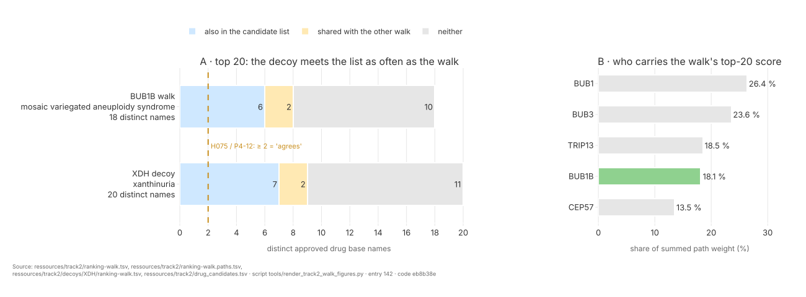

# Step 7 — Track 2 — two engines, one graph

**Standing:** **run 2026-09-23**; `P4-11` (H074) **supported 0.75**, `P4-12` (H075) **supported
0.45**. Marked **done** in `src/mva/science/step_maps/iteration4.py`: both claims are settled,
and the GNN half of the goal is **skipped by user decision** (2026-09-23), not pending.
Iteration 4, `step-7`. Every number below is owned by entry
[142](methodology/142-a-graph-walk-from-the-disease-node.md).

**Goal** (from `steps.py`):

> Do a graph walk and a GNN over the same knowledge graph converge on the same approved drugs for the mechanism, and how does each rank against a decoy?

**Plan:** [`../plan.md`](../plan.md) §5, *Step 7*; decoy rule §12 O6. Board:
[`../todo.md`](../todo.md), *Close-out — 2026-09-23*, T1.

## What happened

Only the **graph walk** half ran. TxGNN (the GNN (graph neural network) half) was skipped, so
`P4-10` (walk vs GNN convergence) was never filed.

| Claim | Prediction | Verdict | Caveat |
|---|---|---|---|
| H074 (`P4-11`) | the walk's top 20 approved drugs share **≤ 5** with the same walk from a decoy | **supported 0.75** — overlap **2** (NADH, pyridoxal phosphate), unchanged with rank-20 ties | the decoy's neighbourhood has ~38× fewer paths (113 vs 4,265), so low overlap is partly built in; both shared drugs are promiscuous cofactors |
| H075 (`P4-12`) | the walk's top 20 holds **≥ 2** drugs from iteration 2's `drug_candidates.tsv` | **supported 0.45** — **6** matches | the decoy walk matches **7**: the list is broad enough that any walk passes, so the test had no power (refuting evidence row 180) |

Both claims were filed **before** the walk ran. Confidences are held below the suggested values
(0.83, 0.55); the weighing is a transparent heuristic for triage, not a calibrated posterior.

**The graph.** PrimeKG v2.1 (a public biomedical knowledge graph: 129,375 nodes, 8,100,498
edges, CC0), fetched with md5 and sha256 checks.

**The walk.** Start at PrimeKG's grouped MVA disease node (MVA, MVA1–3), which links **five**
genes: BUB1, BUB1B, BUB3, CEP57, TRIP13. Walk three metapaths (path templates): `direct`
(disease → gene → drug), `ppi` (→ gene → gene → drug), `pathway` (→ gene → pathway → gene →
drug). Score = Σ over paths of ∏ 1/degree. Keep drugs with a US label on openFDA, stop at 100.

**What came out.** 4,265 paths to 745 drugs; 100 approved kept. **No `direct` path exists**:
PrimeKG has no drug edge on any of the five genes. Top 5: fostamatinib, theophylline, NADH,
pyridoxal phosphate, copper. Vincristine is the only standard-of-care drug in the top 20. BUB1B
carries **18 %** of the top-20 weight.

**The decoy.** `XDH` (xanthinuria type I) passes every O6 condition in PrimeKG itself:
autosomal-recessive, a MONDO node, no mitosis/SAC (spindle assembly checkpoint) term, no pathway
shared with the MVA genes. `NTRK3` was not needed. The decoy walk overrides the card's MONDO id,
because a decoy card keeps the proband's `case` block by design.

**Clinical source.** Of the proband's 8 HPO terms, 7 are PrimeKG nodes (rhabdomyosarcoma is
not); only **2** link to the MVA node (short stature, small for gestational age); none to the
decoy's. The walk uses no phenotype edges: reported, not scored. Card v5's `case.hpo_terms`
misses the eighth term (recurrent spontaneous abortion).



> **Figure** `figures/it4/track2-walk-overlap.{svg,png}` — drawn by
> `tools/render_track2_walk_figures.py` from the three tables below. Legend is in the figure.

## Outputs

| Artifact | Where |
|---|---|
| the ranking (100 approved) + the 309 paths behind its top 20 + manifest | `ressources/track2/ranking-walk.tsv`, `.paths.tsv`, `.provenance.json` |
| the two pre-registered numbers + the post-hoc base rate | `ressources/track2/ranking-walk.comparison.json` |
| the decoy ranking (35 approved) + paths + manifest | `ressources/track2/decoys/XDH/ranking-walk.tsv`, `.paths.tsv`, `.provenance.json` |
| the graph's provenance (DOI, version, md5, sha256, licence) | `ressources/track2/primekg.provenance.json` |
| the graph as parquet (gitignored) | `build/primekg/kg.parquet` |
| fetch + convert | `tools/fetch_primekg.py` |
| walk / compare / explain CLI | `tools/track2_walk.py` |
| the engine | `src/mva/drugs/graph_walk.py`, `primekg.py`, `walk_table.py` |
| tests (synthetic 8-node graph) | `tests/test_drugs_graph_walk.py` |
| lineage | `warehouse.data_lineage`: `track2.ranking-walk`, `track2.decoys.XDH.ranking-walk` |

## What it does not support

- **Walk vs GNN.** Unanswered: TxGNN skipped, `P4-10` never filed.
- **Efficacy.** A drug near the disease in the graph is not a drug that helps. Whether any
  top-20 drug acts in a card direction (D1–D4) is not tested.
- **Agreement with iteration 2.** `P4-12` passed, but a decoy passes it too.
- **A BUB1B-specific ranking.** Four of five start genes are not the child's.

## Limitations

- **The drug end is not penalised.** Multi-target drugs (fostamatinib, 302 target edges) and
  cofactors (NADH) collect many paths. `drug_protein` mixes target, enzyme, transporter and
  carrier edges.
- **Snapshot graph.** PrimeKG v2.1 was released 2022-05-02; a drug or edge absent then cannot
  rank.
- **Weak Track 1 input.** The walk uses only the disease id; it inherits the diagnosis, not
  iteration 4's refuted allele consensus (entry
  [130](../step-6/methodology/130-a-consensus-of-lanes-that-declined-to-vote.md)).
- **Name matching.** DrugBank names meet openFDA names through `base_name`; a drug labelled under
  another generic name is dropped as unapproved.

## Reproduce

```bash
uv run python tools/fetch_primekg.py --execute
uv run python tools/track2_walk.py walk
uv run python tools/track2_walk.py walk --card ressources/track2/decoys/XDH/mechanism.json \
  --mondo MONDO:0010209 --mondo-reason "plan O6 decoy" --out-dir ressources/track2/decoys/XDH
uv run python tools/track2_walk.py compare --decoy ressources/track2/decoys/XDH --write
uv run python tools/track2_walk.py explain --drug Theophylline
uv run python tools/record_track2_lineage.py
```

## Methodology

[`methodology/142`](methodology/142-a-graph-walk-from-the-disease-node.md) — the decoy check,
the walk, both comparisons, the clinical-term check and both verdicts. Claims:
[`hypotheses/`](hypotheses/README.md).
