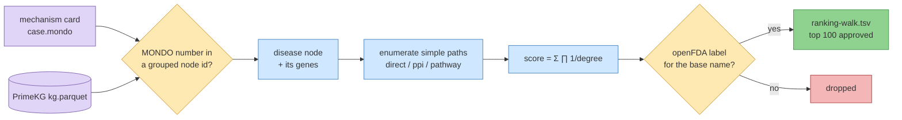

# 142 — A graph walk from the disease node, and a decoy walked the same way

**Written:** 2026-09-23. **Step:** `step-7` (iteration 4). **Hypotheses:** **H074** (`P4-11`,
specificity against a decoy) and **H075** (`P4-12`, agreement with iteration 2's candidate list),
both filed with `mva-science hypothesis-add --iteration iteration4` **before** any walk ran.

## Question

Step 7's goal asks two things: does a **graph walk** and a **GNN** (graph neural network) over one
knowledge graph converge on the same approved drugs, and how does each rank against a **decoy**?
This entry answers the graph-walk half only. TxGNN (the GNN half) is skipped by the user's
decision of 2026-09-23 (`../../todo.md`, *Close-out*), so `P4-10` is never filed.

The two questions this entry can answer:

1. Is the walk **specific**: does it rank different drugs when started from an unrelated
   disease? (`P4-11`)
2. Does the walk **agree** with the literature/API-derived candidate list iteration 2 built
   (`ressources/track2/drug_candidates.tsv`)? (`P4-12`)

## Hypothesis and prediction

- **H074 / `P4-11`.** The walk's top 20 approved drugs share **≤ 5** with the same walk from a
  decoy card's disease node. Decoy: `XDH`, chosen by plan §12 O6's rule; `NTRK3` only if `XDH`
  fails a rule condition.
- **H075 / `P4-12`.** The walk's top 20 contains **≥ 2** drugs that appear in
  `drug_candidates.tsv` (any row, approved or not).

Both comparisons match drug names through `mva.drugs.names.base_name` (salt words folded,
upper-cased). Pre-registered choices, fixed before the run:

- **Top 20** = the first 20 rows of the ranking after the approved-drug filter.
- **Standard-of-care drugs are not removed** from the walk; they are flagged in a column.
- **Ties** break on drug name, so the ranking is deterministic.

## What would refute it

- **H074:** a top-20 overlap **above 10**. 6–10 is recorded as inconclusive.
- **H075:** **0** matches. 1 is recorded as inconclusive. On a refutation the entry lists which
  expected paths the graph lacks.

## Decoy choice (answers plan §12 O6)

O6's rule: autosomal-recessive, has a MONDO disease node, no mitosis/SAC (spindle assembly
checkpoint) role, no pathway shared with BUB1B **in PrimeKG**. Of the two committed decoys
(`ressources/track2/decoys/`), **XDH** passes every condition, each checked in the graph itself:

| condition | XDH, as PrimeKG states it |
|---|---|
| a MONDO disease node | `MONDO:0010209` (xanthinuria type I) → grouped node `xanthinuria` (members xanthinuria, type I, type II); genes XDH, MOCOS |
| autosomal-recessive | the node carries a `disease_phenotype_positive` edge to *Autosomal recessive inheritance* |
| no mitosis/SAC role | XDH's 28 `bioprocess_protein` GO terms are purine catabolism, ROS, endothelial and immune terms; none names mitosis, a checkpoint or chromosome segregation |
| no shared pathway | XDH's 2 pathways (*Purine catabolism*, *Butyrophilin family interactions*) share none with BUB1B, BUB1, BUB3, CEP57 or TRIP13; no XDH–MVA-gene PPI edge |

NTRK3 was not needed, so it was not checked against the rule.

**Why the decoy walk overrides the card's MONDO id.** A decoy card keeps the proband's `case`
block by design (`mva.drugs.decoy`: *same child, different gene*), so its `case.mondo` is MVA1
and a walk from it would reproduce the real walk. The walk therefore takes `--mondo
MONDO:0010209` with a stated reason; both are written into the decoy manifest's `source` block.

## Inputs

| input | version / digest | role |
|---|---|---|
| PrimeKG `kg.csv`, Harvard Dataverse `doi:10.7910/DVN/IXA7BM` | v2.1 (released 2022-05-02), sha256 `0a5a010f…5c69`, md5 matches the published `aac8191d…`, 981,751,236 bytes, **CC0 1.0** | the graph; `ressources/track2/primekg.provenance.json` |
| `build/primekg/kg.parquet` (gitignored) | sha256 `7a0df2fe…eb08`, 8,100,498 edge rows, 129,375 nodes, 10 node types | what the walk reads |
| `ressources/track2/mechanism.json` | card v5, `case.mondo` = `MONDO:0009759` | the start node, the HPO terms, the standard of care |
| `ressources/track2/decoys/XDH/mechanism.json` | decoy card v1 | the decoy run |
| openFDA `drug/label.json` via `mva.drugs.cache.Fetcher` | roll-up digests in each ranking manifest | approval gate: a US label for the base name |
| `ressources/track2/drug_candidates.tsv` | sha256 `42c04912…` | P4-12's comparison list (1,550 distinct base names, 325 approved) |
| `ressources/hackathon-rules/Challenge_Clinical_Phenotype_1.md` | the file the card names in `case.clinical_terms_source` | the 8 HPO terms |

Code at `2d83246`: `mva.drugs.graph_walk`, `mva.drugs.primekg`, `mva.drugs.walk_table`,
`tools/track2_walk.py`, `tools/fetch_primekg.py`.

## Method



> **Legend** — purple = raw inputs (the card, the graph); blue = machinery; yellow = decision
> points (node resolution, the approval gate); green = the output table; red = drugs dropped
> for having no US label.

1. **Resolve the disease.** PrimeKG groups near-identical MONDO diseases into one node and joins
   their numbers with `_`. `MONDO:0009759` is a member of the node *mosaic variegated
   aneuploidy syndrome* (members MVA, MVA1, MVA2, MVA3), linked to **five** genes: BUB1, BUB1B,
   BUB3, CEP57, TRIP13. The walk starts from the whole group.
2. **Walk.** Three metapaths (path templates) over the subgraph of `disease_protein`,
   `protein_protein`, `pathway_protein`, `drug_protein`: `direct` (disease → gene → drug),
   `ppi` (→ gene → gene → drug), `pathway` (→ gene → pathway → gene → drug). Simple paths only.
3. **Score** = degree-weighted path count, damping 1: each path weighs ∏ 1/degree over its
   intermediate nodes (degree over the four walked relations); a drug's score is the sum.
   Ties break on drug name.
4. **Approval gate.** Drugs in score order; keep one when openFDA holds a label for its
   `base_name`; stop at 100 kept.
5. **Compare** the written tables only: top-20 overlap with the decoy (P4-11), top-20 matches
   against `drug_candidates.tsv` (P4-12).

## Commands

```bash
uv run python tools/fetch_primekg.py --execute            # download, md5 check, parquet, manifest
uv run python tools/fetch_primekg.py --execute --reuse    # the re-run after a quoting fix (below)
uv run python tools/track2_walk.py walk
uv run python tools/track2_walk.py walk --card ressources/track2/decoys/XDH/mechanism.json \
  --mondo MONDO:0010209 --mondo-reason "plan O6 decoy: ..." --out-dir ressources/track2/decoys/XDH
uv run python tools/track2_walk.py compare --decoy ressources/track2/decoys/XDH --write
uv run python tools/track2_walk.py compare --real ressources/track2/decoys/XDH \
  --decoy ressources/track2                                 # post-hoc base rate, not written
uv run python tools/track2_walk.py explain --drug Theophylline   # every path, printed
uv run python tools/record_track2_lineage.py                # 10 edges appended, 103 present
```

The first conversion failed: DuckDB's CSV sniffer read `kg.csv` with no quote character and
broke on a drug name containing commas (`"6,4'-Dihydroxy-…"`). Fixed by passing RFC-4180
quoting explicitly; the downloaded bytes were re-hashed under `--reuse`, not trusted by name.

## Observed output

**Real walk** (MVA node): 4,265 paths to 745 drug nodes; 334 label checks (288 live) to keep
100 approved drugs. **No `direct` path exists**: PrimeKG has no drug edge on any of the five MVA
genes. The top 20's 309 paths are 211 `pathway` and 98 `ppi`; their weight enters through BUB1
26 %, BUB3 24 %, TRIP13 19 %, **BUB1B 18 %**, CEP57 14 %.

| rank | drug | score | paths | heaviest path |
|---:|---|---:|---:|---|
| 1 | Fostamatinib | 0.00102 | 142 | MVA → BUB1 → DAPK2 → Fostamatinib |
| 2 | Theophylline | 0.00065 | 5 | MVA → BUB3 → CPNE1 → Theophylline |
| 3 | NADH | 0.00049 | 5 | MVA → BUB1 → HSD17B3 → NADH |
| 4 | Pyridoxal phosphate | 0.00038 | 2 | MVA → TRIP13 → KYAT1 → Pyridoxal phosphate |
| 5 | Copper | 0.00036 | 29 | MVA → CEP57 → KRT8 → Copper |

Ranks 6–20: cannabidiol, L-glutamine, brentuximab vedotin, cyclosporine, voclosporin, zinc (four
rows: zinc, acetate, chloride, sulfate — 18 distinct base names in the top 20), vincristine
(the only standard-of-care drug), vitamin A, belinostat, levothyroxine, liothyronine, thyroid
(porcine).

**Decoy walk** (xanthinuria node, XDH + MOCOS): 113 paths to 109 drugs; 35 approved after 109
checks. Top: pyridoxal phosphate, NADH, azathioprine, inosine, then a 17-way tie at 1/62 (one
path through XDH, degree 62) holding allopurinol, febuxostat, mercaptopurine and several
chemotherapies; the tie spans ranks 5–21.

**The two numbers** (`ressources/track2/ranking-walk.comparison.json`):

| claim | measured | threshold |
|---|---|---|
| P4-11 decoy overlap, top 20 | **2** (NADH, pyridoxal phosphate); **2** again with every rank-20 tie included on both sides | ≤ 5 supported; > 10 refuted |
| P4-12 matches in `drug_candidates.tsv`, top 20 | **6** (belinostat, brentuximab vedotin, levothyroxine, theophylline, vincristine, zinc), all approved rows there | ≥ 2 supported; 0 refuted |
| post hoc: the decoy's top 20 vs the same list | **7** (azathioprine, carboplatin, cisplatin, daunorubicin, deferoxamine, doxorubicin, mercaptopurine) | not pre-registered |

Wider: 31 of the walk's 96 distinct approved names are in `drug_candidates.tsv`; 11 are in
`shortlist.tsv` (atorvastatin, epinephrine, lovastatin, nicotinamide, olaparib, podofilox,
selinexor, simvastatin, sorafenib, valproic acid, vorinostat) — none in the top 20.

**Clinical source.** Of the proband's 8 HPO terms, 7 are PrimeKG phenotype nodes;
**rhabdomyosarcoma (HP:0002859) is not**. Only **2** link to the MVA node: short stature
(HP:0004322) and small for gestational age (HP:0001518). Nephrocalcinosis, failure to thrive,
skeletal muscle atrophy, premature birth and recurrent spontaneous abortion exist as nodes but
not on the MVA node. None of the 8 links to the xanthinuria node. **Card gap:** card v5's
`case.hpo_terms` lists 7 terms; the clinical file's eighth, HP:0200067 (recurrent spontaneous
abortion), is missing from the card. The walk read both and records which came from where.
The walk does not use phenotype edges; the check is reported, not scored.

## Verdict

- **H074 / P4-11 — supported, 0.75** (suggested 0.83). Overlap 2 ≤ 5, robust to ties. Held
  lower: the decoy neighbourhood is ~38× smaller in paths (113 vs 4,265; the register's
  reasoning rounds it to 40×), so low overlap is partly guaranteed by construction, and both
  shared drugs are promiscuous cofactors.
- **H075 / P4-12 — supported, 0.45** (suggested 0.55). 6 ≥ 2 as pre-registered. But the decoy
  also matches 7: `drug_candidates.tsv` is broad enough that **any** walk meets the threshold.
  P4-12 had no power to show agreement on the mechanism. That is a design flaw of the claim,
  recorded as a refuting evidence row, not re-scored after the fact.

Evidence rows 177–180. The weighing is a transparent heuristic for triage, not a calibrated
posterior.

## Assumptions

- A US label (openFDA, matched on `base_name`) is the approval test, as in `drug_candidates.tsv`.
- Degree is measured over the four walked relations only.
- The grouped MVA node is the right start: PrimeKG offers no MVA1-only node.

## Limitations

- **Convergence ≠ correctness.** A drug near the disease in the graph is not a drug that
  helps. The walk measures graph proximity only; whether any top-20 drug acts in a card
  direction (D1–D4) is not tested here. The top is led by a multi-kinase inhibitor and cofactors.
- **The drug end is not penalised.** Fostamatinib (302 target edges) and cofactors (NADH 153
  drug–protein edges) collect many paths. `drug_protein` also mixes `target`, `enzyme`,
  `transporter` and `carrier` edges, and the walk does not tell them apart (vincristine's 16
  edges are mostly transporters and CYPs; 2 are tubulins).
- **Four of five start genes are not the child's.** BUB1B carries 18 % of the top-20 weight.
- **Snapshot graph.** PrimeKG v2.1 was released 2022-05-02; a drug or edge absent then cannot rank.
- **Weak Track 1 input.** Iteration 4 refuted its own consensus claim (entry 130); the walk
  uses only the disease id, so it inherits the diagnosis, not the allele ranking.
- **Name matching.** DrugBank names vs openFDA/ChEMBL names through `base_name`: a drug labelled
  under a different generic name (e.g. a USAN vs INN spelling) is dropped as unapproved.
- **TxGNN skipped** (user decision, 2026-09-23): the "vs GNN" half of step 7's goal is
  unanswered and `P4-10` is never filed.

## Quality checks

- Download md5 = Dataverse's published md5; sha256 recorded; parquet row count 8,100,498.
- Determinism: sorted neighbour order, name tie-break; a unit test re-runs the walk and
  compares rankings.
- Eight unit tests on a synthetic 8-node graph (`tests/test_drugs_graph_walk.py`): metapath
  enumeration, inverse-degree weights, damping 0 = path count, approval gate order and salt
  folding, grouped-MONDO resolution (a prefix is not a member), HPO check. One lineage test.
- Tie sensitivity at rank 20: overlap unchanged.
- Lineage: `warehouse.data_lineage` rows for `track2.ranking-walk` and
  `track2.decoys.XDH.ranking-walk` (card, Dataverse, openFDA, `drug_candidates`; the decoy
  carries no submission edge).
- Coordinate-free: gene, drug, pathway and disease names only; `tools/check-python.sh`
  (coordinate gate) green on commit.

## Outputs

- `ressources/track2/ranking-walk.tsv` (100 rows) + `.paths.tsv` (309 paths behind the top 20)
  + `.provenance.json` + `.comparison.json`
- `ressources/track2/decoys/XDH/ranking-walk.tsv` (35) + `.paths.tsv` (24) + `.provenance.json`
- `ressources/track2/primekg.provenance.json`
