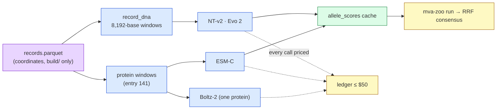
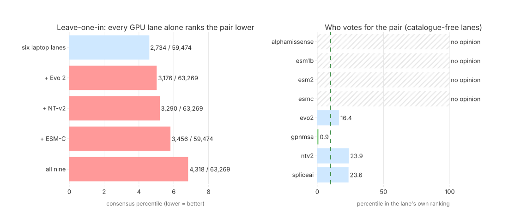

# Step 8 — The GPU tier on Modal

**Standing:** **run 2026-09-23/24**. Iteration 4, `step-8`, track 1. Marked **open** in
`src/mva/science/step_maps/iteration4.py`: H078, H079, H081 and H082 are undecided by their own
terms and owed a revision, not a re-run. Every number below is owned by an entry under
[`methodology/`](methodology/).

**Goal** (from `steps.py`):

> Do the roster's GPU models (NT-v2, Evo 2, ESM-C, Boltz-2), run on Modal behind one HTTP
> contract and a $50 cap, score the confirmed pair's alleles the laptop lanes abstain on — and
> does adding them move the consensus rank?

**Plan:** [`../plan.md`](../plan.md) §7b wave 5, rows B1–B2 (opt-B). Board: [`../todo.md`](../todo.md).

## Why this step exists

Entry 130: the catalogue-free consensus puts the confirmed pair at 20,639 of 52,012 because
three of four laptop lanes **abstain** on its `stop_gained` half. A DNA language model
(a next-token model over the four bases) reads any allele, nonsense included. Those models
need a GPU, so they run on Modal — a serverless GPU cloud billed per second.

> **Legend** purple = the raw input · blue = machinery · green = the cache the reports read ·
> yellow = decision points (the consensus, and the spend guard every wave passes).

## The contract (built first, entry 143)

| piece | file |
|---|---|
| DNA windows, `build/` only | `src/mva/zoo/record_dna.py` |
| wire shape, GPU rates, budget shares | `src/mva/zoo/modal_contract.py` |
| spend ledger + guard | `src/mva/zoo/modal_budget.py` |
| laptop lane (`adapter = "modal"`) | `src/mva/zoo/adapters/modal_gpu.py` |
| one Modal app per model + recipe | `src/mva/zoo/modal_apps/` |
| every Modal command traced | `tools/modal_trace.py` → [`modal-runs.md`](modal-runs.md) |

Budget: $50 cap; shares NT-v2 $6, ESM-C $4, Evo 2 $18, Boltz-2 $6, API $1, the rest reserve.

## Claims (filed before any GPU run)

[`hypotheses/README.md`](hypotheses/README.md): H076 (P4-1 DNA half, `retrospective:`), H077
(P4-4 cost), H078 (P4-13 NT-v2), H079 (P4-14 Evo 2), H080 (P4-15 ESM-C), H081 (P4-16 Boltz-2),
H082 (P4-17 consensus).

## What happened

| entry | lane / question | result | claim |
|---|---|---|---|
| [143](methodology/143-a-gpu-lane-that-sends-two-windows-and-a-bill.md) | the contract, DNA windows | 39,286 / 39,286 windows, 0 REF mismatches, 25 s | H076 supported 0.77 (`retrospective:`) |
| [144](methodology/144-ntv2-reads-two-windows-on-an-l4.md) | NT-v2 500M, L4 | 39,286 scored, $2.96; pair 23.93rd pct | H078 testing 0.40 |
| [145](methodology/145-esmc-agrees-with-esm2-except-on-the-confirmed-allele.md) | ESM-C 600M, L4 | 15,592 scored, $0.08; ρ 0.85 vs ESM2, 0.74 vs ESM1b; confirmed missense at the median | H080 supported 0.85 |
| [146](methodology/146-evo2-1b-scores-every-record-on-an-h100.md) | Evo 2 1B, H100 | 39,286 scored, $7.05; stop-gained top 5.6 %; pair 16.36th pct | H079 testing 0.40 |
| [147](methodology/147-boltz2-folds-bubr1-and-a-conservative-swap-drops-as-much.md) | Boltz-2, H100, one protein | local pLDDT −3.2 / −2.7; a conservative swap drops as much | H081 testing 0.31 |
| [148](methodology/148-the-gpu-lanes-and-the-consensus.md) | the 9-lane consensus + leave-one-in | RRF 4,318 (six lanes: 2,734); **each GPU lane alone ranks the pair lower**; billed $14.57 | H077 supported 0.83, H082 testing 0.20 |

> **Legend** — neutral machinery (the six-lane baseline; a lane that ranks the pair); broken /
> dangerous / lost points (worse than the baseline); good / safe / the goal (top decile,
> dashed); context, not the subject; hatched = no opinion (the lane cannot score both alleles).

**The headline.** The GPU tier is cheap and works: three scoring lanes and a fold study for
**$14.57** billed (ledger $11.33), behind one contract, one API and a traced audit trail
([`modal-runs.md`](modal-runs.md)). It does not rescue the consensus. Equal-weight RRF rewards
how many lanes can *see* a pair. A missense-only lane (ESM-C) adds votes to rival pairs and
none to this missense + stop-gained pair. The DNA lanes vote for it, but only at the 16th and 24th
percentiles. The best catalogue-free opinion is still GPN-MSA's (0.93rd percentile).

**The API.** Each lane serves `POST score` + `GET health` behind proxy auth; the gateway
`mva-zoo-api` (`GET /models`, `POST /score/{key}`) forwards to any lane. Every lane answered
401 without the token and 200 with it. All apps are **stopped**. The code stays in
`src/mva/zoo/modal_apps/`, and `tools/modal_trace.py deploy <key>` brings a lane back.

**Run it again:** `uv run --group zoo-ml python tools/modal_trace.py deploy <key>`, then
`uv run --group zoo-ml mva-zoo score --model <key>`, then
`uv run --group zoo-ml mva-zoo run --config docs/iteration4/step-8/zoo.step8.toml`.
Per-model reports of this run: [`reports/`](reports/); merged: [`merged-report.md`](merged-report.md).

## Limitations

- Windows are patient sequence: they go to Modal containers and come back as scores; volumes
  hold weights only. Every volume is on the deletion list (challenge rule: delete in 30 days).
- The ledger prices GPU seconds only; cold start and idle time are in the billing report (1.29×).
- One recipe per lane, chosen before the consensus ran; none was re-tuned after it.
- The fusion is the pre-registered equal-weight RRF; a lane-aware fusion is a new claim.
- Deletion: every Modal volume and the proxy token are listed in
  [`../../notes/data-deletion-checklist.md`](../../notes/data-deletion-checklist.md).
