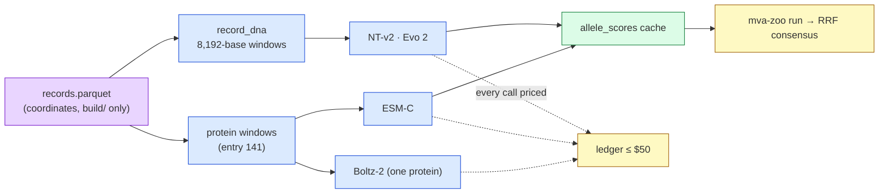

# Step 8 — The GPU tier on Modal

**Standing:** **opened 2026-09-23**, in progress. Iteration 4, `step-8`, track 1. Marked
**open** in `src/mva/science/step_maps/iteration4.py`. Nothing below is a result until an entry
under [`methodology/`](methodology/) records it.

**Goal** (from `steps.py`):

> Do the roster's GPU models (NT-v2, Evo 2, ESM-C, Boltz-2), run on Modal behind one HTTP
> contract and a $50 cap, score the confirmed pair's alleles the laptop lanes abstain on — and
> does adding them move the consensus rank?

**Plan:** [`../plan.md`](../plan.md) §7b wave 5, rows B1–B2 (opt-B). Board: [`../todo.md`](../todo.md).

## Why this step exists

Entry 130: the catalogue-free consensus puts the confirmed pair at 20,639 of 52,012 because
three of four laptop lanes **abstain** on its `stop_gained` half. A DNA language model
(a next-token model over the four bases) reads any allele, nonsense included. Those models
need a GPU, so they run on Modal — a serverless GPU cloud billed per second.

> **Legend** purple = the raw input · blue = machinery · green = the cache the reports read ·
> yellow = decision points (the consensus, and the spend guard every wave passes).

## The contract (built first, entry 143)

| piece | file |
|---|---|
| DNA windows, `build/` only | `src/mva/zoo/record_dna.py` |
| wire shape, GPU rates, budget shares | `src/mva/zoo/modal_contract.py` |
| spend ledger + guard | `src/mva/zoo/modal_budget.py` |
| laptop lane (`adapter = "modal"`) | `src/mva/zoo/adapters/modal_gpu.py` |
| one Modal app per model + recipe | `src/mva/zoo/modal_apps/` |
| every Modal command traced | `tools/modal_trace.py` → [`modal-runs.md`](modal-runs.md) |

Budget: $50 cap; shares NT-v2 $6, ESM-C $4, Evo 2 $18, Boltz-2 $6, API $1, the rest reserve.

## Claims (filed before any GPU run)

[`hypotheses/README.md`](hypotheses/README.md): H076 (P4-1 DNA half, `retrospective:`), H077
(P4-4 cost), H078 (P4-13 NT-v2), H079 (P4-14 Evo 2), H080 (P4-15 ESM-C), H081 (P4-16 Boltz-2),
H082 (P4-17 consensus).

## What happened

To be filled from the entries as they land.

## Limitations

- Windows are patient sequence: they go to Modal containers and come back as scores; volumes
  hold weights only. Every volume is on the deletion list (challenge rule: delete in 30 days).
- The ledger prices GPU seconds only; cold start and idle time are in the billing report.
