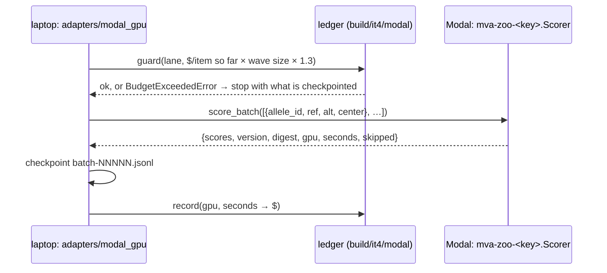

# 143 — A GPU lane that sends two windows and gets back a score and a bill

**Step:** iteration 4, [step 8](../README.md) — the GPU tier on Modal. **Date:** 2026-09-23.
**Claims:** H076 (`P4-1`, DNA half — `retrospective:`). The contract below serves H077–H082,
which later entries test.

## Question

Can every record be handed to a GPU language model as two sequence windows — and nothing
else — with every GPU second priced before the next batch is sent?

## Hypothesis and prediction

H076, filed **after** the run below, so it is marked `retrospective:` and is not a
pre-registered prediction: *every record gets an 8,192-base DNA window pair from the pinned
GRCh38 reference, with no REF mismatch.* Prediction: ≥ 99 % of the 39,286 records carry a
complete, unclipped pair and 0 disagree with the reference base.

## What would refute it

Under 95 % complete, or REF mismatches above 0.1 %.

## Inputs

| input | value |
|---|---|
| records | `build/it4/records.parquet` (step 1, entry 114; 39,286 rows) |
| reference | `build/reference/GRCh38.fa` — GCA_000001405.15 no-alt analysis set; manifest `GRCh38.provenance.json` (output sha256 `c18c666b…`) |
| reader | `pysam` 0.24.1 `FastaFile` |
| window | 8,192 bases, allele at offset 4,096 (Evo 2's context; plan §5) |
| code | `src/mva/zoo/record_dna.py` |

## Commands

```sh
uv run python -c "from mva.zoo.record_dna import write_dna_windows; \
  print(write_dna_windows('build/it4/records.parquet').as_dict())"
```

Log: `build/it4/modal/b1-dna-windows.log`; output `build/it4/dna-windows.parquet` +
`.provenance.json` (both gitignored — patient sequence).

## Observed output

```json
{"considered": 39286, "contig_missing": 0, "ref_mismatch": 0,
 "clipped_at_contig_end": 0, "complete": 39286, "fraction_complete": 1.0}
```

25.4 s wall-clock on the laptop. The alt window keeps both flanks, so an indel's window is
`len(ALT) − len(REF)` bases off 8,192; the allele always starts at 4,096.

## What else this entry built — the tier-3 contract



> **Legend** a sequence diagram: time runs down; each arrow is one message. No gene, HGVS or
> coordinate crosses the laptop→Modal arrow.

| piece | decision |
|---|---|
| `modal_contract.py` | one app per lane (`mva-zoo-<key>`), class `Scorer`, method `score_batch`; `Item` / `Reply` shapes; cap **$50**, shares NT-v2 $6, ESM-C $4, Evo 2 $18, Boltz-2 $6, API $1 |
| GPU rates | read from modal.com/pricing 2026-09-23, per second: H100 0.001097, A100-80GB 0.000694, A100-40GB 0.000583, L40S 0.000542, A10 0.000306, L4 0.000222, T4 0.000164 |
| `modal_budget.py` | append-only `ledger.jsonl`; `guard()` before every wave, padded ×1.3 for cold start and idle time the reply cannot see; `billing_report()` reconciles against Modal's own bill |
| `adapters/modal_gpu.py` | `adapter = "modal"` in the registry; reads windows from `build/` only; central crop to the card's `window`; per-reply checkpoints (a killed run resumes); log `build/it4/modal/<key>.log` |
| `modal_apps/` | the lane recipe (README); `_common.py` (weights volume per lane, weights digest, `scaledown_window` 60 s); `api.py` gateway `mva-zoo-api` (`GET /models`, `POST /score/{key}`, proxy auth) |
| `tools/modal_trace.py` | every deploy / run / stop appends to `build/it4/modal/trace.jsonl`; `summary` writes [`../modal-runs.md`](../modal-runs.md) |

Modal workspace budgets cannot be set from the CLI (`modal workspace settings` exposes none);
the $50 cap is enforced by the ledger, and the user can add a workspace budget on the
Usage & Billing page as an outer guard.

Tests: `tests/test_zoo_modal.py` (4) — window centring and REF check on a fake FASTA, crop
keeps the change, scoring + checkpoint + resume + pricing through a fake transport, the guard
stops at a lane's share. Green with the zoo adapter suite (57 passed).

## Verdict

H076 **supported** on its own terms: 100 % complete, 0 mismatches, 0 clipped. Retrospective —
the claim was filed after the run, so it carries no predictive weight.

## Limitations

- REF agreement is checked on the reference allele only; it does not validate the caller's
  normalisation beyond that.
- Windows are patient sequence. They leave the laptop only inside a `score_batch` call to a
  Modal container, which keeps nothing; volumes hold weights only.

## Conclusion

The DNA half of the record exists for every allele, and a GPU lane is now one file in
`modal_apps/` plus one card fragment. Entries 144–147 run NT-v2, ESM-C, Evo 2 and Boltz-2 on it.
