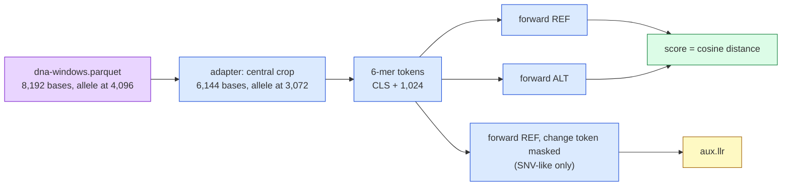

# 144 — NT-v2 reads every record's two DNA windows on an L4, for three dollars

**Step:** iteration 4, [step 8](../README.md) — the GPU tier on Modal. **Date:** 2026-09-23.
**Claims:** H078 (`P4-13`), filed before this run. Lane `ntv2`, app `mva-zoo-ntv2`, contract
[entry 143](143-a-gpu-lane-that-sends-two-windows-and-a-bill.md).

## Question

Can **NT-v2** (Nucleotide Transformer v2, a *masked DNA language model*: a BERT-style network
that learned which 6-base words fit their context across 850 genomes) score every record of the
case — nonsense, missense, splice, indel alike — from its two DNA windows, inside the lane's
$6 share?

## Hypothesis and prediction

H078 / `P4-13`, as filed: *NT-v2, a DNA language model that reads the nonsense allele as well as
the missense one, ranks the confirmed pair in the top decile of its own pair ranking.*
Prediction: *the ntv2 lane scores both confirmed alleles and its catalogue-free rank of the
confirmed pair is at or under the 10th percentile.*

## What would refute it

As filed: *the lane abstains on either confirmed allele, or the pair sits above the median
(50th percentile) of the lane's ranking.*

## Recipe choice

The NT paper (Dalla-Torre et al., Nature Methods 2024, PMID 39609566) scores variants zero-shot
by comparing the model's **embeddings** (the vector it builds for a sequence) of the reference
and the mutant sequence, and by a loss-based likelihood score. This lane uses both:

| field | what | direction |
|---|---|---|
| `score` | **cosine distance** `1 − cos(mean_ref, mean_alt)` of mean final-layer token embeddings | 0 = no change seen; higher = more changed → `score_sign = +1` |
| `aux.llr` | masked **log-likelihood ratio**: mask the 6-mer token holding the change in the REF window, `log P(alt 6-mer) − log P(ref 6-mer)` | negative = mutant word unlikely; SNV-like changes only |
| `aux.cos_local` | cosine distance over the ±16 tokens around the change | as `score` |
| `aux.l2` | Euclidean distance of the mean embeddings | as `score` |

Why the embedding distance is the headline: it needs no token alignment, so **indels are scored**
(a length-changing alt window just has more or fewer tokens). The LLR is exact only when the
change sits inside one 6-mer with unchanged token boundaries; elsewhere it is `null`.

Limitation of the headline, stated up front: an embedding distance measures *how much the model's
view changed*, not *in which direction*. A change toward a more "typical" sequence also scores high.



> **Legend** purple = raw patient windows (`build/` only) · blue = machinery · green = the cached
> score · yellow = the secondary number, present only where the recipe is exact.

## Inputs

| input | value |
|---|---|
| model | `InstaDeepAI/nucleotide-transformer-v2-500m-multi-species`, licence CC-BY-NC-SA-4.0 |
| revision | Hugging Face commit `06615c1660c892fc199840c18123f8385b3542a8` (Hub API, 2026-09-23) |
| weights digest | `86a1b8144af071a923f0334456c86bd3b043eab43881f5aee2dd7f5a76947b66` (`_common.sha256_tree` over `model.safetensors`, measured in the container) |
| image | Debian slim, Python 3.11; `torch==2.5.1`, `transformers==4.46.3`, `huggingface_hub==0.26.5`, `safetensors==0.4.5`, `numpy==2.1.3`, `fastapi[standard]==0.115.6` |
| GPU | L4, `max_containers = 4`, `scaledown_window = 60 s` |
| window | 6,144 bases (1,024 tokens), central crop of the 8,192-base windows (entry 143) |
| batch / wave | 32 items per call, 8 calls per wave; 8 sequences per forward pass |
| precision | fp16 autocast for the full run (weights, softmax, norms fp32); the first 256 records in fp32 — see *Observed output* |
| tokeniser check | every container start compares our 6-mer span tokeniser with the published tokeniser on a random probe with Ns; a mismatch aborts the container |
| records | `build/it4/records.parquet` (39,286), windows `build/it4/dna-windows.parquet` |
| clinical side | none: this lane reads DNA only. The 8 HPO terms enter at the ranking, not here |

Why 6,144 bases: under NT-v2's 2,048-token limit with room for insertions, on a token boundary
at the allele, and half the attention cost of the full 8,192.

## Commands

```bash
uv run --group zoo-ml python tools/modal_trace.py deploy ntv2
uv run --group zoo-ml python tools/modal_trace.py run ntv2 smoke     # 8 random-base items
# card limit = 256, precision fp32
uv run --group zoo-ml mva-zoo score --model ntv2
# precision fp16, redeploy; re-score the same 256 via Scorer.score_batch (scratch script,
# replies priced into the ledger with note "precision check fp16 vs fp32 (entry 144)")
uv run --group zoo-ml python tools/modal_trace.py deploy ntv2
# HTTP proof, synthetic body only, proxy-token headers (values never printed)
curl -H "Modal-Key: …" -H "Modal-Secret: …" https://<workspace>--mva-zoo-ntv2-scorer-health.modal.run
curl -X POST … --data @body.json https://<workspace>--mva-zoo-ntv2-scorer-score.modal.run
curl -X POST … --data @body.json https://<workspace>--mva-zoo-api-web.modal.run/score/ntv2
# limit removed, wave = 8
uv run --group zoo-ml mva-zoo score --model ntv2 --dry-run
uv run --group zoo-ml mva-zoo score --model ntv2
uv run --group zoo-ml python tools/modal_trace.py stop ntv2
```

## Observed output

**Smoke** (8 random-base items, fp32, cold container incl. first weights download): all 8
scored, 4.76 GPU s; identity item (alt = ref) scored ~1e-16 (the numerical floor); SNV ~1e-5;
3-base deletion ~3.5e-3. Tokeniser self-check passed.

**Calibration, 256 real records, fp32** (8 calls × 32): ~20.3 GPU s per call = **0.63 s/record**,
$1.4e-4/record → the full set would cost ~$5.5 in ledger dollars, ×1.3 guard pad ≈ $7.2 — over
the $6 share. So precision was measured, not assumed:

| same 256 records, fp16 vs fp32 | value |
|---|---|
| GPU time | 87.8 s = **0.34 s/record** (1.85× faster) |
| `score` Spearman / Pearson | 0.9941 / 0.99989 |
| `score` relative difference, median / p95 / max | 2.5 % / 10.7 % / 142 % (max on a near-zero score) |
| `aux.llr` Spearman, max abs diff | 0.99998, 0.054 |
| `aux.cos_local` Spearman | 0.99987 |

Rank order is preserved; fp16 was kept for the rest.

**HTTP proof** (synthetic body, 2 items): no credentials → 401; `GET …-scorer-health` → model,
version, digest, GPU; `POST …-scorer-score` and the gateway `POST /score/ntv2` → both items
scored, 0.58 / 0.56 GPU s. URL shape `https://<workspace>--mva-zoo-ntv2-scorer-{score,health}.modal.run`.

**Full run** (fp16, 39,030 records not yet checkpointed): 1,220 calls, 0 errors, 0 skipped,
wall 3,568 s = **10.9 records/s** on ≤ 4 L4s; 13,094 GPU s = 0.335 GPU s/record.
`mva-zoo score`: *inserted 39,030, skipped 256 (already cached)*; the first run inserted 256.

| lane totals (ledger, `build/it4/modal/ledger.jsonl`) | value |
|---|---|
| calls | 1,236 (8 fp32 calibration, 8 precision check, 1,220 full run) |
| GPU seconds | 13,346.8 |
| ledger USD | **$2.963** of the $6 share |
| not in the ledger | smoke (4.76 GPU s), 2 HTTP calls (~1.1 GPU s), cold starts and idle |

**Coverage:** 39,286 / 39,286 records scored (100 % of every consequence class; dry run
beforehand showed the same). `aux.llr` on 36,045; `null` on 3,241 (1,052 of them frameshift or
in-frame indels, the rest multi-base or boundary-crossing changes).

Medians by class (`score`, `aux.llr`), largest classes and the case's classes:

| consequence | n | median score | median llr |
|---|---:|---:|---:|
| missense_variant | 15,620 | 5e-6 | −0.106 |
| synonymous_variant | 12,036 | 4e-6 | −0.067 |
| intron_variant | 5,490 | 7e-6 | −0.122 |
| frameshift_variant | 564 | 2.5e-3 | — |
| stop_gained | 289 | 8e-6 | −1.306 |
| inframe_deletion | 277 | 1.6e-3 | — |
| splice_donor_variant | 122 | 1.3e-5 | −0.710 |

Two readings. (1) Length-changing records sit ~300× above SNVs on `score`: the embedding distance
mostly measures *how much sequence changed*, so across classes it is an indel detector.
(2) Among SNVs, `aux.llr` orders classes the way biology expects — stop_gained and splice-site
changes far more negative than synonymous.

**The confirmed BUB1B alleles** (the `[case]` rule: confirmed_gene BUB1B, lof + missense):

| allele (gene, class) | score | top % of 39,286 on `score` | llr | most-negative % of 36,045 on `llr` |
|---|---:|---:|---:|---:|
| BUB1B stop_gained | 1.7e-5 | 16.5 % | −3.99 | 3.3 % |
| BUB1B missense_variant | 6e-6 | 47.8 % | −0.25 | 46.0 % |

Clinical cross-reference: the lane reads DNA only; the 8 HPO terms do not enter this score. They
enter at the step-8 re-run's ranking.

## Verdict

**H078 — pending the step-8 re-run.** Half of it is decided here:

- *Scores both confirmed alleles:* **met** — both BUB1B alleles have a score and an LLR; the lane
  abstains on neither, so the first refutation branch does not fire.
- *Pair rank ≤ 10th percentile:* not computed here — the pair ranking is the workflow's, re-run
  by the main thread. Allele-level signal, for the record: the nonsense allele is in the top
  3.3 % on `llr` and top 16.5 % on `score`; the missense allele is mid-pack on both (≈ 46–48 %).
  A pair ranking that combines both alleles will be held back by the missense one.

No confidence committed (`mva-science verdict` belongs to the re-run).

## Limitations

- **Direction-free headline.** Cosine distance says "the model's view moved", not "moved toward
  damage". `aux.llr` carries direction for SNV-like changes only.
- **Dilution.** A mean over 1,024 tokens shrinks one base's effect; absolute values are tiny
  (median ~5e-6 for fp32 in the 256-record calibration). Rank, not magnitude, is the usable part.
- **Mixed precision in the cache.** 256 rows fp32, the rest fp16 (`aux.precision`). The fp16/fp32
  gap on the same 256 records is quoted above; it is small against the spread across records,
  but not zero.
- **Window.** 6,144 bases of context, not NT-v2's 12 kb maximum; not tuned.
- **No calibration.** Nothing here was checked against labelled variants; this is zero-shot.
- **Ledger ≠ bill.** The ledger prices in-call GPU seconds; cold starts, weight loading and the
  idle window are in `modal billing report` only (entry 143's reconciliation).

## Conclusion

NT-v2 scored all 39,286 records on Modal L4s for $2.96 (ledger), 1 h wall, no errors. The
embedding-distance headline is dominated by indel length; the masked LLR is the lane's more
informative number for SNVs and puts the BUB1B nonsense allele in the top 3.3 %, the missense
allele near the median. H078's "both scored" half holds; its pair-rank half waits for the
step-8 re-run. Recommendation for the merge: weigh `aux.llr` for SNVs over `score`, or rank
`score` within length-change strata.
