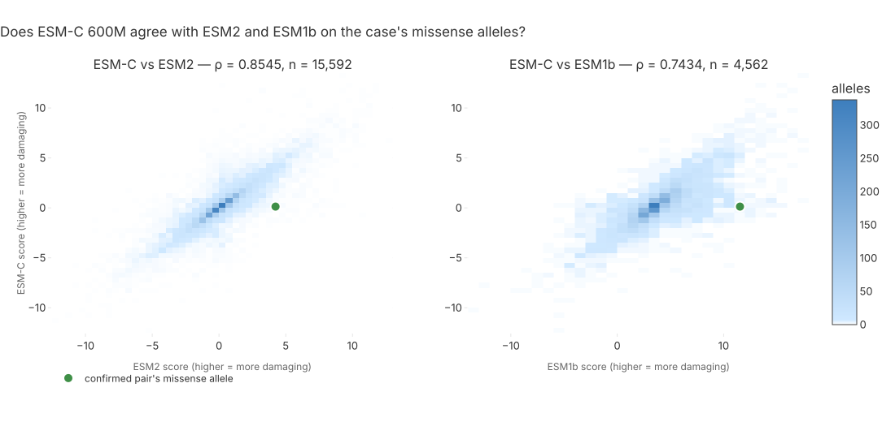

# 145 — ESM-C 600M agrees with ESM2 across the case, and calls the confirmed missense allele neutral

**Step:** iteration 4, [step 8](../README.md) — the GPU tier on Modal. **Date:** 2026-09-23.
**Claims:** H080 (`P4-15`), filed before this run. Lane `esmc`, app `mva-zoo-esmc`, contract
[entry 143](143-a-gpu-lane-that-sends-two-windows-and-a-bill.md).

## Question

Does **ESM-C 600M** (ESM Cambrian, EvolutionaryScale's successor to ESM2: a *masked protein
language model*, a network that learned which amino acid fits a hidden slot from natural protein
sequences alone, no variant labels) order the case's missense alleles the way the two other
protein language models do — and where does it put the confirmed pair's missense allele?

## Hypothesis and prediction

H080 / `P4-15`, as filed: *ESM-C 600M agrees with the other protein language models: its scores
on shared missense alleles correlate with ESM2's at Spearman rho of 0.7 or more.*
Prediction: *Spearman rho(esmc, esm2) >= 0.7 over their shared missense alleles, and
rho(esmc, esm1b) >= 0.6.*

## What would refute it

As filed: *rho(esmc, esm2) below 0.5.*

## Recipe — the ESM2 lane's, unchanged

Same score as `mva.zoo.adapters.local_process.masked_marginals` (entry 142), so the comparison
is model against model, not recipe against recipe:

```
published = log P(alt residue | ref window, changed residue masked)
          − log P(ref residue | same masked window)          # ≤ 0; more negative = worse
cached    = −published                                         # score_sign = −1
```



```mermaid
flowchart LR
  R["records.parquet<br/>protein windows"]:::raw --> A["adapter (laptop)<br/>center = the one differing residue"]:::machine
  A -- "id + 2 windows + center" --> P["plan(): one substitution,<br/>canonical letters, else skipped"]:::decision
  P --> F["ESM-C 600M fp32, L4<br/>ref window, change masked"]:::machine
  F --> S["log P(alt) − log P(ref)"]:::machine
  S --> C["warehouse.allele_scores<br/>model esmc, venue modal:L4"]:::good
  classDef raw fill:#e9d5ff,stroke:#7e22ce
  classDef machine fill:#dbeafe,stroke:#1d4ed8
  classDef good fill:#dcfce7,stroke:#15803d
  classDef decision fill:#fef9c3,stroke:#a16207
```

> **Legend** purple = raw patient windows (`build/` only) · blue = machinery · yellow = the
> item check that decides score or skip · green = the cached score.

## Inputs

| input | value |
|---|---|
| weights | `biohub/esmc-600m-2024-12` (the `EvolutionaryScale/` name redirects), file `data/weights/esmc_600m_2024_12_v0.pth` |
| revision | Hugging Face commit `e4d83bc7e10fd55c92e598e545f4a76bf04a6e5c` (Hub API, 2026-09-23); repo **not gated**, no token, no Modal secret |
| weights digest | `446d3c14628290c8455dd024d2a9a42ace14bea5edd7191153a2166eaf1145ba` (`_common.sha256_tree` over the `.pth`, measured in the container; memoised on the volume by size + mtime) |
| licence | EvolutionaryScale Cambrian non-commercial licence; hackathon use is non-commercial |
| package | `esm==3.1.1` (its `ESMC_600M_202412` constructor: d_model 1152, 18 heads, 36 layers), `torch==2.4.1`, `huggingface-hub==0.36.0`, `fastapi[standard]==0.115.4`, Debian slim, Python 3.11 |
| precision | float32 (the library's `from_pretrained` would cast to bfloat16 on GPU; ESM2 ran float32) |
| GPU | L4, `max_containers = 4`, `scaledown_window = 60 s` |
| batch / wave | 128 items per call, 16 calls per wave; 64 windows per forward pass, grouped by length (no padding) |
| records | `build/it4/records.parquet`, 15,592 missense records with a window pair |
| comparison lanes | `esm2` (entry 142) and `esm1b` (precomputed table), read from `warehouse.allele_scores` |
| confirmed allele | `[case] confirmed_gene` of `src/mva/zoo/zoo.example.toml`, rule `lof+missense`: the gene's one missense record |
| clinical side | none in the score: the lane reads protein sequence only. The 8 HPO terms enter at the ranking (entry 142's report section 5), not here |

## Commands

```bash
uv run --group zoo-ml python tools/modal_trace.py deploy esmc   # 1st: failed, another lane's file edited mid-build
uv run --group zoo-ml python tools/modal_trace.py deploy esmc
uv run --group zoo-ml python tools/modal_trace.py run esmc smoke  # 1st: crash-loop (below), killed
uv run --group zoo-ml modal app stop -y <ephemeral app id>        # the crash-looping smoke app
# fix: web endpoint returns dict (FastAPI cannot model a TypedDict on 3.11); image via _common.with_mva
uv run --group zoo-ml python tools/modal_trace.py deploy esmc
uv run --group zoo-ml python tools/modal_trace.py run esmc smoke  # ubiquitin (UniProt P0CG48), 8 swaps + 1 malformed
# HTTP proof, synthetic ubiquitin body, proxy-token headers (values never printed)
GET  https://<workspace>--mva-zoo-esmc-scorer-health.modal.run        # without headers: 401
POST https://<workspace>--mva-zoo-esmc-scorer-score.modal.run
POST https://<workspace>--mva-zoo-api-web.modal.run/score/esmc        # the gateway
# card: enabled, digest, version; limit = 256, wave = 8
uv run --group zoo-ml python tools/modal_trace.py deploy esmc
uv run --group zoo-ml mva-zoo score --model esmc --dry-run
uv run --group zoo-ml mva-zoo score --model esmc                  # 256 real alleles
# card: limit removed, wave = 16
uv run --group zoo-ml mva-zoo score --model esmc                  # the rest
uv run --group zoo-ml python tools/modal_trace.py stop esmc       # exit 1: `modal app stop` asks y/N
uv run --group zoo-ml modal app stop -y mva-zoo-esmc
uv run --group zoo-ml modal app list                              # every mva-zoo-esmc row: stopped, 0 tasks
uv run python tools/render_step8_agreement.py
```

## Observed output

**Smoke** (ubiquitin, public): 8 scored, 1 skipped (the malformed item), `seconds` 2.266 on L4.
an Ile→Trp in the hydrophobic surface patch −14.36, Gly→Ala at the C-terminal Gly −2.75.

**HTTP.** Unauthenticated GET → `401 missing credentials for proxy authorization`. With the
proxy token: health 200 (200.5 s wall — a cold start that also hashed 2.4 GB of weights, which
is why the digest is now memoised), score 200, and the gateway `/score/esmc` 200 with the same
score (−14.3607) as the smoke.

**Coverage.** 15,592 / 15,592 missense records with a window pair scored (dry run:
`esmc: 15,592/39,286 (39.7%)`; missense 15,592/15,620, 99.8% — the other 28 have no window
pair). Cache: run `20260923T215959Z-a64d` inserted 256, run `20260923T220025Z-562a` inserted
15,336 (skipped 256 already cached), mode catalogue-free.

**Spend and throughput** (`build/it4/modal/ledger.jsonl`, lane `esmc`):

| calls | items | scored | GPU s (measured) | ledger $ | wall, full run |
|---:|---:|---:|---:|---:|---:|
| 122 | 15,592 | 15,592 | 373.4 | **0.083** | 321 s for 15,336 (47.8 items/s over ≤ 4 containers) |

256-allele calibration: 2 calls, 2.91 s each, $0.000646 per 128 items → $5.05e-6 per item →
$0.079 extrapolated for 15,592 (×1.3 overhead $0.10) against a $4 share. The ledger excludes
cold starts and idle scale-down; `modal billing report` is the reconciliation
(`tools/modal_trace.py summary`, step 8's page).

**Agreement** (`tools/render_step8_agreement.py`, Spearman over alleles both lanes scored):

| pair | n | Spearman ρ |
|---|---:|---:|
| esmc – esm2 | 15,592 | **0.8545** |
| esmc – esm1b | 4,562 | **0.7434** |
| esm2 – esm1b (reference) | 4,562 | 0.7510 |



> **Legend** blue shade = alleles per cell (neutral machinery) · green marker = the confirmed
> pair's missense allele. Axes are each lane's cached score, higher = more damaging.

**The confirmed pair's missense allele** (id kept in `build/it4/esmc/agreement.json`):

| lane | cached score | rank among missense | top % |
|---|---:|---:|---:|
| esmc | 0.1288 | 7,717 / 15,592 | 49.49 (percentile 50.51) |
| esm2 | 4.2341 | 754 / 15,592 | 4.84 |
| esm1b | 11.537 | 115 / 4,562 | 2.52 |

ESM-C, which agrees with ESM2 at ρ 0.85 over the whole case, calls this one allele close to
neutral (log-likelihood ratio −0.129) where ESM2 (−4.23) and ESM1b put it in their top 5 %.
Checked, not a pipeline slip: the window pair differs in exactly one residue, `center` is that
residue, and the checkpoint row carries the pinned version and digest.

## Verdict

**Suggested: supported** by H080's own terms — ρ(esmc, esm2) = 0.8545 ≥ 0.7 and
ρ(esmc, esm1b) = 0.7434 ≥ 0.6; the refutation (ρ(esmc, esm2) < 0.5) did not happen. ESM-C's
agreement with ESM1b (0.74) is on par with ESM2's own (0.75). The main thread commits the
verdict.

Not part of H080, and worth its own evidence row: on the confirmed missense allele the three
protein language models split, 2 to 1. Agreement over 15,592 alleles says nothing about any
single allele.

## Limitations

- **Context.** 129-residue windows (shorter where a protein ends), not the whole protein. ESM-C
  may use long-range context differently from ESM2; the confirmed allele's split may be a
  window effect. Untested: re-scoring that allele with the full reference protein would settle it.
- **ESM1b** covers 4,562 of the 15,592 alleles (its precomputed table), so its ρ is over a
  subset.
- **Rank correlation** measures ordering, not calibration: the three lanes' scales differ.
- **One recipe.** Masked marginal only; ESM-C's other published scorings were not tried.
- **Ledger ≠ bill.** GPU seconds exclude cold start (≈ 200 s wall for the first container,
  including a one-off weights hash) and the 60 s idle window.

## Conclusion

ESM-C 600M runs on an L4 for $0.083 of measured GPU time, scores every missense record, and
agrees with ESM2 (ρ 0.85) and ESM1b (ρ 0.74) — H080 holds. It also is the first protein language
model in the zoo to call the confirmed pair's missense allele neutral, which the consensus now
has to weigh rather than average away.
