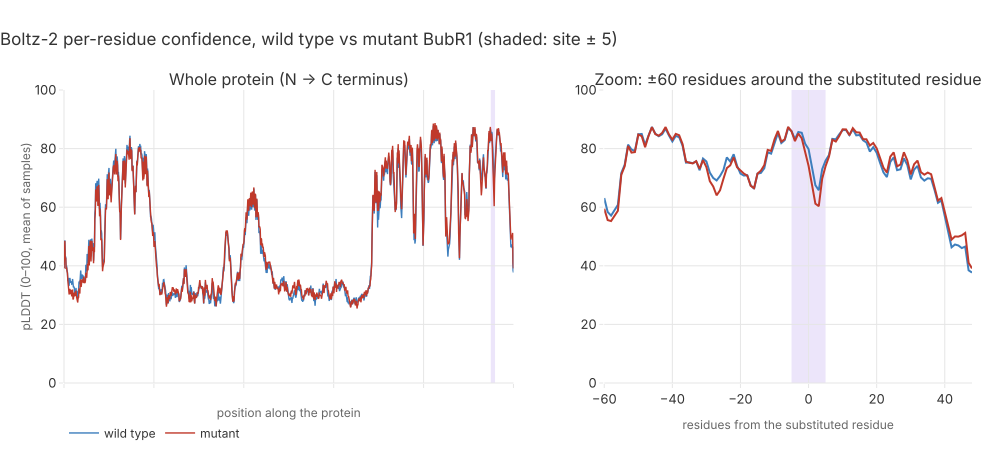
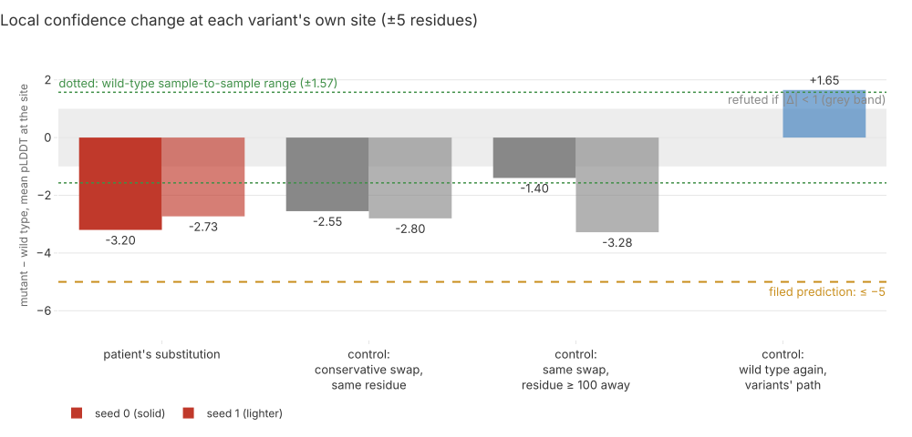
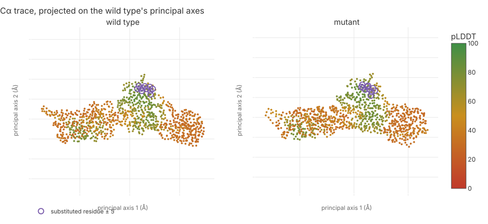

# 147 — Boltz-2 folds BubR1: the site loses ~3 pLDDT points, and a conservative swap loses as many

**Step:** iteration 4, [step 8](../README.md) — the GPU tier on Modal. **Date:** 2026-09-24.
**Claim:** H081 (`P4-16`), filed with `mva-science hypothesis-add` before any fold ran.
**Lane:** `boltz2` — app `mva-zoo-boltz2`, [`src/mva/zoo/modal_apps/boltz2.py`](../../../../src/mva/zoo/modal_apps/boltz2.py);
card fragment [`models.d/boltz2.toml`](../../../../src/mva/zoo/models.d/boltz2.toml).
**Sources:** genomic (the confirmed BUB1B missense record, step 1's `records.parquet`) only.
The clinical HPO terms play no part in a fold; § Conclusion says what the result means for them.

## Question

Does a structure predictor "see" the patient's BUB1B missense substitution? Boltz-2 folds a
protein from its sequence and reports **pLDDT** (predicted local distance difference test:
0–100, the model's confidence that a residue sits where it drew it). If the substitution
disturbs the local fold, the mutant's pLDDT around it should fall.

Software analogy: run the same compiler twice, once on the reference source and once with one
character changed, and diff the compiler's own confidence annotations around that line. The
analogy breaks down in one way: the "compiler" is stochastic (diffusion sampling), so every
diff must be read against the run-to-run spread.

## Hypothesis and prediction

H081 / `P4-16`, as filed: *"Boltz-2 folds wild-type and mutant BubR1 with a visible local
confidence change at the confirmed missense residue."*

Prediction: mean pLDDT within **5 residues** of the substituted residue drops by **≥ 5 points**
in the mutant fold versus wild type.

## What would refute it

|local pLDDT change| **< 1 point** — the fold cannot see the substitution. Between 1 and 5
points is inconclusive by construction.

## Inputs

| input | value |
|---|---|
| sequence | BubR1 reference protein, full length, from `build/it4/protein-seq/<ENSP>.json` (step 1's Ensembl cache); the ENSP accession and substitution come from the BUB1B `missense_variant` record's `hgvs_p` in `build/it4/records.parquet`. Reference residue checked against the record before folding. |
| region folded | **full length** (fits an H100 80 GB; no domain window needed) |
| model | `boltz==2.2.1` (PyPI, MIT), `boltz[cuda]` kernels |
| weights | Hugging Face `boltz-community/boltz-2@6fdef46d763fee7fbb83ca5501ccceff43b85607` (`boltz2_conf.ckpt`, `boltz2_aff.ckpt`, `mols.tar`) |
| weights digest | `bba514a9e792689a160a512f7b519530195f13cd4ed5cee3b24324f5baaceb76` — `_common.sha256_tree` over both `.ckpt`, measured in the container on first download |
| MSA | ColabFold MMseqs2 public server (`api.colabfold.com`), **reference sequence only**: 2,578 aligned sequences. Every variant reuses that alignment with its query row replaced (`_patched_msa`), so no variant sequence left Modal. |
| sampling | Boltz defaults — 3 recycling steps, 200 diffusion steps — plus **3 diffusion samples** per input (the sample spread is the noise floor); seeds 0 and 1 (two runs) |
| GPU | Modal H100 80 GB, `max_containers=1`, `scaledown_window=60 s` |
| local window | site ± 5 residues (11 residues), mean over samples |
| controls | `ctrl_conservative`: a BLOSUM62-positive swap at the **same** residue; `ctrl_distal`: the patient's amino-acid swap at the nearest residue of the same reference amino acid ≥ 100 residues away (scored at its own site); `wt_identity` (seed 1 only): the wild-type sequence again, through the variants' code path |

No other BUB1B missense record exists in the callset (1 missense + 1 stop-gained), so the
controls are synthetic. Sites are kept in `build/it4/boltz2/*/summary.json` only.

## Commands

```bash
uv run --group zoo-ml python tools/modal_trace.py run boltz2 smoke        # ubiquitin, twice (1st failed, below)
uv run --group zoo-ml python tools/modal_trace.py deploy boltz2
# HTTP proof (a throwaway urllib script, not committed): POST {"reference": UBIQUITIN,
# "samples": 1, "msa": "server"} to fold_http, headers Modal-Key/Modal-Secret read from
# build/it4/modal/proxy-token.json; once without headers (expect 401), once with
uv run --group zoo-ml python tools/modal_trace.py run boltz2 fold_case
uv run --group zoo-ml python tools/modal_trace.py run boltz2 fold_case --seed 1 --identity
# stop: modal_trace's `stop` lacks --yes and aborts without a TTY (trace row exit 1);
# the same trace function was called with `modal app stop --yes mva-zoo-boltz2` (exit 0)
uv run python tools/render_step8_boltz2.py --replicate build/it4/boltz2/case-seed1
```

All Modal commands are rows in `build/it4/modal/trace.jsonl`; outputs (CIF, pLDDT/PAE/PDE
`.npz`, confidence JSON, the reference MSA) in `build/it4/boltz2/{smoke,case,case-seed1,http}/`.

## Observed output

**Plumbing.**

- Smoke attempt 1 failed after the wild-type fold: the patched MSA CSV sat in boltz's input
  directory and boltz tried to parse it. Fixed (separate `msa/` dir); its GPU time is booked
  at the app's wall clock, 202 s, an upper bound.
- Smoke 2 (ubiquitin, 3 samples): mean pLDDT 93.6, pTM 0.92, MSA depth 16,384;
  I44A local Δ −0.84, wild-type sample range 0.10.
- HTTP: unauthenticated POST → **401**. With proxy-auth headers →
  **200**, keys `digest, folds, gpu, msa, msa_depth, params, seconds, version, weights`.
  Ubiquitin, 1 sample: pLDDT 93.6, pTM 0.924. URL shape
  `https://<workspace>--mva-zoo-boltz2-scorer-fold-http.modal.run` (and `…-scorer-health…`).
  Wall 134 s against 53 s in-container: ~80 s cold start that the ledger does not see.

**Global confidence (mean of 3 samples).**

| fold | seed 0 mean pLDDT | seed 0 pTM | seed 1 mean pLDDT | seed 1 pTM |
|---|---:|---:|---:|---:|
| wild type | 50.77 | 0.396 | 50.79 | 0.394 |
| mutant | 50.90 | 0.388 | 50.64 | 0.385 |
| conservative, same site | 50.62 | 0.390 | 51.01 | 0.391 |
| same swap, distal | 50.78 | 0.401 | 50.56 | 0.383 |

Whole-protein confidence is low (~51) because long stretches fold at pLDDT 25–35 (the
profile figure): Boltz-2 treats them as disordered. The substituted residue sits in the
high-confidence C-terminal block; wild-type local pLDDT there is 78.0 (seed 0) and 76.5 (seed 1).
No global confidence moves by more than 0.3 pLDDT or 0.013 pTM.

**Local change at each variant's own site (± 5 residues), mutant − wild type.**

| variant | seed 0 | seed 1 |
|---|---:|---:|
| **patient's substitution** | **−3.20** | **−2.73** |
| conservative swap, same residue | −2.55 | −2.80 |
| same swap, residue ≥ 100 away | −1.40 | −3.28 |
| wild type again, variants' path | — | +1.65 |
| wild-type sample-to-sample range | 0.36 | 1.57 |

Against the path-matched identity control (seed 1, same `boltz predict` batch): mutant −4.38,
conservative swap −4.45.

**Structure.** Cα RMSD (root-mean-square distance) of the mutant against wild type (sample 0,
site ± 10, local superposition): **0.45 Å**; wild-type sample 1 against sample 0, same window:
0.13 Å. Global RMSD 19.0 Å, dominated by the disordered stretches, not the site.

**Spend.** 6 ledger rows, 1,124.8 GPU s, **$1.234** of the $6 lane share (H100 at
$0.001097/s; includes the failed smoke's upper bound). `modal billing report --for today`
listed six `mva-zoo-boltz2` rows summing to $1.20 when read; it may lag the last run.
App state after the stop: every `mva-zoo-boltz2` app `stopped`, 0 tasks (`modal app list`).



> **Legend** blue = wild type (neutral machinery); red = mutant; purple shading = the
> substituted residue ± 5 (the patient's raw input). Left: whole protein, x = position along
> the chain, unlabelled on purpose. Right: residues from the site.



> **Legend** red = the patient's substitution; grey = synthetic controls; blue = the
> wild-type identity control; solid/lighter = seed 0/seed 1; grey band = the refutation zone
> (|Δ| < 1); green dotted = the wild-type sample range; yellow dashed = the filed prediction (−5).



> **Legend** one dot per residue, coloured red (low pLDDT) → yellow → green (high); purple
> rings = the substituted residue ± 5. Mutant superposed on wild type, both projected on the
> wild type's two principal axes.

Provenance (inputs sha256, parameters, every printed value):
[`figures/it4/boltz2.provenance.json`](../../../../figures/it4/boltz2.provenance.json).

## Verdict

Suggested for H081: **inconclusive** — the main thread commits it.

- Not supported: the drop is −3.20 / −2.73 (seeds 0/1), short of the filed ≥ 5. Against the
  path-matched identity control it is −4.38, still short.
- Not refuted: |Δ| ≥ 1 in both seeds, above the wild-type sample range.
- The controls say what the drop is: a **conservative swap at the same residue drops it as
  much** (−2.55 / −2.80; −4.45 against the identity control), and the same swap elsewhere
  drops its own site by −1.40 / −3.28. The fold sees *a* change at a structured site; it does
  not single out this substitution. The local backbone barely moves (0.45 Å).
- Suggested evidence row: neutral, source = this entry. Two seeds, three samples each — too
  few to call −3 versus −2.7 different.

## Limitations

- **Structure predictors are weakly sensitive to single substitutions.** Pak et al. 2023
  (PLoS One, PMID 36928239) found "very weak or no correlation" between AlphaFold pLDDT change
  and measured stability change (ΔΔG). Boltz-2 is a different model; no equivalent benchmark
  for it was checked here. pLDDT is confidence, not stability.
- Sample noise is comparable to the effect: the wild-type range reached 1.57, the identity
  control moved +1.65. Two seeds × three samples.
- The variants reuse the reference MSA with the query row patched; the MSA server's alignment
  for a mutant query would be near-identical, not guaranteed identical.
- The reference sequence (a public protein) went to the third-party ColabFold server; no
  variant sequence did.
- Monomer only: BubR1 works in complexes (with its partners at the kinetochore and in the
  mitotic checkpoint complex). An interface effect would not appear in a monomer fold.
- The ledger counts in-container seconds; cold start (~80 s per call, measured on the HTTP
  proof) is billed but not ledgered.
- Boltz-2 reference: Passaro, Corso, Wohlwend et al., bioRxiv 2025, doi
  10.1101/2025.06.14.659707 (DOI resolved by Crossref 2026-09-24).

## Conclusion

- Boltz-2 registers a modest local confidence dip at the confirmed missense residue (~3
  pLDDT points), no global change, and a sub-ångström local shift — **the same size of
  effect as a conservative swap at that residue**. H081 is inconclusive.
- **Track 2, hypomorph vs null.** A destabilised fold would have argued for loss of
  function by misfolding (null-like protein). This fold is not destabilised beyond what any
  change at the site produces, so structure prediction **leaves the drug-direction question
  unresolved**; it gives no support to "null by misfolding". The clinical picture (the
  proband's HPO terms) is untouched by this entry.
- Reusable: `boltz2.py` folds any reference + same-length variants with one MSA call;
  `render_step8_boltz2.py` renders any such run (`--case-dir`, `--replicate`, `--mutant`).
