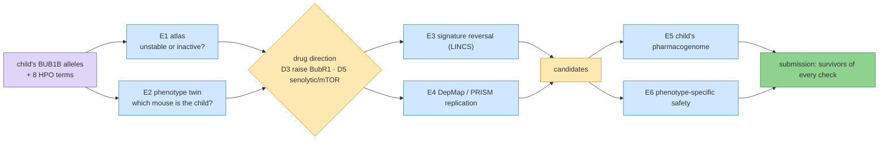
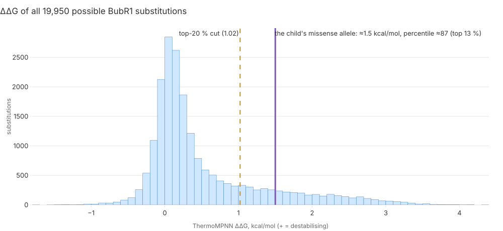
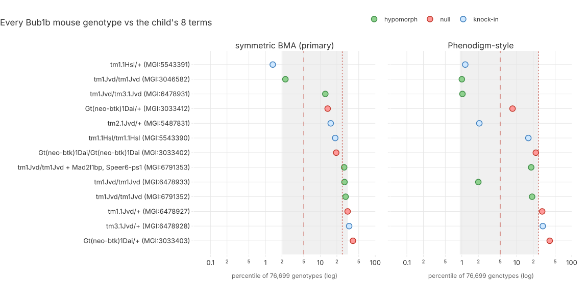
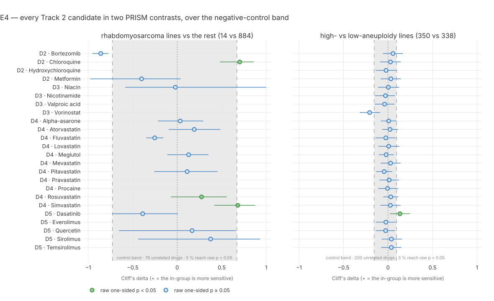
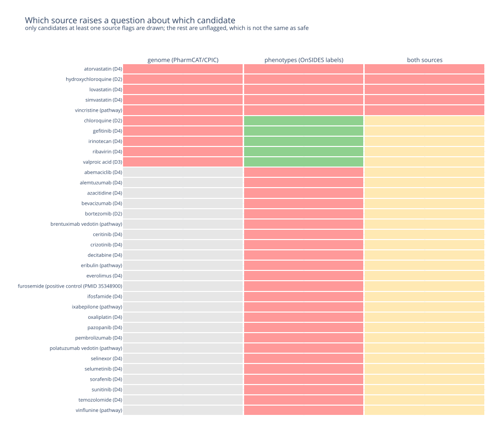

# Step 9 — Track 2: one mechanism, many independent sources

**Standing:** **E1, E2, E4 and E5+E6 run 2026-09-24**; E3 running 2026-09-25 (H092 filed); E7 moved to step 10; E8–E10 not run. Iteration 4, `step-9`, track 2.
Marked **open** in `src/mva/science/step_maps/iteration4.py`. Every number below is owned by an
entry under [`methodology/`](methodology/).

**Goal** (from `steps.py`):

> Does the mechanism class of the child's BUB1B alleles, checked against sources that share
> nothing (a structure atlas, mouse phenotypes, expression signatures, cell-line screens, the
> child's own pharmacogenome, phenotype-specific safety), support each drug direction — and
> which approved candidates survive all of them?

**Builds on:** Track 2 iteration 2 ([`submissions/track2/iteration-2/`](../../../submissions/track2/iteration-2/README.md)):
directions D1–D4, the evidence ladder, the decoy control, the do-not table. Step 8 (Boltz-2 fold,
entry 147) left "unstable or inactive?" unresolved; E1 answers it.

**Research notes** (verified 2026-09-24, not results): [`research/papers.md`](research/papers.md)
(every PMID fetched from eutils), [`research/data-sources.md`](research/data-sources.md)
(endpoints tested, licences, blockers).

## The chain this step builds

> **Legend** purple = the raw inputs (both sources: genome and clinical terms) · blue = one
> experiment, one independent dataset · yellow = a decision point · green = the submission.

## Experiments, mapped to the panel's four criteria

R = Scientific Rigor (35 %), I = Potential Impact (25 %), N = Innovation (25 %), S = Scalability (15 %).

| id | experiment | independent data | criteria | status | claims | entry |
|---|---|---|---|---|---|---|
| E1 | BUB1B variant-to-drug-direction atlas: ΔΔG + conservation for every possible missense, trained on published MVA alleles | AlphaFold O60566, literature labels | R, I, S | **done** | H083 refuted 0.15, H084 supported 0.55 | [149](methodology/149-the-stability-atlas-and-the-childs-missense.md) |
| E2 | Mouse–human phenotype twin: 8 HPO terms vs every MGI genotype, decoys | MGI / IMPC, HPO–MP mapping | R, N, S | **done** | H085 supported 0.70, H086 testing 0.45 | [150](methodology/150-the-childs-phenotype-twin-among-mgi-mice.md) |
| E3 | Signature reversal on LINCS: a BUB1B loss-of-function signature, two engines, 20 decoy signatures | LINCS L1000 (SigCom LINCS, iLINCS); GEO fallback | N, R | **running** (2026-09-25) | H092 `P4-27` | 153 (reserved) |
| E4 | DepMap / PRISM: aneuploidy- and RMS-selective approved drugs | DepMap 24Q4, PRISM 24Q2 | R, S | **done** | H087 supported 0.55, H088 **refuted** 0.20, H089 supported 0.80 | [151](methodology/151-prism-replication-of-the-track2-leads.md) |
| E5 | The child's pharmacogenome (PharmCAT / CPIC) for every candidate — **merged with E6** | the VCF, CPIC via PharmCAT 3.4.0 | I, S | **done** | H090 supported 0.40 (1.6 % of positions callable) | [152](methodology/152-is-each-candidate-safe-for-this-child.md) |
| E6 | Safety against the child's own phenotypes — **merged with E5** (note [E56](submission-notes/E56.md)) | OnSIDES v3.1.1, openFDA FAERS | R, I, N | **done** | H091 supported 0.70 | [152](methodology/152-is-each-candidate-safe-for-this-child.md) |
| E7 | D5 (senolytic / mTOR) graded | papers.md, E2–E4 | R, N | **moved to [step 10](../step-10/README.md)** (2026-09-25): graded by convergence and checks, not iteration 2's ladder | H094, H095 | 155 |
| E8 | BubR1–BUB3 / CDC20 interface fold, WT vs mutant (only if E1 places the residue near one) | PDB, AlphaFold | R | planned | — | — |
| E9 | LLM evidence extraction at scale, citation-checked (Qwen3-Next on Modal) | PubTator3, Europe PMC | S, N, R | planned | — | — |
| E10 | PrimeKG embedding ranker (TxGNN stand-in) with the decoy | PrimeKG | N, S | planned | — | — |

**Scope decision (user, 2026-09-24):** three more experiments only, in value order —
E4, E5+E6 merged, E3. E7 (grading D5) is part of the submission write-up, not an experiment.
E8, E9 and E10 are not run: E1 placed the residue away from the BUB3 and CDC20 binding motifs,
and the submission already shows scalability through the TRIP13 transfer run and innovation
through the step-7 walk.

## Submission notes — the assembly rule

Every experiment writes [`submission-notes/E<n>.md`](submission-notes/) from the
[template](submission-notes/TEMPLATE.md) as it finishes: the one-sentence finding, its numbers
with the entry that owns them, the figure, **which report section it feeds**, which existing
claim it changes, its limits. The Track 2 submission for this iteration,
[`submissions/track2/iteration-4/`](../../../submissions/track2/iteration-4/README.md) (user
decision, 2026-09-25: iteration 4 only, opened by hand because `tools/new_iteration.py` would
open iteration 3), is assembled from these notes, step 10's entries and the entries they cite,
never rewritten from memory.

## Data handling

Patient data may be sent to the user's own Modal workspace (user decision, 2026-09-24). Nothing
patient-derived is committed; new Modal volumes go on
[`../../notes/data-deletion-checklist.md`](../../notes/data-deletion-checklist.md).

## What happened

**E1 — the stability atlas** ([149](methodology/149-the-stability-atlas-and-the-childs-missense.md),
note [E1](submission-notes/E1.md)). ThermoMPNN scored all 19,950 possible BubR1 substitutions on
the AlphaFold model for **$0.003** of GPU. Eight published MVA missense alleles have a protein-level
readout, 5 abundance-lowering and 3 stable. ΔΔG separates them at AUROC **0.60** (95 % CI 0.13–1.00),
so **H083 is refuted as registered and had no power**. The child's missense has ΔΔG at the **87th
percentile** of all substitutions, buried, pLDDT ≥ 90, **inside the pseudokinase domain**
(UniProt, CDD). **H084 is supported, weakly**: the classifier's call equals its base rate. D3 keeps
its standing as a dosage argument. It now reads *predicted destabilising, class not proven*.

> **Legend** — neutral machinery; a decision point; the raw input; blue bars = every possible
> substitution; yellow dashed = the pre-registered top-20 % cut (H084); purple = the child's
> allele, value rounded to 0.1.

**E2 — the phenotype twin** ([150](methodology/150-the-childs-phenotype-twin-among-mgi-mice.md),
note [E2](submission-notes/E2.md)). The child's terms were scored against all **76,699** MGI mouse
genotypes. The best Bub1b genotype ranks in the **top 1.0–1.4 %** on both rollups (IC-matched null
p 0.018–0.060, about 10× chance), and the Bloom → Blm positive control passes, so **H085 is
supported**. The rollups disagree on *which* Bub1b mouse: the K243R/+ acetylation knock-in, or the
H/H and H/L1002P hypomorphs. No null genotype wins, so **H086 stays undecided**. The twin's
published interventions are in `ressources/track2/model_interventions.tsv`: 12 rows, 4 for the new
**D5 (senolytic / mTOR)** direction and 3 for D3.

> **Legend** — green = hypomorph (H086's prediction); red = null / knockout; blue = knock-in;
> grey band = context, not the subject: central 90 % of the null; dashed red = 5 % (H085
> prediction), dotted red = 25 % (refutation).

**E4 — the leads in a screen nobody curated for this case**
([151](methodology/151-prism-replication-of-the-track2-leads.md), note [E4](submission-notes/E4.md)).
PRISM 24Q2, 6,790 compounds × 919 lines, **$0**. All 24 candidates are present, but 10 are
measured on fewer than 3 of the 14 rhabdomyosarcoma lines and cannot be tested — **including
lovastatin, the report's rank-1 lead**.

| claim | result | verdict |
|---|---|---|
| H087 statins are RMS-selective | 4 of 5 testable statins point the predicted way (simvastatin δ +0.681, n 3 lines, p 0.0189; rosuvastatin lineage-matched p 0.0074) but **nothing survives BH correction** (best q 0.132) and the control band spans the same range | **supported, weakly** 0.55 |
| H088 chloroquine is aneuploidy-selective | δ +0.027, p **0.315** — no trend; the second clause did not fire (3 of 4 D2 drugs still point the predicted way) | **refuted** 0.20 |
| H089 the D5 drugs, reported either way | **dasatinib is the 99.4th percentile of 6,790 compounds** on aneuploidy (δ +0.135, p 0.0096) and the only candidate clearing its control band — yet among the **least** RMS-selective (δ −0.388); the mTOR drugs disagree between releases | **supported** 0.80 |

Calibration: dabrafenib δ +0.670 (p 1.6 × 10⁻¹²) on melanoma lines; a 200-drug negative control
fires at 5.3 % and 3.0 % at raw p < 0.05, as expected by chance. **Unasked bonus:** 33 of 34
Mps1 and Aurora inhibitors are *less* effective in high-aneuploidy lines — Cohen-Sharir 2021
(PMID 33505028) re-derived here, a second independent leg under the do-not table.

> **Legend** — good / safe / the goal; neutral machinery; context, not the subject; green = raw
> one-sided p < 0.05, blue = not; bars = 95 % percentile bootstrap CI on Cliff's delta; grey
> band = the central 95 % of 200 unrelated launched drugs through the identical test; dotted
> line = no effect. Only rows measured on ≥ 3 in-group lines are drawn.

**E5+E6 — is each candidate safe for *this* child?**
([152](methodology/152-is-each-candidate-safe-for-this-child.md), note [E56](submission-notes/E56.md)).
The two-source experiment: his genome and his clinical terms, side by side. **$0.**

- **The genome half is mostly a negative result, and that is the finding.** Only **20 of 1,223**
  PharmCAT definition positions are genotyped (**1.6 %**), because the delivery is a
  variant-only callset and no BAM/CRAM ships with it (re-calling would mean streaming 67.68 GB
  at ~11.5 MB/s, ≥ 1.7 h). **Every gene that governs a shortlisted drug is a no call** —
  SLCO1B1 (all three statins, CPIC level A), G6PD (chloroquine, hydroxychloroquine), UGT1A1
  (irinotecan). Observed non-normal phenotypes exist for CYP3A5 (poor metaboliser), CYP2C19,
  CYP2B6 and RYR1 (uncertain malignant-hyperthermia susceptibility). **H090 supported at 0.40**:
  met literally, unanswered where it matters. A **regional callability proxy** says where the
  `--absent-to-ref` assumption holds at all (SLCO1B1 0.52×, G6PD 0.26×, ABCG2 0.00×).
- **The phenotype half is positive.** 45 of 75 candidates (**60.0 %**, CI 48.7–70.3) carry a
  labelled adverse effect matching one of the child's own phenotypes, against **39.7 %**
  (CI 34.9–44.8) in a breadth-matched comparison set — intervals do not overlap. Lovastatin
  80/80, atorvastatin 382/397, simvastatin 184/194 name myopathy or rhabdomyolysis;
  vincristine's single label carries **`Muscle atrophy`**, an exact match to the child's term.
  Paediatric FAERS: vincristine–muscular weakness 57 reports, metformin–rhabdomyolysis 49.
  Both positive controls (furosemide, calcitriol) recovered. **H091 supported at 0.70.**
- **Five of 85 candidates are flagged by both sources**: lovastatin, simvastatin, atorvastatin,
  hydroxychloroquine, vincristine.

> **Legend** — red = that source raises a question; green = that source looked and raised none;
> yellow = exactly one of the two sources; grey = the source had nothing on this drug.
> "Unflagged" is not safe: it means these two sources are silent.

**What this asks the treating team** (research exercise; nothing here advises for or against any
drug): the statin arm can be neither cleared nor contraindicated from the delivered callset,
because its governing gene is unreadable while 95–100 % of those labels name the child's own
muscle phenotype. The cheap, concrete action is a **targeted pharmacogenomic panel** — or a
re-call of the reads at PharmCAT's 1,226 positions — over SLCO1B1, ABCG2, CYP2C9, G6PD and
UGT1A1, plus the incidental RYR1 call in a child facing repeated anaesthesia.

## Corrections the Track 2 report owes (collected for the final submission)

| where | now says | should say | source |
|---|---|---|---|
| iteration-2 report, limit 3 and §5 | the missense is "outside every catalogued domain" | inside the UniProt pseudokinase domain and CDD cd14029 (outside every Pfam and InterPro domain-typed entry) | entry 149 |
| iteration-2 report, limit 3 | unstable or inactive: open | predicted destabilising (87th percentile ΔΔG, buried); the class is not proven computationally. A BubR1 Western blot plus cycloheximide chase in the child's cells would settle it | entry 149 |
| `ressources/track2/mechanism.json`, D3 rationale | NMN "raised BubR1 … and extended lifespan in BubR1-hypomorphic mice" | NMN raised BubR1 abundance; the **lifespan** gain came from SIRT2 overexpression in H/H mice (PMID 24825348) | entry 150 |
| iteration-2 report, D3 row | the lead rests on one mouse paper | that mouse (H/H) is the child's phenotype twin (Phenodigm rank 768 of 76,699). A second paper bounds the result: SIRT2 is inert on a wild-type background (PMID 38009412) | entry 150 |
| iteration-2 report, D3 HDAC arm | valproate and vorinostat act on BubR1 acetylation | re-verify the cited PMIDs (28985013, 19407811); the research scan found no paper linking an approved HDAC inhibitor to BubR1 | research/papers.md |
| iteration-2 report, D2 | metformin and bortezomib inherit class results | keep them inherited; the research scan found no primary aneuploidy-selectivity paper for either | research/papers.md |
| iteration-2 report §7.1 rank 1 (lovastatin) | the best-supported lead | its PRISM coverage is 2 of 14 RMS lines, so the screen **cannot test it**; the class direction is weakly reproduced by simvastatin and rosuvastatin, neither surviving correction | entry 151 |
| iteration-2 report §7.1 row 8 (chloroquine) | the only molecule-level aneuploidy result | not reproduced in PRISM (p 0.315); keep the published cell result, add the non-replication | entry 151 |
| `ressources/track2/mechanism.json` D2 rationale | aneuploid cells are selectively vulnerable | add: in 919 lines the effect is absent for chloroquine and the direction is unresolved for the class | entry 151 |
| iteration-2 report §7.3 do-not table | spindle poisons rely on the checkpoint (argued from biology) | now also **measured**: 33 of 34 Mps1/Aurora inhibitors are less effective in high-aneuploidy lines | entry 151 |
| iteration-2 report §7 (new row) | — | **D5: dasatinib**, 99.4th percentile of 6,790 compounds on the aneuploidy contrast, and the D5 direction from the phenotype twin | entries 150, 151 |
| iteration-2 report §7.4 / new §7.5 | candidates are graded for children in general | add the per-candidate two-source safety table for **this** child, and the five drugs both sources flag | entry 152 |
| iteration-2 report §11 limits | — | add: 1.6 % of pharmacogene positions callable from the delivered VCF; every guideline gene for a shortlisted drug is a no call | entry 152 |
