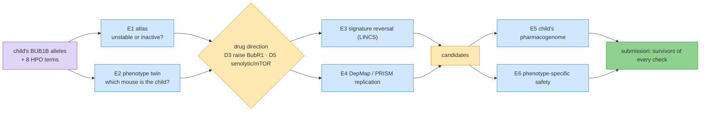

# Step 9 — Track 2: one mechanism, many independent sources

**Standing:** **E1 and E2 run 2026-09-24**; E4 and E5+E6 running; E3, E7–E10 planned. Iteration 4, `step-9`, track 2.
Marked **open** in `src/mva/science/step_maps/iteration4.py`. Every number below is owned by an
entry under [`methodology/`](methodology/).

**Goal** (from `steps.py`):

> Does the mechanism class of the child's BUB1B alleles, checked against sources that share
> nothing (a structure atlas, mouse phenotypes, expression signatures, cell-line screens, the
> child's own pharmacogenome, phenotype-specific safety), support each drug direction — and
> which approved candidates survive all of them?

**Builds on:** Track 2 iteration 2 ([`submissions/track2/iteration-2/`](../../../submissions/track2/iteration-2/README.md)):
directions D1–D4, the evidence ladder, the decoy control, the do-not table. Step 8 (Boltz-2 fold,
entry 147) left "unstable or inactive?" unresolved; E1 answers it.

**Research notes** (verified 2026-09-24, not results): [`research/papers.md`](research/papers.md)
(every PMID fetched from eutils), [`research/data-sources.md`](research/data-sources.md)
(endpoints tested, licences, blockers).

## The chain this step builds

> **Legend** purple = the raw inputs (both sources: genome and clinical terms) · blue = one
> experiment, one independent dataset · yellow = a decision point · green = the submission.

## Experiments, mapped to the panel's four criteria

R = Scientific Rigor (35 %), I = Potential Impact (25 %), N = Innovation (25 %), S = Scalability (15 %).

| id | experiment | independent data | criteria | status | claims | entry |
|---|---|---|---|---|---|---|
| E1 | BUB1B variant-to-drug-direction atlas: ΔΔG + conservation for every possible missense, trained on published MVA alleles | AlphaFold O60566, literature labels | R, I, S | **done** | H083 refuted 0.15, H084 supported 0.55 | [149](methodology/149-the-stability-atlas-and-the-childs-missense.md) |
| E2 | Mouse–human phenotype twin: 8 HPO terms vs every MGI genotype, decoys | MGI / IMPC, HPO–MP mapping | R, N, S | **done** | H085 supported 0.70, H086 testing 0.45 | [150](methodology/150-the-childs-phenotype-twin-among-mgi-mice.md) |
| E3 | Signature reversal on LINCS from the compound-het mouse series + human BUB1B cells | GEO GSE134780, GSE22206; SigCom LINCS | N, R | planned | — | — |
| E4 | DepMap / PRISM: aneuploidy- and RMS-selective approved drugs | DepMap 24Q4, PRISM | R, S | running | H087 (`P4-22`), H088 (`P4-23`), H089 (`P4-24`) | 151 |
| E5 | The child's pharmacogenome (PharmCAT / CPIC) for every candidate — **merged with E6** | the VCF (+ reads at PGx positions), CPIC | I, S | running | H090 (`P4-25`) | 152 |
| E6 | Safety against the child's own phenotypes — **merged with E5** (note `E56.md`) | OnSIDES (paediatric), FAERS | R, I, N | running | H091 (`P4-26`) | 152 |
| E7 | D5 (senolytic / mTOR) graded on the existing ladder with decoys | papers.md, E2–E4 | R, N | planned | — | — |
| E8 | BubR1–BUB3 / CDC20 interface fold, WT vs mutant (only if E1 places the residue near one) | PDB, AlphaFold | R | planned | — | — |
| E9 | LLM evidence extraction at scale, citation-checked (Qwen3-Next on Modal) | PubTator3, Europe PMC | S, N, R | planned | — | — |
| E10 | PrimeKG embedding ranker (TxGNN stand-in) with the decoy | PrimeKG | N, S | planned | — | — |

**Scope decision (user, 2026-09-24):** three more experiments only, in value order —
E4, E5+E6 merged, E3. E7 (grading D5) is part of the submission write-up, not an experiment.
E8, E9 and E10 are not run: E1 placed the residue away from the BUB3 and CDC20 binding motifs,
and the submission already shows scalability through the TRIP13 transfer run and innovation
through the step-7 walk.

## Submission notes — the assembly rule

Every experiment writes [`submission-notes/E<n>.md`](submission-notes/) from the
[template](submission-notes/TEMPLATE.md) as it finishes: the one-sentence finding, its numbers
with the entry that owns them, the figure, **which report section it feeds**, which existing
claim it changes, its limits. The final Track 2 submission (a new `submissions/track2/iteration-3/`
opened with `tools/new_iteration.py`) is assembled from these notes and the entries, never
rewritten from memory.

## Data handling

Patient data may be sent to the user's own Modal workspace (user decision, 2026-09-24). Nothing
patient-derived is committed; new Modal volumes go on
[`../../notes/data-deletion-checklist.md`](../../notes/data-deletion-checklist.md).

## What happened

**E1 — the stability atlas** ([149](methodology/149-the-stability-atlas-and-the-childs-missense.md),
note [E1](submission-notes/E1.md)). ThermoMPNN scored all 19,950 possible BubR1 substitutions on
the AlphaFold model for **$0.003** of GPU. Eight published MVA missense alleles have a protein-level
readout, 5 abundance-lowering and 3 stable. ΔΔG separates them at AUROC **0.60** (95 % CI 0.13–1.00),
so **H083 is refuted as registered and had no power**. The child's missense has ΔΔG at the **87th
percentile** of all substitutions, buried, pLDDT ≥ 90, **inside the pseudokinase domain**
(UniProt, CDD). **H084 is supported, weakly**: the classifier's call equals its base rate. D3 keeps
its standing as a dosage argument. It now reads *predicted destabilising, class not proven*.

> **Legend** — neutral machinery; a decision point; the raw input; blue bars = every possible
> substitution; yellow dashed = the pre-registered top-20 % cut (H084); purple = the child's
> allele, value rounded to 0.1.

**E2 — the phenotype twin** ([150](methodology/150-the-childs-phenotype-twin-among-mgi-mice.md),
note [E2](submission-notes/E2.md)). The child's terms were scored against all **76,699** MGI mouse
genotypes. The best Bub1b genotype ranks in the **top 1.0–1.4 %** on both rollups (IC-matched null
p 0.018–0.060, about 10× chance), and the Bloom → Blm positive control passes, so **H085 is
supported**. The rollups disagree on *which* Bub1b mouse: the K243R/+ acetylation knock-in, or the
H/H and H/L1002P hypomorphs. No null genotype wins, so **H086 stays undecided**. The twin's
published interventions are in `ressources/track2/model_interventions.tsv`: 12 rows, 4 for the new
**D5 (senolytic / mTOR)** direction and 3 for D3.

> **Legend** — green = hypomorph (H086's prediction); red = null / knockout; blue = knock-in;
> grey band = context, not the subject: central 90 % of the null; dashed red = 5 % (H085
> prediction), dotted red = 25 % (refutation).

## Corrections the Track 2 report owes (collected for the final submission)

| where | now says | should say | source |
|---|---|---|---|
| iteration-2 report, limit 3 and §5 | the missense is "outside every catalogued domain" | inside the UniProt pseudokinase domain and CDD cd14029 (outside every Pfam and InterPro domain-typed entry) | entry 149 |
| iteration-2 report, limit 3 | unstable or inactive: open | predicted destabilising (87th percentile ΔΔG, buried); the class is not proven computationally. A BubR1 Western blot plus cycloheximide chase in the child's cells would settle it | entry 149 |
| `ressources/track2/mechanism.json`, D3 rationale | NMN "raised BubR1 … and extended lifespan in BubR1-hypomorphic mice" | NMN raised BubR1 abundance; the **lifespan** gain came from SIRT2 overexpression in H/H mice (PMID 24825348) | entry 150 |
| iteration-2 report, D3 row | the lead rests on one mouse paper | that mouse (H/H) is the child's phenotype twin (Phenodigm rank 768 of 76,699). A second paper bounds the result: SIRT2 is inert on a wild-type background (PMID 38009412) | entry 150 |
| iteration-2 report, D3 HDAC arm | valproate and vorinostat act on BubR1 acetylation | re-verify the cited PMIDs (28985013, 19407811); the research scan found no paper linking an approved HDAC inhibitor to BubR1 | research/papers.md |
| iteration-2 report, D2 | metformin and bortezomib inherit class results | keep them inherited; the research scan found no primary aneuploidy-selectivity paper for either | research/papers.md |
