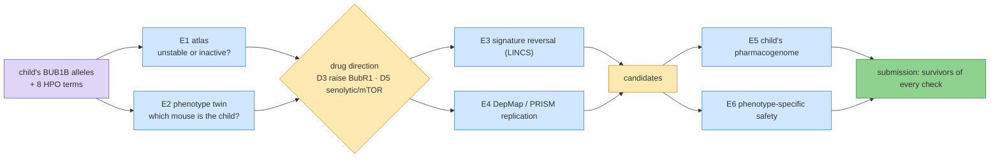

# Step 9 — Track 2: one mechanism, many independent sources

**Standing:** **opened 2026-09-24**, in progress. Iteration 4, `step-9`, track 2. Marked **open**
in `src/mva/science/step_maps/iteration4.py`. Nothing below is a result until an entry under
[`methodology/`](methodology/) records it.

**Goal** (from `steps.py`):

> Does the mechanism class of the child's BUB1B alleles, checked against sources that share
> nothing (a structure atlas, mouse phenotypes, expression signatures, cell-line screens, the
> child's own pharmacogenome, phenotype-specific safety), support each drug direction — and
> which approved candidates survive all of them?

**Builds on:** Track 2 iteration 2 ([`submissions/track2/iteration-2/`](../../../submissions/track2/iteration-2/README.md)):
directions D1–D4, the evidence ladder, the decoy control, the do-not table. Step 8 (Boltz-2 fold,
entry 147) left "unstable or inactive?" unresolved; E1 answers it.

**Research notes** (verified 2026-09-24, not results): [`research/papers.md`](research/papers.md)
(every PMID fetched from eutils), [`research/data-sources.md`](research/data-sources.md)
(endpoints tested, licences, blockers).

## The chain this step builds

> **Legend** purple = the raw inputs (both sources: genome and clinical terms) · blue = one
> experiment, one independent dataset · yellow = a decision point · green = the submission.

## Experiments, mapped to the panel's four criteria

R = Scientific Rigor (35 %), I = Potential Impact (25 %), N = Innovation (25 %), S = Scalability (15 %).

| id | experiment | independent data | criteria | status | claims | entry |
|---|---|---|---|---|---|---|
| E1 | BUB1B variant-to-drug-direction atlas: ΔΔG + conservation for every possible missense, trained on published MVA alleles | AlphaFold O60566, literature labels | R, I, S | running | H083 (`P4-18`), H084 (`P4-19`) | 149 |
| E2 | Mouse–human phenotype twin: 8 HPO terms vs every MGI genotype, decoys | MGI / IMPC, HPO–MP mapping | R, N, S | running | H085 (`P4-20`), H086 (`P4-21`) | 150 |
| E3 | Signature reversal on LINCS from the compound-het mouse series + human BUB1B cells | GEO GSE134780, GSE22206; SigCom LINCS | N, R | planned | — | — |
| E4 | DepMap / PRISM: aneuploidy- and RMS-selective approved drugs | DepMap 24Q4, PRISM | R, S | planned | — | — |
| E5 | The child's pharmacogenome (PharmCAT / CPIC) for every candidate | the VCF (+ reads at PGx positions), CPIC | I, S | planned | — | — |
| E6 | Safety against the child's own phenotypes | OnSIDES (paediatric), FAERS | R, I, N | planned | — | — |
| E7 | D5 (senolytic / mTOR) graded on the existing ladder with decoys | papers.md, E2–E4 | R, N | planned | — | — |
| E8 | BubR1–BUB3 / CDC20 interface fold, WT vs mutant (only if E1 places the residue near one) | PDB, AlphaFold | R | planned | — | — |
| E9 | LLM evidence extraction at scale, citation-checked (Qwen3-Next on Modal) | PubTator3, Europe PMC | S, N, R | planned | — | — |
| E10 | PrimeKG embedding ranker (TxGNN stand-in) with the decoy | PrimeKG | N, S | planned | — | — |

## Submission notes — the assembly rule

Every experiment writes [`submission-notes/E<n>.md`](submission-notes/) from the
[template](submission-notes/TEMPLATE.md) as it finishes: the one-sentence finding, its numbers
with the entry that owns them, the figure, **which report section it feeds**, which existing
claim it changes, its limits. The final Track 2 submission (a new `submissions/track2/iteration-3/`
opened with `tools/new_iteration.py`) is assembled from these notes and the entries, never
rewritten from memory.

## Data handling

Patient data may be sent to the user's own Modal workspace (user decision, 2026-09-24). Nothing
patient-derived is committed; new Modal volumes go on
[`../../notes/data-deletion-checklist.md`](../../notes/data-deletion-checklist.md).

## What happened

To be filled from the entries as they land.
