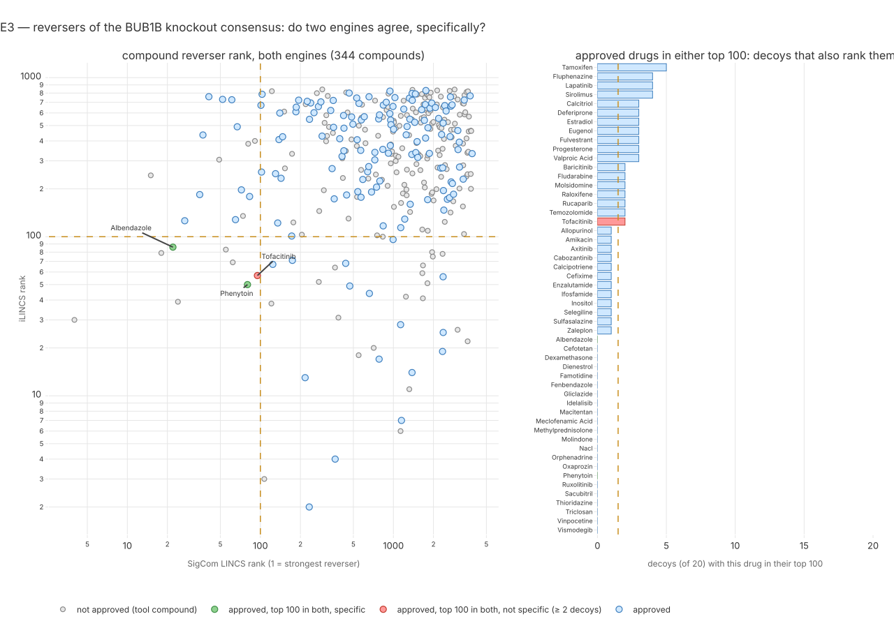
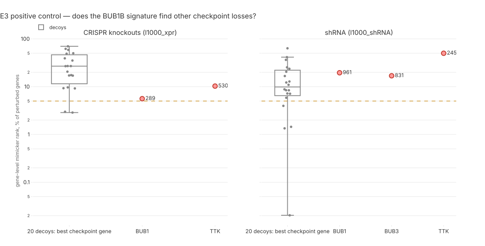

# 153 — Does an approved drug reverse the expression signature of BUB1B loss, in two engines, specifically?

**Step:** iteration 4, [step 9](../README.md), experiment E3. **Date:** 2026-09-25. **Claim:**
H092 (`P4-27`). Hands generator **G4 `lincs`** to [step 10](../../step-10/README.md).
**Sources:** **one only — the genomic source**, at one remove: the mechanism class of the
child's BUB1B alleles chooses the query. This experiment reads no clinical (HPO) term, no
patient sequence, position or allele; only gene symbols and drug names leave the laptop.

## Question

The child's cells are expected to carry less working BubR1 (the protein BUB1B encodes). If a
cell with less BubR1 changes its gene expression in a reproducible way, a drug that pushes
expression **the other way** is a mechanism-agnostic repurposing lead — the Connectivity Map
idea (Lamb 2006). Does such a drug exist among approved drugs, do two independently built
engines agree on it, and is it specific to this signature rather than to any gene list?

**Why a loss-of-function query** (iteration-4 evidence only): the pair is one `stop_gained`
(nonsense: the protein is cut short) and one missense allele (oracle reply, entry 083); the
missense is predicted destabilising (87th percentile ΔΔG, entry 149); the closest mouse twin is
a Bub1b hypomorph (a mouse making too little BubR1, entry 150). A knockout / knockdown
signature is the matching query. No iteration-2 result is used.

## Hypothesis and prediction

Filed in the register before this entry (`uv run mva-science show H092`), verbatim:

> **claim** P4-27: a BUB1B loss-of-function expression signature is reversed by at least one
> approved drug in two independent connectivity engines, and specifically to that signature
>
> **prediction** Signature fixed before any drug query: the LINCS L1000 BUB1B loss-of-function
> consensus signature (CRISPR knockout if SigCom LINCS holds one, else shRNA), its 100 most
> raised and 100 most lowered genes; if LINCS holds none, the GEO human BUB1B knockdown series
> named in step-9 research/data-sources.md. At least one approved drug (ChEMBL max phase 4 or an
> openFDA label), aggregated per compound by its best signature rank, is in the top 100
> reversers of both SigCom LINCS (l1000_cp) and iLINCS, and is in the top 100 reversers of at
> most 1 of 20 size-matched random-gene decoy signatures run through SigCom. Positive control,
> required for the result to count: queried against the genetic-perturbation library, the
> signature ranks at least one other checkpoint-gene loss (BUB1, BUB3, MAD2L1, MAD1L1, TTK) in
> the top 5 % of mimickers

Terms, for a software engineer:

- **L1000** (LINCS): an assay that measures 978 **landmark genes** directly and infers ~11,000
  more; one **signature** = the expression change one perturbation caused in one cell line.
- **characteristic direction (CD) coefficient**: SigCom's per-gene signed score of that change;
  the **consensus** = its mean over every signature of the same perturbation.
- **connectivity engine**: a search index over signatures; query = an up set + a down set;
  **mimicker** = a signature that moves the same way, **reverser** = the opposite way.
- **decoy signature**: a random gene set of the same size, the null for "specifically".
- **positive control**: a query whose right answer is known; if it misses, the pipeline is broken.

**Analysis choices the claim leaves open, fixed 2026-09-25 before any drug query** (the
timestamped copy is the docstring of [`tools/signature_reversal.py`](../../../../tools/signature_reversal.py)):

| choice | fixed value | why |
|---|---|---|
| branch | SigCom LINCS holds **31** BUB1B CRISPR-knockout signatures (and 40 shRNA) → the CRISPR branch; no GEO fallback | the registered order |
| consensus | the `BUB1B` row of LINCS 2021 `xpr_mean_coeff_mat.tsv.gz` (mean CD coefficient, 12,327 genes) | SigCom's own published consensus, not one we average |
| gene space | the **978 landmark** genes (LINCS `geneinfo_beta`); BUB1B itself excluded | iLINCS scores only landmark genes, so both engines read the same 200 genes; landmark genes are measured, not inferred |
| SigCom query | `enrich/ranktwosided`, `l1000_cp`, top **10,000** reverser signatures | deep enough that the top 100 compounds are exact (checked in the run) |
| iLINCS query | `findConcordancesSC`, `UpDn`, library `LIB_5`; reversers = concordance < 0, most negative first | the engine returns only p < 0.05 rows |
| compound rank | each compound at its best reverser signature, rank 1 = best, over **all** compounds (tool compounds included) | "aggregated per compound by its best signature rank" |
| name join | ChEMBL's folded preferred name when ChEMBL knows the label (a research code meets its INN), else `base_name`; step-10 files fold hyphens first (coordinator rule) | one drug, one key across engines and generators |
| approved | ChEMBL `max_phase` 4 (bulk, preferred name + every synonym except trade names) **or** an openFDA label, asked for every non-ChEMBL, non-code name present in both engines | the challenge's two evidences |
| decoys | 20 random 100 + 100 draws from the same landmark space, seed 20260925, SigCom `l1000_cp`, same depth and aggregation | size- and space-matched |
| positive control | real signature vs SigCom `l1000_xpr` **and** `l1000_shRNA` as mimickers, per perturbed gene, BUB1B excluded; pass = any of the five genes in the top 5 % of genes in either library | shRNA is independent of the CRISPR consensus; CRISPR is the same assay family |
| control chance rate | the 20 decoys run the same control | a control that decoys also pass shows nothing |
| consensus check | Pearson r between the consensus row and the plain mean of the 31 per-cell-line files, landmark genes | the input is what it claims |

## What would refute it

As registered: no approved drug in both engines' top 100 reversers, **or** every such drug
also in the top 100 of ≥ 2 of the 20 decoys. **If the positive control fails, the run is
uninterpretable, never support.**

## Inputs

| input | release | bytes | sha256 (first 16) | licence |
|---|---|---|---|---|
| `xpr_mean_coeff_mat.tsv.gz` — `lincs-dcic.s3.amazonaws.com/LINCS-sigs-2021/means/` | LINCS L1000 2021 (S3 Last-Modified 2023-09-05) | 432,492,125 | `f8b115513c365340` | LINCS public; SigCom states none |
| `geneinfo_beta.txt` — `s3.amazonaws.com/macchiato.clue.io/builds/LINCS2020/` | CMap LINCS 2020 beta | 1,141,389 | `e739d06bad42ff92` | CMap / LINCS public |
| 31 per-cell-line BUB1B knockout files (`LINCS-sigs-2021/cd/xpr/`) | LINCS L1000 2021 | ~217 KB each | one manifest each in `build/it4/track2-e3/raw/per-signature/` | as above |
| `signature.json` — the fixed query, written **before** any drug query | this repo | 2,720 | `d63a6194517e40d5` | this repo |
| SigCom LINCS metadata + data API (PMID 35524556) | not stated by the API | 124 cached replies | roll-up `2cdf6c4fbe58b338` | — |
| iLINCS API, `LIB_5` (PMID 35945222) | not stated by the API | 10 cached replies | roll-up `91ce04a19fe449a0` | "Creative Commons Terms of Use" |
| ChEMBL REST, every `max_phase = 4` molecule | ChEMBL 37 (data-sources.md) | 5 replies | roll-up `4048707e0b7c8f0f` | CC BY-SA 3.0 |
| openFDA drug label, 897 generic names | — | 897 replies (0 failed) | roll-up `d7bce4e2297bc07a` | public domain |

Libraries crawled in full, each equal to the server's own `count`: SigCom `l1000_cp` 718,055
signatures, `l1000_xpr` 140,945, `l1000_shRNA` 158,003; iLINCS `LIB_5` 143,374.

Code: `src/mva/drugs/sources/{sigcom,ilincs}.py`,
`src/mva/drugs/signature_reversal{,_approval,_tables,_plan,_controls,_run}.py`,
`tools/signature_reversal.py`, `tools/render_step9_e3.py`; tests
`tests/test_signature_reversal.py` (24, synthetic, no network). numpy 2.5.2. Code version
`89cf730` (in the manifests). Cost $0; wall time ~20 min fetch + ~20 min queries.

## Commands

```bash
uv run python tools/signature_reversal.py fetch   # files + four library crawls, cached
uv run python tools/signature_reversal.py run     # signature → queries → tables (replays from cache)
uv run python tools/render_step9_e3.py
uv run pytest -q tests/test_signature_reversal.py
```

Two failures on the way, both recorded: (1) the first crawl paged SigCom `l1000_cp` with
LoopBack `skip`; past ~560,000 rows the server answered **HTTP 504** three times
(`POST /metadata-api/signatures/find`). The client now pages by key (`id > last seen`), which
returned every row. (2) none else; openFDA answered all 897 names.

Descriptive extras, computed from the run's outputs after the verdict inputs were printed
(not registered, not part of the verdict):

```bash
# Spearman rank agreement over compounds both engines ranked
uv run python -c "import polars as pl; from scipy.stats import spearmanr; \
t=pl.read_csv('ressources/track2/it4/lincs_reversal.tsv',separator='\t'); \
b=t.filter(pl.col('sigcom_rank').is_not_null()&pl.col('ilincs_rank').is_not_null()); \
print(b.height, spearmanr(b['sigcom_rank'], b['ilincs_rank']))"
jq '.engine_overlap_top' build/it4/track2-e3/summary.json   # real, then 20 decoys
```

## Observed output

**The input is what it claims.**

| check | result |
|---|---|
| BUB1B's own coefficient in the consensus | the **most lowered** gene of all 12,327 (and of the 978 landmark genes): the knockout hits its target |
| consensus vs plain mean of the 31 per-cell-line files (landmark genes) | Pearson r **0.817**; top-100 overlap 59 up, 60 down — the published consensus is not a plain mean (weighting not documented); the registered consensus is used |
| query genes the engines matched | SigCom 200 of 200; iLINCS 196 of 200 |
| top raised genes | `CDKN1A` (p21, a p53 target), `DDIT4`, `GATA2`, `GAPDH`, `HSPA1A` … |
| top lowered genes | `CCNB1`, `KIF20A`, `CDC20`, `PCNA`, `CCNA2` … (mitosis / proliferation) |

**Positive control — FAILED in both libraries.**

| library | perturbed genes | BUB1 | BUB3 | MAD1L1 | MAD2L1 | TTK | pass (≤ 5 %)? | decoys passing |
|---|---|---|---|---|---|---|---|---|
| `l1000_xpr` (CRISPR) | 5,156 | 289 (5.6 %) | beyond depth | beyond depth | beyond depth | 530 (10.3 %) | **no** | 2 of 20 |
| `l1000_shRNA` | 4,916 | 961 (19.5 %) | 831 (16.9 %) | beyond depth | beyond depth | 2,459 (50.0 %) | **no** | 4 of 20 |

"Beyond depth" = outside the genes reached by the top 10,000 mimicker signatures (3,575 of
5,156 CRISPR genes; 3,520 of 4,916 shRNA genes), so worse than about the 69th / 72nd percentile.
Random decoys pass the same control 2 and 4 times in 20: the control's chance rate is 10–20 %,
and the real signature does worse than that in shRNA (14 of 20 decoys beat its best gene).

**Drug side** (reported, but see the verdict):

| quantity | value |
|---|---|
| compounds ranked as reversers (SigCom top 10,000 signatures / iLINCS p < 0.05) | 3,928 / 844 |
| compound universes (SigCom / iLINCS / both) | 33,568 / 15,058 / 9,998 |
| approved in both (ChEMBL 1,116 names + openFDA 41 of 897 asked) | 1,157 — the G4 universe |
| compounds in **both** engines' top 100 | **8**: LY-294002, apocynin, AMG-517, wortmannin, phenytoin, iniparib, albendazole, tofacitinib |
| … of which approved | **3**: phenytoin (SigCom 80, iLINCS 50), albendazole (22, 86), tofacitinib (95, 57) |
| … and in ≤ 1 decoy's top 100 | **2**: phenytoin (0 decoys), albendazole (0); tofacitinib is in 2 |
| double-top overlap, real vs decoys (decoy SigCom top 100 ∩ real iLINCS top 100) | real **8**; decoys mean 2.65, max 7 (20 of 20 below 8) |
| Spearman of the two engines' ranks, 344 compounds ranked by both | ρ 0.114, p 0.035 |

The strongest non-approved reversers (LY-294002, wortmannin: PI3K inhibitors) also reverse
3 and 5 of 20 decoys — frequent reversers, not BUB1B-specific. Six of the eight double-top
compounds have their best signature in the same cell line (HA1E). Phenytoin rests on 3 SigCom
and 1 iLINCS signature; albendazole on 22 and 6.



> **Legend** green = approved, in both engines' top 100 and in at most 1 decoy's top 100;
> red = the same but in 2 or more decoys' tops (not specific); blue = approved, outside the
> double top; grey = tool compounds with no approval; yellow dashed = the pre-registered cuts
> (rank 100; 1 decoy). Log axes.



> **Legend** green = a checkpoint gene in the top 5 % of perturbed genes as a mimicker of the
> real signature (none is); red = outside (number = its gene rank; beyond-depth genes not
> drawn); grey = each decoy's best checkpoint gene, the control's chance rate; yellow dashed =
> the pre-registered 5 % cut; log axis.

## Verdict

**H092 (`P4-27`): uninterpretable — recorded as neither support nor refutation.** The
registered positive control failed in both genetic libraries (best: BUB1 at 5.6 % of CRISPR
genes, cut 5 %), so by the claim's own terms the drug result cannot count. Proposed register
state: stays `testing`, confidence unchanged at the 0.50 prior, reason "positive control
failed; run uninterpretable by registration".

Had the control passed, the drug clause would have read **supported** (phenytoin and
albendazole: both engines' top 100, 0 of 20 decoys). This is stated so the reader sees what
the control is guarding, not as a result.

## Limitations

- **The signature looks generic.** Its top genes are a p53/p21 arrest and a proliferation
  drop — the response many essential-gene knockouts share. That explains a control that finds
  no sibling specifically, and it means any reverser may be reversing "arrest", not "BubR1 loss".
- **A 5 % control with 5 genes × 2 libraries is weak even when it passes**: decoys pass it
  10–20 % of the time. A better control would compare against knockouts of non-checkpoint
  essential genes. Not run; a new claim would be needed.
- **Engines share raw data.** SigCom and iLINCS process the same L1000 experiments
  independently; agreement tests the processing, not the biology. The 8-vs-2.65 overlap is
  descriptive and uses SigCom-only decoys.
- **Cell-line context.** LINCS lines are cancer and immortalised lines; six of eight
  double-top hits come from HA1E (kidney epithelium). No line is muscle or rhabdomyosarcoma.
- **Depth truncation.** Compound ranks beyond SigCom's 10,000 signatures and iLINCS's p < 0.05
  rows are unknown; the top 100 is exact (≥ 100 compounds reached in every query).
- **Consensus weighting.** The published consensus is not a plain mean (r 0.817); its
  weighting is undocumented by SigCom.
- **Approval by name.** ChEMBL synonyms and openFDA generic names; a mis-join is possible for
  unusual names. openFDA was asked only for non-ChEMBL, non-code names.

## Conclusion

The BUB1B knockout consensus is real (BUB1B is its most-lowered gene) but, at the registered
bar, it does not recognise other checkpoint-gene losses better than random gene sets do. H092
is therefore **uninterpretable**. Two approved drugs — phenytoin and albendazole — sit in both
engines' top 100 reversers and in no decoy's; they go to step 10 as generator G4 only with the
manifest's caution attached, and no report sentence may call them LINCS-supported.
ChEMBL records albendazole as a **tubulin inhibitor** (CHEMBL1483, checked 2026-09-25) — the
spindle-poison class step 10's K1 check carries as a caution for a checkpoint-deficient
child — and phenytoin as a sodium-channel blocker (CHEMBL16).
