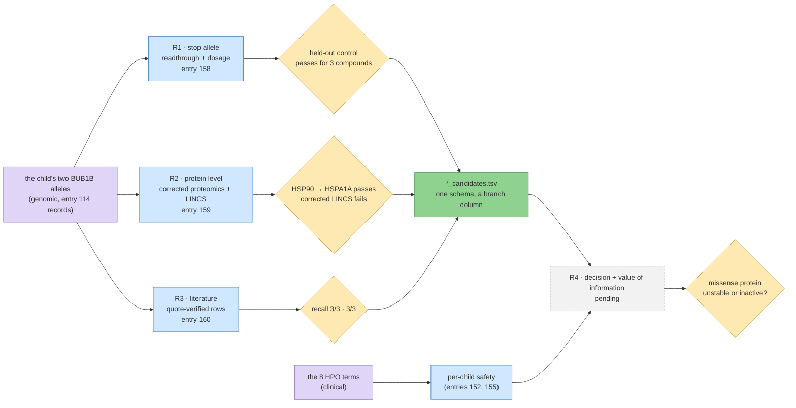

# Iteration 5 · step 1 — allele-first therapy routes

**Standing:** open, verified 2026-09-25 against the filed entries. Goal declared in
`src/mva/science/step_maps/iteration5.py`; routes as in the [plan](../plan.md). Exploratory: no
claims are filed, each route carries a positive control instead
([note](../notes/exploratory-no-hypotheses.md)). Written summary and figure captions:
[`narrative.json`](narrative.json).

**Goal.** Starting from the child's two `BUB1B` alleles (one `stop_gained`, one missense) and
the BubR1 protein, which therapeutic route exists per allele, which passes its own positive
control, and which lab test separates them?

> **Legend** purple = the two raw inputs (genomic, clinical) · blue = a route's machinery ·
> yellow = a control or a question that decides what may be read · green = the shared
> candidate tables · grey dashed = R4, not yet filed.

## Entries

| entry | route | what it found |
|---|---|---|
| [158](methodology/158-the-stop-allele-can-be-read-through-and-it-is-not-the-lever.md) | R1 — stop-codon readthrough, allele dosage | the stop allele is NMD-competent and loses the kinase domain; readthrough is worth at most a small fraction of the gap, so the missense allele is the lever |
| [159](methodology/159-which-drugs-raise-bubr1-protein-once-proliferation-is-removed.md) | R2 — proliferation-corrected drug proteomics; corrected LINCS | control passes; BUB1B protein is proliferation-bound; approved risers are weak; the strongest raisers point at degradation; the corrected LINCS control fails |
| [160](methodology/160-every-bubr1-intervention-in-the-literature-with-a-verified-quote.md) | R3 — quote-verified literature mining | control passes; NAD⁺, HDAC, proteasome, hypomethylating and senolytic classes; safety evidence from MVA patients |
| R4 (pending) | decision + value of information | draft in `work/` (gitignored); filed with the next free number |

## Figures

All in [`figures/it5/`](../../../figures/it5/), each with a `.provenance.json` and an
interactive `.html` twin. Captions: [`narrative.json`](narrative.json).

| route | figures |
|---|---|
| R1 | `r1-stop-anatomy.svg`, `r1-control.svg`, `r1-plus4.svg`, `r1-dosage.svg` |
| R2 | `r2-proliferation.svg`, `r2-control.svg`, `r2-hits.svg` |
| R3 | `r3-extraction-funnel.svg`, `r3-evidence-map.svg`, `r3-mva-exposures.svg` |
| R4 | pending |

## Tables

In [`ressources/track2/it5/`](../../../ressources/track2/it5/), each with a
`.provenance.json`; recorded in `warehouse.data_lineage` as `track2.it5.*` once their entry is
filed (`uv run python tools/record_track2_lineage.py`).

| route | tables |
|---|---|
| R1 | `readthrough.tsv`, `allele_dosage.tsv`, `readthrough_candidates.tsv` |
| R2 | `proteome_hits.tsv`, `proteome_control.tsv`, `lincs_cc_control.tsv`, `protein_candidates.tsv` |
| R3 | `litmine_corpus.tsv`, `litmine_extraction.tsv`, `litmine_exposure_extraction.tsv`, `litmine_interventions.tsv`, `litmine_mva_exposures.tsv`, `litmine_rejected.tsv`, `literature_candidates.tsv` |
| R4 | `decision_*.tsv`, `candidate_safety.tsv`, `decision_config.json` — pending its entry |

Every `*_candidates.tsv` shares the plan's columns (`drug_name, route, branch, evidence_kind,
evidence_strength, positive_control_passed, source, notes`); `evidence_strength` is a per-route
triage rubric, not a probability.

## Submission

[`submissions/track2/iteration-5/`](../../../submissions/track2/iteration-5/README.md) (draft).
