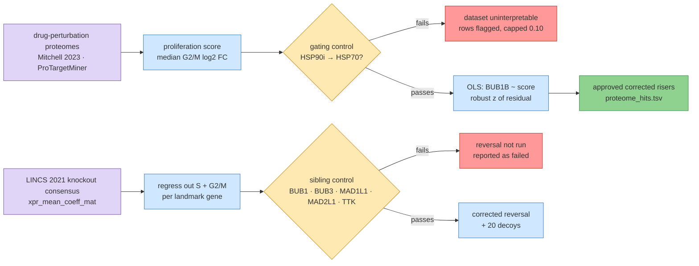
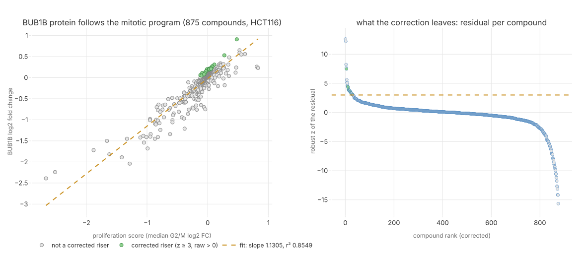
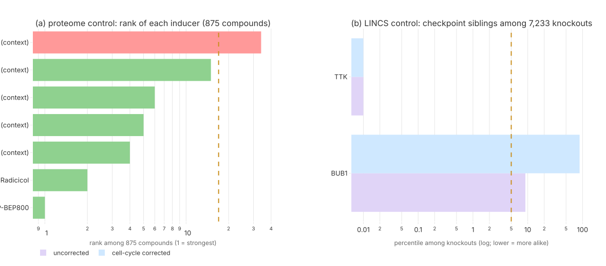
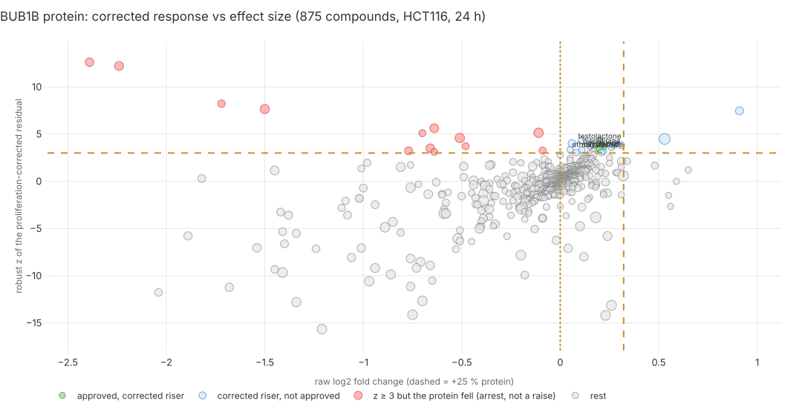

# 159 — Protein-level readout: which drugs raise BubR1, and does a corrected LINCS signature pass?

**Step:** iteration 5, [step 1](../README.md), route R2. **Date:** 2026-09-25. **Claims:** none — exploratory, a positive control instead ([note](../../notes/exploratory-no-hypotheses.md)).

## Question

Direction D3 of the iteration-4 mechanism card is "raise stable BubR1" — a statement about
**protein amount**, not mRNA. Iteration 4's LINCS route (entry 153) asked it in mRNA and its
positive control failed: the BUB1B-knockout signature read as generic cell-cycle arrest, so
no reverser could be trusted. Two questions follow:

- **(a)** In public **drug-perturbation proteomics** (compounds applied, protein abundance
  measured proteome-wide), which compounds raise **BUB1B protein** once the cell-cycle
  effect is corrected for — and do any map to approved drugs?
- **(b)** Does entry 153's own positive control pass if the **proliferation component is
  regressed out** of the expression signatures first? Only if it does is reversal re-run.

**Terms, for a software engineer.**

- **proteomics**: measuring protein amounts directly (mass spectrometry), as opposed to
  transcriptomics, which measures mRNA. mRNA is the source, protein is the running process —
  they often disagree.
- **log2 fold change (log2 FC)**: `log2(treated / control)`; 0 = no change, +1 = double.
- **proliferation score**: one number per drug saying how much it moved the cell-division
  machinery — here the median log2 FC over a published G2/M gene set.
- **robust z**: how far a value sits from the middle, in units of a spread that ignores
  outliers (1.4826 × median absolute deviation ≈ a standard deviation for clean data).
- **positive control**: an experiment whose answer is already known; if the pipeline misses
  it, nothing else it says counts.

## Method



> **Legend** purple = raw public datasets · blue = machinery · yellow = the control that
> decides whether anything downstream may be read · green = a usable output · red = a
> failed control and what it costs.

Every analysis choice was fixed **in writing before the target was ranked**, in the two
drivers' docstrings ([`tools/it5_proteome.py`](../../../../tools/it5_proteome.py),
[`tools/it5_lincs_cc.py`](../../../../tools/it5_lincs_cc.py)); the summary tables below are
those docstrings. While checking that the files quantify BUB1B at all, BUB1B's values in six
Mitchell columns were printed once — no score, fit or ranking had been computed.

## Inputs

| input | what it is | release / version | sha256 (first 16) | licence |
|---|---|---|---|---|
| `mitchell/MOESM3.csv` (43.2 MB) | Mitchell 2023, *Nat Biotechnol* 41:845 (PMID 36593396) Supp. Data 3 — 9,714 proteins × 875 compounds, HCT116, 10 µM (28 at 1 µM), 24 h, log2 FC vs DMSO, median-normalised per plex | published 2023-01-02 | `fc0e7385aa07e99d` | Springer Nature supplementary |
| `ptm/MOESM{7,8,9}.xlsx` (A549 `27c7fc74fd0bd164`, MCF-7 `91d20df8cac9d8f2`, RKO `d3f3d8f39be3ab97`) | Saei 2019, *Nat Commun* 10:5715 (PMID 31844049) Supp. Data 4–6 — ProTargetMiner deep sets, A549 / MCF-7 / RKO, 9 drugs × 3 replicates, fold change vs control | published 2019-12-16 | see left | CC BY 4.0 |
| `ccle/protein_quant_current_normalized.csv.gz` | Nusinow 2020, *Cell* 180:387 — CCLE protein abundance, 378 cell-line channels (baseline only) | gygi.hms.harvard.edu | `b72a9ff39b123c80` | CCLE terms |
| `halflife/MOESM5.xlsx` | Mathieson 2018, *Nat Commun* 9:689 — protein half-lives, 5 human cell types (baseline only) | published 2018-02-14 | `e0503f49230680cb` | CC BY 4.0 |
| `build/it4/track2-e3/raw/xpr_mean_coeff_mat.tsv.gz` (432 MB) | LINCS L1000 2021 CRISPR-knockout consensus, 7,234 knockouts × 12,327 genes — **entry 153's file, unchanged** | S3 Last-Modified 2023-09-05 | `f8b115513c365340` | LINCS public |
| `geneinfo_beta.txt` | CMap LINCS 2020 beta gene table → the 978 landmark genes | — | `e739d06bad42ff92` | CMap public |
| `build/it5/r2/raw/cp_mean_coeff_mat.tsv.gz` (1.9 GB) | LINCS 2021 **compound** consensus — downloaded for the reversal step, **not used**: the control did not pass | S3 Last-Modified 2022-03-30 | in `build/` | LINCS public |
| ChEMBL REST, openFDA drug label | approval evidence (`max_phase 4` bulk index: 25,138 names; 261 non-code names asked of openFDA, 8 labelled, 0 failed) | ChEMBL 37 | roll-up in the manifests | CC BY-SA 3.0 / public domain |

**Unavailable, stated not substituted.** decryptE (Eckert 2024, *Nat Biotechnol*
43:406, PMID 38714896; Jurkat, 144 drugs × 5 doses, 18 h, >1 M dose–response curves) is
deposited as MassIVE `MSV000093659` / `PXD047799`. Its FTP endpoints
(`ftp://massive.ucsd.edu/v06/MSV000093659`, `massive-ftp.ucsd.edu`) did not answer from this
machine (curl timed out repeatedly), and the ProteomeXchange/PROXI file-listing endpoints
return 404 for this accession. The per-protein curve tables are browsable only through
ProteomicsDB `/decryptE` and the authors' Shiny app; no bulk table was retrieved, so
decryptE contributes nothing here. **It is the best next input if a machine with FTP access
is available** — it would add a dose axis, which HCT116-at-one-dose cannot give.

Code: `src/mva/drugs/proteome{,_sets,_sources,_run,_tables,_manifest}.py`,
`src/mva/drugs/signature_cc{,_reversal}.py`; drivers `tools/it5_proteome.py`,
`tools/it5_lincs_cc.py`, `tools/render_it5_r2.py`; tests
`tests/test_drugs_proteome.py` (27), `tests/test_drugs_signature_cc.py` (12), both synthetic
and offline. numpy 2.5.2, polars, openpyxl 3.1.5. Cost $0; ~10 min of downloads, ~90 s for
the proteome run, ~13 s for the LINCS control.

## Commands

```bash
# downloads (curl, into build/it5/r2/raw/ — gitignored; URLs in the manifests)
uv run python tools/it5_proteome.py run          # controls → BUB1B → proteome_{hits,control}.tsv
uv run python tools/it5_lincs_cc.py control      # corrected + uncorrected sibling control
uv run python tools/it5_lincs_cc.py reversal     # refuses: the primary control failed
uv run python tools/it5_proteome.py candidates   # → protein_candidates.tsv
uv run python tools/render_it5_r2.py             # figures/it5/r2-*.svg
uv run pytest -q tests/test_drugs_proteome.py tests/test_drugs_signature_cc.py
```

One failure on the way, recorded: the Mitchell CSV is Windows-1252, not UTF-8 (non-breaking
spaces in compound names); the reader now declares the encoding and folds them.

## Positive control

### (a) proteome — **PASSED in the primary dataset**

Declared before BUB1B was touched: *HSP90 inhibition raises HSP70 (HSPA1A)* — the textbook
heat-shock response. Both HSP90 inhibitors in the library had to be hits in the top 2 % of
875 compounds (rank ≤ 17).

| dataset | gating control | rank | robust z | verdict |
|---|---|---|---|---|
| Mitchell 2023 (HCT116) | HSPA1A ← NVP-BEP800 | **1** / 875 | 46.65 | **pass** |
| Mitchell 2023 | HSPA1A ← radicicol | **2** / 875 | 39.35 | **pass** |
| ProTargetMiner A549 | HSPA1A ← bortezomib | 1 / 9 | 5.32 | pass |
| ProTargetMiner A549 | MDM2 ← nutlin | 2 / 9 | 1.43 | **fail → dataset uninterpretable** |
| ProTargetMiner MCF-7 | HSPA1A ← bortezomib · MDM2 ← nutlin | 1 · 1 | 2.72 · 6.92 | **pass** |
| ProTargetMiner RKO | HSPA1A ← bortezomib | 1 / 9 | 3.28 | pass |
| ProTargetMiner RKO | MDM2 ← nutlin | 2 / 9 | 3.41 | **fail → dataset uninterpretable** |

Secondary controls (reported, do not gate; Mitchell): CDT1 ← MLN4924 rank 4 (z 17.33) —
a protein **stabilisation**, not a transcriptional induction, so the pipeline also sees
degradation-side effects; MDM2 ← nutlin-3a rank 5, ← idasanutlin rank 6 — pass; CDKN1A
(p21) ← nutlin-3a rank 15 but ← idasanutlin rank 34, outside the cut of 17, so that control
**fails by its own "every inducer" rule** while showing the p53 axis is present.

### (b) LINCS — **FAILED after correction; passes uncorrected**

Entry 153's control: the BUB1B-knockout signature must look like loss of the other
spindle-assembly-checkpoint (SAC) genes. Three of the five named siblings (BUB3, MAD1L1,
MAD2L1) **have no knockout consensus row** in the 7,234-row matrix, so only BUB1 and TTK can
be scored; a missing sibling never counts as a pass.

| variant | BUB1 percentile | TTK percentile | mean | permutation p | verdict |
|---|---|---|---|---|---|
| **cc_primary** (S + G2/M regressed out) | 88.46 % | **0.01 %** (rank 1 of 7,233) | 44.23 | 0.390 | **FAIL** |
| raw (uncorrected baseline) | 9.06 % | **0.01 %** | 4.53 | **0.0041** | pass |
| top-1 PC removed | 63.74 % | 0.01 % | 31.87 | 0.203 | fail |
| top-3 PCs removed | 82.40 % | 0.01 % | 41.21 | 0.338 | fail |
| top-10 PCs removed | 87.81 % | 0.01 % | 43.91 | 0.384 | fail |

By declaration the reversal step did not run: `tools/it5_lincs_cc.py reversal` prints the
refusal and writes zero candidate rows. The 1.9 GB compound matrix was downloaded before the
control was run and is left unused, deliberately.

## Output

### (a) BUB1B protein is one of the most proliferation-bound proteins measured

- Across 875 compounds (Mitchell), BUB1B's log2 FC correlates with the G2/M score at
  **r = 0.925** (slope 1.13, r² 0.855): four fifths of everything a drug does to BubR1
  protein is "it changed how many cells are dividing".
- At baseline, across **378 CCLE cell lines**, BUB1B protein correlates with the same score
  at **r = 0.704** — the **99.7th percentile** of 12,050 proteins. Correcting for
  proliferation is not optional for this target; it is the analysis.
- BUB1B has **no** half-life row in Mathieson 2018 (not quantified in those five cell
  types), so no measured BubR1 protein half-life was obtained from that source.

### The corrected risers

18 of 875 compounds are corrected risers (z ≥ 3 **and** the protein actually up); 5 are
approved drugs.

| compound | raw log2 FC | corrected z | rank | breadth | approved | note |
|---|---|---|---|---|---|---|
| Ro-3306 | **+0.91** (+88 %) | 7.47 | 5 | 11.0 % (broad) | no (CDK1 inhibitor) | the largest corrected raise |
| epoxomicin | +0.53 | 4.48 | 10 | 25.5 % (broad) | no (proteasome inhibitor) | raises a quarter of the proteome |
| sulforaphane | +0.31 | 3.81 | 15 | 3.4 % | no (nutraceutical) | |
| selisistat (EX-527) | +0.27 | 3.80 | 16 | 2.4 % | no (SIRT1 inhibitor) | same family as iteration 4's SIRT2 lead |
| kaempferide | +0.26 | 3.60 | 19 | 1.9 % | no | |
| **gliclazide** | +0.22 | 3.59 | 20 | 0.3 % | **yes** | strength 0.70 |
| **nisoldipine** | +0.21 | 3.85 | 14 | 0.5 % | **yes** | strength 0.70 |
| **testolactone** | +0.20 | 4.33 | 12 | 2.4 % | **yes** | strength 0.70 |
| **migalastat** | +0.20 | 3.42 | 23 | 1.9 % | **yes** | strength 0.70 |
| **ethoxzolamide** | +0.19 | 3.44 | 22 | 0.9 % | **yes** | strength 0.70 |

The strongest corrected z values belong to compounds whose BUB1B **fell** — nutlin-3a
(z 12.6, log2 FC −2.39) and idasanutlin (z 12.2, −2.24) lower BubR1 much less than they
lower the rest of mitosis. They are excluded from the hit list by the "raw > 0" clause, and
they are the clearest demonstration of why that clause exists: a large corrected z is not a
raise.

In the deep sets, **bortezomib** is the only corrected riser (A549 z 2.99, RKO z 2.02) —
but both those datasets failed their MDM2 gating control, so those rows are capped at 0.10
and reported as leads, not evidence. MCF-7, the one deep set that passed both controls, has
**no** corrected riser among its 9 drugs.

### (b) what the corrected LINCS control showed

- **TTK (Mps1) is the single most similar knockout to BUB1B in every variant** — rank 1 of
  7,233, r 0.42 uncorrected and still 0.257 after correction. TTK is the kinase that
  recruits BubR1 to the kinetochore; that one sibling relationship is real and survives.
- **BUB1 does not survive.** Uncorrected it sits at the 9.06th percentile; corrected it
  falls to 88.46th. Its resemblance to BUB1B loss was carried by the shared cell-cycle
  component — precisely what entry 153 suspected.
- **A method note worth its own line:** with entry 153's engine-query formulation the control
  failed even uncorrected (best: BUB1 at 5.6 %, cut 5 %). Comparing whole consensus rows by
  correlation, on the same file, the uncorrected control **passes** (mean 4.53 %, p 0.0041).
  Part of entry 153's failure was the query formulation (top-100 up/down gene lists through
  a signature search engine), not only the biology.

### Candidate rows

`ressources/track2/it5/protein_candidates.tsv` — 7 rows, all `route=R2`,
`branch=missense_unstable` (a compound that raises protein amount can only act on an allele
that makes protein; the `stop_gained` allele makes none): 5 approved Mitchell hits at
strength **0.70** (rubric: 0.40 hit + 0.15 survives the SAC-excluded score + 0.15 not broad;
none reaches the +0.15 for a ≥ 25 % raise, and none is replicated) and 2 bortezomib rows at
**0.10** (capped: their dataset's control failed). No LINCS rows: that control failed.

### Figures



> **Legend** green = a corrected riser (z ≥ 3 and the protein up) · grey = everything else ·
> yellow dashed = the fitted proliferation dependence (left) and the z ≥ 3 cut (right).
> Left: BUB1B log2 FC against the proliferation score, 875 compounds. Right: the same
> compounds by corrected rank.



> **Legend** (a) green = the inducer inside the gating cut, red = outside · (b) purple =
> uncorrected, blue = cell-cycle corrected; BUB3, MAD1L1 and MAD2L1 have no knockout row and
> are not drawn · yellow dashed = the cut (top 2 % of compounds; 5 % of knockouts). Log axes.



> **Legend** green = approved corrected riser · blue = corrected riser, not approved · red =
> z ≥ 3 but the protein fell (arrest, not a raise) · grey = the rest · yellow dashed = the
> z ≥ 3 and +25 % cuts, dotted = no change. Marker size = breadth (share of all proteins the
> compound raises).

## Conclusion

1. **The proteome route is interpretable and it ran.** Its gating control passed at rank 1
   and 2 of 875 in the primary dataset — the pipeline finds a textbook protein induction
   before it is pointed at BubR1.
2. **No approved drug raises BUB1B protein by much.** The five approved corrected risers
   move BubR1 by **+14 % to +16 %** (log2 FC 0.19–0.22). A constitutional hypomorph needing
   more functional BubR1 is unlikely to be rescued by a fifth of a doubling, and none of the
   five has a mechanism that plausibly stabilises a missense protein: gliclazide
   (sulfonylurea), nisoldipine (calcium channel), testolactone (aromatase), migalastat (a
   **pharmacological chaperone** — for α-galactosidase A, a different protein), ethoxzolamide
   (carbonic anhydrase). They are reported as what they are: weak, specific-looking,
   mechanism-free hits. Migalastat is the only one whose *class* matches D3 (chaperones
   stabilise misfolded proteins), and that is an argument for testing a chaperone strategy,
   not for this drug.
3. **The biggest corrected raise is mechanistic and not a drug:** Ro-3306 (CDK1 inhibition,
   +88 %) and epoxomicin (proteasome inhibition, +45 %) — the two ways a cell ends up with
   more BubR1 protein are "hold cells before mitosis" and "stop degrading it". Both are
   broad (11 % and 26 % of the proteome) and neither is approved. They point at
   **degradation** as the lever for a missense-unstable allele, which is R1's and R4's
   question, not a repurposing answer.
4. **Entry 153's route stays closed.** After the correction the checkpoint-sibling control
   fails in every variant, so no corrected reverser list was produced. The one sibling that
   survives correction — TTK — is a mechanistic finding, not a drug lead.
5. **What would change this:** decryptE's dose–response curves (a dose axis on an
   approved-drug panel), or any proteomics on a BUB1B-mutant or primary cell rather than a
   cancer line.

## Limits

- **Assumptions.** That a median over 53 G2/M proteins captures "how much did this drug move
  the cell cycle" and that BUB1B's dependence on it is linear. The fit supports the second
  (r² 0.855); the first is a modelling choice, sensitivity-tested by removing the
  checkpoint/kinetochore module from the score (all five approved hits survive) and, in the
  LINCS half, by principal-component removal.
- **A regression removes only what its covariate captures.** A drug that changes BubR1 and
  the cell cycle through the same upstream event is not separated by this model.
- **One cell line, one dose, one time point** (HCT116, 10 µM, 24 h) for the primary dataset;
  9 drugs for the replication sets. A drug absent from both libraries cannot be found here —
  absence is not evidence of no effect.
- **Cancer cell lines are not this child's cells.** HCT116 is mismatch-repair deficient and
  proliferating; a constitutional hypomorph in a growing child is a different system.
- **Protein amount is not protein function.** None of these datasets says whether the extra
  BubR1 is the missense protein, whether it folds, or whether it reaches the kinetochore.
- **The strength rubric is a stated heuristic for triage, not a calibrated probability.**
- **Multiple testing.** 875 compounds × one target; z ≥ 3 with ~875 draws expects ~1–2 false
  positives among the 18 hits under a normal null, and the residuals are not exactly normal.
  The approved five are not corrected for that and must not be read as significant.
- **The control that gates part (a) is one induction in one direction.** It shows the
  pipeline can see a real, large protein change; it does not show it can see a 15 % one.

## Both datasets

- **Genomic source** (the 85 GB dataset) enters at one remove only: the target gene is
  BUB1B because the child carries a `stop_gained` and a missense allele there (oracle reply,
  entry 083), and the branch assignment (`missense_unstable`) follows from that pair. **No
  patient sequence, value or position** was read by either driver, and none appears in any
  table, figure or manifest; the coordinate gate passes.
- **Clinical source** (the 8 HPO terms): not used to compute anything here, and the tables
  say so. Cross-referenced as follows. The terms describe a child with a
  **rhabdomyosarcoma** (HP:0002859), **short stature** (HP:0004322), **failure to thrive**
  (HP:0001508), **skeletal muscle atrophy** (HP:0003202), **small for gestational age**
  (HP:0001518), **premature birth** (HP:0001622), **nephrocalcinosis** (HP:0000121), plus
  parental **recurrent miscarriage** (HP:0200067). Three consequences for this route:
  (i) growth restriction and low muscle mass are whole-body, chronic features — a 15 % rise
  in one protein in a cancer line is not a credible answer to them, which is why conclusion 2
  reports the effect sizes rather than the ranking alone;
  (ii) an active malignancy makes the two mechanistically strongest risers here
  (a CDK1 inhibitor and a proteasome inhibitor, both antiproliferative and broad) unusable
  as chronic "raise BubR1" therapy in this child, independent of approval status;
  (iii) nephrocalcinosis is a standing safety axis for any candidate (iteration 4's
  per-child safety table, entries 152/155) — ethoxzolamide is a carbonic-anhydrase inhibitor,
  a class associated with renal calcification, so its row carries that flag downstream
  rather than being promoted on evidence strength alone.
