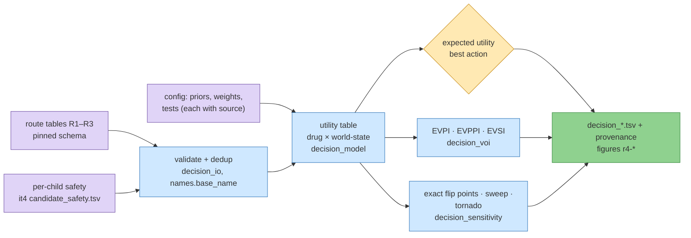

# 161 — The decision, and what the next measurement is worth

**Step:** iteration 5, [step 1](../README.md), route R4. **Date:** 2026-09-25. **Claims:** none — exploratory, a positive control instead ([note](../../notes/exploratory-no-hypotheses.md)).

**Standing:** final run 2026-09-25 on entries 158 (R1), 159 (R2), 160 (R3). Research
triage only: no row advises for or against giving any drug to any patient. Exploratory (no hypotheses filed,
[`../../notes/exploratory-no-hypotheses.md`](../../notes/exploratory-no-hypotheses.md)).

## Question

The child has two broken `BUB1B` copies: a `stop_gained` allele (makes no full-length
protein) and a missense allele (one changed amino acid). Two facts that decide which drug
could help are unknown:

- `missense_class`: is the missense protein **unstable** (made, then degraded fast) or
  **inactive** (stable but not working)?
- `readthrough_feasible`: can a read-through drug (a drug that makes the ribosome skip the
  premature stop) restore enough full-length protein from the stop allele?

Per combination of those facts (a **world-state**), which candidate is best? Which choice is
best *now*, without knowing? And how much would a test, above all the cycloheximide-chase
BubR1 Western blot (iteration-4 report §7.3), change that choice?

**Software analogy.** A lookup table `utility[drug][state]`; a probability-weighted average
per row picks the action; "value of information" is how much the average improves if you
could read the state before choosing, like knowing a feature flag before a deploy decision.

## Method



> **Legend** purple = the raw inputs (route tables, the child's safety flags, the stated
> config) · blue = machinery · yellow = the decision · green = the outputs.

**Utility** (a triage heuristic, not a calibrated posterior, not a probability of benefit):

```
u(drug, state) = safety(drug) × combine over the drug's rows r of
                 [ strength(r) × route_weight(r) × applicability(branch(r), state) × control(r) ]
```

| factor | meaning | where it comes from |
|---|---|---|
| `strength` | the route's `evidence_strength` ∈ [0, 1] | the route's own rubric (its entry) |
| `applicability` | does the row's branch act in this state (`stop_allele` needs `readthrough_feasible=yes`; `missense_unstable` needs `unstable`; `missense_inactive` needs `inactive`; `any` always) | config, 0/1 by default; partial cells swept in the tornado |
| `control` | route passed its positive control → 1; unknown → 0.5; failed → 0.25 (`penalty`) or row dropped (`exclude`) | config choice; the lesson of entry 153 |
| `safety` | per-child two-source flag (entries 152, 155): unflagged 1 · one source 0.75 · both 0.4 · **absent = unassessed 0.6** (never "safe") | config choice; order from K2 |
| `combine` | `max` (default: best single argument) or `noisy_or` (rewards convergence) | config; `max` because iteration-4 convergence was chance-level (H094) |

**Decisions.** `EU(a) = Σ_s P(s) u(a, s)`; world-states are the product of independent
priors. Action 0 is the baseline "defer (no drug; run the test first)", utility 0, and wins
ties, so a drug must beat doing nothing strictly.

- **EVPI** = Σ_s P(s) max_a u(a, s) − max_a EU(a).
- **EVPPI** per variable: the same with only that variable revealed.
- **EVSI** of a binary test with sensitivity/specificity: Bayes-update the prior per result,
  re-choose, average over P(result), subtract max_a EU(a).
- **Flip points**: with one prior `p` swept (other values share 1 − p in their ratio), every
  EU is a straight line in `p`, so the best action is the upper envelope and its break points
  are computed exactly (no grid).
- **Tornado**: each configured parameter at its low/high end, the rest held; metric =
  `evsi:chx_chase_blot` (config `tornado_metric`).

## Inputs

| input | role | version / sha256 |
|---|---|---|
| `ressources/track2/it5/{readthrough,protein,literature}_candidates.tsv` | candidates (R1 19 rows, R2 7, R3 24) | sha256 in `decision_*.provenance.json` |
| `ressources/track2/it5/allele_dosage.tsv` (R1) | derives `readthrough_feasible` | `c340fc8b…fe89e` |
| `ressources/track2/it5/candidate_safety.tsv` (new, this entry) | per-child safety for the 47 iteration-5 names | provenance beside it |
| `ressources/track2/it5/litmine_mva_exposures.tsv`, `build/it5/r3/translation.json` (R3), `ressources/track2/do_not.tsv`, `src/mva/drugs/checks.py`, entry 158 | the avoid list | sha256 in `decision_avoid.provenance.json` |
| `ressources/track2/it4/candidate_safety.tsv` | per-child safety, 62 drugs | `a54e63b9…81ed` |
| `ressources/track2/it5/decision_config.json` | priors, weights, tests, tornado ranges | `2da904b3…d9ad` (dry run) |
| dry run only: `ressources/track2/it4/candidates.tsv` | re-scored under a stated dry-run rubric | via `build/it5/r4/dryrun/it4_adapted_candidates.tsv` `ff6bd4e7…822c` |
| dry run only: synthetic fixture (6 `SYNTH-` rows) | exercises every branch and control state | `build/it5/r4/dryrun/fixture_candidates.tsv` `64015800…5b41` |

**Priors (config).** `missense_class`: unstable 0.55 / inactive 0.45 — the register's triage
weight for H084 (entry 149; ΔΔG 87th percentile), with entry 149's calibration AUROC 0.60
(n = 8) saying the predictor cannot yet separate the classes. Kept: no R1–R3 table measures
this missense's abundance (entry 158 says the child's BubR1 level was never measured).
Blot sensitivity/specificity 0.85/0.85 and reporter 0.8/0.8 are **R4 assumptions** (no route
states a value), swept 0.6–0.99.

**`readthrough_feasible`, derived, not typed** (`src/mva/drugs/decision_priors.py`, config
`derive`). Rule: "feasible" = a readthrough scenario's gain lifts an untreated child scenario
that sits below R1's threshold to at or above it. All three numbers are read from
`allele_dosage.tsv`:

| quantity | read from | value |
|---|---|---|
| threshold | `nearest_genotype_pct` of the "segregation-fidelity cliff" row | 13.0 % of wild type |
| untreated child scenarios below it | `drug = none`, scenario "child now …" | 12.5 (base), 8.5 (pessimistic), 5.0 (inactive) |
| real-dose gains (strict) | "readthrough only" rows | DAP 0.071, SRI 0.058, G418 0.014 pt |
| + stated upper bounds (lenient) | "NMD blockade", "perfect readthrough" rows | 0.712, 1.423 pt |

- Strict (used): 0 of 9 (start, gain) pairs reach 13.0 → **P(yes) = 0**.
- Lenient (tornado end): 2 of 15 → **0.133**. Only the base case (12.5) with an upper bound
  crosses: 13.21 and 13.92.

## Commands

```bash
uv run pytest -q tests/test_drugs_decision.py          # positive control + rules, 16 tests
uv run python tools/it5_decision.py dryrun \
    --lineage docs/iteration5/step-1/work/r4-lineage.json   # -> build/it5/r4/dryrun/
uv run python tools/render_it5_r4.py                   # -> build/it5/r4/dryrun/figures/
# per-child safety for the iteration-5 names (entry 152's method, local caches only)
W=build/it5/r4/safety; C=ressources/track2/it5
uv run python tools/it5_decision.py safety-drugs --out $W/drugs.tsv \
    --candidates $C/readthrough_candidates.tsv $C/protein_candidates.tsv $C/literature_candidates.tsv
cp build/it4/track2-s2/safety/pgx_summary.json $W/     # PharmCAT output reused (sha 581c9c4c…)
uv run python tools/patient_safety.py --work $W labels --onsides build/it4/track2-e56/onsides/csv \
    --drug-table $W/drugs.tsv:drug_name:direction_id \
    --extra-drug "furosemide=positive control (PMID 35348900)" \
    --extra-drug "calcitriol=positive control (FAERS nephrocalcinosis)" \
    --alias "valproic acid=valproate" --alias "nicotinamide=niacinamide" --per-candidate 5
uv run python tools/patient_safety.py --work $W table --drug-table $W/drugs.tsv:drug_name:direction_id \
    --extra-drug "furosemide=positive control (PMID 35348900)" \
    --extra-drug "calcitriol=positive control (FAERS nephrocalcinosis)" \
    --extra-gene "valproic acid=POLG" --out $C/candidate_safety.tsv --entry "…161…" --sources "…"
# final run + figures
uv run python tools/it5_decision.py run \
    --candidates $C/readthrough_candidates.tsv $C/protein_candidates.tsv $C/literature_candidates.tsv \
    --safety ressources/track2/it4/candidate_safety.tsv $C/candidate_safety.tsv --out $C \
    --lineage docs/iteration5/step-1/work/r4-lineage.json   # log: build/it5/r4/final-run.log
uv run python tools/render_it5_r4.py --work ressources/track2/it5 --out figures/it5
```

`r4-lineage.json` holds one edge per (output table, input file) in `warehouse.data_lineage`'s
columns (currently the dry run's 24; the final run overwrites it); each figure's edge is its
own `.provenance.json`. `--set PARAM=VALUE` (repeatable) runs a what-if; addresses are listed in
`src/mva/drugs/decision_config.py`; overrides are recorded in every manifest.

## Positive control

A case small enough to work by hand, reproduced exactly by
`tests/test_drugs_decision.py::test_positive_control_reproduces_the_hand_worked_numbers`.
One variable, P(unstable) = 0.6. Config: failed control × 0.5, phenotype flag × 0.5,
unassessed × 0.6.

| drug | rows | branch | strength | control | safety | u(unstable) | u(inactive) |
|---|---|---|---|---|---|---|---|
| A | "Drug A hydrochloride" (r1), "DRUG A" (r2) | missense_unstable | 0.8, 0.5 → max 0.8 | passed | unflagged 1 | 0.8 | 0 |
| B | r1 | any | 0.4 | passed | phenotype 0.5 | 0.2 | 0.2 |
| C | r3 | missense_inactive | 0.9 | failed ×0.5 | unflagged 1 | 0 | 0.45 |
| D | r1 | any | 0.1 | passed | absent → unassessed 0.6 | 0.06 | 0.06 |

- EU: A = 0.6 × 0.8 = **0.48**; B = 0.20; C = 0.4 × 0.45 = 0.18; D = 0.06 → best **A**.
- EVPI = 0.6 × 0.8 + 0.4 × 0.45 − 0.48 = 0.66 − 0.48 = **0.18**.
- Blot, sensitivity 0.9, specificity 0.8. P(+) = 0.6 × 0.9 + 0.4 × 0.2 = **0.62**;
  EU(A | +) = 0.8 × 0.54 / 0.62 = 0.6968 → A. P(−) = 0.38; EU(C | −) = 0.45 × 0.32 / 0.38 =
  0.3789 > B 0.2 > A 0.1263 → **C**.
  EVSI = 0.62 × 0.6968 + 0.38 × 0.3789 − 0.48 = 0.432 + 0.144 − 0.48 = **0.096**.
- Flip: 0.8 p = 0.45 (1 − p) → **p = 0.36**; C best on [0, 0.36], A on [0.36, 1]. B's line
  (0.2) is below the envelope everywhere (at 0.36 the envelope is 0.288), so B is never best.
- Dedup: A's two spellings are one action supported by routes r1 and r2.
- Exclude policy: C dropped → EVPI = 0.6 × 0.8 + 0.4 × 0.2 − 0.48 = 0.08.

**Result:** all numbers reproduced (16/16 tests pass, tolerance 1e-6). Pass.

## Output

### Dry run (2026-09-25) — pipeline check, not a finding

Iteration-4 candidates re-scored under a dry-run rubric stated in `tools/it5_decision.py`
(`IT4_RUBRIC`: twin 0.4 passed, PRISM 0.2 passed, LINCS 0.2 failed, walk 0.1 unknown; D3 hint
→ `missense_unstable`, else `any`) plus 6 synthetic rows. These weights exercise the code;
they are not evidence about any drug.

| output | value |
|---|---|
| rows / drugs after dedup | 69 / 67 (dasatinib: 2 it4 routes; `SYNTH-STABILISER-1` + its hydrochloride spelling: 1) |
| best overall | DASATINIB, EU 0.400 (its twin row 0.4 × unflagged 1, `any` branch) |
| best per state | `unstable & *` → SYNTH-STABILISER-1 (0.42); `inactive & *` → DASATINIB (0.40) |
| EVPI / EVPPI(missense_class) / EVPPI(readthrough) | 0.011 / 0.011 / 0.000 |
| EVSI blot / reporter | 0.000 / 0.000 (no result moves the choice off DASATINIB) |
| flip point | P(unstable) = 0.952: DASATINIB below, SYNTH-STABILISER-1 above |
| tornado, largest swing | `safety:unassessed` 0.3→1.0: EVSI(blot) 0 → 0.113; then prior(unstable) 0.2→0.9: 0 → 0.009 |

Reading: when an `any`-branch drug is strongest, knowing the allele state is worth little;
the blot gains value only when a branch-specific candidate comes close to it. That is the
shape the final run will test with real route tables.

Files: `build/it5/r4/dryrun/decision_{utilities,states,voi,flips,sweep,tornado}.tsv` (+
`.provenance.json` each), `decision_summary.json`, `run.log`, `render.log`,
`figures/r4-{decision-tree,voi-curve,heatmap,tornado}.svg` (+ `.html`, `.provenance.json`).

### Figures (`figures/it5/`, from the final run)

- `r4-decision-tree.svg` — world-states as a tree ending in the best action per state.
  > **Legend** yellow = the first uncertain fact, purple = further facts about the child's
  > alleles, blue edge = value (prior weight), green = the best drug in that state, red = only
  > the baseline (defer) is best.
- `r4-voi-curve.svg` — EVPI and EVSI against each prior, flip points marked.
  > **Legend** blue = EVPI (upper bound), green = EVSI of the test on that variable, grey
  > dotted = a test on another variable, yellow dashed = exact flip point (segment labels =
  > best action), purple dotted = the configured prior.
- `r4-heatmap.svg` — top 15 actions × world-states.
  > **Legend** white to green = heuristic utility 0 to max, yellow outline = the best action
  > in that state, row label = action · per-child safety class.
- `r4-tornado.svg` — EVSI(blot) over each parameter's range.
  > **Legend** blue bar = the metric's range as one parameter moves low→high, the rest held;
  > red = the best action changes within that range.

### Final run (2026-09-25)

**Preparation.**

- Candidates: 50 route rows → 54 evidence rows after class-row expansion (config `aliases`:
  a named tool compound or named member ×1.0, a member the row names only as a clinic analogue
  ×0.4, R3's "class analogue approved" factor) → **45 drugs**. One row dropped: R1's
  `Untreated` negative control.
- `n/a` controls (R1's published measurements) take `na_factor` 1.0; swept 0.5–1.0.
- Per-child safety (entry 152's method, no new download: PharmCAT output reused, OnSIDES
  local cache, FAERS not queried): 47 names → `ressources/track2/it5/candidate_safety.tsv`.
  Positive control reproduced: furosemide flagged on nephrocalcinosis, calcitriol matched.
  Label check: 11 of the 21 labelled names carry a matched effect (0.52) vs 46/105 in the
  matched comparison set (0.44).
- Safety class of the 45 drugs: 9 unflagged · 7 phenotype flag · 2 genome flag (belinostat,
  valproic acid) · **24 unassessed** (no label in OnSIDES, so neither source could speak) ·
  3 avoid. "Unflagged" is never read as safe.

**Avoid / caution list** (`decision_avoid.tsv`, 35 rows; lowest factor wins):

| level | drugs | evidence |
|---|---|---|
| avoid | 9 CHEK1 inhibitors (AZD-7762, prexasertib, rabusertib, UCN-01, …) | CHK1 knockdown lowers BubR1 −77 % (PMID 19778378; R3 harm row) |
| avoid | bomedemstat (KDM1A) | LSD1 knockdown lowers BubR1 (PMID 20189264) |
| avoid | SU6656, geraldol | drive BubR1 degradation (PMID 21441410) |
| avoid | geldanamycin (HSP90 class) | mutant BubR1 depends on HSP90 (PMID 20516114; R1 strength 0) |
| avoid | gentamicin, amikacin, G418 | renal tubular injury vs nephrocalcinosis HP:0000121 (entry 158 §5) |
| avoid | dactinomycin | same-gene MVA patient: severe reaction (PMID 31081598) |
| avoid | vincristine, paclitaxel | MVA case report advises avoiding antimitotics (PMID 28611924); vincristine also it4's two-source flag |
| avoid | Mps1/TTK and Aurora inhibitor classes (A1) | entry 151; K1 of entry 155 |
| caution | 13 spindle poisons (A2, `do_not.tsv`) | a SAC-deficient background |
| caution | somatropin | no benefit in 4 MVA reports (PMIDs 35434947, 36588761, 12116237); 30147898 |

Candidates hit by the list: **G418, gentamicin, geldanamycin** (utility 0).

**Decision** (`decision_utilities.tsv`, `decision_states.tsv`):

| world-state | prior | best | utility |
|---|---|---|---|
| unstable & readthrough no | 0.55 | GLICLAZIDE **tied** MIGALASTAT | 0.70 |
| inactive & readthrough no | 0.45 | DASATINIB | 0.40 |
| either & readthrough yes | 0 | same as above | — |

- Best now: **GLICLAZIDE tied with MIGALASTAT**, EU 0.385 (R2's 0.70 × P(unstable) 0.55).
- **EVPI 0.180**; EVPPI(missense_class) 0.180; EVPPI(readthrough) 0.
- **EVSI(blot) 0.106** = 59 % of EVPI. Positive (P 0.535) → GLICLAZIDE/MIGALASTAT (EU 0.612);
  negative (P 0.465) → DASATINIB (EU 0.353). EVSI(reporter) 0: no result changes the choice.
- **Flip:** P(unstable) = **0.414** (DASATINIB below, GLICLAZIDE/MIGALASTAT above). The prior
  0.55 is 0.14 above it. `readthrough_feasible`: no flip on [0, 1] — even at P(yes) = 1 no
  readthrough row beats the missense and senolytic rows (best, DAP: 0.6 × unassessed 0.6 = 0.36).
- Top 10 by EU (routes): GLICLAZIDE (R2) 0.385 · MIGALASTAT (R2) 0.385 · NMN (R1, R3) 0.264 ·
  DASATINIB (R1, R3) 0.254 · ETHOXZOLAMIDE, NISOLDIPINE, TESTOLACTONE (R2) 0.231 · MG132
  (R1, R3) 0.165 · QUERCETIN (R1, R3) 0.130 · NIACIN (R3) 0.106.

**Tornado** (metric EVSI(blot); `decision_tornado.tsv`). The blot's value stays positive over
every range: 0.005 (R1 weight 0.25) to 0.150 (sensitivity 0.99). Largest swings: blot
sensitivity, the `missense_unstable`-in-inactive applicability cell, R1's route weight,
`na_factor`. **The best action changes** in three ranges: P(unstable) 0.2 → DASATINIB;
R2 weight 0.25 → NMN; unassessed factor 1.0 → NMN.

**Cross-check against R1's arithmetic (not an engine output).** R2's risers move BUB1B protein
+14–16 % in HCT116. Applied to the base case's missense output (12.5 %), that is 12.5 × 1.15
≈ 14.4 %, above R1's 13.0 % threshold; readthrough's best real dose reaches 12.57 %. This
assumes the rise applies to the missense product in the child's cells, which no dataset shows
(entry 159 Limits).

## Conclusion

1. **The missense class decides the choice; readthrough does not.** EVPPI is 0.180 for
   `missense_class` and 0 for `readthrough_feasible`, whose derived prior is 0 (R1: no real
   dose reaches the threshold).
2. **The cycloheximide-chase blot is worth running first:** EVSI 0.106, 59 % of the ceiling,
   positive in every tornado range. Unstable → a protein-raising candidate; inactive →
   senolysis (dasatinib).
3. **The drug named for the unstable branch is not robust.** GLICLAZIDE and MIGALASTAT tie,
   on one R2 rubric score (0.70) for a +14–16 % change R2 itself calls weak and uncorrected
   for multiple testing. At R2 weight 0.25 the unstable branch goes to NMN (R1, R3: the only
   intervention raising BubR1 in a living mouse). Route rubrics are on different scales; this
   entry does not calibrate them.
4. **Dasatinib is the inactive-branch answer from two routes** (R1 senolytic row, R3 class
   analogue), as in iteration 4 (entry 155), and the best action below P(unstable) 0.414.
5. **The avoid list is the most transferable output:** harm rows that lower BubR1,
   same-disease exposures, and checkpoint-weakening classes, each tied to its source.

## Limits

- **Heuristic.** Every utility is a product of stated weights; every prior a stated weight.
  Outputs rank what to look at and which uncertainty matters; they are not probabilities of
  benefit and not advice for any patient.
- Priors are independent by assumption (`missense_class` ⟂ `readthrough_feasible`).
- No harm term beyond the safety multiplier; a drug that could worsen the checkpoint (A1) must
  be excluded or down-weighted by its route, not here.
- EVSI treats sensitivity/specificity as known; they are assumptions until R1/R3 supply
  values (the tornado shows how much they matter).
- `max` combine ignores convergence; `noisy_or` would double-count routes that share data.
- Utility units are arbitrary; compare EVSI values with each other, not with money or time.
- 24 of 45 drugs are `unassessed` (no OnSIDES label); several approved drugs (nisoldipine,
  vorinostat) show 0 labels, which may be an ingredient-name mismatch in the label cache, not
  an absence of labels. FAERS not queried.
- Class-row expansion weights (1.0 / 0.4) are an R4 choice; the A1 class is listed but no
  candidate's MOA was re-checked against it (none is a known Mps1/Aurora inhibitor by name).
- The readthrough derivation weights (start, gain) pairs equally and inherits every R1
  assumption (NMD escape 10 %, product activity 0.5).
- Name dedup is salt-word stripping only (`mva.drugs.names.base_name`); a brand name and its
  generic stay two actions.

## Both datasets

- **Genomic** (the child's WGS): the two `BUB1B` alleles define the state variables
  (`stop_gained` → `readthrough_feasible`; missense → `missense_class`, prior from the
  stability atlas, entry 149). The safety table carries PharmCAT actionability words only.
  No position is read or written.
- **Clinical** (7 own HPO terms; the 8th is parental history): through the new per-child
  safety table (OnSIDES label effects matched to the terms) and the avoid list
  (nephrocalcinosis HP:0000121 → aminoglycosides; rhabdomyosarcoma HP:0002859 → the
  antimitotic advice; short stature HP:0004322 → growth hormone caution). The utility model
  itself uses no clinical term.
- **Genomic, derived:** `readthrough_feasible` comes from R1's dosage arithmetic over the
  child's stop context (UGA +4A, NMD-competent, entry 158); no position is read here.
