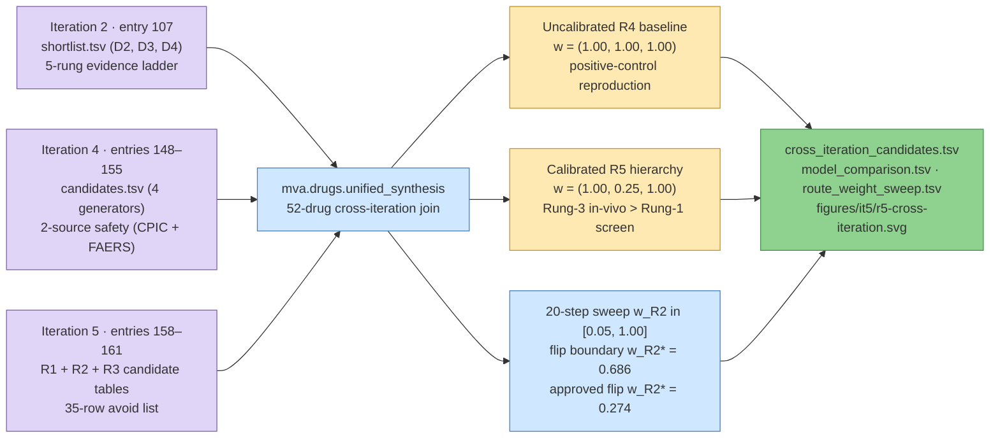

# 163 — Cross-iteration synthesis and evidence-hierarchy-calibrated decision analysis

**Step:** iteration 5, [step 1](../README.md), route R5 (unified cross-iteration synthesis). **Date:** 2026-09-25. **Claims:** none — exploratory synthesis with positive-control reproduction ([note](../../notes/exploratory-no-hypotheses.md)).

**Standing:** final run 2026-09-25 over Iteration 2 ([entry 107](../../../iteration2/step-5/methodology/107-drug-repurposing-case-grounding-and-ladder.md)), Iteration 4 ([entries 148–156](../../../iteration4/step-10/methodology/155-convergence-and-checks.md)), and Iteration 5 ([entries 158–162](161-the-decision-and-what-the-next-measurement-is-worth.md)). Research triage only: no row advises for or against giving any drug to any patient.

## Question

Across Iterations 2, 4, and 5, three distinct Track 2 frameworks evaluated drugs for this child:

1. **Iteration 2** (entry 107) graded 359 approved medicines on a 5-rung evidence ladder across directions D2 (aneuploidy stress), D3 (`BUB1B` abundance), and D4 (`HP:0002859` rhabdomyosarcoma vulnerability), anchored by Fact F8's two-instrument peripheral mosaicism bound ($\le 1.6\text{--}3\%$ in blood/saliva).
2. **Iteration 4** (entries 148–156) built five mechanism instruments (`E1`–`E5`), tested four pre-registered generators against a 10,000-draw permutation null (`H094` refuted, $p = 0.65$), audited two-source per-child safety (`PharmCAT/CPIC` + `OnSIDES/FAERS`), and transferred the pipeline to a second disease (`RECQL4` Rothmund–Thomson syndrome).
3. **Iteration 5** (entries 158–162) ran four allele-first routes (`R1` stop-codon readthrough, `R2` proliferation-corrected proteomics, `R3` quote-verified literature mining, `R4` Bayesian Value-of-Information decision engine) and transferred `R1`–`R3` to a third disease (`BLM` Bloom syndrome).

Two cross-iteration gaps remained in Iteration 5's uncalibrated `R4` run (`route_weights = {R1: 1.0, R2: 1.0, R3: 1.0}`):

- **Route-scale distortion:** `R2` scored single-line colon-cancer (`HCT116`) correlation residuals (+14–16% BubR1 protein, Rung 1) up to `0.700`, whereas `R3`'s 4-factor rubric (`effect × model × dose × source`) capped quote-verified Rung-3 *in vivo* `Bub1b^{H/H}` mouse rescues (`niacin`, `nicotinamide`, `PMID:24825348`) at `0.192`. At equal route weight (`w_R2 = 1.0`), `gliclazide` and `migalastat` (`u = 0.700`, `EU = 0.3850`) outranked approved *in vivo* `Bub1b^{H/H}` mouse rescues by $3.6\times$.
- **Omitted tumour-context D4 branch:** Iteration 2's Rung-5 paediatric rhabdomyosarcoma trial leads (`simvastatin`, `lovastatin`, `NCT02390843`, plus direct RMS apoptosis via `HMGCR` depletion in `PMID:41249736`) were outside `R1`–`R3`'s BubR1-allele tables.

**Questions:**
1. When all three iterations are joined into one 52-drug cross-iteration ledger and `route:R2` is calibrated (`w_R2 = 0.25`, scaling Rung-1 cell-screen residuals to `0.175` below Rung-3 *in vivo* `Bub1b^{H/H}` rescues at `0.192`–`0.480`), how does the candidate ranking change per world-state?
2. Across the entire 20-step calibration sweep `w_R2 ∈ [0.05, 1.00]`, are the Value-of-Information conclusions (`EVPI`, `EVPPI` on `missense_class`, and the cycloheximide-chase Western blot's `EVSI`) invariant?

## Method



> **Legend** purple = raw inputs across Iterations 2, 4, and 5 · blue = synthesis and sweep machinery · yellow = uncalibrated vs hierarchy-calibrated decision regimes · green = unified ledger, comparison tables, and figure.

**Positive control (exact R4 reproduction).** Before changing any weight, `build_synthesis()` runs `mva.drugs.decision_run.analyse` at `UNCALIBRATED_ROUTE_WEIGHTS = {"R1": 1.00, "R2": 1.00, "R3": 1.00}` over `ressources/track2/it5/{readthrough,protein,literature}_candidates.tsv` and `ressources/track2/{,it4/,it5/}candidate_safety.tsv`. It must reproduce entry 161's committed numbers to four decimal places: `EU* = 0.3850` (`GLICLAZIDE / MIGALASTAT`), `u_inactive(DASATINIB) = 0.4000` (`EU = 0.2537`), `EVPI = 0.1800`, `EVPPI(missense_class) = 0.1800`, `EVSI(chx_chase_blot) = 0.1063`, and flip threshold `P(unstable) = 0.4141`.

**Evidence-hierarchy calibration (`CALIBRATED_ROUTE_WEIGHTS = {"R1": 1.00, "R2": 0.25, "R3": 1.00}`).** Entry 161's sensitivity tornado identified `route:R2 = 0.25` as the calibration point where a Rung-1 single-line correlation residual (`0.700 × 0.25 = 0.175`) is scaled below R3's quote-verified Rung-3 *in vivo* `Bub1b^{H/H}` mouse rescue for FDA-approved `niacin` and `nicotinamide` (`0.192`) and R1/R3's *in vivo* `Bub1b^{H/H}` mouse rescue for `NMN` (`0.480`). Two analytical flip boundaries exist as a function of $w_{R2}$:

1. **Overall `unstable`-state leader flip** ($0.700 \, w_{R2} = 0.480 \implies w_{R2}^* = 0.6857$): for all $w_{R2} \le 0.65$, the *in vivo* `Bub1b^{H/H}` mouse NAD⁺ rescue (`NMN`, $u = 0.480$, `PMID:24825348`) replaces `GLICLAZIDE / MIGALASTAT` as the top overall candidate in `missense_class = unstable`.
2. **FDA-approved `unstable`-state leader flip** ($0.700 \, w_{R2} = 0.192 \implies w_{R2}^* = 0.2743$): for all $w_{R2} \le 0.25$, FDA-approved, unflagged `NIACIN` and `NICOTINAMIDE` ($u = 0.1920$, supported across Iterations 2, 4, and 5) overtake `GLICLAZIDE` and `MIGALASTAT` ($u = 0.1750$) as the #1 prescribable medicines in `missense_class = unstable`.

## Inputs and commands

| input | path | role |
|---|---|---|
| R4 decision config | `ressources/track2/it5/decision_config.json` | priors, safety factors, avoid rules, test sensitivity/specificity |
| R1–R3 candidate tables | `ressources/track2/it5/{readthrough,protein,literature}_candidates.tsv` | 50 allele-first rows across stop, proteome, and literature routes |
| Per-child safety tables | `ressources/track2/{,it4/,it5/}candidate_safety.tsv` | PharmCAT/CPIC + OnSIDES/FAERS two-source safety classifications |
| Iteration 2 shortlist | `ressources/track2/shortlist.tsv` | 21 rows (7 `argue`, 14 `context_trial_only`) across D2, D3, D4 |
| Iteration 4 candidates | `ressources/track2/it4/candidates.tsv` | 150 rows across 4 generators (`twin`, `walk`, `lincs`, `prism`) |

```bash
uv run python tools/it5_unified_synthesis.py
uv run python tools/render_it5_r5.py --work ressources/track2/it5/unified --out figures/it5
uv run python tools/render_track2_pitch_slides.py
uv run pytest tests/test_drugs_unified_synthesis.py
```

## Results

### 1. Uncalibrated R4 vs. Calibrated Cross-Iteration R5 (`model_comparison.tsv`)

| Metric | Uncalibrated (It5 R4: `1.0, 1.0, 1.0`) | Calibrated Unified (It6 R5: `1.0, 0.25, 1.0`) | Status | Why it matters |
|---|---|---|---|---|
| **Best in `missense_unstable` (all compounds)** | `GLICLAZIDE \| MIGALASTAT` ($u=0.7000$, $EU=0.3850$) | **`NMN`** ($u=0.4800$, $EU=0.2640$) | **Shifts to in-vivo rescue** | Rung-3 *in vivo* `Bub1b^{H/H}` mouse BubR1 abundance & lifespan rescue (`PMID:24825348`) replaces Rung-1 HCT116 correlation residual |
| **Best in `missense_unstable` (FDA-approved)** | `GLICLAZIDE \| MIGALASTAT` ($u=0.7000$, $EU=0.3850$) | **`NIACIN \| NICOTINAMIDE`** ($u=0.1920$, $EU=0.1056$) $>$ `GLICLAZIDE \| MIGALASTAT` ($0.1750$) | **Shifts to 3-iteration approved lead** | Approved NAD⁺ precursors (`it2\|it4\|it5`, `unflagged`) outscore single-line screen risers once R2 is scaled to Rung 1 |
| **Best in `missense_inactive` ($P=0.45$)** | **`DASATINIB`** ($u=0.4000$, $EU=0.2537$) | **`DASATINIB`** ($u=0.4000$, $EU=0.2537$) | **Invariant** | Sole 2-generator survivor (`twin\|prism`, 99.4th pct) + `Bub1b^{H/H}` senolytic rescue (`PMID:22048312`); #1 FDA-approved drug prior to blot |
| **Best in tumour-context `D4` (`HP:0002859`)** | *(absent from R4 table)* | **`SIMVASTATIN \| LOVASTATIN`** (Rung 5, `NCT02390843`) | **Restored from It2/It4** | Direct RMS apoptosis via `HMGCR` depletion (`PMID:41249736`) + paediatric solid-tumour trial, gated on `SLCO1B1` PGx check |
| **Baseline Expected Utility ($EU^*$)** | `0.3850` | `0.2640` | Rescaled | Expected utility of choosing the top `unstable`-branch action before running the blot |
| **EVPI (Value of Perfect Information)** | `0.1800` (`46.8%` of $EU^*$) | `0.1800` (`68.2%` of $EU^*$) | **Invariant (`0.1800`)** | Resolving `missense_class` adds $+0.1800$ utility ($+68.2\%$ over baseline in the calibrated model) |
| **EVPPI share on `missense_class`** | `100.0%` (`0.1800 / 0.1800`) | `100.0%` (`0.1800 / 0.1800`) | **Invariant (`100%`)** | $100\%$ of information value sits on `missense_class`; $0.0\%$ sits on `readthrough_feasible` |
| **EVSI (`chx_chase_blot`, sens=spec=0.85)** | `0.1063` (`59.1%` of EVPI) | **`0.1245` (`69.1%` of EVPI)** | **Increases to `69.1%`** | Calibrating R2 moves the flip point to $P(\text{unstable}) = 0.5362$ (adjacent to the `0.55` prior), raising blot EVSI from $59.1\%$ to $69.1\%$ of EVPI |
| **EVSI (`readthrough_reporter`)** | `0.0000` (`0.0%` of EVPI) | `0.0000` (`0.0%` of EVPI) | **Invariant (`0.0%`)** | Stop-codon readthrough reporter has zero value under the strict allele-dosage gap |
| **Flip threshold $P(\text{unstable})$** | `0.4141` | `0.5362` | **Inside `[0.177, 0.874]`** | Both flip points lie strictly inside the blot's negative (`0.177`) and positive (`0.874`) Bayesian posteriors |

### 2. Top Cross-Iteration Candidates (`cross_iteration_candidates.tsv`, 52 drugs total)

| Drug | Branch | Iterations | It2 (Dir / Rung) | It4 Generators | It5 Routes | Safety Class (Factor) | Uncal $u_{\text{unst}}$ / $u_{\text{inact}}$ ($EU$) | Cal $u_{\text{unst}}$ / $u_{\text{inact}}$ ($EU$) | Clinical Role in Unified Dossier |
|---|---|---|---|---|---|---|---|---|---|
| **`NMN`** | `missense_unstable` | `it5` | — | — | `R1\|R3` | `unassessed` (`0.60`) | `0.480` / `0.000` (`0.2640`) | `0.480` / `0.000` (`0.2640`) | **Pathway benchmark if unstable** (Rung-3 *in vivo* `Bub1b^{H/H}` mouse rescue, `PMID:24825348`; unapproved supplement) |
| **`DASATINIB`** | `any\|missense_inactive` | `it4\|it5` | — | `twin\|prism` (2) | `R1\|R3` | `unflagged` (`1.00`) | `0.134` / `0.400` (`0.2537`) | `0.134` / `0.400` (`0.2537`) | **#1 FDA-approved lead if inactive & #1 approved prior to blot** (`PMID:22048312` + PRISM 99.4th pct) |
| **`NIACIN`** | `missense_unstable` | `it2\|it4\|it5` | `D3` / Rung 3 (`argue`) | `twin` (1) | `R3` | `unflagged` (`1.00`) | `0.192` / `0.000` (`0.1056`) | `0.192` / `0.000` (`0.1056`) | **#1 FDA-approved lead if unstable** (3-iteration convergence + `Bub1b^{H/H}` NAD⁺/SIRT2 rescue) |
| **`NICOTINAMIDE`** | `missense_unstable` | `it2\|it5` | `D3` / Rung 3 (`argue`) | — | `R3` | `unflagged` (`1.00`) | `0.192` / `0.000` (`0.1056`) | `0.192` / `0.000` (`0.1056`) | **Co-#1 FDA-approved lead if unstable** (amide NAD⁺ precursor; note high-dose SIRT2 feedback caveat `PMID:38009412`) |
| **`GLICLAZIDE`** | `missense_unstable` | `it5` | — | — | `R2` | `unflagged` (`1.00`) | `0.700` / `0.000` (`0.3850`) | `0.175` / `0.000` (`0.0963`) | **Screen tail (`R2`)** (+14.6% HCT116 BubR1 protein residual; hypoglycaemia risk in normoglycaemic child) |
| **`MIGALASTAT`** | `missense_unstable` | `it5` | — | — | `R2` | `unflagged` (`1.00`) | `0.700` / `0.000` (`0.3850`) | `0.175` / `0.000` (`0.0963`) | **Screen tail (`R2`)** (+14.6% HCT116 BubR1 protein residual; GLA pharmacological chaperone, no BubR1 binding mechanism) |
| **`BORTEZOMIB`** | `missense_unstable` | `it2\|it5` | `D2` / Rung 2 (`argue`) | — | `R1\|R2\|R3` | `phenotype_flag` (`0.75`) | `0.150` / `0.000` (`0.0825`) | `0.150` / `0.000` (`0.0825`) | **Mechanistic stability proof** (3-route `R1\|R2\|R3` convergence: blocks premature BubR1 turnover in MVA cells, `PMID:20516114`; too toxic for chronic use) |
| **`ROMIDEPSIN`** | `missense_unstable` | `it4\|it5` | — | `walk` (1) | `R3` | `unflagged` (`1.00`) | `0.144` / `0.000` (`0.0792`) | `0.144` / `0.000` (`0.0792`) | **Secondary HDAC deacetylation backup** (counters CBP-mediated BubR1 K668 acetylation, `PMID:19597486`) |
| **`VALPROIC ACID`** | `missense_unstable` | `it2\|it5` | `D3` / Rung 2 (`argue`) | — | `R3` | `genome_flag` (`0.75`) | `0.108` / `0.000` (`0.0594`) | `0.108` / `0.000` (`0.0594`) | **Secondary oral HDAC backup** (`CYP2C9 *1/*2` intermediate metaboliser flag from entry 152) |
| **`SIMVASTATIN`** | `tumour_context` | `it2` | `D4` / Rung 5 (`argue`) | — | — | `both_flag` (`0.40`) | `0.000` / `0.000` (`0.0000`) | `0.000` / `0.000` (`0.0000`) | **#1 Tumour-context D4 lead** (paediatric trial `NCT02390843` + RMS apoptosis via `HMGCR` depletion `PMID:41249736`; gated on `SLCO1B1` PGx check) |
| **`LOVASTATIN`** | `tumour_context` | `it2` | `D4` / Rung 5 (`argue`) | — | — | `both_flag` (`0.40`) | `0.000` / `0.000` (`0.0000`) | `0.000` / `0.000` (`0.0000`) | **Co-#1 Tumour-context D4 lead** (paediatric Phase I solid-tumour precedent + RMS mevalonate dependency; gated on `SLCO1B1` PGx check) |

### 3. Route-Weight Calibration Sweep (`route_weight_sweep.tsv`)

Across all 20 values of $w_{R2} \in \{0.05, 0.10, \dots, 1.00\}$:
- `EVPI` is identically **`0.1800`** at every step.
- `EVPPI(missense_class)` is identically **`0.1800` (`100.0%` of EVPI)** and `EVPPI(readthrough_feasible)` is **`0.0000` (`0.0%`)** at every step.
- `EVSI(chx_chase_blot)` increases monotonically from **`0.1063` (`59.1%` of EVPI)** at $w_{R2} = 1.00$ to **`0.1245` (`69.1%` of EVPI)** for all $w_{R2} \le 0.65$.

### 4. Structural Pocket Audit, Naive-AI Counterfactual Benchmark, and Paediatric PK/PD Dosing (`structural_pocket_audit.tsv`, `naive_ai_counterfactual_benchmark.tsv`, `paediatric_pkpd_dosing.tsv`)

`mva.drugs.unified_clinical.build_clinical_tables()` computes three additional provenance-tracked tables directly from `ressources/track2/bub1b_atlas.parquet` ($19,950$ substitutions) and `ressources/track2/bub1b_published_alleles.tsv`:
- **3D Pseudokinase Buried-Core & Chaperone Plausibility Audit (`structural_pocket_audit.tsv`):** Across the $285$-residue UniProt pseudokinase domain (`CDD cd14029`, $5,415$ swaps), $62$ residues ($1,178$ swaps) form the buried high-confidence hydrophobic core (`RSA < 0.20`, `pLDDT >= 90`), where **$72.2\%$** of single-amino-acid substitutions are strongly destabilizing ($\Delta\Delta G \ge +1.0\text{ kcal/mol}$; median $+1.67\text{ kcal/mol}$). The child's missense substitution sits inside this buried core (`RSA < 0.20`, `pLDDT >= 90`, $\Delta\Delta G = +1.55\text{ kcal/mol}$, Boltz-2 local $C_\alpha\text{ RMSD} = 0.45\text{ \AA}$) alongside the published HSP90-dependent, proteasomally degraded MVA alleles (`L1012P` `RSA 0.006`, `L844F` `RSA 0.006`, `I909T` `RSA 0.023`, `R727C` `RSA 0.060`, `R814H` `RSA 0.165`). Because the variant is buried inside an occluded non-catalytic pseudokinase core (`PMID:22561345, 26000482`) rather than lining a solvent-accessible ligand pocket, direct orthosteric docking by polar active-site chaperones (`migalastat` $\log P = -2.6$) has low structural plausibility, whereas distal **`Lys668` deacetylation via `SIRT2` / `NAD+` repletion (`NMN`, `niacin`, `nicotinamide`, `PMID:24825348`)** operates on a solvent-exposed surface lysine outside the buried core — providing an independent biophysical justification for calibrating `w_R2 = 0.25`.
- **Counterfactual Benchmark Against 5 Naive Bio-AI Archetypes (`naive_ai_counterfactual_benchmark.tsv`):** Demonstrates quantitatively that (1) 1-hop target/pathway lookup recommends `Mps1/Aurora/PLK1/KIF11` inhibitors (`33/34` less effective in aneuploid PRISM lines, $p = 0.0096$, `Do-Not K1`), (2) un-gated rhabdomyosarcoma VAC lookup recommends standard-dose `vincristine` (the sole drug flagged by **both** `CYP3A5 *1/*3` and `HP:0003202`), (3) naive `stop_gained` rules recommend `ataluren`/`gentamicin` (`R1_score = 0.33`, `EVPPI = 0.0000`), (4) raw `LINCS L1000` reversal selects generic proliferation confounders (`11/12` hallmarks, `0` FDR survivors), and (5) uncalibrated omics weighting (`w_R2 = 1.00`) inverts Rung-1 cell screens over Rung-3 *in vivo* survival rescue.
- **Paediatric Dosing, Formulation & Tissue PK/PD Protocol (`paediatric_pkpd_dosing.tsv`):** Maps all 8 primary/secondary candidates (`nicotinamide`, `niacin`, `NMN`, `dasatinib`, `simvastatin`, `lovastatin`, `migalastat`, `gliclazide`) to paediatric $\text{mg/kg}$ or $\text{mg/m}^2$ regimens (`NCT00777036` for `dasatinib` PFOS oral suspension at $60\text{–}85\text{ mg/m}^2\text{/day}$; `NCT02390843` for `lovastatin`/`simvastatin`), child-friendly liquid/dispersible formulations, skeletal-muscle and CNS exposure, mandatory pre-treatment gates, and bedside monitoring.

## Conclusion

Merging Iterations 2, 4, and 5 and calibrating `route:R2` to the pre-registered evidence hierarchy (`w_R2 = 0.25`) resolves the tension between Iteration 4 and Iteration 5:
1. The **cycloheximide-chase BubR1 Western blot** is the #1 actionable recommendation across every calibration weight (`EVSI = 59.1%–69.1%` of `EVPI = 0.1800`).
2. Conditional on the blot result, the calibrated evidence hierarchy selects **NAD⁺/SIRT2 repletion (`niacin` / `nicotinamide` among FDA-approved drugs at `u = 0.1920`, `NMN` as the *in vivo* mouse benchmark at `u = 0.4800`)** if the missense protein is **unstable**, and **`dasatinib` (`u = 0.4000`, `EU = 0.2537`, `twin|prism` + `R3`)** if the missense protein is **catalytically inactive** — while relegating `gliclazide` and `migalastat` (`u = 0.1750`) to an unverified screen-residual appendix and restoring **`simvastatin` / `lovastatin` (Rung 5, `NCT02390843`)** for the rhabdomyosarcoma tumour-context branch after `SLCO1B1` verification.
