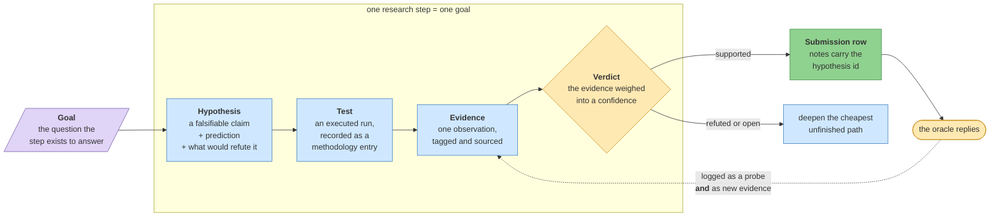

# The method — how a question becomes a scored answer

**Standing:** the scientific method for this project. It owns the loop, the five stations,
and the rules the register enforces. What is *currently* believed lives in the step folders
and in `figures/science-report.html`; this page owns the *shape*, not the content.
Last checked 2026-09-12 (two rules added: machinery entries inside a research step, and the
blind gate as a completion condition).

---

## Why this page exists

The repository already answers *where did this byte come from*: the object store is
hash-verified, the ingest is lossless, and `data_lineage` records which bytes produced
which table. That is **provenance**, and it is necessary.

It is not sufficient. A report is made of a different question — *what do we believe, how
strongly, and on what basis* — and nothing in a lineage edge answers it. Before this
framework, findings were recorded as prose ending in **Conclusions**: no claim stated
before the test, no statement of what would refute it, no verdict, no confidence, and no
link from a finding to a submission row. A report written from that has to be transcribed
by hand, and a transcription cannot be checked against anything.

So the record is **machine-readable**, and the report and the submission rows are generated
from it.

---

## The loop



> **Legend** — **purple = the raw input** (the step's goal, the only thing not derived from
> something else); **blue = neutral machinery** (the stations that transform a claim into an
> observation); **yellow = a decision point** (the verdict, and the oracle reply that may
> change it); **green = the goal** (a scored submission row). Solid arrows are the forward
> path; the dotted arrow is the feedback edge — **an oracle reply re-enters as evidence**,
> so a probe does not merely score, it moves a belief.

---

## The five stations

| Station | What it is | Where it lives |
|---|---|---|
| **Goal** | One question a step exists to answer. Declared in code, reviewable in a diff. | `src/mva/science/steps.py` |
| **Hypothesis** | A falsifiable claim, its prediction, and the observation that would kill it. | `warehouse.hypotheses`, append-only revisions |
| **Test** | An executed run. The methodology entry *is* the test — the reproducible receipt. | `docs/step-<n>/methodology/` |
| **Evidence** | One observation, tagged supports/refutes/neutral, weighted, and carrying its source. | `warehouse.evidence`, append-only |
| **Verdict** | The evidence weighed into a status and a confidence, with a stated reason. | a new revision of the hypothesis |

Then the crossing: a **supported** claim becomes a submission row whose `notes` column
carries its hypothesis id, so a row the scorer sees can be traced back to the claim behind
it. The reply is recorded twice — in `warehouse.probe_ledger` as *what happened*, and in
`warehouse.evidence` as *what it means*.

---

## Steps, and why everything hangs off one

A step declares **one research goal**. Every hypothesis names a step, so the record reads
by question rather than by date.

```
uv run mva-science steps
```

| Step | Kind | Goal |
|---|---|---|
| `step-0` | platform | Can the delivered bytes be trusted, stored without loss, and queried in SQL? |
| `step-1` | research | Does every variant have exactly one spelling, so an exact-match scorer can be trusted with an indel? |
| `step-2` | research | Which variants are rare and damaging enough for an ultra-rare recessive disease, and in which gene? |
| `step-3` | research | Does an unbiased phenotype-driven ranking agree with the panel-first list? |
| `step-4` | research | Is one allele hiding in a call the quality filters discarded? |
| `step-5` | research | Is the missing allele one the caller could not emit at all? |
| `step-6` | research | Which pair does the scorer confirm, and what does each reply tell us next? |
| `step-7` | research | Does public knowledge name an allele or pair the data-driven steps missed, or corroborate the one they found? |
| `step-8` | research | Which market-approved drugs act on the mechanism the confirmed alleles imply, and how strong is the evidence? |

**Step 0 is different, and the difference is the point.** It is *machinery*. "PostgreSQL is
the right database" is a decision with alternatives, judged by whether it works — not a
claim about the patient that evidence can refute. So step 0 takes no hypotheses; its
reasoning lives in [`step-0/notes/`](step-0/notes/) as decisions, and its
[`methodology/001–068`](step-0/methodology/) are platform records — step 0 closed at 068 on 2026-09-04. The register refuses a
hypothesis filed under it.

From step 1 on, every methodology entry is a **test bound to a hypothesis under a goal**.

### The carve-out: machinery entries inside a research step

A research step still has to build and measure its instruments, and an instrument is a
decision, not a claim about the patient. "`mva.kmer` packs a 31-mer into a `uint64`" and
"no arm64 build of DeepVariant exists" are true or false regardless of what this child's
genome says — evidence cannot refute them, only a rerun can.

So a methodology entry **inside** a research step may declare **`Hypotheses: none`**, on two
conditions, both in the header:

1. it **says why** — that it builds or measures an instrument, or records a platform fact,
   rather than testing a claim; and
2. it **names the hypothesis the machinery serves**, so the entry is still reachable from the
   register by question rather than orphaned in the folder.

Precedent, all iteration 2 step 2:
[085](iteration2/step-2/methodology/085-the-bait-and-where-it-runs.md) (builds the bait and
measures the machine, serving H021),
[086](iteration2/step-2/methodology/086-can-the-off-target-gate-be-reached.md) (measures the
surface behind a failed gate) and
[089](iteration2/step-2/methodology/089-the-instruments-and-the-gate-that-was-skipped.md)
(the platform survey that became the evidence row H017/H018 lacked).

This is a carve-out for **instruments**, not for results. An entry that reports what the
child's DNA says, under any heading, is a test and files its hypothesis first.

### A red blind gate blocks a "complete" status

`mva-science check --blind <iteration>` is the only mechanical proof that an iteration's
blinding held. **A step whose blind gate is red is not complete**, whatever else passes, and
its README may not say so: a status line that is wrong is worse than none. This rule exists
because it was broken —
[step 2's completion audit](iteration2/step-2/notes/completion-audit.md) found the step
declared complete with four pre-registered items unrun while `tools/check-python.sh` was
green and the blind gate red, with nothing connecting the two. The filesystem half of the
gate (`tools/check_blind.py`) now runs in `tools/check-python.sh`; the register half still
needs the warehouse and stays in `mva-science check`.

### What a step says in its own words

Everything above is *derived*: the goal from the step map, the claims from the register, the
tests from the entries, the figures from the filesystem. Four things are not, because they
are judgements a person makes, and a step that has run carries them in `narrative.json`
beside its README:

| Field | What it answers |
|---|---|
| `summary` | what the step did, and what came out of it |
| `why` | why the question belonged at this point in the journey |
| `verdict` | what the run concluded, naming the claims it settled — refutations included |
| `inherits` / `hands_to` | the joint in the argument: what the step could not have started without, and what the next step does with the answer. `unblocks` is a dependency edge; this is the reason |
| `figures[]` | per figure, **`reads`** — what the chart literally shows, checkable against the image — and **`means`** — what it is evidence for, argued from the entry it cites |

`reads` and `means` are separate so an interpretation cannot be read as a description.
`tools/check_step_narrative.py` runs in the Python gate: a `done` or `open` research step
with no narrative fails, so does an empty field, a source path that does not exist, a figure
with no caption, and a caption for a figure the step never drew. A `planned` step is exempt —
inventing a summary for a step that has not run would be worse than the silence. Recorded in
[`step-0/methodology/132`](step-0/methodology/132-what-a-step-says-and-what-a-figure-means.md).

---

## What the register refuses

Enforced in constructors, not asked for in a template — a template is advice, a constructor
is a gate.

| Refused | Why it is worth the friction |
|---|---|
| A hypothesis with no `refuted_by` | A claim nothing could disprove is not a hypothesis. Writing the refutation sentence *before* the run is what stops a result being reinterpreted afterwards to fit. |
| An observation with no `source_ref` | An unverifiable observation is not evidence. The source is a methodology entry, a table, a PMID, a ClinVar id, or a probe reply. |
| A confidence with no stated reason | A number nobody can check is exactly what this register exists to prevent. |
| A genomic position in an exported file | `mva-science export` scans and refuses. Name the gene and the consequence, never the position — see [no patient data](notes/no-patient-data-in-the-repository.md). |
| An edit to anything recorded | Both tables are append-only. A changed belief is a **new revision**, so the record of the belief moving survives. |
| A pre-registration claim on a test that already ran | Some step-0 exploration answered research questions before the register existed (panel annotation, entry 031; non-PASS mining, 049; ClinVar join, 051). Filing those now is allowed, but the statement must begin with `retrospective:` and the evidence must cite the entry that ran. A retrospective claim never counts as a pre-registered prediction, and the verdict reasoning says so. |

---

## The weighing, and its limits

`mva-science verdict H001` accumulates evidence in log-odds and prints every term:

```
prior 0.50  (log-odds +0.000)
  +1.400  supports 0.70 — BUB1B is depleted of loss-of-function variants.   -> 0.802
  -0.600  refutes 0.30 — the second allele is absent from the delivered VCF. -> 0.690
suggested confidence 0.69 (1 supporting, 1 refuting, 0 neutral)
```

**This is a transparent heuristic for triage, not a calibrated posterior.** Strengths are
human judgments, and rows drawn from the same underlying data are not independent the way
the sum treats them. It exists so a suggested confidence can be *argued with*.

It writes nothing. Committing takes `--commit` plus `--reasoning`, and where the committed
number differs from the suggestion by 0.15 or more, both are shown side by side — the gap
is a judgment someone made, and it should be visible rather than reconstructed.

---

## The entry template, step 1 onward

The existing step-0 entries keep their shape: they are append-only and were written before this
framework existed, and retro-fitting them would mean inventing hypotheses nobody stated.
New entries add three sections the old ones lack.

```markdown
# 0NN — <question>

**Step:** step-1   **Hypotheses tested:** H003, H004

## Question
## Hypothesis and prediction     <- stated BEFORE the run
## What would refute it          <- stated BEFORE the run
## Inputs                        (with lineage refs)
## Commands
## Observed
## Evidence recorded             <- the evidence_id rows this run produced
## Verdict                       <- per hypothesis, with confidence and reasoning
## Next test
```

Entry numbers stay **global and monotonic** across step folders.

---

## Working it

```bash
uv run mva-science steps                      # the goals
uv run mva-science hypothesis-add --step step-1 \
    --statement '…' --prediction '…' --refuted-by '…' --gene BUB1B
uv run mva-science evidence-add --hypothesis H001 --direction supports \
    --strength 0.7 --claim '…' --source-ref methodology/003
uv run mva-science verdict H001               # arithmetic only, writes nothing
uv run mva-science verdict H001 --commit --status supported --reasoning '…'
uv run mva-science check                       # the publish gate
uv run mva-science export                      # the committed mirror
uv run mva-science report                      # figures/science-report.html
```

The report also renders with no database at all, from the committed mirror:

```bash
uv run mva-science report --from docs/science-register.json
```

That is deliberate — a reviewer with a clone and no credentials sees the same page the
team sees.

---

## Where it all lives

| | Path |
|---|---|
| The step map, in code | [`src/mva/science/steps.py`](../src/mva/science/steps.py) |
| The register and the ledger | `warehouse.hypotheses`, `warehouse.evidence` — see [`step-0/infrastructure.md`](step-0/infrastructure.md) |
| The committed mirror | `docs/step-<n>/hypotheses/`, `docs/science-register.json` |
| The rendered record | `figures/science-report.html` |
| The shared renderer both reports use | [`src/mva/render/`](../src/mva/render/) |
