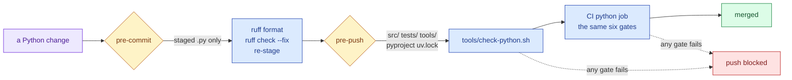

# The Python quality gates

**Standing:** 2026-09-02 — every gate below was run against this repo on that date and is
wired into `.github/workflows/ci.yml`, `.husky/pre-commit` and `.husky/pre-push`.

The `app/` half of this repo has had typecheck, lint, format, test and bundle gates since
the tooling wave. The Python half had `pytest` and nothing else. This note records what
now guards it, and — more usefully — *why each rule is set where it is*, so the next
person changes the reason rather than the number.

One command runs all of it:

```
tools/check-python.sh          # every gate, in CI's order
tools/check-python.sh --fix    # format and autofix first, then check
```

## The gates

| Gate | Command | What it prevents |
| --- | --- | --- |
| Format | `uv run ruff format --check src tests tools` | wrapping style becoming a review topic |
| Lint | `uv run ruff check src tests tools` | 30 rule families: correctness, imports, naming, pathlib, naive datetimes, logging, async, exceptions |
| Module size | `uv run python tools/check_module_size.py` | a file growing past what a reader can hold — CLAUDE.md's 400-line rule, finally enforced |
| Import layering | `uv run lint-imports` | cycles, and any package importing one it must not |
| Types | `uv run mypy` | the ~27 latent `None`-dereferences strict mode found, and every new one |
| Tests | `uv run pytest` | behaviour |

Order is deliberate: the cheap deterministic gates run before the 20-second suite, so a
formatting or layering mistake fails in seconds.



> **Legend** — purple = the raw input (a change); yellow = a decision point (does this hook
> apply to what changed?); blue = neutral machinery; green = the goal; red = points lost.
> A dotted edge is the failing path. Both hooks skip entirely when the change does not
> touch their half, so a docs-only commit runs neither and a Python-only commit never
> starts node.

## The decisions behind the numbers

**Line length is 100, not 88.** The code was already written to ~90 columns (p99 = 93);
at 88 there were 1,918 violations, at 100 there were 8. `app/.prettierrc.json` already
uses `printWidth: 100`, so one repo now has one width.

**`ruff format` was adopted in one pass, not left to authors.** It rewrote 11,965 of
30,159 lines across 156 files. The cost is real: that commit is where blame points for
every reformatted line. The benefit is that style never appears in a review again. The
reformat is a single commit (`style(python): adopt ruff format …`) so it can be skipped
with `git blame --ignore-rev`.

**Every `ignore` entry names its reason.** Six rules are off, and none of them because it
was noisy: relative intra-package imports are deliberate (a package can move without
rewriting its own internals), unused handler arguments *are* the dispatcher's interface,
`dict(...)` is plotly's own documented style, a message at the `raise` site is where the
caller's context is known, function-level imports keep uvicorn/httpx/duckdb/plotly out of
import time, and the "ambiguous" unicode is real en dashes in prose. See
`[tool.ruff.lint]` in `pyproject.toml` — the reasons live next to the switches.

**`.claude/skills/` is excluded from ruff.** Skill scripts (e.g.
`.claude/skills/paper-analyst/scripts/`) are third-party-authored assets bundled with a skill,
not this repo's own Python — holding them to the same style/lint bar as `src`/`tests`/`tools`
would mean rewriting vendored scripts for no functional gain. `extend-exclude` treats them like
`archive`/`build`: present, but not ours to format. The pre-commit hook passes staged files
explicitly (it matches any staged `.py`, not just `src`/`tests`/`tools`), and ruff's
`extend-exclude` is ignored for explicitly-passed paths unless `force-exclude = true` is also
set — so both are needed together.

**Test modules get 600 lines, production code 400.** A test file is the executable
description of one module's behaviour; cutting it in half to satisfy a line count splits
one story across two files without making either easier to read. The cap still exists so
a test file cannot grow unbounded. Production code takes CLAUDE.md's rule as written.

**mypy is a ratchet, not a wall.** Full `strict` over code that predates it is 522
errors — but 496 of those are missing annotations, not type mistakes. So the four
annotation-completeness flags are off globally and turned back **on per package** as each
one is annotated; `mva.io` and `mva.render` are strict today. Every other error class
stays on everywhere, which is what surfaced the 27 real ones (see below). Entries come off
the ratchet list, never onto it.

**The import contracts encode `src/mva/README.md`.** Three contracts: no cycles between
packages, the three leaf packages (`io`, `pipeline`, `render`) import no sibling, and
nothing outside `viz` depends on `viz`. The dependency diagram in that README was drawn
from the real imports; these contracts are what keep it true.

## What the gates found on the way in

Not a clean-up exercise — the gates paid for themselves before they were wired:

- **11 failing tests** that failed on any machine with a `.env` and passed in CI, because
  the reads API resolved its auth token *inside the request handler* through a loader that
  re-read and re-parsed `.env` on every call. Fixed at the edge; the suite is now hermetic
  (`tests/conftest.py`). See the commit `fix(settings): stop the developer's .env …`.
- **27 latent `None`-dereferences** that mypy found and no test covered.
- **Four modules over the 400-line rule**, two of which crossed it during the reformat.
- **22 `zip()` calls with no `strict=`**, each one a place where two sequences of different
  length would silently truncate instead of raising.

## When a gate fails

1. `tools/check-python.sh --fix` fixes formatting and the autofixable lint findings.
2. A **module-size** failure is a design signal, not a formatting one: split by concern,
   one bounded responsibility per module. Do not raise the limit.
3. An **import-layering** failure means the change contradicts the package layering. Fix
   the dependency direction, or argue the layering — in `src/mva/README.md` and here —
   before editing the contract.
4. A **mypy** failure in a package on the strict list is not to be solved by taking the
   package off the list.
5. If a gate is wrong for a change, fix the gate and say so here. Do not push with
   `--no-verify`.

## Related

- [`CONTRIBUTING.md`](../../CONTRIBUTING.md) — the mechanics table, both halves of the repo.
- [`src/mva/README.md`](../../src/mva/README.md) — the package layering the contracts enforce.
- [`docs/notes/no-patient-data-in-the-repository.md`](no-patient-data-in-the-repository.md)
  — the one rule these gates do *not* enforce; `mva-science check` does.
